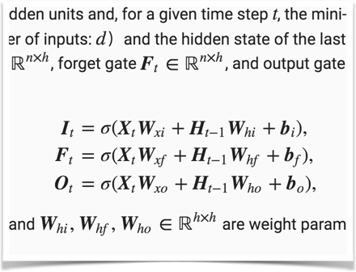
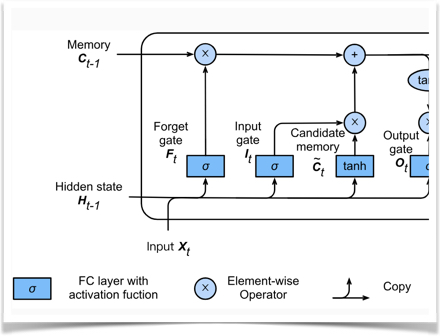
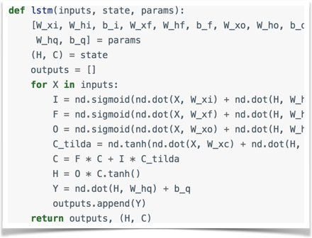
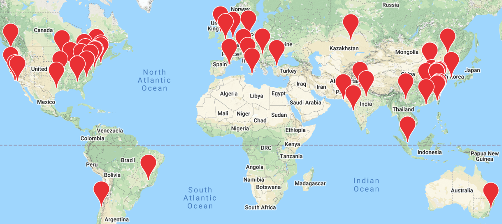

<div align="left">
  
</div>

# D2L.ai lietuviškai: interaktyvi giliojo mokymosi knyga su kodu keliose bibliotekose, matematika ir diskusijomis

> Tai lietuviškas vertimas. Originali knyga: [Dive into Deep Learning](https://d2l.ai/) ([d2l-ai/d2l-en](https://github.com/d2l-ai/d2l-en)). Vertimo būsena ir atsakomybė aprašyta skyriuje [Vertimas ir atsakomybė](#vertimas-ir-atsakomybė).

[](https://github.com/d2l-ai/d2l-en/actions/workflows/ci.yml)

[Knygos svetainė (originalas)](https://d2l.ai/) | [STAT 157 kursas Berklio universitete](http://courses.d2l.ai/berkeley-stat-157/index.html)

<h5 align="center"><i>Geriausias būdas suprasti gilųjį mokymąsi – mokytis darant.</i></h5>

<p align="center">
  
  
  
  
</p>

Ši atvirojo kodo knyga yra mūsų bandymas padaryti gilųjį mokymąsi prieinamą, mokant jus sąvokų, konteksto ir kodo. Visa knyga parengta Jupyter užrašų knygutėse, sklandžiai sujungiančiose aiškinamąjį tekstą, paveikslus, matematiką ir interaktyvius pavyzdžius su savarankišku kodu.

Mūsų tikslas – pasiūlyti išteklių, kuris:
1. būtų nemokamai prieinamas visiems;
1. suteiktų pakankamą techninį gylį, kad taptų atspirties tašku kelyje į taikomojo mašininio mokymo mokslininko profesiją;
1. turėtų paleidžiamo kodo, rodančio skaitytojams, kaip praktiškai spręsti uždavinius;
1. leistų greitai atnaujinti turinį, tiek mums, tiek plačiajai bendruomenei;
1. būtų papildytas forumu interaktyviai techninių detalių diskusijai ir atsakymams į klausimus.

## Universitetai, naudojantys D2L
<p align="center">
  
</p>


Jei ši knyga jums naudinga, pažymėkite šią repozitoriją žvaigždute (★) arba cituokite knygą naudodami šį bibtex įrašą:

```
@book{zhang2023dive,
    title={Dive into Deep Learning},
    author={Zhang, Aston and Lipton, Zachary C. and Li, Mu and Smola, Alexander J.},
    publisher={Cambridge University Press},
    note={\url{https://D2L.ai}},
    year={2023}
}
```


## Atsiliepimai

> <p>„Per mažiau nei dešimtmetį dirbtinio intelekto revoliucija iš tyrimų laboratorijų išplito į plačias pramonės šakas ir visus mūsų kasdienio gyvenimo kampelius.  „Dive into Deep Learning“ yra puikus gilaus mokymosi vadovėlis, nusipelnęs kiekvieno, norinčio suprasti, kodėl gilusis mokymasis uždegė dirbtinio intelekto revoliuciją – galingiausią mūsų laikų technologinę jėgą, dėmesio.“</p>
> <b>&mdash; Jensen Huang, NVIDIA įkūrėjas ir generalinis direktorius</b>

> <p>„Tai savalaikė, žavi knyga, suteikianti ne tik išsamią giliojo mokymosi principų apžvalgą, bet ir detalius algoritmus su praktiniu programavimo kodu, be to, šiuolaikišką įvadą į gilųjį mokymąsi kompiuterinėje regoje ir natūraliosios kalbos apdorojime. Pasinerkite į šią knygą, jei norite pasinerti į gilųjį mokymąsi!“</p>
> <b>&mdash; Jiawei Han, Michael Aiken katedros profesorius, Ilinojaus universitetas Urbana-Šampeinyje</b>

> <p>„Tai labai laukiamas papildymas mašininio mokymo literatūrai, orientuotas į praktinę patirtį, įgyvendinamą integruojant Jupyter užrašų knygutes. Giliojo mokymosi studentams tai turėtų būti neįkainojama, norint tapti šios srities profesionalais.“</p>
> <b>&mdash; Bernhard Schölkopf, Maxo Plancko intelektualiųjų sistemų instituto direktorius</b>

> <p>„Dive into Deep Learning puikiai subalansuoja praktinį mokymąsi ir nuodugnų aiškinimą. Naudojau ją savo giliojo mokymosi kurse ir rekomenduoju visiems, norintiems giliai ir praktiškai suprasti gilųjį mokymąsi.“</p>
> <b>&mdash; Colin Raffel, docentas, Šiaurės Karolinos universitetas Čapel Hile</b>

## Vertimas

Šį lietuvišką vertimą iniciavo **Linas Petkevičius** ir **[Dirbtinio intelekto metodų laboratorija](https://aiml.lt)** (angl. *AI Methods Laboratory*, AIML), veikianti Vilniaus universiteto Matematikos ir informatikos fakulteto Informatikos institute. Laboratorija nagrinėja mašininį mokymą, nuotolinį tyrimą, didžiuosius kalbos modelius ir agentinį dirbtinį intelektą, taikomus Žemės stebėjimui, aplinkosaugai, sveikatos priežiūrai ir pramonei.

Laboratorijos nuorodos:
- Svetainė: <https://aiml.lt>
- Aprašas mašinoms skaitomu formatu: <https://aiml.lt/llms.txt>
- Fakultetas: <https://mif.vu.lt>
- GitHub: <https://github.com/VU-AIML>
- Hugging Face: <https://huggingface.co/AIML-VU>
- Landscape Explorer (mokymosi įrankis): <https://landscape-explorer.aiml.lt/>
- X: <https://twitter.com/AIML_VU>
- Bluesky: <https://bsky.app/profile/aiml-vu.bsky.social>

Turinys ruošiamas **Dirbtinio intelekto olimpiadai** (DIO): <https://www.dio.mif.vu.lt/>.


## Prisidėjimas ([Sužinokite, kaip](https://d2l.ai/chapter_appendix-tools-for-deep-learning/contributing.html))

Šią atvirojo kodo knygą pagerino bendruomenės dalyvių pedagoginiai pasiūlymai, rašybos klaidų taisymai ir kiti patobulinimai. Jūsų pagalba vertinga, nes padeda padaryti knygą geresnę visiems.

**Gerbiami [D2L dalyviai](https://github.com/d2l-ai/d2l-en/graphs/contributors), prašome el. paštu d2lbook.en AT gmail DOT com atsiųsti savo GitHub ID ir vardą, kad jūsų vardas atsirastų [padėkų](https://d2l.ai/chapter_preface/index.html#acknowledgments) skyriuje. Ačiū.**


## Licencijos santrauka

Ši atvirojo kodo knyga prieinama pagal Creative Commons Attribution-ShareAlike 4.0 International licenciją. Žr. [LICENSE](LICENSE) failą.

Šioje atvirojo kodo knygoje esantis pavyzdinis ir nuorodinis kodas prieinamas pagal modifikuotą MIT licenciją. Žr. [LICENSE-SAMPLECODE](LICENSE-SAMPLECODE) failą.

[Kinų kalbos versija](https://github.com/d2l-ai/d2l-zh) | [Diskusijos ir pranešimai apie klaidas](https://discuss.d2l.ai/) | [Elgesio kodeksas](CODE_OF_CONDUCT.md)
