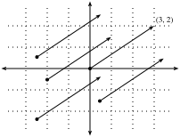
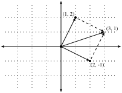
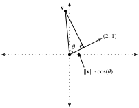
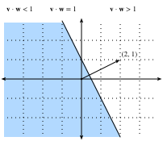
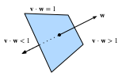
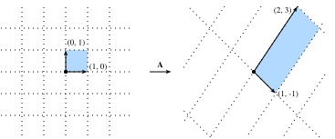

# Geometrija ir tiesinės algebros operacijos
:label:`sec_geometry-linear-algebraic-ops`

:numref:`sec_linear-algebra` susipažinome su tiesinės algebros pagrindais
ir matėme, kaip ją galima naudoti įprastoms duomenų transformavimo operacijoms išreikšti.
Tiesinė algebra yra vienas pagrindinių matematinių ramsčių,
slypinčių po didele dalimi darbo, kurį atliekame giliajame mokyme
ir plačiau – mašininiame mokyme.
Nors :numref:`sec_linear-algebra` buvo pakankamai priemonių,
kad perteiktume šiuolaikinių giliojo mokymosi modelių veikimo mechaniką,
šioje temoje yra daug daugiau.
Šiame skyriuje pasigilinsime,
išryškindami kai kurias geometrines tiesinės algebros operacijų interpretacijas
ir pristatydami keletą pagrindinių sąvokų, įskaitant tikrines reikšmes ir tikrinius vektorius.

## Vektorių geometrija
Pirmiausia turime aptarti dvi įprastas geometrines vektorių interpretacijas –
kaip taškus arba kryptis erdvėje.
Iš esmės vektorius yra skaičių sąrašas, pavyzdžiui, toliau pateiktas Python sąrašas.

```{.python .input}
#@tab all
v = [1, 7, 0, 1]
```

Matematikai dažniausiai tai užrašo kaip *stulpelio* arba *eilutės* vektorių, t. y. kaip

$$
\mathbf{x} = \begin{bmatrix}1\\7\\0\\1\end{bmatrix},
$$

arba

$$
\mathbf{x}^\top = \begin{bmatrix}1 & 7 & 0 & 1\end{bmatrix}.
$$

Jie dažnai turi skirtingas interpretacijas:
duomenų pavyzdžiai yra stulpelio vektoriai,
o svoriai, naudojami svertinėms sumoms sudaryti, yra eilutės vektoriai.
Vis dėlto gali būti naudinga būti lanksčiam.
Kaip aprašėme :numref:`sec_linear-algebra`,
nors vieno vektoriaus numatytoji orientacija yra stulpelio vektorius,
bet kuriai matricai, vaizduojančiai lentelinį duomenų rinkinį,
įprasčiau kiekvieną duomenų pavyzdį
matricoje laikyti eilutės vektoriumi.

Turint vektorių, pirmoji interpretacija,
kurią turėtume jam suteikti, yra taškas erdvėje.
Dviejose ar trijose dimensijose šiuos taškus galime pavaizduoti
naudodami vektorių komponentes taškų vietai erdvėje nustatyti
palyginti su fiksuotu atskaitos tašku, vadinamu *koordinačių pradžia*.  Tai matyti :numref:`fig_grid`.


:label:`fig_grid`

Šis geometrinis požiūris leidžia nagrinėti problemą abstraktesniu lygmeniu.
Nebesusidūrę su atrodančia neįveikiama problema,
tokia kaip paveikslėlių klasifikavimas į kates ar šunis,
galime pradėti nagrinėti užduotis abstrakčiai –
kaip taškų rinkinius erdvėje – ir įsivaizduoti užduotį
kaip būdo atskirti du skirtingus taškų klasterius paiešką.

Lygiagrečiai egzistuoja antras požiūris,
kurį žmonės dažnai taiko vektoriams: kaip kryptims erdvėje.
Vektorių $\mathbf{v} = [3,2]^\top$ galime laikyti ne tik
tašku, esančiu $3$ vienetus į dešinę ir $2$ vienetus aukštyn nuo koordinačių pradžios,
bet ir pačia kryptimi:
žengti $3$ žingsnius į dešinę ir $2$ žingsnius aukštyn.
Šitaip visus vektorius :numref:`fig_arrow` laikome tuo pačiu.


:label:`fig_arrow`

Vienas šio poslinkio privalumų yra tas, kad
galime vizualiai suprasti vektorių sudėties veiksmą.
Visų pirma sekame vieno vektoriaus nurodytas kryptis,
o tada sekame kito vektoriaus nurodytas kryptis, kaip matyti :numref:`fig_add-vec`.


:label:`fig_add-vec`

Vektorių atimtis turi panašią interpretaciją.
Nagrinėdami tapatybę $\mathbf{u} = \mathbf{v} + (\mathbf{u}-\mathbf{v})$,
matome, kad vektorius $\mathbf{u}-\mathbf{v}$ yra kryptis,
kuri mus nuveda iš taško $\mathbf{v}$ į tašką $\mathbf{u}$.


## Skaliarinės sandaugos ir kampai
Kaip matėme :numref:`sec_linear-algebra`,
jei paimame du stulpelio vektorius $\mathbf{u}$ ir $\mathbf{v}$,
jų skaliarinę sandaugą galime sudaryti apskaičiuodami:

$$\mathbf{u}^\top\mathbf{v} = \sum_i u_i\cdot v_i.$$
:eqlabel:`eq_dot_def`

Kadangi :eqref:`eq_dot_def` yra simetrinė, atkartosime klasikinės daugybos žymėjimą ir rašysime

$$
\mathbf{u}\cdot\mathbf{v} = \mathbf{u}^\top\mathbf{v} = \mathbf{v}^\top\mathbf{u},
$$

kad pabrėžtume faktą, jog sukeitus vektorių tvarką gaunamas tas pats atsakymas.

Skaliarinė sandauga :eqref:`eq_dot_def` taip pat turi geometrinę interpretaciją: ji glaudžiai susijusi su kampu tarp dviejų vektorių.  Panagrinėkime kampą, parodytą :numref:`fig_angle`.


:label:`fig_angle`

Pradžiai panagrinėkime du konkrečius vektorius:

$$
\mathbf{v} = (r,0) \; \textrm{and} \; \mathbf{w} = (s\cos(\theta), s \sin(\theta)).
$$

Vektorius $\mathbf{v}$ yra ilgio $r$ ir eina lygiagrečiai $x$ ašiai,
o vektorius $\mathbf{w}$ yra ilgio $s$ ir sudaro kampą $\theta$ su $x$ ašimi.
Jei apskaičiuosime šių dviejų vektorių skaliarinę sandaugą, matome, kad

$$
\mathbf{v}\cdot\mathbf{w} = rs\cos(\theta) = \|\mathbf{v}\|\|\mathbf{w}\|\cos(\theta).
$$

Atlikę paprastą algebrinį pertvarkymą, galime pertvarkyti narius ir gauti

$$
\theta = \arccos\left(\frac{\mathbf{v}\cdot\mathbf{w}}{\|\mathbf{v}\|\|\mathbf{w}\|}\right).
$$

Trumpai tariant, šiems dviem konkretiems vektoriams
skaliarinė sandauga kartu su normomis mums pasako kampą tarp dviejų vektorių. Tas pats faktas teisingas ir bendru atveju. Čia neišvesime išraiškos, tačiau
jei nagrinėsime $\|\mathbf{v} - \mathbf{w}\|^2$ užrašymą dviem būdais:
vienu su skaliarine sandauga, o kitu geometriškai naudodami kosinusų teoremą,
galime gauti pilną ryšį.
Iš tiesų bet kuriems dviem vektoriams $\mathbf{v}$ ir $\mathbf{w}$
kampas tarp dviejų vektorių yra

$$\theta = \arccos\left(\frac{\mathbf{v}\cdot\mathbf{w}}{\|\mathbf{v}\|\|\mathbf{w}\|}\right).$$
:eqlabel:`eq_angle_forumla`

Tai gražus rezultatas, nes niekas skaičiavime neužsimena apie dvi dimensijas.
Iš tiesų galime tai naudoti trijose ar trijuose milijonuose dimensijų be jokių problemų.

Kaip paprastą pavyzdį pažiūrėkime, kaip apskaičiuoti kampą tarp vektorių poros:

```{.python .input}
#@tab mxnet
%matplotlib inline
from d2l import mxnet as d2l
from IPython import display
from mxnet import gluon, np, npx
npx.set_np()

def angle(v, w):
    return np.arccos(v.dot(w) / (np.linalg.norm(v) * np.linalg.norm(w)))

angle(np.array([0, 1, 2]), np.array([2, 3, 4]))
```

```{.python .input}
#@tab pytorch
%matplotlib inline
from d2l import torch as d2l
from IPython import display
import torch
from torchvision import transforms
import torchvision

def angle(v, w):
    return torch.acos(v.dot(w) / (torch.norm(v) * torch.norm(w)))

angle(torch.tensor([0, 1, 2], dtype=torch.float32), torch.tensor([2.0, 3, 4]))
```

```{.python .input}
#@tab tensorflow
%matplotlib inline
from d2l import tensorflow as d2l
from IPython import display
import tensorflow as tf

def angle(v, w):
    return tf.acos(tf.tensordot(v, w, axes=1) / (tf.norm(v) * tf.norm(w)))

angle(tf.constant([0, 1, 2], dtype=tf.float32), tf.constant([2.0, 3, 4]))
```

Dabar to nenaudosime, tačiau naudinga žinoti,
kad vektorius, kurių kampas yra $\pi/2$
(arba, ekvivalenčiai, $90^{\circ}$), vadinsime *ortogonaliaisiais*.
Nagrinėdami aukščiau pateiktą lygtį, matome, kad taip nutinka, kai $\theta = \pi/2$,
o tai tas pats, kas $\cos(\theta) = 0$.
Vienintelis būdas tam nutikti yra tada, kai pati skaliarinė sandauga lygi nuliui,
ir du vektoriai yra ortogonalūs tada ir tik tada, kai $\mathbf{v}\cdot\mathbf{w} = 0$.
Tai pasirodys esanti naudinga formulė geometriškai suprantant objektus.

Pagrįsta klausti: kodėl naudinga skaičiuoti kampą?
Atsakymas slypi tokioje invariantiškumo rūšyje, kokios tikimės iš duomenų.
Panagrinėkime paveikslėlį ir jo dublikatą,
kuriame kiekvieno pikselio reikšmė ta pati, bet $10\%$ ryškumo.
Pavienių pikselių reikšmės apskritai yra toli nuo pradinių reikšmių.
Taigi jei apskaičiuotume atstumą tarp pradinio paveikslėlio ir tamsesnio,
atstumas gali būti didelis.
Tačiau daugumai MM taikymų *turinys* yra tas pats – katės / šuns klasifikatoriui
tai vis dar katės paveikslėlis.
Vis dėlto jei nagrinėsime kampą, nesunku pamatyti,
kad bet kuriam vektoriui $\mathbf{v}$ kampas
tarp $\mathbf{v}$ ir $0{,}1\cdot\mathbf{v}$ yra nulis.
Tai atitinka faktą, kad vektorių skalėjimas
palieka tą pačią kryptį ir tik pakeičia ilgį.
Kampas tamsesnį paveikslėlį laiko identišku.

Tokių pavyzdžių yra visur.
Tekste galime norėti, kad aptariama tema
nepasikeistų, jei parašysime dvigubai ilgesnį dokumentą, sakantį tą patį.
Kai kuriems kodavimams (pavyzdžiui, skaičiuojant žodžių pasikartojimus kokiame nors žodyne) tai atitinka dokumentą koduojančio vektoriaus padvigubinimą,
taigi vėl galime naudoti kampą.

### Kosinusinis panašumas
MM kontekstuose, kuriuose kampas naudojamas
dviejų vektorių artumui matuoti,
praktikai naudoja terminą *kosinusinis panašumas*
daliai
$$
\cos(\theta) = \frac{\mathbf{v}\cdot\mathbf{w}}{\|\mathbf{v}\|\|\mathbf{w}\|}.
$$

žymėti.

Kosinusas įgyja didžiausią reikšmę $1$,
kai du vektoriai rodo ta pačia kryptimi,
mažiausią reikšmę $-1$, kai jie rodo priešingomis kryptimis,
ir reikšmę $0$, kai du vektoriai yra ortogonalūs.
Atkreipkite dėmesį, kad jei aukštų dimensijų vektorių komponentės
atrenkamos atsitiktinai su vidurkiu $0$,
jų kosinusas beveik visada bus artimas $0$.


## Hiperplokštumos

Be darbo su vektoriais, kitas esminis objektas,
kurį turite suprasti, norėdami toli nueiti tiesinėje algebroje,
yra *hiperplokštuma* – tiesės (dvi dimensijos) arba plokštumos (trys dimensijos)
apibendrinimas aukštesnėms dimensijoms.
$d$ dimensijų vektorinėje erdvėje hiperplokštuma turi $d-1$ dimensijų
ir padalija erdvę į dvi puserdves.

Pradėkime nuo pavyzdžio.
Tarkime, turime stulpelio vektorių $\mathbf{w}=[2,1]^\top$. Norime žinoti: „kokie yra taškai $\mathbf{v}$, kuriems $\mathbf{w}\cdot\mathbf{v} = 1$?“
Prisiminę aukščiau pateiktą ryšį tarp skaliarinių sandaugų ir kampų :eqref:`eq_angle_forumla`,
matome, kad tai ekvivalentu
$$
\|\mathbf{v}\|\|\mathbf{w}\|\cos(\theta) = 1 \; \iff \; \|\mathbf{v}\|\cos(\theta) = \frac{1}{\|\mathbf{w}\|} = \frac{1}{\sqrt{5}}.
$$


:label:`fig_vector-project`

Jei nagrinėsime geometrinę šios išraiškos prasmę,
matome, kad tai ekvivalentu teiginiui,
jog $\mathbf{v}$ projekcijos
į $\mathbf{w}$ kryptį ilgis yra tiksliai $1/\|\mathbf{w}\|$, kaip parodyta :numref:`fig_vector-project`.
Visų taškų, kuriems tai teisinga, aibė yra tiesė,
statmena vektoriui $\mathbf{w}$.
Jei norėtume, galėtume rasti šios tiesės lygtį
ir pamatyti, kad ji yra $2x + y = 1$ arba, ekvivalenčiai, $y = 1 - 2x$.

Jei dabar pažiūrėsime, kas nutinka klausiant apie taškų aibę, kuriems
$\mathbf{w}\cdot\mathbf{v} > 1$ arba $\mathbf{w}\cdot\mathbf{v} < 1$,
matome, kad tai atvejai, kai projekcijos
yra atitinkamai ilgesnės arba trumpesnės nei $1/\|\mathbf{w}\|$.
Taigi šios dvi nelygybės apibrėžia abi tiesės puses.
Šitaip radome būdą padalyti savo erdvę į dvi puses,
kur visi vienoje pusėje esantys taškai turi skaliarinę sandaugą žemiau slenksčio,
o kitoje pusėje – aukščiau, kaip matome :numref:`fig_space-division`.


:label:`fig_space-division`

Aukštesnėse dimensijose istorija labai panaši.
Jei dabar paimsime $\mathbf{w} = [1,2,3]^\top$
ir paklausime apie taškus trijose dimensijose, kuriems $\mathbf{w}\cdot\mathbf{v} = 1$,
gausime plokštumą, statmeną duotam vektoriui $\mathbf{w}$.
Dvi nelygybės vėl apibrėžia dvi plokštumos puses, kaip parodyta :numref:`fig_higher-division`.


:label:`fig_higher-division`

Nors mūsų gebėjimas vizualizuoti čia baigiasi,
niekas netrukdo to daryti dešimtyse, šimtuose ar milijarduose dimensijų.
Tai dažnai nutinka galvojant apie išmoktus mašininio mokymo modelius.
Pavyzdžiui, tiesinius klasifikavimo modelius,
tokius kaip aprašyti :numref:`sec_softmax`,
galime suprasti kaip metodus hiperplokštumoms, skiriančioms skirtingas tikslines klases, rasti.
Šiame kontekste tokios hiperplokštumos dažnai vadinamos *sprendimų plokštumomis*.
Dauguma giluminių klasifikavimo modelių baigiasi
tiesiniu sluoksniu, paduodamu į softmax,
todėl giliojo neuroninio tinklo vaidmenį galima interpretuoti kaip
netiesinio įterpinio paiešką, kad tikslines klases
būtų galima švariai atskirti hiperplokštumomis.

Kad pateiktume ranka sukurtą pavyzdį, atkreipkite dėmesį, kad galime sukurti pagrįstą modelį
mažiems marškinėlių ir kelnių paveikslėliams iš Fashion-MNIST duomenų rinkinio
(matytam :numref:`sec_fashion_mnist`) klasifikuoti
tiesiog paėmę vektorių tarp jų vidurkių sprendimų plokštumai apibrėžti
ir akimis įvertinę grubų slenkstį.  Pirmiausia įkelsime duomenis ir apskaičiuosime vidurkius.

```{.python .input}
#@tab mxnet
# Load in the dataset
train = gluon.data.vision.FashionMNIST(train=True)
test = gluon.data.vision.FashionMNIST(train=False)

X_train_0 = np.stack([x[0] for x in train if x[1] == 0]).astype(float)
X_train_1 = np.stack([x[0] for x in train if x[1] == 1]).astype(float)
X_test = np.stack(
    [x[0] for x in test if x[1] == 0 or x[1] == 1]).astype(float)
y_test = np.stack(
    [x[1] for x in test if x[1] == 0 or x[1] == 1]).astype(float)

# Compute averages
ave_0 = np.mean(X_train_0, axis=0)
ave_1 = np.mean(X_train_1, axis=0)
```

```{.python .input}
#@tab pytorch
# Load in the dataset
trans = []
trans.append(transforms.ToTensor())
trans = transforms.Compose(trans)
train = torchvision.datasets.FashionMNIST(root="../data", transform=trans,
                                          train=True, download=True)
test = torchvision.datasets.FashionMNIST(root="../data", transform=trans,
                                         train=False, download=True)

X_train_0 = torch.stack(
    [x[0] * 256 for x in train if x[1] == 0]).type(torch.float32)
X_train_1 = torch.stack(
    [x[0] * 256 for x in train if x[1] == 1]).type(torch.float32)
X_test = torch.stack(
    [x[0] * 256 for x in test if x[1] == 0 or x[1] == 1]).type(torch.float32)
y_test = torch.stack([torch.tensor(x[1]) for x in test
                      if x[1] == 0 or x[1] == 1]).type(torch.float32)

# Compute averages
ave_0 = torch.mean(X_train_0, axis=0)
ave_1 = torch.mean(X_train_1, axis=0)
```

```{.python .input}
#@tab tensorflow
# Load in the dataset
((train_images, train_labels), (
    test_images, test_labels)) = tf.keras.datasets.fashion_mnist.load_data()


X_train_0 = tf.cast(tf.stack(train_images[[i for i, label in enumerate(
    train_labels) if label == 0]] * 256), dtype=tf.float32)
X_train_1 = tf.cast(tf.stack(train_images[[i for i, label in enumerate(
    train_labels) if label == 1]] * 256), dtype=tf.float32)
X_test = tf.cast(tf.stack(test_images[[i for i, label in enumerate(
    test_labels) if label == 0]] * 256), dtype=tf.float32)
y_test = tf.cast(tf.stack(test_images[[i for i, label in enumerate(
    test_labels) if label == 1]] * 256), dtype=tf.float32)

# Compute averages
ave_0 = tf.reduce_mean(X_train_0, axis=0)
ave_1 = tf.reduce_mean(X_train_1, axis=0)
```

Gali būti informatyvu išsamiai panagrinėti šiuos vidurkius, todėl nubraižykime, kaip jie atrodo.  Šiuo atveju matome, kad vidurkis iš tiesų primena neryškų marškinėlių paveikslėlį.

```{.python .input}
#@tab mxnet, pytorch
# Plot average t-shirt
d2l.set_figsize()
d2l.plt.imshow(ave_0.reshape(28, 28).tolist(), cmap='Greys')
d2l.plt.show()
```

```{.python .input}
#@tab tensorflow
# Plot average t-shirt
d2l.set_figsize()
d2l.plt.imshow(tf.reshape(ave_0, (28, 28)), cmap='Greys')
d2l.plt.show()
```

Antruoju atveju vėl matome, kad vidurkis primena neryškų kelnių paveikslėlį.

```{.python .input}
#@tab mxnet, pytorch
# Plot average trousers
d2l.plt.imshow(ave_1.reshape(28, 28).tolist(), cmap='Greys')
d2l.plt.show()
```

```{.python .input}
#@tab tensorflow
# Plot average trousers
d2l.plt.imshow(tf.reshape(ave_1, (28, 28)), cmap='Greys')
d2l.plt.show()
```

Visiškai mašinomis išmoktame sprendime slenkstį išmoktume iš duomenų rinkinio.  Šiuo atveju aš tiesiog ranka akimis įvertinau slenkstį, kuris atrodė gerai mokymo duomenims.

```{.python .input}
#@tab mxnet
# Print test set accuracy with eyeballed threshold
w = (ave_1 - ave_0).T
predictions = X_test.reshape(2000, -1).dot(w.flatten()) > -1500000

# Accuracy
np.mean(predictions.astype(y_test.dtype) == y_test, dtype=np.float64)
```

```{.python .input}
#@tab pytorch
# Print test set accuracy with eyeballed threshold
w = (ave_1 - ave_0).T
# '@' is Matrix Multiplication operator in pytorch.
predictions = X_test.reshape(2000, -1) @ (w.flatten()) > -1500000

# Accuracy
torch.mean((predictions.type(y_test.dtype) == y_test).float(), dtype=torch.float64)
```

```{.python .input}
#@tab tensorflow
# Print test set accuracy with eyeballed threshold
w = tf.transpose(ave_1 - ave_0)
predictions = tf.reduce_sum(X_test * tf.nest.flatten(w), axis=0) > -1500000

# Accuracy
tf.reduce_mean(
    tf.cast(tf.cast(predictions, y_test.dtype) == y_test, tf.float32))
```

## Tiesinių transformacijų geometrija

Per :numref:`sec_linear-algebra` ir aukščiau pateiktas diskusijas
turime tvirtą vektorių, ilgių ir kampų geometrijos supratimą.
Tačiau yra vienas svarbus objektas, kurio aptarimą praleidome –
tai geometrinis matricomis vaizduojamų tiesinių transformacijų supratimas.  Visiškai suvokti, ką matricos gali padaryti transformuodamos duomenis
tarp dviejų potencialiai skirtingų aukštų dimensijų erdvių, reikia daug praktikos,
ir tai viršija šio priedo aprėptį.
Vis dėlto intuiciją galime pradėti kaupti dviejose dimensijose.

Tarkime, turime kokią nors matricą:

$$
\mathbf{A} = \begin{bmatrix}
a & b \\ c & d
\end{bmatrix}.
$$

Jei norime ją pritaikyti savavališkam vektoriui
$\mathbf{v} = [x, y]^\top$,
padauginame ir matome, kad

$$
\begin{aligned}
\mathbf{A}\mathbf{v} & = \begin{bmatrix}a & b \\ c & d\end{bmatrix}\begin{bmatrix}x \\ y\end{bmatrix} \\
& = \begin{bmatrix}ax+by\\ cx+dy\end{bmatrix} \\
& = x\begin{bmatrix}a \\ c\end{bmatrix} + y\begin{bmatrix}b \\d\end{bmatrix} \\
& = x\left\{\mathbf{A}\begin{bmatrix}1\\0\end{bmatrix}\right\} + y\left\{\mathbf{A}\begin{bmatrix}0\\1\end{bmatrix}\right\}.
\end{aligned}
$$

Tai gali atrodyti kaip keistas skaičiavimas,
kuriame kažkas aiškaus tapo šiek tiek neįveikiama.
Tačiau tai mums sako, kad galime užrašyti, kaip
matrica transformuoja *bet kurį* vektorių,
per tai, kaip ji transformuoja *du konkrečius vektorius*:
$[1,0]^\top$ ir $[0,1]^\top$.
Tai verta akimirką apmąstyti.
Iš esmės begalinę problemą
(kas nutinka bet kuriai realiųjų skaičių porai)
sumažinome iki baigtinės
(kas nutinka šiems konkretiems vektoriams).
Šie vektoriai yra *bazės* pavyzdys,
kai bet kurį mūsų erdvės vektorių galime užrašyti
kaip šių *bazės vektorių* svertinę sumą.

Nubraižykime, kas nutinka naudojant konkrečią matricą

$$
\mathbf{A} = \begin{bmatrix}
1 & 2 \\
-1 & 3
\end{bmatrix}.
$$

Jei pažiūrėsime į konkretų vektorių $\mathbf{v} = [2, -1]^\top$,
matome, kad tai $2\cdot[1,0]^\top + -1\cdot[0,1]^\top$,
taigi žinome, kad matrica $A$ jį nusiųs į
$2(\mathbf{A}[1,0]^\top) + -1(\mathbf{A}[0,1])^\top = 2[1, -1]^\top - [2,3]^\top = [0, -5]^\top$.
Jei atidžiai pasieksime šią logiką iki galo,
tarkime, nagrinėdami visų sveikųjų skaičių porų taškų tinklelį,
matome, kad nutinka tai, jog matricos daugyba
gali iškreipti, pasukti ir perskalėti tinklelį,
tačiau tinklelio struktūra turi išlikti, kaip matote :numref:`fig_grid-transform`.


:label:`fig_grid-transform`

Tai svarbiausias intuityvus dalykas,
kurį reikia įsisavinti apie matricomis vaizduojamas tiesines transformacijas.
Matricos negali iškreipti vienų erdvės dalių kitaip nei kitų.
Viskas, ką jos gali padaryti, – paimti pradines mūsų erdvės koordinates
ir jas iškreipti, pasukti ir perskalėti.

Kai kurie iškraipymai gali būti stiprūs.  Pavyzdžiui, matrica

$$
\mathbf{B} = \begin{bmatrix}
2 & -1 \\ 4 & -2
\end{bmatrix},
$$

suspaudžia visą dvimatę plokštumą į vieną tiesę.
Tokių transformacijų atpažinimas ir darbas su jomis yra vėlesnio skyriaus tema,
tačiau geometriškai matome, kad tai iš esmės skiriasi
nuo aukščiau matytų transformacijų tipų.
Pavyzdžiui, matricos $\mathbf{A}$ rezultatą galima „sulenkti atgal“ į pradinį tinklelį.  Matricos $\mathbf{B}$ rezultatų negalima,
nes niekada nežinosime, iš kur atsirado vektorius $[1,2]^\top$ – ar
iš $[1,1]^\top$, ar iš $[0, -1]^\top$?

Nors šis vaizdas buvo $2\times2$ matricai,
niekas netrukdo išmoktas pamokas perkelti į aukštesnes dimensijas.
Jei paimsime panašius bazės vektorius, pavyzdžiui, $[1,0, \ldots,0]$,
ir pažiūrėsime, kur matrica juos nusiunčia,
galime pradėti jausti, kaip matricos daugyba
iškreipia visą erdvę, kad ir kokios dimensijos erdvėje dirbtume.

## Tiesinė priklausomybė

Dar kartą panagrinėkime matricą

$$
\mathbf{B} = \begin{bmatrix}
2 & -1 \\ 4 & -2
\end{bmatrix}.
$$

Ji suspaudžia visą plokštumą taip, kad ji telpa vienoje tiesėje $y = 2x$.
Dabar kyla klausimas: ar yra koks nors būdas tai aptikti
žiūrint tiesiog į matricą?
Atsakymas – taip, galime.
Tegu $\mathbf{b}_1 = [2,4]^\top$ ir $\mathbf{b}_2 = [-1, -2]^\top$
yra du matricos $\mathbf{B}$ stulpeliai.
Prisiminkite, kad viską, ką transformuoja matrica $\mathbf{B}$, galime užrašyti
kaip matricos stulpelių svertinę sumą:
kaip $a_1\mathbf{b}_1 + a_2\mathbf{b}_2$.
Tai vadiname *tiesiniu dariniu*.
Tai, kad $\mathbf{b}_1 = -2\cdot\mathbf{b}_2$,
reiškia, kad bet kurį šių dviejų stulpelių tiesinį darinį galime užrašyti
vien per, tarkime, $\mathbf{b}_2$, nes

$$
a_1\mathbf{b}_1 + a_2\mathbf{b}_2 = -2a_1\mathbf{b}_2 + a_2\mathbf{b}_2 = (a_2-2a_1)\mathbf{b}_2.
$$

Tai reiškia, kad vienas iš stulpelių tam tikra prasme yra perteklinis,
nes neapibrėžia unikalios krypties erdvėje.
Tai neturėtų pernelyg stebinti,
nes jau matėme, kad ši matrica
sutraukia visą plokštumą į vieną tiesę.
Be to, matome, kad tiesinė priklausomybė
$\mathbf{b}_1 = -2\cdot\mathbf{b}_2$ tai užfiksuoja.
Kad tai būtų simetriškiau tarp dviejų vektorių, užrašysime

$$
\mathbf{b}_1  + 2\cdot\mathbf{b}_2 = 0.
$$

Bendru atveju sakysime, kad vektorių rinkinys
$\mathbf{v}_1, \ldots, \mathbf{v}_k$ yra *tiesiškai priklausomas*,
jei egzistuoja koeficientai $a_1, \ldots, a_k$, *ne visi lygūs nuliui*, kad

$$
\sum_{i=1}^k a_i\mathbf{v_i} = 0.
$$

Šiuo atveju galime vieną iš vektorių išreikšti
per kokį nors kitų derinį
ir taip jį faktiškai paversti pertekliniu.
Taigi tiesinė priklausomybė matricos stulpeliuose
yra faktas, liudijantis, kad mūsų matrica
suspaudžia erdvę į kažkokią žemesnę dimensiją.
Jei tiesinės priklausomybės nėra, sakome, kad vektoriai yra *tiesiškai nepriklausomi*.
Jei matricos stulpeliai yra tiesiškai nepriklausomi,
suspaudimo nevyksta ir operaciją galima atšaukti.

## Rangas

Jei turime bendrą $n\times m$ matricą,
pagrįsta klausti, kokios dimensijos erdvę matrica atvaizduoja.
Atsakymas bus sąvoka, vadinama *rangu*.
Ankstesniame skyrelyje pastebėjome, kad tiesinė priklausomybė
liudija apie erdvės suspaudimą į žemesnę dimensiją,
todėl galėsime tai naudoti rango sąvokai apibrėžti.
Visų pirma matricos $\mathbf{A}$ rangas
yra didžiausias tiesiškai nepriklausomų stulpelių skaičius
tarp visų stulpelių poaibių. Pavyzdžiui, matrica

$$
\mathbf{B} = \begin{bmatrix}
2 & 4 \\ -1 & -2
\end{bmatrix},
$$

turi $\textrm{rank}(B)=1$, nes du stulpeliai yra tiesiškai priklausomi,
bet nė vienas stulpelis pats savaime nėra tiesiškai priklausomas.
Sudėtingesniam pavyzdžiui galime panagrinėti

$$
\mathbf{C} = \begin{bmatrix}
1& 3 & 0 & -1 & 0 \\
-1 & 0 & 1 & 1 & -1 \\
0 & 3 & 1 & 0 & -1 \\
2 & 3 & -1 & -2 & 1
\end{bmatrix},
$$

ir parodyti, kad $\mathbf{C}$ turi rangą du, nes, pavyzdžiui,
pirmieji du stulpeliai yra tiesiškai nepriklausomi,
tačiau bet kuris iš keturių trijų stulpelių rinkinių yra priklausomas.

Ši procedūra, kaip aprašyta, yra labai neefektyvi.
Ji reikalauja peržiūrėti kiekvieną duotos matricos stulpelių poaibį,
todėl potencialiai yra eksponentinė pagal stulpelių skaičių.
Vėliau pamatysime skaičiavimo požiūriu efektyvesnį būdą
matricos rangui apskaičiuoti, bet kol kas
pakanka matyti, kad sąvoka
yra gerai apibrėžta, ir suprasti jos prasmę.

## Apverčiamumas

Aukščiau matėme, kad dauginimo iš matricos su tiesiškai priklausomais stulpeliais
negalima atšaukti, t. y. nėra atvirkštinės operacijos, kuri visada galėtų atkurti įvestį.  Tačiau dauginimą iš pilno rango matricos
(t. y. kokios nors $\mathbf{A}$, kuri yra $n \times n$ matrica su rangu $n$)
visada turėtume galėti atšaukti.  Panagrinėkime matricą

$$
\mathbf{I} = \begin{bmatrix}
1 & 0 & \cdots & 0 \\
0 & 1 & \cdots & 0 \\
\vdots & \vdots & \ddots & \vdots \\
0 & 0 & \cdots & 1
\end{bmatrix}.
$$

kuri yra matrica su vienetais išilgai įstrižainės ir nuliais kitur.
Tai vadiname *vienetine* matrica.
Tai matrica, kuri pritaikyta palieka mūsų duomenis nepakeistus.
Kad rastume matricą, kuri atšaukia tai, ką padarė mūsų matrica $\mathbf{A}$,
norime rasti matricą $\mathbf{A}^{-1}$, kad

$$
\mathbf{A}^{-1}\mathbf{A} = \mathbf{A}\mathbf{A}^{-1} =  \mathbf{I}.
$$

Jei į tai žiūrėsime kaip į sistemą, turime $n \times n$ nežinomųjų
($\mathbf{A}^{-1}$ elementų) ir $n \times n$ lygčių
(lygybė, kuri turi galioti tarp kiekvieno sandaugos $\mathbf{A}^{-1}\mathbf{A}$ elemento ir kiekvieno $\mathbf{I}$ elemento),
taigi bendru atveju turėtume tikėtis, kad sprendinys egzistuoja.
Iš tiesų kitame skyrelyje pamatysime dydį, vadinamą *determinantu*,
kuris turi savybę, kad kol determinantas nelygus nuliui, galime rasti sprendinį.  Tokią matricą $\mathbf{A}^{-1}$ vadiname *atvirkštine* matrica.
Pavyzdžiui, jei $\mathbf{A}$ yra bendroji $2 \times 2$ matrica

$$
\mathbf{A} = \begin{bmatrix}
a & b \\
c & d
\end{bmatrix},
$$

tada matome, kad atvirkštinė yra

$$
 \frac{1}{ad-bc}  \begin{bmatrix}
d & -b \\
-c & a
\end{bmatrix}.
$$

Galime tai patikrinti pamatydami, kad dauginimas
iš atvirkštinės matricos, duotos aukščiau pateikta formule, praktikoje veikia.

```{.python .input}
#@tab mxnet
M = np.array([[1, 2], [1, 4]])
M_inv = np.array([[2, -1], [-0.5, 0.5]])
M_inv.dot(M)
```

```{.python .input}
#@tab pytorch
M = torch.tensor([[1, 2], [1, 4]], dtype=torch.float32)
M_inv = torch.tensor([[2, -1], [-0.5, 0.5]])
M_inv @ M
```

```{.python .input}
#@tab tensorflow
M = tf.constant([[1, 2], [1, 4]], dtype=tf.float32)
M_inv = tf.constant([[2, -1], [-0.5, 0.5]])
tf.matmul(M_inv, M)
```

### Skaitinės problemos
Nors matricos atvirkštinė yra naudinga teorijoje,
turime pasakyti, kad dažniausiai praktikoje nenorime
problemai spręsti *naudoti* atvirkštinės matricos.
Apskritai yra daug skaitiškai stabilesnių algoritmų
tiesinėms lygtims, tokioms kaip

$$
\mathbf{A}\mathbf{x} = \mathbf{b},
$$

spręsti, nei atvirkštinės apskaičiavimas ir dauginimas, kad gautume

$$
\mathbf{x} = \mathbf{A}^{-1}\mathbf{b}.
$$

Kaip dalyba iš mažo skaičiaus gali lemti skaitinį nestabilumą,
taip gali lemti ir matricos, artimos žemo rango, apvertimas.

Be to, įprasta, kad matrica $\mathbf{A}$ yra *retoji*,
t. y. joje yra tik nedidelis skaičius nenulinių reikšmių.
Jei nagrinėtume pavyzdžius, pamatytume,
kad tai nereiškia, jog atvirkštinė yra retoji.
Net jei $\mathbf{A}$ būtų $1$ milijono kartų $1$ milijono matrica
su tik $5$ milijonais nenulinių elementų
(taigi mums reikėtų saugoti tik tuos $5$ milijonus),
atvirkštinė paprastai turės beveik kiekvieną elementą nenulinį,
todėl reikės saugoti visus $1\textrm{M}^2$ elementų – tai yra $1$ trilijonas elementų!

Nors neturime laiko pasinerti iki galo į dygius skaitinius klausimus,
dažnai sutinkamus dirbant su tiesine algebra,
norime suteikti jums šiek tiek intuicijos, kada elgtis atsargiai,
o bendra gera taisyklė – praktikoje vengti apvertimo.

## Determinantas
Geometrinis tiesinės algebros požiūris suteikia intuityvų būdą
interpretuoti esminį dydį, žinomą kaip *determinantas*.
Panagrinėkime ankstesnį tinklelio vaizdą, bet dabar su paryškinta sritimi (:numref:`fig_grid-filled`).


:label:`fig_grid-filled`

Pažiūrėkite į paryškintą kvadratą.  Tai kvadratas, kurio kraštines nusako
$(0, 1)$ ir $(1, 0)$, taigi jo plotas lygus vienam.
Kai $\mathbf{A}$ transformuoja šį kvadratą,
matome, kad jis tampa lygiagretainiu.
Nėra priežasties, kodėl šio lygiagretainio plotas turėtų būti toks pat,
nuo kurio pradėjome, ir iš tiesų čia parodytu konkrečiu atveju

$$
\mathbf{A} = \begin{bmatrix}
1 & 2 \\
-1 & 3
\end{bmatrix},
$$

tai koordinatinės geometrijos pratimas – apskaičiuoti
šio lygiagretainio plotą ir gauti, kad plotas yra $5$.

Apskritai, jei turime matricą

$$
\mathbf{A} = \begin{bmatrix}
a & b \\
c & d
\end{bmatrix},
$$

atlikę šiek tiek skaičiavimų matome, kad gauto lygiagretainio
plotas yra $ad-bc$.
Šis plotas vadinamas *determinantu*.

Greitai tai patikrinkime su pavyzdiniu kodu.

```{.python .input}
#@tab mxnet
import numpy as np
np.linalg.det(np.array([[1, -1], [2, 3]]))
```

```{.python .input}
#@tab pytorch
torch.det(torch.tensor([[1, -1], [2, 3]], dtype=torch.float32))
```

```{.python .input}
#@tab tensorflow
tf.linalg.det(tf.constant([[1, -1], [2, 3]], dtype=tf.float32))
```

Arūniai tarp mūsų pastebės,
kad ši išraiška gali būti lygi nuliui ar net neigiama.
Neigiamam nariui tai yra susitarimo klausimas,
paprastai priimtas matematikoje:
jei matrica apverčia figūrą,
sakome, kad plotas neigiamas.
Dabar pažiūrėkime, kad kai determinantas lygus nuliui, sužinome daugiau.

Panagrinėkime

$$
\mathbf{B} = \begin{bmatrix}
2 & 4 \\ -1 & -2
\end{bmatrix}.
$$

Jei apskaičiuosime šios matricos determinantą,
gausime $2\cdot(-2 ) - 4\cdot(-1) = 0$.
Atsižvelgiant į aukščiau pateiktą supratimą, tai prasminga.
$\mathbf{B}$ suspaudžia kvadratą iš pradinio paveikslėlio
iki atkarpos, kurios plotas lygus nuliui.
Ir iš tiesų suspaudimas į žemesnės dimensijos erdvę
yra vienintelis būdas gauti nulinį plotą po transformacijos.
Taigi matome, kad teisingas toks rezultatas:
matrica $A$ yra apverčiama tada ir tik tada, kai
determinantas nelygus nuliui.

Paskutinė pastaba: įsivaizduokite, kad turime bet kokią plokštumoje nubrėžtą figūrą.
Galvodami kaip informatikai, galime išskaidyti
tą figūrą į mažų kvadratėlių rinkinį,
kad figūros plotas iš esmės
būtų tiesiog skaidos kvadratų skaičius.
Jei dabar transformuosime tą figūrą matrica,
kiekvieną iš šių kvadratų nusiųsime į lygiagretainius,
kurių kiekvieno plotą duoda determinantas.
Matome, kad bet kuriai figūrai determinantas duoda (ženklinį) skaičių,
kuriuo matrica perskalėja bet kurios figūros plotą.

Didesnių matricų determinantų skaičiavimas gali būti sunkus,
tačiau intuicija ta pati.
Determinantas išlieka daugikliu,
kuriuo $n\times n$ matricos perskalėja $n$ dimensijų tūrius.

## Tenzoriai ir įprastos tiesinės algebros operacijos

:numref:`sec_linear-algebra` buvo pristatyta tenzorių sąvoka.
Šiame skyrelyje giliau panagrinėsime tenzorių sutraukimus
(tenzorių atitikmenį matricų daugybai)
ir pamatysime, kaip tai gali suteikti vieningą požiūrį
į daugelį matricų ir vektorių operacijų.

Su matricomis ir vektoriais žinojome, kaip juos dauginti duomenims transformuoti.
Panašų apibrėžimą turime turėti ir tenzoriams, jei jie mums bus naudingi.
Pagalvokime apie matricų daugybą:

$$
\mathbf{C} = \mathbf{A}\mathbf{B},
$$

arba ekvivalenčiai

$$ c_{i, j} = \sum_{k} a_{i, k}b_{k, j}.$$

Šį dėsningumą galime pakartoti tenzoriams.
Tenzoriams nėra vieno atvejo, pagal ką sumuoti,
kurį galima būtų pasirinkti universaliai,
todėl turime tiksliai nurodyti, pagal kuriuos indeksus norime sumuoti.
Pavyzdžiui, galėtume nagrinėti

$$
y_{il} = \sum_{jk} x_{ijkl}a_{jk}.
$$

Tokia transformacija vadinama *tenzorių sutraukimu*.
Ji gali atvaizduoti gerokai lankstesnę transformacijų šeimą
nei vien matricų daugyba.

Kaip dažnai naudojamą žymėjimo supaprastinimą,
galime pastebėti, kad suma yra tiksliai pagal tuos indeksus,
kurie išraiškoje pasitaiko daugiau nei vieną kartą,
todėl žmonės dažnai naudoja *Einšteino žymėjimą*,
kai sumavimas netiesiogiai atliekamas pagal visus pasikartojančius indeksus.
Tai duoda kompaktišką išraišką:

$$
y_{il} = x_{ijkl}a_{jk}.
$$

### Įprasti tiesinės algebros pavyzdžiai

Pažiūrėkime, kiek tiesinės algebros apibrėžimų,
kuriuos matėme anksčiau, galima išreikšti šiuo suglaustu tenzorių žymėjimu:

* $\mathbf{v} \cdot \mathbf{w} = \sum_i v_iw_i$
* $\|\mathbf{v}\|_2^{2} = \sum_i v_iv_i$
* $(\mathbf{A}\mathbf{v})_i = \sum_j a_{ij}v_j$
* $(\mathbf{A}\mathbf{B})_{ik} = \sum_j a_{ij}b_{jk}$
* $\textrm{tr}(\mathbf{A}) = \sum_i a_{ii}$

Šitaip galime pakeisti begalę specializuotų žymėjimų trumpomis tenzorių išraiškomis.

### Išraiška kode
Su tenzoriais taip pat galima lanksčiai operuoti kode.
Kaip matėme :numref:`sec_linear-algebra`,
tenzorius galime sukurti, kaip parodyta toliau.

```{.python .input}
#@tab mxnet
# Define tensors
B = np.array([[[1, 2, 3], [4, 5, 6]], [[7, 8, 9], [10, 11, 12]]])
A = np.array([[1, 2], [3, 4]])
v = np.array([1, 2])

# Print out the shapes
A.shape, B.shape, v.shape
```

```{.python .input}
#@tab pytorch
# Define tensors
B = torch.tensor([[[1, 2, 3], [4, 5, 6]], [[7, 8, 9], [10, 11, 12]]])
A = torch.tensor([[1, 2], [3, 4]])
v = torch.tensor([1, 2])

# Print out the shapes
A.shape, B.shape, v.shape
```

```{.python .input}
#@tab tensorflow
# Define tensors
B = tf.constant([[[1, 2, 3], [4, 5, 6]], [[7, 8, 9], [10, 11, 12]]])
A = tf.constant([[1, 2], [3, 4]])
v = tf.constant([1, 2])

# Print out the shapes
A.shape, B.shape, v.shape
```

Einšteino sumavimas yra realizuotas tiesiogiai.
Indeksai, pasitaikantys Einšteino sumavime, gali būti perduodami kaip eilutė,
po kurios pateikiami tenzoriai, su kuriais atliekami veiksmai.
Pavyzdžiui, norėdami realizuoti matricų daugybą,
galime panagrinėti aukščiau matytą Einšteino sumavimą
($\mathbf{A}\mathbf{v} = a_{ij}v_j$)
ir pašalinti pačius indeksus, gaudami realizaciją:

```{.python .input}
#@tab mxnet
# Reimplement matrix multiplication
np.einsum("ij, j -> i", A, v), A.dot(v)
```

```{.python .input}
#@tab pytorch
# Reimplement matrix multiplication
torch.einsum("ij, j -> i", A, v), A@v
```

```{.python .input}
#@tab tensorflow
# Reimplement matrix multiplication
tf.einsum("ij, j -> i", A, v), tf.matmul(A, tf.reshape(v, (2, 1)))
```

Tai labai lankstus žymėjimas.
Pavyzdžiui, jei norime apskaičiuoti tai,
kas tradiciškai būtų užrašoma kaip

$$
c_{kl} = \sum_{ij} \mathbf{b}_{ijk}\mathbf{a}_{il}v_j.
$$

tai galima realizuoti per Einšteino sumavimą taip:

```{.python .input}
#@tab mxnet
np.einsum("ijk, il, j -> kl", B, A, v)
```

```{.python .input}
#@tab pytorch
torch.einsum("ijk, il, j -> kl", B, A, v)
```

```{.python .input}
#@tab tensorflow
tf.einsum("ijk, il, j -> kl", B, A, v)
```

Šis žymėjimas yra skaitomas ir efektyvus žmonėms,
tačiau nepatogus, jei dėl kokios nors priežasties
tenzorių sutraukimą reikia generuoti programiškai.
Dėl šios priežasties `einsum` siūlo alternatyvų žymėjimą,
kiekvienam tenzoriui nurodydamas sveikuosius indeksus.
Pavyzdžiui, tą patį tenzorių sutraukimą galima užrašyti ir taip:

```{.python .input}
#@tab mxnet
np.einsum(B, [0, 1, 2], A, [0, 3], v, [1], [2, 3])
```

```{.python .input}
#@tab pytorch
# PyTorch does not support this type of notation.
```

```{.python .input}
#@tab tensorflow
# TensorFlow does not support this type of notation.
```

Abu žymėjimai leidžia glaustai ir efektyviai atvaizduoti tenzorių sutraukimus kode.

## Santrauka
* Vektorius geometriškai galima interpretuoti kaip taškus arba kryptis erdvėje.
* Skaliarinės sandaugos apibrėžia kampo sąvoką savavališkai aukštos dimensijos erdvėms.
* Hiperplokštumos yra tiesių ir plokštumų apibendrinimai aukštoms dimensijoms.  Jos gali būti naudojamos sprendimų plokštumoms, dažnai naudojamoms kaip paskutinis klasifikavimo užduoties žingsnis, apibrėžti.
* Matricų daugybą geometriškai galima interpretuoti kaip vienodus pagrindinių koordinačių iškraipymus. Jos yra labai ribotas, bet matematiškai tvarkingas vektorių transformavimo būdas.
* Tiesinė priklausomybė yra būdas pasakyti, kada vektorių rinkinys yra žemesnės dimensijos erdvėje, nei tikėtume (tarkime, turite $3$ vektorius, esančius $2$ dimensijų erdvėje). Matricos rangas yra didžiausio jos stulpelių poaibio, kuris yra tiesiškai nepriklausomas, dydis.
* Kai apibrėžta matricos atvirkštinė, matricos apvertimas leidžia rasti kitą matricą, kuri atšaukia pirmosios veikimą. Matricos apvertimas yra naudingas teorijoje, bet praktikoje reikalauja atsargumo dėl skaitinio nestabilumo.
* Determinantai leidžia išmatuoti, kiek matrica išplečia ar suspaudžia erdvę. Nenulinis determinantas reiškia apverčiamą (neišsigimusią) matricą, o nulinės reikšmės determinantas reiškia, kad matrica neapverčiama (išsigimusi).
* Tenzorių sutraukimai ir Einšteino sumavimas suteikia tvarkingą ir aiškų žymėjimą daugeliui skaičiavimų, matomų mašininiame mokyme, išreikšti.

## Pratimai
1. Koks yra kampas tarp
$$
\vec v_1 = \begin{bmatrix}
1 \\ 0 \\ -1 \\ 2
\end{bmatrix}, \qquad \vec v_2 = \begin{bmatrix}
3 \\ 1 \\ 0 \\ 1
\end{bmatrix}?
$$
2. Teisinga ar klaidinga: $\begin{bmatrix}1 & 2\\0&1\end{bmatrix}$ ir $\begin{bmatrix}1 & -2\\0&1\end{bmatrix}$ yra viena kitos atvirkštinės?
3. Tarkime, kad plokštumoje nubrėžėme figūrą, kurios plotas $100\textrm{m}^2$.  Koks bus plotas po figūros transformavimo matrica
$$
\begin{bmatrix}
2 & 3\\
1 & 2
\end{bmatrix}.
$$
4. Kurie iš šių vektorių rinkinių yra tiesiškai nepriklausomi?
 * $\left\{\begin{pmatrix}1\\0\\-1\end{pmatrix}, \begin{pmatrix}2\\1\\-1\end{pmatrix}, \begin{pmatrix}3\\1\\1\end{pmatrix}\right\}$
 * $\left\{\begin{pmatrix}3\\1\\1\end{pmatrix}, \begin{pmatrix}1\\1\\1\end{pmatrix}, \begin{pmatrix}0\\0\\0\end{pmatrix}\right\}$
 * $\left\{\begin{pmatrix}1\\1\\0\end{pmatrix}, \begin{pmatrix}0\\1\\-1\end{pmatrix}, \begin{pmatrix}1\\0\\1\end{pmatrix}\right\}$
5. Tarkime, turite matricą, užrašytą kaip $A = \begin{bmatrix}c\\d\end{bmatrix}\cdot\begin{bmatrix}a & b\end{bmatrix}$ su kokiu nors reikšmių $a, b, c$ ir $d$ pasirinkimu.  Teisinga ar klaidinga: tokios matricos determinantas visada lygus $0$?
6. Vektoriai $e_1 = \begin{bmatrix}1\\0\end{bmatrix}$ ir $e_2 = \begin{bmatrix}0\\1\end{bmatrix}$ yra ortogonalūs.  Kokia sąlyga matricai $A$, kad $Ae_1$ ir $Ae_2$ būtų ortogonalūs?
7. Kaip galite užrašyti $\textrm{tr}(\mathbf{A}^4)$ Einšteino žymėjimu savavališkai matricai $A$?

:begin_tab:`mxnet`
[Diskusijos](https://discuss.d2l.ai/t/410)
:end_tab:

:begin_tab:`pytorch`
[Diskusijos](https://discuss.d2l.ai/t/1084)
:end_tab:

:begin_tab:`tensorflow`
[Diskusijos](https://discuss.d2l.ai/t/1085)
:end_tab:
