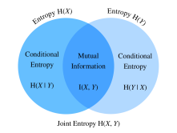

# Informacijos teorija
:label:`sec_information_theory`

Visata perpildyta informacijos. Informacija suteikia bendrą kalbą per disciplinų plyšius: nuo Šekspyro sonetų iki mokslininkų straipsnių Kornelio arXiv, nuo Van Gogo paveikslo „Žvaigždėta naktis“ iki Bethoveno Simfonijos Nr. 5, nuo pirmosios programavimo kalbos Plankalkül iki pažangiausių mašininio mokymo algoritmų. Viskas, nepaisant formato, turi paklusti informacijos teorijos taisyklėms. Pasitelkę informacijos teoriją, galime išmatuoti ir palyginti, kiek informacijos yra skirtinguose signaluose. Šiame skyriuje išnagrinėsime pagrindines informacijos teorijos sąvokas ir jos taikymą mašininiame mokyme.

Prieš pradėdami apžvelkime ryšį tarp mašininio mokymo ir informacijos teorijos. Mašininis mokymas siekia iš duomenų išgauti įdomius signalus ir daryti svarbias prognozes.  Informacijos teorija savo ruožtu nagrinėja informacijos kodavimą, dekodavimą, perdavimą ir manipuliavimą ja. Todėl informacijos teorija suteikia pagrindinę kalbą informacijos apdorojimui mašinomis išmoktose sistemose aptarti. Pavyzdžiui, daugelis mašininio mokymo taikymų naudoja kryžminės entropijos nuostolius, aprašytus :numref:`sec_softmax`.  Šiuos nuostolius galima tiesiogiai išvesti iš informacijos teorijos svarstymų.


## Informacija

Pradėkime nuo informacijos teorijos „sielos“ – informacijos. *Informaciją* galima užkoduoti bet kuo, turinčiu tam tikrą vieno ar kelių kodavimo formatų seką. Tarkime, kad užsibrėžiame apibrėžti informacijos sąvoką.  Kas galėtų būti mūsų atspirties taškas?

Panagrinėkime tokį minties eksperimentą.  Turime draugą su kortų kaladę.  Jis ją sumaišys, apvers kelias korteles ir pasakys mums teiginius apie jas.  Pabandysime įvertinti kiekvieno teiginio informacijos kiekį.

Pirmiausia jis apverčia kortelę ir sako: „Matau kortą.“  Tai nesuteikia mums jokios informacijos.  Jau buvome tuo tikri, todėl tikimės, kad informacija turėtų būti nulinė.

Toliau jis apverčia kortelę ir sako: „Matau širdį.“  Tai suteikia šiek tiek informacijos, bet iš tikrųjų buvo galimos tik $4$ skirtingos rūšys, kiekviena vienodai tikėtina, todėl šis rezultatas mūsų nenustebina.  Tikimės, kad kad ir koks būtų informacijos matas, šis įvykis turėtų turėti mažą informacijos kiekį.

Toliau jis apverčia kortelę ir sako: „Tai pikų $3$.“  Tai daugiau informacijos.  Iš tiesų buvo $52$ vienodai tikėtini galimi rezultatai, ir draugas mums pasakė, kuris iš jų.  Tai turėtų būti vidutinis informacijos kiekis.

Pasiekime loginį kraštutinumą.  Tarkime, kad galiausiai jis apverčia kiekvieną kaladės kortelę ir nuskaito visą sumaišytos kaladės seką.  Kaladė gali būti išdėstyta $52!$ skirtingų tvarkų, vėlgi visos vienodai tikėtinos, todėl mums reikia daug informacijos, kad žinotume, kuri iš jų.

Bet kuri mūsų kuriama informacijos sąvoka turi atitikti šią intuiciją.  Iš tiesų kituose skyreliuose išmoksime apskaičiuoti, kad šie įvykiai turi atitinkamai $0\textrm{ bitų}$, $2\textrm{ bitus}$, $~5{,}7\textrm{ bito}$ ir $~225{,}6\textrm{ bito}$ informacijos.

Perskaitę šiuos minties eksperimentus, matome natūralią idėją.  Kaip atspirties tašką, užuot rūpinęsi žiniomis, galime remtis idėja, kad informacija atspindi nuostabos laipsnį arba abstraktų įvykio galimybę. Pavyzdžiui, jei norime apibūdinti neįprastą įvykį, mums reikia daug informacijos. Įprastam įvykiui informacijos gali prireikti nedaug.

1948 m. Claude'as E. Shannonas paskelbė *A Mathematical Theory of Communication* :cite:`Shannon.1948`, įtvirtinusį informacijos teoriją.  Savo straipsnyje Shannonas pirmą kartą pristatė informacijos entropijos sąvoką. Nuo čia ir pradėsime savo kelionę.


### Savaiminė informacija

Kadangi informacija įkūnija abstrakčią įvykio galimybę, kaip atvaizduoti galimybę į bitų skaičių? Shannonas pristatė terminą *bitas* kaip informacijos vienetą, kurį iš pradžių sukūrė Johnas Tukey. Taigi kas yra „bitas“ ir kodėl juo matuojame informaciją? Istoriškai senovinis siųstuvas galėjo siųsti ar priimti tik du kodo tipus: $0$ ir $1$.  Iš tiesų dvejetainis kodavimas vis dar plačiai naudojamas visuose šiuolaikiniuose skaitmeniniuose kompiuteriuose. Šitaip bet kuri informacija užkoduojama $0$ ir $1$ eilute. Todėl $n$ ilgio dvejetainių skaitmenų eilutė turi $n$ bitų informacijos.

Dabar tarkime, kad bet kokioje kodų eilutėje kiekvienas $0$ ar $1$ pasirodo su tikimybe $\frac{1}{2}$. Taigi įvykis $X$ su $n$ ilgio kodų eilute įvyksta su tikimybe $\frac{1}{2^n}$. Kartu, kaip minėjome, ši eilutė turi $n$ bitų informacijos. Ar galime tai apibendrinti iki matematinės funkcijos, kuri tikimybę $p$ paverčia bitų skaičiumi? Shannonas atsakė apibrėždamas *savaiminę informaciją*

$$I(X) = - \log_2 (p),$$

kaip *bitus* informacijos, kurią gavome apie šį įvykį $X$. Atkreipkite dėmesį, kad šiame skyriuje visada naudosime dvejetainius logaritmus. Paprastumo dėlei likusioje skyriaus dalyje praleisime apatinį indeksą 2 logaritmo žymėjime, t. y. $\log(.)$ visada reiškia $\log_2(.)$. Pavyzdžiui, kodas „0010“ turi savaiminę informaciją

$$I(\textrm{"0010"}) = - \log (p(\textrm{"0010"})) = - \log \left( \frac{1}{2^4} \right) = 4 \textrm{ bits}.$$

Savaiminę informaciją galime apskaičiuoti, kaip parodyta toliau. Prieš tai importuokime visus šiame skyriuje reikalingus paketus.

```{.python .input}
#@tab mxnet
from mxnet import np
from mxnet.metric import NegativeLogLikelihood
from mxnet.ndarray import nansum
import random

def self_information(p):
    return -np.log2(p)

self_information(1 / 64)
```

```{.python .input}
#@tab pytorch
import torch
from torch.nn import NLLLoss

def nansum(x):
    # Define nansum, as pytorch does not offer it inbuilt.
    return x[~torch.isnan(x)].sum()

def self_information(p):
    return -torch.log2(torch.tensor(p)).item()

self_information(1 / 64)
```

```{.python .input}
#@tab tensorflow
import tensorflow as tf

def log2(x):
    return tf.math.log(x) / tf.math.log(2.)

def nansum(x):
    return tf.reduce_sum(tf.where(tf.math.is_nan(
        x), tf.zeros_like(x), x), axis=-1)

def self_information(p):
    return -log2(tf.constant(p)).numpy()

self_information(1 / 64)
```

## Entropija

Kadangi savaiminė informacija matuoja tik vieno diskretaus įvykio informaciją, mums reikia bendresnio mato bet kuriam atsitiktiniam dydžiui, turinčiam diskretų ar tolydų skirstinį.


### Entropijos motyvacija

Pabandykime konkrečiai apibrėžti, ko norime.  Tai bus neformalus teiginys apie vadinamąsias *Shannono entropijos aksiomas*.  Paaiškės, kad šis sveiko proto teiginių rinkinys priverčia mus prie vienintelio informacijos apibrėžimo.  Formalią šių aksiomų versiją kartu su keletu kitų galima rasti :citet:`Csiszar.2008`.

1.  Informacija, kurią gauname stebėdami atsitiktinį dydį, nepriklauso nuo to, kaip vadiname elementus, ar nuo papildomų elementų, kurių tikimybė lygi nuliui, buvimo.
2.  Informacija, kurią gauname stebėdami du atsitiktinius dydžius, yra ne didesnė nei informacijos, gaunamos stebint juos atskirai, suma.  Jei jie nepriklausomi, tai tiksliai suma.
3.  Informacija, gaunama stebint (beveik) tikrus įvykius, yra (beveik) nulinė.

Nors šio fakto įrodymas viršija mūsų teksto aprėptį, svarbu žinoti, kad tai vienareikšmiškai nulemia formą, kurią turi turėti entropija.  Vienintelis šių aksiomų paliekamas dviprasmiškumas yra pagrindinių vienetų pasirinkimas, kuris dažniausiai normuojamas pasirenkant, kaip matėme anksčiau, kad informacija, kurią suteikia vienas sąžiningos monetos metimas, yra vienas bitas.

### Apibrėžimas

Bet kuriam atsitiktiniam dydžiui $X$, sekančiam tikimybių skirstinį $P$ su tikimybės tankio funkcija (t. f.) arba tikimybių masės funkcija (t. m. f.) $p(x)$, tikėtiną informacijos kiekį matuojame per *entropiją* (arba *Shannono entropiją*)

$$H(X) = - E_{x \sim P} [\log p(x)].$$
:eqlabel:`eq_ent_def`

Konkrečiai, jei $X$ yra diskretus, $$H(X) = - \sum_i p_i \log p_i \textrm{, where } p_i = P(X_i).$$

Priešingu atveju, jei $X$ yra tolydus, entropiją vadiname ir *diferencialine entropija*

$$H(X) = - \int_x p(x) \log p(x) \; dx.$$

Entropiją galime apibrėžti taip.

```{.python .input}
#@tab mxnet
def entropy(p):
    entropy = - p * np.log2(p)
    # Operator `nansum` will sum up the non-nan number
    out = nansum(entropy.as_nd_ndarray())
    return out

entropy(np.array([0.1, 0.5, 0.1, 0.3]))
```

```{.python .input}
#@tab pytorch
def entropy(p):
    entropy = - p * torch.log2(p)
    # Operator `nansum` will sum up the non-nan number
    out = nansum(entropy)
    return out

entropy(torch.tensor([0.1, 0.5, 0.1, 0.3]))
```

```{.python .input}
#@tab tensorflow
def entropy(p):
    return nansum(- p * log2(p))

entropy(tf.constant([0.1, 0.5, 0.1, 0.3]))
```

### Interpretacijos

Galbūt jums įdomu: kodėl entropijos apibrėžime :eqref:`eq_ent_def` naudojame neigiamo logaritmo vidurkį? Štai keletas intuicijų.

Pirma, kodėl naudojame *logaritmo* funkciją $\log$? Tarkime, kad $p(x) = f_1(x) f_2(x) \ldots, f_n(x)$, kur kiekviena komponentinė funkcija $f_i(x)$ yra nepriklausoma nuo kitų. Tai reiškia, kad kiekviena $f_i(x)$ nepriklausomai prisideda prie bendros informacijos, gaunamos iš $p(x)$. Kaip aptarta aukščiau, norime, kad entropijos formulė būtų adityvi nepriklausomų atsitiktinių dydžių atžvilgiu. Laimei, $\log$ natūraliai paverčia tikimybių skirstinių sandaugą atskirų narių suma.

Toliau, kodėl naudojame *neigiamą* $\log$? Intuityviai dažnesni įvykiai turėtų turėti mažiau informacijos nei retesni, nes dažnai daugiau informacijos gauname iš neįprasto atvejo nei iš įprasto. Tačiau $\log$ monotoniškai auga didėjant tikimybėms ir iš tiesų yra neigiamas visoms reikšmėms intervale $[0, 1]$.  Turime sukonstruoti monotoniškai mažėjantį ryšį tarp įvykių tikimybės ir jų entropijos, kuri idealiu atveju visada bus teigiama (nes nieko, ką stebime, neturėtų priversti mūsų pamiršti tai, ką žinojome). Todėl prieš $\log$ funkciją pridedame minuso ženklą.

Galiausiai, iš kur atsiranda *vidurkio* funkcija? Panagrinėkime atsitiktinį dydį $X$. Savaiminę informaciją ($-\log(p)$) galime interpretuoti kaip *nuostabos* kiekį, kurį jaučiame pamatę tam tikrą rezultatą.  Iš tiesų tikimybei artėjant prie nulio, nuostaba tampa begalinė.  Panašiai entropiją galime interpretuoti kaip vidutinį nuostabos kiekį stebint $X$. Pavyzdžiui, įsivaizduokite, kad lošimo automatų sistema statistiškai nepriklausomai išduoda simbolius ${s_1, \ldots, s_k}$ atitinkamai su tikimybėmis ${p_1, \ldots, p_k}$. Tada šios sistemos entropija lygi vidutinei savaiminei informacijai stebint kiekvieną išvestį, t. y.,

$$H(S) = \sum_i {p_i \cdot I(s_i)} = - \sum_i {p_i \cdot \log p_i}.$$


### Entropijos savybės

Iš aukščiau pateiktų pavyzdžių ir interpretacijų galime išvesti šias entropijos :eqref:`eq_ent_def` savybes. Čia $X$ vadiname įvykiu, o $P$ – $X$ tikimybių skirstiniu.

* $H(X) \geq 0$ visiems diskretiems $X$ (tolydiems $X$ entropija gali būti neigiama).

* Jei $X \sim P$ su t. f. arba t. m. f. $p(x)$ ir bandome įvertinti $P$ nauju tikimybių skirstiniu $Q$ su t. f. arba t. m. f. $q(x)$, tada $$H(X) = - E_{x \sim P} [\log p(x)] \leq  - E_{x \sim P} [\log q(x)], \textrm{ with equality if and only if } P = Q.$$  Kitaip tariant, $H(X)$ duoda apatinę ribą vidutiniam bitų skaičiui, reikalingam simboliams, ištrauktiems iš $P$, užkoduoti.

* Jei $X \sim P$, tada $x$ perduoda didžiausią informacijos kiekį, jei pasiskirsto tolygiai tarp visų galimų rezultatų. Konkrečiai, jei tikimybių skirstinys $P$ yra diskretus su $k$ klasių $\{p_1, \ldots, p_k \}$, tada $$H(X) \leq \log(k), \textrm{ with equality if and only if } p_i = \frac{1}{k}, \forall i.$$ Jei $P$ yra tolydus atsitiktinis dydis, istorija tampa daug sudėtingesnė.  Tačiau jei papildomai reikalaujame, kad $P$ būtų apibrėžtas baigtiniame intervale (su visomis reikšmėmis tarp $0$ ir $1$), tada $P$ turi didžiausią entropiją, jei yra tolygusis skirstinys tame intervale.


## Abipusė informacija

Anksčiau apibrėžėme vieno atsitiktinio dydžio $X$ entropiją, o kaip dėl atsitiktinių dydžių poros $(X, Y)$ entropijos?  Šiuos metodus galime laikyti bandymu atsakyti į tokio tipo klausimą: „Kokia informacija yra $X$ ir $Y$ kartu, palyginti su kiekvienu atskirai?  Ar yra perteklinės informacijos, ar visa ji unikali?“

Tolesnėje diskusijoje visada naudosime $(X, Y)$ kaip atsitiktinių dydžių porą, sekančią jungtinį tikimybių skirstinį $P$ su t. f. arba t. m. f. $p_{X, Y}(x, y)$, o $X$ ir $Y$ seka tikimybių skirstinius atitinkamai $p_X(x)$ ir $p_Y(y)$.


### Jungtinė entropija

Panašiai kaip vieno atsitiktinio dydžio entropiją :eqref:`eq_ent_def`, atsitiktinių dydžių poros $(X, Y)$ *jungtinę entropiją* $H(X, Y)$ apibrėžiame kaip

$$H(X, Y) = -E_{(x, y) \sim P} [\log p_{X, Y}(x, y)]. $$
:eqlabel:`eq_joint_ent_def`

Tiksliau, viena vertus, jei $(X, Y)$ yra diskrečiųjų atsitiktinių dydžių pora, tada

$$H(X, Y) = - \sum_{x} \sum_{y} p_{X, Y}(x, y) \log p_{X, Y}(x, y).$$

Kita vertus, jei $(X, Y)$ yra tolydžiųjų atsitiktinių dydžių pora, *diferencialinę jungtinę entropiją* apibrėžiame kaip

$$H(X, Y) = - \int_{x, y} p_{X, Y}(x, y) \ \log p_{X, Y}(x, y) \;dx \;dy.$$

:eqref:`eq_joint_ent_def` galime laikyti pasakančia mums visą atsitiktinumą atsitiktinių dydžių poroje.  Kaip kraštutinumų porą paminėsime: jei $X = Y$ yra du identiški atsitiktiniai dydžiai, tada informacija poroje yra tiksliai vieno informacija ir turime $H(X, Y) = H(X) = H(Y)$.  Kitame kraštutinume, jei $X$ ir $Y$ yra nepriklausomi, tada $H(X, Y) = H(X) + H(Y)$.  Iš tiesų visada turėsime, kad informacija, esanti atsitiktinių dydžių poroje, yra ne mažesnė už bet kurio iš atsitiktinių dydžių entropiją ir ne didesnė už abiejų sumą.

$$
H(X), H(Y) \le H(X, Y) \le H(X) + H(Y).
$$

Realizuokime jungtinę entropiją nuo nulio.

```{.python .input}
#@tab mxnet
def joint_entropy(p_xy):
    joint_ent = -p_xy * np.log2(p_xy)
    # Operator `nansum` will sum up the non-nan number
    out = nansum(joint_ent.as_nd_ndarray())
    return out

joint_entropy(np.array([[0.1, 0.5], [0.1, 0.3]]))
```

```{.python .input}
#@tab pytorch
def joint_entropy(p_xy):
    joint_ent = -p_xy * torch.log2(p_xy)
    # Operator `nansum` will sum up the non-nan number
    out = nansum(joint_ent)
    return out

joint_entropy(torch.tensor([[0.1, 0.5], [0.1, 0.3]]))
```

```{.python .input}
#@tab tensorflow
def joint_entropy(p_xy):
    joint_ent = -p_xy * log2(p_xy)
    # Operator `nansum` will sum up the non-nan number
    out = nansum(joint_ent)
    return out

joint_entropy(tf.constant([[0.1, 0.5], [0.1, 0.3]]))
```

Atkreipkite dėmesį, kad tai tas pats *kodas* kaip anksčiau, tačiau dabar jį interpretuojame kitaip – kaip veikiantį su dviejų atsitiktinių dydžių jungtiniu skirstiniu.


### Sąlyginė entropija

Aukščiau apibrėžta jungtinė entropija yra informacijos kiekis, esantis atsitiktinių dydžių poroje.  Tai naudinga, tačiau dažnai ne tai mums rūpi.  Panagrinėkime mašininio mokymo aplinką.  Tegu $X$ yra atsitiktinis dydis (arba atsitiktinių dydžių vektorius), aprašantis paveikslėlio pikselių reikšmes, o $Y$ – atsitiktinis dydis, kuris yra klasės žymė.  $X$ turėtų turėti daug informacijos – natūralus paveikslėlis yra sudėtingas dalykas.  Tačiau informacija, esanti $Y$, parodžius paveikslėlį, turėtų būti maža.  Iš tiesų skaitmens paveikslėlis jau turėtų turėti informacijos apie tai, koks tai skaitmuo, nebent skaitmuo neįskaitomas.  Todėl, norėdami toliau plėsti savo informacijos teorijos žodyną, turime gebėti samprotauti apie informacijos kiekį atsitiktiniame dydyje, sąlygojamame kito.

Tikimybių teorijoje matėme *sąlyginės tikimybės* apibrėžimą, skirtą ryšiui tarp kintamųjų matuoti. Dabar norime analogiškai apibrėžti *sąlyginę entropiją* $H(Y \mid X)$.  Ją galime užrašyti kaip

$$ H(Y \mid X) = - E_{(x, y) \sim P} [\log p(y \mid x)],$$
:eqlabel:`eq_cond_ent_def`

kur $p(y \mid x) = \frac{p_{X, Y}(x, y)}{p_X(x)}$ yra sąlyginė tikimybė. Konkrečiai, jei $(X, Y)$ yra diskrečiųjų atsitiktinių dydžių pora, tada

$$H(Y \mid X) = - \sum_{x} \sum_{y} p(x, y) \log p(y \mid x).$$

Jei $(X, Y)$ yra tolydžiųjų atsitiktinių dydžių pora, *diferencialinė sąlyginė entropija* apibrėžiama panašiai:

$$H(Y \mid X) = - \int_x \int_y p(x, y) \ \log p(y \mid x) \;dx \;dy.$$


Dabar natūralu paklausti, kaip *sąlyginė entropija* $H(Y \mid X)$ susijusi su entropija $H(X)$ ir jungtine entropija $H(X, Y)$?  Naudodami aukščiau pateiktus apibrėžimus, galime tai išreikšti aiškiai:

$$H(Y \mid X) = H(X, Y) - H(X).$$

Tai turi intuityvią interpretaciją: informacija $Y$, žinant $X$ ($H(Y \mid X)$), yra tokia pati kaip informacija abiejuose $X$ ir $Y$ kartu ($H(X, Y)$), atėmus informaciją, jau esančią $X$.  Tai duoda mums informaciją $Y$, kuri nėra atvaizduota ir $X$.

Dabar realizuokime sąlyginę entropiją :eqref:`eq_cond_ent_def` nuo nulio.

```{.python .input}
#@tab mxnet
def conditional_entropy(p_xy, p_x):
    p_y_given_x = p_xy/p_x
    cond_ent = -p_xy * np.log2(p_y_given_x)
    # Operator `nansum` will sum up the non-nan number
    out = nansum(cond_ent.as_nd_ndarray())
    return out

conditional_entropy(np.array([[0.1, 0.5], [0.2, 0.3]]), np.array([0.2, 0.8]))
```

```{.python .input}
#@tab pytorch
def conditional_entropy(p_xy, p_x):
    p_y_given_x = p_xy/p_x
    cond_ent = -p_xy * torch.log2(p_y_given_x)
    # Operator `nansum` will sum up the non-nan number
    out = nansum(cond_ent)
    return out

conditional_entropy(torch.tensor([[0.1, 0.5], [0.2, 0.3]]),
                    torch.tensor([0.2, 0.8]))
```

```{.python .input}
#@tab tensorflow
def conditional_entropy(p_xy, p_x):
    p_y_given_x = p_xy/p_x
    cond_ent = -p_xy * log2(p_y_given_x)
    # Operator `nansum` will sum up the non-nan number
    out = nansum(cond_ent)
    return out

conditional_entropy(tf.constant([[0.1, 0.5], [0.2, 0.3]]),
                    tf.constant([0.2, 0.8]))
```

### Abipusė informacija

Turėdami ankstesnę atsitiktinių dydžių $(X, Y)$ aplinką, galbūt klausiate: „Dabar, kai žinome, kiek informacijos yra $Y$, bet nėra $X$, ar galime panašiai paklausti, kiek informacijos yra bendros tarp $X$ ir $Y$?“ Atsakymas bus $(X, Y)$ *abipusė informacija*, kurią žymėsime $I(X, Y)$.

Užuot šokę tiesiai į formalų apibrėžimą, pasitreniruokime intuiciją pirmiausia bandydami išvesti abipusės informacijos išraišką vien iš anksčiau sukonstruotų narių.  Norime rasti informaciją, bendrą dviem atsitiktiniams dydžiams.  Vienas būdas tai padaryti – pradėti nuo visos informacijos, esančios ir $X$, ir $Y$ kartu, o tada atimti dalis, kurios nėra bendros.  Informacija, esanti ir $X$, ir $Y$ kartu, užrašoma $H(X, Y)$.  Iš jos norime atimti informaciją, esančią $X$, bet ne $Y$, ir informaciją, esančią $Y$, bet ne $X$.  Kaip matėme ankstesniame skyrelyje, tai atitinkamai duoda $H(X \mid Y)$ ir $H(Y \mid X)$.  Taigi abipusė informacija turėtų būti

$$
I(X, Y) = H(X, Y) - H(Y \mid X) - H(X \mid Y).
$$

Iš tiesų tai yra tinkamas abipusės informacijos apibrėžimas.  Išskleidę šių narių apibrėžimus ir juos sujungę, šiek tiek algebros parodo, kad tai tas pats, kas

$$I(X, Y) = E_{x} E_{y} \left\{ p_{X, Y}(x, y) \log\frac{p_{X, Y}(x, y)}{p_X(x) p_Y(y)} \right\}. $$
:eqlabel:`eq_mut_ent_def`


Visus šiuos ryšius galime apibendrinti paveikslėliu :numref:`fig_mutual_information`.  Tai puikus intuicijos testas – pamatyti, kodėl visi šie teiginiai taip pat yra ekvivalentūs $I(X, Y)$.

* $H(X) - H(X \mid Y)$
* $H(Y) - H(Y \mid X)$
* $H(X) + H(Y) - H(X, Y)$


:label:`fig_mutual_information`


Daugeliu atžvilgių abipusę informaciją :eqref:`eq_mut_ent_def` galime laikyti principingu koreliacijos koeficiento, matyto :numref:`sec_random_variables`, išplėtimu.  Tai leidžia klausti ne tik apie tiesinius ryšius tarp kintamųjų, bet ir apie didžiausią bet kokios rūšies informaciją, bendrą dviem atsitiktiniams dydžiams.

Dabar realizuokime abipusę informaciją nuo nulio.

```{.python .input}
#@tab mxnet
def mutual_information(p_xy, p_x, p_y):
    p = p_xy / (p_x * p_y)
    mutual = p_xy * np.log2(p)
    # Operator `nansum` will sum up the non-nan number
    out = nansum(mutual.as_nd_ndarray())
    return out

mutual_information(np.array([[0.1, 0.5], [0.1, 0.3]]),
                   np.array([0.2, 0.8]), np.array([[0.75, 0.25]]))
```

```{.python .input}
#@tab pytorch
def mutual_information(p_xy, p_x, p_y):
    p = p_xy / (p_x * p_y)
    mutual = p_xy * torch.log2(p)
    # Operator `nansum` will sum up the non-nan number
    out = nansum(mutual)
    return out

mutual_information(torch.tensor([[0.1, 0.5], [0.1, 0.3]]),
                   torch.tensor([0.2, 0.8]), torch.tensor([[0.75, 0.25]]))
```

```{.python .input}
#@tab tensorflow
def mutual_information(p_xy, p_x, p_y):
    p = p_xy / (p_x * p_y)
    mutual = p_xy * log2(p)
    # Operator `nansum` will sum up the non-nan number
    out = nansum(mutual)
    return out

mutual_information(tf.constant([[0.1, 0.5], [0.1, 0.3]]),
                   tf.constant([0.2, 0.8]), tf.constant([[0.75, 0.25]]))
```

### Abipusės informacijos savybės

Užuot įsimenant abipusės informacijos apibrėžimą :eqref:`eq_mut_ent_def`, pakanka prisiminti jos svarbiausias savybes:

* Abipusė informacija yra simetriška, t. y. $I(X, Y) = I(Y, X)$.
* Abipusė informacija yra neneigiama, t. y. $I(X, Y) \geq 0$.
* $I(X, Y) = 0$ tada ir tik tada, kai $X$ ir $Y$ yra nepriklausomi. Pavyzdžiui, jei $X$ ir $Y$ yra nepriklausomi, tai žinojimas $Y$ nesuteikia jokios informacijos apie $X$ ir atvirkščiai, todėl jų abipusė informacija lygi nuliui.
* Kita vertus, jei $X$ yra apverčiama $Y$ funkcija, tada $Y$ ir $X$ dalijasi visa informacija ir $$I(X, Y) = H(Y) = H(X).$$

### Taškinė abipusė informacija

Kai šio skyriaus pradžioje dirbome su entropija, galėjome pateikti $-\log(p_X(x))$ interpretaciją kaip tai, kiek *nustebome* konkrečiu rezultatu.  Panašią interpretaciją galime suteikti ir logaritminiam abipusės informacijos nariui, kuris dažnai vadinamas *taškine abipuse informacija*:

$$\textrm{pmi}(x, y) = \log\frac{p_{X, Y}(x, y)}{p_X(x) p_Y(y)}.$$
:eqlabel:`eq_pmi_def`

:eqref:`eq_pmi_def` galime laikyti matuojančia, kiek labiau ar mažiau tikėtina konkreti rezultatų $x$ ir $y$ kombinacija, palyginti su tuo, ko tikėtumėmės iš nepriklausomų atsitiktinių rezultatų.  Jei ji didelė ir teigiama, šie du konkretūs rezultatai pasitaiko daug dažniau, nei būtų atsitiktinai (*pastaba*: vardiklis yra $p_X(x) p_Y(y)$ – tikimybė, jei abu rezultatai būtų nepriklausomi), o jei didelė ir neigiama, tai rodo, kad abu rezultatai įvyksta gerokai rečiau, nei tikėtumėmės atsitiktinai.

Tai leidžia mums abipusę informaciją :eqref:`eq_mut_ent_def` interpretuoti kaip vidutinį nuostabos kiekį, kurį jaučiame matydami du rezultatus įvykstant kartu, palyginti su tuo, ko tikėtumėmės, jei jie būtų nepriklausomi.

### Abipusės informacijos taikymai

Abipusė informacija gali būti šiek tiek abstrakti gryname apibrėžime, tad kaip ji susijusi su mašininiu mokymu? Natūraliosios kalbos apdorojime viena sunkiausių problemų yra *daugiareikšmiškumo išsprendimas*, arba problema, kai žodžio reikšmė iš konteksto neaiški. Pavyzdžiui, neseniai naujienų antraštė pranešė, kad „Amazon dega“. Galite svarstyti, ar kompanijos „Amazon“ pastatas dega, ar dega Amazonės lietaus miškas.

Šiuo atveju abipusė informacija gali padėti išspręsti šį daugiareikšmiškumą. Pirmiausia randame žodžių grupę, kurių kiekvienas turi santykinai didelę abipusę informaciją su kompanija „Amazon“, pavyzdžiui, e. prekyba, technologijos ir internetas. Antra, randame kitą žodžių grupę, kurių kiekvienas turi santykinai didelę abipusę informaciją su Amazonės lietaus mišku, pavyzdžiui, lietus, miškas ir tropinis. Kai reikia išsklaidyti žodžio „Amazon“ daugiareikšmiškumą, galime palyginti, kuri grupė dažniau pasitaiko žodžio „Amazon“ kontekste.  Šiuo atveju straipsnis toliau aprašytų mišką ir kontekstas taptų aiškus.


## Kulbako–Leiblerio divergencija

Kaip aptarėme :numref:`sec_linear-algebra`, normas galime naudoti atstumui tarp dviejų bet kokios dimensijos erdvės taškų matuoti.  Norėtume gebėti atlikti panašią užduotį su tikimybių skirstiniais.  Tai galima daryti įvairiais būdais, tačiau informacijos teorija siūlo vieną iš gražiausių.  Dabar nagrinėjame *Kulbako–Leiblerio (KL) divergenciją*, kuri suteikia būdą išmatuoti, ar du skirstiniai yra artimi, ar ne.


### Apibrėžimas

Tarkime, atsitiktinis dydis $X$ seka tikimybių skirstinį $P$ su t. f. arba t. m. f. $p(x)$, o $P$ įvertiname kitu tikimybių skirstiniu $Q$ su t. f. arba t. m. f. $q(x)$. Tada *Kulbako–Leiblerio (KL) divergencija* (arba *santykinė entropija*) tarp $P$ ir $Q$ yra

$$D_{\textrm{KL}}(P\|Q) = E_{x \sim P} \left[ \log \frac{p(x)}{q(x)} \right].$$
:eqlabel:`eq_kl_def`

Kaip ir su taškine abipuse informacija :eqref:`eq_pmi_def`, vėl galime pateikti logaritminio nario interpretaciją:  $-\log \frac{q(x)}{p(x)} = -\log(q(x)) - (-\log(p(x)))$ bus didelis ir teigiamas, jei $x$ matome daug dažniau pagal $P$, nei tikėtumėmės pagal $Q$, ir didelis ir neigiamas, jei rezultatą matome daug rečiau, nei tikėtasi.  Šitaip galime ją interpretuoti kaip mūsų *santykinę* nuostabą stebint rezultatą, palyginti su tuo, kiek nustebtume jį stebėdami iš savo atskaitos skirstinio.

Realizuokime KL divergenciją nuo nulio.

```{.python .input}
#@tab mxnet
def kl_divergence(p, q):
    kl = p * np.log2(p / q)
    out = nansum(kl.as_nd_ndarray())
    return out.abs().asscalar()
```

```{.python .input}
#@tab pytorch
def kl_divergence(p, q):
    kl = p * torch.log2(p / q)
    out = nansum(kl)
    return out.abs().item()
```

```{.python .input}
#@tab tensorflow
def kl_divergence(p, q):
    kl = p * log2(p / q)
    out = nansum(kl)
    return tf.abs(out).numpy()
```

### KL divergencijos savybės

Pažvelkime į kai kurias KL divergencijos :eqref:`eq_kl_def` savybes.

* KL divergencija yra nesimetrinė, t. y. egzistuoja $P,Q$, kad $$D_{\textrm{KL}}(P\|Q) \neq D_{\textrm{KL}}(Q\|P).$$
* KL divergencija yra neneigiama, t. y. $$D_{\textrm{KL}}(P\|Q) \geq 0.$$ Atkreipkite dėmesį, kad lygybė galioja tik kai $P = Q$.
* Jei egzistuoja toks $x$, kad $p(x) > 0$ ir $q(x) = 0$, tada $D_{\textrm{KL}}(P\|Q) = \infty$.
* Tarp KL divergencijos ir abipusės informacijos yra glaudus ryšys. Be ryšio, parodyto :numref:`fig_mutual_information`, $I(X, Y)$ skaitine verte taip pat lygus šiems dydžiams:
    1. $D_{\textrm{KL}}(P(X, Y)  \ \| \ P(X)P(Y))$;
    1. $E_Y \{ D_{\textrm{KL}}(P(X \mid Y) \ \| \ P(X)) \}$;
    1. $E_X \{ D_{\textrm{KL}}(P(Y \mid X) \ \| \ P(Y)) \}$.

  Pirmajame naryje abipusę informaciją interpretuojame kaip KL divergenciją tarp $P(X, Y)$ ir $P(X)$ bei $P(Y)$ sandaugos, todėl tai yra matas, kiek jungtinis skirstinys skiriasi nuo skirstinio, kuris būtų, jei jie būtų nepriklausomi. Antrajame naryje abipusė informacija mums pasako vidutinį neapibrėžtumo apie $Y$ sumažėjimą, atsirandantį sužinojus $X$ skirstinio reikšmę. Panašiai ir trečiajame naryje.


### Pavyzdys

Išnagrinėkime žaislinį pavyzdį, kad aiškiai pamatytume nesimetriškumą.

Pirmiausia sugeneruokime ir surikiuokime tris $10\,000$ ilgio tenzorius: tikslinį tenzorių $p$, sekantį normalųjį skirstinį $N(0, 1)$, ir du kandidatinius tenzorius $q_1$ ir $q_2$, atitinkamai sekančius normaliuosius skirstinius $N(-1, 1)$ ir $N(1, 1)$.

```{.python .input}
#@tab mxnet
random.seed(1)

nd_len = 10000
p = np.random.normal(loc=0, scale=1, size=(nd_len, ))
q1 = np.random.normal(loc=-1, scale=1, size=(nd_len, ))
q2 = np.random.normal(loc=1, scale=1, size=(nd_len, ))

p = np.array(sorted(p.asnumpy()))
q1 = np.array(sorted(q1.asnumpy()))
q2 = np.array(sorted(q2.asnumpy()))
```

```{.python .input}
#@tab pytorch
torch.manual_seed(1)

tensor_len = 10000
p = torch.normal(0, 1, (tensor_len, ))
q1 = torch.normal(-1, 1, (tensor_len, ))
q2 = torch.normal(1, 1, (tensor_len, ))

p = torch.sort(p)[0]
q1 = torch.sort(q1)[0]
q2 = torch.sort(q2)[0]
```

```{.python .input}
#@tab tensorflow
tensor_len = 10000
p = tf.random.normal((tensor_len, ), 0, 1)
q1 = tf.random.normal((tensor_len, ), -1, 1)
q2 = tf.random.normal((tensor_len, ), 1, 1)

p = tf.sort(p)
q1 = tf.sort(q1)
q2 = tf.sort(q2)
```

Kadangi $q_1$ ir $q_2$ yra simetriški y ašies atžvilgiu (t. y. $x=0$), tikimės panašios KL divergencijos reikšmės tarp $D_{\textrm{KL}}(p\|q_1)$ ir $D_{\textrm{KL}}(p\|q_2)$. Kaip matote toliau, tarp $D_{\textrm{KL}}(p\|q_1)$ ir $D_{\textrm{KL}}(p\|q_2)$ skirtumas yra mažesnis nei 3 %.

```{.python .input}
#@tab all
kl_pq1 = kl_divergence(p, q1)
kl_pq2 = kl_divergence(p, q2)
similar_percentage = abs(kl_pq1 - kl_pq2) / ((kl_pq1 + kl_pq2) / 2) * 100

kl_pq1, kl_pq2, similar_percentage
```

Priešingai, galite pastebėti, kad $D_{\textrm{KL}}(q_2 \|p)$ ir $D_{\textrm{KL}}(p \| q_2)$ labai skiriasi – apie 40 %, kaip parodyta toliau.

```{.python .input}
#@tab all
kl_q2p = kl_divergence(q2, p)
differ_percentage = abs(kl_q2p - kl_pq2) / ((kl_q2p + kl_pq2) / 2) * 100

kl_q2p, differ_percentage
```

## Kryžminė entropija

Jei domina informacijos teorijos taikymai giliajame mokyme, štai trumpas pavyzdys. Tikrąjį skirstinį $P$ apibrėžiame su tikimybių skirstiniu $p(x)$, o įvertintąjį skirstinį $Q$ – su tikimybių skirstiniu $q(x)$, ir juos naudosime likusioje šio skyriaus dalyje.

Tarkime, reikia išspręsti dvejetainio klasifikavimo uždavinį pagal duotus $n$ duomenų pavyzdžių {$x_1, \ldots, x_n$}. Tarkime, kad $1$ ir $0$ užkoduojame kaip atitinkamai teigiamą ir neigiamą klasės žymę $y_i$, o mūsų neuroninis tinklas parametrizuotas $\theta$. Jei siekiame rasti geriausią $\theta$, kad $\hat{y}_i= p_{\theta}(y_i \mid x_i)$, natūralu taikyti didžiausio logaritminio tikėtinumo metodą, kaip matėme :numref:`sec_maximum_likelihood`. Konkrečiai, tikroms žymėms $y_i$ ir prognozėms $\hat{y}_i= p_{\theta}(y_i \mid x_i)$ tikimybė būti klasifikuotam kaip teigiamam yra $\pi_i= p_{\theta}(y_i = 1 \mid x_i)$. Todėl logaritminio tikėtinumo funkcija būtų

$$
\begin{aligned}
l(\theta) &= \log L(\theta) \\
  &= \log \prod_{i=1}^n \pi_i^{y_i} (1 - \pi_i)^{1 - y_i} \\
  &= \sum_{i=1}^n y_i \log(\pi_i) + (1 - y_i) \log (1 - \pi_i). \\
\end{aligned}
$$

Logaritminio tikėtinumo funkcijos $l(\theta)$ maksimizavimas yra tapatus $- l(\theta)$ minimizavimui, taigi iš čia galime rasti geriausią $\theta$. Kad aukščiau pateiktus nuostolius apibendrintume bet kuriems skirstiniams, $-l(\theta)$ taip pat pavadinome *kryžminės entropijos nuostoliais* $\textrm{CE}(y, \hat{y})$, kur $y$ seka tikrąjį skirstinį $P$, o $\hat{y}$ – įvertintąjį skirstinį $Q$.

Visa tai buvo išvesta dirbant iš didžiausio tikėtinumo požiūrio taško.  Tačiau jei atidžiai pažiūrėsime, pamatysime, kad į mūsų skaičiavimą pateko tokie nariai kaip $\log(\pi_i)$, o tai tvirtas ženklas, kad išraišką galime suprasti ir iš informacijos teorijos požiūrio.


### Formalus apibrėžimas

Kaip ir KL divergenciją, atsitiktiniam dydžiui $X$ divergenciją tarp įvertinančiojo skirstinio $Q$ ir tikrojo skirstinio $P$ galime matuoti ir per *kryžminę entropiją*,

$$\textrm{CE}(P, Q) = - E_{x \sim P} [\log(q(x))].$$
:eqlabel:`eq_ce_def`

Naudodami aukščiau aptartas entropijos savybes, ją taip pat galime interpretuoti kaip entropijos $H(P)$ ir KL divergencijos tarp $P$ ir $Q$ sumą, t. y.,

$$\textrm{CE} (P, Q) = H(P) + D_{\textrm{KL}}(P\|Q).$$


Kryžminės entropijos nuostolius galime realizuoti taip.

```{.python .input}
#@tab mxnet
def cross_entropy(y_hat, y):
    ce = -np.log(y_hat[range(len(y_hat)), y])
    return ce.mean()
```

```{.python .input}
#@tab pytorch
def cross_entropy(y_hat, y):
    ce = -torch.log(y_hat[range(len(y_hat)), y])
    return ce.mean()
```

```{.python .input}
#@tab tensorflow
def cross_entropy(y_hat, y):
    # `tf.gather_nd` is used to select specific indices of a tensor.
    ce = -tf.math.log(tf.gather_nd(y_hat, indices = [[i, j] for i, j in zip(
        range(len(y_hat)), y)]))
    return tf.reduce_mean(ce).numpy()
```

Dabar apibrėžkime du tenzorius žymėms ir prognozėms ir apskaičiuokime jų kryžminės entropijos nuostolius.

```{.python .input}
#@tab mxnet
labels = np.array([0, 2])
preds = np.array([[0.3, 0.6, 0.1], [0.2, 0.3, 0.5]])

cross_entropy(preds, labels)
```

```{.python .input}
#@tab pytorch
labels = torch.tensor([0, 2])
preds = torch.tensor([[0.3, 0.6, 0.1], [0.2, 0.3, 0.5]])

cross_entropy(preds, labels)
```

```{.python .input}
#@tab tensorflow
labels = tf.constant([0, 2])
preds = tf.constant([[0.3, 0.6, 0.1], [0.2, 0.3, 0.5]])

cross_entropy(preds, labels)
```

### Savybės

Kaip užsiminta šio skyriaus pradžioje, kryžminė entropija :eqref:`eq_ce_def` gali būti naudojama nuostolių funkcijai optimizavimo uždavinyje apibrėžti. Paaiškėja, kad šie dalykai yra ekvivalentūs:

1. $Q$ prognozinės tikimybės skirstiniui $P$ maksimizavimas (t. y. $E_{x
\sim P} [\log (q(x))]$);
1. Kryžminės entropijos $\textrm{CE} (P, Q)$ minimizavimas;
1. KL divergencijos $D_{\textrm{KL}}(P\|Q)$ minimizavimas.

Kryžminės entropijos apibrėžimas netiesiogiai įrodo ekvivalentų ryšį tarp 2 ir 3 tikslo, kol tikrųjų duomenų entropija $H(P)$ yra pastovi.


### Kryžminė entropija kaip daugiaklasio klasifikavimo tikslo funkcija

Jei pasigilinsime į klasifikavimo tikslo funkciją su kryžminės entropijos nuostoliais $\textrm{CE}$, pamatysime, kad $\textrm{CE}$ minimizavimas yra ekvivalentus logaritminio tikėtinumo funkcijos $L$ maksimizavimui.

Pradžiai tarkime, kad turime duomenų rinkinį su $n$ pavyzdžių, kuriuos galima klasifikuoti į $k$ klasių. Kiekvienam duomenų pavyzdžiui $i$ bet kurią $k$ klasių žymę $\mathbf{y}_i = (y_{i1}, \ldots, y_{ik})$ vaizduojame *fiktyvių kintamųjų kodavimu*. Konkrečiai, jei pavyzdys $i$ priklauso klasei $j$, tada $j$-ąjį elementą nustatome į $1$, o visas kitas komponentes – į $0$, t. y.,

$$ y_{ij} = \begin{cases}1 & j \in J; \\ 0 &\textrm{otherwise.}\end{cases}$$

Pavyzdžiui, jei daugiaklasio klasifikavimo uždavinys turi tris klases $A$, $B$ ir $C$, tada žymės $\mathbf{y}_i$ gali būti užkoduotos kaip {$A: (1, 0, 0); B: (0, 1, 0); C: (0, 0, 1)$}.


Tarkime, kad mūsų neuroninis tinklas parametrizuotas $\theta$. Tikriems žymių vektoriams $\mathbf{y}_i$ ir prognozėms $$\hat{\mathbf{y}}_i= p_{\theta}(\mathbf{y}_i \mid \mathbf{x}_i) = \sum_{j=1}^k y_{ij} p_{\theta} (y_{ij}  \mid  \mathbf{x}_i).$$

Todėl *kryžminės entropijos nuostoliai* būtų

$$
\textrm{CE}(\mathbf{y}, \hat{\mathbf{y}}) = - \sum_{i=1}^n \mathbf{y}_i \log \hat{\mathbf{y}}_i
 = - \sum_{i=1}^n \sum_{j=1}^k y_{ij} \log{p_{\theta} (y_{ij}  \mid  \mathbf{x}_i)}.\\
$$

Kita vertus, į problemą galime žiūrėti ir per didžiausio tikėtinumo įvertinimą. Pradžiai trumpai pristatykime $k$ klasių multinulio skirstinį. Tai Bernulio skirstinio išplėtimas nuo dvejetainės iki daugiaklasės. Jei atsitiktinis vektorius $\mathbf{z} = (z_{1}, \ldots, z_{k})$ seka $k$ klasių *multinulio skirstinį* su tikimybėmis $\mathbf{p} =$ ($p_{1}, \ldots, p_{k}$), t. y. $$p(\mathbf{z}) = p(z_1, \ldots, z_k) = \textrm{Multi} (p_1, \ldots, p_k), \textrm{ where } \sum_{i=1}^k p_i = 1,$$ tada $\mathbf{z}$ jungtinė tikimybių masės funkcija (t. m. f.) yra
$$\mathbf{p}^\mathbf{z} = \prod_{j=1}^k p_{j}^{z_{j}}.$$


Matyti, kad kiekvieno duomenų pavyzdžio žymė $\mathbf{y}_i$ seka $k$ klasių multinulio skirstinį su tikimybėmis $\boldsymbol{\pi} =$ ($\pi_{1}, \ldots, \pi_{k}$). Todėl kiekvieno duomenų pavyzdžio $\mathbf{y}_i$ jungtinė t. m. f. yra  $\mathbf{\pi}^{\mathbf{y}_i} = \prod_{j=1}^k \pi_{j}^{y_{ij}}.$
Todėl logaritminio tikėtinumo funkcija būtų

$$
\begin{aligned}
l(\theta)
 = \log L(\theta)
 = \log \prod_{i=1}^n \boldsymbol{\pi}^{\mathbf{y}_i}
 = \log \prod_{i=1}^n \prod_{j=1}^k \pi_{j}^{y_{ij}}
 = \sum_{i=1}^n \sum_{j=1}^k y_{ij} \log{\pi_{j}}.\\
\end{aligned}
$$

Kadangi didžiausio tikėtinumo įvertinime maksimizuojame tikslo funkciją $l(\theta)$ imdami $\pi_{j} = p_{\theta} (y_{ij}  \mid  \mathbf{x}_i)$, bet kuriam daugiaklasiam klasifikavimui aukščiau pateiktos logaritminio tikėtinumo funkcijos $l(\theta)$ maksimizavimas yra ekvivalentus kryžminės entropijos nuostolių $\textrm{CE}(y, \hat{y})$ minimizavimui.


Kad patikrintume aukščiau pateiktą įrodymą, pritaikykime įtaisytą matą `NegativeLogLikelihood`. Naudodami tuos pačius `labels` ir `preds` kaip ankstesniame pavyzdyje, gausime tokius pačius skaitinius nuostolius kaip ankstesniame pavyzdyje iki 5-ojo ženklo po kablelio.

```{.python .input}
#@tab mxnet
nll_loss = NegativeLogLikelihood()
nll_loss.update(labels.as_nd_ndarray(), preds.as_nd_ndarray())
nll_loss.get()
```

```{.python .input}
#@tab pytorch
# Implementation of cross-entropy loss in PyTorch combines `nn.LogSoftmax()`
# and `nn.NLLLoss()`
nll_loss = NLLLoss()
loss = nll_loss(torch.log(preds), labels)
loss
```

```{.python .input}
#@tab tensorflow
def nll_loss(y_hat, y):
    # Convert labels to one-hot vectors.
    y = tf.keras.utils.to_categorical(y, num_classes= y_hat.shape[1])
    # We will not calculate negative log-likelihood from the definition.
    # Rather, we will follow a circular argument. Because NLL is same as
    # `cross_entropy`, if we calculate cross_entropy that would give us NLL
    cross_entropy = tf.keras.losses.CategoricalCrossentropy(
        from_logits = True, reduction = tf.keras.losses.Reduction.NONE)
    return tf.reduce_mean(cross_entropy(y, y_hat)).numpy()

loss = nll_loss(tf.math.log(preds), labels)
loss
```

## Santrauka

* Informacijos teorija yra tyrimų sritis, nagrinėjanti informacijos kodavimą, dekodavimą, perdavimą ir manipuliavimą ja.
* Entropija yra vienetas, matuojantis, kiek informacijos yra skirtinguose signaluose.
* KL divergencija taip pat gali matuoti divergenciją tarp dviejų skirstinių.
* Kryžminę entropiją galima laikyti daugiaklasio klasifikavimo tikslo funkcija. Kryžminės entropijos nuostolių minimizavimas yra ekvivalentus logaritminio tikėtinumo funkcijos maksimizavimui.


## Pratimai

1. Patikrinkite, kad pirmajame skyriuje pateikti kortų pavyzdžiai iš tiesų turi nurodytą entropiją.
1. Parodykite, kad KL divergencija $D(p\|q)$ yra neneigiama visiems skirstiniams $p$ ir $q$. Užuomina: naudokite Jenseno nelygybę, t. y. faktą, kad $-\log x$ yra iškilioji funkcija.
1. Apskaičiuokime entropiją iš kelių duomenų šaltinių:
    * Tarkime, kad stebite beždžionės, spausdinančios rašomąja mašinėle, sugeneruotą išvestį. Beždžionė atsitiktinai paspaudžia bet kurį iš $44$ rašomosios mašinėlės klavišų (galite laikyti, kad ji dar neatrado jokių specialiųjų klavišų ar „shift“ klavišo). Kiek atsitiktinumo bitų vienam simboliui stebite?
    * Nepatenkinti beždžione, ją pakeičiate girtu rinkėju. Jis geba generuoti žodžius, nors ir nenuosekliai. Vietoj to jis atsitiktinai pasirenka žodį iš $2\,000$ žodžių žodyno. Tarkime, kad vidutinis žodžio ilgis anglų kalboje yra $4{,}5$ raidės. Kiek atsitiktinumo bitų vienam simboliui stebite dabar?
    * Vis dar nepatenkinti rezultatu, rinkėją pakeičiate aukštos kokybės kalbos modeliu. Kalbos modelis šiuo metu gali pasiekti net $15$ punktų painiavą (angl. *perplexity*) vienam žodžiui. Kalbos modelio simbolio *painiava* apibrėžiama kaip tikimybių rinkinio geometrinio vidurkio atvirkštinis dydis, kai kiekviena tikimybė atitinka žodžio simbolį. Konkrečiai, jei duoto žodžio ilgis yra $l$, tada  $\textrm{PPL}(\textrm{word}) = \left[\prod_i p(\textrm{character}_i)\right]^{ -\frac{1}{l}} = \exp \left[ - \frac{1}{l} \sum_i{\log p(\textrm{character}_i)} \right].$  Tarkime, kad testinis žodis turi 4,5 raidės. Kiek atsitiktinumo bitų vienam simboliui stebite dabar?
1. Intuityviai paaiškinkite, kodėl $I(X, Y) = H(X) - H(X \mid Y)$.  Tada parodykite, kad tai tiesa, išreikšdami abi puses kaip vidurkį jungtinio skirstinio atžvilgiu.
1. Kokia yra KL divergencija tarp dviejų Gauso skirstinių $\mathcal{N}(\mu_1, \sigma_1^2)$ ir $\mathcal{N}(\mu_2, \sigma_2^2)$?

:begin_tab:`mxnet`
[Diskusijos](https://discuss.d2l.ai/t/420)
:end_tab:

:begin_tab:`pytorch`
[Diskusijos](https://discuss.d2l.ai/t/1104)
:end_tab:

:begin_tab:`tensorflow`
[Diskusijos](https://discuss.d2l.ai/t/1105)
:end_tab:
