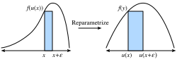
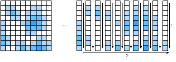

# Integralinis skaičiavimas
:label:`sec_integral_calculus`

Diferencijavimas sudaro tik pusę tradicinio matematinės analizės kurso turinio.  Kita atrama – integravimas – iš pradžių atrodo gana nesusijęs klausimas: „Koks plotas po šia kreive?“  Nors atrodo nesusiję, integravimas glaudžiai susijęs su diferencijavimu per tai, kas vadinama *pagrindine matematinės analizės teorema*.

Mašininio mokymo lygmeniu, apie kurį kalbame šioje knygoje, mums nereikės gilaus integravimo supratimo. Tačiau pateiksime trumpą įvadą, kad paruoštume pagrindą tolesniems taikymams, su kuriais susidursime vėliau.

## Geometrinė interpretacija
Tarkime, turime funkciją $f(x)$.  Paprastumo dėlei darykime prielaidą, kad $f(x)$ yra neneigiama (niekada neįgyja reikšmės, mažesnės už nulį).  Norime pabandyti suprasti: koks plotas yra tarp $f(x)$ ir $x$ ašies?

```{.python .input}
#@tab mxnet
%matplotlib inline
from d2l import mxnet as d2l
from IPython import display
from mpl_toolkits import mplot3d
from mxnet import np, npx
npx.set_np()

x = np.arange(-2, 2, 0.01)
f = np.exp(-x**2)

d2l.set_figsize()
d2l.plt.plot(x, f, color='black')
d2l.plt.fill_between(x.tolist(), f.tolist())
d2l.plt.show()
```

```{.python .input}
#@tab pytorch
%matplotlib inline
from d2l import torch as d2l
from IPython import display
from mpl_toolkits import mplot3d
import torch

x = torch.arange(-2, 2, 0.01)
f = torch.exp(-x**2)

d2l.set_figsize()
d2l.plt.plot(x, f, color='black')
d2l.plt.fill_between(x.tolist(), f.tolist())
d2l.plt.show()
```

```{.python .input}
#@tab tensorflow
%matplotlib inline
from d2l import tensorflow as d2l
from IPython import display
from mpl_toolkits import mplot3d
import tensorflow as tf

x = tf.range(-2, 2, 0.01)
f = tf.exp(-x**2)

d2l.set_figsize()
d2l.plt.plot(x, f, color='black')
d2l.plt.fill_between(x.numpy(), f.numpy())
d2l.plt.show()
```

Dažniausiai šis plotas bus begalinis arba neapibrėžtas (panagrinėkite plotą po $f(x) = x^{2}$), todėl žmonės dažnai kalba apie plotą tarp dviejų ribų, tarkime, $a$ ir $b$.

```{.python .input}
#@tab mxnet
x = np.arange(-2, 2, 0.01)
f = np.exp(-x**2)

d2l.set_figsize()
d2l.plt.plot(x, f, color='black')
d2l.plt.fill_between(x.tolist()[50:250], f.tolist()[50:250])
d2l.plt.show()
```

```{.python .input}
#@tab pytorch
x = torch.arange(-2, 2, 0.01)
f = torch.exp(-x**2)

d2l.set_figsize()
d2l.plt.plot(x, f, color='black')
d2l.plt.fill_between(x.tolist()[50:250], f.tolist()[50:250])
d2l.plt.show()
```

```{.python .input}
#@tab tensorflow
x = tf.range(-2, 2, 0.01)
f = tf.exp(-x**2)

d2l.set_figsize()
d2l.plt.plot(x, f, color='black')
d2l.plt.fill_between(x.numpy()[50:250], f.numpy()[50:250])
d2l.plt.show()
```

Šį plotą žymėsime toliau pateiktu integralo simboliu:

$$
\textrm{Area}(\mathcal{A}) = \int_a^b f(x) \;dx.
$$

Vidinis kintamasis yra fiktyvusis kintamasis, labai panašus į sumos indeksą $\sum$, todėl tai galima ekvivalenčiai užrašyti su bet kokiu mums patinkančiu vidiniu žymeniu:

$$
\int_a^b f(x) \;dx = \int_a^b f(z) \;dz.
$$

Yra tradicinis būdas suprasti, kaip galėtume bandyti aproksimuoti tokius integralus: galime įsivaizduoti, kad sritį tarp $a$ ir $b$ supjaustome į $N$ vertikalių juostelių.  Jei $N$ didelis, kiekvienos juostelės plotą galime aproksimuoti stačiakampiu, o tada sudėti plotus ir gauti visą plotą po kreive.  Pažiūrėkime pavyzdį, kaip tai daroma kode.  Kaip gauti tikrąją reikšmę, pamatysime vėlesniame skyriuje.

```{.python .input}
#@tab mxnet
epsilon = 0.05
a = 0
b = 2

x = np.arange(a, b, epsilon)
f = x / (1 + x**2)

approx = np.sum(epsilon*f)
true = np.log(2) / 2

d2l.set_figsize()
d2l.plt.bar(x.asnumpy(), f.asnumpy(), width=epsilon, align='edge')
d2l.plt.plot(x, f, color='black')
d2l.plt.ylim([0, 1])
d2l.plt.show()

f'approximation: {approx}, truth: {true}'
```

```{.python .input}
#@tab pytorch
epsilon = 0.05
a = 0
b = 2

x = torch.arange(a, b, epsilon)
f = x / (1 + x**2)

approx = torch.sum(epsilon*f)
true = torch.log(torch.tensor([5.])) / 2

d2l.set_figsize()
d2l.plt.bar(x, f, width=epsilon, align='edge')
d2l.plt.plot(x, f, color='black')
d2l.plt.ylim([0, 1])
d2l.plt.show()

f'approximation: {approx}, truth: {true}'
```

```{.python .input}
#@tab tensorflow
epsilon = 0.05
a = 0
b = 2

x = tf.range(a, b, epsilon)
f = x / (1 + x**2)

approx = tf.reduce_sum(epsilon*f)
true = tf.math.log(tf.constant([5.])) / 2

d2l.set_figsize()
d2l.plt.bar(x, f, width=epsilon, align='edge')
d2l.plt.plot(x, f, color='black')
d2l.plt.ylim([0, 1])
d2l.plt.show()

f'approximation: {approx}, truth: {true}'
```

Problema ta, kad nors tai galima padaryti skaitiškai, analitiškai šį metodą galime taikyti tik paprasčiausioms funkcijoms, tokioms kaip

$$
\int_a^b x \;dx.
$$

Bet kas šiek tiek sudėtingesnio, kaip mūsų pavyzdys iš aukščiau pateikto kodo

$$
\int_a^b \frac{x}{1+x^{2}} \;dx.
$$

yra už to, ką galime išspręsti tokiu tiesioginiu metodu.

Vietoj to pasirinksime kitą požiūrį.  Dirbsime intuityviai su ploto sąvoka ir išmoksime pagrindinę skaičiavimo priemonę, naudojamą integralams rasti: *pagrindinę matematinės analizės teoremą*.   Tai bus mūsų integravimo studijų pagrindas.

## Pagrindinė matematinės analizės teorema

Kad giliau įsigilintume į integravimo teoriją, įveskime funkciją

$$
F(x) = \int_0^x f(y) dy.
$$

Ši funkcija matuoja plotą tarp $0$ ir $x$, priklausomai nuo to, kaip keičiame $x$.  Atkreipkite dėmesį, kad tai yra viskas, ko mums reikia, nes

$$
\int_a^b f(x) \;dx = F(b) - F(a).
$$

Tai yra matematinis užkodavimas fakto, kad galime išmatuoti plotą iki tolimesnio galo, o tada atimti plotą iki artimesnio galo, kaip parodyta :numref:`fig_area-subtract`.


:label:`fig_area-subtract`

Taigi bet kurio intervalo integralą galime rasti išsiaiškinę, kas yra $F(x)$.

Tam apsvarstykime eksperimentą.  Kaip dažnai darome matematinėje analizėje, įsivaizduokime, kas nutinka, kai reikšmę šiek tiek pastumiame.  Iš aukščiau pateiktos pastabos žinome, kad

$$
F(x+\epsilon) - F(x) = \int_x^{x+\epsilon} f(y) \; dy.
$$

Tai mums sako, kad funkcija pasikeičia dydžiu, lygiu plotui po mažyte funkcijos juostele.

Čia daroma aproksimacija.  Jei žiūrime į tokią mažytę ploto juostelę, atrodo, kad šis plotas yra artimas stačiakampio plotui, kurio aukštis lygus $f(x)$ reikšmei, o pagrindo plotis yra $\epsilon$.  Iš tiesų galima parodyti, kad kai $\epsilon \rightarrow 0$, ši aproksimacija tampa vis geresnė.  Taigi galime daryti išvadą:

$$
F(x+\epsilon) - F(x) \approx \epsilon f(x).
$$

Tačiau dabar galime pastebėti: tai yra būtent tas dėsningumas, kurio tikėtumėmės skaičiuodami $F$ išvestinę!  Taigi matome tokį gana stulbinantį faktą:

$$
\frac{dF}{dx}(x) = f(x).
$$

Tai yra *pagrindinė matematinės analizės teorema*.  Ją galime užrašyti išplėsta forma
$$\frac{d}{dx}\int_0^x  f(y) \; dy = f(x).$$
:eqlabel:`eq_ftc`

Ji ploto radimo sąvoką (*a priori* gana sunkią) suveda į teiginį apie išvestines (kažką daug geriau suprantama).  Paskutinė pastaba, kurią turime padaryti: tai mums nepasako, kokia tiksliai yra $F(x)$.  Iš tiesų $F(x) + C$ su bet kuria $C$ turi tą pačią išvestinę.  Tai integravimo teorijos gyvenimiška tiesa.  Laimei, atkreipkite dėmesį, kad dirbant su apibrėžtiniais integralais konstantos išnyksta, todėl rezultatui nėra svarbios.

$$
\int_a^b f(x) \; dx = (F(b) + C) - (F(a) + C) = F(b) - F(a).
$$

Tai gali atrodyti kaip abstraktus niekas, bet akimirkai įvertinkime, kad tai mums suteikė visiškai naują požiūrį į integralų skaičiavimą.  Mūsų tikslas nebėra atlikti kažkokį pjaustymo ir sumavimo procesą ploto atkūrimui, o tereikia rasti funkciją, kurios išvestinė yra turima funkcija!  Tai neįtikėtina, nes dabar galime išvardyti daugybę gana sunkių integralų tiesiog apverčiant lentelę iš :numref:`sec_derivative_table`.  Pavyzdžiui, žinome, kad $x^{n}$ išvestinė yra $nx^{n-1}$.  Taigi pagal pagrindinę teoremą :eqref:`eq_ftc` galime sakyti, kad

$$
\int_0^{x} ny^{n-1} \; dy = x^n - 0^n = x^n.
$$

Panašiai žinome, kad $e^{x}$ išvestinė yra ji pati, taigi tai reiškia

$$
\int_0^{x} e^{x} \; dx = e^{x} - e^{0} = e^x - 1.
$$

Šitaip galime plėtoti visą integravimo teoriją laisvai pasitelkdami diferencialinio skaičiavimo idėjas.  Kiekviena integravimo taisyklė išplaukia iš šio vieno fakto.

## Kintamųjų keitimas
:label:`subsec_integral_example`

Kaip ir su diferencijavimu, yra keletas taisyklių, kurios padaro integralų skaičiavimą lengvesnį.  Iš tiesų kiekviena diferencialinio skaičiavimo taisyklė (kaip sandaugos, sumos ir grandinės taisyklės) turi atitinkamą integralinio skaičiavimo taisyklę (integravimas dalimis, integravimo tiesiškumas ir kintamųjų keitimo formulė atitinkamai).  Šiame skyrelyje pasinersime į, galima sakyti, svarbiausią iš sąrašo: kintamųjų keitimo formulę.

Pirmiausia tarkime, turime funkciją, kuri pati yra integralas:

$$
F(x) = \int_0^x f(y) \; dy.
$$

Tarkime, norime sužinoti, kaip ši funkcija atrodo, kai ją sukomponuojame su kita ir gauname $F(u(x))$.  Pagal grandinės taisyklę žinome

$$
\frac{d}{dx}F(u(x)) = \frac{dF}{du}(u(x))\cdot \frac{du}{dx}.
$$

Tai galime paversti teiginiu apie integravimą naudodami pagrindinę teoremą :eqref:`eq_ftc`, kaip aukščiau.  Gauname

$$
F(u(x)) - F(u(0)) = \int_0^x \frac{dF}{du}(u(y))\cdot \frac{du}{dy} \;dy.
$$

Prisiminę, kad $F$ pati yra integralas, gauname, kad kairiąją pusę galima perrašyti kaip

$$
\int_{u(0)}^{u(x)} f(y) \; dy = \int_0^x \frac{dF}{du}(u(y))\cdot \frac{du}{dy} \;dy.
$$

Panašiai, prisiminę, kad $F$ yra integralas, galime atpažinti, kad $\frac{dF}{dx} = f$ pagal pagrindinę teoremą :eqref:`eq_ftc`, todėl galime daryti išvadą

$$\int_{u(0)}^{u(x)} f(y) \; dy = \int_0^x f(u(y))\cdot \frac{du}{dy} \;dy.$$
:eqlabel:`eq_change_var`

Tai yra *kintamųjų keitimo* formulė.

Intuityvesniam išvedimui panagrinėkime, kas nutinka imant $f(u(x))$ integralą tarp $x$ ir $x+\epsilon$. Mažam $\epsilon$ šis integralas yra apytiksliai $\epsilon f(u(x))$ – atitinkamo stačiakampio plotas.  Dabar palyginkime tai su $f(y)$ integralu nuo $u(x)$ iki $u(x+\epsilon)$.  Žinome, kad $u(x+\epsilon) \approx u(x) + \epsilon \frac{du}{dx}(x)$, todėl šio stačiakampio plotas yra apytiksliai $\epsilon \frac{du}{dx}(x)f(u(x))$.  Taigi, kad šių dviejų stačiakampių plotai sutaptų, pirmąjį turime padauginti iš $\frac{du}{dx}(x)$, kaip pavaizduota :numref:`fig_rect-transform`.


:label:`fig_rect-transform`

Tai mums sako, kad

$$
\int_x^{x+\epsilon} f(u(y))\frac{du}{dy}(y)\;dy = \int_{u(x)}^{u(x+\epsilon)} f(y) \; dy.
$$

Tai yra kintamųjų keitimo formulė, išreikšta vienam mažam stačiakampiui.

Jei $u(x)$ ir $f(x)$ tinkamai pasirinktos, tai gali leisti apskaičiuoti neįtikėtinai sudėtingus integralus.  Pavyzdžiui, jei pasirinktume $f(y) = 1$ ir $u(x) = e^{-x^{2}}$ (tai reiškia $\frac{du}{dx}(x) = -2xe^{-x^{2}}$), galime parodyti, kad

$$
e^{-1} - 1 = \int_{e^{-0}}^{e^{-1}} 1 \; dy = -2\int_0^{1} ye^{-y^2}\;dy,
$$

taigi pertvarkę gauname, kad

$$
\int_0^{1} ye^{-y^2}\; dy = \frac{1-e^{-1}}{2}.
$$

## Pastaba dėl ženklų susitarimų

Budrūs skaitytojai pastebės kai ką keisto aukščiau pateiktuose skaičiavimuose.  Būtent tokie skaičiavimai kaip

$$
\int_{e^{-0}}^{e^{-1}} 1 \; dy = e^{-1} -1 < 0,
$$

gali duoti neigiamus skaičius.  Galvojant apie plotus, gali atrodyti keista matyti neigiamą reikšmę, todėl verta išsiaiškinti, koks yra susitarimas.

Matematikai naudoja ženklinio ploto sąvoką.  Ji pasireiškia dviem būdais.  Pirma, jei nagrinėjame funkciją $f(x)$, kuri kartais yra mažesnė už nulį, tai plotas taip pat bus neigiamas.  Pavyzdžiui

$$
\int_0^{1} (-1)\;dx = -1.
$$

Panašiai integralai, einantys iš dešinės į kairę, o ne iš kairės į dešinę, taip pat laikomi neigiamais plotais

$$
\int_0^{-1} 1\; dx = -1.
$$

Standartinis plotas (iš kairės į dešinę teigiamos funkcijos) visada teigiamas.  Viskas, kas gaunama jį apvertus (tarkime, apvertus per $x$ ašį ir gavus neigiamo skaičiaus integralą arba apvertus per $y$ ašį ir gavus integralą neteisinga tvarka), duos neigiamą plotą.  Ir iš tiesų, apvertus du kartus, gauname dvi neigiamas ženklų poras, kurios viena kitą panaikina, ir plotas teigiamas

$$
\int_0^{-1} (-1)\;dx =  1.
$$

Jei ši diskusija skamba pažįstamai – taip ir yra!  :numref:`sec_geometry-linear-algebraic-ops` aptarėme, kaip determinantas panašiai atspindi ženklinį plotą.

## Daugialypiai integralai
Kai kuriais atvejais mums reikės dirbti aukštesnėse dimensijose.  Pavyzdžiui, tarkime, turime dviejų kintamųjų funkciją, pvz., $f(x, y)$, ir norime sužinoti tūrį po $f$, kai $x$ kinta intervale $[a, b]$, o $y$ – intervale $[c, d]$.

```{.python .input}
#@tab mxnet
# Construct grid and compute function
x, y = np.meshgrid(np.linspace(-2, 2, 101), np.linspace(-2, 2, 101),
                   indexing='ij')
z = np.exp(- x**2 - y**2)

# Plot function
ax = d2l.plt.figure().add_subplot(111, projection='3d')
ax.plot_wireframe(x.asnumpy(), y.asnumpy(), z.asnumpy())
d2l.plt.xlabel('x')
d2l.plt.ylabel('y')
d2l.plt.xticks([-2, -1, 0, 1, 2])
d2l.plt.yticks([-2, -1, 0, 1, 2])
d2l.set_figsize()
ax.set_xlim(-2, 2)
ax.set_ylim(-2, 2)
ax.set_zlim(0, 1)
ax.dist = 12
```

```{.python .input}
#@tab pytorch
# Construct grid and compute function
x, y = torch.meshgrid(torch.linspace(-2, 2, 101), torch.linspace(-2, 2, 101))
z = torch.exp(- x**2 - y**2)

# Plot function
ax = d2l.plt.figure().add_subplot(111, projection='3d')
ax.plot_wireframe(x, y, z)
d2l.plt.xlabel('x')
d2l.plt.ylabel('y')
d2l.plt.xticks([-2, -1, 0, 1, 2])
d2l.plt.yticks([-2, -1, 0, 1, 2])
d2l.set_figsize()
ax.set_xlim(-2, 2)
ax.set_ylim(-2, 2)
ax.set_zlim(0, 1)
ax.dist = 12
```

```{.python .input}
#@tab tensorflow
# Construct grid and compute function
x, y = tf.meshgrid(tf.linspace(-2., 2., 101), tf.linspace(-2., 2., 101))
z = tf.exp(- x**2 - y**2)

# Plot function
ax = d2l.plt.figure().add_subplot(111, projection='3d')
ax.plot_wireframe(x, y, z)
d2l.plt.xlabel('x')
d2l.plt.ylabel('y')
d2l.plt.xticks([-2, -1, 0, 1, 2])
d2l.plt.yticks([-2, -1, 0, 1, 2])
d2l.set_figsize()
ax.set_xlim(-2, 2)
ax.set_ylim(-2, 2)
ax.set_zlim(0, 1)
ax.dist = 12
```

Tai užrašome kaip

$$
\int_{[a, b]\times[c, d]} f(x, y)\;dx\;dy.
$$

Tarkime, norime apskaičiuoti šį integralą.  Teigiu, kad tai galime padaryti iteratyviai apskaičiuodami pirmiausia integralą pagal $x$, o tada pereidami prie integralo pagal $y$, t. y.

$$
\int_{[a, b]\times[c, d]} f(x, y)\;dx\;dy = \int_c^{d} \left(\int_a^{b} f(x, y) \;dx\right) \; dy.
$$

Pažiūrėkime, kodėl taip yra.

Panagrinėkime aukščiau pateiktą paveikslą, kuriame funkciją padalijome į $\epsilon \times \epsilon$ kvadratus, kuriuos indeksuosime sveikaisiais koordinatėmis $i, j$.  Šiuo atveju mūsų integralas yra apytiksliai

$$
\sum_{i, j} \epsilon^{2} f(\epsilon i, \epsilon j).
$$

Kai uždavinį diskretizuojame, galime sudėti reikšmes šiuose kvadratuose bet kokia tvarka ir nesijaudinti, kad reikšmės pasikeis.  Tai iliustruota :numref:`fig_sum-order`.  Visų pirma galime sakyti, kad

$$
 \sum _ {j} \epsilon \left(\sum_{i} \epsilon f(\epsilon i, \epsilon j)\right).
$$


:label:`fig_sum-order`

Vidinė suma yra būtent integralo diskretizacija

$$
G(\epsilon j) = \int _a^{b} f(x, \epsilon j) \; dx.
$$

Galiausiai atkreipkite dėmesį, kad jei sujungsime šias dvi išraiškas, gausime

$$
\sum _ {j} \epsilon G(\epsilon j) \approx \int _ {c}^{d} G(y) \; dy = \int _ {[a, b]\times[c, d]} f(x, y)\;dx\;dy.
$$

Taigi viską sudėję gauname, kad

$$
\int _ {[a, b]\times[c, d]} f(x, y)\;dx\;dy = \int _ c^{d} \left(\int _ a^{b} f(x, y) \;dx\right) \; dy.
$$

Atkreipkite dėmesį, kad po diskretizavimo viskas, ką padarėme, buvo tiesiog pakeista skaičių sąrašo sudėjimo tvarka.  Dėl to gali atrodyti, kad tai niekis, tačiau šis rezultatas (vadinamas *Fubini teorema*) ne visada teisingas!  Mašininiame mokyme sutinkamai matematikai (tolydžioms funkcijoms) nėra ko nerimauti, tačiau galima sukurti pavyzdžių, kur jis neteisingas (pavyzdžiui, funkcija $f(x, y) = xy(x^2-y^2)/(x^2+y^2)^3$ stačiakampyje $[0,2]\times[0,1]$).

Atkreipkite dėmesį, kad pasirinkimas pirmiausia integruoti pagal $x$, o tada pagal $y$ buvo savavališkas.  Lygiai taip pat galėjome pasirinkti pirmiausia $y$, o tada $x$ ir pamatyti, kad

$$
\int _ {[a, b]\times[c, d]} f(x, y)\;dx\;dy = \int _ a^{b} \left(\int _ c^{d} f(x, y) \;dy\right) \; dx.
$$

Dažnai suglaudinsime į vektorinį žymėjimą ir sakysime, kad $U = [a, b]\times [c, d]$ atveju tai yra

$$
\int _ U f(\mathbf{x})\;d\mathbf{x}.
$$

## Kintamųjų keitimas daugialypiuose integraluose
Kaip su vienu kintamuoju :eqref:`eq_change_var`, galimybė keisti kintamuosius aukštesnės dimensijos integrale yra svarbi priemonė.  Apibendrinkime rezultatą be išvedimo.

Mums reikia funkcijos, kuri pakeičia mūsų integravimo srities parametrizavimą.  Galime paimti $\phi : \mathbb{R}^n \rightarrow \mathbb{R}^n$, t. y. bet kurią funkciją, priimančią $n$ realiųjų kintamųjų ir grąžinančią kitus $n$.  Kad išraiškos būtų tvarkingos, darysime prielaidą, kad $\phi$ yra *injekcinė*, t. y. niekada nesusilanksto pati su savimi ($\phi(\mathbf{x}) = \phi(\mathbf{y}) \implies \mathbf{x} = \mathbf{y}$).

Šiuo atveju galime sakyti, kad

$$
\int _ {\phi(U)} f(\mathbf{x})\;d\mathbf{x} = \int _ {U} f(\phi(\mathbf{x})) \left|\det(D\phi(\mathbf{x}))\right|\;d\mathbf{x}.
$$

kur $D\phi$ yra $\phi$ *Jakobio matrica*, t. y. dalinių išvestinių matrica funkcijos $\boldsymbol{\phi} = (\phi_1(x_1, \ldots, x_n), \ldots, \phi_n(x_1, \ldots, x_n))$,

$$
D\boldsymbol{\phi} = \begin{bmatrix}
\frac{\partial \phi _ 1}{\partial x _ 1} & \cdots & \frac{\partial \phi _ 1}{\partial x _ n} \\
\vdots & \ddots & \vdots \\
\frac{\partial \phi _ n}{\partial x _ 1} & \cdots & \frac{\partial \phi _ n}{\partial x _ n}
\end{bmatrix}.
$$

Atidžiai pažiūrėję matome, kad tai panašu į vieno kintamojo grandinės taisyklę :eqref:`eq_change_var`, tik narį $\frac{du}{dx}(x)$ pakeitėme nariu $\left|\det(D\phi(\mathbf{x}))\right|$.  Pažiūrėkime, kaip galime interpretuoti šį narį.  Prisiminkite, kad narys $\frac{du}{dx}(x)$ buvo skirtas pasakyti, kiek pritaikę $u$ ištempėme savo $x$ ašį.  Tas pats procesas aukštesnėse dimensijose yra nustatyti, kiek pritaikę $\boldsymbol{\phi}$ ištempiame mažo kvadrato (arba mažo *hiperkubo*) plotą (arba tūrį, arba hipertūrį).  Jei $\boldsymbol{\phi}$ būtų daugyba iš matricos, jau žinome, kad atsakymą duoda determinantas.

Šiek tiek padirbėjus galima parodyti, kad *Jakobio matrica* suteikia geriausią daugelio kintamųjų funkcijos $\boldsymbol{\phi}$ aproksimaciją taške matrica, panašiai kaip galėjome aproksimuoti tiesėmis ar plokštumomis naudodami išvestines ir gradientus. Taigi Jakobio matricos determinantas tiksliai atspindi mastelio koeficientą, kurį nustatėme vienoje dimensijoje.

Reikia šiek tiek darbo, kad šias detales užpildytume, todėl nesijaudinkite, jei dabar jos neaiškios.  Pažiūrėkime bent vieną pavyzdį, kurį panaudosime vėliau.  Panagrinėkime integralą

$$
\int _ {-\infty}^{\infty} \int _ {-\infty}^{\infty} e^{-x^{2}-y^{2}} \;dx\;dy.
$$

Žaidžiant su šiuo integralu tiesiogiai niekur nenueisime, tačiau pakeitę kintamuosius galime gerokai pasistūmėti.  Jei imsime $\boldsymbol{\phi}(r, \theta) = (r \cos(\theta),  r\sin(\theta))$ (t. y. $x = r \cos(\theta)$, $y = r \sin(\theta)$), tada galime pritaikyti kintamųjų keitimo formulę ir pamatyti, kad tai yra tas pats, kas

$$
\int _ 0^\infty \int_0 ^ {2\pi} e^{-r^{2}} \left|\det(D\mathbf{\phi}(\mathbf{x}))\right|\;d\theta\;dr,
$$

kur

$$
\left|\det(D\mathbf{\phi}(\mathbf{x}))\right| = \left|\det\begin{bmatrix}
\cos(\theta) & -r\sin(\theta) \\
\sin(\theta) & r\cos(\theta)
\end{bmatrix}\right| = r(\cos^{2}(\theta) + \sin^{2}(\theta)) = r.
$$

Taigi integralas yra

$$
\int _ 0^\infty \int _ 0 ^ {2\pi} re^{-r^{2}} \;d\theta\;dr = 2\pi\int _ 0^\infty re^{-r^{2}} \;dr = \pi,
$$

kur paskutinė lygybė išplaukia iš to paties skaičiavimo, kurį naudojome :numref:`subsec_integral_example` skyrelyje.

Šį integralą sutiksime vėl, kai :numref:`sec_random_variables` nagrinėsime tolydžiuosius atsitiktinius dydžius.

## Santrauka

* Integravimo teorija leidžia atsakyti į klausimus apie plotus ar tūrius.
* Pagrindinė matematinės analizės teorema leidžia pasinaudoti žiniomis apie išvestines plotams skaičiuoti, remiantis pastebėjimu, kad ploto iki tam tikro taško išvestinę duoda integruojamos funkcijos reikšmė.
* Aukštesnių dimensijų integralus galima apskaičiuoti iteruojant vieno kintamojo integralus.

## Pratimai
1. Kam lygus $\int_1^2 \frac{1}{x} \;dx$?
2. Naudodami kintamųjų keitimo formulę, suintegruokite $\int_0^{\sqrt{\pi}}x\sin(x^2)\;dx$.
3. Kam lygus $\int_{[0,1]^2} xy \;dx\;dy$?
4. Naudodami kintamųjų keitimo formulę, apskaičiuokite $\int_0^2\int_0^1xy(x^2-y^2)/(x^2+y^2)^3\;dy\;dx$ ir $\int_0^1\int_0^2f(x, y) = xy(x^2-y^2)/(x^2+y^2)^3\;dx\;dy$ ir pamatykite, kad jie skiriasi.

:begin_tab:`mxnet`
[Diskusijos](https://discuss.d2l.ai/t/414)
:end_tab:

:begin_tab:`pytorch`
[Diskusijos](https://discuss.d2l.ai/t/1092)
:end_tab:


:begin_tab:`tensorflow`
[Diskusijos](https://discuss.d2l.ai/t/1093)
:end_tab:
