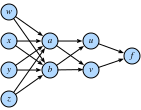
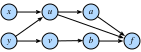

# Daugelio kintamųjų matematinė analizė
:label:`sec_multivariable_calculus`

Dabar, kai gana gerai suprantame vieno kintamojo funkcijos išvestines, grįžkime prie pradinio klausimo, kuriame nagrinėjome nuostolių funkciją, priklausančią nuo galbūt milijardų parametrų.

## Aukštesnių dimensijų diferencijavimas
:numref:`sec_single_variable_calculus` mums sako, kad jei pakeisime vieną iš šių milijardų parametrų, visų kitų nekeisdami, žinome, kas nutiks!  Tai yra ne kas kita, kaip vieno kintamojo funkcija, todėl galime užrašyti

$$L(w_1+\epsilon_1, w_2, \ldots, w_N) \approx L(w_1, w_2, \ldots, w_N) + \epsilon_1 \frac{d}{dw_1} L(w_1, w_2, \ldots, w_N).$$
:eqlabel:`eq_part_der`

Išvestinę pagal vieną kintamąjį, kitus kintamuosius fiksuodami, vadinsime *daline išvestine*, o išvestinei :eqref:`eq_part_der` žymėti naudosime žymenį $\frac{\partial}{\partial w_1}$.

Dabar paimkime tai ir šiek tiek pakeiskime $w_2$ į $w_2 + \epsilon_2$:

$$
\begin{aligned}
L(w_1+\epsilon_1, w_2+\epsilon_2, \ldots, w_N) & \approx L(w_1, w_2+\epsilon_2, \ldots, w_N) + \epsilon_1 \frac{\partial}{\partial w_1} L(w_1, w_2+\epsilon_2, \ldots, w_N+\epsilon_N) \\
& \approx L(w_1, w_2, \ldots, w_N) \\
& \quad + \epsilon_2\frac{\partial}{\partial w_2} L(w_1, w_2, \ldots, w_N) \\
& \quad + \epsilon_1 \frac{\partial}{\partial w_1} L(w_1, w_2, \ldots, w_N) \\
& \quad + \epsilon_1\epsilon_2\frac{\partial}{\partial w_2}\frac{\partial}{\partial w_1} L(w_1, w_2, \ldots, w_N) \\
& \approx L(w_1, w_2, \ldots, w_N) \\
& \quad + \epsilon_2\frac{\partial}{\partial w_2} L(w_1, w_2, \ldots, w_N) \\
& \quad + \epsilon_1 \frac{\partial}{\partial w_1} L(w_1, w_2, \ldots, w_N).
\end{aligned}
$$

Vėl pasinaudojome idėja, kad $\epsilon_1\epsilon_2$ yra aukštesnės eilės narys, kurį galime atmesti taip pat, kaip atmetėme $\epsilon^{2}$ ankstesniame skyriuje, kartu su tuo, ką matėme :eqref:`eq_part_der`.  Tęsdami šitaip, galime užrašyti, kad

$$
L(w_1+\epsilon_1, w_2+\epsilon_2, \ldots, w_N+\epsilon_N) \approx L(w_1, w_2, \ldots, w_N) + \sum_i \epsilon_i \frac{\partial}{\partial w_i} L(w_1, w_2, \ldots, w_N).
$$

Tai gali atrodyti kaip netvarka, bet galime tai padaryti pažįstamesnį pastebėję, kad dešinėje esanti suma atrodo lygiai kaip skaliarinė sandauga, taigi jei pažymėsime

$$
\boldsymbol{\epsilon} = [\epsilon_1, \ldots, \epsilon_N]^\top \; \textrm{and} \;
\nabla_{\mathbf{x}} L = \left[\frac{\partial L}{\partial x_1}, \ldots, \frac{\partial L}{\partial x_N}\right]^\top,
$$

tada

$$L(\mathbf{w} + \boldsymbol{\epsilon}) \approx L(\mathbf{w}) + \boldsymbol{\epsilon}\cdot \nabla_{\mathbf{w}} L(\mathbf{w}).$$
:eqlabel:`eq_nabla_use`

Vektorių $\nabla_{\mathbf{w}} L$ vadinsime $L$ *gradientu*.

Lygtį :eqref:`eq_nabla_use` verta akimirką apmąstyti.  Ji turi būtent tokį formatą, su kokiu susidūrėme vienoje dimensijoje, tik viską pavertėme vektoriais ir skaliarinėmis sandaugomis.  Ji leidžia apytiksliai pasakyti, kaip pasikeis funkcija $L$ esant bet kokiam įvesties trikdžiui.  Kaip pamatysime kitame skyrelyje, tai suteiks svarbią priemonę geometriškai suprasti, kaip galime mokytis naudodami gradiente esančią informaciją.

Bet pirmiausia pažiūrėkime šią aproksimaciją veikiant su pavyzdžiu.  Tarkime, dirbame su funkcija

$$
f(x, y) = \log(e^x + e^y) \textrm{ with gradient } \nabla f (x, y) = \left[\frac{e^x}{e^x+e^y}, \frac{e^y}{e^x+e^y}\right].
$$

Jei pažiūrėsime į tašką, pavyzdžiui, $(0, \log(2))$, matome, kad

$$
f(x, y) = \log(3) \textrm{ with gradient } \nabla f (x, y) = \left[\frac{1}{3}, \frac{2}{3}\right].
$$

Taigi, jei norime aproksimuoti $f$ taške $(\epsilon_1, \log(2) + \epsilon_2)$, matome, kad turėtume turėti tokį konkretų :eqref:`eq_nabla_use` atvejį:

$$
f(\epsilon_1, \log(2) + \epsilon_2) \approx \log(3) + \frac{1}{3}\epsilon_1 + \frac{2}{3}\epsilon_2.
$$

Tai galime patikrinti kode ir pamatyti, kiek gera aproksimacija.

```{.python .input}
#@tab mxnet
%matplotlib inline
from d2l import mxnet as d2l
from IPython import display
from mpl_toolkits import mplot3d
from mxnet import autograd, np, npx
npx.set_np()

def f(x, y):
    return np.log(np.exp(x) + np.exp(y))
def grad_f(x, y):
    return np.array([np.exp(x) / (np.exp(x) + np.exp(y)),
                     np.exp(y) / (np.exp(x) + np.exp(y))])

epsilon = np.array([0.01, -0.03])
grad_approx = f(0, np.log(2)) + epsilon.dot(grad_f(0, np.log(2)))
true_value = f(0 + epsilon[0], np.log(2) + epsilon[1])
f'approximation: {grad_approx}, true Value: {true_value}'
```

```{.python .input}
#@tab pytorch
%matplotlib inline
from d2l import torch as d2l
from IPython import display
from mpl_toolkits import mplot3d
import torch
import numpy as np

def f(x, y):
    return torch.log(torch.exp(x) + torch.exp(y))
def grad_f(x, y):
    return torch.tensor([torch.exp(x) / (torch.exp(x) + torch.exp(y)),
                     torch.exp(y) / (torch.exp(x) + torch.exp(y))])

epsilon = torch.tensor([0.01, -0.03])
grad_approx = f(torch.tensor([0.]), torch.log(
    torch.tensor([2.]))) + epsilon.dot(
    grad_f(torch.tensor([0.]), torch.log(torch.tensor(2.))))
true_value = f(torch.tensor([0.]) + epsilon[0], torch.log(
    torch.tensor([2.])) + epsilon[1])
f'approximation: {grad_approx}, true Value: {true_value}'
```

```{.python .input}
#@tab tensorflow
%matplotlib inline
from d2l import tensorflow as d2l
from IPython import display
from mpl_toolkits import mplot3d
import tensorflow as tf
import numpy as np

def f(x, y):
    return tf.math.log(tf.exp(x) + tf.exp(y))
def grad_f(x, y):
    return tf.constant([(tf.exp(x) / (tf.exp(x) + tf.exp(y))).numpy(),
                        (tf.exp(y) / (tf.exp(x) + tf.exp(y))).numpy()])

epsilon = tf.constant([0.01, -0.03])
grad_approx = f(tf.constant([0.]), tf.math.log(
    tf.constant([2.]))) + tf.tensordot(
    epsilon, grad_f(tf.constant([0.]), tf.math.log(tf.constant(2.))), axes=1)
true_value = f(tf.constant([0.]) + epsilon[0], tf.math.log(
    tf.constant([2.])) + epsilon[1])
f'approximation: {grad_approx}, true Value: {true_value}'
```

## Gradientų geometrija ir gradientinis nusileidimas
Dar kartą panagrinėkime išraišką iš :eqref:`eq_nabla_use`:

$$
L(\mathbf{w} + \boldsymbol{\epsilon}) \approx L(\mathbf{w}) + \boldsymbol{\epsilon}\cdot \nabla_{\mathbf{w}} L(\mathbf{w}).
$$

Tarkime, noriu tai panaudoti, kad padėčiau minimizuoti savo nuostolius $L$.  Pirmiausia geometriškai suprasime gradientinio nusileidimo algoritmą, pirmą kartą aprašytą :numref:`sec_autograd`. Darysime štai ką:

1. Pradėti nuo atsitiktinai pasirinktų pradinių parametrų $\mathbf{w}$.
2. Rasti kryptį $\mathbf{v}$, kuria $L$ taške $\mathbf{w}$ mažėja greičiausiai.
3. Žengti mažą žingsnį ta kryptimi: $\mathbf{w} \rightarrow \mathbf{w} + \epsilon\mathbf{v}$.
4. Kartoti.

Vienintelis dalykas, kurį tiksliai nežinome, kaip padaryti, yra vektoriaus $\mathbf{v}$ apskaičiavimas antrame žingsnyje.  Tokią kryptį vadinsime *stačiausio nusileidimo kryptimi*.  Naudodami geometrinį skaliarinių sandaugų supratimą iš :numref:`sec_geometry-linear-algebraic-ops`, matome, kad :eqref:`eq_nabla_use` galime perrašyti kaip

$$
L(\mathbf{w} + \mathbf{v}) \approx L(\mathbf{w}) + \mathbf{v}\cdot \nabla_{\mathbf{w}} L(\mathbf{w}) = L(\mathbf{w}) + \|\nabla_{\mathbf{w}} L(\mathbf{w})\|\cos(\theta).
$$

Atkreipkite dėmesį, kad patogumo dėlei kryptį paėmėme vienetinio ilgio ir $\theta$ naudojome kampui tarp $\mathbf{v}$ ir $\nabla_{\mathbf{w}} L(\mathbf{w})$ žymėti.  Jei norime rasti kryptį, kuria $L$ mažėja kuo greičiau, norime, kad ši išraiška būtų kuo neigiamesnė.  Vienintelis būdas, kuriuo mūsų pasirinkta kryptis patenka į šią lygtį, yra per $\cos(\theta)$, todėl norime, kad šis kosinusas būtų kuo neigiamesnis.  Dabar, prisiminę kosinuso formą, galime tai padaryti kuo neigiamesnį padarę $\cos(\theta) = -1$, arba, ekvivalenčiai, kad kampas tarp gradiento ir mūsų pasirinktos krypties būtų $\pi$ radianų, arba $180$ laipsnių.  Vienintelis būdas tai pasiekti – judėti tiksliai priešinga kryptimi: pasirinkti $\mathbf{v}$, nukreiptą tiksliai priešinga kryptimi nei $\nabla_{\mathbf{w}} L(\mathbf{w})$!

Tai mus atveda prie vienos svarbiausių mašininio mokymo matematinių sąvokų: stačiausio nusileidimo kryptis yra $-\nabla_{\mathbf{w}}L(\mathbf{w})$ kryptis.  Taigi mūsų neformalų algoritmą galima perrašyti taip.

1. Pradėti nuo atsitiktinai pasirinktų pradinių parametrų $\mathbf{w}$.
2. Apskaičiuoti $\nabla_{\mathbf{w}} L(\mathbf{w})$.
3. Žengti mažą žingsnį priešinga tai krypčiai: $\mathbf{w} \leftarrow \mathbf{w} - \epsilon\nabla_{\mathbf{w}} L(\mathbf{w})$.
4. Kartoti.


Šį pagrindinį algoritmą daugelis tyrėjų įvairiais būdais modifikavo ir pritaikė, tačiau visų jų pagrindinė idėja išlieka ta pati.  Naudoti gradientą, kad rastume kryptį, kuria nuostoliai mažėja kuo greičiau, ir atnaujinti parametrus žengiant žingsnį ta kryptimi.

## Pastaba apie matematinį optimizavimą
Visoje šioje knygoje daugiausia dėmesio skiriame skaitiniams optimizavimo metodams dėl praktinės priežasties: visos giliojo mokymosi aplinkoje sutinkamos funkcijos yra per sudėtingos, kad jas būtų galima minimizuoti aiškiai.

Vis dėlto naudinga pagalvoti, ką aukščiau gautas geometrinis supratimas mums sako apie funkcijų optimizavimą tiesiogiai.

Tarkime, norime rasti reikšmę $\mathbf{x}_0$, kuri minimizuoja kokią nors funkciją $L(\mathbf{x})$.  Tarkime, be to, kad kažkas mums pateikia reikšmę ir sako, kad tai reikšmė, minimizuojanti $L$.  Ar galime ką nors patikrinti, kad pamatytume, ar jų atsakymas bent jau įtikėtinas?

Vėl panagrinėkime :eqref:`eq_nabla_use`:
$$
L(\mathbf{x}_0 + \boldsymbol{\epsilon}) \approx L(\mathbf{x}_0) + \boldsymbol{\epsilon}\cdot \nabla_{\mathbf{x}} L(\mathbf{x}_0).
$$

Jei gradientas nėra nulinis, žinome, kad galime žengti žingsnį kryptimi $-\epsilon \nabla_{\mathbf{x}} L(\mathbf{x}_0)$ ir rasti mažesnę $L$ reikšmę.  Taigi, jei tikrai esame minimume, to būti negali!  Galime daryti išvadą, kad jei $\mathbf{x}_0$ yra minimumas, tai $\nabla_{\mathbf{x}} L(\mathbf{x}_0) = 0$.  Taškus, kuriuose $\nabla_{\mathbf{x}} L(\mathbf{x}_0) = 0$, vadiname *kritiniais taškais*.

Tai gražu, nes kai kuriais retais atvejais *galime* aiškiai rasti visus taškus, kuriuose gradientas lygus nuliui, ir išsirinkti tą, kurio reikšmė mažiausia.

Konkrečiam pavyzdžiui panagrinėkime funkciją
$$
f(x) = 3x^4 - 4x^3 -12x^2.
$$

Ši funkcija turi išvestinę
$$
\frac{df}{dx} = 12x^3 - 12x^2 -24x = 12x(x-2)(x+1).
$$

Vienintelės galimos minimumų vietos yra $x = -1, 0, 2$, kuriose funkcija įgyja atitinkamai reikšmes $-5,0, -32$, todėl galime daryti išvadą, kad funkciją minimizuojame, kai $x = 2$.  Tai patvirtina greitas grafikas.

```{.python .input}
#@tab mxnet
x = np.arange(-2, 3, 0.01)
f = (3 * x**4) - (4 * x**3) - (12 * x**2)

d2l.plot(x, f, 'x', 'f(x)')
```

```{.python .input}
#@tab pytorch
x = torch.arange(-2, 3, 0.01)
f = (3 * x**4) - (4 * x**3) - (12 * x**2)

d2l.plot(x, f, 'x', 'f(x)')
```

```{.python .input}
#@tab tensorflow
x = tf.range(-2, 3, 0.01)
f = (3 * x**4) - (4 * x**3) - (12 * x**2)

d2l.plot(x, f, 'x', 'f(x)')
```

Tai pabrėžia svarbų faktą, kurį verta žinoti dirbant tiek teoriškai, tiek skaitiškai: vieninteliai galimi taškai, kuriuose galime minimizuoti (ar maksimizuoti) funkciją, turės nulinį gradientą, tačiau ne kiekvienas taškas su nuliniu gradientu yra tikrasis *globalusis* minimumas (ar maksimumas).

## Daugelio kintamųjų grandinės taisyklė
Tarkime, turime keturių kintamųjų ($w, x, y$ ir $z$) funkciją, kurią galime gauti sukomponavę daug narių:

$$\begin{aligned}f(u, v) & = (u+v)^{2} \\u(a, b) & = (a+b)^{2}, \qquad v(a, b) = (a-b)^{2}, \\a(w, x, y, z) & = (w+x+y+z)^{2}, \qquad b(w, x, y, z) = (w+x-y-z)^2.\end{aligned}$$
:eqlabel:`eq_multi_func_def`

Tokios lygčių grandinės yra įprastos dirbant su neuroniniais tinklais, todėl esminis dalykas yra suprasti, kaip apskaičiuoti tokių funkcijų gradientus.  Vizualių užuominų apie šį ryšį galime pradėti matyti :numref:`fig_chain-1`, jei pažiūrėsime, kurie kintamieji tiesiogiai susiję vienas su kitu.


:label:`fig_chain-1`

Niekas netrukdo tiesiog sukomponuoti viską iš :eqref:`eq_multi_func_def` ir užrašyti, kad

$$
f(w, x, y, z) = \left(\left((w+x+y+z)^2+(w+x-y-z)^2\right)^2+\left((w+x+y+z)^2-(w+x-y-z)^2\right)^2\right)^2.
$$

Tada išvestinę galėtume paimti tiesiog naudodami vieno kintamojo išvestines, bet tai daryti greitai atsidurtume paskendę narių, iš kurių daugelis kartojasi!  Iš tiesų galima pamatyti, kad, pavyzdžiui:

$$
\begin{aligned}
\frac{\partial f}{\partial w} & = 2 \left(2 \left(2 (w + x + y + z) - 2 (w + x - y - z)\right) \left((w + x + y + z)^{2}- (w + x - y - z)^{2}\right) + \right.\\
& \left. \quad 2 \left(2 (w + x - y - z) + 2 (w + x + y + z)\right) \left((w + x - y - z)^{2}+ (w + x + y + z)^{2}\right)\right) \times \\
& \quad \left(\left((w + x + y + z)^{2}- (w + x - y - z)^2\right)^{2}+ \left((w + x - y - z)^{2}+ (w + x + y + z)^{2}\right)^{2}\right).
\end{aligned}
$$

Jei po to taip pat norėtume apskaičiuoti $\frac{\partial f}{\partial x}$, vėl gautume panašią lygtį su daug pasikartojančių narių ir daug *bendrų* pasikartojančių narių tarp šių dviejų išvestinių.  Tai reiškia didžiulį švaistomo darbo kiekį, ir jei išvestines reikėtų skaičiuoti šitaip, visa giliojo mokymosi revoliucija būtų sustojusi dar neprasidėjusi!


Išskaidykime uždavinį.  Pradėsime bandydami suprasti, kaip $f$ pasikeičia, kai keičiame $a$, iš esmės darydami prielaidą, kad $w, x, y$ ir $z$ visai neegzistuoja.  Samprotausime taip pat, kaip tada, kai pirmą kartą dirbome su gradientu.  Paimkime $a$ ir pridėkime prie jo mažą dydį $\epsilon$.

$$
\begin{aligned}
& f(u(a+\epsilon, b), v(a+\epsilon, b)) \\
\approx & f\left(u(a, b) + \epsilon\frac{\partial u}{\partial a}(a, b), v(a, b) + \epsilon\frac{\partial v}{\partial a}(a, b)\right) \\
\approx & f(u(a, b), v(a, b)) + \epsilon\left[\frac{\partial f}{\partial u}(u(a, b), v(a, b))\frac{\partial u}{\partial a}(a, b) + \frac{\partial f}{\partial v}(u(a, b), v(a, b))\frac{\partial v}{\partial a}(a, b)\right].
\end{aligned}
$$

Pirma eilutė išplaukia iš dalinės išvestinės apibrėžimo, o antra – iš gradiento apibrėžimo.  Žymėjimo požiūriu sunku sekti, kur tiksliai įvertiname kiekvieną išvestinę, kaip išraiškoje $\frac{\partial f}{\partial u}(u(a, b), v(a, b))$, todėl dažnai tai sutrumpiname iki daug lengviau įsimenamos

$$
\frac{\partial f}{\partial a} = \frac{\partial f}{\partial u}\frac{\partial u}{\partial a}+\frac{\partial f}{\partial v}\frac{\partial v}{\partial a}.
$$

Naudinga pagalvoti apie proceso prasmę. Bandome suprasti, kaip formos $f(u(a, b), v(a, b))$ funkcija keičia savo reikšmę keičiantis $a$.  Tai gali vykti dviem keliais: yra kelias $a \rightarrow u \rightarrow f$ ir kelias $a \rightarrow v \rightarrow f$.  Abu šiuos indėlius galime apskaičiuoti pagal grandinės taisyklę: atitinkamai $\frac{\partial w}{\partial u} \cdot \frac{\partial u}{\partial x}$ ir $\frac{\partial w}{\partial v} \cdot \frac{\partial v}{\partial x}$, ir sudėti.

Įsivaizduokite, kad turime kitą funkcijų tinklą, kuriame dešinėje esančios funkcijos priklauso nuo kairėje esančių, su kuriomis jos sujungtos, kaip parodyta :numref:`fig_chain-2`.


:label:`fig_chain-2`

Norėdami apskaičiuoti ką nors panašaus į $\frac{\partial f}{\partial y}$, turime susumuoti per visus (šiuo atveju $3$) kelius nuo $y$ iki $f$, gaudami

$$
\frac{\partial f}{\partial y} = \frac{\partial f}{\partial a} \frac{\partial a}{\partial u} \frac{\partial u}{\partial y} + \frac{\partial f}{\partial u} \frac{\partial u}{\partial y} + \frac{\partial f}{\partial b} \frac{\partial b}{\partial v} \frac{\partial v}{\partial y}.
$$

Šitaip suprasta grandinės taisyklė atneš didelę naudą bandant suprasti, kaip gradientai teka per tinklus ir kodėl įvairūs architektūros sprendimai, tokie kaip LSTM (:numref:`sec_lstm`) ar liekanų sluoksniai (:numref:`sec_resnet`), gali padėti formuoti mokymosi procesą valdydami gradientų tekėjimą.

## Atgalinio sklidimo algoritmas

Grįžkime prie ankstesnio skyrelio pavyzdžio :eqref:`eq_multi_func_def`, kuriame

$$
\begin{aligned}
f(u, v) & = (u+v)^{2} \\
u(a, b) & = (a+b)^{2}, \qquad v(a, b) = (a-b)^{2}, \\
a(w, x, y, z) & = (w+x+y+z)^{2}, \qquad b(w, x, y, z) = (w+x-y-z)^2.
\end{aligned}
$$

Jei norime apskaičiuoti, tarkime, $\frac{\partial f}{\partial w}$, galime pritaikyti daugelio kintamųjų grandinės taisyklę ir gauti:

$$
\begin{aligned}
\frac{\partial f}{\partial w} & = \frac{\partial f}{\partial u}\frac{\partial u}{\partial w} + \frac{\partial f}{\partial v}\frac{\partial v}{\partial w}, \\
\frac{\partial u}{\partial w} & = \frac{\partial u}{\partial a}\frac{\partial a}{\partial w}+\frac{\partial u}{\partial b}\frac{\partial b}{\partial w}, \\
\frac{\partial v}{\partial w} & = \frac{\partial v}{\partial a}\frac{\partial a}{\partial w}+\frac{\partial v}{\partial b}\frac{\partial b}{\partial w}.
\end{aligned}
$$

Pabandykime naudoti šią skaidą $\frac{\partial f}{\partial w}$ apskaičiuoti.  Atkreipkite dėmesį, kad čia mums reikia tik įvairių vieno žingsnio dalinių išvestinių:

$$
\begin{aligned}
\frac{\partial f}{\partial u} = 2(u+v), & \quad\frac{\partial f}{\partial v} = 2(u+v), \\
\frac{\partial u}{\partial a} = 2(a+b), & \quad\frac{\partial u}{\partial b} = 2(a+b), \\
\frac{\partial v}{\partial a} = 2(a-b), & \quad\frac{\partial v}{\partial b} = -2(a-b), \\
\frac{\partial a}{\partial w} = 2(w+x+y+z), & \quad\frac{\partial b}{\partial w} = 2(w+x-y-z).
\end{aligned}
$$

Jei tai užrašysime kodu, ši išraiška tampa gana valdoma.

```{.python .input}
#@tab all
# Compute the value of the function from inputs to outputs
w, x, y, z = -1, 0, -2, 1
a, b = (w + x + y + z)**2, (w + x - y - z)**2
u, v = (a + b)**2, (a - b)**2
f = (u + v)**2
print(f'    f at {w}, {x}, {y}, {z} is {f}')

# Compute the single step partials
df_du, df_dv = 2*(u + v), 2*(u + v)
du_da, du_db, dv_da, dv_db = 2*(a + b), 2*(a + b), 2*(a - b), -2*(a - b)
da_dw, db_dw = 2*(w + x + y + z), 2*(w + x - y - z)

# Compute the final result from inputs to outputs
du_dw, dv_dw = du_da*da_dw + du_db*db_dw, dv_da*da_dw + dv_db*db_dw
df_dw = df_du*du_dw + df_dv*dv_dw
print(f'df/dw at {w}, {x}, {y}, {z} is {df_dw}')
```

Tačiau atkreipkite dėmesį, kad tai vis tiek nepadaro lengvu apskaičiuoti ko nors panašaus į $\frac{\partial f}{\partial x}$.  To priežastis yra *būdas*, kuriuo pasirinkome taikyti grandinės taisyklę.  Jei pažiūrėsime, ką darėme aukščiau, kai tik galėjome, visada palikdavome $\partial w$ vardiklyje.  Šitaip pasirinkome taikyti grandinės taisyklę žiūrėdami, kaip $w$ keičia kiekvieną kitą kintamąjį.  Jei to ir norėtume, tai būtų gera idėja.  Tačiau prisiminkite savo motyvaciją iš giliojo mokymosi: norime pamatyti, kaip kiekvienas parametras keičia *nuostolius*.  Iš esmės norime taikyti grandinės taisyklę, kai tik galime, palikdami $\partial f$ skaitiklyje!

Aiškiau tariant, atkreipkite dėmesį, kad galime užrašyti

$$
\begin{aligned}
\frac{\partial f}{\partial w} & = \frac{\partial f}{\partial a}\frac{\partial a}{\partial w} + \frac{\partial f}{\partial b}\frac{\partial b}{\partial w}, \\
\frac{\partial f}{\partial a} & = \frac{\partial f}{\partial u}\frac{\partial u}{\partial a}+\frac{\partial f}{\partial v}\frac{\partial v}{\partial a}, \\
\frac{\partial f}{\partial b} & = \frac{\partial f}{\partial u}\frac{\partial u}{\partial b}+\frac{\partial f}{\partial v}\frac{\partial v}{\partial b}.
\end{aligned}
$$

Atkreipkite dėmesį, kad taikant grandinės taisyklę šitaip, aiškiai apskaičiuojame $\frac{\partial f}{\partial u}, \frac{\partial f}{\partial v}, \frac{\partial f}{\partial a}, \frac{\partial f}{\partial b}, \; \textrm{ir} \; \frac{\partial f}{\partial w}$.  Niekas netrukdo įtraukti ir lygčių:

$$
\begin{aligned}
\frac{\partial f}{\partial x} & = \frac{\partial f}{\partial a}\frac{\partial a}{\partial x} + \frac{\partial f}{\partial b}\frac{\partial b}{\partial x}, \\
\frac{\partial f}{\partial y} & = \frac{\partial f}{\partial a}\frac{\partial a}{\partial y}+\frac{\partial f}{\partial b}\frac{\partial b}{\partial y}, \\
\frac{\partial f}{\partial z} & = \frac{\partial f}{\partial a}\frac{\partial a}{\partial z}+\frac{\partial f}{\partial b}\frac{\partial b}{\partial z}.
\end{aligned}
$$

ir tada sekti, kaip $f$ keičiasi, keičiant *bet kurį* viso tinklo mazgą.  Realizuokime tai.

```{.python .input}
#@tab all
# Compute the value of the function from inputs to outputs
w, x, y, z = -1, 0, -2, 1
a, b = (w + x + y + z)**2, (w + x - y - z)**2
u, v = (a + b)**2, (a - b)**2
f = (u + v)**2
print(f'f at {w}, {x}, {y}, {z} is {f}')

# Compute the derivative using the decomposition above
# First compute the single step partials
df_du, df_dv = 2*(u + v), 2*(u + v)
du_da, du_db, dv_da, dv_db = 2*(a + b), 2*(a + b), 2*(a - b), -2*(a - b)
da_dw, db_dw = 2*(w + x + y + z), 2*(w + x - y - z)
da_dx, db_dx = 2*(w + x + y + z), 2*(w + x - y - z)
da_dy, db_dy = 2*(w + x + y + z), -2*(w + x - y - z)
da_dz, db_dz = 2*(w + x + y + z), -2*(w + x - y - z)

# Now compute how f changes when we change any value from output to input
df_da, df_db = df_du*du_da + df_dv*dv_da, df_du*du_db + df_dv*dv_db
df_dw, df_dx = df_da*da_dw + df_db*db_dw, df_da*da_dx + df_db*db_dx
df_dy, df_dz = df_da*da_dy + df_db*db_dy, df_da*da_dz + df_db*db_dz

print(f'df/dw at {w}, {x}, {y}, {z} is {df_dw}')
print(f'df/dx at {w}, {x}, {y}, {z} is {df_dx}')
print(f'df/dy at {w}, {x}, {y}, {z} is {df_dy}')
print(f'df/dz at {w}, {x}, {y}, {z} is {df_dz}')
```

Tai, kad išvestines skaičiuojame nuo $f$ atgal link įvesčių, o ne nuo įvesčių pirmyn link išvesčių (kaip darėme pirmajame aukščiau pateiktame kodo fragmente), ir suteikia šiam algoritmui pavadinimą: *atgalinis sklidimas*.  Atkreipkite dėmesį, kad yra du žingsniai:
1. Apskaičiuoti funkcijos reikšmę ir vieno žingsnio daliniais išvestines iš priekio į galą.  Nors aukščiau to nedarėme, tai galima sujungti į vieną *tiesioginį perėjimą* (angl. *forward pass*).
2. Apskaičiuoti $f$ gradientą iš galo į priekį.  Tai vadiname *atgaliniu perėjimu* (angl. *backwards pass*).

Būtent tai įgyvendina kiekvienas giliojo mokymosi algoritmas, kad vienu perėjimu būtų galima apskaičiuoti nuostolių gradientą pagal kiekvieną tinklo parametrą.  Stulbinantis faktas, kad turime tokią skaidą.

Kad pamatytume, kaip tai įkapsuliuoti, greitai pažvelkime į šį pavyzdį.

```{.python .input}
#@tab mxnet
# Initialize as ndarrays, then attach gradients
w, x, y, z = np.array(-1), np.array(0), np.array(-2), np.array(1)

w.attach_grad()
x.attach_grad()
y.attach_grad()
z.attach_grad()

# Do the computation like usual, tracking gradients
with autograd.record():
    a, b = (w + x + y + z)**2, (w + x - y - z)**2
    u, v = (a + b)**2, (a - b)**2
    f = (u + v)**2

# Execute backward pass
f.backward()

print(f'df/dw at {w}, {x}, {y}, {z} is {w.grad}')
print(f'df/dx at {w}, {x}, {y}, {z} is {x.grad}')
print(f'df/dy at {w}, {x}, {y}, {z} is {y.grad}')
print(f'df/dz at {w}, {x}, {y}, {z} is {z.grad}')
```

```{.python .input}
#@tab pytorch
# Initialize as ndarrays, then attach gradients
w = torch.tensor([-1.], requires_grad=True)
x = torch.tensor([0.], requires_grad=True)
y = torch.tensor([-2.], requires_grad=True)
z = torch.tensor([1.], requires_grad=True)
# Do the computation like usual, tracking gradients
a, b = (w + x + y + z)**2, (w + x - y - z)**2
u, v = (a + b)**2, (a - b)**2
f = (u + v)**2

# Execute backward pass
f.backward()

print(f'df/dw at {w.data.item()}, {x.data.item()}, {y.data.item()}, '
      f'{z.data.item()} is {w.grad.data.item()}')
print(f'df/dx at {w.data.item()}, {x.data.item()}, {y.data.item()}, '
      f'{z.data.item()} is {x.grad.data.item()}')
print(f'df/dy at {w.data.item()}, {x.data.item()}, {y.data.item()}, '
      f'{z.data.item()} is {y.grad.data.item()}')
print(f'df/dz at {w.data.item()}, {x.data.item()}, {y.data.item()}, '
      f'{z.data.item()} is {z.grad.data.item()}')
```

```{.python .input}
#@tab tensorflow
# Initialize as ndarrays, then attach gradients
w = tf.Variable(tf.constant([-1.]))
x = tf.Variable(tf.constant([0.]))
y = tf.Variable(tf.constant([-2.]))
z = tf.Variable(tf.constant([1.]))
# Do the computation like usual, tracking gradients
with tf.GradientTape(persistent=True) as t:
    a, b = (w + x + y + z)**2, (w + x - y - z)**2
    u, v = (a + b)**2, (a - b)**2
    f = (u + v)**2

# Execute backward pass
w_grad = t.gradient(f, w).numpy()
x_grad = t.gradient(f, x).numpy()
y_grad = t.gradient(f, y).numpy()
z_grad = t.gradient(f, z).numpy()

print(f'df/dw at {w.numpy()}, {x.numpy()}, {y.numpy()}, '
      f'{z.numpy()} is {w_grad}')
print(f'df/dx at {w.numpy()}, {x.numpy()}, {y.numpy()}, '
      f'{z.numpy()} is {x_grad}')
print(f'df/dy at {w.numpy()}, {x.numpy()}, {y.numpy()}, '
      f'{z.numpy()} is {y_grad}')
print(f'df/dz at {w.numpy()}, {x.numpy()}, {y.numpy()}, '
      f'{z.numpy()} is {z_grad}')
```

Viską, ką darėme aukščiau, galima atlikti automatiškai iškvietus `f.backwards()`.


## Heso matricos
Kaip ir vieno kintamojo matematinėje analizėje, naudinga nagrinėti aukštesnės eilės išvestines, kad suprastume, kaip galime gauti geresnę funkcijos aproksimaciją nei vien naudojant gradientą.

Dirbant su kelių kintamųjų funkcijų aukštesnės eilės išvestinėmis iškart susiduriama su viena problema: jų yra labai daug.  Jei turime $n$ kintamųjų funkciją $f(x_1, \ldots, x_n)$, galime imti $n^{2}$ antrųjų išvestinių, būtent bet kuriam $i$ ir $j$ pasirinkimui:

$$
\frac{d^2f}{dx_idx_j} = \frac{d}{dx_i}\left(\frac{d}{dx_j}f\right).
$$

Tradiciškai jos surenkamos į matricą, vadinamą *Heso matrica*:

$$\mathbf{H}_f = \begin{bmatrix} \frac{d^2f}{dx_1dx_1} & \cdots & \frac{d^2f}{dx_1dx_n} \\ \vdots & \ddots & \vdots \\ \frac{d^2f}{dx_ndx_1} & \cdots & \frac{d^2f}{dx_ndx_n} \\ \end{bmatrix}.$$
:eqlabel:`eq_hess_def`

Ne kiekvienas šios matricos elementas yra nepriklausomas.  Iš tiesų galime parodyti, kad kol egzistuoja ir yra tolydžios abi *mišriosios išvestinės* (dalinės išvestinės pagal daugiau nei vieną kintamąjį), galime sakyti, kad bet kuriems $i$ ir $j$

$$
\frac{d^2f}{dx_idx_j} = \frac{d^2f}{dx_jdx_i}.
$$

Tai išplaukia iš to, kad pirmiausia sutrikdome funkciją $x_i$ kryptimi, o tada $x_j$ kryptimi, ir palyginame rezultatą su tuo, kas nutinka, kai pirmiausia sutrikdome $x_j$, o tada $x_i$, žinodami, kad abi šios tvarkos lemia tą patį galutinį $f$ išvesties pokytį.

Kaip ir su vienu kintamuoju, šias išvestines galime naudoti, kad gautume gerokai geresnį supratimą apie tai, kaip funkcija elgiasi šalia taško.  Visų pirma galime jas naudoti geriausiai tinkančiai kvadratinei funkcijai šalia taško $\mathbf{x}_0$ rasti, kaip matėme vieno kintamojo atveju.

Pažiūrėkime pavyzdį.  Tarkime, $f(x_1, x_2) = a + b_1x_1 + b_2x_2 + c_{11}x_1^{2} + c_{12}x_1x_2 + c_{22}x_2^{2}$.  Tai bendroji dviejų kintamųjų kvadratinės funkcijos forma.  Jei pažiūrėsime į funkcijos reikšmę, jos gradientą ir Heso matricą :eqref:`eq_hess_def`, visus taške nulis:

$$
\begin{aligned}
f(0,0) & = a, \\
\nabla f (0,0) & = \begin{bmatrix}b_1 \\ b_2\end{bmatrix}, \\
\mathbf{H} f (0,0) & = \begin{bmatrix}2 c_{11} & c_{12} \\ c_{12} & 2c_{22}\end{bmatrix},
\end{aligned}
$$

galime atgauti savo pradinį daugianarį pasakę, kad

$$
f(\mathbf{x}) = f(0) + \nabla f (0) \cdot \mathbf{x} + \frac{1}{2}\mathbf{x}^\top \mathbf{H} f (0) \mathbf{x}.
$$

Bendru atveju, jei šį skleidinį apskaičiuotume bet kuriame taške $\mathbf{x}_0$, matome, kad

$$
f(\mathbf{x}) = f(\mathbf{x}_0) + \nabla f (\mathbf{x}_0) \cdot (\mathbf{x}-\mathbf{x}_0) + \frac{1}{2}(\mathbf{x}-\mathbf{x}_0)^\top \mathbf{H} f (\mathbf{x}_0) (\mathbf{x}-\mathbf{x}_0).
$$

Tai veikia bet kokios dimensijos įvesčiai ir suteikia geriausią aproksimuojančią kvadratinę funkciją bet kuriai funkcijai taške.  Kad pateiktume pavyzdį, nubraižykime funkciją

$$
f(x, y) = xe^{-x^2-y^2}.
$$

Galima apskaičiuoti, kad gradientas ir Heso matrica yra
$$
\nabla f(x, y) = e^{-x^2-y^2}\begin{pmatrix}1-2x^2 \\ -2xy\end{pmatrix} \; \textrm{and} \; \mathbf{H}f(x, y) = e^{-x^2-y^2}\begin{pmatrix} 4x^3 - 6x & 4x^2y - 2y \\ 4x^2y-2y &4xy^2-2x\end{pmatrix}.
$$

Taigi, pritaikę šiek tiek algebros, matome, kad aproksimuojanti kvadratinė funkcija taške $[-1,0]^\top$ yra

$$
f(x, y) \approx e^{-1}\left(-1 - (x+1) +(x+1)^2+y^2\right).
$$

```{.python .input}
#@tab mxnet
# Construct grid and compute function
x, y = np.meshgrid(np.linspace(-2, 2, 101),
                   np.linspace(-2, 2, 101), indexing='ij')
z = x*np.exp(- x**2 - y**2)

# Compute approximating quadratic with gradient and Hessian at (1, 0)
w = np.exp(-1)*(-1 - (x + 1) + (x + 1)**2 + y**2)

# Plot function
ax = d2l.plt.figure().add_subplot(111, projection='3d')
ax.plot_wireframe(x.asnumpy(), y.asnumpy(), z.asnumpy(),
                  **{'rstride': 10, 'cstride': 10})
ax.plot_wireframe(x.asnumpy(), y.asnumpy(), w.asnumpy(),
                  **{'rstride': 10, 'cstride': 10}, color='purple')
d2l.plt.xlabel('x')
d2l.plt.ylabel('y')
d2l.set_figsize()
ax.set_xlim(-2, 2)
ax.set_ylim(-2, 2)
ax.set_zlim(-1, 1)
ax.dist = 12
```

```{.python .input}
#@tab pytorch
# Construct grid and compute function
x, y = torch.meshgrid(torch.linspace(-2, 2, 101),
                   torch.linspace(-2, 2, 101))

z = x*torch.exp(- x**2 - y**2)

# Compute approximating quadratic with gradient and Hessian at (1, 0)
w = torch.exp(torch.tensor([-1.]))*(-1 - (x + 1) + 2 * (x + 1)**2 + 2 * y**2)

# Plot function
ax = d2l.plt.figure().add_subplot(111, projection='3d')
ax.plot_wireframe(x.numpy(), y.numpy(), z.numpy(),
                  **{'rstride': 10, 'cstride': 10})
ax.plot_wireframe(x.numpy(), y.numpy(), w.numpy(),
                  **{'rstride': 10, 'cstride': 10}, color='purple')
d2l.plt.xlabel('x')
d2l.plt.ylabel('y')
d2l.set_figsize()
ax.set_xlim(-2, 2)
ax.set_ylim(-2, 2)
ax.set_zlim(-1, 1)
ax.dist = 12
```

```{.python .input}
#@tab tensorflow
# Construct grid and compute function
x, y = tf.meshgrid(tf.linspace(-2., 2., 101),
                   tf.linspace(-2., 2., 101))

z = x*tf.exp(- x**2 - y**2)

# Compute approximating quadratic with gradient and Hessian at (1, 0)
w = tf.exp(tf.constant([-1.]))*(-1 - (x + 1) + 2 * (x + 1)**2 + 2 * y**2)

# Plot function
ax = d2l.plt.figure().add_subplot(111, projection='3d')
ax.plot_wireframe(x.numpy(), y.numpy(), z.numpy(),
                  **{'rstride': 10, 'cstride': 10})
ax.plot_wireframe(x.numpy(), y.numpy(), w.numpy(),
                  **{'rstride': 10, 'cstride': 10}, color='purple')
d2l.plt.xlabel('x')
d2l.plt.ylabel('y')
d2l.set_figsize()
ax.set_xlim(-2, 2)
ax.set_ylim(-2, 2)
ax.set_zlim(-1, 1)
ax.dist = 12
```

Tai sudaro pagrindą Niutono algoritmui, aptartam :numref:`sec_gd`, kur atliekame skaitinį optimizavimą iteratyviai randame geriausiai tinkančią kvadratinę funkciją, o tada tiksliai minimizuojame tą kvadratinę funkciją.

## Šiek tiek matricų matematinės analizės
Funkcijų, apimančių matricas, išvestinės pasirodo esančios ypač gražios.  Šis skyrelis gali tapti žymėjimo požiūriu sunkus, todėl pirmą kartą skaitant gali būti praleistas, tačiau naudinga žinoti, kad funkcijų, apimančių įprastas matricų operacijas, išvestinės dažnai yra gerokai tvarkingesnės, nei galima iš pradžių tikėtis, ypač turint omenyje, kokios svarbios matricų operacijos yra giliojo mokymosi taikymuose.

Pradėkime nuo pavyzdžio.  Tarkime, turime kokį nors fiksuotą stulpelio vektorių $\boldsymbol{\beta}$ ir norime paimti sandaugos funkciją $f(\mathbf{x}) = \boldsymbol{\beta}^\top\mathbf{x}$ ir suprasti, kaip pasikeičia skaliarinė sandauga, kai keičiame $\mathbf{x}$.

Šiek tiek žymėjimo, kuris bus naudingas dirbant su matricų išvestinėmis MM srityje, vadinama *vardiklio išdėstymo matricos išvestine* (angl. *denominator layout*), kai savo dalines išvestines surenkame į tokios formos vektorių, matricą ar tenzorių, koks yra diferencialo vardiklyje.  Šiuo atveju rašysime

$$
\frac{df}{d\mathbf{x}} = \begin{bmatrix}
\frac{df}{dx_1} \\
\vdots \\
\frac{df}{dx_n}
\end{bmatrix},
$$

kur atitikome stulpelio vektoriaus $\mathbf{x}$ formą.

Jei savo funkciją išskleisime komponentėmis, tai yra

$$
f(\mathbf{x}) = \sum_{i = 1}^{n} \beta_ix_i = \beta_1x_1 + \cdots + \beta_nx_n.
$$

Jei dabar imsime dalinę išvestinę pagal, tarkime, $\beta_1$, atkreipkite dėmesį, kad viskas lygu nuliui, išskyrus pirmąjį narį, kuris yra tiesiog $x_1$, padaugintas iš $\beta_1$, taigi gauname, kad

$$
\frac{df}{dx_1} = \beta_1,
$$

arba bendriau, kad

$$
\frac{df}{dx_i} = \beta_i.
$$

Dabar tai galime vėl surinkti į matricą ir pamatyti

$$
\frac{df}{d\mathbf{x}} = \begin{bmatrix}
\frac{df}{dx_1} \\
\vdots \\
\frac{df}{dx_n}
\end{bmatrix} = \begin{bmatrix}
\beta_1 \\
\vdots \\
\beta_n
\end{bmatrix} = \boldsymbol{\beta}.
$$

Tai iliustruoja keletą dalykų apie matricų matematinę analizę, su kuriais dažnai susidursime visame šiame skyrelyje:

* Pirma, skaičiavimai taps gana sudėtingi.
* Antra, galutiniai rezultatai yra daug tvarkingesni nei tarpinis procesas ir visada atrodys panašiai kaip vieno kintamojo atveju.  Šiuo atveju atkreipkite dėmesį, kad $\frac{d}{dx}(bx) = b$ ir $\frac{d}{d\mathbf{x}} (\boldsymbol{\beta}^\top\mathbf{x}) = \boldsymbol{\beta}$ yra panašūs.
* Trečia, transponavimai dažnai gali atsirasti tarsi iš niekur.  Pagrindinė to priežastis yra susitarimas, kad atitinkame vardiklio formą, todėl dauginant matricas, reikės transponuoti, kad grįžtume prie pradinio nario formos.

Kad toliau kurtume intuiciją, pabandykime šiek tiek sudėtingesnį skaičiavimą.  Tarkime, turime stulpelio vektorių $\mathbf{x}$ ir kvadratinę matricą $A$ ir norime apskaičiuoti

$$\frac{d}{d\mathbf{x}}(\mathbf{x}^\top A \mathbf{x}).$$
:eqlabel:`eq_mat_goal_1`

Kad judėtume link lengviau manipuliuojamo žymėjimo, panagrinėkime šį uždavinį naudodami Einšteino žymėjimą.  Šiuo atveju funkciją galime užrašyti kaip

$$
\mathbf{x}^\top A \mathbf{x} = x_ia_{ij}x_j.
$$

Kad apskaičiuotume išvestinę, turime suprasti, kam kiekvienam $k$ lygi

$$
\frac{d}{dx_k}(\mathbf{x}^\top A \mathbf{x}) = \frac{d}{dx_k}x_ia_{ij}x_j.
$$

Pagal sandaugos taisyklę tai yra

$$
\frac{d}{dx_k}x_ia_{ij}x_j = \frac{dx_i}{dx_k}a_{ij}x_j + x_ia_{ij}\frac{dx_j}{dx_k}.
$$

Nariui, pavyzdžiui, $\frac{dx_i}{dx_k}$, nesunku pamatyti, kad jis lygus vienam, kai $i=k$, ir nuliui kitais atvejais.  Tai reiškia, kad kiekvienas narys, kuriame $i$ ir $k$ skiriasi, šioje sumoje išnyksta, todėl toje pirmoje sumoje lieka tik nariai, kur $i=k$.  Tas pats samprotavimas galioja antram nariui, kuriame reikia $j=k$.  Tai duoda

$$
\frac{d}{dx_k}x_ia_{ij}x_j = a_{kj}x_j + x_ia_{ik}.
$$

Dabar indeksų pavadinimai Einšteino žymėjime yra savavališki – tai, kad $i$ ir $j$ skiriasi, šiuo metu šiam skaičiavimui nesvarbu, todėl galime iš naujo sužymėti indeksus, kad abu naudotų $i$, ir pamatyti, kad

$$
\frac{d}{dx_k}x_ia_{ij}x_j = a_{ki}x_i + x_ia_{ik} = (a_{ki} + a_{ik})x_i.
$$

Dabar čia pradeda reikėti šiek tiek praktikos, kad pasistūmėtume toliau.  Pabandykime atpažinti šį rezultatą matricų operacijų terminais.  $a_{ki} + a_{ik}$ yra $k, i$-oji matricos $\mathbf{A} + \mathbf{A}^\top$ komponentė.  Tai duoda

$$
\frac{d}{dx_k}x_ia_{ij}x_j = [\mathbf{A} + \mathbf{A}^\top]_{ki}x_i.
$$

Panašiai šis narys dabar yra matricos $\mathbf{A} + \mathbf{A}^\top$ ir vektoriaus $\mathbf{x}$ sandauga, taigi matome, kad

$$
\left[\frac{d}{d\mathbf{x}}(\mathbf{x}^\top A \mathbf{x})\right]_k = \frac{d}{dx_k}x_ia_{ij}x_j = [(\mathbf{A} + \mathbf{A}^\top)\mathbf{x}]_k.
$$

Taigi matome, kad $k$-asis ieškomos išvestinės iš :eqref:`eq_mat_goal_1` elementas yra tiesiog $k$-asis dešinėje esančio vektoriaus elementas, todėl abu yra tie patys.  Taigi gauname

$$
\frac{d}{d\mathbf{x}}(\mathbf{x}^\top A \mathbf{x}) = (\mathbf{A} + \mathbf{A}^\top)\mathbf{x}.
$$

Tam prireikė gerokai daugiau darbo nei ankstesniam, bet galutinis rezultatas trumpas.  Be to, panagrinėkime tokį tradicinių vieno kintamojo išvestinių skaičiavimą:

$$
\frac{d}{dx}(xax) = \frac{dx}{dx}ax + xa\frac{dx}{dx} = (a+a)x.
$$

Ekvivalenčiai $\frac{d}{dx}(ax^2) = 2ax = (a+a)x$.  Vėl gauname rezultatą, kuris gana panašus į vieno kintamojo rezultatą, tik su įmesta transponavimo operacija.

Šiuo metu dėsningumas turėtų atrodyti gana įtartinai, todėl pabandykime išsiaiškinti kodėl.  Kai imame tokias matricų išvestines, pirmiausia darykime prielaidą, kad gauta išraiška bus kita matricų išraiška: išraiška, kurią galime užrašyti per matricų ir jų transponuotųjų sandaugas bei sumas.  Jei tokia išraiška egzistuoja, ji turės būti teisinga visoms matricoms.  Visų pirma ji turės būti teisinga $1 \times 1$ matricoms, kuriuo atveju matricų sandauga yra tiesiog skaičių sandauga, matricų suma yra tiesiog suma, o transponavimas visai nieko nedaro!  Kitaip tariant, kad ir kokią išraišką gautume, ji *privalo* atitikti vieno kintamojo išraišką.  Tai reiškia, kad šiek tiek pasipraktikavus matricų išvestines dažnai galima atspėti tiesiog žinant, kaip turi atrodyti atitinkama vieno kintamojo išraiška!

Išbandykime tai.  Tarkime, $\mathbf{X}$ yra $n \times m$ matrica, $\mathbf{U}$ yra $n \times r$, o $\mathbf{V}$ yra $r \times m$.  Pabandykime apskaičiuoti

$$\frac{d}{d\mathbf{V}} \|\mathbf{X} - \mathbf{U}\mathbf{V}\|_2^{2} = \;?$$
:eqlabel:`eq_mat_goal_2`

Šis skaičiavimas svarbus srityje, vadinamoje matricų faktorizacija.  Tačiau mums tai tiesiog išvestinė, kurią reikia apskaičiuoti.  Pabandykime įsivaizduoti, kokia ji būtų $1\times1$ matricoms.  Tuo atveju gauname išraišką

$$
\frac{d}{dv} (x-uv)^{2}= -2(x-uv)u,
$$

kur išvestinė yra gana standartinė.  Jei bandysime tai paversti atgal į matricų išraišką, gausime

$$
\frac{d}{d\mathbf{V}} \|\mathbf{X} - \mathbf{U}\mathbf{V}\|_2^{2}= -2(\mathbf{X} - \mathbf{U}\mathbf{V})\mathbf{U}.
$$

Tačiau jei pažiūrėsime, tai visai neveikia.  Prisiminkite, kad $\mathbf{X}$ yra $n \times m$, kaip ir $\mathbf{U}\mathbf{V}$, todėl matrica $2(\mathbf{X} - \mathbf{U}\mathbf{V})$ yra $n \times m$.  Kita vertus, $\mathbf{U}$ yra $n \times r$, o negalime padauginti $n \times m$ ir $n \times r$ matricų, nes dimensijos nesutampa!

Norime gauti $\frac{d}{d\mathbf{V}}$, kuri yra tokios pat formos kaip $\mathbf{V}$, t. y. $r \times m$.  Taigi kažkaip turime paimti $n \times m$ matricą ir $n \times r$ matricą, jas sudauginti (galbūt su transponavimais) ir gauti $r \times m$. Tai galime padaryti dauginant $U^\top$ iš $(\mathbf{X} - \mathbf{U}\mathbf{V})$.  Taigi galime atspėti, kad :eqref:`eq_mat_goal_2` sprendinys yra

$$
\frac{d}{d\mathbf{V}} \|\mathbf{X} - \mathbf{U}\mathbf{V}\|_2^{2}= -2\mathbf{U}^\top(\mathbf{X} - \mathbf{U}\mathbf{V}).
$$

Kad parodytume, jog tai veikia, nepateikti išsamaus skaičiavimo būtų neatsargu.  Jei jau tikime, kad ši praktinė taisyklė veikia, galite praleisti šį išvedimą.  Kad apskaičiuotume

$$
\frac{d}{d\mathbf{V}} \|\mathbf{X} - \mathbf{U}\mathbf{V}\|_2^2,
$$

turime rasti kiekvienam $a$ ir $b$

$$
\frac{d}{dv_{ab}} \|\mathbf{X} - \mathbf{U}\mathbf{V}\|_2^{2}= \frac{d}{dv_{ab}} \sum_{i, j}\left(x_{ij} - \sum_k u_{ik}v_{kj}\right)^2.
$$

Prisiminę, kad visi $\mathbf{X}$ ir $\mathbf{U}$ elementai yra konstantos $\frac{d}{dv_{ab}}$ atžvilgiu, galime išvestinę perkelti į sumos vidų ir pritaikyti grandinės taisyklę kvadratui, gaudami

$$
\frac{d}{dv_{ab}} \|\mathbf{X} - \mathbf{U}\mathbf{V}\|_2^{2}= \sum_{i, j}2\left(x_{ij} - \sum_k u_{ik}v_{kj}\right)\left(-\sum_k u_{ik}\frac{dv_{kj}}{dv_{ab}} \right).
$$

Kaip ir ankstesniame išvedime, galime pastebėti, kad $\frac{dv_{kj}}{dv_{ab}}$ yra nenulinė tik jei $k=a$ ir $j=b$.  Jei kuri nors iš tų sąlygų negalioja, narys sumoje lygus nuliui ir jį galime laisvai atmesti.  Matome, kad

$$
\frac{d}{dv_{ab}} \|\mathbf{X} - \mathbf{U}\mathbf{V}\|_2^{2}= -2\sum_{i}\left(x_{ib} - \sum_k u_{ik}v_{kb}\right)u_{ia}.
$$

Svarbi subtilybė čia ta, kad reikalavimas $k=a$ nepasireiškia vidinėje sumoje, nes tas $k$ yra fiktyvusis kintamasis, pagal kurį sumuojame vidiniame naryje.  Žymėjimo požiūriu tvarkingesnis pavyzdys: panagrinėkite, kodėl

$$
\frac{d}{dx_1} \left(\sum_i x_i \right)^{2}= 2\left(\sum_i x_i \right).
$$

Nuo šio taško galime pradėti atpažinti sumos komponentes.  Pirma,

$$
\sum_k u_{ik}v_{kb} = [\mathbf{U}\mathbf{V}]_{ib}.
$$

Taigi visa išraiška sumos viduje yra

$$
x_{ib} - \sum_k u_{ik}v_{kb} = [\mathbf{X}-\mathbf{U}\mathbf{V}]_{ib}.
$$

Tai reiškia, kad savo išvestinę dabar galime užrašyti kaip

$$
\frac{d}{dv_{ab}} \|\mathbf{X} - \mathbf{U}\mathbf{V}\|_2^{2}= -2\sum_{i}[\mathbf{X}-\mathbf{U}\mathbf{V}]_{ib}u_{ia}.
$$

Norime, kad tai atrodytų kaip matricos $a, b$ elementas, kad galėtume naudoti tą patį metodą kaip ankstesniame pavyzdyje ir gauti matricų išraišką, o tai reiškia, kad turime sukeisti $u_{ia}$ indeksų tvarką.  Jei pastebėsime, kad $u_{ia} = [\mathbf{U}^\top]_{ai}$, tada galime užrašyti

$$
\frac{d}{dv_{ab}} \|\mathbf{X} - \mathbf{U}\mathbf{V}\|_2^{2}= -2\sum_{i} [\mathbf{U}^\top]_{ai}[\mathbf{X}-\mathbf{U}\mathbf{V}]_{ib}.
$$

Tai yra matricų sandauga, todėl galime daryti išvadą, kad

$$
\frac{d}{dv_{ab}} \|\mathbf{X} - \mathbf{U}\mathbf{V}\|_2^{2}= -2[\mathbf{U}^\top(\mathbf{X}-\mathbf{U}\mathbf{V})]_{ab}.
$$

taigi :eqref:`eq_mat_goal_2` sprendinį galime užrašyti

$$
\frac{d}{d\mathbf{V}} \|\mathbf{X} - \mathbf{U}\mathbf{V}\|_2^{2}= -2\mathbf{U}^\top(\mathbf{X} - \mathbf{U}\mathbf{V}).
$$

Tai atitinka sprendinį, kurį atspėjome aukščiau!

Šiuo metu pagrįsta klausti: „Kodėl negaliu tiesiog užrašyti visų išmoktų matematinės analizės taisyklių matricinių versijų?  Aišku, kad tai vis tiek mechaniška.  Kodėl tiesiog to neatlikus!“  Iš tiesų tokių taisyklių yra, o :cite:`Petersen.Pedersen.ea.2008` pateikia puikią santrauką.  Tačiau dėl begalės būdų, kuriais galima derinti matricų operacijas, palyginti su pavieniais skaičiais, matricų išvestinių taisyklių yra gerokai daugiau nei vieno kintamojo.  Dažnai geriausia dirbti su indeksais arba, kai tinka, palikti automatiniam diferencijavimui.

## Santrauka

* Aukštesnėse dimensijose galime apibrėžti gradientus, kurie atlieka tą patį vaidmenį kaip išvestinės vienoje dimensijoje.  Jie leidžia pamatyti, kaip daugelio kintamųjų funkcija keičiasi, kai savavališkai mažai pakeičiame įvestis.
* Atgalinio sklidimo algoritmą galima laikyti daugelio kintamųjų grandinės taisyklės organizavimo metodu, leidžiančiu efektyviai apskaičiuoti daug dalinių išvestinių.
* Matricų matematinė analizė leidžia glaustai užrašyti matricinių išraiškų išvestines.

## Pratimai
1. Turėdami stulpelio vektorių $\boldsymbol{\beta}$, apskaičiuokite ir $f(\mathbf{x}) = \boldsymbol{\beta}^\top\mathbf{x}$, ir $g(\mathbf{x}) = \mathbf{x}^\top\boldsymbol{\beta}$ išvestines.  Kodėl gaunate tą patį atsakymą?
2. Tegu $\mathbf{v}$ yra $n$ dimensijų vektorius. Kam lygu $\frac{\partial}{\partial\mathbf{v}}\|\mathbf{v}\|_2$?
3. Tegu $L(x, y) = \log(e^x + e^y)$.  Apskaičiuokite gradientą.  Kokia yra gradiento komponenčių suma?
4. Tegu $f(x, y) = x^2y + xy^2$. Parodykite, kad vienintelis kritinis taškas yra $(0,0)$. Nagrinėdami $f(x, x)$, nustatykite, ar $(0,0)$ yra maksimumas, minimumas, ar nei vienas, nei kitas.
5. Tarkime, minimizuojame funkciją $f(\mathbf{x}) = g(\mathbf{x}) + h(\mathbf{x})$.  Kaip geometriškai galime interpretuoti sąlygą $\nabla f = 0$ per $g$ ir $h$?


:begin_tab:`mxnet`
[Diskusijos](https://discuss.d2l.ai/t/413)
:end_tab:

:begin_tab:`pytorch`
[Diskusijos](https://discuss.d2l.ai/t/1090)
:end_tab:


:begin_tab:`tensorflow`
[Diskusijos](https://discuss.d2l.ai/t/1091)
:end_tab:
