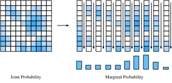

# Atsitiktiniai dydžiai
:label:`sec_random_variables`

:numref:`sec_prob` matėme pagrindus, kaip dirbti su diskrečiaisiais atsitiktiniais dydžiais, kurie mūsų atveju yra tie atsitiktiniai dydžiai, kurie įgyja arba baigtinę galimų reikšmių aibę, arba sveikuosius skaičius.  Šiame skyriuje išplėtosime *tolydžiųjų atsitiktinių dydžių* teoriją – tai atsitiktiniai dydžiai, kurie gali įgyti bet kurią realiąją reikšmę.

## Tolydieji atsitiktiniai dydžiai

Tolydieji atsitiktiniai dydžiai yra gerokai subtilesnė tema nei diskretieji.  Teisinga analogija būtų, kad techninis šuolis yra panašus į šuolį tarp skaičių sąrašų sudėjimo ir funkcijų integravimo.  Todėl teks skirti šiek tiek laiko teorijai išplėtoti.

### Nuo diskrečiųjų prie tolydžiųjų

Kad suprastume papildomus techninius iššūkius dirbant su tolydžiaisiais atsitiktiniais dydžiais, atlikime minties eksperimentą.  Tarkime, metame smiginio strėlytę į taikinį ir norime sužinoti tikimybę, kad ji pataikys tiksliai $2 \textrm{cm}$ nuo taikinio centro.

Pradžiai įsivaizduokime, kad matuojame vieno skaitmens tikslumu, t. y. su intervalais $0 \textrm{cm}$, $1 \textrm{cm}$, $2 \textrm{cm}$ ir t. t.  Metame, tarkime, $100$ strėlyčių į taikinį, ir jei $20$ iš jų patenka į $2\textrm{cm}$ intervalą, darome išvadą, kad $20\%$ mūsų metamų strėlyčių pataiko į taikinį $2 \textrm{cm}$ nuo centro.

Tačiau įdėmiau pažvelgę matome, kad tai neatitinka mūsų klausimo!  Norėjome tikslios lygybės, o šiuose intervaluose yra viskas, kas pateko, tarkime, tarp $1{,}5\textrm{cm}$ ir $2{,}5\textrm{cm}$.

Nenusiminę tęsiame toliau.  Matuojame dar tiksliau, tarkime, $1{,}9\textrm{cm}$, $2{,}0\textrm{cm}$, $2{,}1\textrm{cm}$, ir dabar matome, kad gal $3$ iš $100$ strėlyčių pataikė į $2{,}0\textrm{cm}$ intervalą.  Taigi darome išvadą, kad tikimybė yra $3\%$.

Tačiau tai nieko neišsprendžia!  Problemą tiesiog nustūmėme vienu skaitmeniu toliau.  Šiek tiek abstrahuokime. Įsivaizduokime, kad žinome tikimybę, jog pirmieji $k$ skaitmenų sutampa su $2{,}00000\ldots$, ir norime žinoti tikimybę, kad sutaps pirmieji $k+1$ skaitmenų. Gana pagrįsta daryti prielaidą, kad ${k+1}$-asis skaitmuo iš esmės yra atsitiktinis pasirinkimas iš aibės $\{0, 1, 2, \ldots, 9\}$.  Bent jau negalime įsivaizduoti fiziškai prasmingo proceso, dėl kurio mikrometrų skaičius nuo centro labiau linktų baigtis $7$, o ne $3$.

Tai reiškia, kad iš esmės kiekvienas papildomas reikalaujamo tikslumo skaitmuo turėtų sumažinti sutapimo tikimybę $10$ kartų.  Arba kitaip tariant, tikėtumėmės, kad

$$
P(\textrm{distance is}\; 2.00\ldots, \;\textrm{to}\; k \;\textrm{digits} ) \approx p\cdot10^{-k}.
$$

Reikšmė $p$ iš esmės užkoduoja, kas vyksta su pirmaisiais keliais skaitmenimis, o $10^{-k}$ tvarko likusią dalį.

Atkreipkite dėmesį, kad jei žinome padėtį $k=4$ skaitmenų po kablelio tikslumu, tai reiškia, kad žinome, jog reikšmė patenka į intervalą, tarkime, $[1{,}99995; 2{,}00005]$, kurio ilgis yra $2{,}00005-1{,}99995 = 10^{-4}$.  Taigi, jei šio intervalo ilgį pavadinsime $\epsilon$, galime sakyti

$$
P(\textrm{distance is in an}\; \epsilon\textrm{-sized interval around}\; 2 ) \approx \epsilon \cdot p.
$$

Žengkime dar paskutinį žingsnį.  Visą laiką galvojome apie tašką $2$, bet niekada negalvojome apie kitus taškus.  Iš esmės ten nieko nesiskiria, bet reikšmė $p$ greičiausiai bus kitokia.  Bent jau tikėtumėmės, kad strėlyčių metikas labiau tikėtinai pataikys į tašką netoli centro, pavyzdžiui, $2\textrm{cm}$, o ne $20\textrm{cm}$.  Taigi reikšmė $p$ nėra fiksuota, o turėtų priklausyti nuo taško $x$.  Tai mums sako, kad turėtume tikėtis

$$P(\textrm{distance is in an}\; \epsilon \textrm{-sized interval around}\; x ) \approx \epsilon \cdot p(x).$$
:eqlabel:`eq_pdf_deriv`

Iš tiesų :eqref:`eq_pdf_deriv` tiksliai apibrėžia *tikimybės tankio funkciją*.  Tai funkcija $p(x)$, užkoduojanti santykinę tikimybę pataikyti arti vieno taško, palyginti su kitu.  Pavaizduokime, kaip tokia funkcija gali atrodyti.

```{.python .input}
#@tab mxnet
%matplotlib inline
from d2l import mxnet as d2l
from IPython import display
from mxnet import np, npx
npx.set_np()

# Plot the probability density function for some random variable
x = np.arange(-5, 5, 0.01)
p = 0.2*np.exp(-(x - 3)**2 / 2)/np.sqrt(2 * np.pi) + \
    0.8*np.exp(-(x + 1)**2 / 2)/np.sqrt(2 * np.pi)

d2l.plot(x, p, 'x', 'Density')
```

```{.python .input}
#@tab pytorch
%matplotlib inline
from d2l import torch as d2l
from IPython import display
import torch
torch.pi = torch.acos(torch.zeros(1)).item() * 2  # Define pi in torch

# Plot the probability density function for some random variable
x = torch.arange(-5, 5, 0.01)
p = 0.2*torch.exp(-(x - 3)**2 / 2)/torch.sqrt(2 * torch.tensor(torch.pi)) + \
    0.8*torch.exp(-(x + 1)**2 / 2)/torch.sqrt(2 * torch.tensor(torch.pi))

d2l.plot(x, p, 'x', 'Density')
```

```{.python .input}
#@tab tensorflow
%matplotlib inline
from d2l import tensorflow as d2l
from IPython import display
import tensorflow as tf
tf.pi = tf.acos(tf.zeros(1)).numpy() * 2  # Define pi in TensorFlow

# Plot the probability density function for some random variable
x = tf.range(-5, 5, 0.01)
p = 0.2*tf.exp(-(x - 3)**2 / 2)/tf.sqrt(2 * tf.constant(tf.pi)) + \
    0.8*tf.exp(-(x + 1)**2 / 2)/tf.sqrt(2 * tf.constant(tf.pi))

d2l.plot(x, p, 'x', 'Density')
```

Vietos, kuriose funkcijos reikšmė didelė, rodo sritis, kuriose labiau tikėtina rasti atsitiktinę reikšmę.  Žemos dalys yra sritys, kuriose atsitiktinę reikšmę rasti mažai tikėtina.

### Tikimybės tankio funkcijos

Dabar išnagrinėkime tai toliau.  Jau matėme, kas intuityviai yra tikimybės tankio funkcija atsitiktiniam dydžiui $X$, būtent tankio funkcija yra funkcija $p(x)$, kad

$$P(X \; \textrm{is in an}\; \epsilon \textrm{-sized interval around}\; x ) \approx \epsilon \cdot p(x).$$
:eqlabel:`eq_pdf_def`

Bet ką tai reiškia $p(x)$ savybėms?

Pirma, tikimybės niekada nėra neigiamos, todėl turėtume tikėtis, kad ir $p(x) \ge 0$.

Antra, įsivaizduokime, kad $\mathbb{R}$ supjaustome į begalinį skaičių juostelių, kurių plotis $\epsilon$, tarkime, juostelės $(\epsilon\cdot i, \epsilon \cdot (i+1)]$.  Kiekvienai iš jų iš :eqref:`eq_pdf_def` žinome, kad tikimybė yra apytiksliai

$$
P(X \; \textrm{is in an}\; \epsilon\textrm{-sized interval around}\; x ) \approx \epsilon \cdot p(\epsilon \cdot i),
$$

taigi susumavus per visas jas turėtų būti

$$
P(X\in\mathbb{R}) \approx \sum_i \epsilon \cdot p(\epsilon\cdot i).
$$

Tai yra ne kas kita, kaip integralo aproksimacija, aptarta :numref:`sec_integral_calculus`, todėl galime sakyti, kad

$$
P(X\in\mathbb{R}) = \int_{-\infty}^{\infty} p(x) \; dx.
$$

Žinome, kad $P(X\in\mathbb{R}) = 1$, nes atsitiktinis dydis turi įgyti *kokį nors* skaičių, todėl galime daryti išvadą, kad bet kuriam tankiui

$$
\int_{-\infty}^{\infty} p(x) \; dx = 1.
$$

Iš tiesų, gilinantis toliau matyti, kad bet kuriems $a$ ir $b$ turime

$$
P(X\in(a, b]) = \int _ {a}^{b} p(x) \; dx.
$$

Tai galime aproksimuoti kode naudodami tuos pačius diskrečiuosius aproksimavimo metodus kaip anksčiau.  Šiuo atveju galime aproksimuoti tikimybę patekti į mėlyną sritį.

```{.python .input}
#@tab mxnet
# Approximate probability using numerical integration
epsilon = 0.01
x = np.arange(-5, 5, 0.01)
p = 0.2*np.exp(-(x - 3)**2 / 2) / np.sqrt(2 * np.pi) + \
    0.8*np.exp(-(x + 1)**2 / 2) / np.sqrt(2 * np.pi)

d2l.set_figsize()
d2l.plt.plot(x, p, color='black')
d2l.plt.fill_between(x.tolist()[300:800], p.tolist()[300:800])
d2l.plt.show()

f'approximate Probability: {np.sum(epsilon*p[300:800])}'
```

```{.python .input}
#@tab pytorch
# Approximate probability using numerical integration
epsilon = 0.01
x = torch.arange(-5, 5, 0.01)
p = 0.2*torch.exp(-(x - 3)**2 / 2) / torch.sqrt(2 * torch.tensor(torch.pi)) +\
    0.8*torch.exp(-(x + 1)**2 / 2) / torch.sqrt(2 * torch.tensor(torch.pi))

d2l.set_figsize()
d2l.plt.plot(x, p, color='black')
d2l.plt.fill_between(x.tolist()[300:800], p.tolist()[300:800])
d2l.plt.show()

f'approximate Probability: {torch.sum(epsilon*p[300:800])}'
```

```{.python .input}
#@tab tensorflow
# Approximate probability using numerical integration
epsilon = 0.01
x = tf.range(-5, 5, 0.01)
p = 0.2*tf.exp(-(x - 3)**2 / 2) / tf.sqrt(2 * tf.constant(tf.pi)) +\
    0.8*tf.exp(-(x + 1)**2 / 2) / tf.sqrt(2 * tf.constant(tf.pi))

d2l.set_figsize()
d2l.plt.plot(x, p, color='black')
d2l.plt.fill_between(x.numpy().tolist()[300:800], p.numpy().tolist()[300:800])
d2l.plt.show()

f'approximate Probability: {tf.reduce_sum(epsilon*p[300:800])}'
```

Pasirodo, šios dvi savybės tiksliai aprašo galimų tikimybės tankio funkcijų erdvę (arba *t. t. f.*, kaip dažnai sutrumpinama).  Tai neneigiamos funkcijos $p(x) \ge 0$, kad

$$\int_{-\infty}^{\infty} p(x) \; dx = 1.$$
:eqlabel:`eq_pdf_int_one`

Šią funkciją interpretuojame naudodami integravimą, kad gautume tikimybę, jog mūsų atsitiktinis dydis yra konkrečiame intervale:

$$P(X\in(a, b]) = \int _ {a}^{b} p(x) \; dx.$$
:eqlabel:`eq_pdf_int_int`

:numref:`sec_distributions` pamatysime keletą įprastų skirstinių, tačiau toliau dirbkime abstrakčiai.

### Pasiskirstymo funkcijos

Ankstesniame skyrelyje matėme t. t. f. sąvoką.  Praktikoje tai yra dažnai sutinkamas būdas kalbėti apie tolydžiuosius atsitiktinius dydžius, tačiau jis turi vieną didelę spąstą: t. t. f. reikšmės pačios nėra tikimybės, o veikiau funkcija, kurią turime suintegruoti, kad gautume tikimybes.  Nėra nieko blogo, kad tankis didesnis nei $10$, kol jis nėra didesnis nei $10$ ilgesnėje nei $1/10$ ilgio atkarpoje.  Tai gali prieštarauti intuicijai, todėl žmonės dažnai galvoja ir *pasiskirstymo funkcijos* (angl. *cumulative distribution function*, p. f.) terminais, kuri *yra* tikimybė.

Visų pirma, naudodami :eqref:`eq_pdf_int_int`, atsitiktinio dydžio $X$ su tankiu $p(x)$ pasiskirstymo funkciją apibrėžiame kaip

$$
F(x) = \int _ {-\infty}^{x} p(x) \; dx = P(X \le x).
$$

Pastebėkime keletą savybių.

* $F(x) \rightarrow 0$, kai $x\rightarrow -\infty$.
* $F(x) \rightarrow 1$, kai $x\rightarrow \infty$.
* $F(x)$ yra nemažėjanti ($y > x \implies F(y) \ge F(x)$).
* $F(x)$ yra tolydi (neturi šuolių), jei $X$ yra tolydusis atsitiktinis dydis.

Dėl ketvirtojo punkto atkreipkite dėmesį, kad tai nebūtų tiesa, jei $X$ būtų diskretusis, tarkime, įgyjantis reikšmes $0$ ir $1$, abi su tikimybe $1/2$.  Tuo atveju

$$
F(x) = \begin{cases}
0 & x < 0, \\
\frac{1}{2} & x < 1, \\
1 & x \ge 1.
\end{cases}
$$

Šiame pavyzdyje matome vieną pasiskirstymo funkcijos naudojimo privalumų – galimybę tame pačiame pagrinde dirbti su tolydžiaisiais arba diskrečiaisiais atsitiktiniais dydžiais, ar net jų mišiniais (metame monetą: jei herbas, grąžiname kauliuko metimo rezultatą, jei skaičius – strėlytės metimo atstumą nuo taikinio centro).

### Vidurkiai

Tarkime, dirbame su atsitiktiniu dydžiu $X$.  Patį skirstinį gali būti sunku interpretuoti.  Dažnai naudinga mokėti glaustai apibendrinti atsitiktinio dydžio elgseną.  Skaičiai, padedantys užfiksuoti atsitiktinio dydžio elgseną, vadinami *suvestinėmis statistikomis*.  Dažniausiai sutinkamos yra *vidurkis*, *dispersija* ir *standartinis nuokrypis*.

*Vidurkis* užkoduoja vidutinę atsitiktinio dydžio reikšmę.  Jei turime diskretųjį atsitiktinį dydį $X$, kuris įgyja reikšmes $x_i$ su tikimybėmis $p_i$, tai vidurkis yra svertinis vidurkis: susumuojame reikšmes, padaugintas iš tikimybės, kad atsitiktinis dydis įgyja tą reikšmę:

$$\mu_X = E[X] = \sum_i x_i p_i.$$
:eqlabel:`eq_exp_def`

Vidurkį (nors ir atsargiai) turėtume interpretuoti taip: jis mums iš esmės pasako, kur linkęs būti atsitiktinis dydis.

Minimalistiniam pavyzdžiui, kurį nagrinėsime visame šiame skyriuje, paimkime $X$ kaip atsitiktinį dydį, kuris įgyja reikšmę $a-2$ su tikimybe $p$, $a+2$ su tikimybe $p$ ir $a$ su tikimybe $1-2p$.  Naudodami :eqref:`eq_exp_def` galime apskaičiuoti, kad bet kuriam galimam $a$ ir $p$ pasirinkimui vidurkis yra

$$
\mu_X = E[X] = \sum_i x_i p_i = (a-2)p + a(1-2p) + (a+2)p = a.
$$

Taigi matome, kad vidurkis yra $a$.  Tai atitinka intuiciją, nes $a$ yra vieta, apie kurią centravome savo atsitiktinį dydį.

Kadangi jos naudingos, apibendrinkime keletą savybių.

* Bet kuriam atsitiktiniam dydžiui $X$ ir skaičiams $a$ ir $b$ turime $\mu_{aX+b} = a\mu_X + b$.
* Jei turime du atsitiktinius dydžius $X$ ir $Y$, tai $\mu_{X+Y} = \mu_X+\mu_Y$.

Vidurkiai naudingi norint suprasti vidutinę atsitiktinio dydžio elgseną, tačiau vien vidurkio nepakanka net pilnam intuityviam supratimui.  Gauti $\$10 \pm \$1$ pelno už pardavimą labai skiriasi nuo $\$10 \pm \$15$ už pardavimą, nepaisant to, kad vidutinė reikšmė ta pati.  Antrasis turi daug didesnį svyravimo laipsnį, taigi reiškia daug didesnę riziką.  Taigi norėdami suprasti atsitiktinio dydžio elgseną, mums reikės bent vieno papildomo mato: kokio nors mato, kaip plačiai atsitiktinis dydis svyruoja.

### Dispersijos

Tai priveda prie atsitiktinio dydžio *dispersijos* nagrinėjimo.  Tai kiekybinis matas, kiek atsitiktinis dydis nukrypsta nuo vidurkio.  Panagrinėkime išraišką $X - \mu_X$.  Tai atsitiktinio dydžio nuokrypis nuo jo vidurkio.  Ši reikšmė gali būti teigiama arba neigiama, todėl turime ką nors padaryti, kad ji būtų teigiama ir matuotume nuokrypio dydį.

Pagrįsta būtų išbandyti $\left|X-\mu_X\right|$, ir iš tiesų tai veda prie naudingo dydžio, vadinamo *vidutiniu absoliučiuoju nuokrypiu*, tačiau dėl ryšių su kitomis matematikos ir statistikos sritimis žmonės dažnai naudoja kitokį sprendimą.

Visų pirma jie nagrinėja $(X-\mu_X)^2.$  Jei pažiūrėsime į tipinį šio dydžio didumą paėmę vidurkį, gauname dispersiją

$$\sigma_X^2 = \textrm{Var}(X) = E\left[(X-\mu_X)^2\right] = E[X^2] - \mu_X^2.$$
:eqlabel:`eq_var_def`

Paskutinė lygybė :eqref:`eq_var_def` galioja išskleidus vidurinį apibrėžimą ir pritaikius vidurkio savybes.

Pažiūrėkime savo pavyzdį, kur $X$ yra atsitiktinis dydis, įgyjantis reikšmę $a-2$ su tikimybe $p$, $a+2$ su tikimybe $p$ ir $a$ su tikimybe $1-2p$.  Šiuo atveju $\mu_X = a$, todėl tereikia apskaičiuoti $E\left[X^2\right]$.  Tai galima lengvai padaryti:

$$
E\left[X^2\right] = (a-2)^2p + a^2(1-2p) + (a+2)^2p = a^2 + 8p.
$$

Taigi matome, kad pagal :eqref:`eq_var_def` mūsų dispersija yra

$$
\sigma_X^2 = \textrm{Var}(X) = E[X^2] - \mu_X^2 = a^2 + 8p - a^2 = 8p.
$$

Šis rezultatas vėl prasmingas.  Didžiausia $p$ reikšmė gali būti $1/2$, o tai atitinka $a-2$ arba $a+2$ pasirinkimą metant monetą.  Kad šios dispersija yra $4$, atitinka faktą, kad tiek $a-2$, tiek $a+2$ yra $2$ vienetų atstumu nuo vidurkio, o $2^2 = 4$.  Kitame spektro gale, jei $p=0$, šis atsitiktinis dydis visada įgyja reikšmę $0$, taigi jis visai neturi dispersijos.

Žemiau išvardysime keletą dispersijos savybių:

* Bet kuriam atsitiktiniam dydžiui $X$, $\textrm{Var}(X) \ge 0$, ir $\textrm{Var}(X) = 0$ tada ir tik tada, kai $X$ yra konstanta.
* Bet kuriam atsitiktiniam dydžiui $X$ ir skaičiams $a$ ir $b$ turime $\textrm{Var}(aX+b) = a^2\textrm{Var}(X)$.
* Jei turime du *nepriklausomus* atsitiktinius dydžius $X$ ir $Y$, tai $\textrm{Var}(X+Y) = \textrm{Var}(X) + \textrm{Var}(Y)$.

Interpretuojant šias reikšmes, gali kilti nedidelių keblumų.  Visų pirma pabandykime įsivaizduoti, kas nutinka, jei sekame vienetus per šį skaičiavimą.  Tarkime, dirbame su produkto įvertinimu žvaigždutėmis tinklalapyje.  Tada $a$, $a-2$ ir $a+2$ yra matuojami žvaigždučių vienetais.  Panašiai ir vidurkis $\mu_X$ matuojamas žvaigždutėmis (kaip svertinis vidurkis).  Tačiau kai prieiname prie dispersijos, iškart susiduriame su problema: norime nagrinėti $(X-\mu_X)^2$, kuris yra *žvaigždučių kvadratais*.  Tai reiškia, kad pati dispersija nėra palyginama su pradiniais matavimais.  Kad ją galėtume interpretuoti, turėsime grįžti prie pradinių vienetų.

### Standartiniai nuokrypiai

Šią suvestinę statistiką visada galima gauti iš dispersijos paėmus kvadratinę šaknį!  Taigi *standartinį nuokrypį* apibrėžiame kaip

$$
\sigma_X = \sqrt{\textrm{Var}(X)}.
$$

Mūsų pavyzdyje tai reiškia, kad standartinis nuokrypis yra $\sigma_X = 2\sqrt{2p}$.  Jei dirbame su žvaigždučių vienetais mūsų atsiliepimų pavyzdyje, $\sigma_X$ vėl yra žvaigždutėmis.

Savybes, kurias turėjome dispersijai, galima performuluoti standartiniam nuokrypiui.

* Bet kuriam atsitiktiniam dydžiui $X$, $\sigma_{X} \ge 0$.
* Bet kuriam atsitiktiniam dydžiui $X$ ir skaičiams $a$ ir $b$ turime $\sigma_{aX+b} = |a|\sigma_{X}$
* Jei turime du *nepriklausomus* atsitiktinius dydžius $X$ ir $Y$, tai $\sigma_{X+Y} = \sqrt{\sigma_{X}^2 + \sigma_{Y}^2}$.

Šiuo metu natūralu paklausti: „Jei standartinis nuokrypis yra mūsų pradinio atsitiktinio dydžio vienetais, ar jis atspindi ką nors, ką galime išvesti to atsitiktinio dydžio atžvilgiu?“  Atsakymas – skambus taip!  Iš tiesų, kaip vidurkis mums pasakė tipinę mūsų atsitiktinio dydžio vietą, taip standartinis nuokrypis duoda tipinį to atsitiktinio dydžio kitimo diapazoną.  Tai galime padaryti griežta pasitelkę vadinamąją Čebyševo nelygybę:

$$P\left(X \not\in [\mu_X - \alpha\sigma_X, \mu_X + \alpha\sigma_X]\right) \le \frac{1}{\alpha^2}.$$
:eqlabel:`eq_chebyshev`

Arba žodžiais, kai $\alpha=10$, $99\%$ bet kurio atsitiktinio dydžio imčių patenka į $10$ standartinių nuokrypių nuo vidurkio atstumą.  Tai suteikia tiesioginę interpretaciją mūsų standartinėms suvestinėms statistikoms.

Kad pamatytume, kaip šis teiginys gana subtilus, dar kartą pažiūrėkime savo pavyzdį, kuriame $X$ yra atsitiktinis dydis, įgyjantis reikšmę $a-2$ su tikimybe $p$, $a+2$ su tikimybe $p$ ir $a$ su tikimybe $1-2p$.  Matėme, kad vidurkis buvo $a$, o standartinis nuokrypis $2\sqrt{2p}$.  Tai reiškia, kad jei Čebyševo nelygybę :eqref:`eq_chebyshev` imsime su $\alpha = 2$, matome, kad išraiška yra

$$
P\left(X \not\in [a - 4\sqrt{2p}, a + 4\sqrt{2p}]\right) \le \frac{1}{4}.
$$

Tai reiškia, kad $75\%$ laiko šis atsitiktinis dydis pateks į šį intervalą bet kuriai $p$ reikšmei.  Dabar atkreipkite dėmesį, kad kai $p \rightarrow 0$, šis intervalas taip pat konverguoja į vieną tašką $a$.  Tačiau žinome, kad mūsų atsitiktinis dydis įgyja tik reikšmes $a-2, a$ ir $a+2$, todėl galiausiai galime būti tikri, kad $a-2$ ir $a+2$ pateks už intervalo ribų!  Klausimas, su kuria $p$ tai nutinka.  Taigi norime išspręsti: su kuria $p$ $a+4\sqrt{2p} = a+2$, o tai išsprendžiama, kai $p=1/8$, o tai yra *būtent* pirmoji $p$, su kuria tai galėtų nutikti nepažeidžiant mūsų teiginio, kad ne daugiau nei $1/4$ skirstinio imčių pateks už intervalo ribų ($1/8$ kairėje ir $1/8$ dešinėje).

Pavaizduokime tai.  Tikimybę gauti tris reikšmes parodysime kaip tris vertikalias juosteles, kurių aukštis proporcingas tikimybei.  Intervalas bus nubrėžtas kaip horizontali linija viduryje.  Pirmasis grafikas rodo, kas nutinka, kai $p > 1/8$, kai intervalas saugiai apima visus taškus.

```{.python .input}
#@tab mxnet
# Define a helper to plot these figures
def plot_chebyshev(a, p):
    d2l.set_figsize()
    d2l.plt.stem([a-2, a, a+2], [p, 1-2*p, p], use_line_collection=True)
    d2l.plt.xlim([-4, 4])
    d2l.plt.xlabel('x')
    d2l.plt.ylabel('p.m.f.')

    d2l.plt.hlines(0.5, a - 4 * np.sqrt(2 * p),
                   a + 4 * np.sqrt(2 * p), 'black', lw=4)
    d2l.plt.vlines(a - 4 * np.sqrt(2 * p), 0.53, 0.47, 'black', lw=1)
    d2l.plt.vlines(a + 4 * np.sqrt(2 * p), 0.53, 0.47, 'black', lw=1)
    d2l.plt.title(f'p = {p:.3f}')

    d2l.plt.show()

# Plot interval when p > 1/8
plot_chebyshev(0.0, 0.2)
```

```{.python .input}
#@tab pytorch
# Define a helper to plot these figures
def plot_chebyshev(a, p):
    d2l.set_figsize()
    d2l.plt.stem([a-2, a, a+2], [p, 1-2*p, p], use_line_collection=True)
    d2l.plt.xlim([-4, 4])
    d2l.plt.xlabel('x')
    d2l.plt.ylabel('p.m.f.')

    d2l.plt.hlines(0.5, a - 4 * torch.sqrt(2 * p),
                   a + 4 * torch.sqrt(2 * p), 'black', lw=4)
    d2l.plt.vlines(a - 4 * torch.sqrt(2 * p), 0.53, 0.47, 'black', lw=1)
    d2l.plt.vlines(a + 4 * torch.sqrt(2 * p), 0.53, 0.47, 'black', lw=1)
    d2l.plt.title(f'p = {p:.3f}')

    d2l.plt.show()

# Plot interval when p > 1/8
plot_chebyshev(0.0, torch.tensor(0.2))
```

```{.python .input}
#@tab tensorflow
# Define a helper to plot these figures
def plot_chebyshev(a, p):
    d2l.set_figsize()
    d2l.plt.stem([a-2, a, a+2], [p, 1-2*p, p], use_line_collection=True)
    d2l.plt.xlim([-4, 4])
    d2l.plt.xlabel('x')
    d2l.plt.ylabel('p.m.f.')

    d2l.plt.hlines(0.5, a - 4 * tf.sqrt(2 * p),
                   a + 4 * tf.sqrt(2 * p), 'black', lw=4)
    d2l.plt.vlines(a - 4 * tf.sqrt(2 * p), 0.53, 0.47, 'black', lw=1)
    d2l.plt.vlines(a + 4 * tf.sqrt(2 * p), 0.53, 0.47, 'black', lw=1)
    d2l.plt.title(f'p = {p:.3f}')

    d2l.plt.show()

# Plot interval when p > 1/8
plot_chebyshev(0.0, tf.constant(0.2))
```

Antrasis rodo, kad kai $p = 1/8$, intervalas tiksliai liečia du taškus.  Tai rodo, kad nelygybė yra *aštri*, nes negalima paimti mažesnio intervalo išlaikant nelygybę teisingą.

```{.python .input}
#@tab mxnet
# Plot interval when p = 1/8
plot_chebyshev(0.0, 0.125)
```

```{.python .input}
#@tab pytorch
# Plot interval when p = 1/8
plot_chebyshev(0.0, torch.tensor(0.125))
```

```{.python .input}
#@tab tensorflow
# Plot interval when p = 1/8
plot_chebyshev(0.0, tf.constant(0.125))
```

Trečiasis rodo, kad kai $p < 1/8$, intervale yra tik centras.  Tai nepaneigia nelygybės, nes mums reikėjo užtikrinti tik tai, kad ne daugiau nei $1/4$ tikimybės patenka už intervalo ribų, o tai reiškia, kad kai $p < 1/8$, du taškus $a-2$ ir $a+2$ galima atmesti.

```{.python .input}
#@tab mxnet
# Plot interval when p < 1/8
plot_chebyshev(0.0, 0.05)
```

```{.python .input}
#@tab pytorch
# Plot interval when p < 1/8
plot_chebyshev(0.0, torch.tensor(0.05))
```

```{.python .input}
#@tab tensorflow
# Plot interval when p < 1/8
plot_chebyshev(0.0, tf.constant(0.05))
```

### Vidurkiai ir dispersijos tolydžiuoju atveju

Visa tai buvo diskrečiųjų atsitiktinių dydžių terminais, tačiau tolydžiųjų atsitiktinių dydžių atvejis panašus.  Kad intuityviai suprastume, kaip tai veikia, įsivaizduokime, kad realiųjų skaičių tiesę padalijame į intervalus, kurių ilgis $\epsilon$, duodamus $(\epsilon i, \epsilon (i+1)]$.  Kai tai padarome, mūsų tolydusis atsitiktinis dydis tampa diskretusis ir galime naudoti :eqref:`eq_exp_def` bei pasakyti, kad

$$
\begin{aligned}
\mu_X & \approx \sum_{i} (\epsilon i)P(X \in (\epsilon i, \epsilon (i+1)]) \\
& \approx \sum_{i} (\epsilon i)p_X(\epsilon i)\epsilon, \\
\end{aligned}
$$

kur $p_X$ yra $X$ tankis.  Tai yra $xp_X(x)$ integralo aproksimacija, todėl galime daryti išvadą, kad

$$
\mu_X = \int_{-\infty}^\infty xp_X(x) \; dx.
$$

Panašiai, naudojant :eqref:`eq_var_def`, dispersiją galima užrašyti kaip

$$
\sigma^2_X = E[X^2] - \mu_X^2 = \int_{-\infty}^\infty x^2p_X(x) \; dx - \left(\int_{-\infty}^\infty xp_X(x) \; dx\right)^2.
$$

Viskas, kas aukščiau pasakyta apie vidurkį, dispersiją ir standartinį nuokrypį, tinka ir šiuo atveju.  Pavyzdžiui, jei nagrinėjame atsitiktinį dydį su tankiu

$$
p(x) = \begin{cases}
1 & x \in [0,1], \\
0 & \textrm{otherwise}.
\end{cases}
$$

galime apskaičiuoti

$$
\mu_X = \int_{-\infty}^\infty xp(x) \; dx = \int_0^1 x \; dx = \frac{1}{2}.
$$

ir

$$
\sigma_X^2 = \int_{-\infty}^\infty x^2p(x) \; dx - \left(\frac{1}{2}\right)^2 = \frac{1}{3} - \frac{1}{4} = \frac{1}{12}.
$$

Kaip įspėjimą, panagrinėkime dar vieną pavyzdį, žinomą kaip *Koši skirstinys*.  Tai skirstinys, kurio t. t. f. yra

$$
p(x) = \frac{1}{1+x^2}.
$$

```{.python .input}
#@tab mxnet
# Plot the Cauchy distribution p.d.f.
x = np.arange(-5, 5, 0.01)
p = 1 / (1 + x**2)

d2l.plot(x, p, 'x', 'p.d.f.')
```

```{.python .input}
#@tab pytorch
# Plot the Cauchy distribution p.d.f.
x = torch.arange(-5, 5, 0.01)
p = 1 / (1 + x**2)

d2l.plot(x, p, 'x', 'p.d.f.')
```

```{.python .input}
#@tab tensorflow
# Plot the Cauchy distribution p.d.f.
x = tf.range(-5, 5, 0.01)
p = 1 / (1 + x**2)

d2l.plot(x, p, 'x', 'p.d.f.')
```

Ši funkcija atrodo nekalta, ir iš tiesų pasitelkus integralų lentelę matyti, kad plotas po ja lygus vienetui, taigi ji apibrėžia tolydųjį atsitiktinį dydį.

Kad pamatytume, kas negerai, pabandykime apskaičiuoti jo dispersiją.  Tam reikėtų naudoti :eqref:`eq_var_def` ir apskaičiuoti

$$
\int_{-\infty}^\infty \frac{x^2}{1+x^2}\; dx.
$$

Vidinė funkcija atrodo taip:

```{.python .input}
#@tab mxnet
# Plot the integrand needed to compute the variance
x = np.arange(-20, 20, 0.01)
p = x**2 / (1 + x**2)

d2l.plot(x, p, 'x', 'integrand')
```

```{.python .input}
#@tab pytorch
# Plot the integrand needed to compute the variance
x = torch.arange(-20, 20, 0.01)
p = x**2 / (1 + x**2)

d2l.plot(x, p, 'x', 'integrand')
```

```{.python .input}
#@tab tensorflow
# Plot the integrand needed to compute the variance
x = tf.range(-20, 20, 0.01)
p = x**2 / (1 + x**2)

d2l.plot(x, p, 'x', 'integrand')
```

Ši funkcija akivaizdžiai turi begalinį plotą po ja, nes iš esmės tai yra konstanta vienas su nedidele įduba prie nulio, ir iš tiesų galėtume parodyti, kad

$$
\int_{-\infty}^\infty \frac{x^2}{1+x^2}\; dx = \infty.
$$

Tai reiškia, kad jis neturi gerai apibrėžtos baigtinės dispersijos.

Tačiau įsigilinus matyti dar nerimą keliantis rezultatas.  Pabandykime apskaičiuoti vidurkį naudodami :eqref:`eq_exp_def`.  Naudodami kintamųjų keitimo formulę, matome

$$
\mu_X = \int_{-\infty}^{\infty} \frac{x}{1+x^2} \; dx = \frac{1}{2}\int_1^\infty \frac{1}{u} \; du.
$$

Vidinis integralas yra logaritmo apibrėžimas, todėl iš esmės tai $\log(\infty) = \infty$, taigi nėra ir gerai apibrėžtos vidutinės reikšmės!

Mašininio mokymo mokslininkai savo modelius apibrėžia taip, kad daugeliu atvejų nereikėtų susidurti su šiomis problemomis, ir didžiąja dauguma atvejų dirba su atsitiktiniais dydžiais, turinčiais gerai apibrėžtus vidurkius ir dispersijas.  Vis dėlto kartkartėmis atsitiktiniai dydžiai su *sunkiomis uodegomis* (t. y. tie atsitiktiniai dydžiai, kuriems didelių reikšmių tikimybės pakankamai didelės, kad tokie dalykai kaip vidurkis ar dispersija tampa neapibrėžti) yra naudingi modeliuojant fizikines sistemas, todėl verta žinoti, kad jie egzistuoja.

### Bendrieji tankio funkcijos

Visi aukščiau aprašyti dalykai darė prielaidą, kad dirbame su vienu realiąja reikšme įgyjančiu atsitiktiniu dydžiu.  Bet ką daryti, jei turime du ar daugiau potencialiai stipriai koreliuojančių atsitiktinių dydžių?  Ši aplinkybė yra norma mašininiame mokyme: įsivaizduokite atsitiktinius dydžius, pvz., $R_{i, j}$, kuris užkoduoja raudonąją pikselio reikšmę koordinatėse $(i, j)$ paveikslėlyje, arba $P_t$, kuris yra akcijos kainos atsitiktinis dydis laiku $t$.  Gretimi pikseliai linkę turėti panašią spalvą, o gretimi laiko momentai – panašias kainas.  Negalime jų nagrinėti kaip atskirų atsitiktinių dydžių ir tikėtis sukurti sėkmingą modelį (:numref:`sec_naive_bayes` pamatysime modelį, kuris dėl tokios prielaidos veikia prastai).  Turime išplėtoti matematinę kalbą šiems koreliuojantiems tolydiesiems atsitiktiniams dydžiams tvarkyti.

Laimei, su :numref:`sec_integral_calculus` aptartais daugialypiais integralais galime išplėtoti tokią kalbą.  Tarkime, paprastumo dėlei, turime du atsitiktinius dydžius $X, Y$, kurie gali būti koreliuoti.  Tada, kaip vieno kintamojo atveju, galime užduoti klausimą:

$$
P(X \;\textrm{is in an}\; \epsilon \textrm{-sized interval around}\; x \; \textrm{and} \;Y \;\textrm{is in an}\; \epsilon \textrm{-sized interval around}\; y ).
$$

Panašus samprotavimas kaip vieno kintamojo atveju rodo, kad tai turėtų būti apytiksliai

$$
P(X \;\textrm{is in an}\; \epsilon \textrm{-sized interval around}\; x \; \textrm{and} \;Y \;\textrm{is in an}\; \epsilon \textrm{-sized interval around}\; y ) \approx \epsilon^{2}p(x, y),
$$

kokiai nors funkcijai $p(x, y)$.  Tai vadinama $X$ ir $Y$ *bendruoju tankiu*.  Jam galioja panašios savybės, kaip matėme vieno kintamojo atveju. Būtent:

* $p(x, y) \ge 0$;
* $\int _ {\mathbb{R}^2} p(x, y) \;dx \;dy = 1$;
* $P((X, Y) \in \mathcal{D}) = \int _ {\mathcal{D}} p(x, y) \;dx \;dy$.

Šitaip galime dirbti su keliais, potencialiai koreliuojančiais atsitiktiniais dydžiais.  Jei norime dirbti su daugiau nei dviem atsitiktiniais dydžiais, daugelio kintamųjų tankį galime išplėsti iki tiek koordinačių, kiek pageidaujama, nagrinėdami $p(\mathbf{x}) = p(x_1, \ldots, x_n)$.  Tos pačios savybės – būti neneigiamam ir turėti vienetinį pilnąjį integralą – vis dar galioja.

### Ribiniai skirstiniai
Dirbant su keliais kintamaisiais, dažnai norime mokėti nepaisyti ryšių ir paklausti: „kaip pasiskirstęs šis vienas kintamasis?“  Toks skirstinys vadinamas *ribiniu skirstiniu*.

Konkretumo dėlei tarkime, turime du atsitiktinius dydžius $X, Y$ su bendruoju tankiu $p _ {X, Y}(x, y)$.  Apatinį indeksą naudosime nurodydami, kokių atsitiktinių dydžių tankis tai yra.  Ribinio skirstinio radimo klausimas yra paimti šią funkciją ir panaudoti ją $p _ X(x)$ rasti.

Kaip ir daugeliu atvejų, geriausia grįžti prie intuityvaus vaizdo ir išsiaiškinti, kas turėtų būti tiesa.  Prisiminkite, kad tankis yra funkcija $p _ X$, kad

$$
P(X \in [x, x+\epsilon]) \approx \epsilon \cdot p _ X(x).
$$

Apie $Y$ nėra užsiminta, bet jei mums duota tik $p _{X, Y}$, turime kažkaip įtraukti $Y$. Pirmiausia galime pastebėti, kad tai yra tas pats, kas

$$
P(X \in [x, x+\epsilon] \textrm{, and } Y \in \mathbb{R}) \approx \epsilon \cdot p _ X(x).
$$

Mūsų tankis tiesiogiai nepasako, kas nutinka šiuo atveju, turime skaidyti į mažus intervalus ir pagal $y$, todėl tai galime užrašyti kaip

$$
\begin{aligned}
\epsilon \cdot p _ X(x) & \approx \sum _ {i} P(X \in [x, x+\epsilon] \textrm{, and } Y \in [\epsilon \cdot i, \epsilon \cdot (i+1)]) \\
& \approx \sum _ {i} \epsilon^{2} p _ {X, Y}(x, \epsilon\cdot i).
\end{aligned}
$$


:label:`fig_marginal`

Tai mums sako susumuoti tankio reikšmes išilgai eilės kvadratų, kaip parodyta :numref:`fig_marginal`.  Iš tiesų, iš abiejų pusių suprastinus vieną epsilono daugiklį ir atpažinus, kad dešinėje esanti suma yra integralas pagal $y$, galime daryti išvadą, kad

$$
\begin{aligned}
 p _ X(x) &  \approx \sum _ {i} \epsilon p _ {X, Y}(x, \epsilon\cdot i) \\
 & \approx \int_{-\infty}^\infty p_{X, Y}(x, y) \; dy.
\end{aligned}
$$

Taigi matome

$$
p _ X(x) = \int_{-\infty}^\infty p_{X, Y}(x, y) \; dy.
$$

Tai mums sako, kad norėdami gauti ribinį skirstinį, integruojame pagal kintamuosius, kurie mums nerūpi.  Šis procesas dažnai vadinamas nereikalingų kintamųjų *suintegravimu* (angl. *integrating out*) arba *marginalizavimu*.

### Kovariacija

Dirbant su keliais atsitiktiniais dydžiais, yra viena papildoma suvestinė statistika, kurią naudinga žinoti: *kovariacija*.  Ji matuoja, kokiu laipsniu du atsitiktiniai dydžiai svyruoja kartu.

Tarkime, turime du atsitiktinius dydžius $X$ ir $Y$, pradžiai tarkime, kad jie diskretieji ir įgyja reikšmes $(x_i, y_j)$ su tikimybe $p_{ij}$.  Šiuo atveju kovariacija apibrėžiama kaip

$$\sigma_{XY} = \textrm{Cov}(X, Y) = \sum_{i, j} (x_i - \mu_X) (y_j-\mu_Y) p_{ij}. = E[XY] - E[X]E[Y].$$
:eqlabel:`eq_cov_def`

Kad apie tai pagalvotume intuityviai, panagrinėkime tokią atsitiktinių dydžių porą.  Tarkime, $X$ įgyja reikšmes $1$ ir $3$, o $Y$ – reikšmes $-1$ ir $3$.  Tarkime, turime tokias tikimybes

$$
\begin{aligned}
P(X = 1 \; \textrm{and} \; Y = -1) & = \frac{p}{2}, \\
P(X = 1 \; \textrm{and} \; Y = 3) & = \frac{1-p}{2}, \\
P(X = 3 \; \textrm{and} \; Y = -1) & = \frac{1-p}{2}, \\
P(X = 3 \; \textrm{and} \; Y = 3) & = \frac{p}{2},
\end{aligned}
$$

kur $p$ yra parametras iš $[0,1]$, kurį galime pasirinkti.  Atkreipkite dėmesį, kad jei $p=1$, tai abu visada vienu metu yra savo minimumo arba maksimumo reikšmės, o jei $p=0$, garantuota, kad jie vienu metu įgis apverstas reikšmes (vienas didelis, kai kitas mažas, ir atvirkščiai).  Jei $p=1/2$, tai visi keturi variantai vienodai tikėtini ir nei vienas neturėtų būti susijęs su kitu.  Apskaičiuokime kovariaciją.  Pirmiausia pastebėkime, kad $\mu_X = 2$ ir $\mu_Y = 1$, taigi galime apskaičiuoti naudodami :eqref:`eq_cov_def`:

$$
\begin{aligned}
\textrm{Cov}(X, Y) & = \sum_{i, j} (x_i - \mu_X) (y_j-\mu_Y) p_{ij} \\
& = (1-2)(-1-1)\frac{p}{2} + (1-2)(3-1)\frac{1-p}{2} + (3-2)(-1-1)\frac{1-p}{2} + (3-2)(3-1)\frac{p}{2} \\
& = 4p-2.
\end{aligned}
$$

Kai $p=1$ (atvejis, kai abu vienu metu maksimaliai teigiami arba neigiami), kovariacija yra $2$. Kai $p=0$ (atvejis, kai jie apversti), kovariacija yra $-2$.  Galiausiai, kai $p=1/2$ (atvejis, kai jie nesusiję), kovariacija yra $0$.  Taigi matome, kad kovariacija matuoja, kaip šie du atsitiktiniai dydžiai yra susiję.

Trumpa pastaba apie kovariaciją: ji matuoja tik šiuos tiesinius ryšius.  Sudėtingesni ryšiai, pavyzdžiui, $X = Y^2$, kur $Y$ atsitiktinai renkamas iš $\{-2, -1, 0, 1, 2\}$ su vienoda tikimybe, gali likti nepastebėti.  Iš tiesų greitas skaičiavimas rodo, kad šie atsitiktiniai dydžiai turi nulinę kovariaciją, nors vienas yra deterministinė kito funkcija.

Tolydiesiems atsitiktiniams dydžiams galioja beveik tas pats.  Šiuo metu jau gana patogiai jaučiamės pereidami tarp diskrečiųjų ir tolydžiųjų, todėl :eqref:`eq_cov_def` tolydųjį analogą pateiksime be išvedimo.

$$
\sigma_{XY} = \int_{\mathbb{R}^2} (x-\mu_X)(y-\mu_Y)p(x, y) \;dx \;dy.
$$

Vizualizacijai pažiūrėkime į atsitiktinių dydžių rinkinį su reguliuojama kovariacija.

```{.python .input}
#@tab mxnet
# Plot a few random variables adjustable covariance
covs = [-0.9, 0.0, 1.2]
d2l.plt.figure(figsize=(12, 3))
for i in range(3):
    X = np.random.normal(0, 1, 500)
    Y = covs[i]*X + np.random.normal(0, 1, (500))

    d2l.plt.subplot(1, 4, i+1)
    d2l.plt.scatter(X.asnumpy(), Y.asnumpy())
    d2l.plt.xlabel('X')
    d2l.plt.ylabel('Y')
    d2l.plt.title(f'cov = {covs[i]}')
d2l.plt.show()
```

```{.python .input}
#@tab pytorch
# Plot a few random variables adjustable covariance
covs = [-0.9, 0.0, 1.2]
d2l.plt.figure(figsize=(12, 3))
for i in range(3):
    X = torch.randn(500)
    Y = covs[i]*X + torch.randn(500)

    d2l.plt.subplot(1, 4, i+1)
    d2l.plt.scatter(X.numpy(), Y.numpy())
    d2l.plt.xlabel('X')
    d2l.plt.ylabel('Y')
    d2l.plt.title(f'cov = {covs[i]}')
d2l.plt.show()
```

```{.python .input}
#@tab tensorflow
# Plot a few random variables adjustable covariance
covs = [-0.9, 0.0, 1.2]
d2l.plt.figure(figsize=(12, 3))
for i in range(3):
    X = tf.random.normal((500, ))
    Y = covs[i]*X + tf.random.normal((500, ))

    d2l.plt.subplot(1, 4, i+1)
    d2l.plt.scatter(X.numpy(), Y.numpy())
    d2l.plt.xlabel('X')
    d2l.plt.ylabel('Y')
    d2l.plt.title(f'cov = {covs[i]}')
d2l.plt.show()
```

Pažiūrėkime keletą kovariacijų savybių:

* Bet kuriam atsitiktiniam dydžiui $X$, $\textrm{Cov}(X, X) = \textrm{Var}(X)$.
* Bet kuriems atsitiktiniams dydžiams $X, Y$ ir skaičiams $a$ ir $b$, $\textrm{Cov}(aX+b, Y) = \textrm{Cov}(X, aY+b) = a\textrm{Cov}(X, Y)$.
* Jei $X$ ir $Y$ yra nepriklausomi, tai $\textrm{Cov}(X, Y) = 0$.

Be to, kovariaciją galime naudoti anksčiau matytam ryšiui išplėsti.  Prisiminkite, kad jei $X$ ir $Y$ yra du nepriklausomi atsitiktiniai dydžiai, tai

$$
\textrm{Var}(X+Y) = \textrm{Var}(X) + \textrm{Var}(Y).
$$

Žinodami apie kovariacijas, šį ryšį galime išplėsti.  Iš tiesų šiek tiek algebros gali parodyti, kad bendru atveju

$$
\textrm{Var}(X+Y) = \textrm{Var}(X) + \textrm{Var}(Y) + 2\textrm{Cov}(X, Y).
$$

Tai leidžia apibendrinti dispersijų sumavimo taisyklę koreliuojantiems atsitiktiniams dydžiams.

### Koreliacija

Kaip darėme vidurkių ir dispersijų atveju, dabar apsvarstykime vienetus.  Jei $X$ matuojamas vienu vienetu (tarkime, coliais), o $Y$ – kitu (tarkime, doleriais), kovariacija matuojama šių dviejų vienetų sandauga $\textrm{coliai} \times \textrm{doleriai}$.  Šiuos vienetus gali būti sunku interpretuoti.  Šiuo atveju dažnai norėsime bevienetio ryšio matavimo.  Iš tiesų dažnai nesirūpiname tiksliu kiekybiniu ryšiu, o veikiau klausiame, ar ryšys yra ta pačia kryptimi ir kiek stiprus.

Kad pamatytume, kas prasminga, atlikime minties eksperimentą.  Tarkime, savo atsitiktinius dydžius coliais ir doleriais konvertuojame į coliais ir centais.  Šiuo atveju atsitiktinis dydis $Y$ padauginamas iš $100$.  Jei pereisime per apibrėžimą, tai reiškia, kad $\textrm{Cov}(X, Y)$ bus padauginta iš $100$.  Taigi matome, kad šiuo atveju vienetų pakeitimas pakeičia kovariaciją $100$ kartų.  Todėl norėdami rasti vienetų atžvilgiu invariantišką koreliacijos matą, turėsime padalyti iš kažko kito, kas taip pat pasikeičia $100$ kartų.  Iš tiesų turime aiškų kandidatą – standartinį nuokrypį!  Iš tiesų, jei *koreliacijos koeficientą* apibrėšime kaip

$$\rho(X, Y) = \frac{\textrm{Cov}(X, Y)}{\sigma_{X}\sigma_{Y}},$$
:eqlabel:`eq_cor_def`

matome, kad tai yra bevienetė reikšmė.  Šiek tiek matematikos gali parodyti, kad šis skaičius yra tarp $-1$ ir $1$, kur $1$ reiškia maksimaliai teigiamą koreliaciją, o $-1$ – maksimaliai neigiamą koreliaciją.

Grįžę prie aiškaus diskrečiojo pavyzdžio aukščiau, matome, kad $\sigma_X = 1$ ir $\sigma_Y = 2$, taigi galime apskaičiuoti koreliaciją tarp dviejų atsitiktinių dydžių naudodami :eqref:`eq_cor_def` ir pamatyti, kad

$$
\rho(X, Y) = \frac{4p-2}{1\cdot 2} = 2p-1.
$$

Dabar tai kinta tarp $-1$ ir $1$ su tikėtina elgsena: $1$ reiškia stipriausią koreliaciją, o $-1$ – minimaliai koreliuotus.

Kaip kitą pavyzdį panagrinėkime $X$ kaip bet kurį atsitiktinį dydį, o $Y=aX+b$ – kaip bet kurią tiesinę deterministinę $X$ funkciją.  Tada galima apskaičiuoti, kad

$$\sigma_{Y} = \sigma_{aX+b} = |a|\sigma_{X},$$

$$\textrm{Cov}(X, Y) = \textrm{Cov}(X, aX+b) = a\textrm{Cov}(X, X) = a\textrm{Var}(X),$$

ir taigi pagal :eqref:`eq_cor_def`, kad

$$
\rho(X, Y) = \frac{a\textrm{Var}(X)}{|a|\sigma_{X}^2} = \frac{a}{|a|} = \textrm{sign}(a).
$$

Taigi matome, kad koreliacija yra $+1$ bet kuriam $a > 0$ ir $-1$ bet kuriam $a < 0$, o tai iliustruoja, kad koreliacija matuoja laipsnį ir kryptingumą, kuriais du atsitiktiniai dydžiai yra susiję, o ne svyravimo mastą.

Vėl nubraižykime atsitiktinių dydžių rinkinį su reguliuojama koreliacija.

```{.python .input}
#@tab mxnet
# Plot a few random variables adjustable correlations
cors = [-0.9, 0.0, 1.0]
d2l.plt.figure(figsize=(12, 3))
for i in range(3):
    X = np.random.normal(0, 1, 500)
    Y = cors[i] * X + np.sqrt(1 - cors[i]**2) * np.random.normal(0, 1, 500)

    d2l.plt.subplot(1, 4, i + 1)
    d2l.plt.scatter(X.asnumpy(), Y.asnumpy())
    d2l.plt.xlabel('X')
    d2l.plt.ylabel('Y')
    d2l.plt.title(f'cor = {cors[i]}')
d2l.plt.show()
```

```{.python .input}
#@tab pytorch
# Plot a few random variables adjustable correlations
cors = [-0.9, 0.0, 1.0]
d2l.plt.figure(figsize=(12, 3))
for i in range(3):
    X = torch.randn(500)
    Y = cors[i] * X + torch.sqrt(torch.tensor(1) -
                                 cors[i]**2) * torch.randn(500)

    d2l.plt.subplot(1, 4, i + 1)
    d2l.plt.scatter(X.numpy(), Y.numpy())
    d2l.plt.xlabel('X')
    d2l.plt.ylabel('Y')
    d2l.plt.title(f'cor = {cors[i]}')
d2l.plt.show()
```

```{.python .input}
#@tab tensorflow
# Plot a few random variables adjustable correlations
cors = [-0.9, 0.0, 1.0]
d2l.plt.figure(figsize=(12, 3))
for i in range(3):
    X = tf.random.normal((500, ))
    Y = cors[i] * X + tf.sqrt(tf.constant(1.) -
                                 cors[i]**2) * tf.random.normal((500, ))

    d2l.plt.subplot(1, 4, i + 1)
    d2l.plt.scatter(X.numpy(), Y.numpy())
    d2l.plt.xlabel('X')
    d2l.plt.ylabel('Y')
    d2l.plt.title(f'cor = {cors[i]}')
d2l.plt.show()
```

Žemiau išvardykime keletą koreliacijos savybių.

* Bet kuriam atsitiktiniam dydžiui $X$, $\rho(X, X) = 1$.
* Bet kuriems atsitiktiniams dydžiams $X, Y$ ir skaičiams $a$ ir $b$, $\rho(aX+b, Y) = \rho(X, aY+b) = \rho(X, Y)$.
* Jei $X$ ir $Y$ yra nepriklausomi su nenuline dispersija, tai $\rho(X, Y) = 0$.

Paskutinė pastaba: galite pajusti, kad kai kurios iš šių formulių yra pažįstamos.  Iš tiesų, jei viską išskleisime darydami prielaidą, kad $\mu_X = \mu_Y = 0$, matome, kad tai yra

$$
\rho(X, Y) = \frac{\sum_{i, j} x_iy_ip_{ij}}{\sqrt{\sum_{i, j}x_i^2 p_{ij}}\sqrt{\sum_{i, j}y_j^2 p_{ij}}}.
$$

Tai atrodo kaip narių sandaugų suma, padalyta iš narių sumų kvadratinės šaknies.  Tai yra būtent kampo tarp dviejų vektorių $\mathbf{v}, \mathbf{w}$ kosinuso formulė, kai skirtingos koordinatės pasvertos $p_{ij}$:

$$
\cos(\theta) = \frac{\mathbf{v}\cdot \mathbf{w}}{\|\mathbf{v}\|\|\mathbf{w}\|} = \frac{\sum_{i} v_iw_i}{\sqrt{\sum_{i}v_i^2}\sqrt{\sum_{i}w_i^2}}.
$$

Iš tiesų, jei normas laikysime susijusiomis su standartiniais nuokrypiais, o koreliacijas – kampų kosinusais, didelę dalį intuicijos, kurią turime iš geometrijos, galima pritaikyti mąstant apie atsitiktinius dydžius.

## Santrauka
* Tolydieji atsitiktiniai dydžiai yra atsitiktiniai dydžiai, kurie gali įgyti reikšmių kontinuumą.  Jie turi tam tikrų techninių sunkumų, dėl kurių su jais dirbti sudėtingiau nei su diskrečiaisiais atsitiktiniais dydžiais.
* Tikimybės tankio funkcija leidžia dirbti su tolydžiaisiais atsitiktiniais dydžiais, pateikdama funkciją, kurios plotas po kreive tam tikrame intervale duoda tikimybę rasti imties tašką tame intervale.
* Pasiskirstymo funkcija yra tikimybė, kad stebimas atsitiktinis dydis bus mažesnis už duotą slenkstį.  Ji gali suteikti naudingą alternatyvų požiūrį, vienijantį diskretuosius ir tolydžiuosius kintamuosius.
* Vidurkis yra vidutinė atsitiktinio dydžio reikšmė.
* Dispersija yra tikėtinas atsitiktinio dydžio ir jo vidurkio skirtumo kvadratas.
* Standartinis nuokrypis yra dispersijos kvadratinė šaknis.  Jį galima laikyti reikšmių diapazono, kurį gali įgyti atsitiktinis dydis, matu.
* Čebyševo nelygybė leidžia šią intuiciją padaryti griežta, pateikdama aiškų intervalą, kuriame atsitiktinis dydis yra didžiąją laiko dalį.
* Bendrieji tankiai leidžia dirbti su koreliuojančiais atsitiktiniais dydžiais.  Bendruosius tankius galime marginalizuoti integruodami pagal nepageidaujamus atsitiktinius dydžius ir gauti norimo atsitiktinio dydžio skirstinį.
* Kovariacija ir koreliacijos koeficientas suteikia būdą matuoti bet kokį tiesinį ryšį tarp dviejų koreliuojančių atsitiktinių dydžių.

## Pratimai
1. Tarkime, turime atsitiktinį dydį su tankiu $p(x) = \frac{1}{x^2}$, kai $x \ge 1$, ir $p(x) = 0$ kitais atvejais.  Kam lygu $P(X > 2)$?
2. Laplaso skirstinys yra atsitiktinis dydis, kurio tankis yra $p(x) = \frac{1}{2}e^{-|x|}$.  Koks yra šios funkcijos vidurkis ir standartinis nuokrypis?  Užuomina: $\int_0^\infty xe^{-x} \; dx = 1$ ir $\int_0^\infty x^2e^{-x} \; dx = 2$.
3. Prieinu prie jūsų gatvėje ir sakau: „Turiu atsitiktinį dydį su vidurkiu $1$, standartiniu nuokrypiu $2$, ir pastebėjau, kad $25\%$ mano imčių įgijo reikšmę, didesnę nei $9$.“  Ar man tikite?  Kodėl taip ar ne?
4. Tarkime, turite du atsitiktinius dydžius $X, Y$ su bendruoju tankiu $p_{XY}(x, y) = 4xy$, kai $x, y \in [0,1]$, ir $p_{XY}(x, y) = 0$ kitais atvejais.  Kokia yra $X$ ir $Y$ kovariacija?


:begin_tab:`mxnet`
[Diskusijos](https://discuss.d2l.ai/t/415)
:end_tab:

:begin_tab:`pytorch`
[Diskusijos](https://discuss.d2l.ai/t/1094)
:end_tab:


:begin_tab:`tensorflow`
[Diskusijos](https://discuss.d2l.ai/t/1095)
:end_tab:
