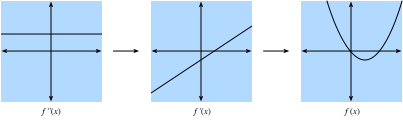
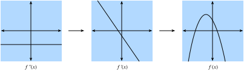
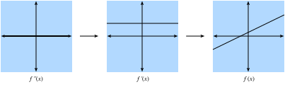

# Vieno kintamojo matematinė analizė
:label:`sec_single_variable_calculus`

:numref:`sec_calculus` matėme pagrindinius diferencialinio skaičiavimo elementus.  Šiame skyriuje giliau panagrinėsime matematinės analizės pagrindus ir tai, kaip ją galime suprasti bei taikyti mašininio mokymo kontekste.

## Diferencialinis skaičiavimas
Diferencialinis skaičiavimas iš esmės tiria, kaip funkcijos elgiasi esant mažiems pokyčiams.  Kad pamatytume, kodėl tai toks svarbus giliajam mokymuisi, panagrinėkime pavyzdį.

Tarkime, turime gilųjį neuroninį tinklą, kurio parametrai patogumo dėlei sujungti į vieną vektorių $\mathbf{w} = (w_1, \ldots, w_n)$.  Turėdami mokymo duomenų rinkinį, nagrinėjame savo neuroninio tinklo nuostolius šiame rinkinyje, kuriuos žymėsime $\mathcal{L}(\mathbf{w})$.

Ši funkcija yra nepaprastai sudėtinga, nes užkoduoja visų galimų duotos architektūros modelių našumą šiame duomenų rinkinyje, todėl beveik neįmanoma pasakyti, kuri parametrų aibė $\mathbf{w}$ minimizuos nuostolius. Todėl praktikoje dažnai pradedame parametrus inicializuodami *atsitiktinai*, o tada iteratyviai darome mažus žingsnius kryptimi, kuria nuostoliai mažėja kuo greičiau.

Taigi klausimas tampa toks, kuris iš pažiūros ne lengvesnis: kaip rasti kryptį, kuria parametrai mažėtų kuo greičiau?  Norėdami tai išnagrinėti, pirmiausia panagrinėkime atvejį su vienu parametru: $L(\mathbf{w}) = L(x)$ vienai realiajai reikšmei $x$.

Paimkime $x$ ir pabandykime suprasti, kas nutinka, kai ją šiek tiek pakeičiame į $x + \epsilon$. Jei norite konkretumo, pagalvokite apie tokį skaičių kaip $\epsilon = 0{,}0000001$.  Kad geriau įsivaizduotume, kas vyksta, nubraižykime pavyzdinės funkcijos $f(x) = \sin(x^x)$ grafiką intervale $[0, 3]$.

```{.python .input}
#@tab mxnet
%matplotlib inline
from d2l import mxnet as d2l
from IPython import display
from mxnet import np, npx
npx.set_np()

# Plot a function in a normal range
x_big = np.arange(0.01, 3.01, 0.01)
ys = np.sin(x_big**x_big)
d2l.plot(x_big, ys, 'x', 'f(x)')
```

```{.python .input}
#@tab pytorch
%matplotlib inline
from d2l import torch as d2l
from IPython import display
import torch
torch.pi = torch.acos(torch.zeros(1)).item() * 2  # Define pi in torch

# Plot a function in a normal range
x_big = torch.arange(0.01, 3.01, 0.01)
ys = torch.sin(x_big**x_big)
d2l.plot(x_big, ys, 'x', 'f(x)')
```

```{.python .input}
#@tab tensorflow
%matplotlib inline
from d2l import tensorflow as d2l
from IPython import display
import tensorflow as tf
tf.pi = tf.acos(tf.zeros(1)).numpy() * 2  # Define pi in TensorFlow

# Plot a function in a normal range
x_big = tf.range(0.01, 3.01, 0.01)
ys = tf.sin(x_big**x_big)
d2l.plot(x_big, ys, 'x', 'f(x)')
```

Tokiu dideliu mastu funkcijos elgsena nėra paprasta. Tačiau jei susiaurinsime intervalą iki kažko mažesnio, pavyzdžiui, $[1{,}75; 2{,}25]$, matome, kad grafikas tampa gerokai paprastesnis.

```{.python .input}
#@tab mxnet
# Plot a the same function in a tiny range
x_med = np.arange(1.75, 2.25, 0.001)
ys = np.sin(x_med**x_med)
d2l.plot(x_med, ys, 'x', 'f(x)')
```

```{.python .input}
#@tab pytorch
# Plot a the same function in a tiny range
x_med = torch.arange(1.75, 2.25, 0.001)
ys = torch.sin(x_med**x_med)
d2l.plot(x_med, ys, 'x', 'f(x)')
```

```{.python .input}
#@tab tensorflow
# Plot a the same function in a tiny range
x_med = tf.range(1.75, 2.25, 0.001)
ys = tf.sin(x_med**x_med)
d2l.plot(x_med, ys, 'x', 'f(x)')
```

Šią mintį išplėtę iki kraštutinumo, priartinę mažytį atkarpą matome, kad elgsena tampa daug paprastesnė: tai tiesiog tiesė.

```{.python .input}
#@tab mxnet
# Plot a the same function in a tiny range
x_small = np.arange(2.0, 2.01, 0.0001)
ys = np.sin(x_small**x_small)
d2l.plot(x_small, ys, 'x', 'f(x)')
```

```{.python .input}
#@tab pytorch
# Plot a the same function in a tiny range
x_small = torch.arange(2.0, 2.01, 0.0001)
ys = torch.sin(x_small**x_small)
d2l.plot(x_small, ys, 'x', 'f(x)')
```

```{.python .input}
#@tab tensorflow
# Plot a the same function in a tiny range
x_small = tf.range(2.0, 2.01, 0.0001)
ys = tf.sin(x_small**x_small)
d2l.plot(x_small, ys, 'x', 'f(x)')
```

Tai yra pagrindinis vieno kintamojo matematinės analizės pastebėjimas: pažįstamų funkcijų elgseną pakankamai mažame intervale galima modeliuoti tiese.  Tai reiškia, kad daugumai funkcijų pagrįstai galima tikėtis, jog šiek tiek pakeitus funkcijos $x$ reikšmę, išvestis $f(x)$ taip pat šiek tiek pasikeis.  Vienintelis klausimas, į kurį turime atsakyti: „Kiek didelis išvesties pokytis, palyginti su įvesties pokyčiu?  Ar perpus mažesnis?  Dvigubai didesnis?“

Taigi galime nagrinėti funkcijos išvesties pokyčio ir nedidelio funkcijos įvesties pokyčio santykį.  Formaliai tai galime užrašyti kaip

$$
\frac{L(x+\epsilon) - L(x)}{(x+\epsilon) - x} = \frac{L(x+\epsilon) - L(x)}{\epsilon}.
$$

Su tuo jau galima pradėti žaisti kode.  Pavyzdžiui, tarkime, žinome, kad $L(x) = x^{2} + 1701(x-4)^3$, tada galime pamatyti, kokia yra ši reikšmė taške $x = 4$, taip.

```{.python .input}
#@tab all
# Define our function
def L(x):
    return x**2 + 1701*(x-4)**3

# Print the difference divided by epsilon for several epsilon
for epsilon in [0.1, 0.001, 0.0001, 0.00001]:
    print(f'epsilon = {epsilon:.5f} -> {(L(4+epsilon) - L(4)) / epsilon:.5f}')
```

Jei esame pastabūs, pamatysime, kad šio skaičiaus išvestis įtartinai artima $8$.  Iš tiesų, mažindami $\epsilon$, matysime, kad reikšmė vis labiau artėja prie $8$.  Taigi galime teisingai daryti išvadą, kad ieškoma reikšmė (laipsnis, kuriuo įvesties pokytis keičia išvestį) taške $x=4$ turėtų būti $8$.  Matematikas šį faktą užkoduoja taip

$$
\lim_{\epsilon \rightarrow 0}\frac{L(4+\epsilon) - L(4)}{\epsilon} = 8.
$$

Trumpa istorinė atkarpa: pirmaisiais neuroninių tinklų tyrimų dešimtmečiais mokslininkai naudojo šį algoritmą (*baigtinių skirtumų metodą*), kad įvertintų, kaip nuostolių funkcija keičiasi esant mažam trikdžiui: tiesiog pakeisti parametrus ir pažiūrėti, kaip pasikeitė nuostoliai.  Tai skaičiavimo požiūriu neefektyvu: norint pamatyti, kaip vieno kintamojo pokytis paveikė nuostolius, reikia dviejų nuostolių funkcijos įvertinimų.  Jei taip bandytume daryti net su menku keliu tūkstančių parametrų skaičiumi, reikėtų kelių tūkstančių tinklo įvertinimų visame duomenų rinkinyje!  Ši problema buvo išspręsta tik 1986 m., kai :citet:`Rumelhart.Hinton.Williams.ea.1988` pristatytas *atgalinio sklidimo algoritmas* suteikė būdą apskaičiuoti, kaip *bet koks* kartu pakeistų parametrų pokytis pakeistų nuostolius per tiek pat skaičiavimo laiko, kiek reikia vienai tinklo prognozei visame duomenų rinkinyje.

Grįžkime prie mūsų pavyzdžio: ši reikšmė $8$ skiriasi esant skirtingoms $x$ reikšmėms, todėl prasminga ją apibrėžti kaip $x$ funkciją.  Formaliau, šis nuo reikšmės priklausantis kitimo greitis vadinamas *išvestine* ir žymimas

$$\frac{df}{dx}(x) = \lim_{\epsilon \rightarrow 0}\frac{f(x+\epsilon) - f(x)}{\epsilon}.$$
:eqlabel:`eq_der_def`

Skirtinguose tekstuose išvestinei žymėti naudojami skirtingi žymenys. Pavyzdžiui, visi toliau pateikti žymenys reiškia tą patį:

$$
\frac{df}{dx} = \frac{d}{dx}f = f' = \nabla_xf = D_xf = f_x.
$$

Dauguma autorių pasirenka vieną žymenį ir jo laikosi, tačiau ir tai negarantuota.  Geriausia mokėti visus šiuos žymenis.  Šiame tekste naudosime žymenį $\frac{df}{dx}$, nebent norėsime imti sudėtingos išraiškos išvestinę – tuomet naudosime $\frac{d}{dx}f$ ir rašysime tokias išraiškas kaip
$$
\frac{d}{dx}\left[x^4+\cos\left(\frac{x^2+1}{2x-1}\right)\right].
$$

Dažnai intuityviai naudinga iš naujo išskleisti išvestinės apibrėžimą :eqref:`eq_der_def`, kad pamatytume, kaip funkcija keičiasi, kai šiek tiek pakeičiame $x$:

$$\begin{aligned} \frac{df}{dx}(x) = \lim_{\epsilon \rightarrow 0}\frac{f(x+\epsilon) - f(x)}{\epsilon} & \implies \frac{df}{dx}(x) \approx \frac{f(x+\epsilon) - f(x)}{\epsilon} \\ & \implies \epsilon \frac{df}{dx}(x) \approx f(x+\epsilon) - f(x) \\ & \implies f(x+\epsilon) \approx f(x) + \epsilon \frac{df}{dx}(x). \end{aligned}$$
:eqlabel:`eq_small_change`

Paskutinę lygtį verta paminėti atskirai.  Ji sako, kad jei paimsime bet kurią funkciją ir šiek tiek pakeisime įvestį, išvestis pasikeis tuo mažu dydžiu, padaugintu iš išvestinės.

Šitaip išvestinę galime suprasti kaip mastelio koeficientą, parodantį, kokį išvesties pokytį gauname dėl įvesties pokyčio.

## Matematinės analizės taisyklės
:label:`sec_derivative_table`

Dabar pereiname prie užduoties suprasti, kaip apskaičiuoti aiškios funkcijos išvestinę.  Pilnas formalus matematinės analizės dėstymas viską išvestų iš pirmųjų principų.  Šiam pagundai čia nepasiduosime, o veikiau suteiksime supratimą apie dažniausiai sutinkamas taisykles.

### Dažniausios išvestinės
Kaip matėme :numref:`sec_calculus`, skaičiuojant išvestines dažnai galima naudoti taisyklių seką, kad skaičiavimą sumažintume iki kelių pagrindinių funkcijų.  Dėl patogumo pakartojame jas čia.

* **Konstantų išvestinė.** $\frac{d}{dx}c = 0$.
* **Tiesinių funkcijų išvestinė.** $\frac{d}{dx}(ax) = a$.
* **Laipsnio taisyklė.** $\frac{d}{dx}x^n = nx^{n-1}$.
* **Eksponentinių funkcijų išvestinė.** $\frac{d}{dx}e^x = e^x$.
* **Logaritmo išvestinė.** $\frac{d}{dx}\log(x) = \frac{1}{x}$.

### Išvestinių taisyklės
Jei kiekvieną išvestinę reikėtų skaičiuoti atskirai ir saugoti lentelėje, diferencialinis skaičiavimas būtų beveik neįmanomas.  Matematikos dovana yra tai, kad aukščiau pateiktas išvestines galime apibendrinti ir skaičiuoti sudėtingesnes, pavyzdžiui, rasti funkcijos $f(x) = \log\left(1+(x-1)^{10}\right)$ išvestinę.  Kaip minėta :numref:`sec_calculus`, raktas į tai – užkoduoti, kas nutinka funkcijas įvairiai derinant, svarbiausia: sumas, sandaugas ir kompozicijas.

* **Sumos taisyklė.** $\frac{d}{dx}\left(g(x) + h(x)\right) = \frac{dg}{dx}(x) + \frac{dh}{dx}(x)$.
* **Sandaugos taisyklė.** $\frac{d}{dx}\left(g(x)\cdot h(x)\right) = g(x)\frac{dh}{dx}(x) + \frac{dg}{dx}(x)h(x)$.
* **Grandinės taisyklė.** $\frac{d}{dx}g(h(x)) = \frac{dg}{dh}(h(x))\cdot \frac{dh}{dx}(x)$.

Pažiūrėkime, kaip galime naudoti :eqref:`eq_small_change`, kad suprastume šias taisykles.  Sumos taisyklei panagrinėkime tokią samprotavimo grandinę:

$$
\begin{aligned}
f(x+\epsilon) & = g(x+\epsilon) + h(x+\epsilon) \\
& \approx g(x) + \epsilon \frac{dg}{dx}(x) + h(x) + \epsilon \frac{dh}{dx}(x) \\
& = g(x) + h(x) + \epsilon\left(\frac{dg}{dx}(x) + \frac{dh}{dx}(x)\right) \\
& = f(x) + \epsilon\left(\frac{dg}{dx}(x) + \frac{dh}{dx}(x)\right).
\end{aligned}
$$

Palyginę šį rezultatą su faktu, kad $f(x+\epsilon) \approx f(x) + \epsilon \frac{df}{dx}(x)$, matome, kad $\frac{df}{dx}(x) = \frac{dg}{dx}(x) + \frac{dh}{dx}(x)$, kaip ir norėta.  Intuicija čia tokia: keičiant įvestį $x$, $g$ ir $h$ kartu prisideda prie išvesties pokyčio atitinkamai $\frac{dg}{dx}(x)$ ir $\frac{dh}{dx}(x)$.


Sandauga subtilesnė ir reikalaus naujo pastebėjimo apie tai, kaip dirbti su šiomis išraiškomis.  Pradėsime kaip anksčiau naudodami :eqref:`eq_small_change`:

$$
\begin{aligned}
f(x+\epsilon) & = g(x+\epsilon)\cdot h(x+\epsilon) \\
& \approx \left(g(x) + \epsilon \frac{dg}{dx}(x)\right)\cdot\left(h(x) + \epsilon \frac{dh}{dx}(x)\right) \\
& = g(x)\cdot h(x) + \epsilon\left(g(x)\frac{dh}{dx}(x) + \frac{dg}{dx}(x)h(x)\right) + \epsilon^2\frac{dg}{dx}(x)\frac{dh}{dx}(x) \\
& = f(x) + \epsilon\left(g(x)\frac{dh}{dx}(x) + \frac{dg}{dx}(x)h(x)\right) + \epsilon^2\frac{dg}{dx}(x)\frac{dh}{dx}(x). \\
\end{aligned}
$$


Tai primena aukščiau atliktą skaičiavimą, ir iš tiesų matome savo atsakymą ($\frac{df}{dx}(x) = g(x)\frac{dh}{dx}(x) + \frac{dg}{dx}(x)h(x)$) šalia $\epsilon$, tačiau yra problema dėl to nario, kurio dydis $\epsilon^{2}$.  Jį vadinsime *aukštesnės eilės nariu*, nes $\epsilon^2$ laipsnis yra aukštesnis už $\epsilon^1$ laipsnį.  Vėlesniame skyriuje pamatysime, kad kartais norėsime juos sekti, tačiau kol kas pastebėkime, kad jei $\epsilon = 0{,}0000001$, tai $\epsilon^{2}= 0{,}0000000000001$, kuris yra gerokai mažesnis.  Kai $\epsilon \rightarrow 0$, aukštesnės eilės narius galime saugiai ignoruoti.  Kaip bendrą šio priedo susitarimą, naudosime „$\approx$“, kad pažymėtume, jog du nariai yra lygūs iki aukštesnės eilės narių.  Tačiau jei norime būti formalesni, galime išnagrinėti skirtumų santykį

$$
\frac{f(x+\epsilon) - f(x)}{\epsilon} = g(x)\frac{dh}{dx}(x) + \frac{dg}{dx}(x)h(x) + \epsilon \frac{dg}{dx}(x)\frac{dh}{dx}(x),
$$

ir pamatyti, kad kai $\epsilon \rightarrow 0$, dešinysis narys taip pat artėja prie nulio.

Galiausiai su grandinės taisykle galime vėl žengti kaip anksčiau naudodami :eqref:`eq_small_change` ir pamatyti, kad

$$
\begin{aligned}
f(x+\epsilon) & = g(h(x+\epsilon)) \\
& \approx g\left(h(x) + \epsilon \frac{dh}{dx}(x)\right) \\
& \approx g(h(x)) + \epsilon \frac{dh}{dx}(x) \frac{dg}{dh}(h(x))\\
& = f(x) + \epsilon \frac{dg}{dh}(h(x))\frac{dh}{dx}(x),
\end{aligned}
$$

kur antroje eilutėje funkciją $g$ vertiname taip, tarsi jos įvestis ($h(x)$) būtų pastumta mažyčiu dydžiu $\epsilon \frac{dh}{dx}(x)$.

Šios taisyklės suteikia lanksčią priemonių rinkinį, leidžiantį apskaičiuoti iš esmės bet kokią norimą išraišką.  Pavyzdžiui,

$$
\begin{aligned}
\frac{d}{dx}\left[\log\left(1+(x-1)^{10}\right)\right] & = \left(1+(x-1)^{10}\right)^{-1}\frac{d}{dx}\left[1+(x-1)^{10}\right]\\
& = \left(1+(x-1)^{10}\right)^{-1}\left(\frac{d}{dx}[1] + \frac{d}{dx}[(x-1)^{10}]\right) \\
& = \left(1+(x-1)^{10}\right)^{-1}\left(0 + 10(x-1)^9\frac{d}{dx}[x-1]\right) \\
& = 10\left(1+(x-1)^{10}\right)^{-1}(x-1)^9 \\
& = \frac{10(x-1)^9}{1+(x-1)^{10}}.
\end{aligned}
$$

Kur kiekvienoje eilutėje naudotos šios taisyklės:

1. Grandinės taisyklė ir logaritmo išvestinė.
2. Sumos taisyklė.
3. Konstantų išvestinė, grandinės taisyklė ir laipsnio taisyklė.
4. Sumos taisyklė, tiesinių funkcijų išvestinė, konstantų išvestinė.

Atlikus šį pavyzdį, turėtų būti aišku du dalykai:

1. Bet kurios funkcijos, kurią galime užrašyti naudodami sumas, sandaugas, konstantas, laipsnius, eksponentes ir logaritmus, išvestinę galima apskaičiuoti mechaniškai laikantis šių taisyklių.
2. Žmogui laikytis šių taisyklių gali būti nuobodu ir klaidų kupina!

Laimei, šie du faktai kartu užsimena apie tolesnį kelią: tai puikus kandidatas mechanizavimui!  Iš tiesų atgalinis sklidimas, prie kurio dar grįšime šiame skyriuje, yra būtent tai.

### Tiesinė aproksimacija
Dirbant su išvestinėmis dažnai naudinga geometriškai interpretuoti aukščiau naudotą aproksimaciją.  Visų pirma atkreipkite dėmesį, kad lygtis

$$
f(x+\epsilon) \approx f(x) + \epsilon \frac{df}{dx}(x),
$$

aproksimuoja $f$ reikšmę tiese, einančia per tašką $(x, f(x))$ ir turinčia nuolydį $\frac{df}{dx}(x)$.  Taip sakome, kad išvestinė suteikia funkcijos $f$ tiesinę aproksimaciją, kaip parodyta toliau:

```{.python .input}
#@tab mxnet
# Compute sin
xs = np.arange(-np.pi, np.pi, 0.01)
plots = [np.sin(xs)]

# Compute some linear approximations. Use d(sin(x)) / dx = cos(x)
for x0 in [-1.5, 0, 2]:
    plots.append(np.sin(x0) + (xs - x0) * np.cos(x0))

d2l.plot(xs, plots, 'x', 'f(x)', ylim=[-1.5, 1.5])
```

```{.python .input}
#@tab pytorch
# Compute sin
xs = torch.arange(-torch.pi, torch.pi, 0.01)
plots = [torch.sin(xs)]

# Compute some linear approximations. Use d(sin(x))/dx = cos(x)
for x0 in [-1.5, 0.0, 2.0]:
    plots.append(torch.sin(torch.tensor(x0)) + (xs - x0) *
                 torch.cos(torch.tensor(x0)))

d2l.plot(xs, plots, 'x', 'f(x)', ylim=[-1.5, 1.5])
```

```{.python .input}
#@tab tensorflow
# Compute sin
xs = tf.range(-tf.pi, tf.pi, 0.01)
plots = [tf.sin(xs)]

# Compute some linear approximations. Use d(sin(x))/dx = cos(x)
for x0 in [-1.5, 0.0, 2.0]:
    plots.append(tf.sin(tf.constant(x0)) + (xs - x0) *
                 tf.cos(tf.constant(x0)))

d2l.plot(xs, plots, 'x', 'f(x)', ylim=[-1.5, 1.5])
```

### Aukštesnės eilės išvestinės

Dabar padarykime tai, kas iš pažiūros gali atrodyti keista.  Paimkime funkciją $f$ ir apskaičiuokime išvestinę $\frac{df}{dx}$.  Tai mums duoda $f$ kitimo greitį bet kuriame taške.

Tačiau išvestinę $\frac{df}{dx}$ galima nagrinėti kaip pačią funkciją, todėl niekas netrukdo apskaičiuoti $\frac{df}{dx}$ išvestinės ir gauti $\frac{d^2f}{dx^2} = \frac{df}{dx}\left(\frac{df}{dx}\right)$.  Tai vadinsime antrąja $f$ išvestine.  Ši funkcija yra $f$ kitimo greičio kitimo greitis, arba, kitaip tariant, kaip kinta kitimo greitis. Išvestinę galime taikyti bet kiek kartų ir gauti vadinamąją $n$-ąją išvestinę. Kad žymėjimas būtų tvarkingas, $n$-ąją išvestinę žymėsime

$$
f^{(n)}(x) = \frac{d^{n}f}{dx^{n}} = \left(\frac{d}{dx}\right)^{n} f.
$$

Pabandykime suprasti, *kodėl* ši sąvoka naudinga.  Toliau pavaizduojame $f^{(2)}(x)$, $f^{(1)}(x)$ ir $f(x)$.

Pirmiausia panagrinėkime atvejį, kai antroji išvestinė $f^{(2)}(x)$ yra teigiama konstanta.  Tai reiškia, kad pirmosios išvestinės nuolydis yra teigiamas.  Dėl to pirmoji išvestinė $f^{(1)}(x)$ gali pradėti neigiama, tam tikrame taške tapti lygi nuliui, o galiausiai tapti teigiama. Tai mums pasako mūsų pradinės funkcijos $f$ nuolydį, todėl pati funkcija $f$ mažėja, išsilygina, tada didėja.  Kitaip tariant, funkcija $f$ išgaubta į viršų ir turi vieną minimumą, kaip parodyta :numref:`fig_positive-second`.


:label:`fig_positive-second`


Antra, jei antroji išvestinė yra neigiama konstanta, tai reiškia, kad pirmoji išvestinė mažėja.  Tai reiškia, kad pirmoji išvestinė gali pradėti teigiama, tam tikrame taške tapti lygi nuliui, o tada tapti neigiama. Vadinasi, pati funkcija $f$ didėja, išsilygina, tada mažėja.  Kitaip tariant, funkcija $f$ išgaubta žemyn ir turi vieną maksimumą, kaip parodyta :numref:`fig_negative-second`.


:label:`fig_negative-second`


Trečia, jei antroji išvestinė visada lygi nuliui, tai pirmoji išvestinė niekada nesikeis – ji yra konstanta!  Tai reiškia, kad $f$ didėja (arba mažėja) pastoviu greičiu, o pati $f$ yra tiesė, kaip parodyta :numref:`fig_zero-second`.


:label:`fig_zero-second`

Apibendrinant, antrąją išvestinę galima interpretuoti kaip aprašančią, kaip funkcija $f$ išlinksta.  Teigiama antroji išvestinė lemia išlinkimą į viršų, neigiama antroji išvestinė reiškia, kad $f$ išlinksta žemyn, o nulinė antroji išvestinė reiškia, kad $f$ visai nelinksta.

Žengkime dar vieną žingsnį. Panagrinėkime funkciją $g(x) = ax^{2}+ bx + c$.  Tada galime apskaičiuoti, kad

$$
\begin{aligned}
\frac{dg}{dx}(x) & = 2ax + b \\
\frac{d^2g}{dx^2}(x) & = 2a.
\end{aligned}
$$

Jei turime omenyje kokią nors pradinę funkciją $f(x)$, galime apskaičiuoti pirmąsias dvi išvestines ir rasti $a, b$ bei $c$ reikšmes, kurios joms leidžia atitikti šį skaičiavimą.  Panašiai kaip ankstesniame skyriuje matėme, kad pirmoji išvestinė duoda geriausią aproksimaciją tiese, ši konstrukcija suteikia geriausią aproksimaciją kvadratine funkcija.  Pavaizduokime tai funkcijai $f(x) = \sin(x)$.

```{.python .input}
#@tab mxnet
# Compute sin
xs = np.arange(-np.pi, np.pi, 0.01)
plots = [np.sin(xs)]

# Compute some quadratic approximations. Use d(sin(x)) / dx = cos(x)
for x0 in [-1.5, 0, 2]:
    plots.append(np.sin(x0) + (xs - x0) * np.cos(x0) -
                              (xs - x0)**2 * np.sin(x0) / 2)

d2l.plot(xs, plots, 'x', 'f(x)', ylim=[-1.5, 1.5])
```

```{.python .input}
#@tab pytorch
# Compute sin
xs = torch.arange(-torch.pi, torch.pi, 0.01)
plots = [torch.sin(xs)]

# Compute some quadratic approximations. Use d(sin(x)) / dx = cos(x)
for x0 in [-1.5, 0.0, 2.0]:
    plots.append(torch.sin(torch.tensor(x0)) + (xs - x0) *
                 torch.cos(torch.tensor(x0)) - (xs - x0)**2 *
                 torch.sin(torch.tensor(x0)) / 2)

d2l.plot(xs, plots, 'x', 'f(x)', ylim=[-1.5, 1.5])
```

```{.python .input}
#@tab tensorflow
# Compute sin
xs = tf.range(-tf.pi, tf.pi, 0.01)
plots = [tf.sin(xs)]

# Compute some quadratic approximations. Use d(sin(x)) / dx = cos(x)
for x0 in [-1.5, 0.0, 2.0]:
    plots.append(tf.sin(tf.constant(x0)) + (xs - x0) *
                 tf.cos(tf.constant(x0)) - (xs - x0)**2 *
                 tf.sin(tf.constant(x0)) / 2)

d2l.plot(xs, plots, 'x', 'f(x)', ylim=[-1.5, 1.5])
```

Šią mintį išplėsime iki *Teiloro eilutės* sampratos kitame skyrelyje.

### Teiloro eilutė


*Teiloro eilutė* suteikia metodą aproksimuoti funkciją $f(x)$, jei turime pirmųjų $n$ išvestinių reikšmes taške $x_0$, t. y. $\left\{ f(x_0), f^{(1)}(x_0), f^{(2)}(x_0), \ldots, f^{(n)}(x_0) \right\}$. Idėja – rasti $n$-ojo laipsnio daugianarį, atitinkantį visas duotas išvestines taške $x_0$.

Atvejį $n=2$ matėme ankstesniame skyrelyje, ir šiek tiek algebros parodo, kad tai yra

$$
f(x) \approx \frac{1}{2}\frac{d^2f}{dx^2}(x_0)(x-x_0)^{2}+ \frac{df}{dx}(x_0)(x-x_0) + f(x_0).
$$

Kaip matome aukščiau, vardiklis $2$ yra tam, kad panaikintų $2$, kurį gauname dukart diferencijuodami $x^2$, o kiti nariai visi lygūs nuliui.  Ta pati logika galioja pirmajai išvestinei ir pačiai reikšmei.

Jei logiką tęsime iki $n=3$, padarysime išvadą, kad

$$
f(x) \approx \frac{\frac{d^3f}{dx^3}(x_0)}{6}(x-x_0)^3 + \frac{\frac{d^2f}{dx^2}(x_0)}{2}(x-x_0)^{2}+ \frac{df}{dx}(x_0)(x-x_0) + f(x_0).
$$

kur $6 = 3 \times 2 = 3!$ atsiranda iš konstantos, kurią gauname priekyje, jei triskart diferencijuojame $x^3$.


Be to, $n$-ojo laipsnio daugianarį galime gauti taip:

$$
P_n(x) = \sum_{i = 0}^{n} \frac{f^{(i)}(x_0)}{i!}(x-x_0)^{i}.
$$

kur žymuo

$$
f^{(n)}(x) = \frac{d^{n}f}{dx^{n}} = \left(\frac{d}{dx}\right)^{n} f.
$$


Iš tiesų $P_n(x)$ galima laikyti geriausia $n$-ojo laipsnio daugianario aproksimacija mūsų funkcijai $f(x)$.

Nors nesigilinsime iki galo į aukščiau pateiktų aproksimacijų paklaidą, verta paminėti begalinę ribą. Šiuo atveju gerai besielgiančioms funkcijoms (žinomoms kaip realiosios analizinės funkcijos), tokioms kaip $\cos(x)$ ar $e^{x}$, galime užrašyti begalinį narių skaičių ir aproksimuoti tą pačią funkciją

$$
f(x) = \sum_{n = 0}^\infty \frac{f^{(n)}(x_0)}{n!}(x-x_0)^{n}.
$$

Pavyzdžiui, paimkime $f(x) = e^{x}$. Kadangi $e^{x}$ yra savo paties išvestinė, žinome, kad $f^{(n)}(x) = e^{x}$. Todėl $e^{x}$ galima atkurti paėmus Teiloro eilutę taške $x_0 = 0$, t. y.

$$
e^{x} = \sum_{n = 0}^\infty \frac{x^{n}}{n!} = 1 + x + \frac{x^2}{2} + \frac{x^3}{6} + \cdots.
$$

Pažiūrėkime, kaip tai veikia kode, ir stebėkime, kaip didinant Teiloro aproksimacijos laipsnį artėjame prie norimos funkcijos $e^x$.

```{.python .input}
#@tab mxnet
# Compute the exponential function
xs = np.arange(0, 3, 0.01)
ys = np.exp(xs)

# Compute a few Taylor series approximations
P1 = 1 + xs
P2 = 1 + xs + xs**2 / 2
P5 = 1 + xs + xs**2 / 2 + xs**3 / 6 + xs**4 / 24 + xs**5 / 120

d2l.plot(xs, [ys, P1, P2, P5], 'x', 'f(x)', legend=[
    "Exponential", "Degree 1 Taylor Series", "Degree 2 Taylor Series",
    "Degree 5 Taylor Series"])
```

```{.python .input}
#@tab pytorch
# Compute the exponential function
xs = torch.arange(0, 3, 0.01)
ys = torch.exp(xs)

# Compute a few Taylor series approximations
P1 = 1 + xs
P2 = 1 + xs + xs**2 / 2
P5 = 1 + xs + xs**2 / 2 + xs**3 / 6 + xs**4 / 24 + xs**5 / 120

d2l.plot(xs, [ys, P1, P2, P5], 'x', 'f(x)', legend=[
    "Exponential", "Degree 1 Taylor Series", "Degree 2 Taylor Series",
    "Degree 5 Taylor Series"])
```

```{.python .input}
#@tab tensorflow
# Compute the exponential function
xs = tf.range(0, 3, 0.01)
ys = tf.exp(xs)

# Compute a few Taylor series approximations
P1 = 1 + xs
P2 = 1 + xs + xs**2 / 2
P5 = 1 + xs + xs**2 / 2 + xs**3 / 6 + xs**4 / 24 + xs**5 / 120

d2l.plot(xs, [ys, P1, P2, P5], 'x', 'f(x)', legend=[
    "Exponential", "Degree 1 Taylor Series", "Degree 2 Taylor Series",
    "Degree 5 Taylor Series"])
```

Teiloro eilutės turi du pagrindinius taikymus:

1. *Teoriniai taikymai*: dažnai, kai bandome suprasti per daug sudėtingą funkciją, Teiloro eilutės leidžia ją paversti daugianariu, su kuriuo galime dirbti tiesiogiai.

2. *Skaitiniai taikymai*: kai kurias funkcijas, pavyzdžiui, $e^{x}$ ar $\cos(x)$, mašinoms sunku apskaičiuoti.  Jos gali saugoti reikšmių lenteles fiksuotu tikslumu (ir tai dažnai daroma), tačiau tai vis tiek palieka neatsakytų klausimų, pavyzdžiui: „Koks yra 1000-asis $\cos(1)$ skaitmuo?“  Teiloro eilutės dažnai padeda atsakyti į tokius klausimus.


## Santrauka

* Išvestinės gali būti naudojamos išreikšti, kaip funkcijos keičiasi, kai įvestį šiek tiek pakeičiame.
* Elementariosios išvestinės gali būti derinamos naudojant išvestinių taisykles, kad gautume savavališkai sudėtingas išvestines.
* Išvestines galima iteruoti ir gauti antrąją ar aukštesnės eilės išvestines.  Kiekvienas eilės padidinimas suteikia smulkesnės informacijos apie funkcijos elgesį.
* Naudodami informaciją iš vieno duomenų pavyzdžio išvestinių, gerai besielgiančias funkcijas galime aproksimuoti daugianariais, gautais iš Teiloro eilutės.


## Pratimai

1. Kokia yra $x^3-4x+1$ išvestinė?
2. Kokia yra $\log(\frac{1}{x})$ išvestinė?
3. Teisinga ar klaidinga: jei $f'(x) = 0$, tai $f$ taške $x$ turi maksimumą arba minimumą?
4. Kur yra $f(x) = x\log(x)$ minimumas, kai $x\ge0$ (darome prielaidą, kad $f(0)$ taške $f$ įgyja ribinę reikšmę $0$)?


:begin_tab:`mxnet`
[Diskusijos](https://discuss.d2l.ai/t/412)
:end_tab:

:begin_tab:`pytorch`
[Diskusijos](https://discuss.d2l.ai/t/1088)
:end_tab:


:begin_tab:`tensorflow`
[Diskusijos](https://discuss.d2l.ai/t/1089)
:end_tab:
