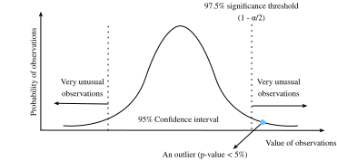

# Statistika
:label:`sec_statistics`

Neabejotinai, kad norint tapti aukščiausio lygio giliojo mokymosi praktiku, būtina gebėti apmokyti pažangiausius ir labai tikslius modelius.  Tačiau dažnai neaišku, kada patobulinimai yra reikšmingi, o kada tėra atsitiktinių mokymo proceso svyravimų rezultatas.  Kad galėtume aptarti įvertintų reikšmių neapibrėžtumą, turime išmokti šiek tiek statistikos.


Seniausia *statistikos* paminėjimą galima atsekti iki arabų mokslininko Al Kindžio (Al-Kindi) $9$ a., kuris išsamiai aprašė, kaip naudoti statistiką ir dažnių analizę užšifruotiems pranešimams iššifruoti. Po 800 metų šiuolaikinė statistika atsirado Vokietijoje XVIII a., kai tyrėjai susitelkė į demografinių ir ekonominių duomenų rinkimą ir analizę. Šiandien statistika yra mokslo šaka, nagrinėjanti duomenų rinkimą, apdorojimą, analizę, interpretavimą ir vizualizavimą. Be to, pagrindinė statistikos teorija plačiai naudojama akademiniuose, pramonės ir vyriausybiniuose tyrimuose.


Konkrečiau, statistiką galima skirstyti į *aprašomąją statistiką* ir *statistinę inferenciją*. Pirmoji orientuota į stebimų duomenų rinkinio, vadinamo *imtimi*, savybių apibendrinimą ir iliustravimą. Imtis ištraukiama iš *populiacijos*, žyminčios visą panašių individų, objektų ar įvykių, kuriuos domina mūsų eksperimentas, aibę. Skirtingai nei aprašomoji statistika, *statistinė inferencija* iš duotų *imčių* toliau daro išvadas apie populiacijos charakteristikas, remdamasi prielaidomis, kad imties skirstinys tam tikru laipsniu gali atkartoti populiacijos skirstinį.


Galite paklausti: „Koks esminis skirtumas tarp mašininio mokymo ir statistikos?“ Iš esmės statistika orientuota į išvadų darymo problemą. Tokio tipo problemos apima ryšio tarp kintamųjų modeliavimą, pavyzdžiui, priežastingumo analizę, ir modelio parametrų statistinio reikšmingumo tikrinimą, pavyzdžiui, A/B testavimą. Priešingai, mašininis mokymas pabrėžia tikslių prognozių darymą, aiškiai neprogramuojant ir nesuprantant kiekvieno parametro funkcijos.


Šiame skyriuje pristatysime tris statistinės inferencijos metodų tipus: įvertinių vertinimą ir palyginimą, hipotezių tikrinimą ir pasikliautinųjų intervalų sudarymą. Šie metodai gali padėti mums spręsti apie duotos populiacijos charakteristikas, t. y. tikrąjį parametrą $\theta$. Trumpumo dėlei darome prielaidą, kad duotos populiacijos tikrasis parametras $\theta$ yra skaliaras. Atvejį, kai $\theta$ yra vektorius ar tenzorius, išplėsti nesunku, todėl jo savo diskusijoje nenagrinėjame.


## Įvertinių vertinimas ir palyginimas

Statistikoje *įvertinys* yra duotų imčių funkcija, naudojama tikrajam parametrui $\theta$ įvertinti. Žymėsime $\hat{\theta}_n = \hat{f}(x_1, \ldots, x_n)$ – $\theta$ įvertį po to, kai stebėjome imtis {$x_1, x_2, \ldots, x_n$}.

Paprastų įvertinių pavyzdžių matėme anksčiau, :numref:`sec_maximum_likelihood` skyriuje.  Jei turite keletą Bernulio atsitiktinio dydžio imčių, tai didžiausio tikėtinumo įvertį tikimybei, kad atsitiktinis dydis lygus vienam, galima gauti suskaičiavus stebėtų vienetų skaičių ir padalijus iš bendro imčių skaičiaus.  Panašiai pratime buvo prašoma parodyti, kad Gauso skirstinio vidurkio didžiausio tikėtinumo įvertis, turint tam tikrą imčių skaičių, yra visų imčių vidutinė reikšmė.  Šie įvertiniai beveik niekada nepateiks tikrosios parametro reikšmės, tačiau idealiu atveju, esant dideliam imčių skaičiui, įvertis bus artimas.

Pavyzdžiui, toliau parodome tikrąjį Gauso atsitiktinio dydžio su vidurkiu nuliu ir dispersija vienas tankį kartu su šio Gauso imčių rinkiniu.  $y$ koordinatę sukonstravome taip, kad kiekvienas taškas būtų matomas, o ryšys su pradiniu tankiu būtų aiškesnis.

```{.python .input}
#@tab mxnet
from d2l import mxnet as d2l
from mxnet import np, npx
import random
npx.set_np()

# Sample datapoints and create y coordinate
epsilon = 0.1
random.seed(8675309)
xs = np.random.normal(loc=0, scale=1, size=(300,))

ys = [np.sum(np.exp(-(xs[:i] - xs[i])**2 / (2 * epsilon**2))
             / np.sqrt(2*np.pi*epsilon**2)) / len(xs) for i in range(len(xs))]

# Compute true density
xd = np.arange(np.min(xs), np.max(xs), 0.01)
yd = np.exp(-xd**2/2) / np.sqrt(2 * np.pi)

# Plot the results
d2l.plot(xd, yd, 'x', 'density')
d2l.plt.scatter(xs, ys)
d2l.plt.axvline(x=0)
d2l.plt.axvline(x=np.mean(xs), linestyle='--', color='purple')
d2l.plt.title(f'sample mean: {float(np.mean(xs)):.2f}')
d2l.plt.show()
```

```{.python .input}
#@tab pytorch
from d2l import torch as d2l
import torch

torch.pi = torch.acos(torch.zeros(1)) * 2  #define pi in torch

# Sample datapoints and create y coordinate
epsilon = 0.1
torch.manual_seed(8675309)
xs = torch.randn(size=(300,))

ys = torch.tensor(
    [torch.sum(torch.exp(-(xs[:i] - xs[i])**2 / (2 * epsilon**2))\
               / torch.sqrt(2*torch.pi*epsilon**2)) / len(xs)\
     for i in range(len(xs))])

# Compute true density
xd = torch.arange(torch.min(xs), torch.max(xs), 0.01)
yd = torch.exp(-xd**2/2) / torch.sqrt(2 * torch.pi)

# Plot the results
d2l.plot(xd, yd, 'x', 'density')
d2l.plt.scatter(xs, ys)
d2l.plt.axvline(x=0)
d2l.plt.axvline(x=torch.mean(xs), linestyle='--', color='purple')
d2l.plt.title(f'sample mean: {float(torch.mean(xs).item()):.2f}')
d2l.plt.show()
```

```{.python .input}
#@tab tensorflow
from d2l import tensorflow as d2l
import tensorflow as tf

tf.pi = tf.acos(tf.zeros(1)) * 2  # define pi in TensorFlow

# Sample datapoints and create y coordinate
epsilon = 0.1
xs = tf.random.normal((300,))

ys = tf.constant(
    [(tf.reduce_sum(tf.exp(-(xs[:i] - xs[i])**2 / (2 * epsilon**2)) \
               / tf.sqrt(2*tf.pi*epsilon**2)) / tf.cast(
        tf.size(xs), dtype=tf.float32)).numpy() \
     for i in range(tf.size(xs))])

# Compute true density
xd = tf.range(tf.reduce_min(xs), tf.reduce_max(xs), 0.01)
yd = tf.exp(-xd**2/2) / tf.sqrt(2 * tf.pi)

# Plot the results
d2l.plot(xd, yd, 'x', 'density')
d2l.plt.scatter(xs, ys)
d2l.plt.axvline(x=0)
d2l.plt.axvline(x=tf.reduce_mean(xs), linestyle='--', color='purple')
d2l.plt.title(f'sample mean: {float(tf.reduce_mean(xs).numpy()):.2f}')
d2l.plt.show()
```

Parametro įvertinį $\hat{\theta}_n$ galima apskaičiuoti daugeliu būdų.  Šiame skyriuje pristatome tris įprastus metodus įvertiniams vertinti ir palyginti: vidutinę kvadratinę paklaidą, standartinį nuokrypį ir statistinį paslinkimą.

### Vidutinė kvadratinė paklaida

Galbūt paprasčiausias įvertiniams vertinti naudojamas matas yra *vidutinės kvadratinės paklaidos (VKP)* (arba $l_2$ nuostolių) įvertinys, kuris gali būti apibrėžtas kaip

$$\textrm{MSE} (\hat{\theta}_n, \theta) = E[(\hat{\theta}_n - \theta)^2].$$
:eqlabel:`eq_mse_est`

Tai leidžia kiekybiškai įvertinti vidutinį kvadratinį nuokrypį nuo tikrosios reikšmės.  VKP visada neneigiama. Jei skaitėte :numref:`sec_linear_regression`, atpažinsite ją kaip dažniausiai naudojamą regresijos nuostolių funkciją. Kaip įvertinio vertinimo matas, kuo jo reikšmė artimesnė nuliui, tuo įvertinys artimesnis tikrajam parametrui $\theta$.


### Statistinis paslinkimas

VKP suteikia natūralų matą, tačiau lengva įsivaizduoti keletą skirtingų reiškinių, galinčių ją padidinti.  Du iš esmės svarbūs yra įvertinio svyravimas dėl duomenų rinkinio atsitiktinumo ir sistemingoji įvertinio paklaida dėl įvertinimo procedūros.


Pirmiausia išmatuokime sistemingąją paklaidą. Įvertiniui $\hat{\theta}_n$ matematinė *statistinio paslinkimo* išraiška gali būti apibrėžta kaip

$$\textrm{bias}(\hat{\theta}_n) = E(\hat{\theta}_n - \theta) = E(\hat{\theta}_n) - \theta.$$
:eqlabel:`eq_bias`

Atkreipkite dėmesį, kad kai $\textrm{bias}(\hat{\theta}_n) = 0$, įvertinio $\hat{\theta}_n$ vidurkis yra lygus tikrajai parametro reikšmei.  Šiuo atveju sakome, kad $\hat{\theta}_n$ yra nepaslinktas įvertinys.  Apskritai nepaslinktas įvertinys yra geresnis už paslinktąjį, nes jo vidurkis yra toks pat kaip tikrojo parametro.


Vis dėlto verta žinoti, kad paslinkti įvertiniai praktikoje naudojami dažnai.  Yra atvejų, kai nepaslinktų įvertinių be papildomų prielaidų nėra arba jų neįmanoma apskaičiuoti.  Tai gali atrodyti didelis įvertinio trūkumas, tačiau dauguma praktikoje sutinkamų įvertinių yra bent asimptotiškai nepaslinkti tuo požiūriu, kad paslinkimas artėja prie nulio, kai turimų imčių skaičius artėja prie begalybės: $\lim_{n \rightarrow \infty} \textrm{bias}(\hat{\theta}_n) = 0$.


### Dispersija ir standartinis nuokrypis

Antra, išmatuokime įvertinio atsitiktinumą.  Prisiminkite iš :numref:`sec_random_variables`, kad *standartinis nuokrypis* (arba *standartinė paklaida*) apibrėžiamas kaip dispersijos kvadratinė šaknis.  Įvertinio svyravimo laipsnį galime išmatuoti matuodami to įvertinio standartinį nuokrypį arba dispersiją.

$$\sigma_{\hat{\theta}_n} = \sqrt{\textrm{Var} (\hat{\theta}_n )} = \sqrt{E[(\hat{\theta}_n - E(\hat{\theta}_n))^2]}.$$
:eqlabel:`eq_var_est`

Svarbu palyginti :eqref:`eq_var_est` su :eqref:`eq_mse_est`.  Šioje lygtyje nelyginame su tikrąja populiacijos reikšme $\theta$, o su $E(\hat{\theta}_n)$ – tikėtinu imties vidurkiu.  Taigi nematuojame, kiek įvertinys linkęs nutolti nuo tikrosios reikšmės, o matuojame paties įvertinio svyravimą.


### Paslinkimo ir dispersijos kompromisas

Intuityviai aišku, kad šie du pagrindiniai komponentai prisideda prie vidutinės kvadratinės paklaidos.  Kiek šokiruojantis dalykas yra tai, kad galime parodyti, jog tai iš tiesų yra vidutinės kvadratinės paklaidos *skaida* į šiuos du indėlius plius trečią.  Tai reiškia, kad vidutinę kvadratinę paklaidą galime užrašyti kaip paslinkimo kvadrato, dispersijos ir nepašalinamosios paklaidos sumą.

$$
\begin{aligned}
\textrm{MSE} (\hat{\theta}_n, \theta) &= E[(\hat{\theta}_n - \theta)^2] \\
 &= E[(\hat{\theta}_n)^2] + E[\theta^2] - 2E[\hat{\theta}_n\theta] \\
 &= \textrm{Var} [\hat{\theta}_n] + E[\hat{\theta}_n]^2 + \textrm{Var} [\theta] + E[\theta]^2 - 2E[\hat{\theta}_n]E[\theta] \\
 &= (E[\hat{\theta}_n] - E[\theta])^2 + \textrm{Var} [\hat{\theta}_n] + \textrm{Var} [\theta] \\
 &= (E[\hat{\theta}_n - \theta])^2 + \textrm{Var} [\hat{\theta}_n] + \textrm{Var} [\theta] \\
 &= (\textrm{bias} [\hat{\theta}_n])^2 + \textrm{Var} (\hat{\theta}_n) + \textrm{Var} [\theta].\\
\end{aligned}
$$

Šią formulę vadiname *paslinkimo ir dispersijos kompromisu* (angl. *bias-variance trade-off*). Vidutinę kvadratinę paklaidą galima padalyti į tris paklaidos šaltinius: paklaidą dėl didelio paslinkimo, paklaidą dėl didelės dispersijos ir nepašalinamąją paklaidą. Paslinkimo paklaida dažnai matoma paprastame modelyje (pavyzdžiui, tiesinės regresijos modelyje), kuris negali išgauti aukštos dimensijos ryšių tarp požymių ir išvesčių. Jei modelis kenčia nuo didelės paslinkimo paklaidos, dažnai sakome, kad jis *nepakankamai prisitaikęs* (angl. *underfitting*) arba jam trūksta *lankstumo*, kaip pristatyta (:numref:`sec_generalization_basics`). Didelė dispersija paprastai atsiranda dėl per sudėtingo modelio, kuris persimoko mokymo duomenims. Dėl to *persimokęs* modelis yra jautrus nedideliems duomenų svyravimams. Jei modelis kenčia nuo didelės dispersijos, dažnai sakome, kad jis *persimokęs* (angl. *overfitting*) ir jam trūksta *generalizacijos*, kaip pristatyta (:numref:`sec_generalization_basics`). Nepašalinamoji paklaida atsiranda dėl paties $\theta$ triukšmo.


### Įvertinių vertinimas kode

Kadangi įvertinio standartinis nuokrypis realizuojamas tiesiog iškviečiant `a.std()` tenzoriui `a`, jį praleisime, bet realizuosime statistinį paslinkimą ir vidutinę kvadratinę paklaidą.

```{.python .input}
#@tab mxnet
# Statistical bias
def stat_bias(true_theta, est_theta):
    return(np.mean(est_theta) - true_theta)

# Mean squared error
def mse(data, true_theta):
    return(np.mean(np.square(data - true_theta)))
```

```{.python .input}
#@tab pytorch
# Statistical bias
def stat_bias(true_theta, est_theta):
    return(torch.mean(est_theta) - true_theta)

# Mean squared error
def mse(data, true_theta):
    return(torch.mean(torch.square(data - true_theta)))
```

```{.python .input}
#@tab tensorflow
# Statistical bias
def stat_bias(true_theta, est_theta):
    return(tf.reduce_mean(est_theta) - true_theta)

# Mean squared error
def mse(data, true_theta):
    return(tf.reduce_mean(tf.square(data - true_theta)))
```

Kad iliustruotume paslinkimo ir dispersijos kompromiso lygtį, simuliuokime normalųjį skirstinį $\mathcal{N}(\theta, \sigma^2)$ su $10\,000$ imčių. Čia naudojame $\theta = 1$ ir $\sigma = 4$. Kadangi įvertinys yra duotų imčių funkcija, čia imčių vidurkį naudojame kaip tikrojo $\theta$ įvertinį šiame normaliajame skirstinyje $\mathcal{N}(\theta, \sigma^2)$ .

```{.python .input}
#@tab mxnet
theta_true = 1
sigma = 4
sample_len = 10000
samples = np.random.normal(theta_true, sigma, sample_len)
theta_est = np.mean(samples)
theta_est
```

```{.python .input}
#@tab pytorch
theta_true = 1
sigma = 4
sample_len = 10000
samples = torch.normal(theta_true, sigma, size=(sample_len, 1))
theta_est = torch.mean(samples)
theta_est
```

```{.python .input}
#@tab tensorflow
theta_true = 1
sigma = 4
sample_len = 10000
samples = tf.random.normal((sample_len, 1), theta_true, sigma)
theta_est = tf.reduce_mean(samples)
theta_est
```

Patikrinkime kompromiso lygtį apskaičiuodami savo įvertinio paslinkimo kvadrato ir dispersijos sumą. Pirmiausia apskaičiuokime savo įvertinio VKP.

```{.python .input}
#@tab all
mse(samples, theta_true)
```

Toliau apskaičiuojame $\textrm{Var} (\hat{\theta}_n) + [\textrm{bias} (\hat{\theta}_n)]^2$, kaip parodyta toliau. Kaip matote, abi reikšmės sutampa skaitinio tikslumo ribose.

```{.python .input}
#@tab mxnet
bias = stat_bias(theta_true, theta_est)
np.square(samples.std()) + np.square(bias)
```

```{.python .input}
#@tab pytorch
bias = stat_bias(theta_true, theta_est)
torch.square(samples.std(unbiased=False)) + torch.square(bias)
```

```{.python .input}
#@tab tensorflow
bias = stat_bias(theta_true, theta_est)
tf.square(tf.math.reduce_std(samples)) + tf.square(bias)
```

## Hipotezių tikrinimas


Dažniausiai sutinkama statistinės inferencijos tema yra hipotezių tikrinimas. Nors hipotezių tikrinimas išpopuliarėjo $\textrm{XX}$ a. pradžioje, pirmasis jo panaudojimas atsekamas iki Džono Arbutnoto (John Arbuthnot) XVIII a. Džonas sekė 80 metų gimimų Londone įrašus ir padarė išvadą, kad kasmet gimsta daugiau vyrų nei moterų. Po to šiuolaikinis reikšmingumo tikrinimas yra intelektinis Karlo Pirsono (Karl Pearson), išradusio $p$ reikšmę ir Pirsono chi kvadrato testą, Viljamo Gosseto (William Gosset), Stjudento t skirstinio tėvo, ir Ronaldo Fišerio (Ronald Fisher), įvedusio nulinę hipotezę ir reikšmingumo testą, paveldas.

*Hipotezės tikrinimas* yra būdas įvertinti tam tikrus įrodymus prieš numatytąjį teiginį apie populiaciją. Numatytąjį teiginį vadiname *nuline hipoteze* $H_0$, kurią bandome atmesti naudodami stebimus duomenis. Čia $H_0$ naudojame kaip statistinio reikšmingumo tikrinimo atspirties tašką. *Alternatyvioji hipotezė* $H_A$ (arba $H_1$) yra teiginys, priešingas nulinei hipotezei. Nulinė hipotezė dažnai formuluojama tvirtinamąja forma, teigiančia ryšį tarp kintamųjų. Ji turėtų atspindėti nuostatą kuo aiškiau ir būti patikrinama statistikos teorija.

Įsivaizduokite, kad esate chemikas. Praleidę tūkstančius valandų laboratorijoje, sukuriate naują vaistą, kuris gali iš esmės pagerinti žmogaus gebėjimą suprasti matematiką. Kad parodytumėte jo stebuklingą galią, turite jį išbandyti. Natūralu, kad jums gali prireikti keleto savanorių, kurie vartotų vaistą, ir pamatyti, ar jis gali padėti jiems geriau mokytis matematikos. Kaip pradėti?

Pirmiausia turėsite atidžiai atsitiktinai atrinkti dvi savanorių grupes, kad nebūtų skirtumo tarp jų matematinio supratimo gebėjimų, išmatuotų pagal tam tikras metrikas. Šios dvi grupės paprastai vadinamos tiriamąja ir kontroline grupe. *Tiriamoji grupė* (arba *gydymo grupė*) yra asmenų grupė, kuri vartos vaistą, o *kontrolinė grupė* atstovauja naudotojų grupę, atidėtą kaip lyginamasis etalonas, t. y. identiškos aplinkos sąlygos, išskyrus šio vaisto vartojimą. Šitaip sumažinama visų kintamųjų įtaka, išskyrus nepriklausomo kintamojo poveikį gydymui.

Antra, po tam tikro vaisto vartojimo laikotarpio turėsite išmatuoti abiejų grupių matematinį supratimą tomis pačiomis metrikomis, pavyzdžiui, leisdami savanoriams atlikti tuos pačius testus išmokus naują matematinę formulę. Tada galite surinkti jų rezultatus ir palyginti.  Šiuo atveju mūsų nulinė hipotezė bus, kad tarp dviejų grupių nėra skirtumo, o alternatyvioji – kad skirtumas yra.

Tai vis dar nėra visiškai formalu.  Yra daug detalių, apie kurias turite atidžiai pagalvoti. Pavyzdžiui, kokios yra tinkamos metrikos jų matematinio supratimo gebėjimui patikrinti? Kiek savanorių reikia jūsų testui, kad galėtumėte užtikrintai teigti apie vaisto veiksmingumą? Kiek laiko turėtų trukti testas? Kaip nuspręsti, ar yra skirtumas tarp dviejų grupių?  Ar rūpi tik vidutinis rezultatas, ar ir rezultatų kitimo diapazonas?  Ir t. t.

Šitaip hipotezių tikrinimas suteikia pagrindą eksperimentų planavimui ir samprotavimui apie stebimų rezultatų patikimumą.  Jei dabar galime parodyti, kad nulinė hipotezė labai mažai tikėtina, galime ją užtikrintai atmesti.

Kad užbaigtume pasakojimą apie darbą su hipotezių tikrinimu, dabar turime pristatyti šiek tiek papildomos terminijos ir kai kurias aukščiau pateiktas sąvokas paversti formaliomis.


### Statistinis reikšmingumas

*Statistinis reikšmingumas* matuoja tikimybę klaidingai atmesti nulinę hipotezę $H_0$, kai jos atmesti nereikėtų, t. y.,

$$ \textrm{statistical significance }= 1 - \alpha = 1 - P(\textrm{reject } H_0 \mid H_0 \textrm{ is true} ).$$

Tai taip pat vadinama *I rūšies klaida* arba *klaidingai teigiamu rezultatu*. $\alpha$ vadinamas *reikšmingumo lygmeniu*, o dažniausiai naudojama jo reikšmė yra $5\%$, t. y. $1-\alpha = 95\%$. Reikšmingumo lygmenį galima paaiškinti kaip rizikos lygį, kurį esame pasirengę prisiimti atmesdami teisingą nulinę hipotezę.

:numref:`fig_statistical_significance` rodo stebinių reikšmes ir duoto normaliojo skirstinio tikimybę dviejų imčių hipotezės testavime. Jei stebimas duomenų pavyzdys yra už $95\%$ slenksčio ribų, pagal nulinės hipotezės prielaidą tai būtų labai mažai tikėtinas stebinys. Vadinasi, galbūt kažkas negerai su nuline hipoteze ir mes ją atmesime.


:label:`fig_statistical_significance`


### Statistinė galia

*Statistinė galia* (arba *jautrumas*) matuoja tikimybę atmesti nulinę hipotezę $H_0$, kai ją reikia atmesti, t. y.,

$$ \textrm{statistical power }= 1 - \beta = 1 - P(\textrm{ fail to reject } H_0  \mid H_0 \textrm{ is false} ).$$

Prisiminkite, kad *I rūšies klaida* yra klaida, atsirandanti atmetus nulinę hipotezę, kai ji teisinga, o *II rūšies klaida* atsiranda neatmetus nulinės hipotezės, kai ji klaidinga. II rūšies klaida paprastai žymima $\beta$, taigi atitinkama statistinė galia yra $1-\beta$.


Intuityviai statistinę galią galima interpretuoti kaip tai, kokia tikėtina, kad mūsų testas aptiks tikrą bent minimalaus dydžio neatitikimą pageidaujamu statistinio reikšmingumo lygmeniu. $80\%$ yra dažnai naudojamas statistinės galios slenkstis. Kuo didesnė statistinė galia, tuo tikėtiniau, kad aptiksime tikrus skirtumus.

Vienas dažniausių statistinės galios taikymų yra reikalingo imčių skaičiaus nustatymas.  Tikimybė atmesti nulinę hipotezę, kai ji klaidinga, priklauso nuo to, kiek ji klaidinga (tai žinoma kaip *efekto dydis*), ir nuo turimų imčių skaičiaus.  Kaip galite tikėtis, mažiems efekto dydžiams aptikti dideliu tikimybe reikės labai didelio imčių skaičiaus.  Nors išsamiai išvesti tai viršija šio trumpo priedo aprėptį, pavyzdžiui, jei norime galėti atmesti nulinę hipotezę, kad mūsų imtis yra iš Gauso skirstinio su vidurkiu nuliu ir dispersija vienas, o manome, kad mūsų imties vidurkis iš tiesų artimas vienam, galime tai padaryti su priimtinomis klaidų dažnėmis turėdami tik $8$ imties dydį.  Tačiau jei manome, kad mūsų imties populiacijos tikrasis vidurkis yra artimas $0{,}01$, tada skirtumui aptikti prireiktų beveik $80000$ imties dydžio.

Galią galime įsivaizduoti kaip vandens filtrą. Šioje analogijoje didelės galios hipotezės testas yra tarsi aukštos kokybės vandens filtravimo sistema, kuri kiek įmanoma sumažins žalingų medžiagų kiekį vandenyje. Kita vertus, mažesnis neatitikimas yra tarsi žemos kokybės vandens filtras, kuriame kai kurios palyginti mažos medžiagos gali lengvai pralįsti pro tarpus. Panašiai, jei statistinė galia nepakankamai didelė, testas gali neaptikti mažesnio neatitikimo.


### Kriterijaus statistika

*Kriterijaus statistika* $T(x)$ yra skaliaras, apibendrinantis kokią nors imties duomenų charakteristiką.  Tokios statistikos apibrėžimo tikslas yra tas, kad ji turėtų leisti atskirti skirtingus skirstinius ir atlikti hipotezės tikrinimą.  Prisiminus mūsų chemiko pavyzdį, jei norime parodyti, kad viena populiacija veikia geriau už kitą, pagrįsta būtų kaip kriterijaus statistiką imti vidurkį.  Skirtingi kriterijaus statistikos pasirinkimai gali lemti statistinius testus su smarkiai skirtinga statistine galia.

Dažnai $T(X)$ (kriterijaus statistikos skirstinys pagal mūsų nulinę hipotezę) nulinės hipotezės sąlygomis sekė, bent apytiksliai, kokį nors įprastą tikimybių skirstinį, pavyzdžiui, normalųjį.  Jei galime aiškiai išvesti tokį skirstinį, o tada išmatuoti savo kriterijaus statistiką savo duomenų rinkinyje, galime užtikrintai atmesti nulinę hipotezę, jei mūsų statistika yra toli už diapazono, kurio tikėtumėmės.  Tai kiekybiškai išreiškus, prieinama prie $p$ reikšmių sampratos.


### $p$ reikšmė

$p$ reikšmė (arba *tikimybės reikšmė*) yra tikimybė, kad $T(X)$ yra bent jau tokia pat kraštutinė kaip stebėta kriterijaus statistika $T(x)$, darant prielaidą, kad nulinė hipotezė yra *teisinga*, t. y.,

$$ p\textrm{-value} = P_{H_0}(T(X) \geq T(x)).$$

Jei $p$ reikšmė yra mažesnė arba lygi iš anksto apibrėžtam ir fiksuotam statistinio reikšmingumo lygmeniui $\alpha$, galime atmesti nulinę hipotezę. Kitu atveju darysime išvadą, kad trūksta įrodymų nulinei hipotezei atmesti. Duotam populiacijos skirstiniui *atmetimo sritis* bus intervalas, sudarytas iš visų taškų, kurių $p$ reikšmė yra mažesnė už statistinio reikšmingumo lygmenį $\alpha$.


### Vienpusis ir dvipusis testas

Paprastai yra dviejų rūšių reikšmingumo testai: vienpusis ir dvipusis. *Vienpusis testas* (arba *vienuodegis testas*) taikomas, kai nulinė ir alternatyvioji hipotezės turi tik vieną kryptį. Pavyzdžiui, nulinė hipotezė gali teigti, kad tikrasis parametras $\theta$ yra mažesnis arba lygus reikšmei $c$. Alternatyvioji hipotezė būtų, kad $\theta$ yra didesnis už $c$. Tai yra, atmetimo sritis yra tik vienoje imties skirstinio pusėje.  Priešingai nei vienpusis testas, *dvipusis testas* (arba *dviuodegis testas*) taikomas, kai atmetimo sritis yra abiejose imties skirstinio pusėse. Šiuo atveju pavyzdyje nulinė hipotezė gali teigti, kad tikrasis parametras $\theta$ lygus reikšmei $c$. Alternatyvioji hipotezė būtų, kad $\theta$ nelygus $c$.


### Bendri hipotezės tikrinimo žingsniai

Susipažinę su aukščiau pateiktomis sąvokomis, peržiūrėkime bendrus hipotezės tikrinimo žingsnius.

1. Suformuluokite klausimą ir nustatykite nulinę hipotezę $H_0$.
2. Nustatykite statistinio reikšmingumo lygmenį $\alpha$ ir statistinę galią ($1 - \beta$).
3. Gaukite imtis atlikdami eksperimentus.  Reikalingas imčių skaičius priklausys nuo statistinės galios ir tikėtino efekto dydžio.
4. Apskaičiuokite kriterijaus statistiką ir $p$ reikšmę.
5. Priimkite sprendimą palikti ar atmesti nulinę hipotezę pagal $p$ reikšmę ir statistinio reikšmingumo lygmenį $\alpha$.

Norėdami atlikti hipotezės tikrinimą, pradedame nuo nulinės hipotezės apibrėžimo ir rizikos lygio, kurį esame pasirengę prisiimti. Tada apskaičiuojame imties kriterijaus statistiką, kraštutinę kriterijaus statistikos reikšmę laikydami įrodymu prieš nulinę hipotezę. Jei kriterijaus statistika patenka į atmetimo sritį, galime atmesti nulinę hipotezę alternatyviosios naudai.

Hipotezių tikrinimas taikomas įvairiuose scenarijuose, pavyzdžiui, klinikiniuose tyrimuose ir A/B testavime.


## Pasikliautinųjų intervalų sudarymas


Įvertinant parametro $\theta$ reikšmę, taškiniai įvertiniai, tokie kaip $\hat \theta$, turi ribotą naudą, nes juose nėra neapibrėžtumo sampratos. Veikiau būtų daug geriau, jei galėtume sudaryti intervalą, kuriame tikrasis parametras $\theta$ būtų su didele tikimybe.  Jei prieš šimtmetį jus būtų domiusios tokios idėjos, būtumėte džiaugsmingai skaitę Jerzy Neyman straipsnį „Outline of a Theory of Statistical Estimation Based on the Classical Theory of Probability“ :cite:`Neyman.1937`, kuris 1937 m. pirmasis pristatė pasikliautinojo intervalo sampratą.

Kad būtų naudingas, pasikliautinasis intervalas turėtų būti kuo mažesnis esant duotam užtikrintumo laipsniui. Pažiūrėkime, kaip jį išvesti.


### Apibrėžimas

Matematiškai tikrojo parametro $\theta$ *pasikliautinasis intervalas* yra intervalas $C_n$, apskaičiuotas iš imties duomenų taip, kad

$$P_{\theta} (C_n \ni \theta) \geq 1 - \alpha, \forall \theta.$$
:eqlabel:`eq_confidence`

Čia $\alpha \in (0, 1)$, o $1 - \alpha$ vadinamas intervalo *pasikliovimo lygmeniu* arba *padengimu*. Tai yra tas pats $\alpha$ kaip ir reikšmingumo lygmuo, apie kurį kalbėjome aukščiau.

Atkreipkite dėmesį, kad :eqref:`eq_confidence` yra apie kintamąjį $C_n$, o ne apie fiksuotą $\theta$. Kad tai pabrėžtume, rašome $P_{\theta} (C_n \ni \theta)$, o ne $P_{\theta} (\theta \in C_n)$.

### Interpretacija

Labai viliojanti $95\%$ pasikliautinąjį intervalą interpretuoti kaip intervalą, kuriame galite būti $95\%$ tikri, kad yra tikrasis parametras, tačiau, deja, taip nėra.  Tikrasis parametras yra fiksuotas, o atsitiktinis yra intervalas.  Taigi geresnė interpretacija būtų sakyti, kad jei šia procedūra sugeneruotumėte didelį skaičių pasikliautinųjų intervalų, $95\%$ sugeneruotų intervalų turėtų tikrąjį parametrą.

Tai gali atrodyti pedantiška, bet tai gali turėti realių pasekmių rezultatų interpretavimui.  Visų pirma galime patenkinti :eqref:`eq_confidence` sudarydami intervalus, apie kuriuos esame *beveik tikri*, kad jie neturi tikrosios reikšmės, jei tik tai darome pakankamai retai.  Šį skyrių užbaigiame pateikdami tris viliojančius, bet klaidingus teiginius.  Išsamią šių punktų diskusiją galima rasti :citet:`Morey.Hoekstra.Rouder.ea.2016`.

* **Klaidingas teiginys 1**. Siauri pasikliautinieji intervalai reiškia, kad galime tiksliai įvertinti parametrą.
* **Klaidingas teiginys 2**. Reikšmės pasikliautinojo intervalo viduje yra labiau tikėtinos tikrosios reikšmės nei esančios už intervalo.
* **Klaidingas teiginys 3**. Tikimybė, kad konkretus stebėtas $95\%$ pasikliautinasis intervalas turi tikrąją reikšmę, yra $95\%$.

Pakanka pasakyti, kad pasikliautinieji intervalai yra subtilūs objektai.  Tačiau jei interpretaciją išlaikysite aiškią, jie gali būti galingos priemonės.

### Gauso pavyzdys

Aptarkime klasikiausią pavyzdį – Gauso skirstinio su nežinomu vidurkiu ir dispersija vidurkio pasikliautinąjį intervalą.  Tarkime, surenkame $n$ imčių $\{x_i\}_{i=1}^n$ iš savo Gauso skirstinio $\mathcal{N}(\mu, \sigma^2)$.  Vidurkio ir dispersijos įvertinius galime apskaičiuoti paėmę

$$\hat\mu_n = \frac{1}{n}\sum_{i=1}^n x_i \;\textrm{and}\; \hat\sigma^2_n = \frac{1}{n-1}\sum_{i=1}^n (x_i - \hat\mu)^2.$$

Jei dabar nagrinėsime atsitiktinį dydį

$$
T = \frac{\hat\mu_n - \mu}{\hat\sigma_n/\sqrt{n}},
$$

gausime atsitiktinį dydį, sekantį gerai žinomą skirstinį, vadinamą *Stjudento t skirstiniu su* $n-1$ *laisvės laipsnių*.

Šis skirstinys labai gerai ištirtas, ir, pavyzdžiui, žinoma, kad kai $n\rightarrow \infty$, jis yra apytiksliai standartinis Gauso, todėl pasižiūrėję Gauso pasiskirstymo funkcijos reikšmes lentelėje galime daryti išvadą, kad $T$ reikšmė yra intervale $[-1{,}96; 1{,}96]$ bent $95\%$ laiko.  Baigtinėms $n$ reikšmėms intervalas turi būti šiek tiek didesnis, bet jie gerai žinomi ir iš anksto apskaičiuoti lentelėse.

Taigi galime daryti išvadą, kad dideliam $n$

$$
P\left(\frac{\hat\mu_n - \mu}{\hat\sigma_n/\sqrt{n}} \in [-1.96, 1.96]\right) \ge 0.95.
$$

Pertvarkę tai abi puses padauginę iš $\hat\sigma_n/\sqrt{n}$ ir pridėję $\hat\mu_n$, gauname

$$
P\left(\mu \in \left[\hat\mu_n - 1.96\frac{\hat\sigma_n}{\sqrt{n}}, \hat\mu_n + 1.96\frac{\hat\sigma_n}{\sqrt{n}}\right]\right) \ge 0.95.
$$

Taigi žinome, kad radome savo $95\%$ pasikliautinąjį intervalą:
$$\left[\hat\mu_n - 1.96\frac{\hat\sigma_n}{\sqrt{n}}, \hat\mu_n + 1.96\frac{\hat\sigma_n}{\sqrt{n}}\right].$$
:eqlabel:`eq_gauss_confidence`

Galima drąsiai sakyti, kad :eqref:`eq_gauss_confidence` yra viena dažniausiai naudojamų statistikos formulių.  Užbaikime savo statistikos diskusiją ją realizuodami.  Paprastumo dėlei darome prielaidą, kad esame asimptotiniame režime.  Mažoms $N$ reikšmėms reikėtų įtraukti teisingą `t_star` reikšmę, gautą programiškai arba iš $t$ lentelės.

```{.python .input}
#@tab mxnet
# Number of samples
N = 1000

# Sample dataset
samples = np.random.normal(loc=0, scale=1, size=(N,))

# Lookup Students's t-distribution c.d.f.
t_star = 1.96

# Construct interval
mu_hat = np.mean(samples)
sigma_hat = samples.std(ddof=1)
(mu_hat - t_star*sigma_hat/np.sqrt(N), mu_hat + t_star*sigma_hat/np.sqrt(N))
```

```{.python .input}
#@tab pytorch
# PyTorch uses Bessel's correction by default, which means the use of ddof=1
# instead of default ddof=0 in numpy. We can use unbiased=False to imitate
# ddof=0.

# Number of samples
N = 1000

# Sample dataset
samples = torch.normal(0, 1, size=(N,))

# Lookup Students's t-distribution c.d.f.
t_star = 1.96

# Construct interval
mu_hat = torch.mean(samples)
sigma_hat = samples.std(unbiased=True)
(mu_hat - t_star*sigma_hat/torch.sqrt(torch.tensor(N, dtype=torch.float32)),\
 mu_hat + t_star*sigma_hat/torch.sqrt(torch.tensor(N, dtype=torch.float32)))
```

```{.python .input}
#@tab tensorflow
# Number of samples
N = 1000

# Sample dataset
samples = tf.random.normal((N,), 0, 1)

# Lookup Students's t-distribution c.d.f.
t_star = 1.96

# Construct interval
mu_hat = tf.reduce_mean(samples)
sigma_hat = tf.math.reduce_std(samples)
(mu_hat - t_star*sigma_hat/tf.sqrt(tf.constant(N, dtype=tf.float32)), \
 mu_hat + t_star*sigma_hat/tf.sqrt(tf.constant(N, dtype=tf.float32)))
```

## Santrauka

* Statistika orientuota į išvadų darymo problemas, o gilusis mokymasis pabrėžia tikslių prognozių darymą aiškiai neprogramuojant ir nesuprantant.
* Yra trys įprasti statistinės inferencijos metodai: įvertinių vertinimas ir palyginimas, hipotezių tikrinimas ir pasikliautinųjų intervalų sudarymas.
* Yra trys dažniausi įvertinių matai: statistinis paslinkimas, standartinis nuokrypis ir vidutinė kvadratinė paklaida.
* Pasikliautinasis intervalas yra apytikslis tikrojo populiacijos parametro intervalas, kurį galime sudaryti iš duotų imčių.
* Hipotezių tikrinimas yra būdas įvertinti tam tikrus įrodymus prieš numatytąjį teiginį apie populiaciją.


## Pratimai

1. Tegu $X_1, X_2, \ldots, X_n \overset{\textrm{iid}}{\sim} \textrm{Unif}(0, \theta)$, kur „iid“ reiškia *nepriklausomi ir vienodai pasiskirstę* (angl. *independent and identically distributed*). Panagrinėkite šiuos $\theta$ įvertinius:
$$\hat{\theta} = \max \{X_1, X_2, \ldots, X_n \};$$
$$\tilde{\theta} = 2 \bar{X_n} = \frac{2}{n} \sum_{i=1}^n X_i.$$
    * Raskite $\hat{\theta}$ statistinį paslinkimą, standartinį nuokrypį ir vidutinę kvadratinę paklaidą.
    * Raskite $\tilde{\theta}$ statistinį paslinkimą, standartinį nuokrypį ir vidutinę kvadratinę paklaidą.
    * Kuris įvertinys geresnis?
1. Ar galite mūsų įvade pateiktam chemiko pavyzdžiui išvesti 5 dvipusio hipotezės tikrinimo žingsnius? Duotas statistinio reikšmingumo lygmuo $\alpha = 0{,}05$ ir statistinė galia $1 - \beta = 0{,}8$.
1. Vykdykite pasikliautinojo intervalo kodą su $N=2$ ir $\alpha = 0{,}5$ $100$ nepriklausomai sugeneruotų duomenų rinkinių ir nubraižykite gautus intervalus (šiuo atveju `t_star = 1.0`).  Pamatysite keletą labai trumpų intervalų, kurie yra labai toli nuo to, kad turėtų tikrąjį vidurkį $0$.  Ar tai prieštarauja pasikliautinojo intervalo interpretacijai?  Ar jaučiatės patogiai naudodami trumpus intervalus aukšto tikslumo įverčiams nurodyti?

:begin_tab:`mxnet`
[Diskusijos](https://discuss.d2l.ai/t/419)
:end_tab:

:begin_tab:`pytorch`
[Diskusijos](https://discuss.d2l.ai/t/1102)
:end_tab:

:begin_tab:`tensorflow`
[Diskusijos](https://discuss.d2l.ai/t/1103)
:end_tab:
