# AWS EC2 egzempliorių naudojimas
:label:`sec_aws`

Šiame skyriuje parodysime, kaip įdiegti visas bibliotekas „švarioje“ Linux mašinoje. Prisiminkite, kad :numref:`sec_sagemaker` aprašėme, kaip naudoti Amazon SageMaker, tačiau patiems susikurti egzempliorių AWS platformoje kainuoja pigiau. Procesą sudaro trys žingsniai:

1. Pateikti užklausą dėl Linux egzemplioriaus su GPU iš AWS EC2.
1. Įdiegti CUDA (arba naudoti Amazon Machine Image su iš anksto įdiegta CUDA).
1. Įdiegti giliojo mokymosi karkasą ir kitas bibliotekas knygos kodui vykdyti.

Šis procesas tinka ir kitiems egzemplioriams (bei kitoms debesijoms), nors reikia nedidelių pakeitimų. Prieš tęsdami turite susikurti AWS paskyrą, išsamiau žr. :numref:`sec_sagemaker`.


## EC2 egzemplioriaus kūrimas ir paleidimas

Prisijungę prie AWS paskyros, spustelėkite „EC2“ (:numref:`fig_aws`), kad pereitumėte į EC2 skydelį.

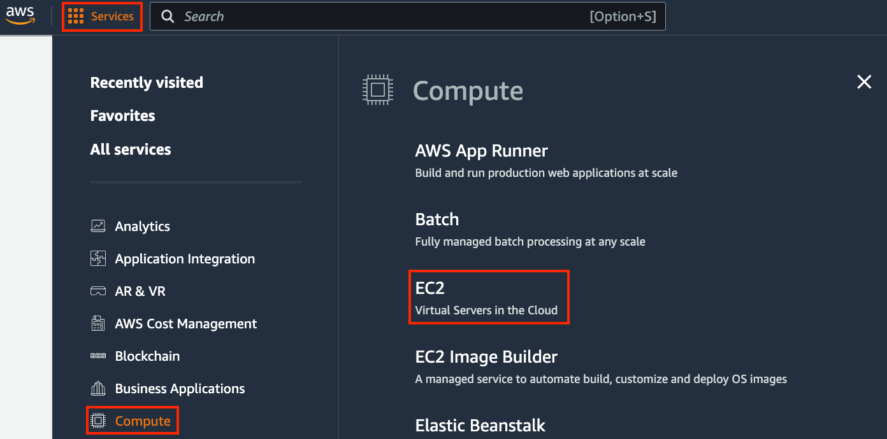
:width:`400px`
:label:`fig_aws`

:numref:`fig_ec2` parodytas EC2 skydelis.

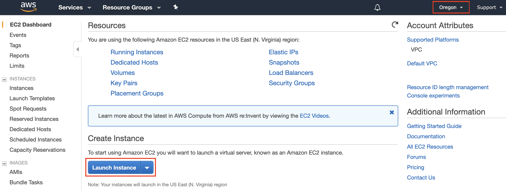
:width:`700px`
:label:`fig_ec2`

### Vietos pasirinkimas
Norėdami sumažinti delsą, pasirinkite netoliese esantį duomenų centrą, pavyzdžiui, „Oregon“ (pažymėta raudonu langeliu :numref:`fig_ec2` viršutiniame dešiniajame kampe). Jei esate Kinijoje,
galite pasirinkti netoliese esantį Azijos ir Ramiojo vandenyno regioną, pavyzdžiui, Seulą ar Tokiją. Atkreipkite dėmesį,
kad kai kuriuose duomenų centruose gali nebūti egzempliorių su GPU.


### Apribojimų didinimas

Prieš pasirinkdami egzempliorių, patikrinkite, ar nėra kiekio
apribojimų, kairėje juostoje spustelėdami žymę „Limits“, kaip parodyta
:numref:`fig_ec2`. 
:numref:`fig_limits` parodytas tokio
apribojimo pavyzdys. Pagal regioną paskyra šiuo metu negali paleisti „p2.xlarge“ egzempliorių. Jei
reikia paleisti vieną ar daugiau egzempliorių, spustelėkite nuorodą „Request limit increase“ ir
pateikite paraišką didesnei egzempliorių kvotai gauti.
Paprastai paraiška nagrinėjama
vieną darbo dieną.

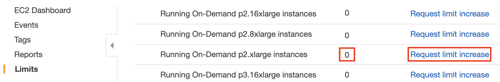
:width:`700px`
:label:`fig_limits`


### Egzemplioriaus paleidimas

Toliau spustelėkite mygtuką „Launch Instance“, pažymėtą raudonu langeliu :numref:`fig_ec2`, ir paleiskite egzempliorių.

Pradedame nuo tinkamo Amazon Machine Image (AMI) pasirinkimo. Pasirinkite Ubuntu egzempliorių (:numref:`fig_ubuntu`).


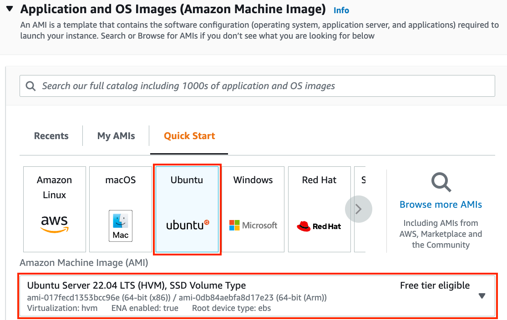
:width:`700px`
:label:`fig_ubuntu`

EC2 siūlo daugybę skirtingų egzempliorių konfigūracijų. Pradedančiajam tai kartais gali atrodyti slegiančiai. :numref:`tab_ec2` išvardytos tinkamos mašinos.

:Skirtingi EC2 egzempliorių tipai
:label:`tab_ec2`

| Pavadinimas | GPU         | Pastabos                         |
|------|-------------|-------------------------------|
| g2   | Grid K520   | senovinis                       |
| p2   | Kepler K80  | senas, bet dažnai pigus kaip „spot“   |
| g3   | Maxwell M60 | geras kompromisas                |
| p3   | Volta V100  | didelis našumas su FP16     |
| p4   | Ampere A100 | didelis našumas didelio masto mokymui |
| g4   | Turing T4   | optimizuotas prognozavimui FP16/INT8 |


Visi šie serveriai turi kelias versijas, nurodančias naudojamų GPU skaičių. Pavyzdžiui, p2.xlarge turi 1 GPU, o p2.16xlarge – 16 GPU ir daugiau atminties. Išsamiau žr. [AWS EC2 dokumentaciją](https://aws.amazon.com/ec2/instance-types/) arba [apibendrinamąjį puslapį](https://www.ec2instances.info). Iliustracijai pakaks p2.xlarge (pažymėta raudonu langeliu :numref:`fig_p2x`).

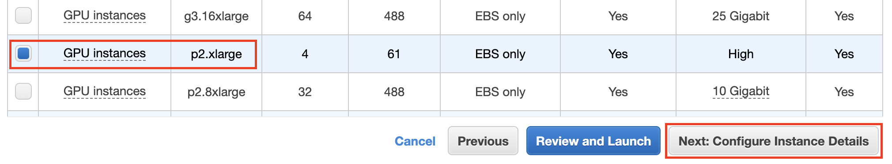
:width:`700px`
:label:`fig_p2x`

Atkreipkite dėmesį, kad turite naudoti egzempliorių su GPU, tinkamomis tvarkyklėmis ir GPU palaikančiu giliojo mokymosi karkasu. Kitaip GPU naudojimas jokios naudos nepateiks.

Toliau pasirenkame raktų porą, naudojamą
prieigai prie egzemplioriaus. Jei neturite raktų poros, spustelėkite „Create new key pair“ :numref:`fig_keypair`, kad ją sugeneruotumėte. Vėliau
galėsite pasirinkti
anksčiau sugeneruotą raktų porą. 
Jei generavote naują, būtinai atsisiųskite raktų porą ir laikykite ją saugioje vietoje. Tai vienintelis būdas prisijungti prie serverio per SSH.

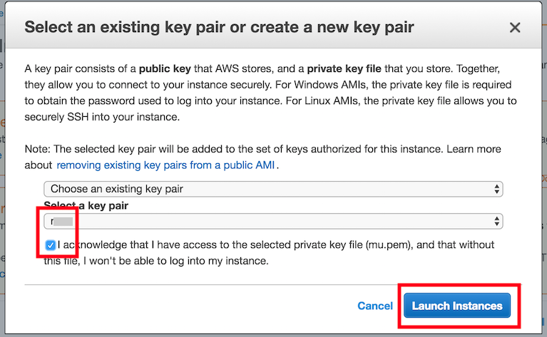
:width:`500px`
:label:`fig_keypair`

Šiame pavyzdyje „Network settings“ paliekame numatytąsias konfigūracijas (spustelėkite mygtuką „Edit“, jei norite keisti tokius elementus kaip potinklis ir saugos grupės). Tik padidiname numatytąjį standžiojo disko dydį iki 64 GB (:numref:`fig_disk`). Atkreipkite dėmesį, kad vien CUDA užima 4 GB.

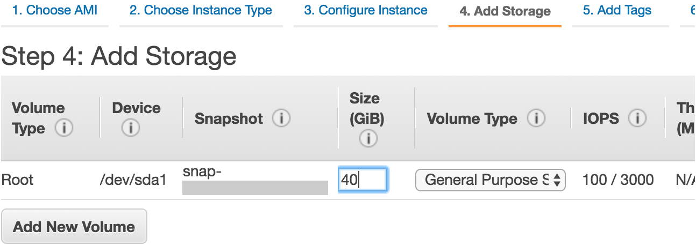
:width:`700px`
:label:`fig_disk`


Spustelėkite „Launch Instance“, kad paleistumėte sukurtą
egzempliorių. Spustelėkite
egzemplioriaus ID, rodomą :numref:`fig_launching`, kad pamatytumėte jo būseną.


:width:`700px`
:label:`fig_launching`

### Prisijungimas prie egzemplioriaus

Kaip parodyta :numref:`fig_connect`, kai egzemplioriaus būsena tampa žalia, dešiniuoju pelės klavišu spustelėkite egzempliorių ir pasirinkite `Connect`, kad pamatytumėte prieigos būdą.

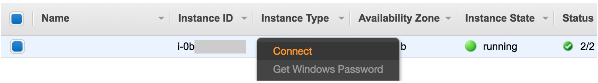
:width:`700px`
:label:`fig_connect`

Jei tai naujas raktas, kad SSH veiktų, jis neturi būti viešai matomas. Pereikite į aplanką, kuriame laikote `D2L_key.pem`, ir 
vykdykite šią komandą,
kad raktas nebūtų viešai matomas:

```bash
chmod 400 D2L_key.pem
```


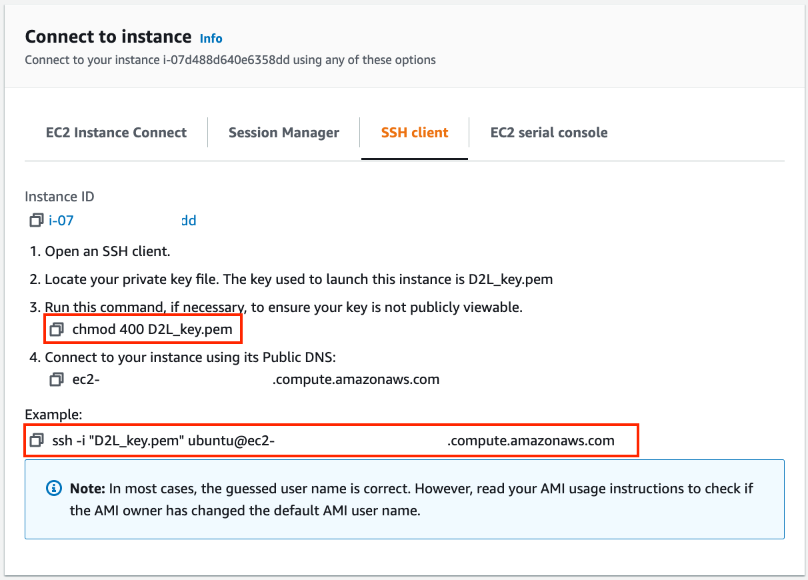
:width:`400px`
:label:`fig_chmod`


Dabar nukopijuokite SSH komandą iš apatinio raudono langelio :numref:`fig_chmod` ir įklijuokite komandinėje eilutėje:

```bash
ssh -i "D2L_key.pem" ubuntu@ec2-xx-xxx-xxx-xxx.y.compute.amazonaws.com
```


Kai komandinė eilutė paklausia „Are you sure you want to continue connecting (yes/no)“, įveskite „yes“ ir paspauskite Enter, kad prisijungtumėte prie egzemplioriaus.

Dabar jūsų serveris paruoštas.


## CUDA diegimas

Prieš diegdami CUDA, būtinai atnaujinkite egzempliorių naujausiomis tvarkyklėmis.

```bash
sudo apt-get update && sudo apt-get install -y build-essential git libgfortran3
```


Čia atsisiunčiame CUDA 12.1. Apsilankykite NVIDIA [oficialioje saugykloje](https://developer.nvidia.com/cuda-toolkit-archive) ir raskite atsisiuntimo nuorodą, kaip parodyta :numref:`fig_cuda`.

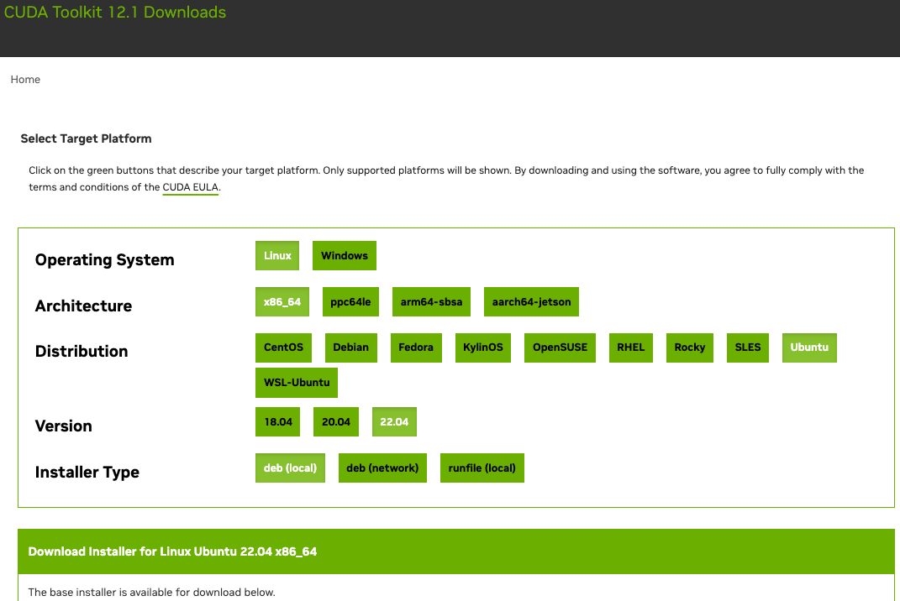
:width:`500px`
:label:`fig_cuda`

Nukopijuokite instrukcijas ir įklijuokite jas terminale, kad įdiegtumėte CUDA 12.1.

```bash
# The link and file name are subject to changes
wget https://developer.download.nvidia.com/compute/cuda/repos/ubuntu2204/x86_64/cuda-ubuntu2204.pin
sudo mv cuda-ubuntu2204.pin /etc/apt/preferences.d/cuda-repository-pin-600
wget https://developer.download.nvidia.com/compute/cuda/12.1.0/local_installers/cuda-repo-ubuntu2204-12-1-local_12.1.0-530.30.02-1_amd64.deb
sudo dpkg -i cuda-repo-ubuntu2204-12-1-local_12.1.0-530.30.02-1_amd64.deb
sudo cp /var/cuda-repo-ubuntu2204-12-1-local/cuda-*-keyring.gpg /usr/share/keyrings/
sudo apt-get update
sudo apt-get -y install cuda
```


Įdiegę programą, vykdykite šią komandą GPU peržiūrai:

```bash
nvidia-smi
```


Galiausiai pridėkite CUDA prie bibliotekų kelio, kad kitos bibliotekos ją rastų, pavyzdžiui, `~/.bashrc` pabaigoje pridėkite šias eilutes.

```bash
export PATH="/usr/local/cuda-12.1/bin:$PATH"
export LD_LIBRARY_PATH=${LD_LIBRARY_PATH}:/usr/local/cuda-12.1/lib64
```


## Bibliotekų kodui vykdyti diegimas

Norėdami vykdyti šios knygos kodą,
tiesiog atlikite :ref:`chap_installation` aprašytus žingsnius
„Linux“ naudotojams EC2 egzemplioriuje
ir pasinaudokite šiais patarimais
darbui nuotoliniame „Linux“ serveryje:

* Norėdami atsisiųsti bash scenarijų Miniconda diegimo puslapyje, dešiniuoju pelės klavišu spustelėkite atsisiuntimo nuorodą, pasirinkite „Copy Link Address“, tada vykdykite `wget [nukopijuotas nuorodos adresas]`.
* Įvykdę `~/miniconda3/bin/conda init`, galite vykdyti `source ~/.bashrc`, užuot uždarę ir vėl atidarę dabartinį apvalkalą.


## Jupyter Notebook vykdymas nuotoliniu būdu

Norint vykdyti Jupyter Notebook nuotoliniu būdu, reikia naudoti SSH prievadų persiuntimą. Juk debesyje esantis serveris neturi monitoriaus ar klaviatūros. Tam prisijunkite prie serverio iš savo stalinio (ar nešiojamojo) kompiuterio taip:

```
# This command must be run in the local command line
ssh -i "/path/to/key.pem" ubuntu@ec2-xx-xxx-xxx-xxx.y.compute.amazonaws.com -L 8889:localhost:8888
```


Toliau pereikite į vietą,
kurioje EC2 egzemplioriuje yra
atsisiųstas šios knygos kodas,
ir vykdykite:

```
conda activate d2l
jupyter notebook
```


:numref:`fig_jupyter` parodyta galima išvestis paleidus Jupyter Notebook. Paskutinė eilutė yra 8888 prievado URL.

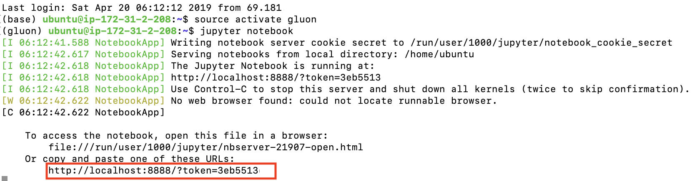
:width:`700px`
:label:`fig_jupyter`

Kadangi naudojote prievadų persiuntimą į 8889 prievadą,
nukopijuokite paskutinę eilutę raudname langelyje :numref:`fig_jupyter`,
URL pakeiskite „8888“ į „8889“
ir atverkite jį vietinėje naršyklėje.


## Nenaudojamų egzempliorių uždarymas

Kadangi debesijos paslaugos apmokestinamos pagal naudojimo laiką, nenaudojamus egzempliorius turėtumėte uždaryti. Atkreipkite dėmesį, kad yra alternatyvų:

* „Sustabdžius“ (angl. *stopping*) egzempliorių, vėliau jį galėsite vėl paleisti. Tai tarsi įprasto serverio maitinimo išjungimas. Tačiau už sustabdytų egzempliorių išsaugotą disko vietą vis tiek bus imamas nedidelis mokestis. 
* „Nutraukus“ (angl. *terminating*) egzempliorių, bus ištrinti visi su juo susiję duomenys. Tai apima ir diską, todėl jo vėl paleisti nebegalėsite. Tai darykite tik tada, kai tikrai žinote, kad ateityje jo nebereikės.

Jei norite naudoti egzempliorių kaip šabloną daugeliui kitų egzempliorių,
dešiniuoju pelės klavišu spustelėkite pavyzdį :numref:`fig_connect` ir pasirinkite „Image“ $\rightarrow$
„Create“, kad sukurtumėte egzemplioriaus atvaizdą. Kai tai bus baigta, pasirinkite
„Instance State“ $\rightarrow$ „Terminate“, kad egzempliorių nutrauktumėte. Kitą
kartą, kai norėsite naudoti šį egzempliorių, galite atlikti šiame skyriuje aprašytus žingsnius
ir sukurti egzempliorių pagal
išsaugotą atvaizdą. Vienintelis skirtumas tas, kad :numref:`fig_ubuntu` parodytame žingsnyje „1. Choose AMI“
turite kairėje pasirinkti „My AMIs“ ir parinkti išsaugotą
atvaizdą. Sukurtas egzempliorius išsaugos atvaizdo standžiajame
diske esančią informaciją. Pavyzdžiui, jums nereikės iš naujo diegti CUDA ir kitų vykdymo
aplinkų.


## Santrauka

* Egzempliorius galime paleisti ir sustabdyti pagal poreikį, nereikia pirkti ir kurti savo kompiuterio.
* Prieš naudojant giliojo mokymosi karkasą su GPU, reikia įdiegti CUDA.
* Naudodami prievadų persiuntimą, galime vykdyti Jupyter Notebook nuotoliniame serveryje.


## Pratimai

1. Debesija suteikia patogumo, bet nėra pigi. Sužinokite, kaip paleisti [„spot“ egzempliorius](https://aws.amazon.com/ec2/spot/), ir pažiūrėkite, kaip sumažinti išlaidas.
1. Išbandykite skirtingus serverius su GPU. Kokie jie greiti?
1. Išbandykite serverius su keliais GPU. Kiek gerai pavyksta išplėsti skaičiavimus?


[Diskusijos](https://discuss.d2l.ai/t/423)
