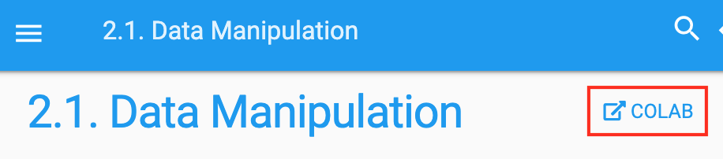
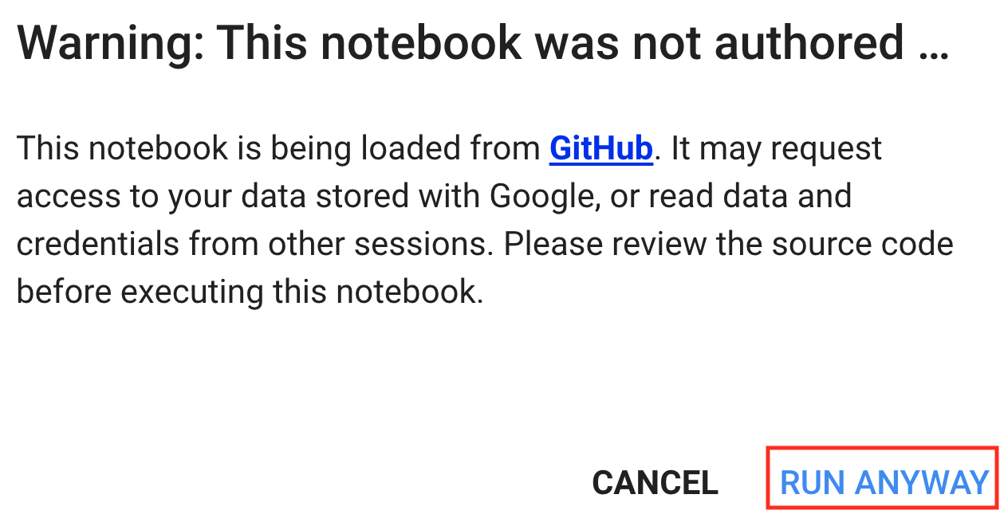

# Google Colab naudojimas
:label:`sec_colab`

:numref:`sec_sagemaker` ir :numref:`sec_aws` skyriuose aprašėme, kaip šią knygą paleisti AWS platformoje. Kitas variantas – paleisti ją [Google Colab](https://colab.research.google.com/),
jei turite „Google“ paskyrą.

Norėdami Colab aplinkoje vykdyti skyriaus kodą, tiesiog spustelėkite mygtuką `Colab`, kaip parodyta :numref:`fig_colab`.

:width:`300px`
:label:`fig_colab`

Jei kodo langelį vykdote pirmą kartą,
pamatysite įspėjamąjį pranešimą, kaip parodyta :numref:`fig_colab2`.
Tiesiog spustelėkite „RUN ANYWAY“, kad jį ignoruotumėte.

:width:`300px`
:label:`fig_colab2`

Toliau Colab prijungs jus prie šio skyriaus kodui vykdyti skirto egzemplioriaus.
Konkrečiai, jei reikia GPU,
Colab bus automatiškai paprašyta
prijungti GPU egzempliorių.

## Santrauka

* Kiekvieno knygos skyriaus kodą galite vykdyti naudodami Google Colab.
* Jei kuriame nors knygos skyriuje reikia GPU, Colab bus paprašyta prijungti GPU egzempliorių.

## Pratimai

1. Atidarykite bet kurį šios knygos skyrių naudodami Google Colab.
1. Redaguokite ir paleiskite bet kurį skyrių, kuriam reikia GPU, naudodami Google Colab.

[Diskusijos](https://discuss.d2l.ai/t/424)
