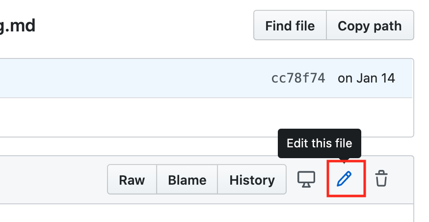
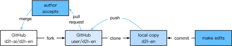
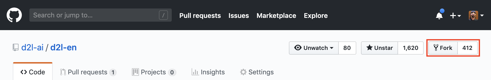
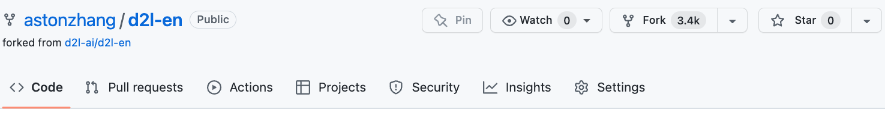
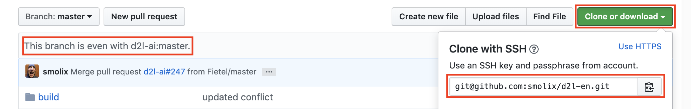
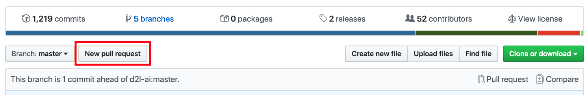
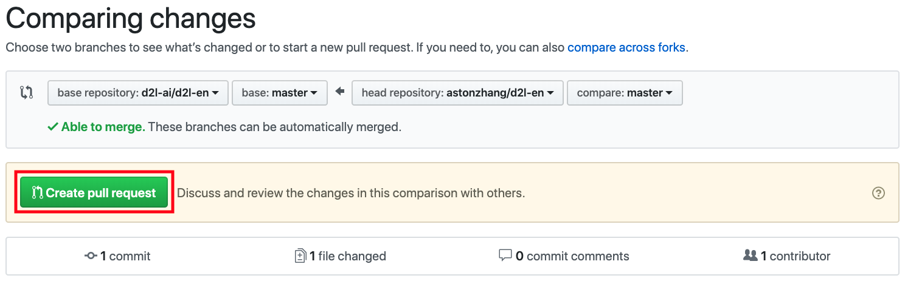

# Prisidėjimas prie šios knygos
:label:`sec_how_to_contribute`

[Skaitytojų](https://github.com/d2l-ai/d2l-en/graphs/contributors) indėlis padeda mums tobulinti šią knygą. Jei pastebėjote rašybos klaidą, pasenusią nuorodą, vietą, kur, jūsų manymu, praleidome citatą, kodą, kuris atrodo neelegantiškai, ar neaiškų paaiškinimą, prisidėkite ir padėkite mums padėti skaitytojams. Nors įprastose knygose laikas tarp spaudinių tiražų (taigi ir tarp rašybos klaidų ištaisymo) gali trukti metus, šioje knygoje patobulinimas paprastai įtraukiamas per valandas ar dienas. Tai įmanoma dėl versijų kontrolės ir nuolatinės integracijos (angl. *continuous integration*, CI) testavimo. Norėdami prisidėti, turite pateikti [pull request](https://github.com/d2l-ai/d2l-en/pulls) GitHub saugyklai. Kai autoriai jūsų pull request sulies su kodo saugykla, tapsite bendraautoriumi.

## Nedidelių pakeitimų teikimas

Dažniausi indėliai – vieno sakinio redagavimas arba rašybos klaidų taisymas. Rekomenduojame rasti šaltinio failą [GitHub saugykloje](https://github.com/d2l-ai/d2l-en) ir redaguoti jį tiesiogiai. Pavyzdžiui, failą galite rasti mygtuku [Find file](https://github.com/d2l-ai/d2l-en/find/master) (:numref:`fig_edit_file`) ir taip surasti šaltinio failą (Markdown failą). Tada viršutiniame dešiniajame kampe spustelėkite mygtuką „Edit this file“ ir atlikite pakeitimus Markdown faile.


:width:`300px`
:label:`fig_edit_file`

Baigę puslapio apačioje esančiame skydelyje „Propose file change“ įrašykite pakeitimų aprašymą ir spustelėkite mygtuką „Propose file change“. Būsite nukreipti į naują puslapį pakeitimams peržiūrėti (:numref:`fig_git_createpr`). Jei viskas gerai, galite pateikti pull request spustelėję mygtuką „Create pull request“.

## Didelių pakeitimų siūlymas

Jei planuojate atnaujinti didelę teksto ar kodo dalį, reikia šiek tiek daugiau žinoti apie šios knygos naudojamą formatą. Šaltinio failas pagrįstas [Markdown formatu](https://daringfireball.net/projects/markdown/syntax) su plėtiniais, pateikiamais per paketą [D2L-Book](http://book.d2l.ai/user/markdown.html), pavyzdžiui, nuorodomis į lygtis, paveikslus, skyrius ir citatas. Šiems failams atverti ir pakeitimams atlikti galite naudoti bet kokį Markdown redaktorių.

Jei norite keisti kodą, rekomenduojame šiuos Markdown failus atverti naudojant Jupyter Notebook, kaip aprašyta :numref:`sec_jupyter`, kad galėtumėte paleisti ir išbandyti savo pakeitimus. Prieš pateikdami pakeitimus, nepamirškite išvalyti visų išvesčių, nes mūsų CI sistema vykdys jūsų atnaujintus skyrius ir sugeneruos išvestis.

Kai kurie skyriai gali palaikyti kelių karkasų realizacijas.
Jei pridedate naują kodo bloką, pirmoje eilutėje jį pažymėkite `%%tab`. Pavyzdžiui,
`%%tab pytorch` – PyTorch kodo blokui, `%%tab tensorflow` – TensorFlow kodo blokui arba `%%tab all` – bendram visų realizacijų kodo blokui. Daugiau informacijos rasite paketo `d2lbook` dokumentacijoje.

## Didelių pakeitimų pateikimas

Dideliam pakeitimui pateikti siūlome naudoti standartinį Git procesą. Trumpai proceso eiga pavaizduota :numref:`fig_contribute`.


:label:`fig_contribute`

Žingsnius aprašysime išsamiai. Jei jau išmanote Git, šį skyrių galite praleisti. Konkretumo dėlei darome prielaidą, kad bendraautoriaus naudotojo vardas yra „astonzhang“.

### Git diegimas

Atvirojo kodo knygoje apie Git aprašyta, [kaip įdiegti Git](https://git-scm.com/book/en/v2). Paprastai tai atliekama komanda `apt install git` Ubuntu Linux sistemoje, įdiegiant Xcode kūrėjo įrankius macOS sistemoje arba naudojant GitHub [darbalaukio klientą](https://desktop.github.com). Jei neturite GitHub paskyros, turite ją susikurti.

### Prisijungimas prie GitHub

Naršyklėje įveskite knygos kodo saugyklos [adresą](https://github.com/d2l-ai/d2l-en/). Spustelėkite mygtuką `Fork` raudname langelyje :numref:`fig_git_fork` viršutiniame dešiniajame kampe, kad sukurtumėte šios knygos saugyklos kopiją. Dabar tai *jūsų kopija* ir galite ją keisti kaip tik norite.


:width:`700px`
:label:`fig_git_fork`


Dabar šios knygos kodo saugykla bus išskaidyta (angl. *forked*, t. y. nukopijuota) į jūsų naudotojo vardą, pavyzdžiui, `astonzhang/d2l-en`, parodytą :numref:`fig_git_forked` viršutiniame kairiajame kampe.


:width:`700px`
:label:`fig_git_forked`

### Saugyklos klonavimas

Norint klonuoti saugyklą (t. y. sukurti vietinę kopiją), reikia gauti jos adresą. Jį rodo žalias mygtukas :numref:`fig_git_clone`. Jei nusprendėte šį išskaidytą variantą laikyti ilgiau, įsitikinkite, kad vietinė kopija atnaujinta pagal pagrindinę saugyklą. Kol kas tiesiog laikykitės :ref:`chap_installation` pateiktų instrukcijų. Pagrindinis skirtumas tas, kad dabar atsisiunčiate *savo paties išskaidytą* saugyklos variantą.


:width:`700px`
:label:`fig_git_clone`

```
# Replace your_github_username with your GitHub username
git clone https://github.com/your_github_username/d2l-en.git
```


### Redagavimas ir išsiuntimas

Dabar metas redaguoti knygą. Geriausia tai daryti Jupyter Notebook, laikantis :numref:`sec_jupyter` instrukcijų. Atlikite pakeitimus ir patikrinkite, ar jie tinkami. Tarkime, kad ištaisėme rašybos klaidą faile `~/d2l-en/chapter_appendix-tools-for-deep-learning/contributing.md`.
Tada galite patikrinti, kuriuos failus pakeitėte.

Šiuo metu Git praneš, kad failas `chapter_appendix-tools-for-deep-learning/contributing.md` buvo pakeistas.

```
mylaptop:d2l-en me$ git status
On branch master
Your branch is up-to-date with 'origin/master'.

Changes not staged for commit:
  (use "git add <file>..." to update what will be committed)
  (use "git checkout -- <file>..." to discard changes in working directory)

	modified:   chapter_appendix-tools-for-deep-learning/contributing.md
```


Įsitikinę, kad to ir norite, vykdykite šią komandą:

```
git add chapter_appendix-tools-for-deep-learning/contributing.md
git commit -m 'Fix a typo in git documentation'
git push
```


Pakeistas kodas atsidurs jūsų asmeninėje saugyklos kopijoje. Norėdami paprašyti pridėti savo pakeitimą, turite sukurti pull request oficialiai knygos saugyklai.

### Pull request pateikimas

Kaip parodyta :numref:`fig_git_newpr`, eikite į savo saugyklos kopiją GitHub ir pasirinkite „New pull request“. Atsidarys ekranas, rodantis jūsų pakeitimų ir dabartinės pagrindinės knygos saugyklos būsenos skirtumus.


:width:`700px`
:label:`fig_git_newpr`


Galiausiai pateikite pull request spustelėdami mygtuką, kaip parodyta :numref:`fig_git_createpr`. Būtinai apibūdinkite savo atliktus pakeitimus.
Taip autoriams bus lengviau juos peržiūrėti ir sulieti su knyga. Priklausomai nuo pakeitimų, jie gali būti priimti iš karto, atmesti arba, dažniausiai, gausite pastabų dėl pakeitimų. Kai jas įtrauksite, viskas bus tvarkoje.


:width:`700px`
:label:`fig_git_createpr`


## Santrauka

* Prie šios knygos galite prisidėti naudodami GitHub.
* Nedideliems pakeitimams failą galite redaguoti tiesiogiai GitHub.
* Dideliam pakeitimui išskaidykite saugyklą, redaguokite vietoje ir atsiųskite pakeitimus tik tada, kai būsite pasiruošę.
* Pull request yra būdas sujungti indėlius. Stenkitės nepateikti milžiniškų pull request, nes juos sunku suprasti ir įtraukti. Geriau siųskite kelis mažesnius.


## Pratimai

1. Pažymėkite žvaigždute (angl. *star*) ir išskaidykite saugyklą `d2l-ai/d2l-en`.
1. Jei pastebėjote ką nors, ką reikėtų patobulinti (pvz., trūksta nuorodos), pateikite pull request. 
1. Paprastai geresnė praktika yra kurti pull request naudojant naują šaką. Sužinokite, kaip tai padaryti, skaitydami apie [Git šakojimą](https://git-scm.com/book/en/v2/Git-Branching-Branches-in-a-Nutshell).

[Diskusijos](https://discuss.d2l.ai/t/426)
