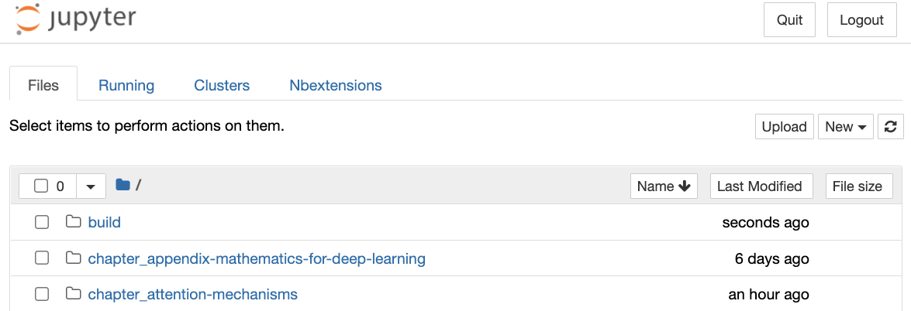
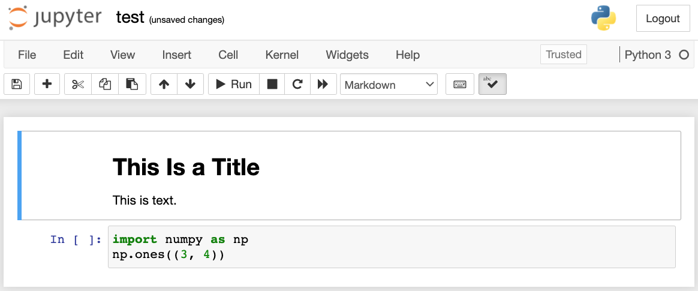
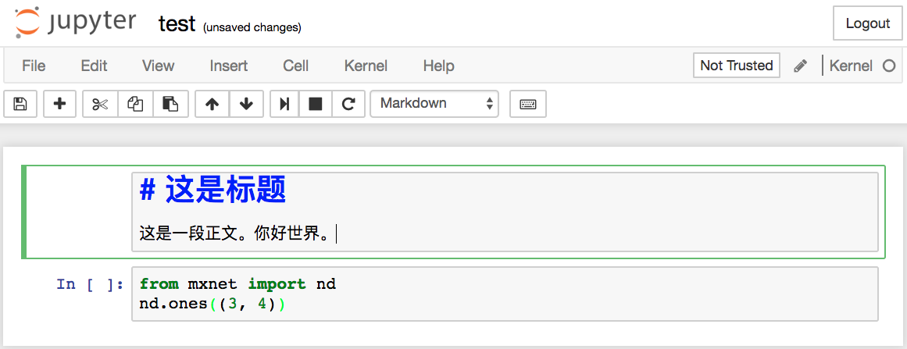
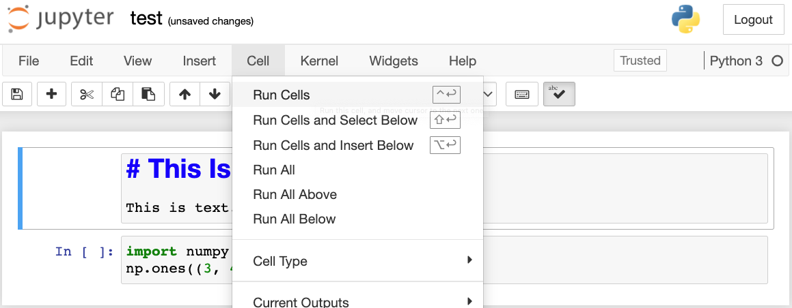
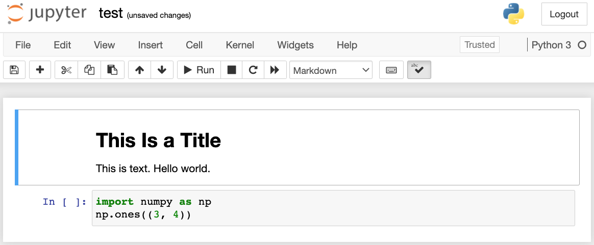
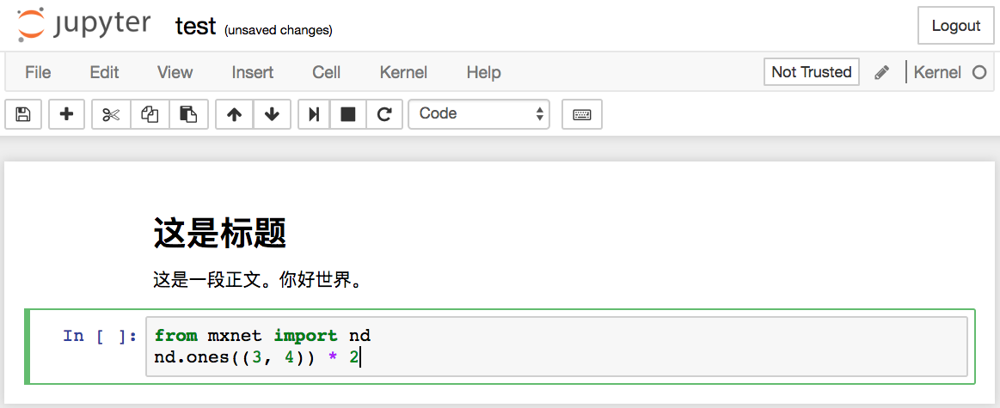
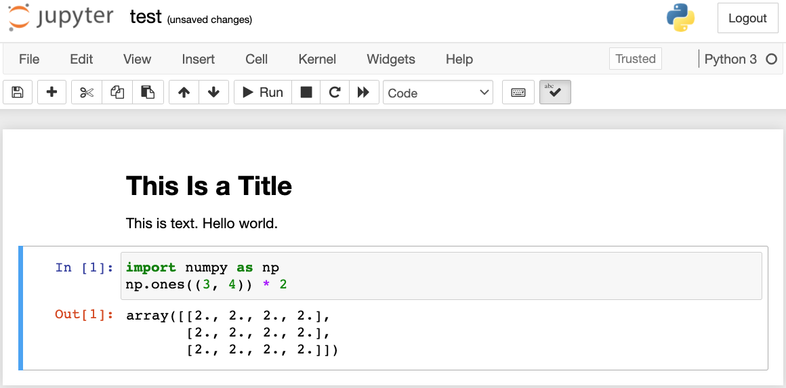

# Jupyter Notebook naudojimas
:label:`sec_jupyter`


Šiame skyriuje aprašoma, kaip redaguoti ir vykdyti
kiekvieno šios knygos skyriaus kodą
naudojant Jupyter Notebook. Įsitikinkite, kad
įdiegėte Jupyter ir atsisiuntėte
kodą, kaip aprašyta
:ref:`chap_installation`.
Jei norite daugiau sužinoti apie Jupyter, žr. puikią pamoką
jo [dokumentacijoje](https://jupyter.readthedocs.io/en/latest/).


## Kodo redagavimas ir vykdymas vietoje

Tarkime, vietinis knygos kodo kelias yra `xx/yy/d2l-en/`. Komandinėje eilutėje pereikite į šį katalogą (`cd xx/yy/d2l-en`) ir vykdykite komandą `jupyter notebook`. Jei naršyklė neatsidaro automatiškai, atverkite http://localhost:8888 – pamatysite Jupyter sąsają ir visus aplankus su knygos kodu, kaip parodyta :numref:`fig_jupyter00`.


:width:`600px`
:label:`fig_jupyter00`


Užrašų knygutės failus galite atverti spustelėdami tinklalapyje rodomą aplanką.
Paprastai jų galūnė yra „.ipynb“.
Trumpumo dėlei sukuriame laikiną failą „test.ipynb“.
Spustelėjus rodomas turinys
pavaizduotas :numref:`fig_jupyter01`.
Šioje užrašų knygutėje yra vienas Markdown langelis ir vienas kodo langelis. Markdown langelio turinį sudaro „This Is a Title“ ir „This is text.“.
Kodo langelyje yra dvi Python kodo eilutės.


:width:`600px`
:label:`fig_jupyter01`


Dukart spustelėkite Markdown langelį, kad įjungtumėte redagavimo režimą.
Langelio gale pridėkite naują eilutę „Hello world.“, kaip parodyta :numref:`fig_jupyter02`.


:width:`600px`
:label:`fig_jupyter02`


Kaip parodyta :numref:`fig_jupyter03`,
meniu juostoje pasirinkite „Cell“ $\rightarrow$ „Run Cells“, kad paleistumėte redaguotą langelį.


:width:`600px`
:label:`fig_jupyter03`

Po paleidimo Markdown langelis atrodo kaip :numref:`fig_jupyter04`.


:width:`600px`
:label:`fig_jupyter04`


Toliau spustelėkite kodo langelį. Po paskutinės kodo eilutės padauginkite elementus iš 2, kaip parodyta :numref:`fig_jupyter05`.


:width:`600px`
:label:`fig_jupyter05`


Langelį taip pat galite paleisti spartiuoju klavišu (pagal numatytuosius nustatymus „Ctrl + Enter“) ir gauti išvestį, parodytą :numref:`fig_jupyter06`.


:width:`600px`
:label:`fig_jupyter06`


Kai užrašų knygutėje daugiau langelių, galime meniu juostoje spustelėti „Kernel“ $\rightarrow$ „Restart & Run All“ ir paleisti visus visos užrašų knygutės langelius. Pasirinkę „Help“ $\rightarrow$ „Edit Keyboard Shortcuts“, galite pakeisti sparčiuosius klavišus pagal savo pageidavimus.

## Papildomos galimybės

Be redagavimo vietoje, svarbūs dar du dalykai: užrašų knygučių redagavimas Markdown formatu ir Jupyter vykdymas nuotoliniu būdu.
Pastarasis svarbus, kai kodą norime vykdyti greitesniame serveryje.
Pirmasis svarbus todėl, kad vietinis Jupyter ipynb formatas saugo daug pagalbinių duomenų,
nesusijusių su turiniu,
dažniausiai susijusių su tuo, kaip ir kur kodas vykdomas.
Tai klaidina Git ir
labai apsunkina indėlių peržiūrą.
Laimei, yra alternatyva – tiesioginis redagavimas Markdown formatu.

### Markdown failai Jupyter aplinkoje

Jei norite prisidėti prie šios knygos turinio, turite keisti
šaltinio failą (md, o ne ipynb) GitHub saugykloje.
Naudodami notedown papildinį,
užrašų knygutes md formatu galime redaguoti tiesiai Jupyter aplinkoje.


Pirmiausia įdiekite notedown papildinį, paleiskite Jupyter Notebook ir įkelkite papildinį:

```
pip install d2l-notedown  # You may need to uninstall the original notedown.
jupyter notebook --NotebookApp.contents_manager_class='notedown.NotedownContentsManager'
```


Taip pat galite nustatyti, kad notedown papildinys būtų įjungiamas pagal numatytuosius nustatymus kiekvieną kartą paleidus Jupyter Notebook.
Pirmiausia sugeneruokite Jupyter Notebook konfigūracijos failą (jei jis jau sugeneruotas, šį žingsnį galite praleisti).

```
jupyter notebook --generate-config
```


Tada Jupyter Notebook konfigūracijos failo pabaigoje pridėkite šią eilutę („Linux“ ar macOS sistemose jis paprastai yra `~/.jupyter/jupyter_notebook_config.py`):

```
c.NotebookApp.contents_manager_class = 'notedown.NotedownContentsManager'
```


Po to pakanka vykdyti komandą `jupyter notebook`, ir notedown papildinys bus įjungtas pagal numatytuosius nustatymus.

### Jupyter užrašų knygučių vykdymas nuotoliniame serveryje

Kartais gali prireikti vykdyti Jupyter užrašų knygutes nuotoliniame serveryje ir pasiekti jas vietinio kompiuterio naršykle. Jei vietiniame kompiuteryje įdiegta „Linux“ ar macOS (Windows šią funkciją taip pat gali palaikyti per trečiųjų šalių programas, pvz., PuTTY), galite naudoti prievadų persiuntimą:

```
ssh myserver -L 8888:localhost:8888
```


Aukščiau esanti eilutė `myserver` yra nuotolinio serverio adresas.
Tada galime naudoti http://localhost:8888 ir pasiekti nuotolinį serverį `myserver`, kuriame veikia Jupyter užrašų knygutės. Kaip vykdyti Jupyter užrašų knygutes AWS egzemplioriuose, išsamiai aprašysime
vėliau šiame priede.

### Vykdymo trukmės matavimas

Naudodami papildinį `ExecuteTime`, galime matuoti kiekvieno Jupyter užrašų knygutės kodo langelio vykdymo trukmę.
Papildinį įdiekite šiomis komandomis:

```
pip install jupyter_contrib_nbextensions
jupyter contrib nbextension install --user
jupyter nbextension enable execute_time/ExecuteTime
```


## Santrauka

* Naudodami Jupyter Notebook įrankį, galime redaguoti, vykdyti ir papildyti kiekvieną knygos skyrių.
* Jupyter užrašų knygutes nuotoliniuose serveriuose galime vykdyti naudodami prievadų persiuntimą.


## Pratimai

1. Redaguokite ir vykdykite šios knygos kodą vietiniame kompiuteryje naudodami Jupyter Notebook.
1. Redaguokite ir vykdykite šios knygos kodą naudodami Jupyter Notebook *nuotoliniu būdu* per prievadų persiuntimą.
1. Palyginkite operacijų $\mathbf{A}^\top \mathbf{B}$ ir $\mathbf{A} \mathbf{B}$ vykdymo laiką dviem kvadratinėms matricoms iš $\mathbb{R}^{1024 \times 1024}$. Kuri operacija greitesnė?


[Diskusijos](https://discuss.d2l.ai/t/421)
