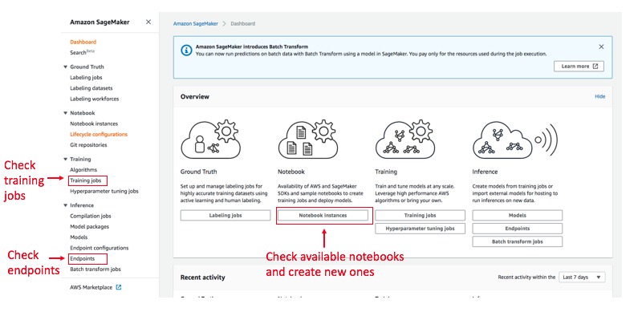
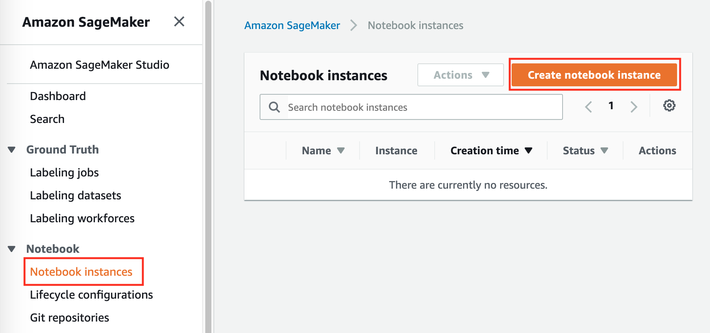
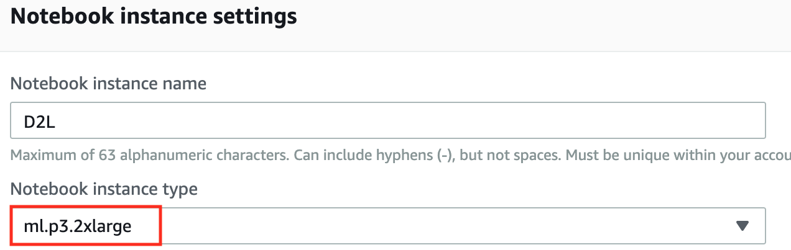
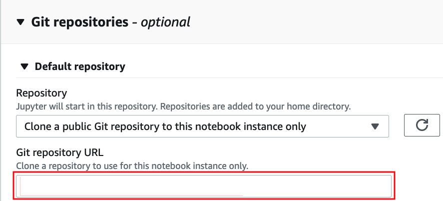
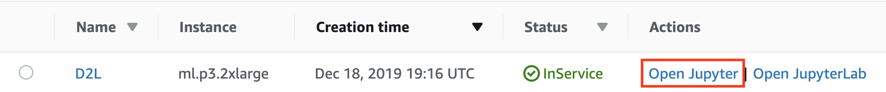
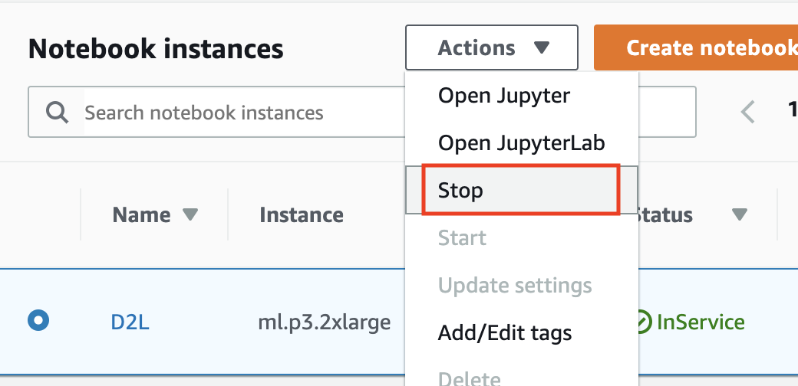
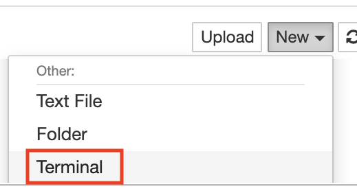

# Amazon SageMaker naudojimas
:label:`sec_sagemaker`

Giliojo mokymosi taikymams gali prireikti tiek skaičiavimo išteklių,
kad jų lengvai nepakanka
vietiniam kompiuteriui.
Debesijos skaičiavimo paslaugos
leidžia lengviau
vykdyti daug GPU išteklių reikalaujantį šios knygos kodą
naudojant galingesnius kompiuterius.
Šiame skyriuje aprašysime,
kaip naudoti Amazon SageMaker
šios knygos kodui vykdyti.

## Registracija

Pirmiausia turime susikurti paskyrą adresu https://aws.amazon.com/.
Saugumo sumetimais
rekomenduojama naudoti dviejų veiksnių tapatybės patvirtinimą.
Taip pat verta
nustatyti išsamius sąskaitų ir išlaidų įspėjimus,
kad išvengtumėte netikėtumų,
pavyzdžiui,
pamiršę sustabdyti veikiančius egzempliorius.
Prisijungę prie AWS paskyros,
atidarykite savo [konsolę](http://console.aws.amazon.com/) ir ieškokite „Amazon SageMaker“ (žr. :numref:`fig_sagemaker`),
tada spustelėkite, kad atvertumėte SageMaker skydelį.


:width:`300px`
:label:`fig_sagemaker`

## SageMaker egzemplioriaus kūrimas

Toliau sukurkime užrašų knygučių egzempliorių, kaip aprašyta :numref:`fig_sagemaker-create`.


:width:`400px`
:label:`fig_sagemaker-create`

SageMaker siūlo kelis [egzempliorių tipus](https://aws.amazon.com/sagemaker/pricing/instance-types/) su skirtinga skaičiavimo galia ir kainomis.
Kurdami užrašų knygučių egzempliorių,
galime nurodyti jo pavadinimą ir tipą.
:numref:`fig_sagemaker-create-2` pasirenkame `ml.p3.2xlarge`: su vienu Tesla V100 GPU ir 8 branduolių CPU šio egzemplioriaus galios pakanka daugumai knygos skyrių.


:width:`400px`
:label:`fig_sagemaker-create-2`

:begin_tab:`mxnet`
Visa knyga ipynb formatu, skirta vykdyti su SageMaker, pasiekiama adresu https://github.com/d2l-ai/d2l-en-sagemaker. Galime nurodyti šios GitHub saugyklos URL (:numref:`fig_sagemaker-create-3`), kad SageMaker ją nukopijuotų kurdama egzempliorių.
:end_tab:

:begin_tab:`pytorch`
Visa knyga ipynb formatu, skirta vykdyti su SageMaker, pasiekiama adresu https://github.com/d2l-ai/d2l-pytorch-sagemaker. Galime nurodyti šios GitHub saugyklos URL (:numref:`fig_sagemaker-create-3`), kad SageMaker ją nukopijuotų kurdama egzempliorių.
:end_tab:

:begin_tab:`tensorflow`
Visa knyga ipynb formatu, skirta vykdyti su SageMaker, pasiekiama adresu https://github.com/d2l-ai/d2l-tensorflow-sagemaker. Galime nurodyti šios GitHub saugyklos URL (:numref:`fig_sagemaker-create-3`), kad SageMaker ją nukopijuotų kurdama egzempliorių.
:end_tab:


:width:`400px`
:label:`fig_sagemaker-create-3`

## Egzemplioriaus paleidimas ir sustabdymas

Egzemplioriaus sukūrimas
gali užtrukti kelias minutes.
Kai jis bus paruoštas,
spustelėkite šalia esančią nuorodą „Open Jupyter“ (:numref:`fig_sagemaker-open`), kad galėtumėte
redaguoti ir vykdyti visas šios knygos Jupyter užrašų knygutes
šiame egzemplioriuje
(panašiai kaip :numref:`sec_jupyter`).


:width:`400px`
:label:`fig_sagemaker-open`


Baigę darbą,
nepamirškite sustabdyti egzemplioriaus, kad
už jį nebūtų toliau skaičiuojama (:numref:`fig_sagemaker-stop`).


:width:`300px`
:label:`fig_sagemaker-stop`

## Užrašų knygučių atnaujinimas

:begin_tab:`mxnet`
Šios atvirojo kodo knygos užrašų knygutės reguliariai atnaujinamos GitHub saugykloje [d2l-ai/d2l-en-sagemaker](https://github.com/d2l-ai/d2l-en-sagemaker).
Norėdami atnaujinti iki naujausios versijos,
galite atverti SageMaker egzemplioriaus terminalą (:numref:`fig_sagemaker-terminal`).
:end_tab:

:begin_tab:`pytorch`
Šios atvirojo kodo knygos užrašų knygutės reguliariai atnaujinamos GitHub saugykloje [d2l-ai/d2l-pytorch-sagemaker](https://github.com/d2l-ai/d2l-pytorch-sagemaker).
Norėdami atnaujinti iki naujausios versijos,
galite atverti SageMaker egzemplioriaus terminalą (:numref:`fig_sagemaker-terminal`).
:end_tab:


:begin_tab:`tensorflow`
Šios atvirojo kodo knygos užrašų knygutės reguliariai atnaujinamos GitHub saugykloje [d2l-ai/d2l-tensorflow-sagemaker](https://github.com/d2l-ai/d2l-tensorflow-sagemaker).
Norėdami atnaujinti iki naujausios versijos,
galite atverti SageMaker egzemplioriaus terminalą (:numref:`fig_sagemaker-terminal`).
:end_tab:



:width:`300px`
:label:`fig_sagemaker-terminal`

Prieš atsisiųsdami atnaujinimus iš nuotolinės saugyklos, galite įkomituoti vietinius pakeitimus.
Kitu atveju tiesiog atmeskite visus vietinius pakeitimus
šiomis terminalo komandomis:

:begin_tab:`mxnet`

```bash
cd SageMaker/d2l-en-sagemaker/
git reset --hard
git pull
```


:end_tab:

:begin_tab:`pytorch`

```bash
cd SageMaker/d2l-pytorch-sagemaker/
git reset --hard
git pull
```


:end_tab:

:begin_tab:`tensorflow`

```bash
cd SageMaker/d2l-tensorflow-sagemaker/
git reset --hard
git pull
```


:end_tab:

## Santrauka

* Naudodami Amazon SageMaker, galime sukurti užrašų knygučių egzempliorių šios knygos daug GPU išteklių reikalaujančiam kodui vykdyti.
* Užrašų knygutes galime atnaujinti per Amazon SageMaker egzemplioriaus terminalą.


## Pratimai


1. Redaguokite ir paleiskite bet kurį skyrių, kuriam reikia GPU, naudodami Amazon SageMaker.
1. Atverkite terminalą ir pasiekite vietinį katalogą, kuriame yra visos šios knygos užrašų knygutės.


[Diskusijos](https://discuss.d2l.ai/t/422)
