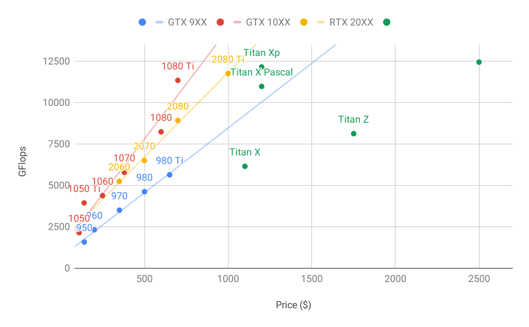
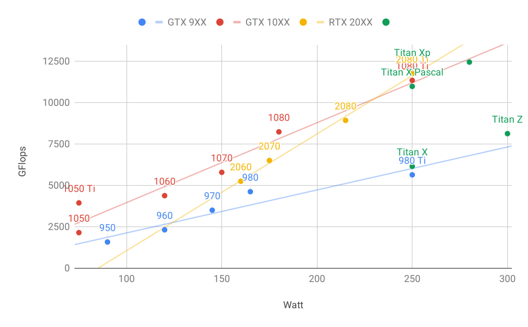

# Serverių ir GPU pasirinkimas
:label:`sec_buy_gpu`

Giliojo mokymosi modelių mokymas paprastai reikalauja daug skaičiavimų. Šiuo metu GPU yra ekonomiškiausi giliojo mokymosi aparatinės įrangos greitintuvai. Ypač palyginti su CPU, GPU yra pigesni ir našesni, dažnai daugiau nei dydžio eile. Be to, vienas serveris gali palaikyti kelis GPU, aukščiausios klasės serveriai – iki 8. Tipiškesnis inžinerinės darbo stoties skaičius – iki 4 GPU, nes šilumos, aušinimo ir maitinimo poreikiai greitai išauga virš to, ką gali palaikyti biuro pastatas. Didesniems diegimams daug praktiškesnis sprendimas yra debesijos skaičiavimas (pvz., Amazon [P3](https://aws.amazon.com/ec2/instance-types/p3/) ir [G4](https://aws.amazon.com/blogs/aws/in-the-works-ec2-instances-g4-with-nvidia-t4-gpus/) egzemplioriai).

## Serverių pasirinkimas

Paprastai nereikia pirkti aukščiausios klasės CPU su daug gijų, nes didžioji dalis skaičiavimų vyksta GPU. Vis dėlto dėl Python globaliojo interpretatoriaus užrakto (GIL) CPU vienagijis našumas gali būti svarbus, kai turime 4–8 GPU. Esant vienodoms sąlygoms, tai rodo, kad ekonomiškesnis pasirinkimas gali būti CPU su mažiau branduolių, bet aukštesniu taktiniu dažniu. Pavyzdžiui, rinkdamiesi tarp 6 branduolių 4 GHz ir 8 branduolių 3,5 GHz CPU, pirmąjį verta rinktis labiau, nors jo bendras greitis mažesnis.
Svarbu atsižvelgti ir į tai, kad GPU sunaudoja daug energijos, todėl išskiria daug šilumos. Tam reikia labai gero aušinimo ir pakankamai didelio korpuso GPU sutalpinti. Jei įmanoma, laikykitės toliau pateiktų gairių:

1. **Maitinimo blokas**. GPU sunaudoja daug energijos. Planuokite iki 350 W kiekvienam įrenginiui (žiūrėkite į vaizdo plokštės *didžiausią poreikį*, o ne į tipinį poreikį, nes efektyvus kodas gali sunaudoti daug energijos). Jei maitinimo bloko galios nepakanka, sistema taps nestabili.
1. **Korpuso dydis**. GPU yra dideli, o papildomiems maitinimo jungtims dažnai reikia papildomos vietos. Be to, dideli korpusai lengviau aušinami.
1. **GPU aušinimas**. Jei turite daug GPU, galbūt verta investuoti į vandens aušinimą. Taip pat rinkitės *etalonines konstrukcijas* (angl. *reference designs*), net jei jos turi mažiau ventiliatorių, nes yra pakankamai plonos, kad tarp įrenginių patektų oras. Jei pirksite GPU su keliais ventiliatoriais, jis gali būti per storas, kad, sumontavus kelis GPU, užtektų oro, ir susidursite su terminiu droselizavimu.
1. **PCIe lizdai**. Duomenų perkėlimui į GPU ir iš jo (ir keitimuisi tarp GPU) reikia daug pralaidumo. Rekomenduojame PCIe 3.0 lizdus su 16 linijų. Jei montuojate kelis GPU, atidžiai perskaitykite pagrindinės plokštės aprašymą ir įsitikinkite, kad 16$\times$ pralaidumas išlieka, kai vienu metu naudojami keli GPU, ir kad papildomuose lizduose gaunate PCIe 3.0, o ne PCIe 2.0. Kai kurios pagrindinės plokštės, sumontavus kelis GPU, sumažina pralaidumą iki 8$\times$ ar net 4$\times$. Tai iš dalies lemia CPU siūlomų PCIe linijų skaičius.

Trumpai, keletas rekomendacijų giliojo mokymosi serveriui sukurti:

* **Pradedantysis**. Pirkite žemos klasės GPU su maža energijos sąnaudomis (pigūs žaidimams skirti GPU, tinkami giliajam mokymuisi, sunaudoja 150–200 W). Jei jums pasiseks, jį palaikys dabartinis jūsų kompiuteris.
* **1 GPU**. Pakaks žemos klasės 4 branduolių CPU ir tiks dauguma pagrindinių plokščių. Siekite bent 32 GB DRAM ir investuokite į SSD vietiniams duomenims pasiekti. Pakaks 600 W maitinimo bloko. Pirkite GPU su daug ventiliatorių.
* **2 GPU**. Pakaks žemos klasės 4–6 branduolių CPU. Siekite 64 GB DRAM ir investuokite į SSD. Dviem aukščiausios klasės GPU reikės apie 1000 W. Rinkdamiesi pagrindines plokštes, įsitikinkite, kad jose yra *du* PCIe 3.0 x16 lizdai. Jei galite, rinkitės plokštę su dviem laisvomis vietomis (60 mm tarpas) tarp PCIe 3.0 x16 lizdų papildomam orui. Tokiu atveju pirkite du GPU su daug ventiliatorių.
* **4 GPU**. Pirkite CPU su gana dideliu vienagijiu greičiu (t. y. aukštu taktiniu dažniu). Tikriausiai reikės CPU su didesniu PCIe linijų skaičiumi, pavyzdžiui, AMD Threadripper. Greičiausiai reikės gana brangių pagrindinių plokščių, kad gautumėte 4 PCIe 3.0 x16 lizdus, nes joms tikriausiai reikės PLX PCIe linijoms multipleksuoti. Pirkite GPU su etalonine konstrukcija, kurie yra siauri ir praleidžia orą tarp GPU. Jums reikės 1600–2000 W maitinimo bloko, o jūsų biuro rozetė gali to nepalaikyti. Šis serveris greičiausiai veiks *triukšmingai ir karštai*. Nenorėsite jo laikyti po stalu. Rekomenduojama 128 GB DRAM. Įsigykite SSD (1–2 TB NVMe) vietinei saugyklai ir keletą standžiųjų diskų RAID konfigūracijoje duomenims laikyti.
* **8 GPU**. Reikia pirkti specialų kelių GPU serverio korpusą su keliais rezervuotais maitinimo blokais (pvz., 2+1, po 1600 W kiekvienam bloke). Tam reikės dviejų lizdų serverio CPU, 256 GB ECC DRAM, greitos tinklo plokštės (rekomenduojama 10 GbE) ir turėsite patikrinti, ar serveriai palaiko GPU *fizinį formos faktorių*. Oro srautas ir laidų išdėstymas vartotojų ir serverių GPU labai skiriasi (pvz., RTX 2080 ir Tesla V100). Tai reiškia, kad vartotojo GPU gali nepavykti įdiegti serveryje dėl nepakankamo tarpo maitinimo kabeliui arba tinkamo laidų pluošto nebuvimo (kaip skausmingai išsiaiškino vienas iš bendraautorių).

## GPU pasirinkimas

Šiuo metu AMD ir NVIDIA yra du pagrindiniai atskirųjų GPU gamintojai. NVIDIA į giliojo mokymosi sritį įžengė pirmoji ir per CUDA geriau palaiko giliojo mokymosi karkasus. Todėl dauguma pirkėjų renkasi NVIDIA GPU.

NVIDIA siūlo du GPU tipus: skirtus individualiems naudotojams (pvz., GTX ir RTX serijos) ir įmonėms (Tesla serija). Abu tipai suteikia panašią skaičiavimo galią. Tačiau įmonėms skirti GPU paprastai naudoja (pasyvų) priverstinį aušinimą, daugiau atminties ir ECC (klaidas taisančią) atmintį. Šie GPU labiau tinka duomenų centrams ir paprastai kainuoja dešimt kartų daugiau nei vartotojų GPU.

Jei esate didelė įmonė, turinti daugiau nei 100 serverių, apsvarstykite NVIDIA Tesla seriją arba kitą variantą – naudokite GPU serverius debesyje. Laboratorijai ar mažai ir vidutinei įmonei, turinčiai daugiau nei 10 serverių, NVIDIA RTX serija greičiausiai yra ekonomiškiausia. Galite pirkti iš anksto sukonfigūruotus serverius su Supermicro ar Asus korpusais, kuriuose efektyviai telpa 4–8 GPU.

GPU gamintojai paprastai kas vienerius ar dvejus metus išleidžia naują kartą, pavyzdžiui, GTX 1000 (Pascal) serija išleista 2017 m., o RTX 2000 (Turing) serija – 2019 m. Kiekvienoje serijoje yra keli skirtingi modeliai su skirtingu našumo lygiu. GPU našumą pirmiausia lemia šių trijų parametrų derinys:

1. **Skaičiavimo galia**. Paprastai žiūrime į 32 bitų slankiojo kablelio skaičiavimo galią. Mokymas 16 bitų slankiuoju kableliu (FP16) taip pat tampa įprastas. Jei jus domina tik prognozavimas, galite naudoti ir 8 bitų sveikuosius skaičius. Naujausios kartos Turing GPU siūlo 4 bitų spartinimą. Deja, rašant šį tekstą žemo tikslumo tinklų mokymo algoritmai dar nėra plačiai paplitę.
1. **Atminties dydis**. Kai jūsų modeliai tampa didesni arba mokymo metu naudojamos imtys auga, reikės daugiau GPU atminties. Atkreipkite dėmesį į HBM2 (didelio pralaidumo atmintis) ir GDDR6 (grafikos DDR) skirtumą. HBM2 yra greitesnė, bet daug brangesnė.
1. **Atminties pralaidumas**. Maksimalią skaičiavimo galios naudą gausite tik turėdami pakankamą atminties pralaidumą. Naudodami GDDR6, ieškokite plačių atminties magistralių.

Daugumai naudotojų pakanka žiūrėti į skaičiavimo galią. Atkreipkite dėmesį, kad daugelis GPU siūlo skirtingų tipų spartinimą. Pavyzdžiui, NVIDIA TensorCores 5$\times$ pagreitina dalį operatorių. Įsitikinkite, kad jūsų bibliotekos tai palaiko. GPU atminties turėtų būti ne mažiau kaip 4 GB (8 GB daug geriau). Stenkitės GPU nenaudoti ir grafinei sąsajai rodyti (naudokite integruotąją grafiką). Jei to išvengti neįmanoma, saugumo dėlei pridėkite papildomus 2 GB RAM.

:numref:`fig_flopsvsprice` palygintos įvairių GTX 900, GTX 1000 ir RTX 2000 serijų modelių 32 bitų slankiojo kablelio skaičiavimo galia ir kaina. Pateiktos kainos paimtos iš Vikipedijos rašymo metu.

:label:`fig_flopsvsprice`

Galime pastebėti keletą dalykų:

1. Kiekvienoje serijoje kaina ir našumas yra maždaug proporcingi. Titan modeliai kainuoja gerokai brangiau dėl didesnio GPU atminties kiekio. Tačiau naujesni modeliai ekonomiškesni, kaip matyti palyginus 980 Ti ir 1080 Ti. RTX 2000 serijos kaina, atrodo, ženkliai negerėja. Tačiau taip yra todėl, kad jie siūlo gerokai geresnį žemo tikslumo našumą (FP16, INT8 ir INT4).
2. GTX 1000 serijos našumo ir kainos santykis yra maždaug dvigubai didesnis nei 900 serijos.
3. RTX 2000 serijai našumas (GFLOPs) yra *afinioji* kainos funkcija.

:label:`fig_wattvsprice`

:numref:`fig_wattvsprice` parodo, kad energijos sąnaudos daugiausia auga tiesiškai su skaičiavimų kiekiu. Antra, vėlesnės kartos yra efektyvesnės. Tam, regis, prieštarauja RTX 2000 serijos grafikas. Tačiau tai yra TensorCores pasekmė – jie sunaudoja neproporcingai daug energijos.

## Santrauka

* Kurdami serverį, atkreipkite dėmesį į maitinimą, PCIe magistralės linijas, CPU vienagijį greitį ir aušinimą.
* Jei įmanoma, turėtumėte pirkti naujausios kartos GPU.
* Dideliems diegimams naudokite debesiją.
* Didelio tankio serveriai gali būti nesuderinami su visais GPU. Prieš pirkdami patikrinkite mechaninius ir aušinimo reikalavimus.
* Siekdami didelio efektyvumo, naudokite FP16 arba mažesnį tikslumą.

[Diskusijos](https://discuss.d2l.ai/t/425)
