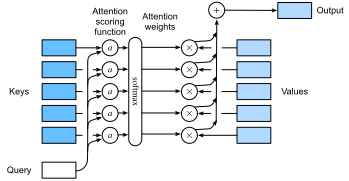

```{.python .input}
%load_ext d2lbook.tab
tab.interact_select('mxnet', 'pytorch', 'tensorflow', 'jax')
```

# Dėmesio vertinimo funkcijos
:label:`sec_attention-scoring-functions`


:numref:`sec_attention-pooling`
naudojome keletą skirtingų atstumu pagrįstų branduolių, įskaitant Gauso branduolį, modeliuoti
sąveikoms tarp užklausų ir raktų. Pasirodo, atstumo funkcijas skaičiuoti šiek tiek brangiau nei skaliarines sandaugas. Todėl,
naudojant softmax operaciją neneigiamiems dėmesio svoriams užtikrinti,
daug darbo buvo skirta *dėmesio vertinimo funkcijoms* $a$ :eqref:`eq_softmax_attention` ir :numref:`fig_attention_output`, kurias paprasčiau apskaičiuoti.


:label:`fig_attention_output`

```{.python .input}
%%tab mxnet
import math
from d2l import mxnet as d2l
from mxnet import np, npx
from mxnet.gluon import nn
npx.set_np()
```

```{.python .input}
%%tab pytorch
from d2l import torch as d2l
import math
import torch
from torch import nn
```

```{.python .input}
%%tab tensorflow
from d2l import tensorflow as d2l
import tensorflow as tf
```

```{.python .input}
%%tab jax
from d2l import jax as d2l
from flax import linen as nn
from jax import numpy as jnp
import jax
import math
```

## [**Skaliarinės sandaugos dėmesys**]


Trumpam peržvelkime dėmesio funkciją (be eksponentinimo), gautą iš Gauso branduolio:

$$
a(\mathbf{q}, \mathbf{k}_i) = -\frac{1}{2} \|\mathbf{q} - \mathbf{k}_i\|^2  = \mathbf{q}^\top \mathbf{k}_i -\frac{1}{2} \|\mathbf{k}_i\|^2  -\frac{1}{2} \|\mathbf{q}\|^2.
$$

Pirma, atkreipkite dėmesį, kad paskutinis narys priklauso tik nuo $\mathbf{q}$. Todėl jis vienodas visoms poroms $(\mathbf{q}, \mathbf{k}_i)$. Dėmesio svorių normalizavimas iki $1$, kaip daroma :eqref:`eq_softmax_attention`, užtikrina, kad šis narys visiškai išnyksta. Antra, atkreipkite dėmesį, kad ir rinkinio, ir sluoksnio normalizacija (aptarsime vėliau) lemia aktyvacijas, kurių normos $\|\mathbf{k}_i\|$ yra gerai apribotos ir dažnai pastovios. Taip yra, pavyzdžiui, kai raktus $\mathbf{k}_i$ sukūrė sluoksnio normalizacija. Todėl galime jį išmesti iš $a$ apibrėžimo be didesnių rezultato pokyčių.

Galiausiai turime kontroliuoti eksponentinės funkcijos argumentų dydžio eilę. Tarkime, kad visi užklausos $\mathbf{q} \in \mathbb{R}^d$ ir rakto $\mathbf{k}_i \in \mathbb{R}^d$ elementai yra nepriklausomi ir vienodai pasiskirstę atsitiktiniai dydžiai su nuliniu vidurkiu ir vienetine dispersija. Abiejų vektorių skaliarinė sandauga turi nulinį vidurkį ir dispersiją $d$. Kad skaliarinės sandaugos dispersija vis dar išliktų $1$ nepriklausomai nuo vektoriaus ilgio, naudojame *mastelio keičiamos skaliarinės sandaugos dėmesio* vertinimo funkciją. T. y. skaliarinę sandaugą perskaliuojame per $1/\sqrt{d}$. Taip prieiname prie pirmosios dažnai naudojamos dėmesio funkcijos, naudojamos, pvz., transformeriuose :cite:`Vaswani.Shazeer.Parmar.ea.2017`:

$$ a(\mathbf{q}, \mathbf{k}_i) = \mathbf{q}^\top \mathbf{k}_i / \sqrt{d}.$$
:eqlabel:`eq_dot_product_attention`

Atkreipkite dėmesį, kad dėmesio svorius $\alpha$ vis dar reikia normalizuoti. Tai galime dar labiau supaprastinti per :eqref:`eq_softmax_attention`, naudodami softmax operaciją:

$$\alpha(\mathbf{q}, \mathbf{k}_i) = \mathrm{softmax}(a(\mathbf{q}, \mathbf{k}_i)) = \frac{\exp(\mathbf{q}^\top \mathbf{k}_i / \sqrt{d})}{\sum_{j=1} \exp(\mathbf{q}^\top \mathbf{k}_j / \sqrt{d})}.$$
:eqlabel:`eq_attn-scoring-alpha`

Pasirodo, visi populiarūs dėmesio sutelkimo mechanizmai naudoja softmax, todėl likusioje šio skyriaus dalyje apsiribosime juo.

## Pagalbinės funkcijos

Mums reikia kelių funkcijų, kad dėmesio sutelkimo mechanizmą būtų efektyvu diegti. Tai apima įrankius kintamo ilgio eilutėms tvarkyti (įprasta natūraliosios kalbos apdorojime) ir įrankius efektyviam vertinimui minirinkiniuose (rinkinio matricų daugyba).


### [**Maskuota softmax operacija**]

Vienas populiariausių dėmesio sutelkimo mechanizmo taikymų yra sekų modeliai. Todėl turime gebėti tvarkyti skirtingo ilgio sekas. Kai kuriais atvejais tokios sekos gali patekti į tą patį minirinkinį, todėl trumpesnes sekas reikia užpildyti netikrais teksto vienetais (pavyzdį žr. :numref:`sec_machine_translation`). Šie specialūs teksto vienetai neturi prasmės. Pavyzdžiui, tarkime, kad turime tokius tris sakinius:

```
Dive  into  Deep    Learning 
Learn to    code    <blank>
Hello world <blank> <blank>
```


Kadangi savo dėmesio modelyje nenorime tuščių vietų, tiesiog turime apriboti $\sum_{i=1}^n \alpha(\mathbf{q}, \mathbf{k}_i) \mathbf{v}_i$ iki $\sum_{i=1}^l \alpha(\mathbf{q}, \mathbf{k}_i) \mathbf{v}_i$, kad ir koks ilgas, $l \leq n$, būtų faktinis sakinys. Kadangi tai tokia dažna problema, ji turi pavadinimą: *maskuota softmax operacija*.

Įgyvendinkime ją. Iš tiesų įgyvendinimas šiek tiek sukčiauja, nustatydamas $\mathbf{v}_i$ reikšmes, kai $i > l$, į nulį. Be to, jis nustato dėmesio svorius į didelį neigiamą skaičių, pvz., $-10^{6}$, kad jų indėlis į gradientus ir reikšmes praktikoje išnyktų. Tai daroma todėl, kad tiesinės algebros branduoliai ir operatoriai yra labai optimizuoti GPU, ir greičiau yra šiek tiek švaistyti skaičiavimus, nei turėti kodą su sąlygos (if then else) sakiniais.

```{.python .input}
%%tab mxnet
def masked_softmax(X, valid_lens):  #@save
    """Perform softmax operation by masking elements on the last axis."""
    # X: 3D tensor, valid_lens: 1D or 2D tensor
    if valid_lens is None:
        return npx.softmax(X)
    else:
        shape = X.shape
        if valid_lens.ndim == 1:
            valid_lens = valid_lens.repeat(shape[1])
        else:
            valid_lens = valid_lens.reshape(-1)
        # On the last axis, replace masked elements with a very large negative
        # value, whose exponentiation outputs 0
        X = npx.sequence_mask(X.reshape(-1, shape[-1]), valid_lens, True,
                              value=-1e6, axis=1)
        return npx.softmax(X).reshape(shape)
```

```{.python .input}
%%tab pytorch
def masked_softmax(X, valid_lens):  #@save
    """Perform softmax operation by masking elements on the last axis."""
    # X: 3D tensor, valid_lens: 1D or 2D tensor 
    def _sequence_mask(X, valid_len, value=0):
        maxlen = X.size(1)
        mask = torch.arange((maxlen), dtype=torch.float32,
                            device=X.device)[None, :] < valid_len[:, None]
        X[~mask] = value
        return X
    
    if valid_lens is None:
        return nn.functional.softmax(X, dim=-1)
    else:
        shape = X.shape
        if valid_lens.dim() == 1:
            valid_lens = torch.repeat_interleave(valid_lens, shape[1])
        else:
            valid_lens = valid_lens.reshape(-1)
        # On the last axis, replace masked elements with a very large negative
        # value, whose exponentiation outputs 0
        X = _sequence_mask(X.reshape(-1, shape[-1]), valid_lens, value=-1e6)
        return nn.functional.softmax(X.reshape(shape), dim=-1)
```

```{.python .input}
%%tab tensorflow
def masked_softmax(X, valid_lens):  #@save
    """Perform softmax operation by masking elements on the last axis."""
    # X: 3D tensor, valid_lens: 1D or 2D tensor
    def _sequence_mask(X, valid_len, value=0):
        maxlen = X.shape[1]
        mask = tf.range(start=0, limit=maxlen, dtype=tf.float32)[
            None, :] < tf.cast(valid_len[:, None], dtype=tf.float32)

        if len(X.shape) == 3:
            return tf.where(tf.expand_dims(mask, axis=-1), X, value)
        else:
            return tf.where(mask, X, value)
    
    if valid_lens is None:
        return tf.nn.softmax(X, axis=-1)
    else:
        shape = X.shape
        if len(valid_lens.shape) == 1:
            valid_lens = tf.repeat(valid_lens, repeats=shape[1])
            
        else:
            valid_lens = tf.reshape(valid_lens, shape=-1)
        # On the last axis, replace masked elements with a very large negative
        # value, whose exponentiation outputs 0    
        X = _sequence_mask(tf.reshape(X, shape=(-1, shape[-1])), valid_lens,
                           value=-1e6)    
        return tf.nn.softmax(tf.reshape(X, shape=shape), axis=-1)
```

```{.python .input}
%%tab jax
def masked_softmax(X, valid_lens):  #@save
    """Perform softmax operation by masking elements on the last axis."""
    # X: 3D tensor, valid_lens: 1D or 2D tensor
    def _sequence_mask(X, valid_len, value=0):
        maxlen = X.shape[1]
        mask = jnp.arange((maxlen),
                          dtype=jnp.float32)[None, :] < valid_len[:, None]
        return jnp.where(mask, X, value)

    if valid_lens is None:
        return nn.softmax(X, axis=-1)
    else:
        shape = X.shape
        if valid_lens.ndim == 1:
            valid_lens = jnp.repeat(valid_lens, shape[1])
        else:
            valid_lens = valid_lens.reshape(-1)
        # On the last axis, replace masked elements with a very large negative
        # value, whose exponentiation outputs 0
        X = _sequence_mask(X.reshape(-1, shape[-1]), valid_lens, value=-1e6)
        return nn.softmax(X.reshape(shape), axis=-1)
```

Kad [**iliustruotume, kaip veikia ši funkcija**],
apsvarstykime dviejų pavyzdžių minirinkinį, kurio dydis $2 \times 4$,
o jų galiojantys ilgiai yra atitinkamai $2$ ir $3$.
Dėl maskuotos softmax operacijos
reikšmės už kiekvienos vektorių poros galiojančių ilgių ribų yra užmaskuojamos nuliais.

```{.python .input}
%%tab mxnet
masked_softmax(np.random.uniform(size=(2, 2, 4)), d2l.tensor([2, 3]))
```

```{.python .input}
%%tab pytorch
masked_softmax(torch.rand(2, 2, 4), torch.tensor([2, 3]))
```

```{.python .input}
%%tab tensorflow
masked_softmax(tf.random.uniform(shape=(2, 2, 4)), tf.constant([2, 3]))
```

```{.python .input}
%%tab jax
masked_softmax(jax.random.uniform(d2l.get_key(), (2, 2, 4)), jnp.array([2, 3]))
```

Jei reikia smulkesnės kontrolės, kad nurodytume galiojantį ilgį kiekvienam iš dviejų kiekvieno pavyzdžio vektorių, tiesiog naudojame dvimatį galiojančių ilgių tenzorių. Tai duoda:

```{.python .input}
%%tab mxnet
masked_softmax(np.random.uniform(size=(2, 2, 4)),
               d2l.tensor([[1, 3], [2, 4]]))
```

```{.python .input}
%%tab pytorch
masked_softmax(torch.rand(2, 2, 4), d2l.tensor([[1, 3], [2, 4]]))
```

```{.python .input}
%%tab tensorflow
masked_softmax(tf.random.uniform((2, 2, 4)), tf.constant([[1, 3], [2, 4]]))
```

```{.python .input}
%%tab jax
masked_softmax(jax.random.uniform(d2l.get_key(), (2, 2, 4)),
               jnp.array([[1, 3], [2, 4]]))
```

### Rinkinio matricų daugyba
:label:`subsec_batch_dot`

Kita dažnai naudojama operacija yra matricų rinkinių daugyba tarpusavyje. Tai pravartu, kai turime užklausų, raktų ir reikšmių minirinkinius. Konkrečiau, tarkime, kad

$$\mathbf{Q} = [\mathbf{Q}_1, \mathbf{Q}_2, \ldots, \mathbf{Q}_n]  \in \mathbb{R}^{n \times a \times b}, \\
    \mathbf{K} = [\mathbf{K}_1, \mathbf{K}_2, \ldots, \mathbf{K}_n]  \in \mathbb{R}^{n \times b \times c}.
$$

Tada rinkinio matricų daugyba (BMM) apskaičiuoja elementų lygmens sandaugą

$$\textrm{BMM}(\mathbf{Q}, \mathbf{K}) = [\mathbf{Q}_1 \mathbf{K}_1, \mathbf{Q}_2 \mathbf{K}_2, \ldots, \mathbf{Q}_n \mathbf{K}_n] \in \mathbb{R}^{n \times a \times c}.$$
:eqlabel:`eq_batch-matrix-mul`

Pažiūrėkime, kaip tai veikia giliojo mokymosi karkase.

```{.python .input}
%%tab mxnet
Q = d2l.ones((2, 3, 4))
K = d2l.ones((2, 4, 6))
d2l.check_shape(npx.batch_dot(Q, K), (2, 3, 6))
```

```{.python .input}
%%tab pytorch
Q = d2l.ones((2, 3, 4))
K = d2l.ones((2, 4, 6))
d2l.check_shape(torch.bmm(Q, K), (2, 3, 6))
```

```{.python .input}
%%tab tensorflow
Q = d2l.ones((2, 3, 4))
K = d2l.ones((2, 4, 6))
d2l.check_shape(tf.matmul(Q, K).numpy(), (2, 3, 6))
```

```{.python .input}
%%tab jax
Q = d2l.ones((2, 3, 4))
K = d2l.ones((2, 4, 6))
d2l.check_shape(jax.lax.batch_matmul(Q, K), (2, 3, 6))
```

## [**Mastelio keičiamos skaliarinės sandaugos dėmesys**]

Grįžkime prie skaliarinės sandaugos dėmesio, pristatyto :eqref:`eq_dot_product_attention`.
Apskritai jis reikalauja, kad ir užklausa, ir raktas
turėtų tą patį vektoriaus ilgį, tarkime $d$, nors tai galima lengvai išspręsti pakeitus
$\mathbf{q}^\top \mathbf{k}$ į $\mathbf{q}^\top \mathbf{M} \mathbf{k}$, kur $\mathbf{M}$ yra matrica, tinkamai pasirinkta pereiti tarp abiejų erdvių. Kol kas tarkime, kad dimensijos sutampa.

Praktikoje dėl efektyvumo dažnai galvojame apie minirinkinius,
pavyzdžiui, apskaičiuojame dėmesį $n$ užklausų ir $m$ raktų ir reikšmių porų,
kur užklausų ir raktų ilgis $d$,
o reikšmių ilgis $v$. Užklausų $\mathbf Q\in\mathbb R^{n\times d}$,
raktų $\mathbf K\in\mathbb R^{m\times d}$
ir reikšmių $\mathbf V\in\mathbb R^{m\times v}$
mastelio keičiamos skaliarinės sandaugos dėmesį
taigi galima užrašyti kaip

$$ \mathrm{softmax}\left(\frac{\mathbf Q \mathbf K^\top }{\sqrt{d}}\right) \mathbf V \in \mathbb{R}^{n\times v}.$$
:eqlabel:`eq_softmax_QK_V`

Atkreipkite dėmesį, kad taikydami tai minirinkiniui, turime naudoti rinkinio matricų daugybą, pristatytą :eqref:`eq_batch-matrix-mul`. Toliau pateiktame mastelio keičiamos skaliarinės sandaugos dėmesio įgyvendinime
modelio reguliarizacijai naudojame dropout.

```{.python .input}
%%tab mxnet
class DotProductAttention(nn.Block):  #@save
    """Scaled dot product attention."""
    def __init__(self, dropout):
        super().__init__()
        self.dropout = nn.Dropout(dropout)

    # Shape of queries: (batch_size, no. of queries, d)
    # Shape of keys: (batch_size, no. of key-value pairs, d)
    # Shape of values: (batch_size, no. of key-value pairs, value dimension)
    # Shape of valid_lens: (batch_size,) or (batch_size, no. of queries)
    def forward(self, queries, keys, values, valid_lens=None):
        d = queries.shape[-1]
        # Set transpose_b=True to swap the last two dimensions of keys
        scores = npx.batch_dot(queries, keys, transpose_b=True) / math.sqrt(d)
        self.attention_weights = masked_softmax(scores, valid_lens)
        return npx.batch_dot(self.dropout(self.attention_weights), values)
```

```{.python .input}
%%tab pytorch
class DotProductAttention(nn.Module):  #@save
    """Scaled dot product attention."""
    def __init__(self, dropout):
        super().__init__()
        self.dropout = nn.Dropout(dropout)

    # Shape of queries: (batch_size, no. of queries, d)
    # Shape of keys: (batch_size, no. of key-value pairs, d)
    # Shape of values: (batch_size, no. of key-value pairs, value dimension)
    # Shape of valid_lens: (batch_size,) or (batch_size, no. of queries)
    def forward(self, queries, keys, values, valid_lens=None):
        d = queries.shape[-1]
        # Swap the last two dimensions of keys with keys.transpose(1, 2)
        scores = torch.bmm(queries, keys.transpose(1, 2)) / math.sqrt(d)
        self.attention_weights = masked_softmax(scores, valid_lens)
        return torch.bmm(self.dropout(self.attention_weights), values)
```

```{.python .input}
%%tab tensorflow
class DotProductAttention(tf.keras.layers.Layer):  #@save
    """Scaled dot product attention."""
    def __init__(self, dropout):
        super().__init__()
        self.dropout = tf.keras.layers.Dropout(dropout)
        
    # Shape of queries: (batch_size, no. of queries, d)
    # Shape of keys: (batch_size, no. of key-value pairs, d)
    # Shape of values: (batch_size, no. of key-value pairs, value dimension)
    # Shape of valid_lens: (batch_size,) or (batch_size, no. of queries)
    def call(self, queries, keys, values, valid_lens=None, **kwargs):
        d = queries.shape[-1]
        scores = tf.matmul(queries, keys, transpose_b=True)/tf.math.sqrt(
            tf.cast(d, dtype=tf.float32))
        self.attention_weights = masked_softmax(scores, valid_lens)
        return tf.matmul(self.dropout(self.attention_weights, **kwargs), values)
```

```{.python .input}
%%tab jax
class DotProductAttention(nn.Module):  #@save
    """Scaled dot product attention."""
    dropout: float

    # Shape of queries: (batch_size, no. of queries, d)
    # Shape of keys: (batch_size, no. of key-value pairs, d)
    # Shape of values: (batch_size, no. of key-value pairs, value dimension)
    # Shape of valid_lens: (batch_size,) or (batch_size, no. of queries)
    @nn.compact
    def __call__(self, queries, keys, values, valid_lens=None,
                 training=False):
        d = queries.shape[-1]
        # Swap the last two dimensions of keys with keys.swapaxes(1, 2)
        scores = queries@(keys.swapaxes(1, 2)) / math.sqrt(d)
        attention_weights = masked_softmax(scores, valid_lens)
        dropout_layer = nn.Dropout(self.dropout, deterministic=not training)
        return dropout_layer(attention_weights)@values, attention_weights
```

Kad [**iliustruotume, kaip veikia klasė `DotProductAttention`**],
naudojame tuos pačius raktus, reikšmes ir galiojančius ilgius iš ankstesnio žaislinio adityvinio dėmesio pavyzdžio. Savo pavyzdžio tikslais tarkime, kad minirinkinio dydis yra $2$, iš viso yra $10$ raktų ir reikšmių, o reikšmių dimensija yra $4$. Galiausiai tarkime, kad galiojantis ilgis kiekvienam stebėjimui yra atitinkamai $2$ ir $6$. Atsižvelgiant į tai, tikimės, kad išvestis bus $2 \times 1 \times 4$ tenzorius, t. y. po vieną eilutę kiekvienam minirinkinio pavyzdžiui.

```{.python .input}
%%tab mxnet
queries = d2l.normal(0, 1, (2, 1, 2))
keys = d2l.normal(0, 1, (2, 10, 2))
values = d2l.normal(0, 1, (2, 10, 4))
valid_lens = d2l.tensor([2, 6])

attention = DotProductAttention(dropout=0.5)
attention.initialize()
d2l.check_shape(attention(queries, keys, values, valid_lens), (2, 1, 4))
```

```{.python .input}
%%tab pytorch
queries = d2l.normal(0, 1, (2, 1, 2))
keys = d2l.normal(0, 1, (2, 10, 2))
values = d2l.normal(0, 1, (2, 10, 4))
valid_lens = d2l.tensor([2, 6])

attention = DotProductAttention(dropout=0.5)
attention.eval()
d2l.check_shape(attention(queries, keys, values, valid_lens), (2, 1, 4))
```

```{.python .input}
%%tab tensorflow
queries = tf.random.normal(shape=(2, 1, 2))
keys = tf.random.normal(shape=(2, 10, 2))
values = tf.random.normal(shape=(2, 10, 4))
valid_lens = tf.constant([2, 6])

attention = DotProductAttention(dropout=0.5)
d2l.check_shape(attention(queries, keys, values, valid_lens, training=False),
                (2, 1, 4))
```

```{.python .input}
%%tab jax
queries = jax.random.normal(d2l.get_key(), (2, 1, 2))
keys = jax.random.normal(d2l.get_key(), (2, 10, 2))
values = jax.random.normal(d2l.get_key(), (2, 10, 4))
valid_lens = d2l.tensor([2, 6])

attention = DotProductAttention(dropout=0.5)
(output, attention_weights), params = attention.init_with_output(
    d2l.get_key(), queries, keys, values, valid_lens)
print(output)
```

Patikrinkime, ar dėmesio svoriai iš tiesų išnyksta viskam, kas yra už atitinkamai antro ir šešto stulpelių (nes galiojantis ilgis nustatytas $2$ ir $6$).

```{.python .input}
%%tab pytorch, mxnet, tensorflow
d2l.show_heatmaps(d2l.reshape(attention.attention_weights, (1, 1, 2, 10)),
                  xlabel='Keys', ylabel='Queries')
```

```{.python .input}
%%tab jax
d2l.show_heatmaps(d2l.reshape(attention_weights, (1, 1, 2, 10)),
                  xlabel='Keys', ylabel='Queries')
```

## [**Adityvinis dėmesys**]
:label:`subsec_additive-attention`

Kai užklausos $\mathbf{q}$ ir raktai $\mathbf{k}$ yra skirtingų dimensijų vektoriai,
galime arba naudoti matricą neatitikčiai spręsti per $\mathbf{q}^\top \mathbf{M} \mathbf{k}$, arba galime naudoti adityvinį dėmesį
kaip vertinimo funkciją. Kitas privalumas yra tas, kad, kaip rodo pavadinimas, dėmesys yra adityvinis. Tai gali lemti nedidelį skaičiavimų sutaupymą.
Duotai užklausai $\mathbf{q} \in \mathbb{R}^q$
ir raktui $\mathbf{k} \in \mathbb{R}^k$
*adityvinio dėmesio* vertinimo funkcija :cite:`Bahdanau.Cho.Bengio.2014` yra

$$a(\mathbf q, \mathbf k) = \mathbf w_v^\top \textrm{tanh}(\mathbf W_q\mathbf q + \mathbf W_k \mathbf k) \in \mathbb{R},$$
:eqlabel:`eq_additive-attn`

kur $\mathbf W_q\in\mathbb R^{h\times q}$, $\mathbf W_k\in\mathbb R^{h\times k}$
ir $\mathbf w_v\in\mathbb R^{h}$ yra mokomi parametrai. Šis narys toliau paduodamas į softmax, kad būtų užtikrintas ir neneigiamumas, ir normalizacija.
Ekvivalentiška :eqref:`eq_additive-attn` interpretacija yra ta, kad užklausa ir raktas sujungiami
ir paduodami į MLP su vienu paslėptuoju sluoksniu.
Naudodami $\tanh$ kaip aktyvacijos funkciją ir išjungdami poslinkio narius,
adityvinį dėmesį įgyvendiname taip:

```{.python .input}
%%tab mxnet
class AdditiveAttention(nn.Block):  #@save
    """Additive attention."""
    def __init__(self, num_hiddens, dropout, **kwargs):
        super(AdditiveAttention, self).__init__(**kwargs)
        # Use flatten=False to only transform the last axis so that the
        # shapes for the other axes are kept the same
        self.W_k = nn.Dense(num_hiddens, use_bias=False, flatten=False)
        self.W_q = nn.Dense(num_hiddens, use_bias=False, flatten=False)
        self.w_v = nn.Dense(1, use_bias=False, flatten=False)
        self.dropout = nn.Dropout(dropout)

    def forward(self, queries, keys, values, valid_lens):
        queries, keys = self.W_q(queries), self.W_k(keys)
        # After dimension expansion, shape of queries: (batch_size, no. of
        # queries, 1, num_hiddens) and shape of keys: (batch_size, 1,
        # no. of key-value pairs, num_hiddens). Sum them up with
        # broadcasting
        features = np.expand_dims(queries, axis=2) + np.expand_dims(
            keys, axis=1)
        features = np.tanh(features)
        # There is only one output of self.w_v, so we remove the last
        # one-dimensional entry from the shape. Shape of scores:
        # (batch_size, no. of queries, no. of key-value pairs)
        scores = np.squeeze(self.w_v(features), axis=-1)
        self.attention_weights = masked_softmax(scores, valid_lens)
        # Shape of values: (batch_size, no. of key-value pairs, value
        # dimension)
        return npx.batch_dot(self.dropout(self.attention_weights), values)
```

```{.python .input}
%%tab pytorch
class AdditiveAttention(nn.Module):  #@save
    """Additive attention."""
    def __init__(self, num_hiddens, dropout, **kwargs):
        super(AdditiveAttention, self).__init__(**kwargs)
        self.W_k = nn.LazyLinear(num_hiddens, bias=False)
        self.W_q = nn.LazyLinear(num_hiddens, bias=False)
        self.w_v = nn.LazyLinear(1, bias=False)
        self.dropout = nn.Dropout(dropout)

    def forward(self, queries, keys, values, valid_lens):
        queries, keys = self.W_q(queries), self.W_k(keys)
        # After dimension expansion, shape of queries: (batch_size, no. of
        # queries, 1, num_hiddens) and shape of keys: (batch_size, 1, no. of
        # key-value pairs, num_hiddens). Sum them up with broadcasting
        features = queries.unsqueeze(2) + keys.unsqueeze(1)
        features = torch.tanh(features)
        # There is only one output of self.w_v, so we remove the last
        # one-dimensional entry from the shape. Shape of scores: (batch_size,
        # no. of queries, no. of key-value pairs)
        scores = self.w_v(features).squeeze(-1)
        self.attention_weights = masked_softmax(scores, valid_lens)
        # Shape of values: (batch_size, no. of key-value pairs, value
        # dimension)
        return torch.bmm(self.dropout(self.attention_weights), values)
```

```{.python .input}
%%tab tensorflow
class AdditiveAttention(tf.keras.layers.Layer):  #@save
    """Additive attention."""
    def __init__(self, key_size, query_size, num_hiddens, dropout, **kwargs):
        super().__init__(**kwargs)
        self.W_k = tf.keras.layers.Dense(num_hiddens, use_bias=False)
        self.W_q = tf.keras.layers.Dense(num_hiddens, use_bias=False)
        self.w_v = tf.keras.layers.Dense(1, use_bias=False)
        self.dropout = tf.keras.layers.Dropout(dropout)
        
    def call(self, queries, keys, values, valid_lens, **kwargs):
        queries, keys = self.W_q(queries), self.W_k(keys)
        # After dimension expansion, shape of queries: (batch_size, no. of
        # queries, 1, num_hiddens) and shape of keys: (batch_size, 1, no. of
        # key-value pairs, num_hiddens). Sum them up with broadcasting
        features = tf.expand_dims(queries, axis=2) + tf.expand_dims(
            keys, axis=1)
        features = tf.nn.tanh(features)
        # There is only one output of self.w_v, so we remove the last
        # one-dimensional entry from the shape. Shape of scores: (batch_size,
        # no. of queries, no. of key-value pairs)
        scores = tf.squeeze(self.w_v(features), axis=-1)
        self.attention_weights = masked_softmax(scores, valid_lens)
        # Shape of values: (batch_size, no. of key-value pairs, value
        # dimension)
        return tf.matmul(self.dropout(
            self.attention_weights, **kwargs), values)
```

```{.python .input}
%%tab jax
class AdditiveAttention(nn.Module):  #@save
    num_hiddens: int
    dropout: float

    def setup(self):
        self.W_k = nn.Dense(self.num_hiddens, use_bias=False)
        self.W_q = nn.Dense(self.num_hiddens, use_bias=False)
        self.w_v = nn.Dense(1, use_bias=False)

    @nn.compact
    def __call__(self, queries, keys, values, valid_lens, training=False):
        queries, keys = self.W_q(queries), self.W_k(keys)
        # After dimension expansion, shape of queries: (batch_size, no. of
        # queries, 1, num_hiddens) and shape of keys: (batch_size, 1, no. of
        # key-value pairs, num_hiddens). Sum them up with broadcasting
        features = jnp.expand_dims(queries, axis=2) + jnp.expand_dims(keys, axis=1)
        features = nn.tanh(features)
        # There is only one output of self.w_v, so we remove the last
        # one-dimensional entry from the shape. Shape of scores: (batch_size,
        # no. of queries, no. of key-value pairs)
        scores = self.w_v(features).squeeze(-1)
        attention_weights = masked_softmax(scores, valid_lens)
        dropout_layer = nn.Dropout(self.dropout, deterministic=not training)
        # Shape of values: (batch_size, no. of key-value pairs, value
        # dimension)
        return dropout_layer(attention_weights)@values, attention_weights
```

[**Pažiūrėkime, kaip veikia `AdditiveAttention`**]. Savo žaisliniame pavyzdyje pasirenkame užklausas, raktus ir reikšmes, kurių dydžiai atitinkamai
$(2, 1, 20)$, $(2, 10, 2)$ ir $(2, 10, 4)$. Tai tapatu mūsų pasirinkimui `DotProductAttention`, tik dabar užklausos yra $20$ matmenų. Panašiai minirinkinio sekoms galiojančiais ilgiais pasirenkame $(2, 6)$.

```{.python .input}
%%tab mxnet
queries = d2l.normal(0, 1, (2, 1, 20))

attention = AdditiveAttention(num_hiddens=8, dropout=0.1)
attention.initialize()
d2l.check_shape(attention(queries, keys, values, valid_lens), (2, 1, 4))
```

```{.python .input}
%%tab pytorch
queries = d2l.normal(0, 1, (2, 1, 20))

attention = AdditiveAttention(num_hiddens=8, dropout=0.1)
attention.eval()
d2l.check_shape(attention(queries, keys, values, valid_lens), (2, 1, 4))
```

```{.python .input}
%%tab tensorflow
queries = tf.random.normal(shape=(2, 1, 20))

attention = AdditiveAttention(key_size=2, query_size=20, num_hiddens=8,
                              dropout=0.1)
d2l.check_shape(attention(queries, keys, values, valid_lens, training=False),
                (2, 1, 4))
```

```{.python .input}
%%tab jax
queries = jax.random.normal(d2l.get_key(), (2, 1, 20))
attention = AdditiveAttention(num_hiddens=8, dropout=0.1)
(output, attention_weights), params = attention.init_with_output(
    d2l.get_key(), queries, keys, values, valid_lens)
print(output)
```

Peržiūrėdami dėmesio funkciją matome elgesį, kokybiškai gana panašų į `DotProductAttention`. T. y. tik nariai pasirinktuose galiojančiuose ilgiuose $(2, 6)$ yra nenuliniai.

```{.python .input}
%%tab pytorch, mxnet, tensorflow
d2l.show_heatmaps(d2l.reshape(attention.attention_weights, (1, 1, 2, 10)),
                  xlabel='Keys', ylabel='Queries')
```

```{.python .input}
%%tab jax
d2l.show_heatmaps(d2l.reshape(attention_weights, (1, 1, 2, 10)),
                  xlabel='Keys', ylabel='Queries')
```

## Santrauka

Šiame skyrelyje pristatėme dvi pagrindines dėmesio vertinimo funkcijas: skaliarinės sandaugos ir adityvinį dėmesį. Tai veiksmingi įrankiai agreguoti per kintamo ilgio sekas. Visų pirma skaliarinės sandaugos dėmesys yra šiuolaikinių transformerių architektūrų pagrindas. Kai užklausos ir raktai yra skirtingų ilgių vektoriai,
vietoj to galime naudoti adityvinio dėmesio vertinimo funkciją. Šių sluoksnių optimizavimas yra viena pagrindinių pažangos sričių pastaraisiais metais. Pavyzdžiui, [NVIDIA transformerių biblioteka](https://docs.nvidia.com/deeplearning/transformer-engine/user-guide/index.html) ir „Megatron“ :cite:`shoeybi2019megatron` iš esmės remiasi efektyviais dėmesio sutelkimo mechanizmo variantais. Tai aptarsime gerokai išsamiau, nagrinėdami transformerius vėlesniuose skyreliuose.

## Pratimai

1. Įgyvendinkite atstumu pagrįstą dėmesį modifikuodami `DotProductAttention` kodą. Atkreipkite dėmesį, kad efektyviam įgyvendinimui reikia tik raktų kvadratinių normų $\|\mathbf{k}_i\|^2$.
1. Modifikuokite skaliarinės sandaugos dėmesį, kad jis leistų skirtingų dimensijų užklausas ir raktus, naudojant matricą dimensijoms pritaikyti.
1. Kaip skaičiavimo kaina keičiasi priklausomai nuo raktų, užklausų, reikšmių dimensijos ir jų skaičiaus? O kaip atminties pralaidumo reikalavimai?

:begin_tab:`mxnet`
[Diskusijos](https://discuss.d2l.ai/t/346)
:end_tab:

:begin_tab:`pytorch`
[Diskusijos](https://discuss.d2l.ai/t/1064)
:end_tab:

:begin_tab:`tensorflow`
[Diskusijos](https://discuss.d2l.ai/t/3867)
:end_tab:

:begin_tab:`jax`
[Diskusijos](https://discuss.d2l.ai/t/18027)
:end_tab:
