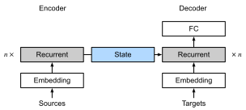
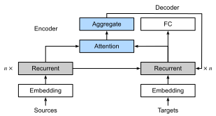

```{.python .input}
%load_ext d2lbook.tab
tab.interact_select('mxnet', 'pytorch', 'tensorflow', 'jax')
```

# Bahdanau dėmesio sutelkimo mechanizmas
:label:`sec_seq2seq_attention`

Kai :numref:`sec_seq2seq` susidūrėme su mašininiu vertimu,
suprojektavome kodavimo ir dekodavimo architektūrą sekos į seką mokymuisi,
pagrįstą dviem RNN :cite:`Sutskever.Vinyals.Le.2014`.
Konkrečiai, RNN kodavimo blokas paverčia kintamo ilgio seką
*fiksuotos formos* konteksto kintamuoju.
Tada RNN dekodavimo blokas generuoja išvesties (tikslo) seką teksto vienetas po teksto vieneto,
remdamasis sugeneruotais teksto vienetais ir konteksto kintamuoju.

Prisiminkite :numref:`fig_seq2seq_details`, kurį kartojame (:numref:`fig_s2s_attention_state`) su šiek tiek papildomų detalių. Įprastai RNN visa svarbi informacija apie šaltinio seką kodavimo bloko paverčiama tam tikru vidiniu *fiksuotos dimensijos* būsenos vaizdu. Būtent šią būseną dekodavimo blokas naudoja kaip pilną ir išskirtinį informacijos šaltinį išverstai sekai generuoti. Kitaip tariant, sekos į seką mechanizmas traktuoja tarpinę būseną kaip pakankamąją statistiką bet kokios eilutės, kuri galėjo būti įvestis.


:label:`fig_s2s_attention_state`

Nors tai gana pagrįsta trumpoms sekoms, akivaizdu, kad ilgoms – tokioms kaip knygos skyrius ar net tik labai ilgas sakinys – tai neįmanoma. Juk netrukus tarpiniame vaizde tiesiog nebeužteks „vietos“ viskam, kas svarbu šaltinio sekoje, saugoti. Dėl to dekodavimo blokas nesugebės išversti ilgų ir sudėtingų sakinių. Vienas pirmųjų, susidūrusių su tuo, buvo :citet:`Graves.2013`, kuris bandė suprojektuoti RNN rankraštiniam tekstui generuoti. Kadangi šaltinio tekstas yra savavališko ilgio, jie suprojektavo diferencijuojamą dėmesio sutelkimo modelį,
kuris sulygiuotų teksto simbolius su daug ilgesne rašiklio trajektorija,
kur sulygiavimas juda tik viena kryptimi. Tai savo ruožtu remiasi dekodavimo algoritmais kalbos atpažinime, pvz., paslėptaisiais Markovo modeliais :cite:`rabiner1993fundamentals`.

Įkvėpti mokymosi sulygiuoti idėjos,
:citet:`Bahdanau.Cho.Bengio.2014` pasiūlė diferencijuojamą dėmesio sutelkimo modelį
*be* vienakrypčio sulygiavimo apribojimo.
Prognozuojant teksto vienetą,
jei ne visi įvesties teksto vienetai yra svarbūs,
modelis sulygiuoja (arba sutelkia dėmesį)
tik į tas įvesties sekos dalis,
kurios laikomos svarbiomis dabartinei prognozei. Tai tada naudojama dabartinei būsenai atnaujinti prieš generuojant kitą teksto vienetą. Nors aprašyme gana nekenksminga, ši *Bahdanau dėmesio sutelkimo mechanizmo* idėja, galima teigti, tapo viena įtakingiausių pastarojo dešimtmečio giliojo mokymosi idėjų, davusia pradžią transformeriams :cite:`Vaswani.Shazeer.Parmar.ea.2017` ir daugeliui susijusių naujų architektūrų.

```{.python .input}
%%tab mxnet
from d2l import mxnet as d2l
from mxnet import init, np, npx
from mxnet.gluon import rnn, nn
npx.set_np()
```

```{.python .input}
%%tab pytorch
from d2l import torch as d2l
import torch
from torch import nn
```

```{.python .input}
%%tab tensorflow
from d2l import tensorflow as d2l
import tensorflow as tf
```

```{.python .input}
%%tab jax
from d2l import jax as d2l
from flax import linen as nn
from jax import numpy as jnp
import jax
```

## Modelis

Laikomės žymėjimo, pristatyto sekos į seką architektūroje :numref:`sec_seq2seq`, ypač :eqref:`eq_seq2seq_s_t`.
Pagrindinė idėja yra ta, kad užuot išlaikius būseną,
t. y. konteksto kintamąjį $\mathbf{c}$, apibendrinantį šaltinio sakinį, fiksuotą, mes jį dinamiškai atnaujiname kaip funkciją ir originalaus teksto (kodavimo bloko paslėptosios būsenos $\mathbf{h}_{t}$), ir jau sugeneruoto teksto (dekodavimo bloko paslėptosios būsenos $\mathbf{s}_{t'-1}$). Tai duoda $\mathbf{c}_{t'}$, kuris atnaujinamas po bet kurio dekodavimo laiko žingsnio $t'$. Tarkime, kad įvesties seka yra ilgio $T$. Šiuo atveju konteksto kintamasis yra dėmesio sutelkimo išvestis:

$$\mathbf{c}_{t'} = \sum_{t=1}^{T} \alpha(\mathbf{s}_{t' - 1}, \mathbf{h}_{t}) \mathbf{h}_{t}.$$

Naudojome $\mathbf{s}_{t' - 1}$ kaip užklausą, o
$\mathbf{h}_{t}$ – ir kaip raktą, ir kaip reikšmę. Atkreipkite dėmesį, kad $\mathbf{c}_{t'}$ tada naudojamas būsenai $\mathbf{s}_{t'}$ sugeneruoti ir naujam teksto vienetui generuoti: žr. :eqref:`eq_seq2seq_s_t`. Visų pirma dėmesio svoris $\alpha$ apskaičiuojamas kaip :eqref:`eq_attn-scoring-alpha`,
naudojant adityvinio dėmesio vertinimo funkciją,
apibrėžtą :eqref:`eq_additive-attn`.
Ši RNN kodavimo ir dekodavimo architektūra
su dėmesio sutelkimu pavaizduota :numref:`fig_s2s_attention_details`. Atkreipkite dėmesį, kad vėliau šis modelis buvo modifikuotas, kad į dekodavimo bloką kaip papildomas kontekstas būtų įtraukti jau sugeneruoti teksto vienetai (t. y. dėmesio suma nesibaigia ties $T$, o tęsiasi iki $t'-1$). Pavyzdžiui, šios strategijos, taikomos kalbos atpažinimui, aprašymą žr. :citet:`chan2015listen`.


:label:`fig_s2s_attention_details`

## Dekodavimo bloko su dėmesio sutelkimu apibrėžimas

Kad įgyvendintume RNN kodavimo ir dekodavimo modelį su dėmesio sutelkimu,
tereikia iš naujo apibrėžti dekodavimo bloką (sugeneruotų simbolių praleidimas dėmesio funkcijoje supaprastina dizainą). Pradėkime nuo [**bazinės dekodavimo blokų su dėmesio sutelkimu sąsajos**], apibrėždami nieko nenustebinančiai pavadintą klasę `AttentionDecoder`.

```{.python .input}
%%tab pytorch, mxnet, tensorflow
class AttentionDecoder(d2l.Decoder):  #@save
    """The base attention-based decoder interface."""
    def __init__(self):
        super().__init__()

    @property
    def attention_weights(self):
        raise NotImplementedError
```

Turime [**įgyvendinti RNN dekodavimo bloką**]
klasėje `Seq2SeqAttentionDecoder`.
Dekodavimo bloko būsena inicializuojama su
(i) paskutinio kodavimo bloko sluoksnio paslėptosiomis būsenomis visais laiko žingsniais, naudojamomis kaip raktai ir reikšmės dėmesio sutelkimui;
(ii) kodavimo bloko paslėptąja būsena visuose sluoksniuose paskutiniu laiko žingsniu, kuri naudojama dekodavimo bloko paslėptajai būsenai inicializuoti;
ir (iii) kodavimo bloko galiojančiu ilgiu, kad dėmesio sutelkime būtų neįtraukti užpildymo teksto vienetai.
Kiekvienu dekodavimo laiko žingsniu paskutinio dekodavimo bloko sluoksnio paslėptoji būsena, gauta ankstesniu laiko žingsniu, naudojama kaip dėmesio sutelkimo mechanizmo užklausa.
Tiek dėmesio sutelkimo mechanizmo išvestis, tiek įvesties įterpinys sujungiami ir naudojami kaip RNN dekodavimo bloko įvestis.

```{.python .input}
%%tab mxnet
class Seq2SeqAttentionDecoder(AttentionDecoder):
    def __init__(self, vocab_size, embed_size, num_hiddens, num_layers,
                 dropout=0):
        super().__init__()
        self.attention = d2l.AdditiveAttention(num_hiddens, dropout)
        self.embedding = nn.Embedding(vocab_size, embed_size)
        self.rnn = rnn.GRU(num_hiddens, num_layers, dropout=dropout)
        self.dense = nn.Dense(vocab_size, flatten=False)
        self.initialize(init.Xavier())

    def init_state(self, enc_outputs, enc_valid_lens):
        # Shape of outputs: (num_steps, batch_size, num_hiddens).
        # Shape of hidden_state: (num_layers, batch_size, num_hiddens)
        outputs, hidden_state = enc_outputs
        return (outputs.swapaxes(0, 1), hidden_state, enc_valid_lens)

    def forward(self, X, state):
        # Shape of enc_outputs: (batch_size, num_steps, num_hiddens).
        # Shape of hidden_state: (num_layers, batch_size, num_hiddens)
        enc_outputs, hidden_state, enc_valid_lens = state
        # Shape of the output X: (num_steps, batch_size, embed_size)
        X = self.embedding(X).swapaxes(0, 1)
        outputs, self._attention_weights = [], []
        for x in X:
            # Shape of query: (batch_size, 1, num_hiddens)
            query = np.expand_dims(hidden_state[-1], axis=1)
            # Shape of context: (batch_size, 1, num_hiddens)
            context = self.attention(
                query, enc_outputs, enc_outputs, enc_valid_lens)
            # Concatenate on the feature dimension
            x = np.concatenate((context, np.expand_dims(x, axis=1)), axis=-1)
            # Reshape x as (1, batch_size, embed_size + num_hiddens)
            out, hidden_state = self.rnn(x.swapaxes(0, 1), hidden_state)
            hidden_state = hidden_state[0]
            outputs.append(out)
            self._attention_weights.append(self.attention.attention_weights)
        # After fully connected layer transformation, shape of outputs:
        # (num_steps, batch_size, vocab_size)
        outputs = self.dense(np.concatenate(outputs, axis=0))
        return outputs.swapaxes(0, 1), [enc_outputs, hidden_state,
                                        enc_valid_lens]

    @property
    def attention_weights(self):
        return self._attention_weights
```

```{.python .input}
%%tab pytorch
class Seq2SeqAttentionDecoder(AttentionDecoder):
    def __init__(self, vocab_size, embed_size, num_hiddens, num_layers,
                 dropout=0):
        super().__init__()
        self.attention = d2l.AdditiveAttention(num_hiddens, dropout)
        self.embedding = nn.Embedding(vocab_size, embed_size)
        self.rnn = nn.GRU(
            embed_size + num_hiddens, num_hiddens, num_layers,
            dropout=dropout)
        self.dense = nn.LazyLinear(vocab_size)
        self.apply(d2l.init_seq2seq)

    def init_state(self, enc_outputs, enc_valid_lens):
        # Shape of outputs: (num_steps, batch_size, num_hiddens).
        # Shape of hidden_state: (num_layers, batch_size, num_hiddens)
        outputs, hidden_state = enc_outputs
        return (outputs.permute(1, 0, 2), hidden_state, enc_valid_lens)

    def forward(self, X, state):
        # Shape of enc_outputs: (batch_size, num_steps, num_hiddens).
        # Shape of hidden_state: (num_layers, batch_size, num_hiddens)
        enc_outputs, hidden_state, enc_valid_lens = state
        # Shape of the output X: (num_steps, batch_size, embed_size)
        X = self.embedding(X).permute(1, 0, 2)
        outputs, self._attention_weights = [], []
        for x in X:
            # Shape of query: (batch_size, 1, num_hiddens)
            query = torch.unsqueeze(hidden_state[-1], dim=1)
            # Shape of context: (batch_size, 1, num_hiddens)
            context = self.attention(
                query, enc_outputs, enc_outputs, enc_valid_lens)
            # Concatenate on the feature dimension
            x = torch.cat((context, torch.unsqueeze(x, dim=1)), dim=-1)
            # Reshape x as (1, batch_size, embed_size + num_hiddens)
            out, hidden_state = self.rnn(x.permute(1, 0, 2), hidden_state)
            outputs.append(out)
            self._attention_weights.append(self.attention.attention_weights)
        # After fully connected layer transformation, shape of outputs:
        # (num_steps, batch_size, vocab_size)
        outputs = self.dense(torch.cat(outputs, dim=0))
        return outputs.permute(1, 0, 2), [enc_outputs, hidden_state,
                                          enc_valid_lens]

    @property
    def attention_weights(self):
        return self._attention_weights
```

```{.python .input}
%%tab tensorflow
class Seq2SeqAttentionDecoder(AttentionDecoder):
    def __init__(self, vocab_size, embed_size, num_hiddens, num_layers,
                 dropout=0):
        super().__init__()
        self.attention = d2l.AdditiveAttention(num_hiddens, num_hiddens,
                                               num_hiddens, dropout)
        self.embedding = tf.keras.layers.Embedding(vocab_size, embed_size)
        self.rnn = tf.keras.layers.RNN(tf.keras.layers.StackedRNNCells(
            [tf.keras.layers.GRUCell(num_hiddens, dropout=dropout)
             for _ in range(num_layers)]), return_sequences=True,
                                       return_state=True)
        self.dense = tf.keras.layers.Dense(vocab_size)

    def init_state(self, enc_outputs, enc_valid_lens):
        # Shape of outputs: (batch_size, num_steps, num_hiddens).
        # Length of list hidden_state is num_layers, where the shape of its
        # element is (batch_size, num_hiddens)
        outputs, hidden_state = enc_outputs
        return (tf.transpose(outputs, (1, 0, 2)), hidden_state,
                enc_valid_lens)

    def call(self, X, state, **kwargs):
        # Shape of output enc_outputs: # (batch_size, num_steps, num_hiddens)
        # Length of list hidden_state is num_layers, where the shape of its
        # element is (batch_size, num_hiddens)
        enc_outputs, hidden_state, enc_valid_lens = state
        # Shape of the output X: (num_steps, batch_size, embed_size)
        X = self.embedding(X)  # Input X has shape: (batch_size, num_steps)
        X = tf.transpose(X, perm=(1, 0, 2))
        outputs, self._attention_weights = [], []
        for x in X:
            # Shape of query: (batch_size, 1, num_hiddens)
            query = tf.expand_dims(hidden_state[-1], axis=1)
            # Shape of context: (batch_size, 1, num_hiddens)
            context = self.attention(query, enc_outputs, enc_outputs,
                                     enc_valid_lens, **kwargs)
            # Concatenate on the feature dimension
            x = tf.concat((context, tf.expand_dims(x, axis=1)), axis=-1)
            out = self.rnn(x, hidden_state, **kwargs)
            hidden_state = out[1:]
            outputs.append(out[0])
            self._attention_weights.append(self.attention.attention_weights)
        # After fully connected layer transformation, shape of outputs:
        # (batch_size, num_steps, vocab_size)
        outputs = self.dense(tf.concat(outputs, axis=1))
        return outputs, [enc_outputs, hidden_state, enc_valid_lens]

    @property
    def attention_weights(self):
        return self._attention_weights
```

```{.python .input}
%%tab jax
class Seq2SeqAttentionDecoder(nn.Module):
    vocab_size: int
    embed_size: int
    num_hiddens: int
    num_layers: int
    dropout: float = 0

    def setup(self):
        self.attention = d2l.AdditiveAttention(self.num_hiddens, self.dropout)
        self.embedding = nn.Embed(self.vocab_size, self.embed_size)
        self.dense = nn.Dense(self.vocab_size)
        self.rnn = d2l.GRU(num_hiddens, num_layers, dropout=self.dropout)

    def init_state(self, enc_outputs, enc_valid_lens, *args):
        # Shape of outputs: (num_steps, batch_size, num_hiddens).
        # Shape of hidden_state: (num_layers, batch_size, num_hiddens)
        outputs, hidden_state = enc_outputs
        # Attention Weights are returned as part of state; init with None
        return (outputs.transpose(1, 0, 2), hidden_state, enc_valid_lens)

    @nn.compact
    def __call__(self, X, state, training=False):
        # Shape of enc_outputs: (batch_size, num_steps, num_hiddens).
        # Shape of hidden_state: (num_layers, batch_size, num_hiddens)
        # Ignore Attention value in state
        enc_outputs, hidden_state, enc_valid_lens = state
        # Shape of the output X: (num_steps, batch_size, embed_size)
        X = self.embedding(X).transpose(1, 0, 2)
        outputs, attention_weights = [], []
        for x in X:
            # Shape of query: (batch_size, 1, num_hiddens)
            query = jnp.expand_dims(hidden_state[-1], axis=1)
            # Shape of context: (batch_size, 1, num_hiddens)
            context, attention_w = self.attention(query, enc_outputs,
                                                  enc_outputs, enc_valid_lens,
                                                  training=training)
            # Concatenate on the feature dimension
            x = jnp.concatenate((context, jnp.expand_dims(x, axis=1)), axis=-1)
            # Reshape x as (1, batch_size, embed_size + num_hiddens)
            out, hidden_state = self.rnn(x.transpose(1, 0, 2), hidden_state,
                                         training=training)
            outputs.append(out)
            attention_weights.append(attention_w)

        # Flax sow API is used to capture intermediate variables
        self.sow('intermediates', 'dec_attention_weights', attention_weights)

        # After fully connected layer transformation, shape of outputs:
        # (num_steps, batch_size, vocab_size)
        outputs = self.dense(jnp.concatenate(outputs, axis=0))
        return outputs.transpose(1, 0, 2), [enc_outputs, hidden_state,
                                            enc_valid_lens]
```

Toliau [**išbandome įgyvendintą
dekodavimo bloką**] su dėmesio sutelkimu,
naudodami keturių sekų minirinkinį, kurių kiekviena yra septynių laiko žingsnių ilgio.

```{.python .input}
%%tab all
vocab_size, embed_size, num_hiddens, num_layers = 10, 8, 16, 2
batch_size, num_steps = 4, 7
encoder = d2l.Seq2SeqEncoder(vocab_size, embed_size, num_hiddens, num_layers)
decoder = Seq2SeqAttentionDecoder(vocab_size, embed_size, num_hiddens,
                                  num_layers)
if tab.selected('mxnet'):
    X = d2l.zeros((batch_size, num_steps))
    state = decoder.init_state(encoder(X), None)
    output, state = decoder(X, state)
if tab.selected('pytorch'):
    X = d2l.zeros((batch_size, num_steps), dtype=torch.long)
    state = decoder.init_state(encoder(X), None)
    output, state = decoder(X, state)
if tab.selected('tensorflow'):
    X = tf.zeros((batch_size, num_steps))
    state = decoder.init_state(encoder(X, training=False), None)
    output, state = decoder(X, state, training=False)
if tab.selected('jax'):
    X = jnp.zeros((batch_size, num_steps), dtype=jnp.int32)
    state = decoder.init_state(encoder.init_with_output(d2l.get_key(),
                                                        X, training=False)[0],
                               None)
    (output, state), _ = decoder.init_with_output(d2l.get_key(), X,
                                                  state, training=False)
d2l.check_shape(output, (batch_size, num_steps, vocab_size))
d2l.check_shape(state[0], (batch_size, num_steps, num_hiddens))
d2l.check_shape(state[1][0], (batch_size, num_hiddens))
```

## [**Mokymas**]

Dabar, kai nurodėme naują dekodavimo bloką, galime tęsti analogiškai kaip :numref:`sec_seq2seq_training`:
nurodyti hiperparametrus, sukurti
įprastą kodavimo bloką ir dekodavimo bloką su dėmesio sutelkimu
ir apmokyti šį modelį mašininiam vertimui.

```{.python .input}
%%tab all
data = d2l.MTFraEng(batch_size=128)
embed_size, num_hiddens, num_layers, dropout = 256, 256, 2, 0.2
if tab.selected('mxnet', 'pytorch', 'jax'):
    encoder = d2l.Seq2SeqEncoder(
        len(data.src_vocab), embed_size, num_hiddens, num_layers, dropout)
    decoder = Seq2SeqAttentionDecoder(
        len(data.tgt_vocab), embed_size, num_hiddens, num_layers, dropout)
if tab.selected('mxnet', 'pytorch'):
    model = d2l.Seq2Seq(encoder, decoder, tgt_pad=data.tgt_vocab['<pad>'],
                        lr=0.005)
if tab.selected('jax'):
    model = d2l.Seq2Seq(encoder, decoder, tgt_pad=data.tgt_vocab['<pad>'],
                        lr=0.005, training=True)
if tab.selected('mxnet', 'pytorch', 'jax'):
    trainer = d2l.Trainer(max_epochs=30, gradient_clip_val=1, num_gpus=1)
if tab.selected('tensorflow'):
    with d2l.try_gpu():
        encoder = d2l.Seq2SeqEncoder(
            len(data.src_vocab), embed_size, num_hiddens, num_layers, dropout)
        decoder = Seq2SeqAttentionDecoder(
            len(data.tgt_vocab), embed_size, num_hiddens, num_layers, dropout)
        model = d2l.Seq2Seq(encoder, decoder, tgt_pad=data.tgt_vocab['<pad>'],
                            lr=0.005)
    trainer = d2l.Trainer(max_epochs=30, gradient_clip_val=1)
trainer.fit(model, data)
```

Apmokius modelį,
naudojame jį, kad [**išverstume kelis anglų kalbos sakinius**]
į prancūzų kalbą ir apskaičiuotume jų BLEU įverčius.

```{.python .input}
%%tab all
engs = ['go .', 'i lost .', 'he\'s calm .', 'i\'m home .']
fras = ['va !', 'j\'ai perdu .', 'il est calme .', 'je suis chez moi .']
if tab.selected('pytorch', 'mxnet', 'tensorflow'):
    preds, _ = model.predict_step(
        data.build(engs, fras), d2l.try_gpu(), data.num_steps)
if tab.selected('jax'):
    preds, _ = model.predict_step(
        trainer.state.params, data.build(engs, fras), data.num_steps)
for en, fr, p in zip(engs, fras, preds):
    translation = []
    for token in data.tgt_vocab.to_tokens(p):
        if token == '<eos>':
            break
        translation.append(token)
    print(f'{en} => {translation}, bleu,'
          f'{d2l.bleu(" ".join(translation), fr, k=2):.3f}')
```

[**Vizualizuokime dėmesio svorius**],
verčiant paskutinį anglų kalbos sakinį.
Matome, kad kiekviena užklausa priskiria nevienodus svorius
raktų ir reikšmių poroms.
Tai rodo, kad kiekviename dekodavimo žingsnyje
skirtingos įvesties sekų dalys
selektyviai agreguojamos dėmesio sutelkime.

```{.python .input}
%%tab all
if tab.selected('pytorch', 'mxnet', 'tensorflow'):
    _, dec_attention_weights = model.predict_step(
        data.build([engs[-1]], [fras[-1]]), d2l.try_gpu(), data.num_steps, True)
if tab.selected('jax'):
    _, (dec_attention_weights, _) = model.predict_step(
        trainer.state.params, data.build([engs[-1]], [fras[-1]]),
        data.num_steps, True)
attention_weights = d2l.concat(
    [step[0][0][0] for step in dec_attention_weights], 0)
attention_weights = d2l.reshape(attention_weights, (1, 1, -1, data.num_steps))
```

```{.python .input}
%%tab mxnet
# Plus one to include the end-of-sequence token
d2l.show_heatmaps(
    attention_weights[:, :, :, :len(engs[-1].split()) + 1],
    xlabel='Key positions', ylabel='Query positions')
```

```{.python .input}
%%tab pytorch
# Plus one to include the end-of-sequence token
d2l.show_heatmaps(
    attention_weights[:, :, :, :len(engs[-1].split()) + 1].cpu(),
    xlabel='Key positions', ylabel='Query positions')
```

```{.python .input}
%%tab tensorflow
# Plus one to include the end-of-sequence token
d2l.show_heatmaps(attention_weights[:, :, :, :len(engs[-1].split()) + 1],
                  xlabel='Key positions', ylabel='Query positions')
```

```{.python .input}
%%tab jax
# Plus one to include the end-of-sequence token
d2l.show_heatmaps(attention_weights[:, :, :, :len(engs[-1].split()) + 1],
                  xlabel='Key positions', ylabel='Query positions')
```

## Santrauka

Prognozuojant teksto vienetą, jei ne visi įvesties teksto vienetai yra svarbūs, RNN kodavimo ir dekodavimo modelis su Bahdanau dėmesio sutelkimo mechanizmu selektyviai agreguoja skirtingas įvesties sekos dalis. Tai pasiekiama traktuojant būseną (konteksto kintamąjį) kaip adityvinio dėmesio sutelkimo išvestį.
RNN kodavimo ir dekodavimo modelyje Bahdanau dėmesio sutelkimo mechanizmas traktuoja ankstesnio laiko žingsnio dekodavimo bloko paslėptąją būseną kaip užklausą, o visų laiko žingsnių kodavimo bloko paslėptąsias būsenas – ir kaip raktus, ir kaip reikšmes.


## Pratimai

1. Eksperimente pakeiskite GRU į LSTM.
1. Pakeiskite eksperimentą, adityvinio dėmesio vertinimo funkciją pakeisdami mastelio keičiama skaliarine sandauga. Kaip tai veikia apmokymo efektyvumą?

:begin_tab:`mxnet`
[Diskusijos](https://discuss.d2l.ai/t/347)
:end_tab:

:begin_tab:`pytorch`
[Diskusijos](https://discuss.d2l.ai/t/1065)
:end_tab:

:begin_tab:`tensorflow`
[Diskusijos](https://discuss.d2l.ai/t/3868)
:end_tab:

:begin_tab:`jax`
[Diskusijos](https://discuss.d2l.ai/t/18028)
:end_tab:

