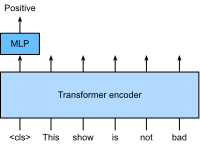
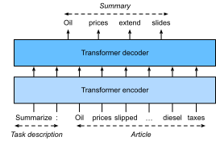
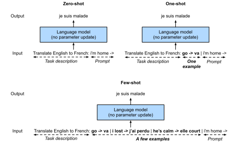

# Didelio masto išankstinis transformerių apmokymas
:label:`sec_large-pretraining-transformers`

Iki šiol mūsų vaizdų klasifikavimo ir mašininio vertimo eksperimentuose
modeliai būdavo apmokomi duomenų rinkiniuose su įvesties ir išvesties pavyzdžiais
*nuo nulio* konkrečioms užduotims atlikti.
Pavyzdžiui, transformeris buvo apmokytas
su anglų–prancūzų poromis (:numref:`sec_transformer`),
kad šis modelis galėtų išversti įvestą anglišką tekstą į prancūzų kalbą.
Dėl to kiekvienas modelis tampa *konkrečiu ekspertu*,
jautriu net nedideliam duomenų skirstinio pokyčiui
(:numref:`sec_environment-and-distribution-shift`).
Siekiant geriau apibendrinančių modelių ar net kompetentingesnių *universalistų*,
galinčių atlikti kelias užduotis su pritaikymu arba be jo,
vis labiau įprasta modelius *iš anksto apmokyti* dideliuose duomenyse.

Turint daugiau išankstinio apmokymo duomenų, transformerių architektūra
veikia geriau didėjant modelio dydžiui ir apmokymo skaičiavimams,
parodydama puikų *mastelio didinimo* (angl. *scaling*) elgesį.
Konkrečiai, transformeriais pagrįstų kalbos modelių našumas
didėja pagal laipsninį dėsnį su modelio parametrų kiekiu,
apmokymo teksto vienetų skaičiumi ir apmokymo skaičiavimais :cite:`kaplan2020scaling`.
Transformerių mastelio didinamumą taip pat patvirtina
gerokai padidėjęs našumas
didesnių regimųjų transformerių, apmokytų didesniuose duomenyse
(aptarta :numref:`sec_vision-transformer`).
Naujesni sėkmės pavyzdžiai apima „Gato“ – *universalų* modelį,
galintį žaisti „Atari“ žaidimus, aprašyti vaizdus, kalbėtis ir veikti kaip robotas :cite:`reed2022generalist`. „Gato“ yra vienas transformeris, gerai didinantis mastelį, kai iš anksto apmokomas įvairiomis modalybėmis,
įskaitant tekstą, vaizdus, sąnarių sukimo momentus ir mygtukų paspaudimus.
Pažymėtina, kad visi tokie daugiamodaliai duomenys serializuojami į plokščią teksto vienetų seką,
kurią transformeriai gali apdoroti panašiai kaip teksto vienetus (:numref:`sec_transformer`)
ar vaizdo fragmentus (:numref:`sec_vision-transformer`).

Prieš įtikinamą transformerių išankstinio apmokymo sėkmę daugiamodaliams duomenims,
transformeriai buvo plačiai iš anksto apmokomi su gausybe teksto.
Iš pradžių pasiūlyta mašininiam vertimui,
transformerių architektūra :numref:`fig_transformer`
susideda iš kodavimo bloko įvesties sekoms vaizduoti
ir dekodavimo bloko tikslo sekoms generuoti.
Iš esmės transformerius galima naudoti trimis skirtingais režimais:
*tik kodavimo blokas*, *kodavimo ir dekodavimo blokas* ir *tik dekodavimo blokas*.
Šio skyriaus pabaigoje apžvelgsime šiuos tris režimus
ir paaiškinsime mastelio didinamumą iš anksto apmokant transformerius.

## Tik kodavimo blokas

Kai naudojamas tik transformerio kodavimo blokas,
įvesties teksto vienetų seka paverčiama
tuo pačiu skaičiumi vaizdų,
kuriuos galima toliau projektuoti į išvestį
(pvz., klasifikavimą). Transformerio kodavimo blokas
sudarytas iš saviraiškės dėmesio sutelkimo transformacijos sluoksnių,
kuriuose visi įvesties teksto vienetai sutelkia dėmesį vienas į kitą.
Pavyzdžiui, :numref:`fig_vit` pavaizduoti regimieji transformeriai
yra tik kodavimo bloko, paverčiantys įvesties vaizdo fragmentų seką į
specialaus „&lt;cls&gt;“ teksto vieneto vaizdą.
Kadangi šis vaizdas priklauso nuo visų įvesties teksto vienetų,
jis toliau projektuojamas į klasifikavimo žymenis.
Šis dizainas buvo įkvėptas ankstesnio tik kodavimo bloko transformerio,
iš anksto apmokyto su tekstu: BERT (angl. *Bidirectional Encoder Representations from Transformers*) :cite:`Devlin.Chang.Lee.ea.2018`.

### BERT išankstinis apmokymas

:label:`fig_bert-encoder-only`

BERT iš anksto apmokomas teksto sekomis naudojant *maskuotą kalbos modeliavimą*:
įvesties tekstas su atsitiktinai užmaskuotais teksto vienetais paduodamas
į transformerio kodavimo bloką užmaskuotiems teksto vienetams prognozuoti.
Kaip iliustruota :numref:`fig_bert-encoder-only`,
originali teksto seka „I“, „love“, „this“, „red“, „car“
papildoma priekyje „&lt;cls&gt;“ teksto vienetu, o „&lt;mask&gt;“ teksto vienetas
atsitiktinai pakeičia „love“; tada išankstinio apmokymo metu minimizuojamas kryžminės entropijos nuostolis tarp užmaskuoto teksto vieneto „love“
ir jo prognozės.
Atkreipkite dėmesį, kad transformerio kodavimo blokų dėmesio šablone nėra apribojimų
(dešinėje :numref:`fig_bert-encoder-only`),
todėl visi teksto vienetai gali sutelkti dėmesį vienas į kitą.
Taigi „love“ prognozė priklauso nuo įvesties teksto vienetų prieš jį ir po jo sekoje.
Todėl BERT yra „dvikryptis kodavimo blokas“.
Nereikalaujant rankinio žymėjimo, BERT išankstiniam apmokymui galima naudoti
didelio masto tekstinius duomenis
iš knygų ir „Wikipedia“.

### BERT patikslinimas

Iš anksto apmokytą BERT galima *patikslinti* (angl. *fine-tune*) tolesnėms kodavimo užduotims, apimančioms pavienį tekstą ar teksto poras. Patikslinant prie BERT galima pridėti papildomų sluoksnių su atsitiktiniais parametrais: šie parametrai ir iš anksto apmokyti BERT parametrai bus *atnaujinami*, kad atitiktų tolesnių užduočių apmokymo duomenis.

:label:`fig_bert-finetune-classification`

:numref:`fig_bert-finetune-classification` iliustruoja
BERT patikslinimą nuotaikų analizei.
Transformerio kodavimo blokas yra iš anksto apmokytas BERT,
kuris kaip įvestį priima teksto seką
ir paduoda „&lt;cls&gt;“ vaizdą
(globalų įvesties vaizdą)
į papildomą pilnai sujungtą sluoksnį
nuotaikai prognozuoti.
Patikslinimo metu kryžminės entropijos nuostolis
tarp prognozės ir žymens
nuotaikų analizės duomenyse
minimizuojamas gradientiniais algoritmais,
kur papildomas sluoksnis apmokomas nuo nulio,
o iš anksto apmokyti BERT parametrai atnaujinami.
BERT gali daugiau nei nuotaikų analizę.
Bendrieji kalbos vaizdai, išmokti
350 milijonų parametrų BERT
iš 250 milijardų apmokymo teksto vienetų,
pagerino pažangiausius rezultatus natūraliosios kalbos užduotyse,
tokiose kaip pavienio teksto klasifikavimas,
teksto porų klasifikavimas ar regresija,
teksto žymėjimas ir atsakymas į klausimus.

Galite pastebėti, kad šios tolesnės užduotys apima teksto porų supratimą.
BERT išankstinis apmokymas turi dar vieną nuostolį, skirtą prognozuoti,
ar vienas sakinys iškart seka kitą.
Tačiau vėliau, iš anksto apmokant RoBERTa –
to paties dydžio BERT variantą – su 2000 milijardų teksto vienetų, buvo nustatyta, kad šis nuostolis mažiau naudingas :cite:`Liu.Ott.Goyal.ea.2019`.
Kiti BERT dariniai patobulino modelių architektūras ar išankstinio apmokymo tikslus,
pavyzdžiui, ALBERT (priverčiant dalytis parametrais) :cite:`lan2019albert`,
SpanBERT (vaizduojant ir prognozuojant teksto atkarpas) :cite:`joshi2020spanbert`,
DistilBERT (lengvas dėl žinių distiliavimo) :cite:`sanh2019distilbert`
ir ELECTRA (pakeistų teksto vienetų aptikimas) :cite:`clark2019electra`.
Be to, BERT įkvėpė transformerių išankstinį apmokymą kompiuterinėje regoje,
pavyzdžiui, regimuosius transformerius :cite:`Dosovitskiy.Beyer.Kolesnikov.ea.2021`,
Swin transformerius :cite:`liu2021swin`
ir MAE (maskuotus autoenkoderius) :cite:`he2022masked`.

## Kodavimo ir dekodavimo blokas

Kadangi transformerio kodavimo blokas paverčia įvesties teksto vienetų seką
tuo pačiu išvesties vaizdų skaičiumi,
tik kodavimo bloko režimas negali generuoti savavališko ilgio sekos, kaip mašininiame vertime.
Kaip iš pradžių pasiūlyta mašininiam vertimui,
transformerių architektūrą galima aprūpinti dekodavimo bloku,
kuris autoregresiškai prognozuoja savavališko ilgio tikslo seką
teksto vienetas po teksto vieneto,
sąlygodamas ir kodavimo bloko išvestimi, ir dekodavimo bloko išvestimi:
(i) sąlygojant kodavimo bloko išvestimi, kodavimo ir dekodavimo kryžminis dėmesio sutelkimas
(dekodavimo bloko lygiagreti dėmesio sutelkimo transformacija :numref:`fig_transformer`)
leidžia tikslo teksto vienetams sutelkti dėmesį į *visus* įvesties teksto vienetus;
(ii) sąlygojimas dekodavimo bloko išvestimi pasiekiamas
vadinamuoju *priežastiniu* dėmesio sutelkimu
(šis pavadinimas įprastas literatūroje, bet klaidinantis,
nes mažai susijęs su tikru priežastingumo tyrimu)
šablonu (dekodavimo bloko maskuota lygiagreti dėmesio sutelkimo transformacija :numref:`fig_transformer`),
kur bet kuris tikslo teksto vienetas gali sutelkti dėmesį tik į *praeities* ir *dabarties* tikslo sekos teksto vienetus.

Kad iš anksto apmokytume kodavimo ir dekodavimo transformerius, nepasitelkdami žmonių pažymėtų mašininio vertimo duomenų,
BART :cite:`lewis2019bart` ir T5 :cite:`raffel2020exploring`
yra du vienu metu pasiūlyti kodavimo ir dekodavimo transformeriai,
iš anksto apmokyti didelio masto tekstynuose.
Abu savo išankstinio apmokymo tiksluose bando atkurti originalų tekstą,
tačiau pirmasis pabrėžia įvesties triukšminimą
(pvz., maskavimą, šalinimą, permutaciją ir sukimą),
o antrasis išryškina daugiauzdavinio vienijimą
su išsamiais abliacijos tyrimais.

### T5 išankstinis apmokymas

Kaip iš anksto apmokyto transformerio kodavimo ir dekodavimo pavyzdys,
T5 (angl. *Text-to-Text Transfer Transformer*)
vienija daugelį užduočių į tą pačią teksto į tekstą problemą:
bet kuriai užduočiai kodavimo bloko įvestis yra užduoties aprašymas
(pvz., „Summarize“, „:“), po kurio eina užduoties įvestis
(pvz., straipsnio teksto vienetų seka),
o dekodavimo blokas prognozuoja užduoties išvestį
(pvz., teksto vienetų seką, apibendrinančią įvesties straipsnį).
Kad veiktų kaip tekstas į tekstą, T5 apmokomas
generuoti tam tikrą tikslo tekstą, sąlygotą įvesties teksto.

![Kairėje: T5 išankstinis apmokymas prognozuojant iš eilės einančias atkarpas. Originalus sakinys yra „I“, „love“, „this“, „red“, „car“, kur „love“ pakeistas specialiu „&lt;X&gt;“ teksto vienetu, o iš eilės einantys „red“, „car“ pakeisti specialiu „&lt;Y&gt;“ teksto vienetu. Tikslo seka baigiasi specialiu „&lt;Z&gt;“ teksto vienetu. Dešinėje: Dėmesio šablonas transformerio kodavimo ir dekodavimo bloke. Kodavimo bloko saviraiškėje dėmesio sutelkimo transformacijoje (apatinis kvadratas) visi įvesties teksto vienetai sutelkia dėmesį vienas į kitą; kodavimo ir dekodavimo kryžminiame dėmesio sutelkime (viršutinis stačiakampis) kiekvienas tikslo teksto vienetas sutelkia dėmesį į visus įvesties teksto vienetus; dekodavimo bloko saviraiškėje dėmesio sutelkimo transformacijoje (viršutinis trikampis) kiekvienas tikslo teksto vienetas sutelkia dėmesį tik į dabarties ir praeities tikslo teksto vienetus (priežastinis).](../img/t5-encoder-decoder.svg)
:label:`fig_t5-encoder-decoder`

Kad iš bet kurio originalaus teksto gautų įvestį ir išvestį,
T5 iš anksto apmokomas prognozuoti iš eilės einančias atkarpas.
Konkrečiai, teksto vienetai iš teksto atsitiktinai pakeičiami
specialiais teksto vienetais, kur kiekviena iš eilės einanti atkarpa
pakeičiama tuo pačiu specialiu teksto vienetu.
Apsvarstykime pavyzdį :numref:`fig_t5-encoder-decoder`,
kur originalus tekstas yra „I“, „love“, „this“, „red“, „car“.
Teksto vienetai „love“, „red“, „car“ atsitiktinai pakeičiami specialiais teksto vienetais.
Kadangi „red“ ir „car“ yra iš eilės einanti atkarpa,
jie pakeičiami tuo pačiu specialiu teksto vienetu.
Dėl to įvesties seka yra „I“, „&lt;X&gt;“, „this“, „&lt;Y&gt;“,
o tikslo seka yra
„&lt;X&gt;“, „love“, „&lt;Y&gt;“, „red“, „car“, „&lt;Z&gt;“,
kur „&lt;Z&gt;“ yra dar vienas specialus teksto vienetas, žymintis pabaigą.
Kaip parodyta :numref:`fig_t5-encoder-decoder`,
dekodavimo blokas turi priežastinį dėmesio šabloną, kad sekos prognozavimo metu
nesutelktų dėmesio į ateities teksto vienetus.

T5 iš eilės einančių atkarpų prognozavimas taip pat vadinamas
sugadinto teksto atkūrimu.
Su šiuo tikslu T5 iš anksto apmokomas
su 1000 milijardų teksto vienetų iš C4
(angl. *Colossal Clean Crawled Corpus*) duomenų,
kuriuos sudaro švarus anglų kalbos tekstas
iš interneto :cite:`raffel2020exploring`.

### T5 patikslinimas

Panašiai kaip BERT, T5 reikia patikslinti (atnaujinant T5 parametrus)
su konkrečiai užduočiai skirtais apmokymo duomenimis, kad ji būtų atlikta.
Pagrindiniai skirtumai nuo BERT patikslinimo:
(i) T5 įvestis apima užduočių aprašymus;
(ii) T5 gali generuoti savavališko ilgio sekas
su savo transformerio dekodavimo bloku;
(iii) nereikia papildomų sluoksnių.

:label:`fig_t5-finetune-summarization`

:numref:`fig_t5-finetune-summarization`
paaiškina T5 patikslinimą,
kaip pavyzdį naudojant teksto apibendrinimą.
Šioje tolesnėje užduotyje
užduoties aprašymo teksto vienetai „Summarize“, „:“,
po kurių eina straipsnio teksto vienetai, paduodami į kodavimo bloką.

Po patikslinimo 11 milijardų parametrų T5 (T5-11B)
pasiekė pažangiausius rezultatus keliuose kodavimo (pvz., klasifikavimo)
ir generavimo (pvz., apibendrinimo) lyginamuosiuose testuose.
Nuo išleidimo T5 buvo plačiai naudojamas vėlesniuose tyrimuose.
Pavyzdžiui, perjungiamieji (angl. *switch*) transformeriai suprojektuoti remiantis T5,
kad aktyvuotų parametrų pogrupį
geresniam skaičiavimo efektyvumui :cite:`fedus2022switch`.
Teksto į vaizdą modelyje „Imagen“
tekstas paduodamas į užšaldytą T5 kodavimo bloką (T5-XXL)
su 4,6 milijardo parametrų :cite:`saharia2022photorealistic`.
Fotorealistiški teksto į vaizdą pavyzdžiai :numref:`fig_imagen`
rodo, kad vien T5 kodavimo blokas gali veiksmingai
vaizduoti tekstą net be patikslinimo.

:width:`700px`
:label:`fig_imagen`

## Tik dekodavimo blokas

Apžvelgėme tik kodavimo bloko ir kodavimo ir dekodavimo transformerius.
Alternatyviai, tik dekodavimo bloko transformeriai
pašalina visą kodavimo bloką ir dekodavimo bloko porsluoksnį
su kodavimo ir dekodavimo kryžminiu dėmesio sutelkimu
iš originalios kodavimo ir dekodavimo architektūros,
pavaizduotos :numref:`fig_transformer`.
Šiandien tik dekodavimo bloko transformeriai yra *de facto* architektūra
didelio masto kalbos modeliavime (:numref:`sec_language-model`),
kuris per saviraišką mokymąsi naudoja pasaulio gausius nepažymėtus tekstynus.

### GPT ir GPT-2

Naudodamas kalbos modeliavimą kaip apmokymo tikslą,
GPT (angl. *generative pre-training*) modelis
pasirenka transformerio dekodavimo bloką
kaip savo pagrindą :cite:`Radford.Narasimhan.Salimans.ea.2018`.

:label:`fig_gpt-decoder-only`

Laikydamasi autoregresinio kalbos modelio apmokymo,
aprašyto :numref:`subsec_partitioning-seqs`,
:numref:`fig_gpt-decoder-only` iliustruoja
GPT išankstinį apmokymą su transformerio kodavimo bloku,
kur tikslo seka yra įvesties seka, pastumta vienu teksto vienetu.
Atkreipkite dėmesį, kad dėmesio šablonas transformerio dekodavimo bloke
užtikrina, kad kiekvienas teksto vienetas gali sutelkti dėmesį tik į savo praeities teksto vienetus
(į ateities teksto vienetus negalima sutelkti dėmesio, nes jie dar nepasirinkti).

GPT turi 100 milijonų parametrų ir turi būti
patikslintas atskiroms tolesnėms užduotims.
Daug didesnis transformerio dekodavimo bloko kalbos modelis,
GPT-2, buvo pristatytas po metų :cite:`Radford.Wu.Child.ea.2019`.
Palyginti su originaliu transformerio dekodavimo bloku GPT, GPT-2 buvo pritaikyta išankstinė normalizacija
(aptarta :numref:`subsec_vit-encoder`)
ir patobulintas inicializavimas bei svorių mastelio keitimas.
Iš anksto apmokytas su 40 GB teksto, 1,5 milijardo parametrų
GPT-2 pasiekė pažangiausius rezultatus kalbos modeliavimo lyginamuosiuose testuose
ir daug žadančius rezultatus keliose kitose užduotyse
*neatnaujinant parametrų ar architektūros*.

### GPT-3 ir toliau

GPT-2 parodė potencialą naudoti tą patį kalbos modelį
kelioms užduotims be modelio atnaujinimo.
Tai skaičiavimo požiūriu efektyviau nei patikslinimas,
kuriam reikia modelio atnaujinimų per gradientų skaičiavimą.

:label:`fig_gpt-3-xshot`

Prieš aiškindami skaičiavimo požiūriu efektyvesnį
kalbos modelių naudojimą be parametrų atnaujinimo,
prisiminkite iš :numref:`sec_rnn-scratch`, kad kalbos modelį
galima apmokyti generuoti teksto seką,
sąlygotą tam tikros priešdėlio teksto sekos.
Taigi iš anksto apmokytas kalbos modelis gali sugeneruoti užduoties išvestį
kaip seką *be parametrų atnaujinimo*,
sąlygotą įvesties sekos su užduoties aprašymu,
konkrečiai užduočiai skirtais įvesties ir išvesties pavyzdžiais ir užklausa (užduoties įvestimi).
Ši mokymosi paradigma vadinama *kontekstiniu mokymusi* (angl. *in-context learning*) :cite:`brown2020language`,
kurį galima toliau skirstyti
į *nulinio pavyzdžio* (angl. *zero-shot*), *vieno pavyzdžio* (angl. *one-shot*) ir *kelių pavyzdžių* (angl. *few-shot*),
kai konkrečiai užduočiai skirtų įvesties ir išvesties pavyzdžių nėra, yra vienas ir yra keli (:numref:`fig_gpt-3-xshot`).

:width:`400px`
:label:`fig_gpt3-xshot-scaling`

Šios trys nuostatos buvo išbandytos GPT-3 :cite:`brown2020language`,
kurio didžiausia versija naudoja duomenis ir modelio dydį,
maždaug dviem eilėmis didesnius nei GPT-2.
GPT-3 naudoja tą pačią transformerio dekodavimo bloko architektūrą
kaip tiesioginis pirmtakas GPT-2,
tik dėmesio šablonai
(dešinėje :numref:`fig_gpt-decoder-only`)
yra retesni kas antrame sluoksnyje.
Iš anksto apmokytas su 300 milijardų teksto vienetų,
GPT-3 veikia geriau su didesniu modelio dydžiu,
kur kelių pavyzdžių našumas didėja sparčiausiai (:numref:`fig_gpt3-xshot-scaling`).

Vėlesnis GPT-4 modelis savo ataskaitoje visiškai neatskleidė techninių detalių :cite:`openai2023gpt4`.
Priešingai nei jo pirmtakai, GPT-4
yra didelio masto daugiamodalis modelis, galintis
priimti ir tekstą, ir vaizdus kaip įvestį
ir generuoti teksto išvestį.

## Mastelio didinamumas

:numref:`fig_gpt3-xshot-scaling` empiriškai parodo transformerių
mastelio didinamumą GPT-3 kalbos modelyje.
Kalbos modeliavimui išsamesni empiriniai tyrimai
apie transformerių mastelio didinamumą paskatino tyrėjus įžvelgti perspektyvą
apmokyti didesnius transformerius su daugiau duomenų ir skaičiavimų :cite:`kaplan2020scaling`.

:width:`700px`
:label:`fig_scaling-power-law3`

Kaip parodyta :numref:`fig_scaling-power-law3`,
*laipsninio dėsnio mastelio didinamumas* gali būti stebimas našume
modelio dydžio atžvilgiu (parametrų skaičius, neįskaitant įterpimo sluoksnių),
duomenų rinkinio dydžio (apmokymo teksto vienetų skaičius)
ir apmokymo skaičiavimų kiekio (PetaFLOP/s-dienos, neįskaitant įterpimo sluoksnių).
Apskritai visų šių trijų veiksnių didinimas kartu lemia geresnį našumą.
Tačiau *kaip* juos didinti kartu
vis dar yra diskusijų klausimas :cite:`hoffmann2022training`.

:width:`700px`
:label:`fig_scaling-sample-conv`

Be geresnio našumo, dideli modeliai taip pat pasižymi geresniu pavyzdžių efektyvumu nei maži modeliai. :numref:`fig_scaling-sample-conv` rodo, kad dideliems modeliams reikia mažiau apmokymo pavyzdžių (apdorotų teksto vienetų), kad veiktų tuo pačiu lygiu, kurį pasiekia maži modeliai, o našumas glaudžiai didėja su skaičiavimais.

:width:`250px`
:label:`fig_scaling-gpt3`

Empiriniai mastelio didinimo elgesiai, aprašyti :citet:`kaplan2020scaling`, buvo patikrinti vėlesniuose dideliuose transformerių modeliuose. Pavyzdžiui, GPT-3 palaikė šią hipotezę dar dviem eilėmis :numref:`fig_scaling-gpt3`.

## Dideli kalbos modeliai

Transformerių mastelio didinamumas GPT serijoje įkvėpė vėlesnius didelius kalbos modelius.
GPT-2 transformerio dekodavimo blokas buvo naudotas apmokant 530 milijardų parametrų „Megatron-Turing NLG“ :cite:`smith2022using` su 270 milijardų apmokymo teksto vienetų. Laikydamasis GPT-2 dizaino, 280 milijardų parametrų „Gopher“ :cite:`rae2021scaling`, iš anksto apmokytas su 300 milijardų teksto vienetų, konkurencingai veikė įvairiose užduotyse.
Paveldėdamas tą pačią architektūrą ir naudodamas tą patį „Gopher“ skaičiavimo biudžetą, „Chinchilla“ :cite:`hoffmann2022training` yra gerokai mažesnis (70 milijardų parametrų) modelis, kuris apmokomas daug ilgiau (1,4 trilijono apmokymo teksto vienetų), daugelyje užduočių pranokstantis „Gopher“, ir daugiau dėmesio skiriantis teksto vienetų skaičiui nei parametrų skaičiui.
Siekiant tęsti kalbos modeliavimo mastelio didinimo liniją,
PaLM (angl. *Pathway Language Model*) :cite:`chowdhery2022palm`, 540 milijardų parametrų transformerio dekodavimo blokas su modifikuotais dizainais, iš anksto apmokytas su 780 milijardų teksto vienetų, pranoko vidutinį žmogaus našumą BIG-Bench lyginamajame teste :cite:`srivastava2022beyond`. Vėlesnė jo versija PaLM 2 :cite:`anil2023palm` didino duomenis ir modelį maždaug santykiu 1:1 ir pagerino daugiakalbes bei samprotavimo galimybes.
Kiti dideli kalbos modeliai, tokie kaip „Minerva“ :cite:`lewkowycz2022solving`, toliau apmokantis universalų modelį (PaLM), ir „Galactica“ :cite:`taylor2022galactica`, neapmokytas bendrame tekstyne, parodė daug žadančius kiekybinio ir mokslinio samprotavimo gebėjimus.

Atvirojo kodo leidimai, tokie kaip OPT (angl. *Open Pretrained Transformers*) :cite:`zhang2022opt`, BLOOM :cite:` scao2022bloom` ir FALCON :cite:`penedo2023refinedweb`,
demokratizavo didelių kalbos modelių tyrimus ir naudojimą.
Daugiausia dėmesio skirdamas skaičiavimo efektyvumui išvedimo metu,
atvirojo kodo „Llama 1“ :cite:`touvron2023llama` pranoko daug didesnius modelius, apmokydamas juos su daugiau teksto vienetų, nei buvo įprasta naudoti. Atnaujintas „Llama 2“ :cite:`touvron2023llama2` dar 40 % padidino išankstinio apmokymo tekstyną, o tai lėmė produktų modelius, kurie gali prilygti konkurencingų uždarojo kodo modelių našumui.

:citet:`wei2022emergent` aptarė didelių kalbos modelių išryškėjančias (angl. *emergent*) galimybes, esančias didesniuose modeliuose, bet nesančias mažesniuose.
Tačiau vien modelio dydžio didinimas savaime nepadaro modelių geriau besilaikančių žmogaus nurodymų.
:citet:`wei2021finetuned,sanh2021multitask` nustatė, kad didelių kalbos modelių patikslinimas
įvairiuose duomenų rinkiniuose, aprašytuose per *nurodymus*,
gali pagerinti nulinio pavyzdžio našumą neregėtose užduotyse.
Naudodami *skatinamąjį mokymąsi iš žmogaus grįžtamojo ryšio*,
:citet:`ouyang2022training` patikslino GPT-3,
kad jis laikytųsi įvairių nurodymų.
Po gauto „InstructGPT“, kuris
suderina kalbos modelius su žmogaus ketinimais
per patikslinimą :cite:`ouyang2022training`,
[ChatGPT](https://chat.openai.com/)
gali generuoti žmogiškus atsakymus (pvz., kodo derinimą ir kūrybinį rašymą)
remdamasis pokalbiais su žmonėmis
ir gali atlikti daugelį natūraliosios kalbos apdorojimo
užduočių nulinio pavyzdžio režimu :cite:`qin2023chatgpt`.
:citet:`bai2022constitutional` pakeitė žmogaus įvestis (pvz., žmonių pažymėtus duomenis) modelių išvestimis,
kad iš dalies automatizuotų nurodymų derinimo procesą, kuris taip pat žinomas kaip *skatinamasis mokymasis iš DI grįžtamojo ryšio*.

Dideli kalbos modeliai suteikia įdomią perspektyvą
formuluoti teksto įvestį, kad modeliai atliktų norimas užduotis per kontekstinį mokymąsi,
kuris taip pat žinomas kaip *skatinimas* (angl. *prompting*).
Pažymėtina,
*minčių grandinės skatinimas* (angl. *chain-of-thought prompting*) :cite:`wei2022chain`,
kontekstinio mokymosi metodas
su kelių pavyzdžių „klausimas, tarpiniai samprotavimo žingsniai, atsakymas“ demonstracijomis,
išgauna sudėtingas didelių kalbos modelių samprotavimo galimybes,
kad būtų išspręstos matematinio, sveiko proto ir simbolinio samprotavimo užduotys.
Kelių samprotavimo kelių ėmimas :cite:`wang2023self`, kelių pavyzdžių demonstracijų įvairinimas :cite:`zhang2023automatic`
ir sudėtingų problemų suvedimas į pogrupes problemas :cite:`zhou2023least`
gali pagerinti samprotavimo tikslumą. Iš tiesų, su paprastomis užklausomis, tokiomis kaip „Let's think step by step“ prieš kiekvieną atsakymą,
dideli kalbos modeliai gali net atlikti *nulinio pavyzdžio*
minčių grandinės samprotavimą su pakankamu tikslumu :cite:`kojima2022large`.
Net daugiamodalėms įvestims, sudarytoms ir iš teksto, ir iš vaizdų,
kalbos modeliai gali atlikti daugiamodalį minčių grandinės samprotavimą didesniu tikslumu nei naudojant vien teksto įvestį :cite:`zhang2023multicot`.

## Santrauka ir diskusija

Transformeriai buvo iš anksto apmokyti kaip tik kodavimo bloko (pvz., BERT), kodavimo ir dekodavimo bloko (pvz., T5) ir tik dekodavimo bloko (pvz., GPT serija). Iš anksto apmokyti modeliai gali būti pritaikyti skirtingoms užduotims atlikti su modelio atnaujinimu (pvz., patikslinimu) arba be jo (pvz., kelių pavyzdžių). Transformerių mastelio didinamumas rodo, kad geresnis našumas gaunamas iš didesnių modelių, daugiau apmokymo duomenų ir daugiau apmokymo skaičiavimų. Kadangi transformeriai pirmiausia buvo suprojektuoti ir iš anksto apmokyti tekstiniams duomenims, šis skyrelis šiek tiek krypsta į natūraliosios kalbos apdorojimą. Vis dėlto aukščiau aptarti modeliai dažnai randami naujesniuose modeliuose įvairiomis modalybėmis. Pavyzdžiui,
(i) „Chinchilla“ :cite:`hoffmann2022training` buvo toliau išplėstas iki „Flamingo“ :cite:`alayrac2022flamingo` – regimojo kalbos modelio mokymuisi iš kelių pavyzdžių;
(ii) GPT-2 :cite:`Radford.Wu.Child.ea.2019` ir regimasis transformeris koduoja tekstą ir vaizdus CLIP (angl. *Contrastive Language-Image Pre-training*) :cite:`radford2021learning`, kurio vaizdų ir teksto įterpiniai vėliau buvo pritaikyti DALL-E 2 teksto į vaizdą sistemoje :cite:`ramesh2022hierarchical`. Nors sisteminių transformerių mastelio didinamumo tyrimų daugiamodaliame išankstiniame apmokyme dar nėra, vien transformerių teksto į vaizdą modelis „Parti“ :cite:`yu2022scaling` rodo mastelio didinamumo potencialą per modalybes:
didesnis „Parti“ geriau geba generuoti didelio tikslumo vaizdus ir suprasti turiningą tekstą (:numref:`fig_parti`).

:width:`700px`
:label:`fig_parti`

## Pratimai

1. Ar įmanoma patikslinti T5 naudojant minirinkinį, sudarytą iš skirtingų užduočių? Kodėl taip arba kodėl ne? O kaip dėl GPT-2?
1. Turint galingą kalbos modelį, kokius taikymus galite sugalvoti?
1. Tarkime, kad jūsų prašoma patikslinti kalbos modelį, kad jis atliktų teksto klasifikavimą, pridedant papildomų sluoksnių. Kur juos pridėtumėte? Kodėl?
1. Apsvarstykite sekos į seką problemas (pvz., mašininį vertimą), kuriose įvesties seka visada pasiekiama viso tikslo sekos prognozavimo metu. Kokie galėtų būti modeliavimo tik dekodavimo bloko transformeriais apribojimai? Kodėl?

[Diskusijos](https://discuss.d2l.ai/t/9232)
