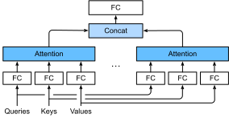

```{.python .input}
%load_ext d2lbook.tab
tab.interact_select('mxnet', 'pytorch', 'tensorflow', 'jax')
```

# Lygiagreti dėmesio sutelkimo transformacija
:label:`sec_multihead-attention`


Praktikoje, turint tą pačią užklausų, raktų ir reikšmių aibę, galime norėti, kad mūsų modelis derintų žinias iš
skirtingų to paties dėmesio sutelkimo mechanizmo elgesių,
pavyzdžiui, užfiksuotų skirtingo nuotolio priklausomybes
(pvz., trumpesnio ir ilgesnio nuotolio) sekoje.
Todėl gali būti naudinga leisti mūsų dėmesio sutelkimo mechanizmui kartu naudoti skirtingus užklausų, raktų ir reikšmių vaizdų poerdvius.


Šiuo tikslu užuot atlikus
vieną dėmesio sutelkimą,
užklausas, raktus ir reikšmes
galima transformuoti
$h$ nepriklausomai išmoktų tiesinių projekcijų.
Tada šios $h$ suprojektuotų užklausų, raktų ir reikšmių
paduodamos į dėmesio sutelkimą lygiagrečiai.
Galiausiai
$h$ dėmesio sutelkimo išvesčių
sujungiamos ir
transformuojamos dar viena išmokta tiesine projekcija,
kad būtų gauta galutinė išvestis.
Šis dizainas
vadinamas *lygiagrečia dėmesio sutelkimo transformacija* (angl. *multi-head attention*),
kur kiekviena iš $h$ dėmesio sutelkimo išvesčių
yra *vienetas* (angl. *head*) :cite:`Vaswani.Shazeer.Parmar.ea.2017`.
Naudodama pilnai sujungtus sluoksnius
išmokstamoms tiesinėms transformacijoms atlikti,
:numref:`fig_multi-head-attention`
aprašo lygiagrečią dėmesio sutelkimo transformaciją.


:label:`fig_multi-head-attention`

```{.python .input}
%%tab mxnet
from d2l import mxnet as d2l
import math
from mxnet import autograd, np, npx
from mxnet.gluon import nn
npx.set_np()
```

```{.python .input}
%%tab pytorch
from d2l import torch as d2l
import math
import torch
from torch import nn
```

```{.python .input}
%%tab tensorflow
from d2l import tensorflow as d2l
import tensorflow as tf
```

```{.python .input}
%%tab jax
from d2l import jax as d2l
from flax import linen as nn
from jax import numpy as jnp
import jax
```

## Modelis

Prieš pateikdami lygiagrečios dėmesio sutelkimo transformacijos įgyvendinimą,
formalizuokime šį modelį matematiškai.
Duotai užklausai $\mathbf{q} \in \mathbb{R}^{d_q}$,
raktui $\mathbf{k} \in \mathbb{R}^{d_k}$
ir reikšmei $\mathbf{v} \in \mathbb{R}^{d_v}$
kiekvienas dėmesio sutelkimo vienetas $\mathbf{h}_i$  ($i = 1, \ldots, h$)
apskaičiuojamas kaip

$$\mathbf{h}_i = f(\mathbf W_i^{(q)}\mathbf q, \mathbf W_i^{(k)}\mathbf k,\mathbf W_i^{(v)}\mathbf v) \in \mathbb R^{p_v},$$

kur
$\mathbf W_i^{(q)}\in\mathbb R^{p_q\times d_q}$,
$\mathbf W_i^{(k)}\in\mathbb R^{p_k\times d_k}$
ir $\mathbf W_i^{(v)}\in\mathbb R^{p_v\times d_v}$
yra mokomi parametrai, o
$f$ yra dėmesio sutelkimas,
pavyzdžiui,
adityvinis dėmesys ir mastelio keičiamos skaliarinės sandaugos dėmesys
:numref:`sec_attention-scoring-functions`.
Lygiagrečios dėmesio sutelkimo transformacijos išvestis
yra dar viena tiesinė transformacija per
mokomus parametrus
$\mathbf W_o\in\mathbb R^{p_o\times h p_v}$
iš $h$ vienetų sujungimo:

$$\mathbf W_o \begin{bmatrix}\mathbf h_1\\\vdots\\\mathbf h_h\end{bmatrix} \in \mathbb{R}^{p_o}.$$

Remiantis šiuo dizainu, kiekvienas vienetas gali sutelkti dėmesį
į skirtingas įvesties dalis.
Galima išreikšti sudėtingesnes funkcijas
nei paprastas svertinis vidurkis.

## Įgyvendinimas

Savo įgyvendinime
[**kiekvienam lygiagrečios dėmesio sutelkimo transformacijos vienetui
pasirenkame mastelio keičiamos skaliarinės sandaugos dėmesį**].
Kad išvengtume reikšmingo skaičiavimo kainos ir parametrizavimo kainos augimo,
nustatome $p_q = p_k = p_v = p_o / h$.
Atkreipkite dėmesį, kad $h$ vienetų galima apskaičiuoti lygiagrečiai,
jei užklausos, rakto ir reikšmės
tiesinių transformacijų išvesčių skaičių
nustatome į $p_q h = p_k h = p_v h = p_o$.
Toliau pateiktame įgyvendinime
$p_o$ nurodomas per argumentą `num_hiddens`.

```{.python .input}
%%tab mxnet
class MultiHeadAttention(d2l.Module):  #@save
    """Multi-head attention."""
    def __init__(self, num_hiddens, num_heads, dropout, use_bias=False,
                 **kwargs):
        super().__init__()
        self.num_heads = num_heads
        self.attention = d2l.DotProductAttention(dropout)
        self.W_q = nn.Dense(num_hiddens, use_bias=use_bias, flatten=False)
        self.W_k = nn.Dense(num_hiddens, use_bias=use_bias, flatten=False)
        self.W_v = nn.Dense(num_hiddens, use_bias=use_bias, flatten=False)
        self.W_o = nn.Dense(num_hiddens, use_bias=use_bias, flatten=False)

    def forward(self, queries, keys, values, valid_lens):
        # Shape of queries, keys, or values:
        # (batch_size, no. of queries or key-value pairs, num_hiddens)
        # Shape of valid_lens: (batch_size,) or (batch_size, no. of queries)
        # After transposing, shape of output queries, keys, or values:
        # (batch_size * num_heads, no. of queries or key-value pairs,
        # num_hiddens / num_heads)
        queries = self.transpose_qkv(self.W_q(queries))
        keys = self.transpose_qkv(self.W_k(keys))
        values = self.transpose_qkv(self.W_v(values))

        if valid_lens is not None:
            # On axis 0, copy the first item (scalar or vector) for num_heads
            # times, then copy the next item, and so on
            valid_lens = valid_lens.repeat(self.num_heads, axis=0)

        # Shape of output: (batch_size * num_heads, no. of queries,
        # num_hiddens / num_heads)
        output = self.attention(queries, keys, values, valid_lens)
        
        # Shape of output_concat: (batch_size, no. of queries, num_hiddens)
        output_concat = self.transpose_output(output)
        return self.W_o(output_concat)
```

```{.python .input}
%%tab pytorch
class MultiHeadAttention(d2l.Module):  #@save
    """Multi-head attention."""
    def __init__(self, num_hiddens, num_heads, dropout, bias=False, **kwargs):
        super().__init__()
        self.num_heads = num_heads
        self.attention = d2l.DotProductAttention(dropout)
        self.W_q = nn.LazyLinear(num_hiddens, bias=bias)
        self.W_k = nn.LazyLinear(num_hiddens, bias=bias)
        self.W_v = nn.LazyLinear(num_hiddens, bias=bias)
        self.W_o = nn.LazyLinear(num_hiddens, bias=bias)

    def forward(self, queries, keys, values, valid_lens):
        # Shape of queries, keys, or values:
        # (batch_size, no. of queries or key-value pairs, num_hiddens)
        # Shape of valid_lens: (batch_size,) or (batch_size, no. of queries)
        # After transposing, shape of output queries, keys, or values:
        # (batch_size * num_heads, no. of queries or key-value pairs,
        # num_hiddens / num_heads)
        queries = self.transpose_qkv(self.W_q(queries))
        keys = self.transpose_qkv(self.W_k(keys))
        values = self.transpose_qkv(self.W_v(values))

        if valid_lens is not None:
            # On axis 0, copy the first item (scalar or vector) for num_heads
            # times, then copy the next item, and so on
            valid_lens = torch.repeat_interleave(
                valid_lens, repeats=self.num_heads, dim=0)

        # Shape of output: (batch_size * num_heads, no. of queries,
        # num_hiddens / num_heads)
        output = self.attention(queries, keys, values, valid_lens)
        # Shape of output_concat: (batch_size, no. of queries, num_hiddens)
        output_concat = self.transpose_output(output)
        return self.W_o(output_concat)
```

```{.python .input}
%%tab tensorflow
class MultiHeadAttention(d2l.Module):  #@save
    """Multi-head attention."""
    def __init__(self, key_size, query_size, value_size, num_hiddens,
                 num_heads, dropout, bias=False, **kwargs):
        super().__init__()
        self.num_heads = num_heads
        self.attention = d2l.DotProductAttention(dropout)
        self.W_q = tf.keras.layers.Dense(num_hiddens, use_bias=bias)
        self.W_k = tf.keras.layers.Dense(num_hiddens, use_bias=bias)
        self.W_v = tf.keras.layers.Dense(num_hiddens, use_bias=bias)
        self.W_o = tf.keras.layers.Dense(num_hiddens, use_bias=bias)
    
    def call(self, queries, keys, values, valid_lens, **kwargs):
        # Shape of queries, keys, or values:
        # (batch_size, no. of queries or key-value pairs, num_hiddens)
        # Shape of valid_lens: (batch_size,) or (batch_size, no. of queries)
        # After transposing, shape of output queries, keys, or values:
        # (batch_size * num_heads, no. of queries or key-value pairs,
        # num_hiddens / num_heads)
        queries = self.transpose_qkv(self.W_q(queries))
        keys = self.transpose_qkv(self.W_k(keys))
        values = self.transpose_qkv(self.W_v(values))
        
        if valid_lens is not None:
            # On axis 0, copy the first item (scalar or vector) for num_heads
            # times, then copy the next item, and so on
            valid_lens = tf.repeat(valid_lens, repeats=self.num_heads, axis=0)
            
        # Shape of output: (batch_size * num_heads, no. of queries,
        # num_hiddens / num_heads)
        output = self.attention(queries, keys, values, valid_lens, **kwargs)
        
        # Shape of output_concat: (batch_size, no. of queries, num_hiddens)
        output_concat = self.transpose_output(output)
        return self.W_o(output_concat)
```

```{.python .input}
%%tab jax
class MultiHeadAttention(nn.Module):  #@save
    num_hiddens: int
    num_heads: int
    dropout: float
    bias: bool = False

    def setup(self):
        self.attention = d2l.DotProductAttention(self.dropout)
        self.W_q = nn.Dense(self.num_hiddens, use_bias=self.bias)
        self.W_k = nn.Dense(self.num_hiddens, use_bias=self.bias)
        self.W_v = nn.Dense(self.num_hiddens, use_bias=self.bias)
        self.W_o = nn.Dense(self.num_hiddens, use_bias=self.bias)

    @nn.compact
    def __call__(self, queries, keys, values, valid_lens, training=False):
        # Shape of queries, keys, or values:
        # (batch_size, no. of queries or key-value pairs, num_hiddens)
        # Shape of valid_lens: (batch_size,) or (batch_size, no. of queries)
        # After transposing, shape of output queries, keys, or values:
        # (batch_size * num_heads, no. of queries or key-value pairs,
        # num_hiddens / num_heads)
        queries = self.transpose_qkv(self.W_q(queries))
        keys = self.transpose_qkv(self.W_k(keys))
        values = self.transpose_qkv(self.W_v(values))

        if valid_lens is not None:
            # On axis 0, copy the first item (scalar or vector) for num_heads
            # times, then copy the next item, and so on
            valid_lens = jnp.repeat(valid_lens, self.num_heads, axis=0)

        # Shape of output: (batch_size * num_heads, no. of queries,
        # num_hiddens / num_heads)
        output, attention_weights = self.attention(
            queries, keys, values, valid_lens, training=training)
        # Shape of output_concat: (batch_size, no. of queries, num_hiddens)
        output_concat = self.transpose_output(output)
        return self.W_o(output_concat), attention_weights
```

Kad būtų galima [**lygiagrečiai skaičiuoti kelis vienetus**],
aukščiau pateikta klasė `MultiHeadAttention` naudoja du toliau apibrėžtus transponavimo metodus.
Konkrečiai,
metodas `transpose_output` atstato operaciją,
kurią atlieka metodas `transpose_qkv`.

```{.python .input}
%%tab mxnet
@d2l.add_to_class(MultiHeadAttention)  #@save
def transpose_qkv(self, X):
    """Transposition for parallel computation of multiple attention heads."""
    # Shape of input X: (batch_size, no. of queries or key-value pairs,
    # num_hiddens). Shape of output X: (batch_size, no. of queries or
    # key-value pairs, num_heads, num_hiddens / num_heads)
    X = X.reshape(X.shape[0], X.shape[1], self.num_heads, -1)
    # Shape of output X: (batch_size, num_heads, no. of queries or key-value
    # pairs, num_hiddens / num_heads)
    X = X.transpose(0, 2, 1, 3)
    # Shape of output: (batch_size * num_heads, no. of queries or key-value
    # pairs, num_hiddens / num_heads)
    return X.reshape(-1, X.shape[2], X.shape[3])

@d2l.add_to_class(MultiHeadAttention)  #@save
def transpose_output(self, X):
    """Reverse the operation of transpose_qkv."""
    X = X.reshape(-1, self.num_heads, X.shape[1], X.shape[2])
    X = X.transpose(0, 2, 1, 3)
    return X.reshape(X.shape[0], X.shape[1], -1)
```

```{.python .input}
%%tab pytorch
@d2l.add_to_class(MultiHeadAttention)  #@save
def transpose_qkv(self, X):
    """Transposition for parallel computation of multiple attention heads."""
    # Shape of input X: (batch_size, no. of queries or key-value pairs,
    # num_hiddens). Shape of output X: (batch_size, no. of queries or
    # key-value pairs, num_heads, num_hiddens / num_heads)
    X = X.reshape(X.shape[0], X.shape[1], self.num_heads, -1)
    # Shape of output X: (batch_size, num_heads, no. of queries or key-value
    # pairs, num_hiddens / num_heads)
    X = X.permute(0, 2, 1, 3)
    # Shape of output: (batch_size * num_heads, no. of queries or key-value
    # pairs, num_hiddens / num_heads)
    return X.reshape(-1, X.shape[2], X.shape[3])

@d2l.add_to_class(MultiHeadAttention)  #@save
def transpose_output(self, X):
    """Reverse the operation of transpose_qkv."""
    X = X.reshape(-1, self.num_heads, X.shape[1], X.shape[2])
    X = X.permute(0, 2, 1, 3)
    return X.reshape(X.shape[0], X.shape[1], -1)
```

```{.python .input}
%%tab tensorflow
@d2l.add_to_class(MultiHeadAttention)  #@save
def transpose_qkv(self, X):
    """Transposition for parallel computation of multiple attention heads."""
    # Shape of input X: (batch_size, no. of queries or key-value pairs,
    # num_hiddens). Shape of output X: (batch_size, no. of queries or
    # key-value pairs, num_heads, num_hiddens / num_heads)
    X = tf.reshape(X, shape=(X.shape[0], X.shape[1], self.num_heads, -1))
    # Shape of output X: (batch_size, num_heads, no. of queries or key-value
    # pairs, num_hiddens / num_heads)
    X = tf.transpose(X, perm=(0, 2, 1, 3))
    # Shape of output: (batch_size * num_heads, no. of queries or key-value
    # pairs, num_hiddens / num_heads)
    return tf.reshape(X, shape=(-1, X.shape[2], X.shape[3]))

@d2l.add_to_class(MultiHeadAttention)  #@save
def transpose_output(self, X):
    """Reverse the operation of transpose_qkv."""
    X = tf.reshape(X, shape=(-1, self.num_heads, X.shape[1], X.shape[2]))
    X = tf.transpose(X, perm=(0, 2, 1, 3))
    return tf.reshape(X, shape=(X.shape[0], X.shape[1], -1))
```

```{.python .input}
%%tab jax
@d2l.add_to_class(MultiHeadAttention)  #@save
def transpose_qkv(self, X):
    """Transposition for parallel computation of multiple attention heads."""
    # Shape of input X: (batch_size, no. of queries or key-value pairs,
    # num_hiddens). Shape of output X: (batch_size, no. of queries or
    # key-value pairs, num_heads, num_hiddens / num_heads)
    X = X.reshape((X.shape[0], X.shape[1], self.num_heads, -1))
    # Shape of output X: (batch_size, num_heads, no. of queries or key-value
    # pairs, num_hiddens / num_heads)
    X = jnp.transpose(X, (0, 2, 1, 3))
    # Shape of output: (batch_size * num_heads, no. of queries or key-value
    # pairs, num_hiddens / num_heads)
    return X.reshape((-1, X.shape[2], X.shape[3]))

@d2l.add_to_class(MultiHeadAttention)  #@save
def transpose_output(self, X):
    """Reverse the operation of transpose_qkv."""
    X = X.reshape((-1, self.num_heads, X.shape[1], X.shape[2]))
    X = jnp.transpose(X, (0, 2, 1, 3))
    return X.reshape((X.shape[0], X.shape[1], -1))
```

[**Išbandykime mūsų įgyvendintą**] klasę `MultiHeadAttention`
naudodami žaislinį pavyzdį, kuriame raktai ir reikšmės yra tos pačios.
Dėl to
lygiagrečios dėmesio sutelkimo transformacijos išvesties forma
yra (`batch_size`, `num_queries`, `num_hiddens`).

```{.python .input}
%%tab pytorch
num_hiddens, num_heads = 100, 5
attention = MultiHeadAttention(num_hiddens, num_heads, 0.5)
batch_size, num_queries, num_kvpairs = 2, 4, 6
valid_lens = d2l.tensor([3, 2])
X = d2l.ones((batch_size, num_queries, num_hiddens))
Y = d2l.ones((batch_size, num_kvpairs, num_hiddens))
d2l.check_shape(attention(X, Y, Y, valid_lens),
                (batch_size, num_queries, num_hiddens))
```

```{.python .input}
%%tab mxnet
num_hiddens, num_heads = 100, 5
attention = MultiHeadAttention(num_hiddens, num_heads, 0.5)
attention.initialize()
```

```{.python .input}
%%tab jax
num_hiddens, num_heads = 100, 5
attention = MultiHeadAttention(num_hiddens, num_heads, 0.5)
```

```{.python .input}
%%tab tensorflow
num_hiddens, num_heads = 100, 5
attention = MultiHeadAttention(num_hiddens, num_hiddens, num_hiddens,
                               num_hiddens, num_heads, 0.5)
```

```{.python .input}
%%tab mxnet
batch_size, num_queries, num_kvpairs = 2, 4, 6
valid_lens = d2l.tensor([3, 2])
X = d2l.ones((batch_size, num_queries, num_hiddens))
Y = d2l.ones((batch_size, num_kvpairs, num_hiddens))
d2l.check_shape(attention(X, Y, Y, valid_lens),
                (batch_size, num_queries, num_hiddens))
```

```{.python .input}
%%tab tensorflow
batch_size, num_queries, num_kvpairs = 2, 4, 6
valid_lens = d2l.tensor([3, 2])
X = tf.ones((batch_size, num_queries, num_hiddens))
Y = tf.ones((batch_size, num_kvpairs, num_hiddens))
d2l.check_shape(attention(X, Y, Y, valid_lens, training=False),
                (batch_size, num_queries, num_hiddens))
```

```{.python .input}
%%tab jax
batch_size, num_queries, num_kvpairs = 2, 4, 6
valid_lens = d2l.tensor([3, 2])
X = d2l.ones((batch_size, num_queries, num_hiddens))
Y = d2l.ones((batch_size, num_kvpairs, num_hiddens))
d2l.check_shape(attention.init_with_output(d2l.get_key(), X, Y, Y, valid_lens,
                                           training=False)[0][0],
                (batch_size, num_queries, num_hiddens))
```

## Santrauka

Lygiagreti dėmesio sutelkimo transformacija derina to paties dėmesio sutelkimo žinias
per skirtingus užklausų, raktų ir reikšmių vaizdų poerdvius.
Kad kelis lygiagrečios dėmesio sutelkimo transformacijos vienetus būtų galima apskaičiuoti lygiagrečiai,
reikia tinkamo tenzorių manipuliavimo.


## Pratimai

1. Vizualizuokite kelių vienetų dėmesio svorius šiame eksperimente.
1. Tarkime, kad turime apmokytą modelį, pagrįstą lygiagrečia dėmesio sutelkimo transformacija, ir norime išretinti (angl. *prune*) mažiau svarbius dėmesio sutelkimo vienetus, kad padidintume prognozavimo greitį. Kaip galime suprojektuoti eksperimentus dėmesio sutelkimo vieneto svarbai išmatuoti?

:begin_tab:`mxnet`
[Diskusijos](https://discuss.d2l.ai/t/1634)
:end_tab:

:begin_tab:`pytorch`
[Diskusijos](https://discuss.d2l.ai/t/1635)
:end_tab:

:begin_tab:`tensorflow`
[Diskusijos](https://discuss.d2l.ai/t/3869)
:end_tab:

:begin_tab:`jax`
[Diskusijos](https://discuss.d2l.ai/t/18029)
:end_tab:
