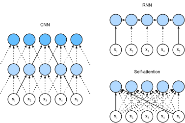

```{.python .input}
%load_ext d2lbook.tab
tab.interact_select('mxnet', 'pytorch', 'tensorflow', 'jax')
```

# Saviraiška dėmesio sutelkimo transformacija ir pozicinis kodavimas
:label:`sec_self-attention-and-positional-encoding`

Giliajame mokymesi sekoms koduoti dažnai naudojame CNN arba RNN.
Dabar, turėdami omenyje dėmesio sutelkimo mechanizmus,
įsivaizduokime, kad teksto vienetų seką paduodame
į dėmesio sutelkimo mechanizmą taip,
kad kiekviename žingsnyje
kiekvienas teksto vienetas turi savo užklausą, raktus ir reikšmes.
Čia, apskaičiuodamas teksto vieneto vaizdo reikšmę kitame sluoksnyje,
teksto vienetas gali sutelkti dėmesį (per savo užklausos vektorių) į bet kurį kitą teksto vienetą
(sutapatinant pagal jų raktų vektorius).
Naudodami visą užklausos ir rakto suderinamumo įverčių aibę,
galime apskaičiuoti kiekvieno teksto vieneto vaizdą,
sudarydami atitinkamą svertinę sumą
per kitus teksto vienetus.
Kadangi kiekvienas teksto vienetas sutelkia dėmesį į kiekvieną kitą teksto vienetą
(priešingai nei atveju, kai dekodavimo žingsniai sutelkia dėmesį į kodavimo žingsnius),
tokios architektūros paprastai apibūdinamos kaip *saviraiškės dėmesio sutelkimo transformacijos* (angl. *self-attention*) modeliai :cite:`Lin.Feng.Santos.ea.2017,Vaswani.Shazeer.Parmar.ea.2017`,
o kitur apibūdinamos kaip *vidinio dėmesio* (angl. *intra-attention*) modelis :cite:`Cheng.Dong.Lapata.2016,Parikh.Tackstrom.Das.ea.2016,Paulus.Xiong.Socher.2017`.
Šiame skyrelyje aptarsime sekų kodavimą naudojant saviraiškę dėmesio sutelkimo transformaciją,
įskaitant papildomos informacijos apie sekos tvarką naudojimą.

```{.python .input}
%%tab mxnet
from d2l import mxnet as d2l
import math
from mxnet import autograd, np, npx
from mxnet.gluon import nn
npx.set_np()
```

```{.python .input}
%%tab pytorch
from d2l import torch as d2l
import math
import torch
from torch import nn
```

```{.python .input}
%%tab tensorflow
from d2l import tensorflow as d2l
import numpy as np
import tensorflow as tf
```

```{.python .input}
%%tab jax
from d2l import jax as d2l
from flax import linen as nn
from jax import numpy as jnp
import jax
```

## [**Saviraiška dėmesio sutelkimo transformacija**]

Duotai įvesties teksto vienetų sekai
$\mathbf{x}_1, \ldots, \mathbf{x}_n$, kur bet kuris $\mathbf{x}_i \in \mathbb{R}^d$ ($1 \leq i \leq n$),
jos saviraiška dėmesio sutelkimo transformacija išveda
to paties ilgio seką
$\mathbf{y}_1, \ldots, \mathbf{y}_n$,
kur

$$\mathbf{y}_i = f(\mathbf{x}_i, (\mathbf{x}_1, \mathbf{x}_1), \ldots, (\mathbf{x}_n, \mathbf{x}_n)) \in \mathbb{R}^d$$

pagal dėmesio sutelkimo apibrėžimą
:eqref:`eq_attention_pooling`.
Naudodamas lygiagrečią dėmesio sutelkimo transformaciją,
toliau pateiktas kodo fragmentas
apskaičiuoja tenzoriaus saviraišką dėmesio sutelkimo transformaciją,
kurio forma (rinkinio dydis, laiko žingsnių skaičius arba sekos ilgis teksto vienetais, $d$).
Išvesties tenzorius turi tą pačią formą.

```{.python .input}
%%tab pytorch
num_hiddens, num_heads = 100, 5
attention = d2l.MultiHeadAttention(num_hiddens, num_heads, 0.5)
batch_size, num_queries, valid_lens = 2, 4, d2l.tensor([3, 2])
X = d2l.ones((batch_size, num_queries, num_hiddens))
d2l.check_shape(attention(X, X, X, valid_lens),
                (batch_size, num_queries, num_hiddens))
```

```{.python .input}
%%tab mxnet
num_hiddens, num_heads = 100, 5
attention = d2l.MultiHeadAttention(num_hiddens, num_heads, 0.5)
attention.initialize()
```

```{.python .input}
%%tab jax
num_hiddens, num_heads = 100, 5
attention = d2l.MultiHeadAttention(num_hiddens, num_heads, 0.5)
```

```{.python .input}
%%tab tensorflow
num_hiddens, num_heads = 100, 5
attention = d2l.MultiHeadAttention(num_hiddens, num_hiddens, num_hiddens,
                                   num_hiddens, num_heads, 0.5)
```

```{.python .input}
%%tab mxnet
batch_size, num_queries, valid_lens = 2, 4, d2l.tensor([3, 2])
X = d2l.ones((batch_size, num_queries, num_hiddens))
d2l.check_shape(attention(X, X, X, valid_lens),
                (batch_size, num_queries, num_hiddens))
```

```{.python .input}
%%tab tensorflow
batch_size, num_queries, valid_lens = 2, 4, tf.constant([3, 2])
X = tf.ones((batch_size, num_queries, num_hiddens))
d2l.check_shape(attention(X, X, X, valid_lens, training=False),
                (batch_size, num_queries, num_hiddens))
```

```{.python .input}
%%tab jax
batch_size, num_queries, valid_lens = 2, 4, d2l.tensor([3, 2])
X = d2l.ones((batch_size, num_queries, num_hiddens))
d2l.check_shape(attention.init_with_output(d2l.get_key(), X, X, X, valid_lens,
                                           training=False)[0][0],
                (batch_size, num_queries, num_hiddens))
```

## CNN, RNN ir saviraiškės dėmesio sutelkimo transformacijos palyginimas
:label:`subsec_cnn-rnn-self-attention`

Palyginkime architektūras, skirtas
$n$ teksto vienetų sekai atvaizduoti
į kitą tokio paties ilgio seką,
kur kiekvienas įvesties ar išvesties teksto vienetas vaizduojamas
$d$ matmenų vektoriumi.
Konkrečiai,
nagrinėsime CNN, RNN ir saviraišką dėmesio sutelkimo transformaciją.
Palyginsime jų
skaičiavimo sudėtingumą,
nuoseklias operacijas
ir didžiausius kelio ilgius.
Atkreipkite dėmesį, kad nuoseklios operacijos neleidžia lygiagretinti skaičiavimų,
o trumpesnis kelias tarp
bet kurio sekos pozicijų derinio
palengvina ilgo nuotolio priklausomybių sekoje mokymąsi :cite:`Hochreiter.Bengio.Frasconi.ea.2001`.



:label:`fig_cnn-rnn-self-attention`


Bet kurią teksto seką laikykime „vienmačiu vaizdu“. Panašiai vienmačiai CNN gali apdoroti lokalius požymius, tokius kaip $n$-gramos tekste.
Duotai $n$ ilgio sekai
apsvarstykime konvoliucinį sluoksnį, kurio branduolio dydis yra $k$,
o įvesties ir išvesties kanalų skaičius abu yra $d$.
Konvoliucinio sluoksnio skaičiavimo sudėtingumas yra $\mathcal{O}(knd^2)$.
Kaip rodo :numref:`fig_cnn-rnn-self-attention`,
CNN yra hierarchiniai,
todėl yra $\mathcal{O}(1)$ nuoseklių operacijų,
o didžiausias kelio ilgis yra $\mathcal{O}(n/k)$.
Pavyzdžiui, :numref:`fig_cnn-rnn-self-attention` $\mathbf{x}_1$ ir $\mathbf{x}_5$
patenka į dviejų sluoksnių CNN su 3 dydžio branduoliu
lokalią matymo sritį.

Atnaujinant RNN paslėptąją būseną,
$d \times d$ svorių matricos
ir $d$ matmenų paslėptosios būsenos daugyba turi
$\mathcal{O}(d^2)$ skaičiavimo sudėtingumą.
Kadangi sekos ilgis yra $n$,
rekurentinio sluoksnio skaičiavimo sudėtingumas
yra $\mathcal{O}(nd^2)$.
Pagal :numref:`fig_cnn-rnn-self-attention`
yra $\mathcal{O}(n)$ nuoseklių operacijų,
kurių negalima lygiagretinti,
o didžiausias kelio ilgis taip pat yra $\mathcal{O}(n)$.

Saviraiškėje dėmesio sutelkimo transformacijoje
užklausos, raktai ir reikšmės
yra visos $n \times d$ matricos.
Apsvarstykime mastelio keičiamos skaliarinės sandaugos dėmesį
:eqref:`eq_softmax_QK_V`,
kur $n \times d$ matrica dauginama iš
$d \times n$ matricos,
o tada gauta $n \times n$ išvesties matrica dauginama
iš $n \times d$ matricos.
Dėl to
saviraiškė dėmesio sutelkimo transformacija
turi $\mathcal{O}(n^2d)$ skaičiavimo sudėtingumą.
Kaip matome iš :numref:`fig_cnn-rnn-self-attention`,
kiekvienas teksto vienetas tiesiogiai sujungtas
su bet kuriuo kitu teksto vienetu per saviraišką dėmesio sutelkimo transformaciją.
Todėl
skaičiavimas gali būti lygiagretus su $\mathcal{O}(1)$ nuoseklių operacijų,
o didžiausias kelio ilgis taip pat yra $\mathcal{O}(1)$.

Apskritai
ir CNN, ir saviraiškė dėmesio sutelkimo transformacija leidžia lygiagretų skaičiavimą,
o saviraiškė dėmesio sutelkimo transformacija turi trumpiausią didžiausią kelio ilgį.
Tačiau kvadratinis skaičiavimo sudėtingumas sekos ilgio atžvilgiu
daro saviraišką dėmesio sutelkimo transformaciją nepriimtinai lėtą labai ilgoms sekoms.


## [**Pozicinis kodavimas**]
:label:`subsec_positional-encoding`


Skirtingai nei RNN, rekurentiškai apdorojantys
sekos teksto vienetus po vieną,
saviraiškė dėmesio sutelkimo transformacija atsisako
nuosekliųjų operacijų lygiagrečiojo skaičiavimo naudai.
Atkreipkite dėmesį, kad saviraiškė dėmesio sutelkimo transformacija pati savaime
nesaugo sekos tvarkos.
Ką daryti, jei tikrai svarbu,
kad modelis žinotų, kokia tvarka
atėjo įvesties seka?

Dominuojantis metodas informacijai apie teksto vienetų tvarką išsaugoti
yra tai pateikti modeliui
kaip papildomą įvestį, susietą
su kiekvienu teksto vienetu.
Šios įvestys vadinamos *poziciniais kodavimais*,
ir jie gali būti arba išmokti, arba nustatyti *a priori*.
Dabar aprašome paprastą fiksuotų pozicinių kodavimų schemą,
pagrįstą sinuso ir kosinuso funkcijomis :cite:`Vaswani.Shazeer.Parmar.ea.2017`.

Tarkime, kad įvesties vaizdas
$\mathbf{X} \in \mathbb{R}^{n \times d}$
turi $d$ matmenų įterpinius
$n$ sekos teksto vienetų.
Pozicinis kodavimas išveda
$\mathbf{X} + \mathbf{P}$,
naudodamas tos pačios formos pozicinių įterpinių matricą
$\mathbf{P} \in \mathbb{R}^{n \times d}$,
kurios elementas $i$-ojoje eilutėje
ir $(2j)$-ajame
arba $(2j + 1)$-ajame stulpelyje yra

$$\begin{aligned} p_{i, 2j} &= \sin\left(\frac{i}{10000^{2j/d}}\right),\\p_{i, 2j+1} &= \cos\left(\frac{i}{10000^{2j/d}}\right).\end{aligned}$$
:eqlabel:`eq_positional-encoding-def`

Iš pirmo žvilgsnio
šis trigonometrinių funkcijų
dizainas atrodo keistas.
Prieš paaiškindami šį dizainą,
pirmiausia įgyvendinkime jį toliau pateiktoje klasėje `PositionalEncoding`.

```{.python .input}
%%tab mxnet
class PositionalEncoding(nn.Block):  #@save
    """Positional encoding."""
    def __init__(self, num_hiddens, dropout, max_len=1000):
        super().__init__()
        self.dropout = nn.Dropout(dropout)
        # Create a long enough P
        self.P = d2l.zeros((1, max_len, num_hiddens))
        X = d2l.arange(max_len).reshape(-1, 1) / np.power(
            10000, np.arange(0, num_hiddens, 2) / num_hiddens)
        self.P[:, :, 0::2] = np.sin(X)
        self.P[:, :, 1::2] = np.cos(X)

    def forward(self, X):
        X = X + self.P[:, :X.shape[1], :].as_in_ctx(X.ctx)
        return self.dropout(X)
```

```{.python .input}
%%tab pytorch
class PositionalEncoding(nn.Module):  #@save
    """Positional encoding."""
    def __init__(self, num_hiddens, dropout, max_len=1000):
        super().__init__()
        self.dropout = nn.Dropout(dropout)
        # Create a long enough P
        self.P = d2l.zeros((1, max_len, num_hiddens))
        X = d2l.arange(max_len, dtype=torch.float32).reshape(
            -1, 1) / torch.pow(10000, torch.arange(
            0, num_hiddens, 2, dtype=torch.float32) / num_hiddens)
        self.P[:, :, 0::2] = torch.sin(X)
        self.P[:, :, 1::2] = torch.cos(X)

    def forward(self, X):
        X = X + self.P[:, :X.shape[1], :].to(X.device)
        return self.dropout(X)
```

```{.python .input}
%%tab tensorflow
class PositionalEncoding(tf.keras.layers.Layer):  #@save
    """Positional encoding."""
    def __init__(self, num_hiddens, dropout, max_len=1000):
        super().__init__()
        self.dropout = tf.keras.layers.Dropout(dropout)
        # Create a long enough P
        self.P = np.zeros((1, max_len, num_hiddens))
        X = np.arange(max_len, dtype=np.float32).reshape(
            -1,1)/np.power(10000, np.arange(
            0, num_hiddens, 2, dtype=np.float32) / num_hiddens)
        self.P[:, :, 0::2] = np.sin(X)
        self.P[:, :, 1::2] = np.cos(X)
        
    def call(self, X, **kwargs):
        X = X + self.P[:, :X.shape[1], :]
        return self.dropout(X, **kwargs)
```

```{.python .input}
%%tab jax
class PositionalEncoding(nn.Module):  #@save
    """Positional encoding."""
    num_hiddens: int
    dropout: float
    max_len: int = 1000

    def setup(self):
        # Create a long enough P
        self.P = d2l.zeros((1, self.max_len, self.num_hiddens))
        X = d2l.arange(self.max_len, dtype=jnp.float32).reshape(
            -1, 1) / jnp.power(10000, jnp.arange(
            0, self.num_hiddens, 2, dtype=jnp.float32) / self.num_hiddens)
        self.P = self.P.at[:, :, 0::2].set(jnp.sin(X))
        self.P = self.P.at[:, :, 1::2].set(jnp.cos(X))

    @nn.compact
    def __call__(self, X, training=False):
        # Flax sow API is used to capture intermediate variables
        self.sow('intermediates', 'P', self.P)
        X = X + self.P[:, :X.shape[1], :]
        return nn.Dropout(self.dropout)(X, deterministic=not training)
```

Pozicinių įterpinių matricoje $\mathbf{P}$
[**eilutės atitinka pozicijas sekoje,
o stulpeliai vaizduoja skirtingas pozicinio kodavimo dimensijas**].
Toliau pateiktame pavyzdyje
matome, kad
pozicinių įterpinių matricos $6$-asis ir $7$-asis
stulpeliai
turi aukštesnį dažnį nei
$8$-asis ir $9$-asis
stulpeliai.
Poslinkis tarp
$6$-ojo ir $7$-ojo (taip pat $8$-ojo ir $9$-ojo) stulpelių
atsiranda dėl sinuso ir kosinuso funkcijų kaitaliojimosi.

```{.python .input}
%%tab mxnet
encoding_dim, num_steps = 32, 60
pos_encoding = PositionalEncoding(encoding_dim, 0)
pos_encoding.initialize()
X = pos_encoding(np.zeros((1, num_steps, encoding_dim)))
P = pos_encoding.P[:, :X.shape[1], :]
d2l.plot(d2l.arange(num_steps), P[0, :, 6:10].T, xlabel='Row (position)',
         figsize=(6, 2.5), legend=["Col %d" % d for d in d2l.arange(6, 10)])
```

```{.python .input}
%%tab pytorch
encoding_dim, num_steps = 32, 60
pos_encoding = PositionalEncoding(encoding_dim, 0)
X = pos_encoding(d2l.zeros((1, num_steps, encoding_dim)))
P = pos_encoding.P[:, :X.shape[1], :]
d2l.plot(d2l.arange(num_steps), P[0, :, 6:10].T, xlabel='Row (position)',
         figsize=(6, 2.5), legend=["Col %d" % d for d in d2l.arange(6, 10)])
```

```{.python .input}
%%tab tensorflow
encoding_dim, num_steps = 32, 60
pos_encoding = PositionalEncoding(encoding_dim, 0)
X = pos_encoding(tf.zeros((1, num_steps, encoding_dim)), training=False)
P = pos_encoding.P[:, :X.shape[1], :]
d2l.plot(np.arange(num_steps), P[0, :, 6:10].T, xlabel='Row (position)',
         figsize=(6, 2.5), legend=["Col %d" % d for d in np.arange(6, 10)])
```

```{.python .input}
%%tab jax
encoding_dim, num_steps = 32, 60
pos_encoding = PositionalEncoding(encoding_dim, 0)
params = pos_encoding.init(d2l.get_key(), d2l.zeros((1, num_steps, encoding_dim)))
X, inter_vars = pos_encoding.apply(params, d2l.zeros((1, num_steps, encoding_dim)),
                                   mutable='intermediates')
P = inter_vars['intermediates']['P'][0]  # retrieve intermediate value P
P = P[:, :X.shape[1], :]
d2l.plot(d2l.arange(num_steps), P[0, :, 6:10].T, xlabel='Row (position)',
         figsize=(6, 2.5), legend=["Col %d" % d for d in d2l.arange(6, 10)])
```

### Absoliuti pozicinė informacija

Kad pamatytume, kaip monotoniškai mažėjantis dažnis
išilgai kodavimo dimensijos susijęs su absoliučia pozicine informacija,
išspausdinkime [**dvejetainius vaizdus**] skaičių $0, 1, \ldots, 7$.
Kaip matome, žemiausias bitas, antras žemiausias bitas
ir trečias žemiausias bitas keičiasi atitinkamai kas skaičių,
kas du skaičius ir kas keturis skaičius.

```{.python .input}
%%tab all
for i in range(8):
    print(f'{i} in binary is {i:>03b}')
```

Dvejetainiuose vaizduose aukštesnis bitas
turi žemesnį dažnį nei žemesnis bitas.
Panašiai, kaip parodyta toliau pateiktame šilumos žemėlapyje,
[**pozicinis kodavimas mažina
dažnius išilgai kodavimo dimensijos**],
naudodamas trigonometrines funkcijas.
Kadangi išvestys yra slankiojo kablelio skaičiai,
tokie tolydūs vaizdai
yra efektyvesni vietos požiūriu
nei dvejetainiai vaizdai.

```{.python .input}
%%tab mxnet
P = np.expand_dims(np.expand_dims(P[0, :, :], 0), 0)
d2l.show_heatmaps(P, xlabel='Column (encoding dimension)',
                  ylabel='Row (position)', figsize=(3.5, 4), cmap='Blues')
```

```{.python .input}
%%tab pytorch
P = P[0, :, :].unsqueeze(0).unsqueeze(0)
d2l.show_heatmaps(P, xlabel='Column (encoding dimension)',
                  ylabel='Row (position)', figsize=(3.5, 4), cmap='Blues')
```

```{.python .input}
%%tab tensorflow
P = tf.expand_dims(tf.expand_dims(P[0, :, :], axis=0), axis=0)
d2l.show_heatmaps(P, xlabel='Column (encoding dimension)',
                  ylabel='Row (position)', figsize=(3.5, 4), cmap='Blues')
```

```{.python .input}
%%tab jax
P = jnp.expand_dims(jnp.expand_dims(P[0, :, :], axis=0), axis=0)
d2l.show_heatmaps(P, xlabel='Column (encoding dimension)',
                  ylabel='Row (position)', figsize=(3.5, 4), cmap='Blues')
```

### Santykinė pozicinė informacija

Be absoliučios pozicinės informacijos užfiksavimo,
aukščiau pateiktas pozicinis kodavimas
taip pat leidžia
modeliui lengvai išmokti sutelkti dėmesį pagal santykines pozicijas.
Taip yra todėl, kad
bet kuriam fiksuotam pozicijos poslinkiui $\delta$
pozicinis kodavimas pozicijoje $i + \delta$
gali būti pavaizduotas tiesine to paties kodavimo pozicijoje $i$
projekcija.


Šią projekciją galima paaiškinti
matematiškai.
Pažymėjus
$\omega_j = 1/10000^{2j/d}$,
bet kuri pora $(p_{i, 2j}, p_{i, 2j+1})$
:eqref:`eq_positional-encoding-def`
gali
būti tiesiškai suprojektuota į $(p_{i+\delta, 2j}, p_{i+\delta, 2j+1})$
bet kuriam fiksuotam poslinkiui $\delta$:

$$\begin{aligned}
\begin{bmatrix} \cos(\delta \omega_j) & \sin(\delta \omega_j) \\  -\sin(\delta \omega_j) & \cos(\delta \omega_j) \\ \end{bmatrix}
\begin{bmatrix} p_{i, 2j} \\  p_{i, 2j+1} \\ \end{bmatrix}
=&\begin{bmatrix} \cos(\delta \omega_j) \sin(i \omega_j) + \sin(\delta \omega_j) \cos(i \omega_j) \\  -\sin(\delta \omega_j) \sin(i \omega_j) + \cos(\delta \omega_j) \cos(i \omega_j) \\ \end{bmatrix}\\
=&\begin{bmatrix} \sin\left((i+\delta) \omega_j\right) \\  \cos\left((i+\delta) \omega_j\right) \\ \end{bmatrix}\\
=& 
\begin{bmatrix} p_{i+\delta, 2j} \\  p_{i+\delta, 2j+1} \\ \end{bmatrix},
\end{aligned}$$

kur $2\times 2$ projekcijos matrica nepriklauso nuo jokio pozicijos indekso $i$.

## Santrauka

Saviraiškėje dėmesio sutelkimo transformacijoje užklausos, raktai ir reikšmės visos ateina iš to paties šaltinio.
Ir CNN, ir saviraiškė dėmesio sutelkimo transformacija leidžia lygiagretų skaičiavimą,
o saviraiškė dėmesio sutelkimo transformacija turi trumpiausią didžiausią kelio ilgį.
Tačiau kvadratinis skaičiavimo sudėtingumas
sekos ilgio atžvilgiu
daro saviraišką dėmesio sutelkimo transformaciją nepriimtinai lėtą
labai ilgoms sekoms.
Kad naudotume sekos tvarkos informaciją,
galime įterpti absoliučią arba santykinę pozicinę informaciją,
pridėdami pozicinį kodavimą prie įvesties vaizdų.

## Pratimai

1. Tarkime, kad projektuojame gilią architektūrą sekai pavaizduoti, sukraudami saviraiškės dėmesio sutelkimo transformacijos sluoksnius su poziciniu kodavimu. Kokios gali būti galimos problemos?
1. Ar galite suprojektuoti išmokstamą pozicinio kodavimo metodą?
1. Ar galime priskirti skirtingus išmoktus įterpinius pagal skirtingus poslinkius tarp užklausų ir raktų, lyginamų saviraiškėje dėmesio sutelkimo transformacijoje? Užuomina: galite remtis santykinių pozicijų įterpiniais :cite:`shaw2018self,huang2018music`.

:begin_tab:`mxnet`
[Diskusijos](https://discuss.d2l.ai/t/1651)
:end_tab:

:begin_tab:`pytorch`
[Diskusijos](https://discuss.d2l.ai/t/1652)
:end_tab:

:begin_tab:`tensorflow`
[Diskusijos](https://discuss.d2l.ai/t/3870)
:end_tab:

:begin_tab:`jax`
[Diskusijos](https://discuss.d2l.ai/t/18030)
:end_tab:
