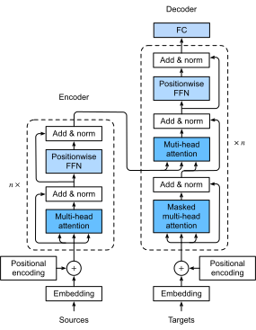

```{.python .input}
%load_ext d2lbook.tab
tab.interact_select('mxnet', 'pytorch', 'tensorflow', 'jax')
```

# Transformerių architektūra
:label:`sec_transformer`


:numref:`subsec_cnn-rnn-self-attention`
palyginome CNN, RNN ir saviraišką dėmesio sutelkimo transformaciją.
Pažymėtina, kad saviraiškė dėmesio sutelkimo transformacija
leidžia ir lygiagretų skaičiavimą, ir
turi trumpiausią didžiausią kelio ilgį.
Todėl
patrauklu projektuoti gilias architektūras
naudojant saviraišką dėmesio sutelkimo transformaciją.
Skirtingai nei ankstesni saviraiškės dėmesio sutelkimo modeliai,
vis dar besiremiantys RNN įvesties vaizdams :cite:`Cheng.Dong.Lapata.2016,Lin.Feng.Santos.ea.2017,Paulus.Xiong.Socher.2017`,
transformerio modelis
pagrįstas vien dėmesio sutelkimo mechanizmais,
be jokių konvoliucinių ar rekurentinių sluoksnių :cite:`Vaswani.Shazeer.Parmar.ea.2017`.
Nors iš pradžių buvo pasiūlytas
sekos į seką mokymuisi su tekstiniais duomenimis,
transformeriai išplito
plačiame šiuolaikinių giliojo mokymosi taikymų spektre,
pavyzdžiui, kalbos, regos, kalbėjimo ir skatinamojo mokymosi srityse.

```{.python .input}
%%tab mxnet
from d2l import mxnet as d2l
import math
from mxnet import autograd, init, np, npx
from mxnet.gluon import nn
import pandas as pd
npx.set_np()
```

```{.python .input}
%%tab pytorch
from d2l import torch as d2l
import math
import pandas as pd
import torch
from torch import nn
```

```{.python .input}
%%tab tensorflow
from d2l import tensorflow as d2l
import numpy as np
import pandas as pd
import tensorflow as tf
```

```{.python .input}
%%tab jax
from d2l import jax as d2l
from flax import linen as nn
from jax import numpy as jnp
import jax
import math
import pandas as pd
```

## Modelis

Kaip kodavimo ir dekodavimo
architektūros pavyzdys,
bendra
transformerio architektūra
pateikta :numref:`fig_transformer`.
Kaip matome,
transformeris sudarytas iš kodavimo ir dekodavimo bloko.
Skirtingai nei
Bahdanau dėmesio sutelkimas
sekos į seką mokymuisi
:numref:`fig_s2s_attention_details`,
įvesties (šaltinio) ir išvesties (tikslo)
sekų įterpiniai
sudedami su poziciniu kodavimu
prieš paduodant į
kodavimo ir dekodavimo blokus,
kurie kraunami iš modulių, pagrįstų saviraiške dėmesio sutelkimo transformacija.


:width:`320px`
:label:`fig_transformer`


Dabar pateikiame
transformerio architektūros :numref:`fig_transformer` apžvalgą.
Aukštu lygiu transformerio kodavimo blokas yra kelių vienodų sluoksnių rietuvė,
kur kiekvienas sluoksnis
turi du porsluoksnius (kiekvienas žymimas $\textrm{sublayer}$).
Pirmasis
yra lygiagreti saviraiškė dėmesio sutelkimo transformacija
o antrasis – pozicinis tiesioginio sklidimo tinklas.
Konkrečiai,
kodavimo bloko saviraiškėje dėmesio sutelkimo transformacijoje
užklausos, raktai ir reikšmės visos yra iš
ankstesnio kodavimo bloko sluoksnio išvesčių.
Įkvėpta :numref:`sec_resnet` ResNet dizaino,
aplink abu porsluoksnius naudojama
liekamoji jungtis.
Transformeryje
bet kuriai įvesčiai $\mathbf{x} \in \mathbb{R}^d$ bet kurioje sekos pozicijoje
reikalaujame, kad $\textrm{sublayer}(\mathbf{x}) \in \mathbb{R}^d$, kad
liekamoji jungtis $\mathbf{x} + \textrm{sublayer}(\mathbf{x}) \in \mathbb{R}^d$ būtų įmanoma.
Iškart po šio liekamosios jungties sudėjimo
atliekama sluoksnio normalizacija :cite:`Ba.Kiros.Hinton.2016`.
Dėl to transformerio kodavimo blokas išveda $d$ matmenų vektoriaus vaizdą
kiekvienai įvesties sekos pozicijai.

Transformerio dekodavimo blokas taip pat yra kelių vienodų sluoksnių rietuvė
su liekamosiomis jungtimis ir sluoksnio normalizacijomis.
Be dviejų kodavimo bloke aprašytų porsluoksnių, dekodavimo blokas įterpia
trečią porsluoksnį, žinomą kaip
kodavimo ir dekodavimo dėmesio sutelkimas,
tarp šių dviejų.
Kodavimo ir dekodavimo dėmesio sutelkime
užklausos yra iš
dekodavimo bloko saviraiškės dėmesio sutelkimo porsluoksnio išvesčių,
o raktai ir reikšmės yra
iš transformerio kodavimo bloko išvesčių.
Dekodavimo bloko saviraiškėje dėmesio sutelkime
užklausos, raktai ir reikšmės visos yra iš
ankstesnio dekodavimo bloko sluoksnio išvesčių.
Tačiau kiekvienai dekodavimo bloko pozicijai
leidžiama sutelkti dėmesį tik į visas dekodavimo bloko pozicijas
iki tos pozicijos imtinai.
Šis *maskuotas* dėmesio sutelkimas
išlaiko autoregresinę savybę,
užtikrindamas, kad prognozė priklauso tik
nuo tų išvesties teksto vienetų, kurie jau sugeneruoti.


Jau aprašėme ir įgyvendinome
lygiagrečią dėmesio sutelkimo transformaciją, pagrįstą mastelio keičiamomis skaliarinėmis sandaugomis,
:numref:`sec_multihead-attention`
ir pozicinį kodavimą :numref:`subsec_positional-encoding`.
Toliau įgyvendinsime
likusią transformerio modelio dalį.

## [**Pozicinio tiesioginio sklidimo tinklai**]
:label:`subsec_positionwise-ffn`

Pozicinio tiesioginio sklidimo tinklas transformuoja
vaizdą visose sekos pozicijose
naudodamas tą patį MLP.
Todėl jį vadiname *poziciniu*.
Toliau pateiktame įgyvendinime
įvestis `X` su forma
(rinkinio dydis, laiko žingsnių skaičius arba sekos ilgis teksto vienetais,
paslėptųjų vienetų skaičius arba požymių dimensija)
bus dviejų sluoksnių MLP paversta
išvesties tenzoriumi, kurio forma
(rinkinio dydis, laiko žingsnių skaičius, `ffn_num_outputs`).

```{.python .input}
%%tab mxnet
class PositionWiseFFN(nn.Block):  #@save
    """The positionwise feed-forward network."""
    def __init__(self, ffn_num_hiddens, ffn_num_outputs):
        super().__init__()
        self.dense1 = nn.Dense(ffn_num_hiddens, flatten=False,
                               activation='relu')
        self.dense2 = nn.Dense(ffn_num_outputs, flatten=False)

    def forward(self, X):
        return self.dense2(self.dense1(X))
```

```{.python .input}
%%tab pytorch
class PositionWiseFFN(nn.Module):  #@save
    """The positionwise feed-forward network."""
    def __init__(self, ffn_num_hiddens, ffn_num_outputs):
        super().__init__()
        self.dense1 = nn.LazyLinear(ffn_num_hiddens)
        self.relu = nn.ReLU()
        self.dense2 = nn.LazyLinear(ffn_num_outputs)

    def forward(self, X):
        return self.dense2(self.relu(self.dense1(X)))
```

```{.python .input}
%%tab tensorflow
class PositionWiseFFN(tf.keras.layers.Layer):  #@save
    """The positionwise feed-forward network."""
    def __init__(self, ffn_num_hiddens, ffn_num_outputs):
        super().__init__()
        self.dense1 = tf.keras.layers.Dense(ffn_num_hiddens)
        self.relu = tf.keras.layers.ReLU()
        self.dense2 = tf.keras.layers.Dense(ffn_num_outputs)

    def call(self, X):
        return self.dense2(self.relu(self.dense1(X)))
```

```{.python .input}
%%tab jax
class PositionWiseFFN(nn.Module):  #@save
    """The positionwise feed-forward network."""
    ffn_num_hiddens: int
    ffn_num_outputs: int

    def setup(self):
        self.dense1 = nn.Dense(self.ffn_num_hiddens)
        self.dense2 = nn.Dense(self.ffn_num_outputs)

    def __call__(self, X):
        return self.dense2(nn.relu(self.dense1(X)))
```

Toliau pateiktas pavyzdys
rodo, kad [**giliausia tenzoriaus
dimensija pasikeičia**] į
išvesčių skaičių
pozicinio tiesioginio sklidimo tinkle.
Kadangi tas pats MLP transformuoja
visose pozicijose,
kai įvestys visose šiose pozicijose yra tos pačios,
jų išvestys taip pat yra identiškos.

```{.python .input}
%%tab mxnet
ffn = PositionWiseFFN(4, 8)
ffn.initialize()
ffn(np.ones((2, 3, 4)))[0]
```

```{.python .input}
%%tab pytorch
ffn = PositionWiseFFN(4, 8)
ffn.eval()
ffn(d2l.ones((2, 3, 4)))[0]
```

```{.python .input}
%%tab tensorflow
ffn = PositionWiseFFN(4, 8)
ffn(tf.ones((2, 3, 4)))[0]
```

```{.python .input}
%%tab jax
ffn = PositionWiseFFN(4, 8)
ffn.init_with_output(d2l.get_key(), jnp.ones((2, 3, 4)))[0][0]
```

## Liekamoji jungtis ir sluoksnio normalizacija

Dabar susitelkime į „sudėk ir normalizuok“ komponentą :numref:`fig_transformer`.
Kaip aprašėme šio skyrelio pradžioje,
tai yra liekamoji jungtis, iškart po kurios
eina sluoksnio normalizacija.
Abi yra svarbios efektyvioms gilioms architektūroms.

:numref:`sec_batch_norm`
paaiškinome, kaip rinkinio normalizacija
perkelia centrą ir keičia mastelį per pavyzdžius
minirinkinyje.
Kaip aptarta :numref:`subsec_layer-normalization-in-bn`,
sluoksnio normalizacija yra tokia pati kaip rinkinio normalizacija,
tik pirmoji
normalizuoja per požymių dimensiją,
todėl turi nuo mastelio ir nuo rinkinio dydžio nepriklausomumo privalumų.
Nepaisant plataus taikymo
kompiuterinėje regoje,
rinkinio normalizacija
empiriškai paprastai yra
mažiau veiksminga nei sluoksnio normalizacija
natūraliosios kalbos apdorojimo
užduotyse, kuriose įvestys dažnai yra
kintamo ilgio sekos.

Toliau pateiktas kodo fragmentas
[**palygina normalizavimą skirtingomis dimensijomis
sluoksnio normalizacija ir rinkinio normalizacija**].

```{.python .input}
%%tab mxnet
ln = nn.LayerNorm()
ln.initialize()
bn = nn.BatchNorm()
bn.initialize()
X = d2l.tensor([[1, 2], [2, 3]])
# Compute mean and variance from X in the training mode
with autograd.record():
    print('layer norm:', ln(X), '\nbatch norm:', bn(X))
```

```{.python .input}
%%tab pytorch
ln = nn.LayerNorm(2)
bn = nn.LazyBatchNorm1d()
X = d2l.tensor([[1, 2], [2, 3]], dtype=torch.float32)
# Compute mean and variance from X in the training mode
print('layer norm:', ln(X), '\nbatch norm:', bn(X))
```

```{.python .input}
%%tab tensorflow
ln = tf.keras.layers.LayerNormalization()
bn = tf.keras.layers.BatchNormalization()
X = tf.constant([[1, 2], [2, 3]], dtype=tf.float32)
print('layer norm:', ln(X), '\nbatch norm:', bn(X, training=True))
```

```{.python .input}
%%tab jax
ln = nn.LayerNorm()
bn = nn.BatchNorm()
X = d2l.tensor([[1, 2], [2, 3]], dtype=d2l.float32)
# Compute mean and variance from X in the training mode
print('layer norm:', ln.init_with_output(d2l.get_key(), X)[0],
      '\nbatch norm:', bn.init_with_output(d2l.get_key(), X,
                                           use_running_average=False)[0])
```

Dabar galime įgyvendinti klasę `AddNorm`
[**naudodami liekamąją jungtį, po kurios eina sluoksnio normalizacija**].
Reguliarizacijai taip pat taikomas dropout.

```{.python .input}
%%tab mxnet
class AddNorm(nn.Block):  #@save
    """The residual connection followed by layer normalization."""
    def __init__(self, dropout):
        super().__init__()
        self.dropout = nn.Dropout(dropout)
        self.ln = nn.LayerNorm()

    def forward(self, X, Y):
        return self.ln(self.dropout(Y) + X)
```

```{.python .input}
%%tab pytorch
class AddNorm(nn.Module):  #@save
    """The residual connection followed by layer normalization."""
    def __init__(self, norm_shape, dropout):
        super().__init__()
        self.dropout = nn.Dropout(dropout)
        self.ln = nn.LayerNorm(norm_shape)

    def forward(self, X, Y):
        return self.ln(self.dropout(Y) + X)
```

```{.python .input}
%%tab tensorflow
class AddNorm(tf.keras.layers.Layer):  #@save
    """The residual connection followed by layer normalization."""
    def __init__(self, norm_shape, dropout):
        super().__init__()
        self.dropout = tf.keras.layers.Dropout(dropout)
        self.ln = tf.keras.layers.LayerNormalization(norm_shape)

    def call(self, X, Y, **kwargs):
        return self.ln(self.dropout(Y, **kwargs) + X)
```

```{.python .input}
%%tab jax
class AddNorm(nn.Module):  #@save
    """The residual connection followed by layer normalization."""
    dropout: int

    @nn.compact
    def __call__(self, X, Y, training=False):
        return nn.LayerNorm()(
            nn.Dropout(self.dropout)(Y, deterministic=not training) + X)
```

Liekamoji jungtis reikalauja, kad
dvi įvestys būtų tos pačios formos,
kad [**išvesties tenzorius po sudėties operacijos taip pat turėtų tą pačią formą**].

```{.python .input}
%%tab mxnet
add_norm = AddNorm(0.5)
add_norm.initialize()
shape = (2, 3, 4)
d2l.check_shape(add_norm(d2l.ones(shape), d2l.ones(shape)), shape)
```

```{.python .input}
%%tab pytorch
add_norm = AddNorm(4, 0.5)
shape = (2, 3, 4)
d2l.check_shape(add_norm(d2l.ones(shape), d2l.ones(shape)), shape)
```

```{.python .input}
%%tab tensorflow
# Normalized_shape is: [i for i in range(len(input.shape))][1:]
add_norm = AddNorm([1, 2], 0.5)
shape = (2, 3, 4)
d2l.check_shape(add_norm(tf.ones(shape), tf.ones(shape), training=False),
                shape)
```

```{.python .input}
%%tab jax
add_norm = AddNorm(0.5)
shape = (2, 3, 4)
output, _ = add_norm.init_with_output(d2l.get_key(), d2l.ones(shape),
                                      d2l.ones(shape))
d2l.check_shape(output, shape)
```

## Kodavimo blokas
:label:`subsec_transformer-encoder`

Turėdami visus esminius komponentus transformerio kodavimo blokui surinkti,
pradėkime
įgyvendindami [**vieną kodavimo bloko sluoksnį**].
Toliau pateikta klasė `TransformerEncoderBlock`
turi du porsluoksnius: lygiagrečią saviraišką dėmesio sutelkimo transformaciją ir poziciniu tiesioginio sklidimo tinklus,
kur aplink abu porsluoksnius naudojama liekamoji jungtis, po kurios eina sluoksnio normalizacija.

```{.python .input}
%%tab mxnet
class TransformerEncoderBlock(nn.Block):  #@save
    """The Transformer encoder block."""
    def __init__(self, num_hiddens, ffn_num_hiddens, num_heads, dropout,
                 use_bias=False):
        super().__init__()
        self.attention = d2l.MultiHeadAttention(
            num_hiddens, num_heads, dropout, use_bias)
        self.addnorm1 = AddNorm(dropout)
        self.ffn = PositionWiseFFN(ffn_num_hiddens, num_hiddens)
        self.addnorm2 = AddNorm(dropout)

    def forward(self, X, valid_lens):
        Y = self.addnorm1(X, self.attention(X, X, X, valid_lens))
        return self.addnorm2(Y, self.ffn(Y))
```

```{.python .input}
%%tab pytorch
class TransformerEncoderBlock(nn.Module):  #@save
    """The Transformer encoder block."""
    def __init__(self, num_hiddens, ffn_num_hiddens, num_heads, dropout,
                 use_bias=False):
        super().__init__()
        self.attention = d2l.MultiHeadAttention(num_hiddens, num_heads,
                                                dropout, use_bias)
        self.addnorm1 = AddNorm(num_hiddens, dropout)
        self.ffn = PositionWiseFFN(ffn_num_hiddens, num_hiddens)
        self.addnorm2 = AddNorm(num_hiddens, dropout)

    def forward(self, X, valid_lens):
        Y = self.addnorm1(X, self.attention(X, X, X, valid_lens))
        return self.addnorm2(Y, self.ffn(Y))
```

```{.python .input}
%%tab tensorflow
class TransformerEncoderBlock(tf.keras.layers.Layer):  #@save
    """The Transformer encoder block."""
    def __init__(self, key_size, query_size, value_size, num_hiddens,
                 norm_shape, ffn_num_hiddens, num_heads, dropout, bias=False):
        super().__init__()
        self.attention = d2l.MultiHeadAttention(
            key_size, query_size, value_size, num_hiddens, num_heads, dropout,
            bias)
        self.addnorm1 = AddNorm(norm_shape, dropout)
        self.ffn = PositionWiseFFN(ffn_num_hiddens, num_hiddens)
        self.addnorm2 = AddNorm(norm_shape, dropout)

    def call(self, X, valid_lens, **kwargs):
        Y = self.addnorm1(X, self.attention(X, X, X, valid_lens, **kwargs),
                          **kwargs)
        return self.addnorm2(Y, self.ffn(Y), **kwargs)
```

```{.python .input}
%%tab jax
class TransformerEncoderBlock(nn.Module):  #@save
    """The Transformer encoder block."""
    num_hiddens: int
    ffn_num_hiddens: int
    num_heads: int
    dropout: float
    use_bias: bool = False

    def setup(self):
        self.attention = d2l.MultiHeadAttention(self.num_hiddens, self.num_heads,
                                                self.dropout, self.use_bias)
        self.addnorm1 = AddNorm(self.dropout)
        self.ffn = PositionWiseFFN(self.ffn_num_hiddens, self.num_hiddens)
        self.addnorm2 = AddNorm(self.dropout)

    def __call__(self, X, valid_lens, training=False):
        output, attention_weights = self.attention(X, X, X, valid_lens,
                                                   training=training)
        Y = self.addnorm1(X, output, training=training)
        return self.addnorm2(Y, self.ffn(Y), training=training), attention_weights
```

Kaip matome,
[**joks transformerio kodavimo bloko sluoksnis
nekeičia savo įvesties formos.**]

```{.python .input}
%%tab mxnet
X = d2l.ones((2, 100, 24))
valid_lens = d2l.tensor([3, 2])
encoder_blk = TransformerEncoderBlock(24, 48, 8, 0.5)
encoder_blk.initialize()
d2l.check_shape(encoder_blk(X, valid_lens), X.shape)
```

```{.python .input}
%%tab pytorch
X = d2l.ones((2, 100, 24))
valid_lens = d2l.tensor([3, 2])
encoder_blk = TransformerEncoderBlock(24, 48, 8, 0.5)
encoder_blk.eval()
d2l.check_shape(encoder_blk(X, valid_lens), X.shape)
```

```{.python .input}
%%tab tensorflow
X = tf.ones((2, 100, 24))
valid_lens = tf.constant([3, 2])
norm_shape = [i for i in range(len(X.shape))][1:]
encoder_blk = TransformerEncoderBlock(24, 24, 24, 24, norm_shape, 48, 8, 0.5)
d2l.check_shape(encoder_blk(X, valid_lens, training=False), X.shape)
```

```{.python .input}
%%tab jax
X = jnp.ones((2, 100, 24))
valid_lens = jnp.array([3, 2])
encoder_blk = TransformerEncoderBlock(24, 48, 8, 0.5)
(output, _), _ = encoder_blk.init_with_output(d2l.get_key(), X, valid_lens,
                                              training=False)
d2l.check_shape(output, X.shape)
```

Toliau pateiktame [**transformerio kodavimo bloko**] įgyvendinime
sukrauname `num_blks` aukščiau pateiktų klasių `TransformerEncoderBlock` egzempliorių.
Kadangi naudojame fiksuotą pozicinį kodavimą,
kurio reikšmės visada yra tarp $-1$ ir $1$,
mokomų įvesties įterpinių reikšmes
padauginame iš įterpinio dimensijos kvadratinės šaknies,
kad pakeistume mastelį prieš sudedant įvesties įterpinį ir pozicinį kodavimą.

```{.python .input}
%%tab mxnet
class TransformerEncoder(d2l.Encoder):  #@save
    """The Transformer encoder."""
    def __init__(self, vocab_size, num_hiddens, ffn_num_hiddens,
                 num_heads, num_blks, dropout, use_bias=False):
        super().__init__()
        self.num_hiddens = num_hiddens
        self.embedding = nn.Embedding(vocab_size, num_hiddens)
        self.pos_encoding = d2l.PositionalEncoding(num_hiddens, dropout)
        self.blks = nn.Sequential()
        for _ in range(num_blks):
            self.blks.add(TransformerEncoderBlock(
                num_hiddens, ffn_num_hiddens, num_heads, dropout, use_bias))
        self.initialize()

    def forward(self, X, valid_lens):
        # Since positional encoding values are between -1 and 1, the embedding
        # values are multiplied by the square root of the embedding dimension
        # to rescale before they are summed up
        X = self.pos_encoding(self.embedding(X) * math.sqrt(self.num_hiddens))
        self.attention_weights = [None] * len(self.blks)
        for i, blk in enumerate(self.blks):
            X = blk(X, valid_lens)
            self.attention_weights[
                i] = blk.attention.attention.attention_weights
        return X
```

```{.python .input}
%%tab pytorch
class TransformerEncoder(d2l.Encoder):  #@save
    """The Transformer encoder."""
    def __init__(self, vocab_size, num_hiddens, ffn_num_hiddens,
                 num_heads, num_blks, dropout, use_bias=False):
        super().__init__()
        self.num_hiddens = num_hiddens
        self.embedding = nn.Embedding(vocab_size, num_hiddens)
        self.pos_encoding = d2l.PositionalEncoding(num_hiddens, dropout)
        self.blks = nn.Sequential()
        for i in range(num_blks):
            self.blks.add_module("block"+str(i), TransformerEncoderBlock(
                num_hiddens, ffn_num_hiddens, num_heads, dropout, use_bias))

    def forward(self, X, valid_lens):
        # Since positional encoding values are between -1 and 1, the embedding
        # values are multiplied by the square root of the embedding dimension
        # to rescale before they are summed up
        X = self.pos_encoding(self.embedding(X) * math.sqrt(self.num_hiddens))
        self.attention_weights = [None] * len(self.blks)
        for i, blk in enumerate(self.blks):
            X = blk(X, valid_lens)
            self.attention_weights[
                i] = blk.attention.attention.attention_weights
        return X
```

```{.python .input}
%%tab tensorflow
class TransformerEncoder(d2l.Encoder):  #@save
    """The Transformer encoder."""
    def __init__(self, vocab_size, key_size, query_size, value_size,
                 num_hiddens, norm_shape, ffn_num_hiddens, num_heads,
                 num_blks, dropout, bias=False):
        super().__init__()
        self.num_hiddens = num_hiddens
        self.embedding = tf.keras.layers.Embedding(vocab_size, num_hiddens)
        self.pos_encoding = d2l.PositionalEncoding(num_hiddens, dropout)
        self.blks = [TransformerEncoderBlock(
            key_size, query_size, value_size, num_hiddens, norm_shape,
            ffn_num_hiddens, num_heads, dropout, bias) for _ in range(
            num_blks)]

    def call(self, X, valid_lens, **kwargs):
        # Since positional encoding values are between -1 and 1, the embedding
        # values are multiplied by the square root of the embedding dimension
        # to rescale before they are summed up
        X = self.pos_encoding(self.embedding(X) * tf.math.sqrt(
            tf.cast(self.num_hiddens, dtype=tf.float32)), **kwargs)
        self.attention_weights = [None] * len(self.blks)
        for i, blk in enumerate(self.blks):
            X = blk(X, valid_lens, **kwargs)
            self.attention_weights[
                i] = blk.attention.attention.attention_weights
        return X
```

```{.python .input}
%%tab jax
class TransformerEncoder(d2l.Encoder):  #@save
    """The Transformer encoder."""
    vocab_size: int
    num_hiddens:int
    ffn_num_hiddens: int
    num_heads: int
    num_blks: int
    dropout: float
    use_bias: bool = False

    def setup(self):
        self.embedding = nn.Embed(self.vocab_size, self.num_hiddens)
        self.pos_encoding = d2l.PositionalEncoding(self.num_hiddens, self.dropout)
        self.blks = [TransformerEncoderBlock(self.num_hiddens,
                                             self.ffn_num_hiddens,
                                             self.num_heads,
                                             self.dropout, self.use_bias)
                     for _ in range(self.num_blks)]

    def __call__(self, X, valid_lens, training=False):
        # Since positional encoding values are between -1 and 1, the embedding
        # values are multiplied by the square root of the embedding dimension
        # to rescale before they are summed up
        X = self.embedding(X) * math.sqrt(self.num_hiddens)
        X = self.pos_encoding(X, training=training)
        attention_weights = [None] * len(self.blks)
        for i, blk in enumerate(self.blks):
            X, attention_w = blk(X, valid_lens, training=training)
            attention_weights[i] = attention_w
        # Flax sow API is used to capture intermediate variables
        self.sow('intermediates', 'enc_attention_weights', attention_weights)
        return X
```

Toliau nurodome hiperparametrus, kad [**sukurtume dviejų sluoksnių transformerio kodavimo bloką**].
Transformerio kodavimo bloko išvesties forma
yra (rinkinio dydis, laiko žingsnių skaičius, `num_hiddens`).

```{.python .input}
%%tab mxnet
encoder = TransformerEncoder(200, 24, 48, 8, 2, 0.5)
d2l.check_shape(encoder(np.ones((2, 100)), valid_lens), (2, 100, 24))
```

```{.python .input}
%%tab pytorch
encoder = TransformerEncoder(200, 24, 48, 8, 2, 0.5)
d2l.check_shape(encoder(d2l.ones((2, 100), dtype=torch.long), valid_lens),
                (2, 100, 24))
```

```{.python .input}
%%tab tensorflow
encoder = TransformerEncoder(200, 24, 24, 24, 24, [1, 2], 48, 8, 2, 0.5)
d2l.check_shape(encoder(tf.ones((2, 100)), valid_lens, training=False),
                (2, 100, 24))
```

```{.python .input}
%%tab jax
encoder = TransformerEncoder(200, 24, 48, 8, 2, 0.5)
d2l.check_shape(encoder.init_with_output(d2l.get_key(),
                                         jnp.ones((2, 100), dtype=jnp.int32),
                                         valid_lens)[0],
                (2, 100, 24))
```

## Dekodavimo blokas

Kaip parodyta :numref:`fig_transformer`,
[**transformerio dekodavimo blokas
sudarytas iš kelių vienodų sluoksnių**].
Kiekvienas sluoksnis įgyvendintas toliau pateiktoje
klasėje `TransformerDecoderBlock`,
kuri turi tris porsluoksnius:
dekodavimo bloko saviraišką dėmesio sutelkimo transformaciją,
kodavimo ir dekodavimo dėmesio sutelkimą
ir poziciniu tiesioginio sklidimo tinklus.
Šie porsluoksniai naudoja
aplink juos liekamąją jungtį,
po kurios eina sluoksnio normalizacija.


Kaip aprašėme anksčiau šiame skyrelyje,
maskuotoje lygiagrečioje dekodavimo bloko saviraiškėje dėmesio sutelkimo transformacijoje
(pirmajame porsluoksnyje)
užklausos, raktai ir reikšmės
visos ateina iš ankstesnio dekodavimo bloko sluoksnio išvesčių.
Apmokant sekos į seką modelius,
teksto vienetai visose išvesties sekos
pozicijose (laiko žingsniuose)
yra žinomi.
Tačiau
prognozavimo metu
išvesties seka generuojama teksto vienetas po teksto vieneto;
todėl
bet kuriuo dekodavimo bloko laiko žingsniu
dekodavimo bloko saviraiškėje dėmesio sutelkimo transformacijoje
galima naudoti tik jau sugeneruotus teksto vienetus.
Kad dekodavimo bloke išliktų autoregresija,
jo maskuota saviraiškė dėmesio sutelkimo transformacija
nurodo `dec_valid_lens`, kad
bet kuri užklausa
sutelktų dėmesį tik į
visas dekodavimo bloko pozicijas
iki užklausos pozicijos.

```{.python .input}
%%tab mxnet
class TransformerDecoderBlock(nn.Block):
    # The i-th block in the Transformer decoder
    def __init__(self, num_hiddens, ffn_num_hiddens, num_heads, dropout, i):
        super().__init__()
        self.i = i
        self.attention1 = d2l.MultiHeadAttention(num_hiddens, num_heads,
                                                 dropout)
        self.addnorm1 = AddNorm(dropout)
        self.attention2 = d2l.MultiHeadAttention(num_hiddens, num_heads,
                                                 dropout)
        self.addnorm2 = AddNorm(dropout)
        self.ffn = PositionWiseFFN(ffn_num_hiddens, num_hiddens)
        self.addnorm3 = AddNorm(dropout)

    def forward(self, X, state):
        enc_outputs, enc_valid_lens = state[0], state[1]
        # During training, all the tokens of any output sequence are processed
        # at the same time, so state[2][self.i] is None as initialized. When
        # decoding any output sequence token by token during prediction,
        # state[2][self.i] contains representations of the decoded output at
        # the i-th block up to the current time step
        if state[2][self.i] is None:
            key_values = X
        else:
            key_values = np.concatenate((state[2][self.i], X), axis=1)
        state[2][self.i] = key_values

        if autograd.is_training():
            batch_size, num_steps, _ = X.shape
            # Shape of dec_valid_lens: (batch_size, num_steps), where every
            # row is [1, 2, ..., num_steps]
            dec_valid_lens = np.tile(np.arange(1, num_steps + 1, ctx=X.ctx),
                                     (batch_size, 1))
        else:
            dec_valid_lens = None
        # Self-attention
        X2 = self.attention1(X, key_values, key_values, dec_valid_lens)
        Y = self.addnorm1(X, X2)
        # Encoder-decoder attention. Shape of enc_outputs:
        # (batch_size, num_steps, num_hiddens)
        Y2 = self.attention2(Y, enc_outputs, enc_outputs, enc_valid_lens)
        Z = self.addnorm2(Y, Y2)
        return self.addnorm3(Z, self.ffn(Z)), state
```

```{.python .input}
%%tab pytorch
class TransformerDecoderBlock(nn.Module):
    # The i-th block in the Transformer decoder
    def __init__(self, num_hiddens, ffn_num_hiddens, num_heads, dropout, i):
        super().__init__()
        self.i = i
        self.attention1 = d2l.MultiHeadAttention(num_hiddens, num_heads,
                                                 dropout)
        self.addnorm1 = AddNorm(num_hiddens, dropout)
        self.attention2 = d2l.MultiHeadAttention(num_hiddens, num_heads,
                                                 dropout)
        self.addnorm2 = AddNorm(num_hiddens, dropout)
        self.ffn = PositionWiseFFN(ffn_num_hiddens, num_hiddens)
        self.addnorm3 = AddNorm(num_hiddens, dropout)

    def forward(self, X, state):
        enc_outputs, enc_valid_lens = state[0], state[1]
        # During training, all the tokens of any output sequence are processed
        # at the same time, so state[2][self.i] is None as initialized. When
        # decoding any output sequence token by token during prediction,
        # state[2][self.i] contains representations of the decoded output at
        # the i-th block up to the current time step
        if state[2][self.i] is None:
            key_values = X
        else:
            key_values = torch.cat((state[2][self.i], X), dim=1)
        state[2][self.i] = key_values
        if self.training:
            batch_size, num_steps, _ = X.shape
            # Shape of dec_valid_lens: (batch_size, num_steps), where every
            # row is [1, 2, ..., num_steps]
            dec_valid_lens = torch.arange(
                1, num_steps + 1, device=X.device).repeat(batch_size, 1)
        else:
            dec_valid_lens = None
        # Self-attention
        X2 = self.attention1(X, key_values, key_values, dec_valid_lens)
        Y = self.addnorm1(X, X2)
        # Encoder-decoder attention. Shape of enc_outputs:
        # (batch_size, num_steps, num_hiddens)
        Y2 = self.attention2(Y, enc_outputs, enc_outputs, enc_valid_lens)
        Z = self.addnorm2(Y, Y2)
        return self.addnorm3(Z, self.ffn(Z)), state
```

```{.python .input}
%%tab tensorflow
class TransformerDecoderBlock(tf.keras.layers.Layer):
    # The i-th block in the Transformer decoder
    def __init__(self, key_size, query_size, value_size, num_hiddens,
                 norm_shape, ffn_num_hiddens, num_heads, dropout, i):
        super().__init__()
        self.i = i
        self.attention1 = d2l.MultiHeadAttention(
            key_size, query_size, value_size, num_hiddens, num_heads, dropout)
        self.addnorm1 = AddNorm(norm_shape, dropout)
        self.attention2 = d2l.MultiHeadAttention(
            key_size, query_size, value_size, num_hiddens, num_heads, dropout)
        self.addnorm2 = AddNorm(norm_shape, dropout)
        self.ffn = PositionWiseFFN(ffn_num_hiddens, num_hiddens)
        self.addnorm3 = AddNorm(norm_shape, dropout)

    def call(self, X, state, **kwargs):
        enc_outputs, enc_valid_lens = state[0], state[1]
        # During training, all the tokens of any output sequence are processed
        # at the same time, so state[2][self.i] is None as initialized. When
        # decoding any output sequence token by token during prediction,
        # state[2][self.i] contains representations of the decoded output at
        # the i-th block up to the current time step
        if state[2][self.i] is None:
            key_values = X
        else:
            key_values = tf.concat((state[2][self.i], X), axis=1)
        state[2][self.i] = key_values
        if kwargs["training"]:
            batch_size, num_steps, _ = X.shape
            # Shape of dec_valid_lens: (batch_size, num_steps), where every
            # row is [1, 2, ..., num_steps]
            dec_valid_lens = tf.repeat(
                tf.reshape(tf.range(1, num_steps + 1),
                           shape=(-1, num_steps)), repeats=batch_size, axis=0)
        else:
            dec_valid_lens = None
        # Self-attention
        X2 = self.attention1(X, key_values, key_values, dec_valid_lens,
                             **kwargs)
        Y = self.addnorm1(X, X2, **kwargs)
        # Encoder-decoder attention. Shape of enc_outputs:
        # (batch_size, num_steps, num_hiddens)
        Y2 = self.attention2(Y, enc_outputs, enc_outputs, enc_valid_lens,
                             **kwargs)
        Z = self.addnorm2(Y, Y2, **kwargs)
        return self.addnorm3(Z, self.ffn(Z), **kwargs), state
```

```{.python .input}
%%tab jax
class TransformerDecoderBlock(nn.Module):
    # The i-th block in the Transformer decoder
    num_hiddens: int
    ffn_num_hiddens: int
    num_heads: int
    dropout: float
    i: int

    def setup(self):
        self.attention1 = d2l.MultiHeadAttention(self.num_hiddens,
                                                 self.num_heads,
                                                 self.dropout)
        self.addnorm1 = AddNorm(self.dropout)
        self.attention2 = d2l.MultiHeadAttention(self.num_hiddens,
                                                 self.num_heads,
                                                 self.dropout)
        self.addnorm2 = AddNorm(self.dropout)
        self.ffn = PositionWiseFFN(self.ffn_num_hiddens, self.num_hiddens)
        self.addnorm3 = AddNorm(self.dropout)

    def __call__(self, X, state, training=False):
        enc_outputs, enc_valid_lens = state[0], state[1]
        # During training, all the tokens of any output sequence are processed
        # at the same time, so state[2][self.i] is None as initialized. When
        # decoding any output sequence token by token during prediction,
        # state[2][self.i] contains representations of the decoded output at
        # the i-th block up to the current time step
        if state[2][self.i] is None:
            key_values = X
        else:
            key_values = jnp.concatenate((state[2][self.i], X), axis=1)
        state[2][self.i] = key_values
        if training:
            batch_size, num_steps, _ = X.shape
            # Shape of dec_valid_lens: (batch_size, num_steps), where every
            # row is [1, 2, ..., num_steps]
            dec_valid_lens = jnp.tile(jnp.arange(1, num_steps + 1),
                                      (batch_size, 1))
        else:
            dec_valid_lens = None
        # Self-attention
        X2, attention_w1 = self.attention1(X, key_values, key_values,
                                           dec_valid_lens, training=training)
        Y = self.addnorm1(X, X2, training=training)
        # Encoder-decoder attention. Shape of enc_outputs:
        # (batch_size, num_steps, num_hiddens)
        Y2, attention_w2 = self.attention2(Y, enc_outputs, enc_outputs,
                                           enc_valid_lens, training=training)
        Z = self.addnorm2(Y, Y2, training=training)
        return self.addnorm3(Z, self.ffn(Z), training=training), state, attention_w1, attention_w2
```

Kad palengvintume mastelio keičiamos skaliarinės sandaugos operacijas
kodavimo ir dekodavimo dėmesio sutelkime
ir sudėties operacijas liekamosiose jungtyse,
[**dekodavimo bloko požymių dimensija (`num_hiddens`)
yra tokia pati kaip kodavimo bloko.**]

```{.python .input}
%%tab mxnet
decoder_blk = TransformerDecoderBlock(24, 48, 8, 0.5, 0)
decoder_blk.initialize()
X = np.ones((2, 100, 24))
state = [encoder_blk(X, valid_lens), valid_lens, [None]]
d2l.check_shape(decoder_blk(X, state)[0], X.shape)
```

```{.python .input}
%%tab pytorch
decoder_blk = TransformerDecoderBlock(24, 48, 8, 0.5, 0)
X = d2l.ones((2, 100, 24))
state = [encoder_blk(X, valid_lens), valid_lens, [None]]
d2l.check_shape(decoder_blk(X, state)[0], X.shape)
```

```{.python .input}
%%tab tensorflow
decoder_blk = TransformerDecoderBlock(24, 24, 24, 24, [1, 2], 48, 8, 0.5, 0)
X = tf.ones((2, 100, 24))
state = [encoder_blk(X, valid_lens), valid_lens, [None]]
d2l.check_shape(decoder_blk(X, state, training=False)[0], X.shape)
```

```{.python .input}
%%tab jax
decoder_blk = TransformerDecoderBlock(24, 48, 8, 0.5, 0)
X = d2l.ones((2, 100, 24))
state = [encoder_blk.init_with_output(d2l.get_key(), X, valid_lens)[0][0],
         valid_lens, [None]]
d2l.check_shape(decoder_blk.init_with_output(d2l.get_key(), X, state)[0][0],
                X.shape)
```

Dabar [**sukonstruojame visą transformerio dekodavimo bloką**],
sudarytą iš `num_blks` `TransformerDecoderBlock` egzempliorių.
Galiausiai pilnai sujungtas sluoksnis apskaičiuoja prognozę
visiems `vocab_size` galimiems išvesties teksto vienetams.
Tiek dekodavimo bloko saviraiškės dėmesio sutelkimo svoriai,
tiek kodavimo ir dekodavimo dėmesio sutelkimo svoriai
saugomi vėlesniam vizualizavimui.

```{.python .input}
%%tab mxnet
class TransformerDecoder(d2l.AttentionDecoder):
    def __init__(self, vocab_size, num_hiddens, ffn_num_hiddens, num_heads,
                 num_blks, dropout):
        super().__init__()
        self.num_hiddens = num_hiddens
        self.num_blks = num_blks
        self.embedding = nn.Embedding(vocab_size, num_hiddens)
        self.pos_encoding = d2l.PositionalEncoding(num_hiddens, dropout)
        self.blks = nn.Sequential()
        for i in range(num_blks):
            self.blks.add(TransformerDecoderBlock(
                num_hiddens, ffn_num_hiddens, num_heads, dropout, i))
        self.dense = nn.Dense(vocab_size, flatten=False)
        self.initialize()

    def init_state(self, enc_outputs, enc_valid_lens):
        return [enc_outputs, enc_valid_lens, [None] * self.num_blks]

    def forward(self, X, state):
        X = self.pos_encoding(self.embedding(X) * math.sqrt(self.num_hiddens))
        self._attention_weights = [[None] * len(self.blks) for _ in range (2)]
        for i, blk in enumerate(self.blks):
            X, state = blk(X, state)
            # Decoder self-attention weights
            self._attention_weights[0][
                i] = blk.attention1.attention.attention_weights
            # Encoder-decoder attention weights
            self._attention_weights[1][
                i] = blk.attention2.attention.attention_weights
        return self.dense(X), state

    @property
    def attention_weights(self):
        return self._attention_weights
```

```{.python .input}
%%tab pytorch
class TransformerDecoder(d2l.AttentionDecoder):
    def __init__(self, vocab_size, num_hiddens, ffn_num_hiddens, num_heads,
                 num_blks, dropout):
        super().__init__()
        self.num_hiddens = num_hiddens
        self.num_blks = num_blks
        self.embedding = nn.Embedding(vocab_size, num_hiddens)
        self.pos_encoding = d2l.PositionalEncoding(num_hiddens, dropout)
        self.blks = nn.Sequential()
        for i in range(num_blks):
            self.blks.add_module("block"+str(i), TransformerDecoderBlock(
                num_hiddens, ffn_num_hiddens, num_heads, dropout, i))
        self.dense = nn.LazyLinear(vocab_size)

    def init_state(self, enc_outputs, enc_valid_lens):
        return [enc_outputs, enc_valid_lens, [None] * self.num_blks]

    def forward(self, X, state):
        X = self.pos_encoding(self.embedding(X) * math.sqrt(self.num_hiddens))
        self._attention_weights = [[None] * len(self.blks) for _ in range (2)]
        for i, blk in enumerate(self.blks):
            X, state = blk(X, state)
            # Decoder self-attention weights
            self._attention_weights[0][
                i] = blk.attention1.attention.attention_weights
            # Encoder-decoder attention weights
            self._attention_weights[1][
                i] = blk.attention2.attention.attention_weights
        return self.dense(X), state

    @property
    def attention_weights(self):
        return self._attention_weights
```

```{.python .input}
%%tab tensorflow
class TransformerDecoder(d2l.AttentionDecoder):
    def __init__(self, vocab_size, key_size, query_size, value_size,
                 num_hiddens, norm_shape, ffn_num_hiddens, num_heads,
                 num_blks, dropout):
        super().__init__()
        self.num_hiddens = num_hiddens
        self.num_blks = num_blks
        self.embedding = tf.keras.layers.Embedding(vocab_size, num_hiddens)
        self.pos_encoding = d2l.PositionalEncoding(num_hiddens, dropout)
        self.blks = [TransformerDecoderBlock(
            key_size, query_size, value_size, num_hiddens, norm_shape,
            ffn_num_hiddens, num_heads, dropout, i)
                     for i in range(num_blks)]
        self.dense = tf.keras.layers.Dense(vocab_size)

    def init_state(self, enc_outputs, enc_valid_lens):
        return [enc_outputs, enc_valid_lens, [None] * self.num_blks]

    def call(self, X, state, **kwargs):
        X = self.pos_encoding(self.embedding(X) * tf.math.sqrt(
            tf.cast(self.num_hiddens, dtype=tf.float32)), **kwargs)
        # 2 attention layers in decoder
        self._attention_weights = [[None] * len(self.blks) for _ in range(2)]
        for i, blk in enumerate(self.blks):
            X, state = blk(X, state, **kwargs)
            # Decoder self-attention weights
            self._attention_weights[0][i] = (
                blk.attention1.attention.attention_weights)
            # Encoder-decoder attention weights
            self._attention_weights[1][i] = (
                blk.attention2.attention.attention_weights)
        return self.dense(X), state

    @property
    def attention_weights(self):
        return self._attention_weights
```

```{.python .input}
%%tab jax
class TransformerDecoder(nn.Module):
    vocab_size: int
    num_hiddens: int
    ffn_num_hiddens: int
    num_heads: int
    num_blks: int
    dropout: float

    def setup(self):
        self.embedding = nn.Embed(self.vocab_size, self.num_hiddens)
        self.pos_encoding = d2l.PositionalEncoding(self.num_hiddens,
                                                   self.dropout)
        self.blks = [TransformerDecoderBlock(self.num_hiddens,
                                             self.ffn_num_hiddens,
                                             self.num_heads, self.dropout, i)
                     for i in range(self.num_blks)]
        self.dense = nn.Dense(self.vocab_size)

    def init_state(self, enc_outputs, enc_valid_lens):
        return [enc_outputs, enc_valid_lens, [None] * self.num_blks]

    def __call__(self, X, state, training=False):
        X = self.embedding(X) * jnp.sqrt(jnp.float32(self.num_hiddens))
        X = self.pos_encoding(X, training=training)
        attention_weights = [[None] * len(self.blks) for _ in range(2)]
        for i, blk in enumerate(self.blks):
            X, state, attention_w1, attention_w2 = blk(X, state,
                                                       training=training)
            # Decoder self-attention weights
            attention_weights[0][i] = attention_w1
            # Encoder-decoder attention weights
            attention_weights[1][i] = attention_w2
        # Flax sow API is used to capture intermediate variables
        self.sow('intermediates', 'dec_attention_weights', attention_weights)
        return self.dense(X), state
```

## [**Mokymas**]

Sukurkime kodavimo ir dekodavimo modelį
pagal transformerio architektūrą.
Čia nurodome, kad
ir transformerio kodavimo blokas, ir transformerio dekodavimo blokas
turi du sluoksnius su 4 vienetų dėmesio sutelkimu.
Kaip :numref:`sec_seq2seq_training`,
apmokome transformerio modelį
sekos į seką mokymuisi anglų–prancūzų mašininio vertimo duomenų rinkinyje.

```{.python .input}
%%tab all
data = d2l.MTFraEng(batch_size=128)
num_hiddens, num_blks, dropout = 256, 2, 0.2
ffn_num_hiddens, num_heads = 64, 4
if tab.selected('tensorflow'):
    key_size, query_size, value_size = 256, 256, 256
    norm_shape = [2]
if tab.selected('pytorch', 'mxnet', 'jax'):
    encoder = TransformerEncoder(
        len(data.src_vocab), num_hiddens, ffn_num_hiddens, num_heads,
        num_blks, dropout)
    decoder = TransformerDecoder(
        len(data.tgt_vocab), num_hiddens, ffn_num_hiddens, num_heads,
        num_blks, dropout)
if tab.selected('mxnet', 'pytorch'):
    model = d2l.Seq2Seq(encoder, decoder, tgt_pad=data.tgt_vocab['<pad>'],
                        lr=0.001)
    trainer = d2l.Trainer(max_epochs=30, gradient_clip_val=1, num_gpus=1)
if tab.selected('jax'):
    model = d2l.Seq2Seq(encoder, decoder, tgt_pad=data.tgt_vocab['<pad>'],
                        lr=0.001, training=True)
    trainer = d2l.Trainer(max_epochs=30, gradient_clip_val=1, num_gpus=1)
if tab.selected('tensorflow'):
    with d2l.try_gpu():
        encoder = TransformerEncoder(
            len(data.src_vocab), key_size, query_size, value_size, num_hiddens,
            norm_shape, ffn_num_hiddens, num_heads, num_blks, dropout)
        decoder = TransformerDecoder(
            len(data.tgt_vocab), key_size, query_size, value_size, num_hiddens,
            norm_shape, ffn_num_hiddens, num_heads, num_blks, dropout)
        model = d2l.Seq2Seq(encoder, decoder, tgt_pad=data.tgt_vocab['<pad>'],
                            lr=0.001)
    trainer = d2l.Trainer(max_epochs=30, gradient_clip_val=1)
trainer.fit(model, data)
```

Po apmokymo
naudojame transformerio modelį,
kad [**išverstume kelis anglų kalbos sakinius**] į prancūzų kalbą ir apskaičiuotume jų BLEU įverčius.

```{.python .input}
%%tab all
engs = ['go .', 'i lost .', 'he\'s calm .', 'i\'m home .']
fras = ['va !', 'j\'ai perdu .', 'il est calme .', 'je suis chez moi .']
if tab.selected('pytorch', 'mxnet', 'tensorflow'):
    preds, _ = model.predict_step(
        data.build(engs, fras), d2l.try_gpu(), data.num_steps)
if tab.selected('jax'):
    preds, _ = model.predict_step(
        trainer.state.params, data.build(engs, fras), data.num_steps)
for en, fr, p in zip(engs, fras, preds):
    translation = []
    for token in data.tgt_vocab.to_tokens(p):
        if token == '<eos>':
            break
        translation.append(token)
    print(f'{en} => {translation}, bleu,'
          f'{d2l.bleu(" ".join(translation), fr, k=2):.3f}')
```

[**Vizualizuokime transformerio dėmesio svorius**], verčiant paskutinį anglų kalbos sakinį į prancūzų kalbą.
Kodavimo bloko saviraiškės dėmesio sutelkimo svorių forma
yra (kodavimo bloko sluoksnių skaičius, dėmesio sutelkimo vienetų skaičius, `num_steps` arba užklausų skaičius, `num_steps` arba raktų ir reikšmių porų skaičius).

```{.python .input}
%%tab pytorch, mxnet, tensorflow
_, dec_attention_weights = model.predict_step(
    data.build([engs[-1]], [fras[-1]]), d2l.try_gpu(), data.num_steps, True)
enc_attention_weights = d2l.concat(model.encoder.attention_weights, 0)
shape = (num_blks, num_heads, -1, data.num_steps)
enc_attention_weights = d2l.reshape(enc_attention_weights, shape)
d2l.check_shape(enc_attention_weights,
                (num_blks, num_heads, data.num_steps, data.num_steps))
```

```{.python .input}
%%tab jax
_, (dec_attention_weights, enc_attention_weights) = model.predict_step(
    trainer.state.params, data.build([engs[-1]], [fras[-1]]),
    data.num_steps, True)
enc_attention_weights = d2l.concat(enc_attention_weights, 0)
shape = (num_blks, num_heads, -1, data.num_steps)
enc_attention_weights = d2l.reshape(enc_attention_weights, shape)
d2l.check_shape(enc_attention_weights,
                (num_blks, num_heads, data.num_steps, data.num_steps))
```

Kodavimo bloko saviraiškėje dėmesio sutelkimo transformacijoje
ir užklausos, ir raktai ateina iš tos pačios įvesties sekos.
Kadangi užpildymo teksto vienetai neturi prasmės,
su nurodytu įvesties sekos galiojančiu ilgiu
jokia užklausa nesutelkia dėmesio į užpildymo teksto vienetų pozicijas.
Toliau
du lygiagrečios dėmesio sutelkimo transformacijos svorių sluoksniai
pateikiami eilutė po eilutės.
Kiekvienas vienetas nepriklausomai sutelkia dėmesį
pagal atskirą užklausų, raktų ir reikšmių vaizdų poerdvį.

```{.python .input}
%%tab mxnet, tensorflow, jax
d2l.show_heatmaps(
    enc_attention_weights, xlabel='Key positions', ylabel='Query positions',
    titles=['Head %d' % i for i in range(1, 5)], figsize=(7, 3.5))
```

```{.python .input}
%%tab pytorch
d2l.show_heatmaps(
    enc_attention_weights.cpu(), xlabel='Key positions',
    ylabel='Query positions', titles=['Head %d' % i for i in range(1, 5)],
    figsize=(7, 3.5))
```

[**Kad vizualizuotume dekodavimo bloko saviraiškės dėmesio sutelkimo svorius ir kodavimo ir dekodavimo dėmesio sutelkimo svorius,
reikia daugiau duomenų manipuliacijų.**]
Pavyzdžiui,
užmaskuotus dėmesio svorius užpildome nuliu.
Atkreipkite dėmesį, kad
dekodavimo bloko saviraiškės dėmesio sutelkimo svoriai
ir kodavimo ir dekodavimo dėmesio sutelkimo svoriai
abu turi tas pačias užklausas:
sekos pradžios teksto vienetą, po kurio eina
išvesties teksto vienetai ir galbūt
sekos pabaigos teksto vienetai.

```{.python .input}
%%tab mxnet
dec_attention_weights_2d = [d2l.tensor(head[0]).tolist()
                            for step in dec_attention_weights
                            for attn in step for blk in attn for head in blk]
dec_attention_weights_filled = d2l.tensor(
    pd.DataFrame(dec_attention_weights_2d).fillna(0.0).values)
dec_attention_weights = d2l.reshape(dec_attention_weights_filled, (
    -1, 2, num_blks, num_heads, data.num_steps))
dec_self_attention_weights, dec_inter_attention_weights = \
    dec_attention_weights.transpose(1, 2, 3, 0, 4)
```

```{.python .input}
%%tab pytorch
dec_attention_weights_2d = [head[0].tolist()
                            for step in dec_attention_weights
                            for attn in step for blk in attn for head in blk]
dec_attention_weights_filled = d2l.tensor(
    pd.DataFrame(dec_attention_weights_2d).fillna(0.0).values)
shape = (-1, 2, num_blks, num_heads, data.num_steps)
dec_attention_weights = d2l.reshape(dec_attention_weights_filled, shape)
dec_self_attention_weights, dec_inter_attention_weights = \
    dec_attention_weights.permute(1, 2, 3, 0, 4)
```

```{.python .input}
%%tab tensorflow
dec_attention_weights_2d = [head[0] for step in dec_attention_weights
                            for attn in step
                            for blk in attn for head in blk]
dec_attention_weights_filled = tf.convert_to_tensor(
    np.asarray(pd.DataFrame(dec_attention_weights_2d).fillna(
        0.0).values).astype(np.float32))
dec_attention_weights = tf.reshape(dec_attention_weights_filled, shape=(
    -1, 2, num_blks, num_heads, data.num_steps))
dec_self_attention_weights, dec_inter_attention_weights = tf.transpose(
    dec_attention_weights, perm=(1, 2, 3, 0, 4))
```

```{.python .input}
%%tab jax
dec_attention_weights_2d = [head[0].tolist() for step in dec_attention_weights
                            for attn in step
                            for blk in attn for head in blk]
dec_attention_weights_filled = d2l.tensor(
    pd.DataFrame(dec_attention_weights_2d).fillna(0.0).values)
dec_attention_weights = dec_attention_weights_filled.reshape(
    (-1, 2, num_blks, num_heads, data.num_steps))
dec_self_attention_weights, dec_inter_attention_weights = \
    dec_attention_weights.transpose(1, 2, 3, 0, 4)
```

```{.python .input}
%%tab all
d2l.check_shape(dec_self_attention_weights,
                (num_blks, num_heads, data.num_steps, data.num_steps))
d2l.check_shape(dec_inter_attention_weights,
                (num_blks, num_heads, data.num_steps, data.num_steps))
```

Dėl dekodavimo bloko saviraiškės dėmesio sutelkimo transformacijos autoregresinės savybės
jokia užklausa nesutelkia dėmesio į raktų ir reikšmių poras po užklausos pozicijos.

```{.python .input}
%%tab all
d2l.show_heatmaps(
    dec_self_attention_weights[:, :, :, :],
    xlabel='Key positions', ylabel='Query positions',
    titles=['Head %d' % i for i in range(1, 5)], figsize=(7, 3.5))
```

Panašiai kaip kodavimo bloko saviraiškės dėmesio sutelkimo transformacijos atveju,
per nurodytą įvesties sekos galiojantį ilgį
[**jokia užklausa iš išvesties sekos
nesutelkia dėmesio į tuos užpildymo teksto vienetus iš įvesties sekos.**]

```{.python .input}
%%tab all
d2l.show_heatmaps(
    dec_inter_attention_weights, xlabel='Key positions',
    ylabel='Query positions', titles=['Head %d' % i for i in range(1, 5)],
    figsize=(7, 3.5))
```

Nors transformerio architektūra
iš pradžių buvo pasiūlyta sekos į seką mokymuisi,
kaip atrasime vėliau knygoje,
arba transformerio kodavimo blokas,
arba transformerio dekodavimo blokas
dažnai naudojamas atskirai
skirtingoms giliojo mokymosi užduotims.

## Santrauka

Transformeris yra kodavimo ir dekodavimo architektūros pavyzdys,
nors praktikoje kodavimo arba dekodavimo bloką galima naudoti atskirai.
Transformerių architektūroje lygiagreti saviraiškė dėmesio sutelkimo transformacija naudojama
įvesties ir išvesties sekoms vaizduoti,
nors dekodavimo blokas turi išlaikyti autoregresinę savybę per maskuotą versiją.
Ir liekamosios jungtys, ir sluoksnio normalizacija transformeryje
yra svarbios apmokant labai gilų modelį.
Pozicinis tiesioginio sklidimo tinklas transformerio modelyje
transformuoja vaizdą visose sekos pozicijose naudodamas tą patį MLP.


## Pratimai

1. Apmokykite gilesnį transformerį eksperimentuose. Kaip tai veikia apmokymo greitį ir vertimo kokybę?
1. Ar gera idėja transformeryje mastelio keičiamos skaliarinės sandaugos dėmesį pakeisti adityviniu dėmesiu? Kodėl?
1. Kalbos modeliavimui, ar turėtume naudoti transformerio kodavimo bloką, dekodavimo bloką, ar abu? Kaip suprojektuotumėte šį metodą?
1. Su kokiais iššūkiais gali susidurti transformeriai, jei įvesties sekos labai ilgos? Kodėl?
1. Kaip pagerintumėte transformerių skaičiavimo ir atminties efektyvumą? Užuomina: galite remtis apžvalginiu straipsniu :citet:`Tay.Dehghani.Bahri.ea.2020`.

:begin_tab:`mxnet`
[Diskusijos](https://discuss.d2l.ai/t/348)
:end_tab:

:begin_tab:`pytorch`
[Diskusijos](https://discuss.d2l.ai/t/1066)
:end_tab:

:begin_tab:`tensorflow`
[Diskusijos](https://discuss.d2l.ai/t/3871)
:end_tab:

:begin_tab:`jax`
[Diskusijos](https://discuss.d2l.ai/t/18031)
:end_tab:

