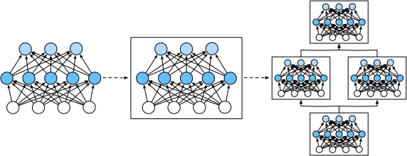

```{.python .input}
%load_ext d2lbook.tab
tab.interact_select(['mxnet', 'pytorch', 'tensorflow', 'jax'])
```

# Sluoksniai ir moduliai
:label:`sec_model_construction`

Kai pirmą kartą pristatėme neuroninius tinklus,
susitelkėme į tiesinius modelius su viena išvestimi.
Čia visą modelį sudaro tik vienas neuronas.
Atkreipkite dėmesį, kad vienas neuronas
(i) priima tam tikrą įvesčių aibę;
(ii) generuoja atitinkamą skaliarinę išvestį;
ir (iii) turi susijusių parametrų aibę, kurią galima atnaujinti
siekiant optimizuoti kokią nors dominančią tikslo funkciją.
Tada, kai pradėjome galvoti apie tinklus su keliomis išvestimis,
pasitelkėme vektorizuotą aritmetiką,
kad apibūdintume visą neuronų sluoksnį.
Lygiai kaip atskiri neuronai,
sluoksniai (i) priima įvesčių aibę,
(ii) generuoja atitinkamas išvestis
ir (iii) yra aprašomi derinamų parametrų aibe.
Kai nagrinėjome softmax regresiją,
vienas sluoksnis pats buvo modelis.
Tačiau net kai vėliau
pristatėme MLP,
vis tiek galėjome laikyti, kad modelis
išlaiko tą pačią pagrindinę struktūrą.

Įdomu, kad MLP atveju
ir visas modelis, ir jo sudedamieji sluoksniai
turi šią struktūrą.
Visas modelis priima neapdorotas įvestis (požymius),
generuoja išvestis (prognozes)
ir turi parametrus
(visų sudedamųjų sluoksnių parametrų visumą).
Lygiai taip pat kiekvienas atskiras sluoksnis priima įvestis
(kurias pateikia ankstesnis sluoksnis),
generuoja išvestis (kito sluoksnio įvestis)
ir turi derinamų parametrų aibę, kuri atnaujinama
pagal signalą, tekantį atgal
iš kito sluoksnio.


Nors galite manyti, kad neuronai, sluoksniai ir modeliai
suteikia mums pakankamai abstrakcijų savo darbui,
paaiškėja, kad dažnai patogu
kalbėti apie komponentus, kurie yra
didesni nei atskiras sluoksnis,
bet mažesni nei visas modelis.
Pavyzdžiui, ResNet-152 architektūra,
kuri be galo populiari kompiuteriniame matyme,
turi šimtus sluoksnių.
Šiuos sluoksnius sudaro pasikartojantys *sluoksnių grupių* dėsningumai. Įgyvendinti tokį tinklą po vieną sluoksnį gali tapti varginantis.
Šis rūpestis nėra vien hipotetinis – tokie
projektavimo šablonai praktikoje yra įprasti.
Minėtoji ResNet architektūra
laimėjo 2015 m. ImageNet ir COCO kompiuterinio matymo konkursus
tiek atpažinimo, tiek aptikimo kategorijose :cite:`He.Zhang.Ren.ea.2016`
ir tebėra pagrindinė architektūra daugeliui matymo užduočių.
Panašios architektūros, kuriose sluoksniai išdėstyti
įvairiais pasikartojančiais dėsningumais,
dabar yra visur kitose srityse,
įskaitant natūraliosios kalbos apdorojimą ir kalbą.

Kad įgyvendintume šiuos sudėtingus tinklus,
pristatome neuroninio tinklo *modulio* sąvoką.
Modulis gali aprašyti atskirą sluoksnį,
kelių sluoksnių komponentą
arba patį visą modelį!
Viena darbo su modulio abstrakcija nauda
yra ta, kad juos galima jungti į didesnius darinius,
dažnai rekursyviai. Tai iliustruota :numref:`fig_blocks`. Apibrėždami kodą, generuojantį savavališko sudėtingumo
modulius pagal poreikį,
galime parašyti stebėtinai kompaktišką kodą
ir vis tiek įgyvendinti sudėtingus neuroninius tinklus.


:label:`fig_blocks`


Programavimo požiūriu modulis atvaizduojamas *klase*.
Bet kuri jos poklasė turi apibrėžti tiesioginio sklidimo metodą,
kuris transformuoja jos įvestį į išvestį,
ir turi saugoti visus reikalingus parametrus.
Atkreipkite dėmesį, kad kai kuriems moduliams parametrų visai nereikia.
Galiausiai modulis turi turėti atgalinio sklidimo metodą
gradientams apskaičiuoti.
Laimei, dėl užkulisinės magijos,
kurią suteikia automatinis diferencijavimas
(pristatytas :numref:`sec_autograd`),
apibrėždami savo modulį,
turime rūpintis tik parametrais
ir tiesioginio sklidimo metodu.

```{.python .input}
%%tab mxnet
from mxnet import np, npx
from mxnet.gluon import nn
npx.set_np()
```

```{.python .input}
%%tab pytorch
import torch
from torch import nn
from torch.nn import functional as F
```

```{.python .input}
%%tab tensorflow
import tensorflow as tf
```

```{.python .input}
%%tab jax
from typing import List
from d2l import jax as d2l
from flax import linen as nn
import jax
from jax import numpy as jnp
```

[**Pradžioje peržiūrime kodą,
kurį naudojome MLP įgyvendinti**]
(:numref:`sec_mlp`).
Šis kodas sugeneruoja tinklą
su vienu pilnai sujungtu paslėptuoju sluoksniu,
turinčiu 256 vienetus ir ReLU aktyvaciją,
po kurio eina pilnai sujungtas išvesties sluoksnis
su dešimčia vienetų (be aktyvacijos funkcijos).

```{.python .input}
%%tab mxnet
net = nn.Sequential()
net.add(nn.Dense(256, activation='relu'))
net.add(nn.Dense(10))
net.initialize()

X = np.random.uniform(size=(2, 20))
net(X).shape
```

```{.python .input}
%%tab pytorch
net = nn.Sequential(nn.LazyLinear(256), nn.ReLU(), nn.LazyLinear(10))

X = torch.rand(2, 20)
net(X).shape
```

```{.python .input}
%%tab tensorflow
net = tf.keras.models.Sequential([
    tf.keras.layers.Dense(256, activation=tf.nn.relu),
    tf.keras.layers.Dense(10),
])

X = tf.random.uniform((2, 20))
net(X).shape
```

```{.python .input}
%%tab jax
net = nn.Sequential([nn.Dense(256), nn.relu, nn.Dense(10)])

# get_key is a d2l saved function returning jax.random.PRNGKey(random_seed)
X = jax.random.uniform(d2l.get_key(), (2, 20))
params = net.init(d2l.get_key(), X)
net.apply(params, X).shape
```

:begin_tab:`mxnet`
Šiame pavyzdyje sukonstravome
savo modelį, sukurdami `nn.Sequential` egzempliorių
ir priskirdami grąžintą objektą kintamajam `net`.
Toliau pakartotinai kviečiame jo metodą `add`,
pridėdami sluoksnius ta tvarka,
kuria jie turėtų būti vykdomi.
Trumpai tariant, `nn.Sequential` apibrėžia ypatingą `Block` rūšį –
klasę, kuri Gluon atvaizduoja *modulį*.
Ji palaiko sutvarkytą sudedamųjų `Block` sąrašą.
Metodas `add` tiesiog palengvina
kiekvieno paskesnio `Block` pridėjimą prie sąrašo.
Atkreipkite dėmesį, kad kiekvienas sluoksnis yra klasės `Dense` egzempliorius,
kuris pats yra `Block` poklasė.
Tiesioginio sklidimo (`forward`) metodas taip pat nepaprastai paprastas:
jis sujungia kiekvieną sąrašo `Block` į grandinę,
perduodamas kiekvieno išvestį kaip įvestį kitam.
Atkreipkite dėmesį, kad iki šiol savo modelius kvietėme
konstrukcija `net(X)`, kad gautume jų išvestis.
Tai iš tikrųjų tėra santrumpa `net.forward(X)` –
graži Python gudrybė, pasiekiama
per klasės `Block` metodą `__call__`.
:end_tab:

:begin_tab:`pytorch`
Šiame pavyzdyje sukonstravome
savo modelį, sukurdami `nn.Sequential` egzempliorių, perduodami sluoksnius kaip argumentus ta tvarka,
kuria jie turėtų būti vykdomi.
Trumpai tariant, (**`nn.Sequential` apibrėžia ypatingą `Module` rūšį**) –
klasę, kuri PyTorch atvaizduoja modulį.
Ji palaiko sutvarkytą sudedamųjų `Module` sąrašą.
Atkreipkite dėmesį, kad kiekvienas iš dviejų pilnai sujungtų sluoksnių yra klasės `Linear` egzempliorius,
kuris pats yra `Module` poklasė.
Tiesioginio sklidimo (`forward`) metodas taip pat nepaprastai paprastas:
jis sujungia kiekvieną sąrašo modulį į grandinę,
perduodamas kiekvieno išvestį kaip įvestį kitam.
Atkreipkite dėmesį, kad iki šiol savo modelius kvietėme
konstrukcija `net(X)`, kad gautume jų išvestis.
Tai iš tikrųjų tėra santrumpa `net.__call__(X)`.
:end_tab:

:begin_tab:`tensorflow`
Šiame pavyzdyje sukonstravome
savo modelį, sukurdami `keras.models.Sequential` egzempliorių, perduodami sluoksnius kaip argumentus ta tvarka,
kuria jie turėtų būti vykdomi.
Trumpai tariant, `Sequential` apibrėžia ypatingą `keras.Model` rūšį –
klasę, kuri Keras atvaizduoja modulį.
Ji palaiko sutvarkytą sudedamųjų `Model` sąrašą.
Atkreipkite dėmesį, kad kiekvienas iš dviejų pilnai sujungtų sluoksnių yra klasės `Dense` egzempliorius,
kuris pats yra `Model` poklasė.
Tiesioginio sklidimo (`call`) metodas taip pat nepaprastai paprastas:
jis sujungia kiekvieną sąrašo modulį į grandinę,
perduodamas kiekvieno išvestį kaip įvestį kitam.
Atkreipkite dėmesį, kad iki šiol savo modelius kvietėme
konstrukcija `net(X)`, kad gautume jų išvestis.
Tai iš tikrųjų tėra santrumpa `net.call(X)` –
graži Python gudrybė, pasiekiama
per modulio klasės metodą `__call__`.
:end_tab:

## [**Pasirinktinis modulis**]

Galbūt lengviausias būdas išsiugdyti intuiciją
apie tai, kaip veikia modulis,
yra patiems jį įgyvendinti.
Prieš tai
trumpai apibendriname pagrindines funkcijas,
kurias turi teikti kiekvienas modulis:


1. Priimti įvesties duomenis kaip savo tiesioginio sklidimo metodo argumentus.
1. Generuoti išvestį, kad tiesioginio sklidimo metodas grąžintų reikšmę. Atkreipkite dėmesį, kad išvestis gali turėti kitą formą nei įvestis. Pavyzdžiui, pirmasis pilnai sujungtas sluoksnis mūsų aukščiau pateiktame modelyje priima savavališkos dimensijos įvestį, bet grąžina 256 dimensijos išvestį.
1. Apskaičiuoti savo išvesties gradientą įvesties atžvilgiu, kurį galima pasiekti per jo atgalinio sklidimo metodą. Paprastai tai vyksta automatiškai.
1. Saugoti ir suteikti prieigą prie tų parametrų, kurie reikalingi
   tiesioginio sklidimo skaičiavimui atlikti.
1. Prireikus inicializuoti modelio parametrus.


Šiame fragmente
užkoduojame nuo nulio modulį,
atitinkantį MLP
su vienu paslėptuoju sluoksniu su 256 paslėptaisiais vienetais
ir 10 dimensijų išvesties sluoksniu.
Atkreipkite dėmesį, kad žemiau pateikta klasė `MLP` paveldi klasę, atvaizduojančią modulį.
Labai pasikliausime tėvinės klasės metodais,
pateikdami tik savo konstruktorių (Python metodą `__init__`) ir tiesioginio sklidimo metodą.

```{.python .input}
%%tab mxnet
class MLP(nn.Block):
    def __init__(self):
        # Call the constructor of the MLP parent class nn.Block to perform
        # the necessary initialization
        super().__init__()
        self.hidden = nn.Dense(256, activation='relu')
        self.out = nn.Dense(10)

    # Define the forward propagation of the model, that is, how to return the
    # required model output based on the input X
    def forward(self, X):
        return self.out(self.hidden(X))
```

```{.python .input}
%%tab pytorch
class MLP(nn.Module):
    def __init__(self):
        # Call the constructor of the parent class nn.Module to perform
        # the necessary initialization
        super().__init__()
        self.hidden = nn.LazyLinear(256)
        self.out = nn.LazyLinear(10)

    # Define the forward propagation of the model, that is, how to return the
    # required model output based on the input X
    def forward(self, X):
        return self.out(F.relu(self.hidden(X)))
```

```{.python .input}
%%tab tensorflow
class MLP(tf.keras.Model):
    def __init__(self):
        # Call the constructor of the parent class tf.keras.Model to perform
        # the necessary initialization
        super().__init__()
        self.hidden = tf.keras.layers.Dense(units=256, activation=tf.nn.relu)
        self.out = tf.keras.layers.Dense(units=10)

    # Define the forward propagation of the model, that is, how to return the
    # required model output based on the input X
    def call(self, X):
        return self.out(self.hidden((X)))
```

```{.python .input}
%%tab jax
class MLP(nn.Module):
    def setup(self):
        # Define the layers
        self.hidden = nn.Dense(256)
        self.out = nn.Dense(10)

    # Define the forward propagation of the model, that is, how to return the
    # required model output based on the input X
    def __call__(self, X):
        return self.out(nn.relu(self.hidden(X)))
```

Pirmiausia susitelkime į tiesioginio sklidimo metodą.
Atkreipkite dėmesį, kad jis priima `X` kaip įvestį,
apskaičiuoja paslėptąjį atvaizdą
su pritaikyta aktyvacijos funkcija
ir išveda savo logitus.
Šiame `MLP` įgyvendinime
abu sluoksniai yra egzemplioriaus kintamieji.
Kad suprastume, kodėl tai pagrįsta, įsivaizduokite
sukuriant du MLP, `net1` ir `net2`,
ir apmokant juos su skirtingais duomenimis.
Natūralu, kad tikėtumėmės, jog jie
atvaizduos du skirtingus išmoktus modelius.

Konstruktoriuje [**sukuriame MLP sluoksnius**]
(**ir vėliau kviečiame šiuos sluoksnius**)
kiekvieną kartą kviečiant tiesioginio sklidimo metodą.
Atkreipkite dėmesį į keletą esminių detalių.
Pirma, mūsų pritaikytas metodas `__init__`
kviečia tėvinės klasės metodą `__init__`
per `super().__init__()`,
taip pasaugodamas mus nuo pasikartojančio
šablonistinio kodo, taikomo daugumai modulių, kartojimo.
Tada sukuriame du savo pilnai sujungtus sluoksnius,
priskirdami juos `self.hidden` ir `self.out`.
Atkreipkite dėmesį, kad jei neįgyvendiname naujo sluoksnio,
nereikia rūpintis nei atgalinio sklidimo metodu,
nei parametrų inicializavimu.
Sistema šiuos metodus sugeneruos automatiškai.
Išbandykime tai.

```{.python .input}
%%tab pytorch, mxnet, tensorflow
net = MLP()
if tab.selected('mxnet'):
    net.initialize()
net(X).shape
```

```{.python .input}
%%tab jax
net = MLP()
params = net.init(d2l.get_key(), X)
net.apply(params, X).shape
```

Pagrindinė modulio abstrakcijos dorybė yra jos universalumas.
Galime sukurti modulio poklasę, kad sukurtume sluoksnius
(pavyzdžiui, pilnai sujungto sluoksnio klasę),
visus modelius (pavyzdžiui, aukščiau pateiktą klasę `MLP`)
arba įvairius vidutinio sudėtingumo komponentus.
Šį universalumą išnaudosime
visuose būsimuose skyriuose,
pavyzdžiui, nagrinėdami
konvoliucinius neuroninius tinklus.


## [**Nuoseklusis modulis**]
:label:`subsec_model-construction-sequential`

Dabar galime atidžiau pažvelgti,
kaip veikia klasė `Sequential`.
Prisiminkite, kad `Sequential` buvo sukurta
kitiems moduliams sujungti į grandinę.
Kad sukurtume savo supaprastintą `MySequential`,
tereikia apibrėžti du pagrindinius metodus:

1. Metodą, skirtą po vieną pridėti modulius į sąrašą.
1. Tiesioginio sklidimo metodą, skirtą perduoti įvestį per modulių grandinę ta pačia tvarka, kuria jie buvo pridėti.

Tą patį funkcionalumą, kurį teikia numatytoji klasė `Sequential`,
pateikia ir žemiau pateikta klasė `MySequential`.

```{.python .input}
%%tab mxnet
class MySequential(nn.Block):
    def add(self, block):
        # Here, block is an instance of a Block subclass, and we assume that
        # it has a unique name. We save it in the member variable _children of
        # the Block class, and its type is OrderedDict. When the MySequential
        # instance calls the initialize method, the system automatically
        # initializes all members of _children
        self._children[block.name] = block

    def forward(self, X):
        # OrderedDict guarantees that members will be traversed in the order
        # they were added
        for block in self._children.values():
            X = block(X)
        return X
```

```{.python .input}
%%tab pytorch
class MySequential(nn.Module):
    def __init__(self, *args):
        super().__init__()
        for idx, module in enumerate(args):
            self.add_module(str(idx), module)

    def forward(self, X):
        for module in self.children():            
            X = module(X)
        return X
```

```{.python .input}
%%tab tensorflow
class MySequential(tf.keras.Model):
    def __init__(self, *args):
        super().__init__()
        self.modules = args

    def call(self, X):
        for module in self.modules:
            X = module(X)
        return X
```

```{.python .input}
%%tab jax
class MySequential(nn.Module):
    modules: List

    def __call__(self, X):
        for module in self.modules:
            X = module(X)
        return X
```

:begin_tab:`mxnet`
Metodas `add` prideda vieną bloką
į sutvarkytą žodyną `_children`.
Galbūt stebitės, kodėl kiekvienas Gluon `Block`
turi atributą `_children`
ir kodėl jį naudojome, užuot tiesiog
patys apibrėžę Python sąrašą.
Trumpai tariant, pagrindinis `_children` pranašumas yra tas,
kad mūsų bloko parametrų inicializavimo metu
Gluon žino, kad reikia pažvelgti į `_children`
žodyną, norint rasti pogrupius blokus, kurių
parametrus taip pat reikia inicializuoti.
:end_tab:

:begin_tab:`pytorch`
Metode `__init__` pridedame kiekvieną modulį
kviesdami metodą `add_modules`. Šiuos modulius vėliau galima pasiekti metodu `children`.
Tokiu būdu sistema žino pridėtus modulius
ir tinkamai inicializuos kiekvieno modulio parametrus.
:end_tab:

Kai iškviečiamas mūsų `MySequential` tiesioginio sklidimo metodas,
kiekvienas pridėtas modulis vykdomas
ta tvarka, kuria jie buvo pridėti.
Dabar galime iš naujo įgyvendinti MLP
naudodami savo klasę `MySequential`.

```{.python .input}
%%tab mxnet
net = MySequential()
net.add(nn.Dense(256, activation='relu'))
net.add(nn.Dense(10))
net.initialize()
net(X).shape
```

```{.python .input}
%%tab pytorch
net = MySequential(nn.LazyLinear(256), nn.ReLU(), nn.LazyLinear(10))
net(X).shape
```

```{.python .input}
%%tab tensorflow
net = MySequential(
    tf.keras.layers.Dense(units=256, activation=tf.nn.relu),
    tf.keras.layers.Dense(10))
net(X).shape
```

```{.python .input}
%%tab jax
net = MySequential([nn.Dense(256), nn.relu, nn.Dense(10)])
params = net.init(d2l.get_key(), X)
net.apply(params, X).shape
```

Atkreipkite dėmesį, kad šis `MySequential` naudojimas
yra identiškas kodui, kurį anksčiau parašėme
klasei `Sequential`
(kaip aprašyta :numref:`sec_mlp`).


## [**Kodo vykdymas tiesioginio sklidimo metode**]

Klasė `Sequential` palengvina modelio konstravimą,
leisdama mums surinkti naujas architektūras
neapibrėžiant savo klasės.
Tačiau ne visos architektūros yra paprastos grandinės.
Kai reikia didesnio lankstumo,
norėsime apibrėžti savo blokus.
Pavyzdžiui, galime norėti vykdyti
Python valdymo srautą tiesioginio sklidimo metode.
Be to, galime norėti atlikti
savavališkas matematines operacijas,
nepasikliaudami vien iš anksto apibrėžtais neuroninių tinklų sluoksniais.

Galbūt pastebėjote, kad iki šiol
visos mūsų tinklų operacijos
veikė mūsų tinklo aktyvacijas
ir jo parametrus.
Tačiau kartais galime norėti
įtraukti narius,
kurie nėra nei ankstesnių sluoksnių rezultatas,
nei atnaujinami parametrai.
Juos vadiname *pastoviaisiais parametrais*.
Tarkime, pavyzdžiui, kad norime sluoksnio,
kuris apskaičiuoja funkciją
$f(\mathbf{x},\mathbf{w}) = c \cdot \mathbf{w}^\top \mathbf{x}$,
kur $\mathbf{x}$ yra įvestis, $\mathbf{w}$ yra mūsų parametras,
o $c$ yra kokia nors nurodyta konstanta,
kuri optimizavimo metu neatnaujinama.
Taigi įgyvendiname klasę `FixedHiddenMLP` taip.

```{.python .input}
%%tab mxnet
class FixedHiddenMLP(nn.Block):
    def __init__(self):
        super().__init__()
        # Random weight parameters created with the get_constant method
        # are not updated during training (i.e., constant parameters)
        self.rand_weight = self.params.get_constant(
            'rand_weight', np.random.uniform(size=(20, 20)))
        self.dense = nn.Dense(20, activation='relu')

    def forward(self, X):
        X = self.dense(X)
        # Use the created constant parameters, as well as the relu and dot
        # functions
        X = npx.relu(np.dot(X, self.rand_weight.data()) + 1)
        # Reuse the fully connected layer. This is equivalent to sharing
        # parameters with two fully connected layers
        X = self.dense(X)
        # Control flow
        while np.abs(X).sum() > 1:
            X /= 2
        return X.sum()
```

```{.python .input}
%%tab pytorch
class FixedHiddenMLP(nn.Module):
    def __init__(self):
        super().__init__()
        # Random weight parameters that will not compute gradients and
        # therefore keep constant during training
        self.rand_weight = torch.rand((20, 20))
        self.linear = nn.LazyLinear(20)

    def forward(self, X):
        X = self.linear(X)        
        X = F.relu(X @ self.rand_weight + 1)
        # Reuse the fully connected layer. This is equivalent to sharing
        # parameters with two fully connected layers
        X = self.linear(X)
        # Control flow
        while X.abs().sum() > 1:
            X /= 2
        return X.sum()
```

```{.python .input}
%%tab tensorflow
class FixedHiddenMLP(tf.keras.Model):
    def __init__(self):
        super().__init__()
        self.flatten = tf.keras.layers.Flatten()
        # Random weight parameters created with tf.constant are not updated
        # during training (i.e., constant parameters)
        self.rand_weight = tf.constant(tf.random.uniform((20, 20)))
        self.dense = tf.keras.layers.Dense(20, activation=tf.nn.relu)

    def call(self, inputs):
        X = self.flatten(inputs)
        # Use the created constant parameters, as well as the relu and
        # matmul functions
        X = tf.nn.relu(tf.matmul(X, self.rand_weight) + 1)
        # Reuse the fully connected layer. This is equivalent to sharing
        # parameters with two fully connected layers
        X = self.dense(X)
        # Control flow
        while tf.reduce_sum(tf.math.abs(X)) > 1:
            X /= 2
        return tf.reduce_sum(X)
```

```{.python .input}
%%tab jax
class FixedHiddenMLP(nn.Module):
    # Random weight parameters that will not compute gradients and
    # therefore keep constant during training
    rand_weight: jnp.array = jax.random.uniform(d2l.get_key(), (20, 20))

    def setup(self):
        self.dense = nn.Dense(20)

    def __call__(self, X):
        X = self.dense(X)
        X = nn.relu(X @ self.rand_weight + 1)
        # Reuse the fully connected layer. This is equivalent to sharing
        # parameters with two fully connected layers
        X = self.dense(X)
        # Control flow
        while jnp.abs(X).sum() > 1:
            X /= 2
        return X.sum()
```

Šiame modelyje
įgyvendiname paslėptąjį sluoksnį, kurio svoriai
(`self.rand_weight`) inicializuojami atsitiktinai
sukuriant egzempliorių ir vėliau yra pastovūs.
Šis svoris nėra modelio parametras,
todėl jis niekada neatnaujinamas atgaliniu sklidimu.
Tada tinklas perduoda šio „fiksuoto“ sluoksnio išvestį
per pilnai sujungtą sluoksnį.

Atkreipkite dėmesį, kad prieš grąžindamas išvestį,
mūsų modelis padarė kai ką neįprasto.
Paleidome ciklą while, tikrindami
sąlygą, ar jo $\ell_1$ norma didesnė už $1$,
ir dalijome savo išvesties vektorių iš $2$,
kol jis tenkino sąlygą.
Galiausiai grąžinome `X` elementų sumą.
Kiek mums žinoma, joks standartinis neuroninis tinklas
neatlieka šios operacijos.
Atkreipkite dėmesį, kad ši konkreti operacija gali būti nenaudinga
jokioje realaus pasaulio užduotyje.
Mūsų tikslas yra tik parodyti, kaip integruoti
savavališką kodą į savo
neuroninio tinklo skaičiavimų srautą.

```{.python .input}
%%tab pytorch, mxnet, tensorflow
net = FixedHiddenMLP()
if tab.selected('mxnet'):
    net.initialize()
net(X)
```

```{.python .input}
%%tab jax
net = FixedHiddenMLP()
params = net.init(d2l.get_key(), X)
net.apply(params, X)
```

Galime [**maišyti ir derinti įvairius
modulių sujungimo būdus.**]
Šiame pavyzdyje modulius įdedame vieną į kitą
kai kuriais kūrybiškais būdais.

```{.python .input}
%%tab mxnet
class NestMLP(nn.Block):
    def __init__(self, **kwargs):
        super().__init__(**kwargs)
        self.net = nn.Sequential()
        self.net.add(nn.Dense(64, activation='relu'),
                     nn.Dense(32, activation='relu'))
        self.dense = nn.Dense(16, activation='relu')

    def forward(self, X):
        return self.dense(self.net(X))

chimera = nn.Sequential()
chimera.add(NestMLP(), nn.Dense(20), FixedHiddenMLP())
chimera.initialize()
chimera(X)
```

```{.python .input}
%%tab pytorch
class NestMLP(nn.Module):
    def __init__(self):
        super().__init__()
        self.net = nn.Sequential(nn.LazyLinear(64), nn.ReLU(),
                                 nn.LazyLinear(32), nn.ReLU())
        self.linear = nn.LazyLinear(16)

    def forward(self, X):
        return self.linear(self.net(X))

chimera = nn.Sequential(NestMLP(), nn.LazyLinear(20), FixedHiddenMLP())
chimera(X)
```

```{.python .input}
%%tab tensorflow
class NestMLP(tf.keras.Model):
    def __init__(self):
        super().__init__()
        self.net = tf.keras.Sequential()
        self.net.add(tf.keras.layers.Dense(64, activation=tf.nn.relu))
        self.net.add(tf.keras.layers.Dense(32, activation=tf.nn.relu))
        self.dense = tf.keras.layers.Dense(16, activation=tf.nn.relu)

    def call(self, inputs):
        return self.dense(self.net(inputs))

chimera = tf.keras.Sequential()
chimera.add(NestMLP())
chimera.add(tf.keras.layers.Dense(20))
chimera.add(FixedHiddenMLP())
chimera(X)
```

```{.python .input}
%%tab jax
class NestMLP(nn.Module):
    def setup(self):
        self.net = nn.Sequential([nn.Dense(64), nn.relu,
                                  nn.Dense(32), nn.relu])
        self.dense = nn.Dense(16)

    def __call__(self, X):
        return self.dense(self.net(X))


chimera = nn.Sequential([NestMLP(), nn.Dense(20), FixedHiddenMLP()])
params = chimera.init(d2l.get_key(), X)
chimera.apply(params, X)
```

## Santrauka

Atskiri sluoksniai gali būti moduliai.
Daug sluoksnių gali sudaryti modulį.
Daug modulių gali sudaryti modulį.

Modulis gali turėti kodo.
Moduliai pasirūpina daugybe buities darbų, įskaitant parametrų inicializavimą ir atgalinį sklidimą.
Nuoseklius sluoksnių ir modulių sujungimus tvarko modulis `Sequential`.


## Pratimai

1. Kokių problemų kils, jei pakeisite `MySequential`, kad moduliai būtų saugomi Python sąraše?
1. Įgyvendinkite modulį, kuris kaip argumentus priima du modulius, tarkime, `net1` ir `net2`, ir tiesioginio sklidimo metu grąžina abiejų tinklų sujungtą išvestį. Tai taip pat vadinama *lygiagrečiuoju moduliu*.
1. Tarkime, kad norite sujungti kelis to paties tinklo egzempliorius. Įgyvendinkite gamyklos funkciją, kuri sugeneruoja kelis to paties modulio egzempliorius, ir iš jų sukurkite didesnį tinklą.

:begin_tab:`mxnet`
[Diskusijos](https://discuss.d2l.ai/t/54)
:end_tab:

:begin_tab:`pytorch`
[Diskusijos](https://discuss.d2l.ai/t/55)
:end_tab:

:begin_tab:`tensorflow`
[Diskusijos](https://discuss.d2l.ai/t/264)
:end_tab:

:begin_tab:`jax`
[Diskusijos](https://discuss.d2l.ai/t/17989)
:end_tab:
