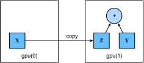

```{.python .input}
%load_ext d2lbook.tab
tab.interact_select(['mxnet', 'pytorch', 'tensorflow', 'jax'])
```

# GPU
:label:`sec_use_gpu`

:numref:`tab_intro_decade` iliustravome spartų skaičiavimų augimą
per pastaruosius du dešimtmečius.
Trumpai tariant, GPU našumas nuo 2000 m. išaugo
1000 kartų kas dešimtmetį.
Tai suteikia puikių galimybių, bet taip pat rodo,
kad tokio našumo poreikis buvo didelis.


Šiame skyrelyje pradedame aptarti, kaip pasinaudoti
šiuo skaičiavimo našumu savo tyrimams.
Pirmiausia naudojant vieną GPU, o vėliau –
kaip naudoti kelis GPU ir kelis serverius (su keliais GPU).

Konkrečiai, aptarsime, kaip
skaičiavimams naudoti vieną NVIDIA GPU.
Pirmiausia įsitikinkite, kad turite įdiegtą bent vieną NVIDIA GPU.
Tada atsisiųskite [NVIDIA tvarkyklę ir CUDA](https://developer.nvidia.com/cuda-downloads)
ir vykdykite nurodymus, kad nustatytumėte tinkamą kelią.
Kai šie pasiruošimai baigti,
komandą `nvidia-smi` galima naudoti
(**vaizdo plokštės informacijai peržiūrėti**).

:begin_tab:`mxnet`
Galbūt pastebėjote, kad MXNet tenzorius
atrodo beveik identiškai kaip NumPy `ndarray`.
Bet yra keletas esminių skirtumų.
Viena pagrindinių savybių, išskiriančių MXNet
iš NumPy, yra jo palaikymas įvairiems aparatinės įrangos įrenginiams.

MXNet kiekvienas masyvas turi kontekstą.
Iki šiol pagal numatytuosius nustatymus visi kintamieji
ir su jais susiję skaičiavimai
buvo priskirti CPU.
Paprastai kiti kontekstai gali būti įvairūs GPU.
Dalykai gali tapti dar sudėtingesni, kai
užduotis diegiame keliuose serveriuose.
Protingai priskirdami masyvus kontekstams,
galime sumažinti laiką, praleidžiamą
perduodant duomenis tarp įrenginių.
Pavyzdžiui, apmokant neuroninius tinklus serveryje su GPU,
paprastai norime, kad modelio parametrai būtų GPU.

Toliau turime patvirtinti, kad
įdiegta GPU MXNet versija.
Jei jau įdiegta CPU MXNet versija,
pirmiausia turime ją pašalinti.
Pavyzdžiui, naudokite komandą `pip uninstall mxnet`,
tada įdiekite atitinkamą MXNet versiją
pagal savo CUDA versiją.
Tarkime, kad turite įdiegtą CUDA 10.0,
galite įdiegti MXNet versiją,
palaikančią CUDA 10.0, per `pip install mxnet-cu100`.
:end_tab:

:begin_tab:`pytorch`
PyTorch kiekvienas masyvas turi įrenginį; dažnai vadiname jį *kontekstu*.
Iki šiol pagal numatytuosius nustatymus visi kintamieji
ir su jais susiję skaičiavimai
buvo priskirti CPU.
Paprastai kiti kontekstai gali būti įvairūs GPU.
Dalykai gali tapti dar sudėtingesni, kai
užduotis diegiame keliuose serveriuose.
Protingai priskirdami masyvus kontekstams,
galime sumažinti laiką, praleidžiamą
perduodant duomenis tarp įrenginių.
Pavyzdžiui, apmokant neuroninius tinklus serveryje su GPU,
paprastai norime, kad modelio parametrai būtų GPU.
:end_tab:

Kad paleistumėte šiame skyrelyje pateiktas programas,
jums reikia bent dviejų GPU.
Atkreipkite dėmesį, kad daugumai stalinių kompiuterių tai gali būti ištaiginga,
bet debesyje tai lengvai prieinama, pvz.,
naudojant AWS EC2 kelių GPU egzempliorius.
Beveik visiems kitiems skyreliams kelių GPU *nereikia*, bet čia tiesiog norime iliustruoti duomenų srautą tarp skirtingų įrenginių.

```{.python .input}
%%tab mxnet
from d2l import mxnet as d2l
from mxnet import np, npx
from mxnet.gluon import nn
npx.set_np()
```

```{.python .input}
%%tab pytorch
from d2l import torch as d2l
import torch
from torch import nn
```

```{.python .input}
%%tab tensorflow
from d2l import tensorflow as d2l
import tensorflow as tf
```

```{.python .input}
%%tab jax
from d2l import jax as d2l
from flax import linen as nn
import jax
from jax import numpy as jnp
```

## [**Skaičiavimo įrenginiai**]

Saugojimui ir skaičiavimui galime nurodyti įrenginius,
tokius kaip CPU ir GPU.
Pagal numatytuosius nustatymus tenzoriai sukuriami pagrindinėje atmintyje,
o skaičiavimams naudojamas CPU.

:begin_tab:`mxnet`
MXNet CPU ir GPU galima nurodyti per `cpu()` ir `gpu()`.
Reikia pažymėti, kad `cpu()`
(ar bet koks sveikasis skaičius skliausteliuose)
reiškia visus fizinius CPU ir atmintį.
Tai reiškia, kad MXNet skaičiavimai
bandys naudoti visus CPU branduolius.
Tačiau `gpu()` atstovauja tik vieną plokštę
ir atitinkamą atmintį.
Jei yra keli GPU, naudojame `gpu(i)`
$i$-ajam GPU atvaizduoti ($i$ prasideda nuo 0).
Taip pat `gpu(0)` ir `gpu()` yra ekvivalentūs.
:end_tab:

:begin_tab:`pytorch`
PyTorch CPU ir GPU galima nurodyti per `torch.device('cpu')` ir `torch.device('cuda')`.
Reikia pažymėti, kad `cpu` įrenginys
reiškia visus fizinius CPU ir atmintį.
Tai reiškia, kad PyTorch skaičiavimai
bandys naudoti visus CPU branduolius.
Tačiau `gpu` įrenginys atstovauja tik vieną plokštę
ir atitinkamą atmintį.
Jei yra keli GPU, naudojame `torch.device(f'cuda:{i}')`
$i$-ajam GPU atvaizduoti ($i$ prasideda nuo 0).
Taip pat `gpu:0` ir `gpu` yra ekvivalentūs.
:end_tab:

```{.python .input}
%%tab pytorch
def cpu():  #@save
    """Get the CPU device."""
    return torch.device('cpu')

def gpu(i=0):  #@save
    """Get a GPU device."""
    return torch.device(f'cuda:{i}')

cpu(), gpu(), gpu(1)
```

```{.python .input}
%%tab mxnet, tensorflow, jax
def cpu():  #@save
    """Get the CPU device."""
    if tab.selected('mxnet'):
        return npx.cpu()
    if tab.selected('tensorflow'):
        return tf.device('/CPU:0')
    if tab.selected('jax'):
        return jax.devices('cpu')[0]

def gpu(i=0):  #@save
    """Get a GPU device."""
    if tab.selected('mxnet'):
        return npx.gpu(i)
    if tab.selected('tensorflow'):
        return tf.device(f'/GPU:{i}')
    if tab.selected('jax'):
        return jax.devices('gpu')[i]

cpu(), gpu(), gpu(1)
```

Galime (**užklausti turimų GPU skaičiaus.**)

```{.python .input}
%%tab pytorch
def num_gpus():  #@save
    """Get the number of available GPUs."""
    return torch.cuda.device_count()

num_gpus()
```

```{.python .input}
%%tab mxnet, tensorflow, jax
def num_gpus():  #@save
    """Get the number of available GPUs."""
    if tab.selected('mxnet'):
        return npx.num_gpus()
    if tab.selected('tensorflow'):
        return len(tf.config.experimental.list_physical_devices('GPU'))
    if tab.selected('jax'):
        try:
            return jax.device_count('gpu')
        except:
            return 0  # No GPU backend found

num_gpus()
```

Dabar [**apibrėžiame dvi patogias funkcijas, leidžiančias
vykdyti kodą net jei prašomų GPU nėra.**]

```{.python .input}
%%tab all
def try_gpu(i=0):  #@save
    """Return gpu(i) if exists, otherwise return cpu()."""
    if num_gpus() >= i + 1:
        return gpu(i)
    return cpu()

def try_all_gpus():  #@save
    """Return all available GPUs, or [cpu(),] if no GPU exists."""
    return [gpu(i) for i in range(num_gpus())]

try_gpu(), try_gpu(10), try_all_gpus()
```

## Tenzoriai ir GPU

:begin_tab:`pytorch`
Pagal numatytuosius nustatymus tenzoriai sukuriami CPU.
Galime [**užklausti įrenginio, kuriame yra tenzorius.**]
:end_tab:

:begin_tab:`mxnet`
Pagal numatytuosius nustatymus tenzoriai sukuriami CPU.
Galime [**užklausti įrenginio, kuriame yra tenzorius.**]
:end_tab:

:begin_tab:`tensorflow, jax`
Pagal numatytuosius nustatymus tenzoriai sukuriami GPU/TPU, jei jie yra,
o jei jų nėra, naudojamas CPU.
Galime [**užklausti įrenginio, kuriame yra tenzorius.**]
:end_tab:

```{.python .input}
%%tab mxnet
x = np.array([1, 2, 3])
x.ctx
```

```{.python .input}
%%tab pytorch
x = torch.tensor([1, 2, 3])
x.device
```

```{.python .input}
%%tab tensorflow
x = tf.constant([1, 2, 3])
x.device
```

```{.python .input}
%%tab jax
x = jnp.array([1, 2, 3])
x.device()
```

Svarbu atkreipti dėmesį, kad kai tik norime
operuoti keliais nariais,
jie turi būti tame pačiame įrenginyje.
Pavyzdžiui, jei sudedame du tenzorius,
turime užtikrinti, kad abu argumentai
yra tame pačiame įrenginyje – priešingu atveju karkasas
nežinotų, kur saugoti rezultatą
ar net kaip nuspręsti, kur atlikti skaičiavimą.

### Saugojimas GPU

Yra keli būdai [**saugoti tenzorių GPU.**]
Pavyzdžiui, kurdami tenzorių galime nurodyti saugojimo įrenginį.
Toliau sukuriame tenzoriaus kintamąjį `X` pirmajame `gpu`.
GPU sukurtas tenzorius sunaudoja tik šio GPU atmintį.
Komandą `nvidia-smi` galime naudoti GPU atminties naudojimui peržiūrėti.
Apskritai turime užtikrinti, kad nesukurtume duomenų, viršijančių GPU atminties ribą.

```{.python .input}
%%tab mxnet
X = np.ones((2, 3), ctx=try_gpu())
X
```

```{.python .input}
%%tab pytorch
X = torch.ones(2, 3, device=try_gpu())
X
```

```{.python .input}
%%tab tensorflow
with try_gpu():
    X = tf.ones((2, 3))
X
```

```{.python .input}
%%tab jax
# By default JAX puts arrays to GPUs or TPUs if available
X = jax.device_put(jnp.ones((2, 3)), try_gpu())
X
```

Tarkime, kad turite bent du GPU, šis kodas (**sukurs atsitiktinį tenzorių `Y` antrajame GPU.**)

```{.python .input}
%%tab mxnet
Y = np.random.uniform(size=(2, 3), ctx=try_gpu(1))
Y
```

```{.python .input}
%%tab pytorch
Y = torch.rand(2, 3, device=try_gpu(1))
Y
```

```{.python .input}
%%tab tensorflow
with try_gpu(1):
    Y = tf.random.uniform((2, 3))
Y
```

```{.python .input}
%%tab jax
Y = jax.device_put(jax.random.uniform(jax.random.PRNGKey(0), (2, 3)),
                   try_gpu(1))
Y
```

### Kopijavimas

[**Jei norime apskaičiuoti `X + Y`,
turime nuspręsti, kur atlikti šią operaciją.**]
Pavyzdžiui, kaip parodyta :numref:`fig_copyto`,
galime perkelti `X` į antrąjį GPU
ir atlikti operaciją ten.
*Nesudėkite* tiesiog `X` ir `Y`,
nes tai sukels išimtį.
Vykdymo variklis nežinotų, ką daryti:
jis negali rasti duomenų tame pačiame įrenginyje ir nepavyksta.
Kadangi `Y` yra antrajame GPU,
turime perkelti `X` ten, kad galėtume juos sudėti.


:label:`fig_copyto`

```{.python .input}
%%tab mxnet
Z = X.copyto(try_gpu(1))
print(X)
print(Z)
```

```{.python .input}
%%tab pytorch
Z = X.cuda(1)
print(X)
print(Z)
```

```{.python .input}
%%tab tensorflow
with try_gpu(1):
    Z = X
print(X)
print(Z)
```

```{.python .input}
%%tab jax
Z = jax.device_put(X, try_gpu(1))
print(X)
print(Z)
```

Dabar, kai [**duomenys (ir `Z`, ir `Y`) yra tame pačiame GPU), galime juos sudėti.**]

```{.python .input}
%%tab all
Y + Z
```

:begin_tab:`mxnet`
Įsivaizduokite, kad jūsų kintamasis `Z` jau yra antrajame GPU.
Kas nutinka, jei vis tiek kviečiame `Z.copyto(gpu(1))`?
Jis padarys kopiją ir paskirs naują atmintį,
nors tas kintamasis jau yra norimame įrenginyje.
Būna atvejų, kai, priklausomai nuo aplinkos, kurioje vykdomas mūsų kodas,
du kintamieji jau gali būti tame pačiame įrenginyje.
Todėl norime daryti kopiją tik tada, kai kintamieji
šiuo metu yra skirtinguose įrenginiuose.
Tokiais atvejais galime kviesti `as_in_ctx`.
Jei kintamasis jau yra nurodytame įrenginyje,
tai nieko nedaro.
Nebent konkrečiai norite padaryti kopiją,
`as_in_ctx` yra pasirenkamas metodas.
:end_tab:

:begin_tab:`pytorch`
Bet kas, jei jūsų kintamasis `Z` jau buvo antrajame GPU?
Kas nutinka, jei vis tiek kviečiame `Z.cuda(1)`?
Jis grąžins `Z`, užuot daręs kopiją ir paskyręs naują atmintį.
:end_tab:

:begin_tab:`tensorflow`
Įsivaizduokite, kad jūsų kintamasis `Z` jau yra antrajame GPU.
Kas nutinka, jei vis tiek kviečiame `Z2 = Z` to paties įrenginio srityje?
Jis grąžins `Z`, užuot daręs kopiją ir paskyręs naują atmintį.
:end_tab:

:begin_tab:`jax`
Įsivaizduokite, kad jūsų kintamasis `Z` jau yra antrajame GPU.
Kas nutinka, jei vis tiek kviečiame `Z2 = Z` to paties įrenginio srityje?
Jis grąžins `Z`, užuot daręs kopiją ir paskyręs naują atmintį.
:end_tab:

```{.python .input}
%%tab mxnet
Z.as_in_ctx(try_gpu(1)) is Z
```

```{.python .input}
%%tab pytorch
Z.cuda(1) is Z
```

```{.python .input}
%%tab tensorflow
with try_gpu(1):
    Z2 = Z
Z2 is Z
```

```{.python .input}
%%tab jax
Z2 = jax.device_put(Z, try_gpu(1))
Z2 is Z
```

### Papildomos pastabos

Žmonės naudoja GPU mašininiam mokymuisi,
nes tikisi, kad jie bus greiti.
Bet kintamųjų perkėlimas tarp įrenginių yra lėtas: daug lėtesnis nei skaičiavimas.
Todėl norime, kad būtumėte 100 % tikri,
jog norite daryti kažką lėto, prieš tai leisdami tai daryti.
Jei giliojo mokymosi karkasas tiesiog automatiškai atliktų kopijavimą
nesugriūdamas, galbūt nepastebėtumėte,
kad parašėte lėto kodo.

Duomenų perkėlimas ne tik lėtas, bet ir gerokai apsunkina lygiagretinimą,
nes turime laukti, kol duomenys bus išsiųsti (ar tiksliau – gauti),
kad galėtume tęsti tolesnes operacijas.
Todėl su kopijavimo operacijomis reikia elgtis labai atsargiai.
Nykščio taisyklė: daug mažų operacijų
yra daug blogiau nei viena didelė operacija.
Be to, kelios operacijos vienu metu
yra daug geriau nei daug pavienių operacijų, išbarstytų po kodą,
nebent žinote, ką darote.
Taip yra todėl, kad tokios operacijos gali blokuotis, jei vienas įrenginys
turi laukti kito, kol galės daryti ką nors kita.
Tai šiek tiek primena kavos užsakymą eilėje,
užuot užsisakius ją iš anksto telefonu
ir sužinojus, kad ji paruošta, kai jūs atvykstate.

Galiausiai, kai spausdiname tenzorius arba konvertuojame tenzorius į NumPy formatą,
jei duomenų nėra pagrindinėje atmintyje,
karkasas pirmiausia nukopijuos juos į pagrindinę atmintį,
dėl ko atsiranda papildomos perdavimo sąnaudos.
Dar blogiau, dabar tai priklauso nuo baisiojo globaliojo interpretatoriaus užrakto,
dėl kurio viskas laukia, kol Python baigs darbą.


## [**Neuroniniai tinklai ir GPU**]

Panašiai neuroninio tinklo modelis gali nurodyti įrenginius.
Šis kodas modelio parametrus patalpina GPU.

```{.python .input}
%%tab mxnet
net = nn.Sequential()
net.add(nn.Dense(1))
net.initialize(ctx=try_gpu())
```

```{.python .input}
%%tab pytorch
net = nn.Sequential(nn.LazyLinear(1))
net = net.to(device=try_gpu())
```

```{.python .input}
%%tab tensorflow
strategy = tf.distribute.MirroredStrategy()
with strategy.scope():
    net = tf.keras.models.Sequential([
        tf.keras.layers.Dense(1)])
```

```{.python .input}
%%tab jax
net = nn.Sequential([nn.Dense(1)])

key1, key2 = jax.random.split(jax.random.PRNGKey(0))
x = jax.random.normal(key1, (10,))  # Dummy input
params = net.init(key2, x)  # Initialization call
```

Daug daugiau pavyzdžių, kaip vykdyti modelius GPU, pamatysime
tolesniuose skyriuose,
tiesiog todėl, kad modeliai taps šiek tiek imlesni skaičiavimams.

Pavyzdžiui, kai įvestis yra tenzorius GPU, modelis apskaičiuos rezultatą tame pačiame GPU.

```{.python .input}
%%tab mxnet, pytorch, tensorflow
net(X)
```

```{.python .input}
%%tab jax
net.apply(params, x)
```

Patvirtinkime, kad (**modelio parametrai saugomi tame pačiame GPU.**)

```{.python .input}
%%tab mxnet
net[0].weight.data().ctx
```

```{.python .input}
%%tab pytorch
net[0].weight.data.device
```

```{.python .input}
%%tab tensorflow
net.layers[0].weights[0].device, net.layers[0].weights[1].device
```

```{.python .input}
%%tab jax
print(jax.tree_util.tree_map(lambda x: x.device(), params))
```

Leiskime apmokytojui palaikyti GPU.

```{.python .input}
%%tab mxnet
@d2l.add_to_class(d2l.Module)  #@save
def set_scratch_params_device(self, device):
    for attr in dir(self):
        a = getattr(self, attr)
        if isinstance(a, np.ndarray):
            with autograd.record():
                setattr(self, attr, a.as_in_ctx(device))
            getattr(self, attr).attach_grad()
        if isinstance(a, d2l.Module):
            a.set_scratch_params_device(device)
        if isinstance(a, list):
            for elem in a:
                elem.set_scratch_params_device(device)
```

```{.python .input}
%%tab mxnet, pytorch
@d2l.add_to_class(d2l.Trainer)  #@save
def __init__(self, max_epochs, num_gpus=0, gradient_clip_val=0):
    self.save_hyperparameters()
    self.gpus = [d2l.gpu(i) for i in range(min(num_gpus, d2l.num_gpus()))]

@d2l.add_to_class(d2l.Trainer)  #@save
def prepare_batch(self, batch):
    if self.gpus:
        batch = [d2l.to(a, self.gpus[0]) for a in batch]
    return batch

@d2l.add_to_class(d2l.Trainer)  #@save
def prepare_model(self, model):
    model.trainer = self
    model.board.xlim = [0, self.max_epochs]
    if self.gpus:
        if tab.selected('mxnet'):
            model.collect_params().reset_ctx(self.gpus[0])
            model.set_scratch_params_device(self.gpus[0])
        if tab.selected('pytorch'):
            model.to(self.gpus[0])
    self.model = model
```

```{.python .input}
%%tab jax
@d2l.add_to_class(d2l.Trainer)  #@save
def __init__(self, max_epochs, num_gpus=0, gradient_clip_val=0):
    self.save_hyperparameters()
    self.gpus = [d2l.gpu(i) for i in range(min(num_gpus, d2l.num_gpus()))]

@d2l.add_to_class(d2l.Trainer)  #@save
def prepare_batch(self, batch):
    if self.gpus:
        batch = [d2l.to(a, self.gpus[0]) for a in batch]
    return batch
```

Trumpai tariant, kol visi duomenys ir parametrai yra tame pačiame įrenginyje, galime efektyviai mokyti modelius. Tolesniuose skyriuose pamatysime keletą tokių pavyzdžių.

## Santrauka

Saugojimui ir skaičiavimui galime nurodyti įrenginius, tokius kaip CPU ar GPU.
  Pagal numatytuosius nustatymus duomenys sukuriami pagrindinėje atmintyje,
  o skaičiavimams naudojamas CPU.
Giliojo mokymosi karkasas reikalauja, kad visi skaičiavimo įvesties duomenys
  būtų tame pačiame įrenginyje,
  nesvarbu, ar tai CPU, ar tas pats GPU.
Neatsargiai perkeldami duomenis galite prarasti daug našumo.
  Tipinė klaida yra tokia: apskaičiuoti nuostolius
  kiekvienam minirinkiniui GPU ir pranešti juos
  naudotojui komandų eilutėje (arba įrašyti juos į NumPy `ndarray`)
  sukels globalųjį interpretatoriaus užraktą, kuris sustabdys visus GPU.
  Daug geriau paskirti atmintį
  žurnalui GPU viduje ir perkelti tik didesnius žurnalus.

## Pratimai

1. Išbandykite didesnę skaičiavimo užduotį, pavyzdžiui, didelių matricų daugybą,
   ir pažiūrėkite skirtumą tarp CPU ir GPU greičio.
   O kaip su užduotimi, turinčia nedaug skaičiavimų?
1. Kaip turėtume skaityti ir rašyti modelio parametrus GPU?
1. Išmatuokite laiką, per kurį apskaičiuojama 1000
   $100 \times 100$ matricų daugybų
   ir po vieną rezultatą žurnale užfiksuokite išvesties matricos Frobenijaus normą. Palyginkite su žurnalo laikymu GPU ir perkeliant tik galutinį rezultatą.
1. Išmatuokite, kiek laiko užtrunka atlikti dvi matricų daugybas
   dviejuose GPU vienu metu. Palyginkite su skaičiavimu paeiliui
   viename GPU. Užuomina: turėtumėte matyti beveik tiesinį mastelio kitimą.

:begin_tab:`mxnet`
[Diskusijos](https://discuss.d2l.ai/t/62)
:end_tab:

:begin_tab:`pytorch`
[Diskusijos](https://discuss.d2l.ai/t/63)
:end_tab:

:begin_tab:`tensorflow`
[Diskusijos](https://discuss.d2l.ai/t/270)
:end_tab:

:begin_tab:`jax`
[Diskusijos](https://discuss.d2l.ai/t/17995)
:end_tab:
