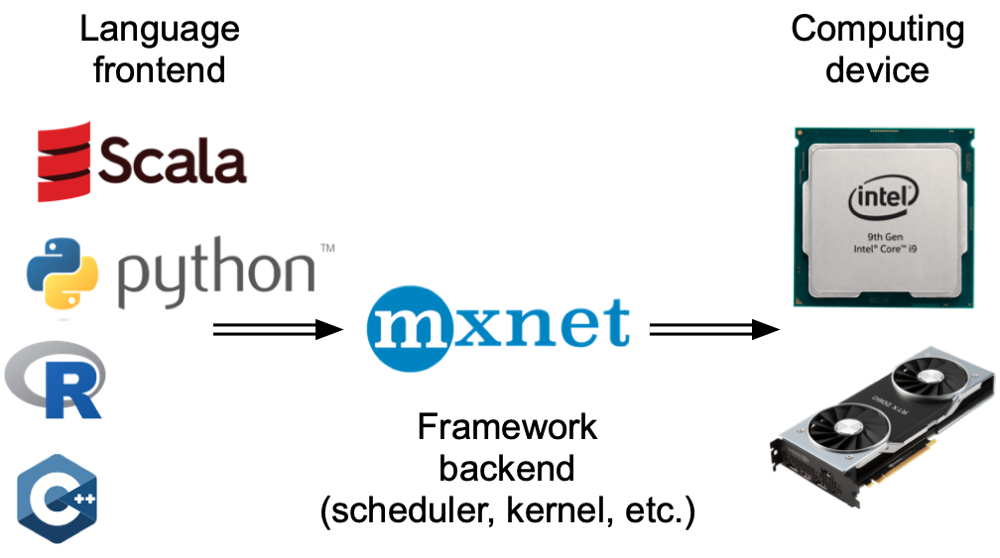
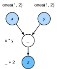
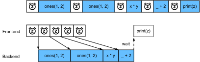

# Asinchroniniai skaičiavimai
:label:`sec_async`

Šiandieniniai kompiuteriai yra labai lygiagrečios sistemos, sudarytos iš kelių CPU branduolių (dažnai su keliomis gijomis kiekvienam branduoliui), kelių apdorojimo elementų kiekviename GPU ir dažnai kelių GPU kiekviename įrenginyje. Trumpai tariant, galime apdoroti daug skirtingų dalykų vienu metu, dažnai skirtinguose įrenginiuose. Deja, Python nėra puikus būdas rašyti lygiagretų ir asinchroninį kodą, bent jau be papildomos pagalbos. Juk Python yra vienagijis, ir tai vargu ar pasikeis ateityje. Giliojo mokymosi karkasai, tokie kaip MXNet ir TensorFlow, naudoja *asinchroninio programavimo* modelį našumui pagerinti,
o PyTorch naudoja paties Python planuoklį, todėl našumo kompromisas yra kitoks.
PyTorch pagal numatytuosius nustatymus GPU operacijos yra asinchroninės. Kai iškviečiate funkciją, naudojančią GPU, operacijos įtraukiamos į konkretaus įrenginio eilę, bet nebūtinai įvykdomos iš karto, o tik vėliau. Tai leidžia mums vykdyti daugiau skaičiavimų lygiagrečiai, įskaitant operacijas CPU ar kituose GPU.

Todėl supratimas, kaip veikia asinchroninis programavimas, padeda mums kurti efektyvesnes programas proaktyviai mažinant skaičiavimo reikalavimus ir tarpusavio priklausomybes. Tai leidžia sumažinti atminties pridėtines sąnaudas ir padidinti procesorių panaudojimą.

```{.python .input}
#@tab mxnet
from d2l import mxnet as d2l
import numpy, os, subprocess
from mxnet import autograd, gluon, np, npx
from mxnet.gluon import nn
npx.set_np()
```

```{.python .input}
#@tab pytorch
from d2l import torch as d2l
import numpy, os, subprocess
import torch
from torch import nn
```

## Asinchroniškumas per vidinę dalį

:begin_tab:`mxnet`
Apšilimui panagrinėkime tokį žaislinį uždavinį: norime sugeneruoti atsitiktinę matricą ir ją sudauginti. Padarykime tai ir su NumPy, ir su `mxnet.np`, kad pamatytume skirtumą.
:end_tab:

:begin_tab:`pytorch`
Apšilimui panagrinėkime tokį žaislinį uždavinį: norime sugeneruoti atsitiktinę matricą ir ją sudauginti. Padarykime tai ir su NumPy, ir su PyTorch tenzoriumi, kad pamatytume skirtumą.
Atkreipkite dėmesį, kad PyTorch `tensor` apibrėžtas GPU.
:end_tab:

```{.python .input}
#@tab mxnet
with d2l.Benchmark('numpy'):
    for _ in range(10):
        a = numpy.random.normal(size=(1000, 1000))
        b = numpy.dot(a, a)

with d2l.Benchmark('mxnet.np'):
    for _ in range(10):
        a = np.random.normal(size=(1000, 1000))
        b = np.dot(a, a)
```

```{.python .input}
#@tab pytorch
# Warmup for GPU computation
device = d2l.try_gpu()
a = torch.randn(size=(1000, 1000), device=device)
b = torch.mm(a, a)

with d2l.Benchmark('numpy'):
    for _ in range(10):
        a = numpy.random.normal(size=(1000, 1000))
        b = numpy.dot(a, a)

with d2l.Benchmark('torch'):
    for _ in range(10):
        a = torch.randn(size=(1000, 1000), device=device)
        b = torch.mm(a, a)
```

:begin_tab:`mxnet`
Lyginamosios analizės išvestis per MXNet yra eilėmis greitesnė. Kadangi abi vykdomos tame pačiame procesoriuje, turi vykti kažkas kita.
Priversdami MXNet baigti visus vidinės dalies skaičiavimus prieš grąžinant rezultatą, matome, kas anksčiau įvyko: skaičiavimas vykdomas vidinėje dalyje, o priekinė dalis grąžina valdymą Python.
:end_tab:

:begin_tab:`pytorch`
Lyginamosios analizės išvestis per PyTorch yra eilėmis greitesnė.
NumPy skaliarinė sandauga vykdoma CPU procesoriuje, o
PyTorch matricų daugyba vykdoma GPU, todėl tikimasi, kad pastaroji
bus daug greitesnė. Tačiau didžiulis laiko skirtumas rodo, kad turi vykti
kažkas kita.
PyTorch pagal numatytuosius nustatymus GPU operacijos yra asinchroninės.
Priversdami PyTorch baigti visus skaičiavimus prieš grąžinant rezultatą, matome,
kas anksčiau įvyko: skaičiavimas vykdomas vidinėje dalyje,
o priekinė dalis grąžina valdymą Python.
:end_tab:

```{.python .input}
#@tab mxnet
with d2l.Benchmark():
    for _ in range(10):
        a = np.random.normal(size=(1000, 1000))
        b = np.dot(a, a)
    npx.waitall()
```

```{.python .input}
#@tab pytorch
with d2l.Benchmark():
    for _ in range(10):
        a = torch.randn(size=(1000, 1000), device=device)
        b = torch.mm(a, a)
    torch.cuda.synchronize(device)
```

:begin_tab:`mxnet`
Plačiai kalbant, MXNet turi priekinę dalį (angl. *frontend*) tiesioginei sąveikai su naudotojais, pavyzdžiui, per Python, taip pat vidinę dalį (angl. *backend*), kurią sistema naudoja skaičiavimams atlikti.
Kaip parodyta :numref:`fig_frontends`, naudotojai gali rašyti MXNet programas įvairiomis priekinės dalies kalbomis, pavyzdžiui, Python, R, Scala ir C++. Nepriklausomai nuo naudojamos priekinės dalies programavimo kalbos, MXNet programų vykdymas vyksta daugiausia vidinėje C++ įgyvendinimų dalyje. Priekinės dalies kalbos išduotos operacijos perduodamos vidinei daliai vykdyti.
Vidinė dalis valdo savo gijas, kurios nuolat renka ir vykdo eilėje esančias užduotis. Atkreipkite dėmesį, kad tam, kad tai veiktų, vidinė dalis turi gebėti sekti priklausomybes tarp įvairių skaičiavimo grafo žingsnių. Todėl negalima lygiagretinti operacijų, kurios priklauso viena nuo kitos.
:end_tab:

:begin_tab:`pytorch`
Plačiai kalbant, PyTorch turi priekinę dalį (angl. *frontend*) tiesioginei sąveikai su naudotojais, pavyzdžiui, per Python, taip pat vidinę dalį (angl. *backend*), kurią sistema naudoja skaičiavimams atlikti.
Kaip parodyta :numref:`fig_frontends`, naudotojai gali rašyti PyTorch programas įvairiomis priekinės dalies kalbomis, pavyzdžiui, Python ir C++. Nepriklausomai nuo naudojamos priekinės dalies programavimo kalbos, PyTorch programų vykdymas vyksta daugiausia vidinėje C++ įgyvendinimų dalyje. Priekinės dalies kalbos išduotos operacijos perduodamos vidinei daliai vykdyti.
Vidinė dalis valdo savo gijas, kurios nuolat renka ir vykdo eilėje esančias užduotis.
Atkreipkite dėmesį, kad tam, kad tai veiktų, vidinė dalis turi gebėti sekti
priklausomybes tarp įvairių skaičiavimo grafo žingsnių.
Todėl negalima lygiagretinti operacijų, kurios priklauso viena nuo kitos.
:end_tab:


:width:`300px`
:label:`fig_frontends`

Pažiūrėkime į kitą žaislinį pavyzdį, kad geriau suprastume priklausomybių grafą.

```{.python .input}
#@tab mxnet
x = np.ones((1, 2))
y = np.ones((1, 2))
z = x * y + 2
z
```

```{.python .input}
#@tab pytorch
x = torch.ones((1, 2), device=device)
y = torch.ones((1, 2), device=device)
z = x * y + 2
z
```


:label:`fig_asyncgraph`


Aukščiau pateiktas kodo fragmentas taip pat iliustruotas :numref:`fig_asyncgraph`.
Kai Python priekinės dalies gija vykdo vieną iš pirmųjų trijų sakinių, ji tiesiog grąžina užduotį į vidinės dalies eilę. Kai paskutinio sakinio rezultatus reikia *atspausdinti*, Python priekinės dalies gija lauks, kol C++ vidinės dalies gija baigs skaičiuoti kintamojo `z` rezultatą. Vienas šio dizaino privalumas yra tas, kad Python priekinės dalies gijai nereikia atlikti tikrų skaičiavimų. Todėl bendram programos našumui turi mažai įtakos, koks yra paties Python našumas. :numref:`fig_threading` iliustruoja, kaip sąveikauja priekinė ir vidinė dalys.


:label:`fig_threading`


## Barjerai ir blokatoriai

:begin_tab:`mxnet`
Yra keletas operacijų, kurios privers Python laukti, kol jos bus baigtos:

* Akivaizdžiausia, `npx.waitall()` laukia, kol baigsis visi skaičiavimai, nepriklausomai nuo to, kada skaičiavimo instrukcijos buvo išduotos. Praktikoje šį operatorių naudoti yra bloga idėja, nebent tai būtina, nes tai gali lemti prastą našumą.
* Jei tiesiog norime palaukti, kol bus pasiekiamas konkretus kintamasis, galime iškviesti `z.wait_to_read()`. Šiuo atveju MXNet blokuoja grįžimą į Python, kol bus apskaičiuotas kintamasis `z`. Kiti skaičiavimai po to gali tęstis.

Pažiūrėkime, kaip tai veikia praktiškai.
:end_tab:

```{.python .input}
#@tab mxnet
with d2l.Benchmark('waitall'):
    b = np.dot(a, a)
    npx.waitall()

with d2l.Benchmark('wait_to_read'):
    b = np.dot(a, a)
    b.wait_to_read()
```

:begin_tab:`mxnet`
Abi operacijos užtrunka maždaug tiek pat laiko. Be akivaizdžių blokuojančių operacijų, rekomenduojame žinoti apie *numanomus* blokatorius. Kintamojo spausdinimas akivaizdžiai reikalauja, kad kintamasis būtų pasiekiamas, todėl yra blokatorius. Galiausiai konvertavimai į NumPy per `z.asnumpy()` ir konvertavimai į skaliarus per `z.item()` yra blokuojantys, nes NumPy neturi asinchroniškumo sąvokos. Jam reikia prieigos prie reikšmių, kaip ir funkcijai `print`. 

Dažnai kopijuoti nedidelius duomenų kiekius iš MXNet srities į NumPy ir atgal gali sugriauti kitaip efektyvaus kodo našumą, nes kiekviena tokia operacija reikalauja, kad skaičiavimo grafas įvertintų visus tarpinius rezultatus, reikalingus atitinkamam nariui gauti, *prieš* galint daryti bet ką kita.
:end_tab:

```{.python .input}
#@tab mxnet
with d2l.Benchmark('numpy conversion'):
    b = np.dot(a, a)
    b.asnumpy()

with d2l.Benchmark('scalar conversion'):
    b = np.dot(a, a)
    b.sum().item()
```

## Skaičiavimo gerinimas

:begin_tab:`mxnet`
Labai daugiagijėje sistemoje (net įprasti nešiojamieji kompiuteriai turi 4 ar daugiau gijų, o kelių lizdų serveriuose šis skaičius gali viršyti 256) operacijų planavimo pridėtinės sąnaudos gali tapti reikšmingos. Todėl labai pageidautina, kad skaičiavimas ir planavimas vyktų asinchroniškai ir lygiagrečiai. Kad parodytume tokio požiūrio naudą, pažiūrėkime, kas nutinka, jei kelis kartus padidiname kintamąjį 1, nuosekliai arba asinchroniškai. Sinchroninį vykdymą imituojame įterpdami `wait_to_read` barjerą tarp kiekvieno pridėjimo.
:end_tab:

```{.python .input}
#@tab mxnet
with d2l.Benchmark('synchronous'):
    for _ in range(10000):
        y = x + 1
        y.wait_to_read()

with d2l.Benchmark('asynchronous'):
    for _ in range(10000):
        y = x + 1
    npx.waitall()
```

:begin_tab:`mxnet`
Kiek supaprastintą Python priekinės dalies gijos ir C++ vidinės dalies gijos sąveiką galima apibendrinti taip:
1. Priekinė dalis nurodo vidinei daliai įterpti skaičiavimo užduotį `y = x + 1` į eilę.
1. Tada vidinė dalis gauna skaičiavimo užduotis iš eilės ir atlieka tikruosius skaičiavimus.
1. Tada vidinė dalis grąžina skaičiavimo rezultatus priekinei daliai.
Tarkime, kad šių trijų etapų trukmės yra atitinkamai $t_1, t_2$ ir $t_3$. Jei nenaudojame asinchroninio programavimo, bendras laikas, reikalingas 10000 skaičiavimų atlikti, yra apytiksliai $10000 (t_1+ t_2 + t_3)$. Jei naudojamas asinchroninis programavimas, bendras laikas, reikalingas 10000 skaičiavimų atlikti, gali sumažėti iki $t_1 + 10000 t_2 + t_3$ (darant prielaidą, kad $10000 t_2 > 9999t_1$), nes priekinei daliai nereikia laukti, kol vidinė dalis grąžins skaičiavimo rezultatus kiekvienoje ciklo iteracijoje.
:end_tab:


## Santrauka


* Giliojo mokymosi karkasai gali atskirti Python priekinę dalį nuo vykdymo vidinės dalies. Tai leidžia greitai asinchroniškai įterpti komandas į vidinę dalį ir gauti susijusį lygiagretumą.
* Asinchroniškumas lemia gana greitai reaguojančią priekinę dalį. Tačiau būkite atsargūs ir nepripildykite užduočių eilės, nes tai gali lemti pernelyg didelį atminties suvartojimą. Rekomenduojama sinchronizuoti kiekvienam minirinkiniui, kad priekinė ir vidinė dalys išliktų apytiksliai sinchronizuotos.
* Lustų gamintojai siūlo sudėtingus našumo analizės įrankius, kad būtų galima gauti daug smulkesnį supratimą apie giliojo mokymosi efektyvumą.

:begin_tab:`mxnet`
* Atminkite, kad konvertavimai iš MXNet atminties valdymo į Python privers vidinę dalį laukti, kol bus paruoštas konkretus kintamasis. Tokias funkcijas kaip `print`, `asnumpy` ir `item` visos turi šį poveikį. Tai gali būti pageidautina, bet neapgalvotas sinchronizavimo naudojimas gali sugadinti našumą.
:end_tab:


## Pratimai

:begin_tab:`mxnet`
1. Aukščiau minėjome, kad naudojant asinchroninį skaičiavimą bendrą laiką, reikalingą 10000 skaičiavimų atlikti, galima sumažinti iki $t_1 + 10000 t_2 + t_3$. Kodėl čia turime daryti prielaidą $10000 t_2 > 9999 t_1$?
1. Išmatuokite skirtumą tarp `waitall` ir `wait_to_read`. Užuomina: atlikite keletą instrukcijų ir sinchronizuokite tarpiniam rezultatui.
:end_tab:

:begin_tab:`pytorch`
1. Atlikite tų pačių šiame skyrelyje pateiktų matricų daugybos operacijų lyginamąją analizę CPU. Ar vis tiek galite pastebėti asinchroniškumą per vidinę dalį?
:end_tab:

:begin_tab:`mxnet`
[Diskusijos](https://discuss.d2l.ai/t/361)
:end_tab:

:begin_tab:`pytorch`
[Diskusijos](https://discuss.d2l.ai/t/2564)
:end_tab:
