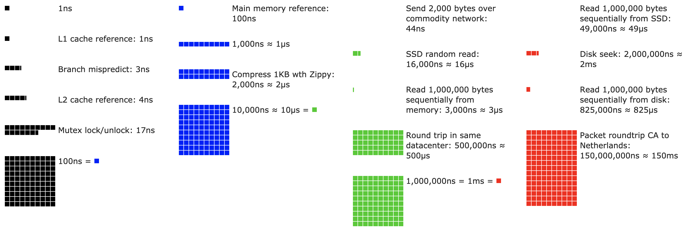
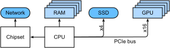
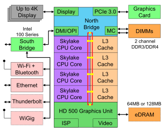
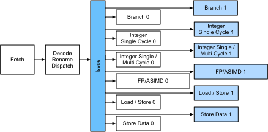
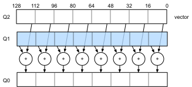
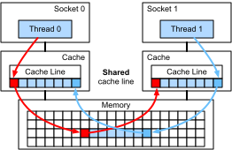
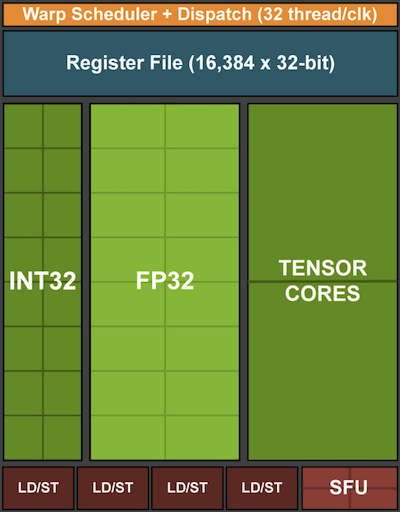
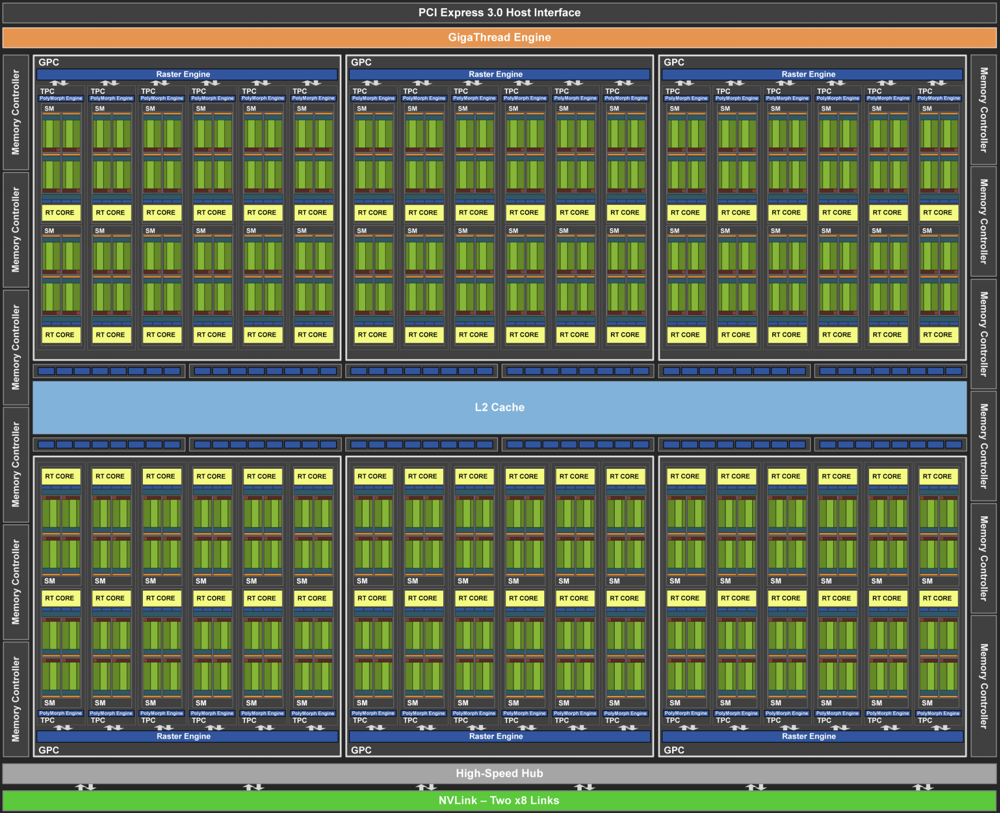
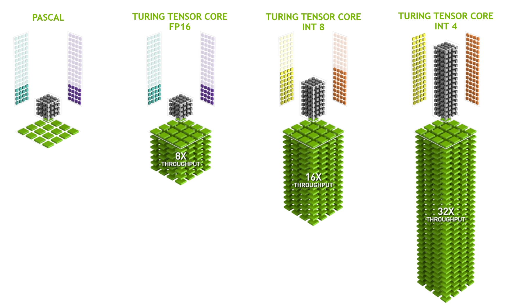

# Aparatinė įranga
:label:`sec_hardware`

Kuriant didelio našumo sistemas, reikia gerai suprasti algoritmus ir modelius, kad būtų užfiksuoti statistiniai uždavinio aspektai. Tuo pačiu būtina turėti bent minimalių žinių apie pagrindinę aparatinę įrangą. Šis skyrelis nėra tinkamo aparatinės įrangos ir sistemų projektavimo kurso pakaitalas. Vietoj to jis gali būti atspirties taškas suprantant, kodėl kai kurie algoritmai yra efektyvesni už kitus ir kaip pasiekti gerą pralaidumą. Geras dizainas gali lengvai lemti eilės dydžio skirtumą, o tai savo ruožtu gali lemti skirtumą tarp galimybės apmokyti tinklą (pvz., per savaitę) ir visiško negalėjimo to padaryti (per 3 mėnesius, taip praleidžiant terminą). 
Pradėsime nuo kompiuterių apžvalgos. Tada priartinsime vaizdą, kad atidžiau pažiūrėtume į CPU ir GPU. Galiausiai nutolinsime vaizdą, kad apžvelgtume, kaip keli kompiuteriai sujungiami serverių centre ar debesyje. 

:label:`fig_latencynumbers`

Nekantriems skaitytojams gali pakakti :numref:`fig_latencynumbers`. Jis paimtas iš Colin Scott [interaktyvaus įrašo](https://people.eecs.berkeley.edu/%7Ercs/research/interactive_latency.html), kuris pateikia gerą pastarojo dešimtmečio pažangos apžvalgą. Originalūs skaičiai priklauso Jeff Dean [Stanfordo pranešimui 2010 m.](https://static.googleusercontent.com/media/research.google.com/en//people/jeff/Stanford-DL-Nov-2010.pdf).
Toliau pateiktas aptarimas paaiškina dalį šių skaičių pagrindimo ir tai, kaip jie gali padėti mums projektuojant algoritmus. Toliau pateiktas aptarimas yra labai aukšto lygio ir paviršutiniškas. Jis aiškiai *nėra tinkamo kurso pakaitalas*, o tik skirtas suteikti pakankamai informacijos statistiniam modeliuotojui, kad šis galėtų priimti tinkamus dizaino sprendimus. Išsamiai kompiuterių architektūros apžvalgai nukreipiame skaitytoją į :cite:`Hennessy.Patterson.2011` arba naujesnį kursą šia tema, pavyzdžiui, [Arste Asanovic](http://inst.eecs.berkeley.edu/%7Ecs152/sp19/) kursą.

## Kompiuteriai

Dauguma giliojo mokymosi tyrėjų ir praktikų turi prieigą prie kompiuterio su pakankamu atminties ir skaičiavimo kiekiu, tam tikra spartintuvo forma, pavyzdžiui, GPU, ar jų keliais. Kompiuterį sudaro šie pagrindiniai komponentai:

* Procesorius (dar vadinamas CPU), gebantis vykdyti mums skirtas programas (be operacinės sistemos ir daugelio kitų dalykų vykdymo), paprastai sudarytas iš 8 ar daugiau branduolių.
* Atmintis (RAM) skaičiavimo rezultatams, pavyzdžiui, svorių vektoriams ir aktyvacijoms, bei apmokymo duomenims saugoti ir gauti.
* Ethernet tinklo ryšys (kartais keli) nuo 1 GB/s iki 100 GB/s greičių. Aukščiausios klasės serveriuose galima rasti pažangesnių jungčių.
* Greita plėtimo magistralė (PCIe) sistemai prijungti prie vieno ar kelių GPU. Serveriuose yra iki 8 spartintuvų, dažnai sujungtų pažangia topologija, o staliniuose kompiuteriuose – 1 ar 2, priklausomai nuo naudotojo biudžeto ir maitinimo šaltinio dydžio.
* Ilgalaikė saugykla, pavyzdžiui, magnetinis standusis diskas, kietojo kūno diskas, daugeliu atvejų prijungtas per PCIe magistralę. Ji suteikia efektyvų apmokymo duomenų perdavimą sistemai ir tarpinių kontrolinių taškų saugojimą, kai reikia.

:label:`fig_mobo-symbol`

Kaip rodo :numref:`fig_mobo-symbol`, dauguma komponentų (tinklas, GPU ir saugykla) prie CPU prijungti per PCIe magistralę. Ją sudaro kelios linijos, tiesiogiai prijungtos prie CPU. Pavyzdžiui, AMD Threadripper 3 turi 64 PCIe 4.0 linijas, kurių kiekviena gali perduoti 16 Gbit/s duomenų abiem kryptimis. Atmintis tiesiogiai prijungta prie CPU, kurios bendras pralaidumas siekia iki 100 GB/s.

Kai vykdome kodą kompiuteryje, turime perkelti duomenis į procesorius (CPU ar GPU), atlikti skaičiavimą, o tada perkelti rezultatus iš procesoriaus atgal į RAM ir ilgalaikę saugyklą. Todėl, kad pasiektume gerą našumą, turime užtikrinti, kad tai veiktų sklandžiai ir nė viena iš sistemų netaptų pagrindine kliūtimi. Pavyzdžiui, jei negalime pakankamai greitai įkelti vaizdų, procesorius neturės darbo. Panašiai, jei negalime pakankamai greitai perkelti matricų į CPU (ar GPU), jo apdorojimo elementai badaus. Galiausiai, jei norime sinchronizuoti kelis kompiuterius tinkle, pastarasis neturėtų sulėtinti skaičiavimo. Viena galimybė yra suplakti komunikaciją ir skaičiavimą. Pažvelkime į įvairius komponentus išsamiau.

## Atmintis

Pagrindine prasme atmintis naudojama duomenims, kuriuos reikia lengvai pasiekti, saugoti. Šiuo metu CPU RAM paprastai yra [DDR4](https://en.wikipedia.org/wiki/DDR4_SDRAM) tipo, siūlanti 20–25 GB/s pralaidumą vienam moduliui. Kiekvienas modulis turi 64 bitų pločio magistralę. Paprastai atminties modulių poros naudojamos kelių kanalų galimybei suteikti. CPU turi nuo 2 iki 4 atminties kanalų, t. y. jų didžiausias atminties pralaidumas yra nuo 40 GB/s iki 100 GB/s. Dažnai kiekvienam kanalui yra du bankai. Pavyzdžiui, AMD Zen 3 Threadripper turi 8 lizdus.

Nors šie skaičiai įspūdingi, jie pasako tik dalį istorijos. Kai norime perskaityti dalį iš atminties, pirmiausia turime pasakyti atminties moduliui, kur galima rasti informaciją. Tai yra, pirmiausia turime nusiųsti *adresą* į RAM. Tai atlikę, galime pasirinkti skaityti tik vieną 64 bitų įrašą arba ilgą įrašų seką. Pastarasis vadinamas *pliūpsniniu skaitymu* (angl. *burst read*). Trumpai tariant, adreso siuntimas į atmintį ir perdavimo paruošimas užtrunka apytiksliai 100 ns (detalės priklauso nuo konkrečių naudojamų atminties lustų laiko koeficientų), o kiekvienas vėlesnis perdavimas užtrunka tik 0.2 ns. Trumpai tariant, pirmasis skaitymas yra 500 kartų brangesnis nei vėlesni! Atkreipkite dėmesį, kad per sekundę galėtume atlikti iki 10 000 000 atsitiktinių skaitymų. Tai rodo, kad turėtume kiek įmanoma vengti atsitiktinės prieigos prie atminties ir vietoj to naudoti pliūpsninius skaitymus (ir rašymus).

Reikalai kiek sudėtingesni, kai atsižvelgiame į tai, kad turime kelis *bankus*. Kiekvienas bankas gali skaityti atmintį iš esmės nepriklausomai. Tai reiškia du dalykus. 
Viena vertus, efektyvus atsitiktinių skaitymų skaičius yra iki 4 kartų didesnis, jei jie tolygiai paskirstyti per atmintį. Tai taip pat reiškia, kad atlikti atsitiktinius skaitymus vis tiek yra bloga idėja, nes pliūpsniniai skaitymai taip pat yra 4 kartus greitesni. Kita vertus, dėl atminties lygiavimo pagal 64 bitų ribas gera idėja yra lygiuoti bet kokias duomenų struktūras pagal tas pačias ribas. Kompiliatoriai tai atlieka beveik [automatiškai](https://en.wikipedia.org/wiki/Data_structure_alignment), kai nustatomos tinkamos vėliavėlės. Smalsūs skaitytojai raginami peržiūrėti paskaitą apie DRAM, pavyzdžiui, [Zeshan Chishti](http://web.cecs.pdx.edu/%7Ezeshan/ece585_lec5.pdf) paskaitą.

GPU atmintis patiria dar didesnius pralaidumo reikalavimus, nes jie turi daug daugiau apdorojimo elementų nei CPU. Apskritai yra du būdai jiems patenkinti. Pirmasis yra padaryti atminties magistralę gerokai platesnę. Pavyzdžiui, NVIDIA RTX 2080 Ti turi 352 bitų pločio magistralę. Tai leidžia vienu metu perduoti daug daugiau informacijos. Antra, GPU naudoja specialią didelio našumo atmintį. Vartotojiško lygio įrenginiai, pavyzdžiui, NVIDIA RTX ir Titan serijos, paprastai naudoja [GDDR6](https://en.wikipedia.org/wiki/GDDR6_SDRAM) lustus su daugiau nei 500 GB/s bendru pralaidumu. Alternatyva yra naudoti HBM (didelio pralaidumo atminties, angl. *high bandwidth memory*) modulius. Jie naudoja labai kitokią sąsają ir jungiasi tiesiogiai su GPU ant specialios silicio plokštelės. Dėl to jie yra labai brangūs, o jų naudojimas paprastai apsiriboja aukščiausios klasės serverių lustais, pavyzdžiui, NVIDIA Volta V100 serijos spartintuvais. Visiškai nenuostabu, kad GPU atmintis paprastai yra *daug* mažesnė nei CPU atmintis dėl pirmosios didesnės kainos. Mūsų tikslams jų našumo charakteristikos iš esmės yra panašios, tik daug greitesnės. Šios knygos tikslais detales galime saugiai ignoruoti. Jos svarbios tik derinant GPU branduolius dideliam pralaidumui.

## Saugykla

Matėme, kad kai kurios pagrindinės RAM charakteristikos yra *pralaidumas* ir *vėlinimas*. Tas pats pasakytina apie saugojimo įrenginius, tik skirtumai gali būti dar ekstremalesni.

### Standieji diskai

*Standieji diskai* (HDD) naudojami jau daugiau nei pusę amžiaus. Trumpai tariant, juose yra keletas besisukančių diskų su galvutėmis, kurias galima pozicionuoti skaityti ar rašyti bet kuriame take. Aukščiausios klasės diskai talpina iki 16 TB ant 9 diskų. Vienas pagrindinių HDD privalumų yra tai, kad jie yra santykinai nebrangūs. Vienas iš daugelio jų trūkumų yra paprastai katastrofiški gedimų režimai ir santykinai didelis skaitymo vėlinimas.

Norėdami suprasti pastarąjį, atsiminkime, kad HDD sukasi apie 7 200 aps./min. (apsisukimų per minutę). Jei jie suktųsi daug greičiau, jie subyrėtų dėl diskus veikiančios išcentrinės jėgos. Tai turi didelį trūkumą, kai reikia pasiekti konkretų disko sektorių: turime laukti, kol diskas pasisuks į reikiamą padėtį (galime judinti galvutes, bet ne pagreitinti pačius diskus). Todėl gali užtrukti daugiau nei 8 ms, kol prašomi duomenys bus pasiekiami. Dažnas būdas tai išreikšti – sakyti, kad HDD gali veikti apytiksliai 100 IOPs (įvesties ir išvesties operacijų per sekundę). Šis skaičius iš esmės nepasikeitė pastaruosius du dešimtmečius. Dar blogiau, pralaidumą padidinti yra lygiai taip pat sunku (jis yra 100–200 MB/s eilės). Juk kiekviena galvutė skaito bitų taką, todėl bitų sparta didėja tik kaip informacijos tankio kvadratinė šaknis. Dėl to HDD sparčiai tampa archyvine saugykla ir žemos kokybės saugykla labai dideliems duomenų rinkiniams.

### Kietojo kūno diskai

Kietojo kūno diskai (SSD) informacijai nuolat saugoti naudoja flash atmintį. Tai leidžia *daug greičiau* pasiekti saugomus įrašus. Šiuolaikiniai SSD gali veikti 100 000–500 000 IOPs, t. y. iki 3 eilių greičiau nei HDD. Be to, jų pralaidumas gali siekti 1–3 GB/s, t. y. viena eile greičiau nei HDD. Šie patobulinimai skamba beveik per gerai, kad būtų tiesa. Iš tikrųjų jie turi tokių išlygų dėl SSD projektavimo būdo.

* SSD informaciją saugo blokais (256 KB ar didesniais). Jie gali būti rašomi tik visu bloku, o tai užtrunka daug laiko. Todėl atsitiktiniai bitų lygio rašymai SSD veikia labai prastai. Panašiai duomenų rašymas apskritai užtrunka daug laiko, nes blokas turi būti perskaitytas, ištrintas ir tada perrašytas su nauja informacija. Šiuo metu SSD valdikliai ir programinė aparatinė įranga yra sukūrę algoritmus tam sušvelninti. Vis dėlto rašymai gali būti daug lėtesni, ypač QLC (keturių lygių ląstelių) SSD. Esminis dalykas našumui pagerinti yra palaikyti operacijų *eilę*, teikti pirmenybę skaitymams ir, jei įmanoma, rašyti dideliais blokais.
* SSD atminties ląstelės nusidėvi gana greitai (dažnai jau po kelių tūkstančių rašymų). Nusidėvėjimo lygio apsaugos algoritmai geba paskirstyti degradaciją per daug ląstelių. Vis dėlto SSD nerekomenduojama naudoti keitimo failams ar dideliems žurnalo failų kaupimams.
* Galiausiai, didžiulis pralaidumo padidėjimas privertė kompiuterių projektuotojus SSD jungti tiesiogiai prie PCIe magistralės. Diskai, gebantys tai tvarkyti, vadinami NVMe (angl. *Non Volatile Memory enhanced*), gali naudoti iki 4 PCIe linijų. Tai sudaro iki 8 GB/s PCIe 4.0.

### Debesų saugykla

Debesų saugykla suteikia konfigūruojamą našumo intervalą. Tai yra, saugyklos priskyrimas virtualioms mašinoms yra dinaminis tiek kiekio, tiek greičio požiūriu, kaip pasirenka naudotojai. Rekomenduojame naudotojams padidinti paskirtą IOPs skaičių, kai tik vėlinimas yra per didelis, pavyzdžiui, apmokant su daug mažų įrašų.

## CPU

Centriniai procesoriai (CPU) yra bet kurio kompiuterio pagrindas. Juos sudaro keli pagrindiniai komponentai: *procesoriaus branduoliai*, gebantys vykdyti mašininį kodą, juos jungianti *magistralė* (konkreti topologija gerokai skiriasi tarp procesorių modelių, kartų ir gamintojų) ir *spartinančiosios atmintinės* (angl. *caches*), leidžiančios pasiekti didesnį pralaidumą ir mažesnį atminties prieigos vėlinimą, nei įmanoma skaitant iš pagrindinės atminties. Galiausiai beveik visi šiuolaikiniai CPU turi *vektorinio apdorojimo blokus*, padedančius atlikti didelio našumo tiesinę algebrą ir konvoliucijas, kurios yra įprastos medijų apdorojime ir mašininiame mokymesi.

:label:`fig_skylake`

:numref:`fig_skylake` pavaizduotas Intel Skylake vartotojiško lygio keturių branduolių CPU. Jis turi integruotą GPU, spartinančiąsias atmintines ir žiedinę magistralę, jungiančią keturis branduolius. Periferiniai įrenginiai, pavyzdžiui, Ethernet, WiFi, Bluetooth, SSD valdiklis ir USB, yra arba lustų rinkinio dalis, arba tiesiogiai prijungti (PCIe) prie CPU.

### Mikroarchitektūra

Kiekvieną iš procesoriaus branduolių sudaro gana sudėtingas komponentų rinkinys. Nors detalės skiriasi tarp kartų ir gamintojų, pagrindinis funkcionalumas yra beveik standartinis. Priekinė dalis įkelia instrukcijas ir bando nuspėti, kuris kelias bus pasirinktas (pvz., valdymo srautui). Tada instrukcijos iš asemblerio kodo dekoduojamos į mikroinstrukcijas. Asemblerio kodas dažnai nėra žemiausio lygio kodas, kurį vykdo procesorius. Vietoj to sudėtingos instrukcijos gali būti dekoduojamos į žemesnio lygio operacijų rinkinį. Jas tada apdoroja tikrasis vykdymo branduolys. Dažnai pastarasis geba atlikti daug operacijų vienu metu. Pavyzdžiui, :numref:`fig_cortexa77` pavaizduotas ARM Cortex A77 branduolys geba atlikti iki 8 operacijų vienu metu.

:label:`fig_cortexa77`

Tai reiškia, kad efektyvios programos gali atlikti daugiau nei vieną instrukciją per taktą, jei jas galima vykdyti nepriklausomai. Ne visi blokai yra vienodi. Kai kurie specializuojasi sveikųjų skaičių instrukcijose, o kiti optimizuoti slankiojo kablelio našumui. Pralaidumui padidinti procesorius taip pat gali sekti kelis kodo kelius vienu metu, kai yra šakojimosi instrukcija, o tada atmesti nepasirinktų šakų rezultatus. Todėl šakojimosi prognozavimo blokai yra svarbūs (priekinėje dalyje), kad būtų sekami tik perspektyviausi keliai.

### Vektorizavimas

Gilusis mokymasis yra itin išalkęs skaičiavimų. Todėl, kad CPU taptų tinkami mašininiam mokymuisi, reikia atlikti daug operacijų per vieną taktą. Tai pasiekiama per vektorinius blokus. Jie turi skirtingus pavadinimus: ARM jie vadinami NEON, x86 (naujesnė karta) – [AVX2](https://en.wikipedia.org/wiki/Advanced_Vector_Extensions) blokais. Bendras aspektas yra tas, kad jie geba atlikti SIMD (viena instrukcija, daug duomenų) operacijas. :numref:`fig_neon128` parodyta, kaip ARM per vieną taktą galima sudėti 8 trumpuosius sveikuosius skaičius.

:label:`fig_neon128`

Priklausomai nuo architektūros pasirinkimų, tokie registrai yra iki 512 bitų ilgio, leidžiantys sujungti iki 64 skaičių porų. Pavyzdžiui, galime dauginti du skaičius ir pridėti juos prie trečiojo, o tai dar žinoma kaip suliejamoji daugyba ir sudėtis (angl. *fused multiply-add*). Intel [OpenVino](https://01.org/openvinotoolkit) jas naudoja, kad pasiektų pagarbų giliojo mokymosi pralaidumą serverių klasės CPU. Vis dėlto atkreipkite dėmesį, kad šį skaičių visiškai nustelbia tai, ką geba pasiekti GPU. Pavyzdžiui, NVIDIA RTX 2080 Ti turi 4 352 CUDA branduolius, kurių kiekvienas bet kuriuo metu geba apdoroti tokią operaciją.

### Spartinančioji atmintinė

Panagrinėkime tokią situaciją: turime kuklų CPU su 4 branduoliais, kaip pavaizduota aukščiau :numref:`fig_skylake`, veikiantį 2 GHz dažniu.
Be to, tarkime, kad turime IPC (instrukcijų per taktą) skaičių 1 ir kad blokai turi įjungtą AVX2 su 256 bitų pločiu. Be to, tarkime, kad bent vienas iš AVX2 operacijoms naudojamų registrų turi būti gautas iš atminties. Tai reiškia, kad CPU per taktą sunaudoja $4 \times 256 \textrm{ bit} = 128 \textrm{ bytes}$ duomenų. Jei negalime perduoti $2 \times 10^9 \times 128 = 256 \times 10^9$ baitų į procesorių per sekundę, apdorojimo elementai badaus. Deja, tokio lusto atminties sąsaja palaiko tik 20–40 GB/s duomenų perdavimą, t. y. viena eile mažiau. Sprendimas yra kiek įmanoma vengti *naujų* duomenų įkėlimo iš atminties ir vietoj to juos kaupti lokaliai CPU. Čia praverčia spartinančiosios atmintinės. Paprastai naudojami šie pavadinimai ar sąvokos:

* **Registrai**, griežtai kalbant, nėra spartinančiosios atmintinės dalis. Jie padeda ruošti instrukcijas. Vis dėlto CPU registrai yra atminties vietos, kurias CPU gali pasiekti taktiniu greičiu be jokios vėlinimo nuobaudos. CPU turi dešimtis registrų. Kompiliatoriui (ar programuotojui) tenka efektyviai naudoti registrus. Pavyzdžiui, C programavimo kalba turi raktažodį `register`.
* **L1 spartinančiosios atmintinės** yra pirmoji gynybos linija nuo didelių atminties pralaidumo reikalavimų. L1 spartinančiosios atmintinės yra mažutės (tipiniai dydžiai gali būti 32–64 KB) ir dažnai padalytos į duomenų ir instrukcijų atmintines. Kai duomenys randami L1 spartinančiojoje atmintinėje, prieiga yra labai greita. Jei jų ten nerandama, paieška tęsiasi žemyn spartinančiųjų atmintinių hierarchija.
* **L2 spartinančiosios atmintinės** yra kita stotelė. Priklausomai nuo architektūros dizaino ir procesoriaus dydžio jos gali būti išskirtinės. Jos gali būti pasiekiamos tik tam tikro branduolio arba bendros keliems branduoliams. L2 spartinančiosios atmintinės yra didesnės (paprastai 256–512 KB vienam branduoliui) ir lėtesnės nei L1. Be to, norėdami ką nors pasiekti L2, pirmiausia turime patikrinti ir suprasti, kad duomenų nėra L1, o tai prideda šiek tiek papildomo vėlinimo.
* **L3 spartinančiosios atmintinės** yra bendros keliems branduoliams ir gali būti gana didelės. AMD Epyc 3 serverių CPU turi didžiulę 256 MB spartinančiąją atmintinę, paskirstytą per kelis lustelius (angl. *chiplets*). Tipiškesni skaičiai yra 4–8 MB intervale.

Numatyti, kurių atminties elementų prireiks toliau, yra vienas pagrindinių optimizavimo parametrų lustų projektavime. Pavyzdžiui, patartina atmintį peržiūrėti *pirmyn*, nes dauguma spartinimo algoritmų bandys skaityti *į priekį*, o ne atgal. Panašiai atminties prieigos šablonų išlaikymas lokaliais yra geras būdas pagerinti našumą.

Spartinančiųjų atmintinių pridėjimas yra dviašmenis kardas. Viena vertus, jos užtikrina, kad procesoriaus branduoliai nebadautų duomenų. Tuo pačiu jos didina lusto dydį, užimdamos plotą, kurį kitu atveju būtų galima skirti apdorojimo galiai didinti. Be to, *spartinančiosios atmintinės nepataikymai* gali būti brangūs. Panagrinėkime blogiausią scenarijų, *klaidingą dalijimąsi* (angl. *false sharing*), kaip pavaizduota :numref:`fig_falsesharing`. Atminties vieta yra užkaupta procesoriuje 0, kai procesoriaus 1 gija paprašo duomenų. Kad juos gautų, procesorius 0 turi sustabdyti tai, ką daro, įrašyti informaciją atgal į pagrindinę atmintį ir tada leisti procesoriui 1 ją perskaityti iš atminties. Šios operacijos metu abu procesoriai laukia. Visai tikėtina, kad toks kodas veikia *lėčiau* keliuose procesoriuose, palyginti su efektyviu vieno procesoriaus įgyvendinimu. Tai dar viena priežastis, kodėl spartinančiųjų atmintinių dydžiai turi praktinę ribą (be jų fizinio dydžio).

:label:`fig_falsesharing`

## GPU ir kiti spartintuvai

Nebus perdėta teigti, kad gilusis mokymasis nebūtų buvęs sėkmingas be GPU. Tuo pačiu pagrįstai galima teigti, kad GPU gamintojų turtai gerokai išaugo dėl giliojo mokymosi. Ši aparatinės įrangos ir algoritmų koevoliucija lėmė situaciją, kai, gerai ar blogai, gilusis mokymasis yra pageidaujama statistinio modeliavimo paradigma. Todėl apsimoka suprasti konkrečią GPU ir susijusių spartintuvų, tokių kaip TPU :cite:`Jouppi.Young.Patil.ea.2017`, naudą.

Verta paminėti praktikoje dažnai daromą skirtį: spartintuvai optimizuojami arba apmokymui, arba inferencijai. Pastarajai reikia apskaičiuoti tik tinklo tiesioginį sklidimą. Nereikia saugoti tarpinių duomenų atgaliniam sklidimui. Be to, galbūt nereikia labai tikslaus skaičiavimo (paprastai pakanka FP16 ar INT8). Kita vertus, apmokymo metu visi tarpiniai rezultatai turi būti saugomi gradientams apskaičiuoti. Be to, gradientų kaupimui reikia didesnio tikslumo, kad būtų išvengta skaitinio nuosmukio (angl. *underflow*) (ar perpildos). Tai reiškia, kad FP16 (ar mišrus tikslumas su FP32) yra minimalus reikalavimas. Visa tai reikalauja greitesnės ir didesnės atminties (HBM2, palyginti su GDDR6) ir daugiau apdorojimo galios. Pavyzdžiui, NVIDIA [Turing](https://devblogs.nvidia.com/nvidia-turing-architecture-in-depth/) T4 GPU optimizuoti inferencijai, o V100 GPU labiau tinka apmokymui.

Prisiminkite vektorizavimą, kaip iliustruota :numref:`fig_neon128`. Pridėjus vektorinius blokus prie procesoriaus branduolio, galėjome žymiai padidinti pralaidumą. Pavyzdžiui, :numref:`fig_neon128` pavyzdyje galėjome atlikti 16 operacijų vienu metu.
Pirma,
kas, jei pridėtume operacijas, kurios optimizuotų ne tik operacijas tarp vektorių, bet ir tarp matricų? Ši strategija lėmė tenzorinius branduolius (apie kuriuos netrukus). 
Antra, kas, jei pridėtume daug daugiau branduolių? Trumpai tariant, šios dvi strategijos apibendrina GPU dizaino sprendimus. :numref:`fig_turing_processing_block` pateikta pagrindinio apdorojimo bloko apžvalga. Jame yra 16 sveikųjų skaičių ir 16 slankiojo kablelio blokų. Be to, du tenzoriniai branduoliai pagreitina siaurą papildomų giliajam mokymuisi aktualių operacijų poaibį. Kiekvieną srautinį multiprocesorių sudaro keturi tokie blokai.

:width:`150px`
:label:`fig_turing_processing_block`

Toliau 12 srautinių multiprocesorių sugrupuojami į grafikos apdorojimo klasterius, kurie sudaro aukščiausios klasės TU102 procesorius. Gausūs atminties kanalai ir L2 spartinančioji atmintinė papildo konfigūraciją. :numref:`fig_turing` pateikiamos svarbios detalės. Viena iš tokio įrenginio projektavimo priežasčių yra ta, kad atskirus blokus galima pridėti ar pašalinti pagal poreikį, kad lustai būtų kompaktiškesni ir būtų sprendžiamos išeigos problemos (sugedę moduliai gali būti neaktyvuojami). Laimei, tokių įrenginių programavimas yra gerai paslėptas nuo atsitiktinio giliojo mokymosi tyrėjo po CUDA ir karkaso kodo sluoksniais. Visų pirma daugiau nei viena programa gali būti vykdoma GPU vienu metu, jei yra laisvų išteklių. Vis dėlto apsimoka žinoti įrenginių apribojimus, kad nepasirinktume modelių, kurie netelpa į įrenginio atmintį.

:width:`350px`
:label:`fig_turing`

Paskutinis aspektas, kurį verta aptarti išsamiau, yra *tenzoriniai branduoliai*. Tai naujausios tendencijos pridėti daugiau optimizuotų grandinių, ypač veiksmingų giliajam mokymuisi, pavyzdys. Pavyzdžiui, TPU pridėjo sistolinį masyvą :cite:`Kung.1988` greitai matricų daugybai. Ten dizainas buvo skirtas palaikyti labai mažą skaičių (pirmajai TPU kartai – vieną) didelių operacijų. Tenzoriniai branduoliai yra kitame gale. Jie optimizuoti mažoms operacijoms, apimančioms $4 \times 4$ ir $16 \times 16$ matricas, priklausomai nuo jų skaitinio tikslumo. :numref:`fig_tensorcore` pateikiama optimizacijų apžvalga.

:width:`400px`
:label:`fig_tensorcore`

Akivaizdu, kad optimizuodami skaičiavimą galiausiai darome tam tikrus kompromisus. Vienas iš jų yra tas, kad GPU nelabai gerai tvarko pertraukimus ir retuosius duomenis. Nors yra žymių išimčių, pavyzdžiui, [Gunrock](https://github.com/gunrock/gunrock) :cite:`Wang.Davidson.Pan.ea.2016`, retųjų matricų ir vektorių prieigos šablonas netinka dideliam pralaidumui pliūpsninių skaitymų operacijoms, kuriose GPU pasižymi. Abiejų tikslų suderinimas yra aktyvių tyrimų sritis. Žr., pvz., [DGL](http://dgl.ai) – biblioteką, pritaikytą giliajam mokymuisi grafuose.

## Tinklai ir magistralės

Kai vieno įrenginio optimizavimui nepakanka, turime perduoti duomenis į jį ir iš jo, kad sinchronizuotume apdorojimą. Čia praverčia tinklai ir magistralės. Turime keletą dizaino parametrų: pralaidumą, kainą, atstumą ir lankstumą.
Viename gale turime WiFi, kuris turi gana gerą aprėptį, yra labai paprastas naudoti (juk nėra laidų), pigus, bet siūlo palyginti vidutinišką pralaidumą ir vėlinimą. Joks sveiko proto mašininio mokymosi tyrėjas nenaudotų jo serverių klasteriui kurti. Toliau sutelksime dėmesį į jungtis, tinkamas giliajam mokymuisi.

* **PCIe** yra specializuota magistralė labai didelio pralaidumo taškas–taškas jungtims (iki 32 GB/s PCIe 4.0 16 linijų lizde) vienai linijai. Vėlinimas yra vienženklių mikrosekundžių eilės (5 μs). PCIe jungtys yra brangios. Procesoriai jų turi tik ribotą skaičių: AMD EPYC 3 turi 128 linijas, Intel Xeon – iki 48 linijų vienam lustui; staliniams skirtuose CPU skaičiai yra atitinkamai 20 (Ryzen 9) ir 16 (Core i9). Kadangi GPU paprastai turi 16 linijų, tai riboja GPU, kurie gali jungtis prie CPU visu pralaidumu, skaičių. Juk jie turi dalytis jungtimis su kita didelio pralaidumo periferija, tokia kaip saugykla ir Ethernet. Kaip ir su RAM prieiga, didelės masinės siuntos yra pageidautinos dėl sumažintų paketų pridėtinių sąnaudų.
* **Ethernet** yra dažniausiai naudojamas kompiuterių jungimo būdas. Nors jis yra gerokai lėtesnis nei PCIe, jis labai pigus, atsparus diegiant ir apima daug didesnius atstumus. Tipinis žemos klasės serverių pralaidumas yra 1 GBit/s. Aukštesnės klasės įrenginiai (pvz., [C5 egzemplioriai](https://aws.amazon.com/ec2/instance-types/c5/) debesyje) siūlo pralaidumą nuo 10 iki 100 GBit/s. Kaip ir visais ankstesniais atvejais, duomenų perdavimas turi didelių pridėtinių sąnaudų. Atkreipkite dėmesį, kad beveik niekada nenaudojame grynojo Ethernet tiesiogiai, o naudojame protokolą, vykdomą virš fizinės jungties (pavyzdžiui, UDP ar TCP/IP). Tai prideda dar daugiau pridėtinių sąnaudų. Kaip ir PCIe, Ethernet sukurtas dviem įrenginiams, pavyzdžiui, kompiuteriui ir komutatoriui, sujungti.
* **Komutatoriai** leidžia mums sujungti kelis įrenginius taip, kad bet kuri jų pora gali vienu metu atlikti (paprastai pilno pralaidumo) taškas–taškas ryšį. Pavyzdžiui, Ethernet komutatoriai gali sujungti 40 serverių dideliu skerspjūvio pralaidumu. Atkreipkite dėmesį, kad komutatoriai nėra išskirtiniai tradiciniams kompiuterių tinklams. Net PCIe linijas galima [komutuoti](https://www.broadcom.com/products/pcie-switches-bridges/pcie-switches). Tai daroma, pavyzdžiui, siekiant prijungti didelį GPU skaičių prie pagrindinio procesoriaus, kaip yra [P2 egzempliorių](https://aws.amazon.com/ec2/instance-types/p2/) atveju.
* **NVLink** yra alternatyva PCIe, kai kalbama apie labai didelio pralaidumo jungtis. Jis siūlo iki 300 Gbit/s duomenų perdavimo spartą vienai jungčiai. Serverių GPU (Volta V100) turi šešias jungtis, o vartotojiško lygio GPU (RTX 2080 Ti) turi tik vieną jungtį, veikiančią sumažinta 100 Gbit/s sparta. Rekomenduojame naudoti [NCCL](https://github.com/NVIDIA/nccl), kad pasiektumėte didelį duomenų perdavimą tarp GPU.

## Daugiau vėlinimo skaičių

:numref:`table_latency_numbers` ir :numref:`table_latency_numbers_tesla` santrauka yra iš [Eliot Eshelman](https://gist.github.com/eshelman), kuris palaiko atnaujintą skaičių versiją kaip [GitHub gist](https://gist.github.com/eshelman/343a1c46cb3fba142c1afdcdeec17646).

:Dažni vėlinimo skaičiai.

| Veiksmas | Laikas | Pastabos |
| :----------------------------------------- | -----: | :---------------------------------------------- |
| L1 spartinančiosios atmintinės nuoroda/pataikymas | 1.5 ns | 4 taktai                                  |
| Slankiojo kablelio sudėtis/daugyba/FMA     | 1.5 ns | 4 taktai                                        |
| L2 spartinančiosios atmintinės nuoroda/pataikymas |   5 ns | 12 ~ 17 taktų                            |
| Šakojimosi neteisingas prognozavimas       |   6 ns | 15 ~ 20 taktų                                   |
| L3 spartinančiosios atmintinės pataikymas (nebendra atmintinė) |  16 ns | 42 taktai                   |
| L3 spartinančiosios atmintinės pataikymas (bendra kitame branduolyje) |  25 ns | 65 taktai            |
| Mutekso užraktas/atrakinimas               |  25 ns |                                                 |
| L3 spartinančiosios atmintinės pataikymas (modifikuota kitame branduolyje) |  29 ns | 75 taktai       |
| L3 spartinančiosios atmintinės pataikymas (nuotolinio CPU lizde) |  40 ns | 100 ~ 300 taktų (40 ~ 116 ns)         |
| QPI šuolis į kitą CPU (už šuolį)           |  40 ns |                                                 |
| 64 MB atminties nuoroda (vietinis CPU)     |  46 ns | TinyMemBench su Broadwell E5-2690v4             |
| 64 MB atminties nuoroda (nuotolinis CPU)   |  70 ns | TinyMemBench su Broadwell E5-2690v4             |
| 256 MB atminties nuoroda (vietinis CPU)    |  75 ns | TinyMemBench su Broadwell E5-2690v4             |
| Intel Optane atsitiktinis rašymas          |  94 ns | UCSD Non-Volatile Systems Lab                   |
| 256 MB atminties nuoroda (nuotolinis CPU)  | 120 ns | TinyMemBench su Broadwell E5-2690v4             |
| Intel Optane atsitiktinis skaitymas        | 305 ns | UCSD Non-Volatile Systems Lab                   |
| Siųsti 4 KB per 100 Gbps HPC tinklą        |   1 μs | MVAPICH2 per Intel Omni-Path                    |
| Suspausti 1 KB su Google Snappy            |   3 μs |                                                 |
| Siųsti 4 KB per 10 Gbps ethernet           |  10 μs |                                                 |
| Atsitiktinai įrašyti 4 KB į NVMe SSD       |  30 μs | DC P3608 NVMe SSD (QOS 99 % yra 500 μs)         |
| Perduoti 1 MB į/iš NVLink GPU              |  30 μs | ~33 GB/s su NVIDIA 40 GB NVLink                 |
| Perduoti 1 MB į/iš PCI-E GPU               |  80 μs | ~12 GB/s PCIe 3.0 x16 jungtimi                  |
| Atsitiktinai perskaityti 4 KB iš NVMe SSD  | 120 μs | DC P3608 NVMe SSD (QOS 99 %)                    |
| Nuosekliai perskaityti 1 MB iš NVMe SSD    | 208 μs | ~4.8 GB/s DC P3608 NVMe SSD                     |
| Atsitiktinai įrašyti 4 KB į SATA SSD       | 500 μs | DC S3510 SATA SSD (QOS 99.9 %)                  |
| Atsitiktinai perskaityti 4 KB iš SATA SSD  | 500 μs | DC S3510 SATA SSD (QOS 99.9 %)                  |
| Kelionė pirmyn ir atgal tame pačiame duomenų centre | 500 μs | Vienos krypties ping yra ~250 μs       |
| Nuosekliai perskaityti 1 MB iš SATA SSD    |   2 ms | ~550 MB/s DC S3510 SATA SSD                     |
| Nuosekliai perskaityti 1 MB iš disko       |   5 ms | ~200 MB/s serverio HDD                          |
| Atsitiktinė disko prieiga (paieška + sukimasis) |  10 ms |                                            |
| Siųsti paketą CA->Nyderlandai->CA          | 150 ms |                                                 |
:label:`table_latency_numbers`

:NVIDIA Tesla GPU vėlinimo skaičiai.

| Veiksmas | Laikas | Pastabos |
| :------------------------------ | -----: | :---------------------------------------- |
| GPU bendrosios atminties prieiga |  30 ns | 30~90 taktų (bankų konfliktai prideda vėlinimo) |
| GPU globaliosios atminties prieiga | 200 ns | 200~800 taktų                          |
| Paleisti CUDA branduolį GPU     |  10 μs | Pagrindinis CPU nurodo GPU pradėti branduolį |
| Perduoti 1 MB į/iš NVLink GPU   |  30 μs | ~33 GB/s su NVIDIA 40 GB NVLink           |
| Perduoti 1 MB į/iš PCI-E GPU    |  80 μs | ~12 GB/s PCI-Express x16 jungtimi         |
:label:`table_latency_numbers_tesla`

## Santrauka

* Įrenginiai turi pridėtinių sąnaudų operacijoms. Todėl svarbu siekti nedidelio skaičiaus didelių perdavimų, o ne daug mažų. Tai taikoma RAM, SSD, tinklams ir GPU.
* Vektorizavimas yra esminis našumui. Įsitikinkite, kad žinote konkrečias savo spartintuvo galimybes. Pavyzdžiui, kai kurie Intel Xeon CPU ypač tinka INT8 operacijoms, NVIDIA Volta GPU pasižymi FP16 matricų daugybos operacijomis, o NVIDIA Turing spindi FP16, INT8 ir INT4 operacijose.
* Skaitinis perpildymas dėl mažų duomenų tipų gali būti problema apmokymo metu (ir mažesniu mastu inferencijos metu).
* Aliasing (angl. *aliasing*) gali žymiai pabloginti našumą. Pavyzdžiui, atminties lygiavimas 64 bitų CPU turėtų būti atliekamas pagal 64 bitų ribas. GPU gera idėja yra išlaikyti konvoliucijų dydžius sulygiuotus, pavyzdžiui, pagal tenzorinius branduolius.
* Suderinkite savo algoritmus su aparatine įranga (pvz., atminties poreikiu ir pralaidumu). Didelis pagreitėjimas (eilėmis) gali būti pasiektas, kai parametrai telpa į spartinančiąsias atmintines.
* Rekomenduojame, kad prieš tikrindami eksperimentinius rezultatus, naujo algoritmo našumą pasiskaičiuotumėte ant popieriaus. Eilės dydžio ar didesni neatitikimai yra priežastis nerimauti.
* Naudokite profiliuoklius našumo kliūtims derinti.
* Apmokymo ir inferencijos aparatinė įranga turi skirtingus optimalius taškus kainos ir našumo požiūriu.

## Pratimai

1. Parašykite C kodą, kuris patikrintų, ar yra koks nors greičio skirtumas tarp atminties pasiekimo sulygiuotai ar nesulygiuotai išorinės atminties sąsajos atžvilgiu. Užuomina: saugokitės spartinimo efektų.
1. Patikrinkite greičio skirtumą tarp atminties pasiekimo nuosekliai arba su duotu žingsniu.
1. Kaip galėtumėte išmatuoti CPU spartinančiųjų atmintinių dydžius?
1. Kaip išdėstytumėte duomenis per kelis atminties kanalus maksimaliam pralaidumui? Kaip juos išdėstytumėte, jei turėtumėte daug mažų gijų?
1. Įmonės klasės HDD sukasi 10 000 aps./min. Koks yra absoliučiai minimalus laikas, kurį blogiausiu atveju HDD turi praleisti prieš galėdamas perskaityti duomenis (galite daryti prielaidą, kad galvutės juda beveik akimirksniu)? Kodėl 2.5" HDD tampa populiarūs komerciniuose serveriuose (palyginti su 3.5" ir 5.25" diskais)?
1. Tarkime, kad HDD gamintojas padidina saugojimo tankį nuo 1 Tbit kvadratiniam coliui iki 5 Tbit kvadratiniam coliui. Kiek informacijos galite saugoti ant žiedo 2.5" HDD? Ar yra skirtumas tarp vidinių ir išorinių takų?
1. Pereinant nuo 8 bitų prie 16 bitų duomenų tipų, silicio kiekis padidėja maždaug keturis kartus. Kodėl? Kodėl NVIDIA galėjo pridėti INT4 operacijas savo Turing GPU?
1. Kiek greičiau skaityti atmintį pirmyn, palyginti su skaitymu atgal? Ar šis skaičius skiriasi tarp skirtingų kompiuterių ir CPU gamintojų? Kodėl? Parašykite C kodą ir eksperimentuokite su juo.
1. Ar galite išmatuoti savo disko spartinančiosios atmintinės dydį? Koks jis tipiniam HDD? Ar SSD reikia spartinančiosios atmintinės?
1. Išmatuokite paketų pridėtines sąnaudas siunčiant žinutes per Ethernet. Išsiaiškinkite skirtumą tarp UDP ir TCP/IP ryšių.
1. Tiesioginė atminties prieiga (angl. *direct memory access*) leidžia kitiems įrenginiams nei CPU tiesiogiai rašyti į atmintį (ir skaityti iš jos). Kodėl tai gera idėja?
1. Pažiūrėkite į Turing T4 GPU našumo skaičius. Kodėl našumas „tik“ padvigubėja pereinant nuo FP16 prie INT8 ir INT4?
1. Koks trumpiausias laikas, kurio turėtų prireikti paketui nukeliauti pirmyn ir atgal tarp San Fransisko ir Amsterdamo? Užuomina: galite daryti prielaidą, kad atstumas yra 10 000 km.

[Diskusijos](https://discuss.d2l.ai/t/363)
