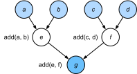

# Kompiliatoriai ir interpretatoriai
:label:`sec_hybridize`

Iki šiol ši knyga daugiausia dėmesio skyrė imperatyviajam programavimui, kuris naudoja tokius sakinius kaip `print`, `+` ir `if`, kad pakeistų programos būseną. Panagrinėkime tokį paprastos imperatyviosios programos pavyzdį.

```{.python .input}
#@tab all
def add(a, b):
    return a + b

def fancy_func(a, b, c, d):
    e = add(a, b)
    f = add(c, d)
    g = add(e, f)
    return g

print(fancy_func(1, 2, 3, 4))
```

Python yra *interpretuojamoji kalba*. Vertindama aukščiau pateiktą funkciją `fancy_func`, ji atlieka funkcijos kūną sudarančias operacijas *nuosekliai*. Tai yra, ji įvertins `e = add(a, b)` ir išsaugos rezultatus kaip kintamąjį `e`, taip pakeisdama programos būseną. Kiti du sakiniai `f = add(c, d)` ir `g = add(e, f)` bus vykdomi panašiai, atliekant sudėtį ir išsaugant rezultatus kaip kintamuosius. :numref:`fig_compute_graph` iliustruoja duomenų srautą.


:label:`fig_compute_graph`

Nors imperatyvusis programavimas yra patogus, jis gali būti neefektyvus. Viena vertus, net jei funkcija `add` kartojamai kviečiama visoje `fancy_func`, Python vykdys tris funkcijų iškvietimus atskirai. Jei jie vykdomi, tarkime, GPU (ar net keliuose GPU), Python interpretatoriaus pridėtinės sąnaudos gali tapti didžiulės. Be to, jai reikės išsaugoti kintamųjų `e` ir `f` reikšmes, kol bus įvykdyti visi `fancy_func` sakiniai. Taip yra todėl, kad nežinome, ar kintamuosius `e` ir `f` naudos kitos programos dalys po to, kai bus įvykdyti sakiniai `e = add(a, b)` ir `f = add(c, d)`.

## Simbolinis programavimas

Panagrinėkime alternatyvą – *simbolinį programavimą*, kai skaičiavimas paprastai atliekamas tik tada, kai procesas yra visiškai apibrėžtas. Šią strategiją naudoja keli giliojo mokymosi karkasai, įskaitant Theano ir TensorFlow (pastarasis įgijo imperatyviuosius plėtinius). Ji paprastai apima šiuos žingsnius:

1. Apibrėžti vykdytinas operacijas.
1. Sukompiliuoti operacijas į vykdomąją programą.
1. Pateikti reikiamas įvestis ir iškviesti sukompiliuotą programą vykdymui.

Tai leidžia atlikti didelį optimizavimą. Pirma, daugeliu atvejų galime praleisti Python interpretatorių, taip pašalindami našumo kliūtį, kuri gali tapti reikšminga keliuose greituose GPU, suporuotuose su viena Python gija CPU. 
Antra, kompiliatorius gali optimizuoti ir perrašyti aukščiau pateiktą kodą į `print((1 + 2) + (3 + 4))` ar net `print(10)`. Tai įmanoma, nes kompiliatorius mato visą kodą prieš paversdamas jį mašininėmis instrukcijomis. Pavyzdžiui, jis gali atlaisvinti atmintį (arba jos niekada neskirti), kai tik kintamasis nebereikalingas. Arba jis gali visiškai transformuoti kodą į ekvivalentų fragmentą.
Kad geriau suprastume, panagrinėkime šią imperatyviojo programavimo imitaciją (juk tai Python) žemiau.

```{.python .input}
#@tab all
def add_():
    return '''
def add(a, b):
    return a + b
'''

def fancy_func_():
    return '''
def fancy_func(a, b, c, d):
    e = add(a, b)
    f = add(c, d)
    g = add(e, f)
    return g
'''

def evoke_():
    return add_() + fancy_func_() + 'print(fancy_func(1, 2, 3, 4))'

prog = evoke_()
print(prog)
y = compile(prog, '', 'exec')
exec(y)
```

Skirtumai tarp imperatyviojo (interpretuojamojo) programavimo ir simbolinio programavimo yra tokie:

* Imperatyvusis programavimas yra lengvesnis. Kai Python naudojamas imperatyvusis programavimas, didžioji kodo dalis yra tiesmuka ir lengvai parašoma. Imperatyviojo programavimo kodą taip pat lengviau derinti. Taip yra todėl, kad lengviau gauti ir atspausdinti visas svarbias tarpinių kintamųjų reikšmes arba naudoti integruotus Python derinimo įrankius.
* Simbolinis programavimas yra efektyvesnis ir lengviau perkeliamas. Simbolinis programavimas palengvina kodo optimizavimą kompiliavimo metu, o taip pat suteikia galimybę perkelti programą į nuo Python nepriklausomą formatą. Tai leidžia programą vykdyti ne Python aplinkoje ir taip išvengti bet kokių galimų našumo problemų, susijusių su Python interpretatoriumi.


## Hibridinis programavimas

Istoriškai dauguma giliojo mokymosi karkasų pasirinkdavo imperatyvųjį arba simbolinį požiūrį. Pavyzdžiui, Theano, TensorFlow (įkvėptas pirmojo), Keras ir CNTK modelius formuluoja simboliškai. Ir atvirkščiai, Chainer ir PyTorch naudoja imperatyvųjį požiūrį. Vėlesnėse versijose TensorFlow 2.0 ir Keras buvo pridėtas imperatyvusis režimas.

:begin_tab:`mxnet`
Kurdami Gluon, kūrėjai svarstė, ar būtų įmanoma sujungti abiejų programavimo paradigmų privalumus. Tai lėmė hibridinį modelį, kuris leidžia naudotojams kurti ir derinti naudojant grynąjį imperatyvųjį programavimą, tuo pačiu turint galimybę daugumą programų konvertuoti į simbolines programas, kurias galima vykdyti, kai reikalingas produkcinio lygio skaičiavimo našumas ir diegimas.

Praktikoje tai reiškia, kad modelius kuriame naudodami klasę `HybridBlock` arba `HybridSequential`. Pagal numatytuosius nustatymus bet kuri iš jų vykdoma taip pat, kaip imperatyviajame programavime vykdoma klasė `Block` ar `Sequential`. 
Klasė `HybridSequential` yra `HybridBlock` poklasė (kaip ir `Sequential` yra `Block` poklasė). Kai iškviečiama funkcija `hybridize`, Gluon sukompiliuoja modelį į simboliniame programavime naudojamą formą. Tai leidžia optimizuoti daug skaičiavimų reikalaujančias dalis nepaaukojant modelio įgyvendinimo būdo. Naudą iliustruosime žemiau, sutelkdami dėmesį į nuoseklius modelius ir blokus.
:end_tab:

:begin_tab:`pytorch`
Kaip minėta aukščiau, PyTorch grindžiamas imperatyviuoju programavimu ir naudoja dinaminius skaičiavimo grafus. Siekdami pasinaudoti simbolinio programavimo perkeliamumu ir efektyvumu, kūrėjai svarstė, ar būtų įmanoma sujungti abiejų programavimo paradigmų privalumus. Tai lėmė torchscript, kuris leidžia naudotojams kurti ir derinti naudojant grynąjį imperatyvųjį programavimą, tuo pačiu turint galimybę daugumą programų konvertuoti į simbolines programas, kurias galima vykdyti, kai reikalingas produkcinio lygio skaičiavimo našumas ir diegimas.
:end_tab:

:begin_tab:`tensorflow`
Imperatyvusis programavimo modelis dabar yra numatytasis TensorFlow 2, o tai maloni naujovė naujokams šioje kalboje. Tačiau tos pačios simbolinio programavimo technikos ir iš jų kylantys skaičiavimo grafai vis dar egzistuoja TensorFlow ir yra pasiekiami lengvai naudojamu dekoratoriumi `tf.function`. Tai atnešė imperatyvųjį programavimo modelį į TensorFlow, leido naudotojams apibrėžti intuityvesnes funkcijas, o tada jas apgaubti ir automatiškai sukompiliuoti į skaičiavimo grafus naudojant TensorFlow komandos vadinamą funkciją [autograph](https://www.tensorflow.org/api_docs/python/tf/autograph).
:end_tab:

## Klasės `Sequential` hibridizavimas

Paprasčiausias būdas pajausti, kaip veikia hibridizavimas, yra panagrinėti giliuosius tinklus su keliais sluoksniais. Įprastai Python interpretatorius turės vykdyti visų sluoksnių kodą, kad sugeneruotų instrukciją, kurią galima perduoti CPU ar GPU. Vienam (greitam) skaičiavimo įrenginiui tai nesukelia jokių didelių problemų. Kita vertus, jei naudojame pažangų 8 GPU serverį, pavyzdžiui, AWS P3dn.24xlarge egzempliorių, Python sunkiai spės užimti visus GPU. Vienagijis Python interpretatorius čia tampa kliūtimi. Pažiūrėkime, kaip tai galime išspręsti reikšmingoms kodo dalims pakeisdami `Sequential` į `HybridSequential`. Pradedame apibrėždami paprastą MLP.

```{.python .input}
#@tab mxnet
from d2l import mxnet as d2l
from mxnet import np, npx
from mxnet.gluon import nn
npx.set_np()

# Factory for networks
def get_net():
    net = nn.HybridSequential()  
    net.add(nn.Dense(256, activation='relu'),
            nn.Dense(128, activation='relu'),
            nn.Dense(2))
    net.initialize()
    return net

x = np.random.normal(size=(1, 512))
net = get_net()
net(x)
```

```{.python .input}
#@tab pytorch
from d2l import torch as d2l
import torch
from torch import nn

# Factory for networks
def get_net():
    net = nn.Sequential(nn.Linear(512, 256),
            nn.ReLU(),
            nn.Linear(256, 128),
            nn.ReLU(),
            nn.Linear(128, 2))
    return net

x = torch.randn(size=(1, 512))
net = get_net()
net(x)
```

```{.python .input}
#@tab tensorflow
from d2l import tensorflow as d2l
import tensorflow as tf
from tensorflow.keras.layers import Dense

# Factory for networks
def get_net():
    net = tf.keras.Sequential()
    net.add(Dense(256, input_shape = (512,), activation = "relu"))
    net.add(Dense(128, activation = "relu"))
    net.add(Dense(2, activation = "linear"))
    return net

x = tf.random.normal([1,512])
net = get_net()
net(x)
```

:begin_tab:`mxnet`
Iškvietę funkciją `hybridize`, galime sukompiliuoti ir optimizuoti skaičiavimą MLP. Modelio skaičiavimo rezultatas išlieka nepakitęs.
:end_tab:

:begin_tab:`pytorch`
Konvertavę modelį naudodami funkciją `torch.jit.script`, galime sukompiliuoti ir optimizuoti skaičiavimą MLP. Modelio skaičiavimo rezultatas išlieka nepakitęs.
:end_tab:

:begin_tab:`tensorflow`
Anksčiau visos TensorFlow sukurtos funkcijos buvo kuriamos kaip skaičiavimo grafas ir todėl pagal numatytuosius nustatymus buvo kompiliuojamos JIT. Tačiau išleidus TensorFlow 2.X ir EagerTensor, tai nebėra numatytasis elgesys. 
Šią funkciją galime vėl įjungti su tf.function. tf.function dažniausiai naudojama kaip funkcijos dekoratorius, tačiau ją galima iškviesti ir tiesiogiai kaip įprastą Python funkciją, kaip parodyta žemiau. Modelio skaičiavimo rezultatas išlieka nepakitęs.
:end_tab:

```{.python .input}
#@tab mxnet
net.hybridize()
net(x)
```

```{.python .input}
#@tab pytorch
net = torch.jit.script(net)
net(x)
```

```{.python .input}
#@tab tensorflow
net = tf.function(net)
net(x)
```

:begin_tab:`mxnet`
Tai atrodo beveik per gerai, kad būtų tiesa: tiesiog nurodykite bloką kaip `HybridSequential`, parašykite tą patį kodą kaip anksčiau ir iškvieskite `hybridize`. Kai tai įvyksta, tinklas optimizuojamas (našumą išmatuosime žemiau). Deja, tai neveikia stebuklingai kiekvienam sluoksniui. Vis dėlto sluoksnis nebus optimizuotas, jei paveldi klasę `Block`, o ne klasę `HybridBlock`.
:end_tab:

:begin_tab:`pytorch`
Tai atrodo beveik per gerai, kad būtų tiesa: parašykite tą patį kodą kaip anksčiau ir tiesiog konvertuokite modelį naudodami `torch.jit.script`. Kai tai įvyksta, tinklas optimizuojamas (našumą išmatuosime žemiau).
:end_tab:

:begin_tab:`tensorflow`
Tai atrodo beveik per gerai, kad būtų tiesa: parašykite tą patį kodą kaip anksčiau ir tiesiog konvertuokite modelį naudodami `tf.function`. Kai tai įvyksta, tinklas sukuriamas kaip skaičiavimo grafas TensorFlow MLIR tarpiniu atvaizdu ir yra stipriai optimizuojamas kompiliatoriaus lygiu greitam vykdymui (našumą išmatuosime žemiau).
Aiškiai pridėjus vėliavėlę `jit_compile = True` prie `tf.function()` iškvietimo, įjungiama XLA (Accelerated Linear Algebra) funkcija TensorFlow. XLA tam tikrais atvejais gali dar labiau optimizuoti JIT sukompiliuotą kodą. Grafo režimo vykdymas įjungiamas ir be šio aiškaus apibrėžimo, tačiau XLA gali gerokai pagreitinti kai kurias dideles tiesinės algebros operacijas (panašias į tas, kurias matome giliojo mokymosi taikymuose), ypač GPU aplinkoje.
:end_tab:

### Spartinimas hibridizavimu

Kad parodytume kompiliavimu pasiektą našumo pagerėjimą, palyginame laiką, reikalingą įvertinti `net(x)` prieš hibridizavimą ir po jo. Pirmiausia apibrėžkime klasę šiam laikui matuoti. Ji pravers visame skyriuje, kai imsimės matuoti (ir gerinti) našumą.

```{.python .input}
#@tab all
#@save
class Benchmark:
    """For measuring running time."""
    def __init__(self, description='Done'):
        self.description = description

    def __enter__(self):
        self.timer = d2l.Timer()
        return self

    def __exit__(self, *args):
        print(f'{self.description}: {self.timer.stop():.4f} sec')
```

:begin_tab:`mxnet`
Dabar galime iškviesti tinklą du kartus: vieną kartą su hibridizavimu ir vieną kartą be jo.
:end_tab:

:begin_tab:`pytorch`
Dabar galime iškviesti tinklą du kartus: vieną kartą su torchscript ir vieną kartą be jo.
:end_tab:

:begin_tab:`tensorflow`
Dabar galime iškviesti tinklą tris kartus: vieną kartą vykdomą nedelsiant (angl. *eagerly*), vieną kartą grafo režimu ir dar kartą naudojant JIT sukompiliuotą XLA.
:end_tab:

```{.python .input}
#@tab mxnet
net = get_net()
with Benchmark('Without hybridization'):
    for i in range(1000): net(x)
    npx.waitall()

net.hybridize()
with Benchmark('With hybridization'):
    for i in range(1000): net(x)
    npx.waitall()
```

```{.python .input}
#@tab pytorch
net = get_net()
with Benchmark('Without torchscript'):
    for i in range(1000): net(x)

net = torch.jit.script(net)
with Benchmark('With torchscript'):
    for i in range(1000): net(x)
```

```{.python .input}
#@tab tensorflow
net = get_net()
with Benchmark('Eager Mode'):
    for i in range(1000): net(x)

net = tf.function(net)
with Benchmark('Graph Mode'):
    for i in range(1000): net(x)
```

:begin_tab:`mxnet`
Kaip matyti iš aukščiau pateiktų rezultatų, po to, kai `HybridSequential` egzempliorius iškviečia funkciją `hybridize`, skaičiavimo našumas pagerėja naudojant simbolinį programavimą.
:end_tab:

:begin_tab:`pytorch`
Kaip matyti iš aukščiau pateiktų rezultatų, po to, kai `nn.Sequential` egzempliorius paverčiamas scenarijumi naudojant funkciją `torch.jit.script`, skaičiavimo našumas pagerėja naudojant simbolinį programavimą.
:end_tab:

:begin_tab:`tensorflow`
Kaip matyti iš aukščiau pateiktų rezultatų, po to, kai `tf.keras.Sequential` egzempliorius paverčiamas scenarijumi naudojant funkciją `tf.function`, skaičiavimo našumas pagerėja naudojant simbolinį programavimą per grafo režimo vykdymą TensorFlow. 
:end_tab:

### Serializavimas

:begin_tab:`mxnet`
Vienas iš modelių kompiliavimo privalumų yra tas, kad galime serializuoti (išsaugoti) modelį ir jo parametrus diske. Tai leidžia mums išsaugoti modelį nepriklausomai nuo pasirinktos priekinės dalies kalbos. Tai leidžia diegti apmokytus modelius kituose įrenginiuose ir lengvai naudoti kitas priekinės dalies programavimo kalbas. Tuo pačiu kodas dažnai yra greitesnis nei tas, kurį galima pasiekti imperatyviajame programavime. Pažiūrėkime, kaip veikia funkcija `export`.
:end_tab:

:begin_tab:`pytorch`
Vienas iš modelių kompiliavimo privalumų yra tas, kad galime serializuoti (išsaugoti) modelį ir jo parametrus diske. Tai leidžia mums išsaugoti modelį nepriklausomai nuo pasirinktos priekinės dalies kalbos. Tai leidžia diegti apmokytus modelius kituose įrenginiuose ir lengvai naudoti kitas priekinės dalies programavimo kalbas. Tuo pačiu kodas dažnai yra greitesnis nei tas, kurį galima pasiekti imperatyviajame programavime. Pažiūrėkime, kaip veikia funkcija `save`.
:end_tab:

:begin_tab:`tensorflow`
Vienas iš modelių kompiliavimo privalumų yra tas, kad galime serializuoti (išsaugoti) modelį ir jo parametrus diske. Tai leidžia mums išsaugoti modelį nepriklausomai nuo pasirinktos priekinės dalies kalbos. Tai leidžia diegti apmokytus modelius kituose įrenginiuose ir lengvai naudoti kitas priekinės dalies programavimo kalbas arba vykdyti apmokytą modelį serveryje. Tuo pačiu kodas dažnai yra greitesnis nei tas, kurį galima pasiekti imperatyviajame programavime. 
Žemo lygio API, leidžianti išsaugoti TensorFlow, yra `tf.saved_model`. 
Pažiūrėkime, kaip veikia `saved_model` egzempliorius.
:end_tab:

```{.python .input}
#@tab mxnet
net.export('my_mlp')
!ls -lh my_mlp*
```

```{.python .input}
#@tab pytorch
net.save('my_mlp')
!ls -lh my_mlp*
```

```{.python .input}
#@tab tensorflow
net = get_net()
tf.saved_model.save(net, 'my_mlp')
!ls -lh my_mlp*
```

:begin_tab:`mxnet`
Modelis suskaidomas į (didelį dvejetainį) parametrų failą ir JSON aprašą programos, reikalingos modelio skaičiavimui vykdyti. Failus gali nuskaityti kitos Python ar MXNet palaikomos priekinės dalies kalbos, pavyzdžiui, C++, R, Scala ir Perl. Pažvelkime į pirmąsias modelio aprašo eilutes.
:end_tab:

```{.python .input}
#@tab mxnet
!head my_mlp-symbol.json
```

:begin_tab:`mxnet`
Anksčiau parodėme, kad iškvietus funkciją `hybridize`, modelis gali pasiekti aukštesnį skaičiavimo našumą ir perkeliamumą. Tačiau atkreipkite dėmesį, kad hibridizavimas gali paveikti modelio lankstumą, ypač valdymo srauto požiūriu. 

Be to, priešingai nei `Block` egzemplioriui, kuriam reikia naudoti funkciją `forward`, `HybridBlock` egzemplioriui turime naudoti funkciją `hybrid_forward`.
:end_tab:

```{.python .input}
#@tab mxnet
class HybridNet(nn.HybridBlock):
    def __init__(self, **kwargs):
        super(HybridNet, self).__init__(**kwargs)
        self.hidden = nn.Dense(4)
        self.output = nn.Dense(2)

    def hybrid_forward(self, F, x):
        print('module F: ', F)
        print('value  x: ', x)
        x = F.npx.relu(self.hidden(x))
        print('result  : ', x)
        return self.output(x)
```

:begin_tab:`mxnet`
Aukščiau pateiktas kodas įgyvendina paprastą tinklą su 4 paslėptaisiais vienetais ir 2 išvestimis. Funkcija `hybrid_forward` priima papildomą argumentą `F`. Jo reikia, nes priklausomai nuo to, ar kodas buvo hibridizuotas, ar ne, apdorojimui bus naudojama šiek tiek skirtinga biblioteka (`ndarray` ar `symbol`). Abi klasės atlieka labai panašias funkcijas, o MXNet automatiškai nustato argumentą. Kad suprastume, kas vyksta, atspausdiname argumentus kaip funkcijos iškvietimo dalį.
:end_tab:

```{.python .input}
#@tab mxnet
net = HybridNet()
net.initialize()
x = np.random.normal(size=(1, 3))
net(x)
```

:begin_tab:`mxnet`
Pakartojus tiesioginio sklidimo skaičiavimą, gausime tą pačią išvestį (detalių praleidžiame). Dabar pažiūrėkime, kas nutinka, jei iškviečiame funkciją `hybridize`.
:end_tab:

```{.python .input}
#@tab mxnet
net.hybridize()
net(x)
```

:begin_tab:`mxnet`
Vietoj `ndarray` dabar `F` naudojame modulį `symbol`. Be to, nors įvestis yra `ndarray` tipo, duomenys, tekantys per tinklą, dabar kompiliavimo proceso metu konvertuojami į `symbol` tipą. Pakartojus funkcijos iškvietimą, gaunamas stebinantis rezultatas:
:end_tab:

```{.python .input}
#@tab mxnet
net(x)
```

:begin_tab:`mxnet` 
Tai gana skiriasi nuo to, ką matėme anksčiau. Visi spausdinimo sakiniai, apibrėžti `hybrid_forward`, praleidžiami. Iš tikrųjų po hibridizavimo `net(x)` vykdymas nebeapima Python interpretatoriaus. Tai reiškia, kad bet koks nereikalingas Python kodas (pavyzdžiui, spausdinimo sakiniai) praleidžiamas siekiant daug racionalesnio vykdymo ir geresnio našumo. Vietoj to MXNet tiesiogiai kviečia C++ vidinę dalį. Taip pat atkreipkite dėmesį, kad kai kurios funkcijos nepalaikomos modulyje `symbol` (pvz., `asnumpy`), o operacijos vietoje, pavyzdžiui, `a += b` ir `a[:] = a + b`, turi būti perrašytos kaip `a = a + b`. Vis dėlto modelių kompiliavimas yra vertas pastangų, kai tik svarbus greitis. Nauda gali svyruoti nuo kelių procentinių punktų iki daugiau nei dvigubo greičio, priklausomai nuo modelio sudėtingumo, CPU greičio ir GPU greičio bei skaičiaus.
:end_tab:

## Santrauka


* Imperatyvusis programavimas leidžia lengvai kurti naujus modelius, nes galima rašyti kodą su valdymo srautu ir galimybe naudoti didelę Python programinės įrangos ekosistemos dalį.
* Simbolinis programavimas reikalauja, kad nurodytume programą ir ją sukompiliuotume prieš vykdydami. Nauda – geresnis našumas.

:begin_tab:`mxnet` 
* MXNet gali prireikus sujungti abiejų požiūrių privalumus.
* Modeliai, sukonstruoti klasėmis `HybridSequential` ir `HybridBlock`, gali konvertuoti imperatyviąsias programas į simbolines iškviesdami funkciją `hybridize`.
:end_tab:


## Pratimai


:begin_tab:`mxnet` 
1. Pridėkite `x.asnumpy()` prie pirmosios šiame skyrelyje esančios klasės `HybridNet` funkcijos `hybrid_forward` eilutės. Vykdykite kodą ir stebėkite klaidas, su kuriomis susidursite. Kodėl jos atsiranda?
1. Kas nutinka, jei prie funkcijos `hybrid_forward` pridedame valdymo srautą, t. y. Python sakinius `if` ir `for`?
1. Peržiūrėkite jus dominančius modelius ankstesniuose skyriuose. Ar galite pagerinti jų skaičiavimo našumą juos įgyvendindami iš naujo?
:end_tab:

:begin_tab:`pytorch,tensorflow` 
1. Peržiūrėkite jus dominančius modelius ankstesniuose skyriuose. Ar galite pagerinti jų skaičiavimo našumą juos įgyvendindami iš naujo?
:end_tab:


:begin_tab:`mxnet`
[Diskusijos](https://discuss.d2l.ai/t/360)
:end_tab:

:begin_tab:`pytorch`
[Diskusijos](https://discuss.d2l.ai/t/2490)
:end_tab:

:begin_tab:`tensorflow`
[Diskusijos](https://discuss.d2l.ai/t/2492)
:end_tab:
