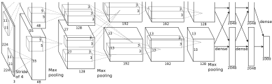
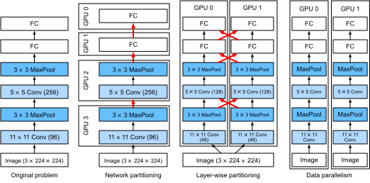
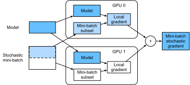

# Apmokymas keliuose GPU
:label:`sec_multi_gpu`

Iki šiol aptarėme, kaip efektyviai apmokyti modelius CPU ir GPU. Netgi parodėme :numref:`sec_auto_para`, kaip giliojo mokymosi karkasai leidžia automatiškai lygiagretinti skaičiavimą ir komunikaciją tarp jų. Taip pat :numref:`sec_use_gpu` parodėme, kaip išvardyti visus kompiuteryje esamus GPU naudojant komandą `nvidia-smi`.
To, ką *neaptarėme*, yra tai, kaip iš tikrųjų lygiagretinti giliojo mokymosi apmokymą.
Vietoj to tarp kita ko numanėme, kad kaip nors padalysime duomenis tarp kelių įrenginių ir tai veiks. Šis skyrelis užpildo detales ir parodo, kaip lygiagrečiai apmokyti tinklą pradedant nuo nulio. Detalės apie tai, kaip pasinaudoti aukšto lygio API funkcionalumu, perkeltos į :numref:`sec_multi_gpu_concise`.
Darome prielaidą, kad esate susipažinę su minirinkinio stochastinio gradientinio nusileidimo algoritmais, tokiais kaip aprašyti :numref:`sec_minibatch_sgd`.


## Uždavinio padalijimas

Pradėkime nuo paprasto kompiuterinės regos uždavinio ir kiek archajiško tinklo, pavyzdžiui, su keliais konvoliucijų, sutraukimo sluoksniais ir galbūt keliais pilnai sujungtais sluoksniais pabaigoje.
Tai yra, pradėkime nuo tinklo, kuris atrodo gana panašiai į LeNet :cite:`LeCun.Bottou.Bengio.ea.1998` arba AlexNet :cite:`Krizhevsky.Sutskever.Hinton.2012`.
Turėdami kelis GPU (2, jei tai staliniame kompiuteryje esantis serveris, 4 AWS g4dn.12xlarge egzemplioriuje, 8 p3.16xlarge arba 16 p2.16xlarge), norime suskaidyti apmokymą taip, kad pasiektume gerą pagreitėjimą ir tuo pačiu pasinaudotume paprastais ir atkartojamais dizaino sprendimais. Juk keli GPU padidina ir *atminties*, ir *skaičiavimo* gebą. Trumpai tariant, turime tokius pasirinkimus, turint apmokymo duomenų minirinkinį, kurį norime klasifikuoti.

Pirma, galėtume padalyti tinklą tarp kelių GPU. Tai yra, kiekvienas GPU gauna kaip įvestį duomenis, tekančius į tam tikrą sluoksnį, apdoroja duomenis per kelis vėlesnius sluoksnius ir tada siunčia duomenis kitam GPU.
Tai leidžia apdoroti duomenis didesniais tinklais, palyginti su tuo, ką galėtų apdoroti vienas GPU.
Be to,
atminties poreikį vienam GPU galima gerai kontroliuoti (jis sudaro bendro tinklo poreikio dalį).

Tačiau sąsaja tarp sluoksnių (ir taip GPU) reikalauja glaudaus sinchronizavimo. Tai gali būti sudėtinga, ypač jei skaičiavimo apkrovos tarp sluoksnių nėra tinkamai suderintos. Problema paaštrėja esant dideliam GPU skaičiui.
Sąsaja tarp sluoksnių taip pat
reikalauja didelių duomenų perdavimo kiekių,
pavyzdžiui, aktyvacijų ir gradientų.
Tai gali viršyti GPU magistralių pralaidumą.
Be to, daug skaičiavimų reikalaujančias, bet nuoseklias operacijas padalyti nėra paprasta. Žr., pvz., :citet:`Mirhoseini.Pham.Le.ea.2017` – geriausią pastangą šiuo požiūriu. Tai išlieka sudėtinga problema, ir neaišku, ar įmanoma pasiekti gerą (tiesinį) mastelio didėjimą nebanaliems uždaviniams. Nerekomenduojame to, nebent yra puikus karkaso ar operacinės sistemos palaikymas kelių GPU sujungimui į grandinę.


Antra, galėtume padalyti darbą pagal sluoksnius. Pavyzdžiui, užuot skaičiavę 64 kanalus viename GPU, galėtume padalyti uždavinį tarp 4 GPU, kurių kiekvienas generuoja duomenis 16 kanalų.
Panašiai pilnai sujungtam sluoksniui galėtume padalyti išvesties vienetų skaičių. :numref:`fig_alexnet_original` (paimtas iš :citet:`Krizhevsky.Sutskever.Hinton.2012`)
iliustruoja šį dizainą, kuriame ši strategija buvo naudojama GPU su labai mažu atminties kiekiu (tuo metu 2 GB).
Tai leidžia pasiekti gerą mastelio didėjimą skaičiavimo požiūriu, jei kanalų (ar vienetų) skaičius nėra pernelyg mažas.
Be to,
keli GPU gali apdoroti vis didesnius tinklus, nes turima atmintis didėja tiesiškai.


:label:`fig_alexnet_original`

Tačiau
mums reikia *labai didelio* sinchronizavimo ar barjerų operacijų skaičiaus, nes kiekvienas sluoksnis priklauso nuo visų kitų sluoksnių rezultatų.
Be to, duomenų kiekis, kurį reikia perduoti, potencialiai yra dar didesnis nei paskirstant sluoksnius tarp GPU. Todėl nerekomenduojame šio požiūrio dėl jo pralaidumo kaštų ir sudėtingumo.

Galiausiai galėtume padalyti duomenis tarp kelių GPU. Taip visi GPU atlieka to paties tipo darbą, nors ir su skirtingais stebiniais. Gradientai agreguojami per GPU po kiekvieno apmokymo duomenų minirinkinio.
Tai paprasčiausias požiūris, ir jį galima taikyti bet kuriose situacijose.
Sinchronizuoti reikia tik po kiekvieno minirinkinio. Vis dėlto labai pageidautina pradėti keistis gradientų parametrais jau tada, kai kiti dar skaičiuojami.
Be to, didesnis GPU skaičius lemia didesnius minirinkinių dydžius, taip padidindamas apmokymo efektyvumą.
Tačiau pridėjus daugiau GPU negalime apmokyti didesnių modelių.



:label:`fig_splitting`


Skirtingų lygiagretinimo keliuose GPU būdų palyginimas pavaizduotas :numref:`fig_splitting`.
Apskritai duomenų lygiagretumas yra patogiausias būdas, jei turime prieigą prie pakankamai didelės atminties GPU. Taip pat žr. :cite:`Li.Andersen.Park.ea.2014` išsamiam paskirstytojo apmokymo skaidymo aprašymui. GPU atmintis buvo problema pirmaisiais giliojo mokymosi laikais. Šiuo metu ši problema išspręsta visais atvejais, išskyrus patį neįprasčiausius. Toliau sutelkiame dėmesį į duomenų lygiagretumą.

## Duomenų lygiagretumas

Tarkime, kad kompiuteryje yra $k$ GPU. Turint apmokomą modelį, kiekvienas GPU nepriklausomai palaikys pilną modelio parametrų aibę, nors parametrų reikšmės tarp GPU yra identiškos ir sinchronizuotos.
Pavyzdžiui,
:numref:`fig_data_parallel` iliustruoja
apmokymą su
duomenų lygiagretumu, kai $k=2$.



:label:`fig_data_parallel`

Apskritai apmokymas vyksta taip:

* Bet kurioje apmokymo iteracijoje, turint atsitiktinį minirinkinį, rinkinyje esančius pavyzdžius padalijame į $k$ dalių ir vienodai paskirstome tarp GPU.
* Kiekvienas GPU apskaičiuoja modelio parametrų nuostolį ir gradientą pagal jam priskirtą minirinkinio poaibį.
* Kiekvieno iš $k$ GPU lokalūs gradientai agreguojami, kad gautume dabartinį minirinkinio stochastinį gradientą.
* Agreguotas gradientas perskirstomas kiekvienam GPU.
* Kiekvienas GPU naudoja šį minirinkinio stochastinį gradientą, kad atnaujintų pilną jo palaikomą modelio parametrų aibę.


Atkreipkite dėmesį, kad praktikoje, apmokant $k$ GPU, minirinkinio dydį *padidiname* $k$ kartų, kad kiekvienas GPU turėtų tiek pat darbo, kaip jei apmokytume tik vieną GPU. 16 GPU serveryje tai gali žymiai padidinti minirinkinio dydį, todėl gali tekti atitinkamai padidinti mokymosi greitį.
Taip pat atkreipkite dėmesį, kad :numref:`sec_batch_norm` paketinę normalizaciją reikia pritaikyti, pavyzdžiui, palaikant atskirą paketinės normalizacijos koeficientą kiekvienam GPU.
Toliau naudosime žaislinį tinklą keliems GPU skirtam apmokymui iliustruoti.

```{.python .input}
#@tab mxnet
%matplotlib inline
from d2l import mxnet as d2l
from mxnet import autograd, gluon, np, npx
npx.set_np()
```

```{.python .input}
#@tab pytorch
%matplotlib inline
from d2l import torch as d2l
import torch
from torch import nn
from torch.nn import functional as F
```

## [**Žaislinis tinklas**]

Naudojame LeNet, kaip pristatyta :numref:`sec_lenet` (su nedideliais pakeitimais). Apibrėžiame jį nuo nulio, kad detaliai iliustruotume parametrų keitimąsi ir sinchronizavimą.

```{.python .input}
#@tab mxnet
# Initialize model parameters
scale = 0.01
W1 = np.random.normal(scale=scale, size=(20, 1, 3, 3))
b1 = np.zeros(20)
W2 = np.random.normal(scale=scale, size=(50, 20, 5, 5))
b2 = np.zeros(50)
W3 = np.random.normal(scale=scale, size=(800, 128))
b3 = np.zeros(128)
W4 = np.random.normal(scale=scale, size=(128, 10))
b4 = np.zeros(10)
params = [W1, b1, W2, b2, W3, b3, W4, b4]

# Define the model
def lenet(X, params):
    h1_conv = npx.convolution(data=X, weight=params[0], bias=params[1],
                              kernel=(3, 3), num_filter=20)
    h1_activation = npx.relu(h1_conv)
    h1 = npx.pooling(data=h1_activation, pool_type='avg', kernel=(2, 2),
                     stride=(2, 2))
    h2_conv = npx.convolution(data=h1, weight=params[2], bias=params[3],
                              kernel=(5, 5), num_filter=50)
    h2_activation = npx.relu(h2_conv)
    h2 = npx.pooling(data=h2_activation, pool_type='avg', kernel=(2, 2),
                     stride=(2, 2))
    h2 = h2.reshape(h2.shape[0], -1)
    h3_linear = np.dot(h2, params[4]) + params[5]
    h3 = npx.relu(h3_linear)
    y_hat = np.dot(h3, params[6]) + params[7]
    return y_hat

# Cross-entropy loss function
loss = gluon.loss.SoftmaxCrossEntropyLoss()
```

```{.python .input}
#@tab pytorch
# Initialize model parameters
scale = 0.01
W1 = torch.randn(size=(20, 1, 3, 3)) * scale
b1 = torch.zeros(20)
W2 = torch.randn(size=(50, 20, 5, 5)) * scale
b2 = torch.zeros(50)
W3 = torch.randn(size=(800, 128)) * scale
b3 = torch.zeros(128)
W4 = torch.randn(size=(128, 10)) * scale
b4 = torch.zeros(10)
params = [W1, b1, W2, b2, W3, b3, W4, b4]

# Define the model
def lenet(X, params):
    h1_conv = F.conv2d(input=X, weight=params[0], bias=params[1])
    h1_activation = F.relu(h1_conv)
    h1 = F.avg_pool2d(input=h1_activation, kernel_size=(2, 2), stride=(2, 2))
    h2_conv = F.conv2d(input=h1, weight=params[2], bias=params[3])
    h2_activation = F.relu(h2_conv)
    h2 = F.avg_pool2d(input=h2_activation, kernel_size=(2, 2), stride=(2, 2))
    h2 = h2.reshape(h2.shape[0], -1)
    h3_linear = torch.mm(h2, params[4]) + params[5]
    h3 = F.relu(h3_linear)
    y_hat = torch.mm(h3, params[6]) + params[7]
    return y_hat

# Cross-entropy loss function
loss = nn.CrossEntropyLoss(reduction='none')
```

## Duomenų sinchronizavimas

Efektyviam apmokymui keliuose GPU mums reikia dviejų pagrindinių operacijų.
Pirma, turime turėti galimybę [**paskirstyti parametrų sąrašą keliems įrenginiams**] ir pridėti gradientus (`get_params`). Be parametrų neįmanoma įvertinti tinklo GPU.
Antra, mums reikia galimybės sumuoti parametrus per kelis įrenginius, t. y. mums reikia funkcijos `allreduce`.

```{.python .input}
#@tab mxnet
def get_params(params, device):
    new_params = [p.copyto(device) for p in params]
    for p in new_params:
        p.attach_grad()
    return new_params
```

```{.python .input}
#@tab pytorch
def get_params(params, device):
    new_params = [p.to(device) for p in params]
    for p in new_params:
        p.requires_grad_()
    return new_params
```

Išbandykime nukopijuodami modelio parametrus į vieną GPU.

```{.python .input}
#@tab all
new_params = get_params(params, d2l.try_gpu(0))
print('b1 weight:', new_params[1])
print('b1 grad:', new_params[1].grad)
```

Kadangi dar neatlikome jokių skaičiavimų, poslinkio parametro gradientas vis dar lygus nuliui.
Dabar tarkime, kad turime vektorių, paskirstytą keliuose GPU. Ši [**funkcija `allreduce` sudeda visus vektorius ir išplatina rezultatą atgal visiems GPU**]. Atkreipkite dėmesį, kad tam, kad tai veiktų, turime nukopijuoti duomenis į įrenginį, kuris kaupia rezultatus.

```{.python .input}
#@tab mxnet
def allreduce(data):
    for i in range(1, len(data)):
        data[0][:] += data[i].copyto(data[0].ctx)
    for i in range(1, len(data)):
        data[0].copyto(data[i])
```

```{.python .input}
#@tab pytorch
def allreduce(data):
    for i in range(1, len(data)):
        data[0][:] += data[i].to(data[0].device)
    for i in range(1, len(data)):
        data[i][:] = data[0].to(data[i].device)
```

Patikrinkime tai sukurdami vektorius su skirtingomis reikšmėmis skirtinguose įrenginiuose ir juos suagreguodami.

```{.python .input}
#@tab mxnet
data = [np.ones((1, 2), ctx=d2l.try_gpu(i)) * (i + 1) for i in range(2)]
print('before allreduce:\n', data[0], '\n', data[1])
allreduce(data)
print('after allreduce:\n', data[0], '\n', data[1])
```

```{.python .input}
#@tab pytorch
data = [torch.ones((1, 2), device=d2l.try_gpu(i)) * (i + 1) for i in range(2)]
print('before allreduce:\n', data[0], '\n', data[1])
allreduce(data)
print('after allreduce:\n', data[0], '\n', data[1])
```

## Duomenų paskirstymas

Mums reikia paprastos pagalbinės funkcijos, kad [**vienodai paskirstytume minirinkinį tarp kelių GPU**]. Pavyzdžiui, dviejuose GPU norėtume, kad pusė duomenų būtų nukopijuota į kiekvieną iš GPU.
Kadangi tai patogiau ir glausčiau, naudojame giliojo mokymosi karkaso integruotą funkciją, kad išbandytume ją su $4 \times 5$ matrica.

```{.python .input}
#@tab mxnet
data = np.arange(20).reshape(4, 5)
devices = [npx.gpu(0), npx.gpu(1)]
split = gluon.utils.split_and_load(data, devices)
print('input :', data)
print('load into', devices)
print('output:', split)
```

```{.python .input}
#@tab pytorch
data = torch.arange(20).reshape(4, 5)
devices = [torch.device('cuda:0'), torch.device('cuda:1')]
split = nn.parallel.scatter(data, devices)
print('input :', data)
print('load into', devices)
print('output:', split)
```

Vėlesniam pakartotiniam naudojimui apibrėžiame funkciją `split_batch`, kuri padalija ir duomenis, ir žymes.

```{.python .input}
#@tab mxnet
#@save
def split_batch(X, y, devices):
    """Split `X` and `y` into multiple devices."""
    assert X.shape[0] == y.shape[0]
    return (gluon.utils.split_and_load(X, devices),
            gluon.utils.split_and_load(y, devices))
```

```{.python .input}
#@tab pytorch
#@save
def split_batch(X, y, devices):
    """Split `X` and `y` into multiple devices."""
    assert X.shape[0] == y.shape[0]
    return (nn.parallel.scatter(X, devices),
            nn.parallel.scatter(y, devices))
```

## Apmokymas

Dabar galime įgyvendinti [**apmokymą keliuose GPU vienam minirinkiniui**]. Jo įgyvendinimas daugiausia grindžiamas šiame skyrelyje aprašytu duomenų lygiagretumo požiūriu. Naudosime ką tik aptartas pagalbines funkcijas `allreduce` ir `split_and_load`, kad sinchronizuotume duomenis tarp kelių GPU. Atkreipkite dėmesį, kad nereikia rašyti jokio specialaus kodo lygiagretumui pasiekti. Kadangi skaičiavimo grafas neturi jokių priklausomybių tarp įrenginių vieno minirinkinio viduje, jis vykdomas lygiagrečiai *automatiškai*.

```{.python .input}
#@tab mxnet
def train_batch(X, y, device_params, devices, lr):
    X_shards, y_shards = split_batch(X, y, devices)
    with autograd.record():  # Loss is calculated separately on each GPU
        ls = [loss(lenet(X_shard, device_W), y_shard)
              for X_shard, y_shard, device_W in zip(
                  X_shards, y_shards, device_params)]
    for l in ls:  # Backpropagation is performed separately on each GPU
        l.backward()
    # Sum all gradients from each GPU and broadcast them to all GPUs
    for i in range(len(device_params[0])):
        allreduce([device_params[c][i].grad for c in range(len(devices))])
    # The model parameters are updated separately on each GPU
    for param in device_params:
        d2l.sgd(param, lr, X.shape[0])  # Here, we use a full-size batch
```

```{.python .input}
#@tab pytorch
def train_batch(X, y, device_params, devices, lr):
    X_shards, y_shards = split_batch(X, y, devices)
    # Loss is calculated separately on each GPU
    ls = [loss(lenet(X_shard, device_W), y_shard).sum()
          for X_shard, y_shard, device_W in zip(
              X_shards, y_shards, device_params)]
    for l in ls:  # Backpropagation is performed separately on each GPU
        l.backward()
    # Sum all gradients from each GPU and broadcast them to all GPUs
    with torch.no_grad():
        for i in range(len(device_params[0])):
            allreduce([device_params[c][i].grad for c in range(len(devices))])
    # The model parameters are updated separately on each GPU
    for param in device_params:
        d2l.sgd(param, lr, X.shape[0]) # Here, we use a full-size batch
```

Dabar galime apibrėžti [**apmokymo funkciją**]. Ji šiek tiek skiriasi nuo naudotų ankstesniuose skyriuose: turime paskirti GPU ir nukopijuoti visus modelio parametrus į visus įrenginius.
Akivaizdu, kad kiekvienas rinkinys apdorojamas naudojant funkciją `train_batch`, kad būtų galima tvarkyti kelis GPU. Patogumo (ir kodo glaustumo) dėlei tikslumą apskaičiuojame viename GPU, nors tai *neefektyvu*, nes kiti GPU dykinėja.

```{.python .input}
#@tab mxnet
def train(num_gpus, batch_size, lr):
    train_iter, test_iter = d2l.load_data_fashion_mnist(batch_size)
    devices = [d2l.try_gpu(i) for i in range(num_gpus)]
    # Copy model parameters to `num_gpus` GPUs
    device_params = [get_params(params, d) for d in devices]
    num_epochs = 10
    animator = d2l.Animator('epoch', 'test acc', xlim=[1, num_epochs])
    timer = d2l.Timer()
    for epoch in range(num_epochs):
        timer.start()
        for X, y in train_iter:
            # Perform multi-GPU training for a single minibatch
            train_batch(X, y, device_params, devices, lr)
            npx.waitall()
        timer.stop()
        # Evaluate the model on GPU 0
        animator.add(epoch + 1, (d2l.evaluate_accuracy_gpu(
            lambda x: lenet(x, device_params[0]), test_iter, devices[0]),))
    print(f'test acc: {animator.Y[0][-1]:.2f}, {timer.avg():.1f} sec/epoch '
          f'on {str(devices)}')
```

```{.python .input}
#@tab pytorch
def train(num_gpus, batch_size, lr):
    train_iter, test_iter = d2l.load_data_fashion_mnist(batch_size)
    devices = [d2l.try_gpu(i) for i in range(num_gpus)]
    # Copy model parameters to `num_gpus` GPUs
    device_params = [get_params(params, d) for d in devices]
    num_epochs = 10
    animator = d2l.Animator('epoch', 'test acc', xlim=[1, num_epochs])
    timer = d2l.Timer()
    for epoch in range(num_epochs):
        timer.start()
        for X, y in train_iter:
            # Perform multi-GPU training for a single minibatch
            train_batch(X, y, device_params, devices, lr)
            torch.cuda.synchronize()
        timer.stop()
        # Evaluate the model on GPU 0
        animator.add(epoch + 1, (d2l.evaluate_accuracy_gpu(
            lambda x: lenet(x, device_params[0]), test_iter, devices[0]),))
    print(f'test acc: {animator.Y[0][-1]:.2f}, {timer.avg():.1f} sec/epoch '
          f'on {str(devices)}')
```

Pažiūrėkime, kaip gerai tai veikia [**viename GPU**].
Pirmiausia naudojame 256 rinkinio dydį ir 0.2 mokymosi greitį.

```{.python .input}
#@tab all
train(num_gpus=1, batch_size=256, lr=0.2)
```

Palikę rinkinio dydį ir mokymosi greitį nepakeistus ir [**padidinę GPU skaičių iki 2**], matome, kad testavimo tikslumas maždaug išlieka toks pat, palyginti su
ankstesniu eksperimentu.
Optimizavimo algoritmų požiūriu jie yra identiški. Deja, čia negalima pasiekti prasmingo pagreitėjimo: modelis tiesiog per mažas; be to, turime tik nedidelį duomenų rinkinį, kuriame mūsų šiek tiek paprastas apmokymo keliuose GPU įgyvendinimo būdas patyrė didelių Python pridėtinių sąnaudų. Toliau susidursime su sudėtingesniais modeliais ir sudėtingesniais lygiagretinimo būdais.
Vis dėlto pažiūrėkime, kas nutinka su Fashion-MNIST.

```{.python .input}
#@tab all
train(num_gpus=2, batch_size=256, lr=0.2)
```

## Santrauka

* Yra keli būdai, kaip padalyti giliojo tinklo apmokymą tarp kelių GPU. Galime jį padalyti tarp sluoksnių, per sluoksnius arba per duomenis. Pirmieji du reikalauja glaudžiai choreografuotų duomenų perdavimų. Duomenų lygiagretumas yra paprasčiausia strategija.
* Duomenų lygiagretusis apmokymas yra tiesmukas. Tačiau, kad būtų efektyvus, jis padidina efektyvų minirinkinio dydį.
* Duomenų lygiagretume duomenys padalijami tarp kelių GPU, kur kiekvienas GPU vykdo savo tiesioginio ir atgalinio sklidimo operaciją, o vėliau gradientai agreguojami ir rezultatai išplatinami atgal GPU.
* Didesniems minirinkiniams galime naudoti šiek tiek padidintus mokymosi greičius.

## Pratimai

1. Apmokydami $k$ GPU, pakeiskite minirinkinio dydį iš $b$ į $k \cdot b$, t. y. padidinkite jį GPU skaičiumi.
1. Palyginkite tikslumą esant skirtingiems mokymosi greičiams. Kaip jis kinta priklausomai nuo GPU skaičiaus?
1. Įgyvendinkite efektyvesnę funkciją `allreduce`, kuri agreguotų skirtingus parametrus skirtinguose GPU. Kodėl ji efektyvesnė?
1. Įgyvendinkite testavimo tikslumo skaičiavimą keliuose GPU.

:begin_tab:`mxnet`
[Diskusijos](https://discuss.d2l.ai/t/364)
:end_tab:

:begin_tab:`pytorch`
[Diskusijos](https://discuss.d2l.ai/t/1669)
:end_tab:
