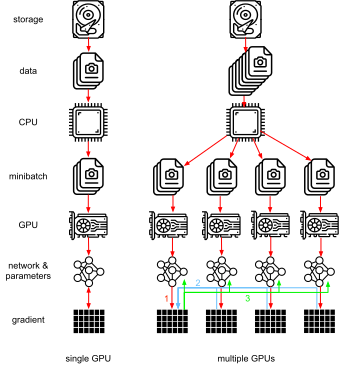
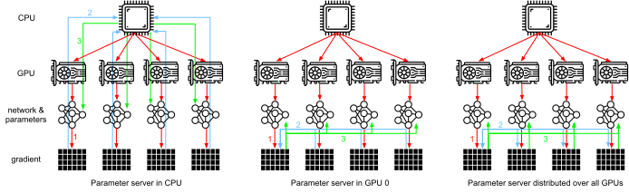
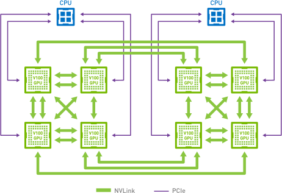
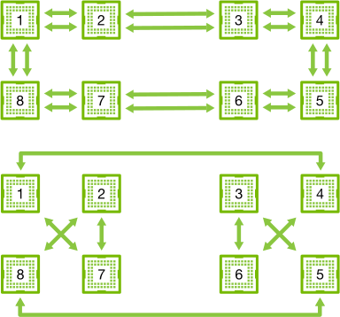
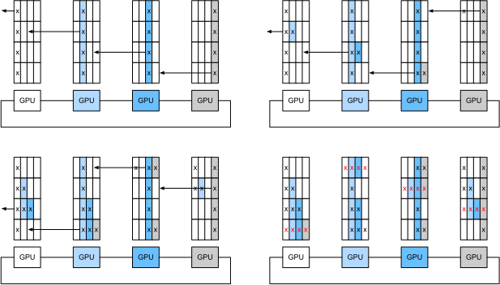
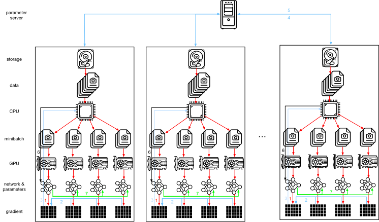
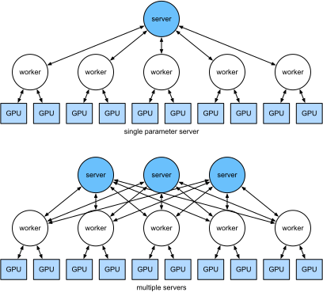

# Parametrų serveriai
:label:`sec_parameterserver`

Pereidami nuo vieno GPU prie kelių GPU, o paskui prie kelių serverių, turinčių kelis GPU, galbūt visų išsibarsčiusių per kelias spinteles ir tinklo komutatorius,
mūsų paskirstytojo ir lygiagrečiojo apmokymo algoritmai turi tapti gerokai sudėtingesni. Detalės svarbios, nes skirtingos jungtys turi labai skirtingą pralaidumą (pvz., NVLink tinkamoje aplinkoje gali pasiūlyti iki 100 GB/s per 6 jungtis, PCIe 4.0 (16 linijų) siūlo 32 GB/s, o net sparčiojo 100GbE Ethernet pralaidumas siekia tik 10 GB/s). Tuo pačiu nėra pagrįsta tikėtis, kad statistinis modeliuotojas bus tinklų ir sistemų ekspertas.

Pagrindinė parametrų serverio idėja buvo pristatyta :citet:`Smola.Narayanamurthy.2010` paskirstytųjų latentinių kintamųjų modelių kontekste. Vėliau :citet:`Ahmed.Aly.Gonzalez.ea.2012` pateiktas siuntimo (angl. *push*) ir gavimo (angl. *pull*) semantikos aprašymas, o :citet:`Li.Andersen.Park.ea.2014` – sistemos ir atvirojo kodo bibliotekos aprašymas. Toliau pagrįsime efektyvumui reikalingus komponentus.

## Duomenų lygiagretusis apmokymas

Peržvelkime duomenų lygiagretųjį požiūrį į paskirstytąjį apmokymą. Šiame skyrelyje naudosime jį atmesdami visus kitus, nes praktikoje jį gerokai paprasčiau įgyvendinti. Praktiškai nėra naudojimo atvejų (be giliojo mokymosi grafuose), kuriuose būtų pageidaujama kokia nors kita lygiagretumo strategija, nes šiais laikais GPU turi daug atminties. :numref:`fig_parameterserver` aprašo duomenų lygiagretumo variantą, kurį įgyvendinome :numref:`sec_multi_gpu`. Pagrindinis jo aspektas yra tas, kad gradientų agregavimas vyksta viename GPU (GPU 0), prieš atnaujinti parametrai vėl išplatinami visiems GPU.

:label:`fig_parameterserver`

Žvelgiant atgal, sprendimas agreguoti GPU 0 atrodo gana ad hoc. Juk galėtume agreguoti ir CPU. Iš tikrųjų galėtume net nuspręsti agreguoti dalį parametrų viename GPU, o kitus – kitame. Jei optimizavimo algoritmas tai palaiko, nėra jokios realios priežasties, kodėl negalėtume. Pavyzdžiui, jei turime keturis parametrų vektorius su susijusiais gradientais $\mathbf{g}_1, \ldots, \mathbf{g}_4$, galėtume agreguoti gradientus viename GPU kiekvienam $\mathbf{g}_i$ ($i = 1, \ldots, 4$).

Šis samprotavimas atrodo savavališkas ir lengvabūdiškas. Juk matematika visur ta pati. Tačiau mes susiduriame su tikra fizine aparatine įranga, kurioje skirtingos magistralės turi skirtingą pralaidumą, kaip aptarta :numref:`sec_hardware`.
Panagrinėkime tikrą 4 GPU serverį, aprašytą :numref:`fig_bw_hierarchy`. Jei jis ypač gerai sujungtas, jis gali turėti 100 GbE tinklo plokštę. Tipiškesni skaičiai yra 1–10 GbE intervale su efektyviuoju pralaidumu nuo 100 MB/s iki 1 GB/s.
Kadangi CPU turi per mažai PCIe linijų, kad tiesiogiai prisijungtų prie visų GPU (pvz., vartotojiško lygio Intel CPU turi 24 linijas), mums reikia [multiplekserio](https://www.broadcom.com/products/pcie-switches-bridges/pcie-switches). Pralaidumas nuo CPU 16x Gen3 jungtimi yra 16 GB/s. Tokiu greičiu prie komutatoriaus yra prijungtas ir *kiekvienas* iš GPU. Tai reiškia, kad efektyviau komunikuoti tarp pačių įrenginių.

:label:`fig_bw_hierarchy`

Argumentavimo tikslais tarkime, kad gradientai yra 160 MB. Šiuo atveju gradientų siuntimas iš visų 3 likusių GPU į ketvirtąjį užtrunka 30 ms (kiekvienas perdavimas užtrunka 10 ms = 160 MB / 16 GB/s). Pridėję dar 30 ms svorių vektoriams perduoti atgal, gauname iš viso 60 ms.
Jei siunčiame visus duomenis į CPU, patiriame 40 ms nuobaudą, nes *kiekvienas* iš keturių GPU turi siųsti duomenis į CPU, gaunant iš viso 80 ms. Galiausiai tarkime, kad galime padalyti gradientus į 4 dalis po 40 MB. Dabar galime agreguoti kiekvieną dalį skirtingame GPU *vienu metu*, nes PCIe komutatorius suteikia pilno pralaidumo operaciją tarp visų jungčių. Vietoj 30 ms tai užtrunka 7.5 ms, o sinchronizavimo operacijai gauname iš viso 15 ms. Trumpai tariant, priklausomai nuo to, kaip sinchronizuojame parametrus, ta pati operacija gali užtrukti nuo 15 ms iki 80 ms. :numref:`fig_ps_distributed` pavaizduotos skirtingos parametrų keitimosi strategijos.

:label:`fig_ps_distributed`

Atkreipkite dėmesį, kad turime dar vieną įrankį našumui gerinti: giliajame tinkle užtrunka tam tikrą laiką apskaičiuoti visus gradientus iš viršaus į apačią. Gradientų sinchronizavimą kai kurioms parametrų grupėms galime pradėti net kai dar esame užimti jų skaičiavimu kitoms. Žr., pvz., :citet:`Sergeev.Del-Balso.2018` dėl detalių, kaip tai padaryti [Horovod](https://github.com/horovod/horovod).

## Žiedinis sinchronizavimas

Kalbant apie sinchronizavimą šiuolaikinėje giliojo mokymosi aparatinėje įrangoje, dažnai susiduriame su gerokai specializuotu tinklo ryšiu. Pavyzdžiui, AWS p3.16xlarge ir NVIDIA DGX-2 egzemplioriai turi tą pačią :numref:`fig_nvlink` ryšio struktūrą. Kiekvienas GPU jungiasi su pagrindiniu CPU per PCIe jungtį, kuri geriausiu atveju veikia 16 GB/s greičiu. Be to, kiekvienas GPU taip pat turi 6 NVLink jungtis, kurių kiekviena geba perduoti 300 Gbit/s dvikryptiškai. Tai sudaro apie 18 GB/s vienai jungčiai viena kryptimi. Trumpai tariant, bendras NVLink pralaidumas yra gerokai didesnis nei PCIe pralaidumas. Klausimas, kaip jį efektyviausiai panaudoti.

:label:`fig_nvlink`

Pasirodo, optimali sinchronizavimo strategija yra suskaidyti tinklą į du žiedus ir juos naudoti duomenims tiesiogiai sinchronizuoti :cite:`Wang.Li.Liberty.ea.2018`. :numref:`fig_nvlink_twoloop` iliustruoja, kad tinklą galima suskaidyti į vieną žiedą (1-2-3-4-5-6-7-8-1) su dvigubu NVLink pralaidumu ir į vieną (1-4-6-3-5-8-2-7-1) su įprastu pralaidumu. Efektyvaus sinchronizavimo protokolo projektavimas šiuo atveju nėra paprastas.

:label:`fig_nvlink_twoloop`

Panagrinėkime tokį minties eksperimentą: turint $n$ skaičiavimo mazgų (ar GPU) žiedą, galime siųsti gradientus iš pirmojo mazgo į antrąjį. Ten jis pridedamas prie lokaliojo gradiento ir siunčiamas toliau į trečiąjį mazgą ir taip toliau. Po $n-1$ žingsnių agreguotą gradientą galima rasti paskutiniame aplankytame mazge. Tai yra, gradientų agregavimo laikas auga tiesiškai didėjant mazgų skaičiui. Tačiau jei taip darome, algoritmas yra gana neefektyvus. Juk bet kuriuo metu komunikuoja tik vienas iš mazgų. O kas, jei suskaidytume gradientus į $n$ dalių ir pradėtume sinchronizuoti dalį $i$ pradedant mazge $i$?
Kadangi kiekvienos dalies dydis yra $1/n$, bendras laikas dabar yra $(n-1)/n \approx 1$. Kitaip tariant, laikas, skirtas gradientams agreguoti, *neauga* didėjant žiedo dydžiui. Tai gana stulbinantis rezultatas. :numref:`fig_ringsync` iliustruoja žingsnių seką, kai $n=4$ mazgų.

:label:`fig_ringsync`

Jei naudojame tą patį pavyzdį – 160 MB sinchronizavimą per 8 V100 GPU, gauname apytiksliai $2 \cdot 160 \textrm{MB} / (3 \cdot 18 \textrm{GB/s}) \approx 6 \textrm{ms}$. Tai geriau nei naudoti PCIe magistralę, nors dabar naudojame 8 GPU. Atkreipkite dėmesį, kad praktikoje šie skaičiai yra šiek tiek prastesni, nes giliojo mokymosi karkasai dažnai nesugeba komunikacijos surinkti į dideles pliūpsninio perdavimo siuntas.

Atkreipkite dėmesį, kad paplitusi klaidinga nuomonė, esą žiedinis sinchronizavimas iš esmės skiriasi nuo kitų sinchronizavimo algoritmų. Vienintelis skirtumas yra tas, kad sinchronizavimo kelias yra kiek sudėtingesnis, palyginti su paprastu medžiu.

## Apmokymas keliuose kompiuteriuose

Paskirstytasis apmokymas keliuose kompiuteriuose prideda dar vieną iššūkį: turime komunikuoti su serveriais, kurie sujungti tik palyginti mažesnio pralaidumo tinklu, kuris kai kuriais atvejais gali būti daugiau nei eile lėtesnis.
Sinchronizavimas tarp įrenginių yra sudėtingas. Juk skirtingi kompiuteriai, vykdantys apmokymo kodą, turės subtiliai skirtingą greitį. Todėl, jei norime naudoti sinchroninį paskirstytąjį optimizavimą, turime juos *sinchronizuoti*. :numref:`fig_ps_multimachine` iliustruoja, kaip vyksta paskirstytasis lygiagretusis apmokymas.

1. Kiekviename kompiuteryje nuskaitomas (skirtingas) duomenų rinkinys, padalijamas tarp kelių GPU ir perduodamas į GPU atmintį. Ten prognozės ir gradientai apskaičiuojami kiekvienam GPU rinkiniui atskirai.
2. Visų lokaliųjų GPU gradientai agreguojami viename GPU (arba jų dalys agreguojamos skirtinguose GPU).
3. Gradientai siunčiami į CPU.
4. CPU siunčia gradientus į centrinį parametrų serverį, kuris agreguoja visus gradientus.
5. Agreguoti gradientai tada naudojami parametrams atnaujinti, o atnaujinti parametrai išplatinami atgal atskiriems CPU.
6. Informacija siunčiama vienam (ar keliems) GPU.
7. Atnaujinti parametrai paskleidžiami visiems GPU.

:label:`fig_ps_multimachine`

Kiekviena iš šių operacijų atrodo gana tiesmuka. Ir iš tikrųjų jas galima efektyviai atlikti *viename* kompiuteryje. Tačiau pažvelgę į kelis kompiuterius, matome, kad centrinis parametrų serveris tampa kliūtimi. Juk pralaidumas vienam serveriui yra ribotas, todėl $m$ darbininkų visų gradientų siuntimo į serverį laikas yra $\mathcal{O}(m)$. Šį barjerą galime peržengti padidinę serverių skaičių iki $n$. Šiuo atveju kiekvienam serveriui reikia saugoti tik $\mathcal{O}(1/n)$ parametrų, todėl bendras atnaujinimų ir optimizavimo laikas tampa $\mathcal{O}(m/n)$.
Suderinus abu skaičius gaunamas pastovus mastelio didėjimas nepriklausomai nuo to, kiek darbininkų turime. Praktikoje *tuos pačius* kompiuterius naudojame ir kaip darbininkus, ir kaip serverius. :numref:`fig_ps_multips` iliustruoja dizainą (detalių taip pat žr. :cite:`Li.Andersen.Park.ea.2014`).
Visų pirma užtikrinti, kad keli kompiuteriai veiktų be pernelyg didelių vėlavimų, nėra paprasta. 

:label:`fig_ps_multips`

## Raktų ir reikšmių saugyklos

Žingsnių, reikalingų paskirstytajam apmokymui keliuose GPU, įgyvendinimas praktikoje nėra paprastas.
Todėl apsimoka naudoti bendrą abstrakciją, būtent *raktų ir reikšmių saugyklą* su iš naujo apibrėžta atnaujinimo semantika.

Per daugelį darbininkų ir daugelį GPU gradiento $i$ skaičiavimą galima apibrėžti kaip

$$\mathbf{g}_{i} = \sum_{k \in \textrm{workers}} \sum_{j \in \textrm{GPUs}} \mathbf{g}_{ijk},$$

kur $\mathbf{g}_{ijk}$ yra gradiento $i$ dalis, padalyta GPU $j$ darbininke $k$.
Pagrindinis šios operacijos aspektas yra tas, kad tai *komutacinė redukcija*, t. y. ji paverčia daug vektorių vienu, o operacijos taikymo tvarka nesvarbi. Tai puiku mūsų tikslams, nes mums nereikia smulkaus valdymo, kada kuris gradientas gaunamas. Be to, atkreipkite dėmesį, kad ši operacija yra nepriklausoma tarp skirtingų $i$.

Tai leidžia apibrėžti šias dvi operacijas: *push*, kuri kaupia gradientus, ir *pull*, kuri gauna agreguotus gradientus. Kadangi turime daug skirtingų gradientų aibių (juk turime daug sluoksnių), gradientus turime indeksuoti raktu $i$. Šis panašumas į raktų ir reikšmių saugyklas, tokias kaip pristatyta Dynamo
:cite:`DeCandia.Hastorun.Jampani.ea.2007`, nėra atsitiktinis. Jos taip pat tenkina daug panašių savybių, ypač kai kalbama apie parametrų paskirstymą tarp kelių serverių.

Raktų ir reikšmių saugyklų siuntimo (push) ir gavimo (pull) operacijos aprašomos taip:

* **push(key, value)** siunčia tam tikrą gradientą (reikšmę) iš darbininko į bendrą saugyklą. Ten reikšmė agreguojama, pavyzdžiui, susumuojant.
* **pull(key, value)** gauna agreguotą reikšmę iš bendros saugyklos, pavyzdžiui, sujungus visų darbininkų gradientus.

Paslėpę visą sinchronizavimo sudėtingumą už paprastos siuntimo ir gavimo operacijos, galime atskirti statistinių modeliuotojų, norinčių gebėti išreikšti optimizavimą paprastais terminais, ir sistemų inžinierių, kuriems tenka tvarkytis su paskirstytajam sinchronizavimui būdingu sudėtingumu, rūpesčius.

## Santrauka

* Sinchronizavimas turi būti labai adaptyvus konkrečiai tinklo infrastruktūrai ir ryšiui serveryje. Tai gali sukelti didelį skirtumą sinchronizavimo laikui.
* Žiedinis sinchronizavimas gali būti optimalus p3 ir DGX-2 serveriams. Kitiems galbūt ne taip.
* Hierarchinė sinchronizavimo strategija gerai veikia pridedant kelis parametrų serverius didesniam pralaidumui.

## Pratimai

1. Ar galite dar labiau pagerinti žiedinį sinchronizavimą? Užuomina: žinutes galite siųsti abiem kryptimis.
1. Ar įmanoma leisti asinchroninę komunikaciją (kol skaičiavimas dar vyksta)? Kaip tai veikia našumą?
1. Kas, jei prarastume serverį ilgai trunkančio skaičiavimo metu? Kaip galime suprojektuoti *atsparumo gedimams* mechanizmą, kad išvengtume visiško skaičiavimo paleidimo iš naujo?

[Diskusijos](https://discuss.d2l.ai/t/366)
