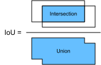
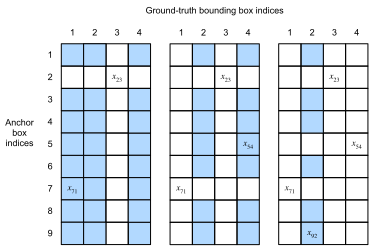

# Inkariniai stačiakampiai
:label:`sec_anchor`


Objektų aptikimo algoritmai paprastai
atrenka daug sričių įvesties vaizde, nustato, ar šios sritys turi
dominančių objektų, ir koreguoja sričių ribas,
kad tiksliau prognozuotų
objektų *tikruosius apibrėžiamuosius stačiakampius*.
Skirtingi modeliai gali taikyti
skirtingas sričių atrankos schemas.
Čia pristatome vieną iš tokių metodų:
jis generuoja kelis apibrėžiamuosius stačiakampius su skirtingais masteliais ir kraštinių santykiais, kurių centras yra kiekvienas pikselis.
Šie apibrėžiamieji stačiakampiai vadinami *inkariniais stačiakampiais* (angl. *anchor boxes*).
Objektų aptikimo modelį, pagrįstą inkariniais stačiakampiais, suprojektuosime
:numref:`sec_ssd`.

Pirmiausia pakeiskime spausdinimo tikslumą,
kad išvestys būtų glaustesnės.

```{.python .input}
#@tab mxnet
%matplotlib inline
from d2l import mxnet as d2l
from mxnet import gluon, image, np, npx

np.set_printoptions(2)  # Simplify printing accuracy
npx.set_np()
```

```{.python .input}
#@tab pytorch
%matplotlib inline
from d2l import torch as d2l
import torch

torch.set_printoptions(2)  # Simplify printing accuracy
```

## Kelių inkarinių stačiakampių generavimas

Tarkime, kad įvesties vaizdo aukštis yra $h$, o plotis – $w$.
Generuojame skirtingos formos inkarinius stačiakampius, kurių centras yra kiekvienas vaizdo pikselis.
Tegul *mastelis* yra $s\in (0, 1]$,
o *kraštinių santykis* (pločio ir aukščio santykis) yra $r > 0$.
Tada [**inkarinio stačiakampio plotis ir aukštis yra atitinkamai $ws\sqrt{r}$ ir $hs/\sqrt{r}$.**]
Atkreipkite dėmesį, kad kai pateikta centro padėtis, nustatomas inkarinis stačiakampis su žinomu pločiu ir aukščiu.

Kad sugeneruotume kelis skirtingos formos inkarinius stačiakampius,
nustatykime masteliu seką
$s_1,\ldots, s_n$ ir
kraštinių santykių seką $r_1,\ldots, r_m$.
Naudojant visus šių mastelių ir kraštinių santykių derinius, kai centras yra kiekvienas pikselis,
įvesties vaizdas turės iš viso $whnm$ inkarinių stačiakampių. Nors šie inkariniai stačiakampiai gali apimti visus
tikruosius apibrėžiamuosius stačiakampius, skaičiavimo sudėtingumas lengvai tampa per didelis.
Praktikoje
galime (**atsižvelgti tik į tuos derinius,
kuriuose yra**) $s_1$ arba $r_1$:

(**$$(s_1, r_1), (s_1, r_2), \ldots, (s_1, r_m), (s_2, r_1), (s_3, r_1), \ldots, (s_n, r_1).$$**)

Tai reiškia, kad to paties pikselio centre esančių inkarinių stačiakampių skaičius yra $n+m-1$. Visam įvesties vaizdui sugeneruosime iš viso $wh(n+m-1)$ inkarinių stačiakampių.

Aukščiau aprašytas inkarinių stačiakampių generavimo metodas įgyvendintas toliau pateiktoje funkcijoje `multibox_prior`. Nurodome įvesties vaizdą, mastelių sąrašą ir kraštinių santykių sąrašą, o ši funkcija grąžins visus inkarinius stačiakampius.

```{.python .input}
#@tab mxnet
#@save
def multibox_prior(data, sizes, ratios):
    """Generate anchor boxes with different shapes centered on each pixel."""
    in_height, in_width = data.shape[-2:]
    device, num_sizes, num_ratios = data.ctx, len(sizes), len(ratios)
    boxes_per_pixel = (num_sizes + num_ratios - 1)
    size_tensor = d2l.tensor(sizes, ctx=device)
    ratio_tensor = d2l.tensor(ratios, ctx=device)
    # Offsets are required to move the anchor to the center of a pixel. Since
    # a pixel has height=1 and width=1, we choose to offset our centers by 0.5
    offset_h, offset_w = 0.5, 0.5
    steps_h = 1.0 / in_height  # Scaled steps in y-axis
    steps_w = 1.0 / in_width  # Scaled steps in x-axis

    # Generate all center points for the anchor boxes
    center_h = (d2l.arange(in_height, ctx=device) + offset_h) * steps_h
    center_w = (d2l.arange(in_width, ctx=device) + offset_w) * steps_w
    shift_x, shift_y = d2l.meshgrid(center_w, center_h)
    shift_x, shift_y = shift_x.reshape(-1), shift_y.reshape(-1)

    # Generate `boxes_per_pixel` number of heights and widths that are later
    # used to create anchor box corner coordinates (xmin, xmax, ymin, ymax)
    w = np.concatenate((size_tensor * np.sqrt(ratio_tensor[0]),
                        sizes[0] * np.sqrt(ratio_tensor[1:]))) \
                        * in_height / in_width  # Handle rectangular inputs
    h = np.concatenate((size_tensor / np.sqrt(ratio_tensor[0]),
                        sizes[0] / np.sqrt(ratio_tensor[1:])))
    # Divide by 2 to get half height and half width
    anchor_manipulations = np.tile(np.stack((-w, -h, w, h)).T,
                                   (in_height * in_width, 1)) / 2

    # Each center point will have `boxes_per_pixel` number of anchor boxes, so
    # generate a grid of all anchor box centers with `boxes_per_pixel` repeats
    out_grid = d2l.stack([shift_x, shift_y, shift_x, shift_y],
                         axis=1).repeat(boxes_per_pixel, axis=0)
    output = out_grid + anchor_manipulations
    return np.expand_dims(output, axis=0)
```

```{.python .input}
#@tab pytorch
#@save
def multibox_prior(data, sizes, ratios):
    """Generate anchor boxes with different shapes centered on each pixel."""
    in_height, in_width = data.shape[-2:]
    device, num_sizes, num_ratios = data.device, len(sizes), len(ratios)
    boxes_per_pixel = (num_sizes + num_ratios - 1)
    size_tensor = d2l.tensor(sizes, device=device)
    ratio_tensor = d2l.tensor(ratios, device=device)
    # Offsets are required to move the anchor to the center of a pixel. Since
    # a pixel has height=1 and width=1, we choose to offset our centers by 0.5
    offset_h, offset_w = 0.5, 0.5
    steps_h = 1.0 / in_height  # Scaled steps in y axis
    steps_w = 1.0 / in_width  # Scaled steps in x axis

    # Generate all center points for the anchor boxes
    center_h = (torch.arange(in_height, device=device) + offset_h) * steps_h
    center_w = (torch.arange(in_width, device=device) + offset_w) * steps_w
    shift_y, shift_x = torch.meshgrid(center_h, center_w, indexing='ij')
    shift_y, shift_x = shift_y.reshape(-1), shift_x.reshape(-1)

    # Generate `boxes_per_pixel` number of heights and widths that are later
    # used to create anchor box corner coordinates (xmin, xmax, ymin, ymax)
    w = torch.cat((size_tensor * torch.sqrt(ratio_tensor[0]),
                   sizes[0] * torch.sqrt(ratio_tensor[1:])))\
                   * in_height / in_width  # Handle rectangular inputs
    h = torch.cat((size_tensor / torch.sqrt(ratio_tensor[0]),
                   sizes[0] / torch.sqrt(ratio_tensor[1:])))
    # Divide by 2 to get half height and half width
    anchor_manipulations = torch.stack((-w, -h, w, h)).T.repeat(
                                        in_height * in_width, 1) / 2

    # Each center point will have `boxes_per_pixel` number of anchor boxes, so
    # generate a grid of all anchor box centers with `boxes_per_pixel` repeats
    out_grid = torch.stack([shift_x, shift_y, shift_x, shift_y],
                dim=1).repeat_interleave(boxes_per_pixel, dim=0)
    output = out_grid + anchor_manipulations
    return output.unsqueeze(0)
```

Matome, kad [**grąžinto inkarinių stačiakampių kintamojo `Y` forma**] yra
(rinkinio dydis, inkarinių stačiakampių skaičius, 4).

```{.python .input}
#@tab mxnet
img = image.imread('../img/catdog.jpg').asnumpy()
h, w = img.shape[:2]

print(h, w)
X = np.random.uniform(size=(1, 3, h, w))  # Construct input data
Y = multibox_prior(X, sizes=[0.75, 0.5, 0.25], ratios=[1, 2, 0.5])
Y.shape
```

```{.python .input}
#@tab pytorch
img = d2l.plt.imread('../img/catdog.jpg')
h, w = img.shape[:2]

print(h, w)
X = torch.rand(size=(1, 3, h, w))  # Construct input data
Y = multibox_prior(X, sizes=[0.75, 0.5, 0.25], ratios=[1, 2, 0.5])
Y.shape
```

Pakeitę inkarinių stačiakampių kintamojo `Y` formą į (vaizdo aukštis, vaizdo plotis, to paties pikselio centre esančių inkarinių stačiakampių skaičius, 4),
galime gauti visus inkarinius stačiakampius, kurių centras yra nurodytoje pikselio padėtyje.
Toliau
[**pasiekiame pirmąjį inkarinį stačiakampį, kurio centras yra (250, 250)**]. Jis turi keturis elementus: inkarinio stačiakampio viršutinio kairiojo kampo $(x, y)$ ašių koordinates ir apatinio dešiniojo kampo $(x, y)$ ašių koordinates.
Abiejų ašių koordinačių reikšmės
padalytos atitinkamai iš vaizdo pločio ir aukščio.

```{.python .input}
#@tab all
boxes = Y.reshape(h, w, 5, 4)
boxes[250, 250, 0, :]
```

Kad [**parodytume visus inkarinius stačiakampius, kurių centras yra vienas vaizdo pikselis**],
apibrėžiame šią funkciją `show_bboxes`, kuri vaizde nubraižo kelis apibrėžiamuosius stačiakampius.

```{.python .input}
#@tab all
#@save
def show_bboxes(axes, bboxes, labels=None, colors=None):
    """Show bounding boxes."""

    def make_list(obj, default_values=None):
        if obj is None:
            obj = default_values
        elif not isinstance(obj, (list, tuple)):
            obj = [obj]
        return obj

    labels = make_list(labels)
    colors = make_list(colors, ['b', 'g', 'r', 'm', 'c'])
    for i, bbox in enumerate(bboxes):
        color = colors[i % len(colors)]
        rect = d2l.bbox_to_rect(d2l.numpy(bbox), color)
        axes.add_patch(rect)
        if labels and len(labels) > i:
            text_color = 'k' if color == 'w' else 'w'
            axes.text(rect.xy[0], rect.xy[1], labels[i],
                      va='center', ha='center', fontsize=9, color=text_color,
                      bbox=dict(facecolor=color, lw=0))
```

Kaip ką tik matėme, kintamajame `boxes` esančios $x$ ir $y$ ašių koordinačių reikšmės buvo padalytos atitinkamai iš vaizdo pločio ir aukščio.
Braižydami inkarinius stačiakampius,
turime atkurti jų pradines koordinačių reikšmes;
todėl toliau apibrėžiame kintamąjį `bbox_scale`.
Dabar galime nubraižyti visus inkarinius stačiakampius, kurių centras yra (250, 250), vaizde.
Kaip matote, mėlynas inkarinis stačiakampis, kurio mastelis 0,75, o kraštinių santykis 1, gerai
apjuosia vaizde esantį šunį.

```{.python .input}
#@tab all
d2l.set_figsize()
bbox_scale = d2l.tensor((w, h, w, h))
fig = d2l.plt.imshow(img)
show_bboxes(fig.axes, boxes[250, 250, :, :] * bbox_scale,
            ['s=0.75, r=1', 's=0.5, r=1', 's=0.25, r=1', 's=0.75, r=2',
             's=0.75, r=0.5'])
```

## [**Sankirtos ir sąjungos santykis (IoU)**]

Ką tik minėjome, kad inkarinis stačiakampis „gerai“ apjuosia vaizde esantį šunį.
Jei žinomas objekto tikrasis apibrėžiamasis stačiakampis, kaip galima kiekybiškai įvertinti, kas čia yra „gerai“?
Intuityviai galime matuoti
inkarinio stačiakampio ir tikrojo apibrėžiamojo stačiakampio panašumą.
Žinome, kad *Žakaro indeksas* (angl. *Jaccard index*) gali matuoti dviejų aibių panašumą. Turint aibes $\mathcal{A}$ ir $\mathcal{B}$, jų Žakaro indeksas yra jų sankirtos dydis, padalytas iš jų sąjungos dydžio:

$$J(\mathcal{A},\mathcal{B}) = \frac{\left|\mathcal{A} \cap \mathcal{B}\right|}{\left| \mathcal{A} \cup \mathcal{B}\right|}.$$


Iš tikrųjų bet kurio apibrėžiamojo stačiakampio pikselių plotą galime laikyti pikselių aibe.
Taip dviejų apibrėžiamųjų stačiakampių panašumą galime matuoti jų pikselių aibių Žakaro indeksu. Dviejų apibrėžiamųjų stačiakampių Žakaro indeksą paprastai vadiname *sankirtos ir sąjungos santykiu* (angl. *intersection over union*, *IoU*), t. y. jų sankirtos ploto ir sąjungos ploto santykiu, kaip parodyta :numref:`fig_iou`.
IoU reikšmė yra tarp 0 ir 1:
0 reiškia, kad du apibrėžiamieji stačiakampiai visiškai nepersidengia,
o 1 rodo, kad abu apibrėžiamieji stačiakampiai sutampa.


:label:`fig_iou`

Likusioje šio skyrelio dalyje naudosime IoU, kad išmatuotume inkarinių stačiakampių ir tikrųjų apibrėžiamųjų stačiakampių bei skirtingų inkarinių stačiakampių panašumą.
Turint du inkarinių arba apibrėžiamųjų stačiakampių sąrašus,
toliau pateikta funkcija `box_iou` apskaičiuoja jų poromis IoU
tarp šių dviejų sąrašų.

```{.python .input}
#@tab mxnet
#@save
def box_iou(boxes1, boxes2):
    """Compute pairwise IoU across two lists of anchor or bounding boxes."""
    box_area = lambda boxes: ((boxes[:, 2] - boxes[:, 0]) *
                              (boxes[:, 3] - boxes[:, 1]))
    # Shape of `boxes1`, `boxes2`, `areas1`, `areas2`: (no. of boxes1, 4),
    # (no. of boxes2, 4), (no. of boxes1,), (no. of boxes2,)
    areas1 = box_area(boxes1)
    areas2 = box_area(boxes2)
    # Shape of `inter_upperlefts`, `inter_lowerrights`, `inters`: (no. of
    # boxes1, no. of boxes2, 2)
    inter_upperlefts = np.maximum(boxes1[:, None, :2], boxes2[:, :2])
    inter_lowerrights = np.minimum(boxes1[:, None, 2:], boxes2[:, 2:])
    inters = (inter_lowerrights - inter_upperlefts).clip(min=0)
    # Shape of `inter_areas` and `union_areas`: (no. of boxes1, no. of boxes2)
    inter_areas = inters[:, :, 0] * inters[:, :, 1]
    union_areas = areas1[:, None] + areas2 - inter_areas
    return inter_areas / union_areas
```

```{.python .input}
#@tab pytorch
#@save
def box_iou(boxes1, boxes2):
    """Compute pairwise IoU across two lists of anchor or bounding boxes."""
    box_area = lambda boxes: ((boxes[:, 2] - boxes[:, 0]) *
                              (boxes[:, 3] - boxes[:, 1]))
    # Shape of `boxes1`, `boxes2`, `areas1`, `areas2`: (no. of boxes1, 4),
    # (no. of boxes2, 4), (no. of boxes1,), (no. of boxes2,)
    areas1 = box_area(boxes1)
    areas2 = box_area(boxes2)
    # Shape of `inter_upperlefts`, `inter_lowerrights`, `inters`: (no. of
    # boxes1, no. of boxes2, 2)
    inter_upperlefts = torch.max(boxes1[:, None, :2], boxes2[:, :2])
    inter_lowerrights = torch.min(boxes1[:, None, 2:], boxes2[:, 2:])
    inters = (inter_lowerrights - inter_upperlefts).clamp(min=0)
    # Shape of `inter_areas` and `union_areas`: (no. of boxes1, no. of boxes2)
    inter_areas = inters[:, :, 0] * inters[:, :, 1]
    union_areas = areas1[:, None] + areas2 - inter_areas
    return inter_areas / union_areas
```

## Inkarinių stačiakampių žymėjimas apmokymo duomenyse
:label:`subsec_labeling-anchor-boxes`


Apmokymo duomenų rinkinyje
kiekvieną inkarinį stačiakampį laikome apmokymo pavyzdžiu.
Kad apmokytume objektų aptikimo modelį,
kiekvienam inkariniam stačiakampiui reikia *klasės* ir *poslinkio* žymenų,
kur pirmasis yra
su inkariniu stačiakampiu susijusio objekto klasė,
o antrasis – tikrojo apibrėžiamojo stačiakampio
poslinkis inkarinio stačiakampio atžvilgiu.
Prognozavimo metu
kiekvienam vaizdui
generuojame kelis inkarinius stačiakampius,
prognozuojame visų inkarinių stačiakampių klases ir poslinkius,
koreguojame jų padėtis pagal prognozuotus poslinkius, kad gautume prognozuojamus apibrėžiamuosius stačiakampius,
ir galiausiai išvedame tik tuos
prognozuojamus apibrėžiamuosius stačiakampius, kurie tenkina tam tikrus kriterijus.


Kaip žinome, objektų aptikimo apmokymo aibėje
yra žymenų, nurodančių
*tikrųjų apibrėžiamųjų stačiakampių* vietas
ir jų apjuostų objektų klases.
Kad pažymėtume bet kurį sugeneruotą *inkarinį stačiakampį*,
remiamės pažymėta
vieta ir klase to *priskirto* tikrojo apibrėžiamojo stačiakampio, kuris yra artimiausias inkariniam stačiakampiui.
Toliau
aprašome algoritmą, skirtą priskirti
artimiausius tikruosius apibrėžiamuosius stačiakampius inkariniams stačiakampiams.

### [**Tikrųjų apibrėžiamųjų stačiakampių priskyrimas inkariniams stačiakampiams**]

Tarkime, kad duotame vaizde
inkariniai stačiakampiai yra $A_1, A_2, \ldots, A_{n_a}$, o tikrieji apibrėžiamieji stačiakampiai yra $B_1, B_2, \ldots, B_{n_b}$, kur $n_a \geq n_b$.
Apibrėžkime matricą $\mathbf{X} \in \mathbb{R}^{n_a \times n_b}$, kurios elementas $x_{ij}$, esantis $i$-ojoje eilutėje ir $j$-ajame stulpelyje, yra inkarinio stačiakampio $A_i$ ir tikrojo apibrėžiamojo stačiakampio $B_j$ IoU. Algoritmą sudaro šie žingsniai:

1. Raskite didžiausią matricos $\mathbf{X}$ elementą ir pažymėkite jo eilutės ir stulpelio indeksus atitinkamai $i_1$ ir $j_1$. Tada tikrasis apibrėžiamasis stačiakampis $B_{j_1}$ priskiriamas inkariniam stačiakampiui $A_{i_1}$. Tai gana intuityvu, nes $A_{i_1}$ ir $B_{j_1}$ yra artimiausi tarp visų inkarinių stačiakampių ir tikrųjų apibrėžiamųjų stačiakampių porų. Po pirmojo priskyrimo atmeskite visus matricos $\mathbf{X}$ elementus ${i_1}$-ojoje eilutėje ir ${j_1}$-ajame stulpelyje.
1. Raskite didžiausią iš likusių matricos $\mathbf{X}$ elementų ir pažymėkite jo eilutės ir stulpelio indeksus atitinkamai $i_2$ ir $j_2$. Tikrąjį apibrėžiamąjį stačiakampį $B_{j_2}$ priskiriame inkariniam stačiakampiui $A_{i_2}$ ir atmetame visus matricos $\mathbf{X}$ elementus ${i_2}$-ojoje eilutėje ir ${j_2}$-ajame stulpelyje.
1. Šiuo metu dviejų eilučių ir dviejų stulpelių elementai matricoje $\mathbf{X}$ jau atmesti. Tęsiame, kol bus atmesti visi $n_b$ matricos $\mathbf{X}$ stulpelių elementai. Tuomet tikrasis apibrėžiamasis stačiakampis bus priskirtas kiekvienam iš $n_b$ inkarinių stačiakampių.
1. Pereikite tik per likusius $n_a - n_b$ inkarinių stačiakampių. Pavyzdžiui, turint bet kurį inkarinį stačiakampį $A_i$, per visą matricos $\mathbf{X}$ $i$-ąją eilutę raskite tikrąjį apibrėžiamąjį stačiakampį $B_j$, kurio IoU su $A_i$ didžiausias, ir priskirkite $B_j$ stačiakampiui $A_i$ tik tuo atveju, jei šis IoU yra didesnis už iš anksto nustatytą slenkstį.

Iliustruokime aukščiau aprašytą algoritmą konkrečiu
pavyzdžiu.
Kaip parodyta :numref:`fig_anchor_label` (kairėje), darant prielaidą, kad didžiausia matricos $\mathbf{X}$ reikšmė yra $x_{23}$, tikrąjį apibrėžiamąjį stačiakampį $B_3$ priskiriame inkariniam stačiakampiui $A_2$.
Tada atmetame visus matricos elementus 2 eilutėje ir 3 stulpelyje, tarp likusių elementų (užtamsinta sritis) randame didžiausią $x_{71}$ ir tikrąjį apibrėžiamąjį stačiakampį $B_1$ priskiriame inkariniam stačiakampiui $A_7$.
Toliau, kaip parodyta :numref:`fig_anchor_label` (viduryje), atmetame visus matricos elementus 7 eilutėje ir 1 stulpelyje, tarp likusių elementų (užtamsinta sritis) randame didžiausią $x_{54}$ ir tikrąjį apibrėžiamąjį stačiakampį $B_4$ priskiriame inkariniam stačiakampiui $A_5$.
Galiausiai, kaip parodyta :numref:`fig_anchor_label` (dešinėje), atmetame visus matricos elementus 5 eilutėje ir 4 stulpelyje, tarp likusių elementų (užtamsinta sritis) randame didžiausią $x_{92}$ ir tikrąjį apibrėžiamąjį stačiakampį $B_2$ priskiriame inkariniam stačiakampiui $A_9$.
Po to mums tereikia pereiti per
likusius inkarinius stačiakampius $A_1, A_3, A_4, A_6, A_8$ ir pagal slenkstį nuspręsti, ar jiems priskirti tikruosius apibrėžiamuosius stačiakampius.


:label:`fig_anchor_label`

Šis algoritmas įgyvendintas toliau pateiktoje funkcijoje `assign_anchor_to_bbox`.

```{.python .input}
#@tab mxnet
#@save
def assign_anchor_to_bbox(ground_truth, anchors, device, iou_threshold=0.5):
    """Assign closest ground-truth bounding boxes to anchor boxes."""
    num_anchors, num_gt_boxes = anchors.shape[0], ground_truth.shape[0]
    # Element x_ij in the i-th row and j-th column is the IoU of the anchor
    # box i and the ground-truth bounding box j
    jaccard = box_iou(anchors, ground_truth)
    # Initialize the tensor to hold the assigned ground-truth bounding box for
    # each anchor
    anchors_bbox_map = np.full((num_anchors,), -1, dtype=np.int32, ctx=device)
    # Assign ground-truth bounding boxes according to the threshold
    max_ious, indices = np.max(jaccard, axis=1), np.argmax(jaccard, axis=1)
    anc_i = np.nonzero(max_ious >= iou_threshold)[0]
    box_j = indices[max_ious >= iou_threshold]
    anchors_bbox_map[anc_i] = box_j
    col_discard = np.full((num_anchors,), -1)
    row_discard = np.full((num_gt_boxes,), -1)
    for _ in range(num_gt_boxes):
        max_idx = np.argmax(jaccard)  # Find the largest IoU
        box_idx = (max_idx % num_gt_boxes).astype('int32')
        anc_idx = (max_idx / num_gt_boxes).astype('int32')
        anchors_bbox_map[anc_idx] = box_idx
        jaccard[:, box_idx] = col_discard
        jaccard[anc_idx, :] = row_discard
    return anchors_bbox_map
```

```{.python .input}
#@tab pytorch
#@save
def assign_anchor_to_bbox(ground_truth, anchors, device, iou_threshold=0.5):
    """Assign closest ground-truth bounding boxes to anchor boxes."""
    num_anchors, num_gt_boxes = anchors.shape[0], ground_truth.shape[0]
    # Element x_ij in the i-th row and j-th column is the IoU of the anchor
    # box i and the ground-truth bounding box j
    jaccard = box_iou(anchors, ground_truth)
    # Initialize the tensor to hold the assigned ground-truth bounding box for
    # each anchor
    anchors_bbox_map = torch.full((num_anchors,), -1, dtype=torch.long,
                                  device=device)
    # Assign ground-truth bounding boxes according to the threshold
    max_ious, indices = torch.max(jaccard, dim=1)
    anc_i = torch.nonzero(max_ious >= iou_threshold).reshape(-1)
    box_j = indices[max_ious >= iou_threshold]
    anchors_bbox_map[anc_i] = box_j
    col_discard = torch.full((num_anchors,), -1)
    row_discard = torch.full((num_gt_boxes,), -1)
    for _ in range(num_gt_boxes):
        max_idx = torch.argmax(jaccard)  # Find the largest IoU
        box_idx = (max_idx % num_gt_boxes).long()
        anc_idx = (max_idx / num_gt_boxes).long()
        anchors_bbox_map[anc_idx] = box_idx
        jaccard[:, box_idx] = col_discard
        jaccard[anc_idx, :] = row_discard
    return anchors_bbox_map
```

### Klasių ir poslinkių žymėjimas

Dabar galime pažymėti kiekvieno inkarinio stačiakampio klasę ir poslinkį. Tarkime, kad inkariniam stačiakampiui $A$ priskirtas
tikrasis apibrėžiamasis stačiakampis $B$.
Viena vertus,
inkarinio stačiakampio $A$ klasė bus
pažymėta kaip $B$ klasė.
Kita vertus,
inkarinio stačiakampio $A$ poslinkis
bus pažymėtas pagal
santykinę $B$ ir $A$ centrų koordinačių padėtį
kartu su santykiniu šių
dviejų stačiakampių dydžiu.
Atsižvelgiant į skirtingas
skirtingų stačiakampių padėtis ir dydžius duomenų rinkinyje,
tiems santykiniams padėtims ir dydžiams galime taikyti transformacijas,
kurios gali lemti
tolygiau pasiskirsčiusius poslinkius,
kuriuos lengviau pritaikyti.
Čia aprašome įprastą transformaciją.
[**Tegul $A$ ir $B$ centrų koordinatės yra $(x_a, y_a)$ ir $(x_b, y_b)$,
jų pločiai – $w_a$ ir $w_b$,
o aukščiai – atitinkamai $h_a$ ir $h_b$.
Galime pažymėti $A$ poslinkį kaip

$$\left( \frac{ \frac{x_b - x_a}{w_a} - \mu_x }{\sigma_x},
\frac{ \frac{y_b - y_a}{h_a} - \mu_y }{\sigma_y},
\frac{ \log \frac{w_b}{w_a} - \mu_w }{\sigma_w},
\frac{ \log \frac{h_b}{h_a} - \mu_h }{\sigma_h}\right),$$
**]
kur numatytosios konstantų reikšmės yra $\mu_x = \mu_y = \mu_w = \mu_h = 0, \sigma_x=\sigma_y=0{,}1$ ir $\sigma_w=\sigma_h=0{,}2$.
Ši transformacija įgyvendinta toliau pateiktoje funkcijoje `offset_boxes`.

```{.python .input}
#@tab all
#@save
def offset_boxes(anchors, assigned_bb, eps=1e-6):
    """Transform for anchor box offsets."""
    c_anc = d2l.box_corner_to_center(anchors)
    c_assigned_bb = d2l.box_corner_to_center(assigned_bb)
    offset_xy = 10 * (c_assigned_bb[:, :2] - c_anc[:, :2]) / c_anc[:, 2:]
    offset_wh = 5 * d2l.log(eps + c_assigned_bb[:, 2:] / c_anc[:, 2:])
    offset = d2l.concat([offset_xy, offset_wh], axis=1)
    return offset
```

Jei inkariniam stačiakampiui nepriskirtas tikrasis apibrėžiamasis stačiakampis, tiesiog pažymime inkarinio stačiakampio klasę kaip „fonas“.
Inkariniai stačiakampiai, kurių klasė yra fonas, dažnai vadinami *neigiamais* inkariniais stačiakampiais,
o likusieji vadinami *teigiamais* inkariniais stačiakampiais.
Įgyvendiname šią funkciją `multibox_target`,
kad [**pažymėtume inkarinių stačiakampių klases ir poslinkius**] (argumentas `anchors`) naudodami tikruosius apibrėžiamuosius stačiakampius (argumentas `labels`).
Ši funkcija fono klasę nustato į nulį, o naujos klasės sveikąjį indeksą padidina vienetu.

```{.python .input}
#@tab mxnet
#@save
def multibox_target(anchors, labels):
    """Label anchor boxes using ground-truth bounding boxes."""
    batch_size, anchors = labels.shape[0], anchors.squeeze(0)
    batch_offset, batch_mask, batch_class_labels = [], [], []
    device, num_anchors = anchors.ctx, anchors.shape[0]
    for i in range(batch_size):
        label = labels[i, :, :]
        anchors_bbox_map = assign_anchor_to_bbox(
            label[:, 1:], anchors, device)
        bbox_mask = np.tile((np.expand_dims((anchors_bbox_map >= 0),
                                            axis=-1)), (1, 4)).astype('int32')
        # Initialize class labels and assigned bounding box coordinates with
        # zeros
        class_labels = d2l.zeros(num_anchors, dtype=np.int32, ctx=device)
        assigned_bb = d2l.zeros((num_anchors, 4), dtype=np.float32,
                                ctx=device)
        # Label classes of anchor boxes using their assigned ground-truth
        # bounding boxes. If an anchor box is not assigned any, we label its
        # class as background (the value remains zero)
        indices_true = np.nonzero(anchors_bbox_map >= 0)[0]
        bb_idx = anchors_bbox_map[indices_true]
        class_labels[indices_true] = label[bb_idx, 0].astype('int32') + 1
        assigned_bb[indices_true] = label[bb_idx, 1:]
        # Offset transformation
        offset = offset_boxes(anchors, assigned_bb) * bbox_mask
        batch_offset.append(offset.reshape(-1))
        batch_mask.append(bbox_mask.reshape(-1))
        batch_class_labels.append(class_labels)
    bbox_offset = d2l.stack(batch_offset)
    bbox_mask = d2l.stack(batch_mask)
    class_labels = d2l.stack(batch_class_labels)
    return (bbox_offset, bbox_mask, class_labels)
```

```{.python .input}
#@tab pytorch
#@save
def multibox_target(anchors, labels):
    """Label anchor boxes using ground-truth bounding boxes."""
    batch_size, anchors = labels.shape[0], anchors.squeeze(0)
    batch_offset, batch_mask, batch_class_labels = [], [], []
    device, num_anchors = anchors.device, anchors.shape[0]
    for i in range(batch_size):
        label = labels[i, :, :]
        anchors_bbox_map = assign_anchor_to_bbox(
            label[:, 1:], anchors, device)
        bbox_mask = ((anchors_bbox_map >= 0).float().unsqueeze(-1)).repeat(
            1, 4)
        # Initialize class labels and assigned bounding box coordinates with
        # zeros
        class_labels = torch.zeros(num_anchors, dtype=torch.long,
                                   device=device)
        assigned_bb = torch.zeros((num_anchors, 4), dtype=torch.float32,
                                  device=device)
        # Label classes of anchor boxes using their assigned ground-truth
        # bounding boxes. If an anchor box is not assigned any, we label its
        # class as background (the value remains zero)
        indices_true = torch.nonzero(anchors_bbox_map >= 0)
        bb_idx = anchors_bbox_map[indices_true]
        class_labels[indices_true] = label[bb_idx, 0].long() + 1
        assigned_bb[indices_true] = label[bb_idx, 1:]
        # Offset transformation
        offset = offset_boxes(anchors, assigned_bb) * bbox_mask
        batch_offset.append(offset.reshape(-1))
        batch_mask.append(bbox_mask.reshape(-1))
        batch_class_labels.append(class_labels)
    bbox_offset = torch.stack(batch_offset)
    bbox_mask = torch.stack(batch_mask)
    class_labels = torch.stack(batch_class_labels)
    return (bbox_offset, bbox_mask, class_labels)
```

### Pavyzdys

Iliustruokime inkarinių stačiakampių žymėjimą
konkrečiu pavyzdžiu.
Įkeltame vaizde apibrėžiame šuns ir katės tikruosius apibrėžiamuosius stačiakampius,
kur pirmasis elementas yra klasė (0 šuniui ir 1 katei), o likę keturi elementai yra
viršutinio kairiojo ir apatinio dešiniojo kampų
$(x, y)$ ašių koordinatės
(intervalas tarp 0 ir 1).
Taip pat sukonstruojame penkis pažymėtinus inkarinius stačiakampius
naudodami
viršutinio kairiojo ir apatinio dešiniojo kampų koordinates:
$A_0, \ldots, A_4$ (indeksas prasideda nuo 0).
Tada [**nubraižome šiuos tikruosius apibrėžiamuosius stačiakampius
ir inkarinius stačiakampius
vaizde.**]

```{.python .input}
#@tab all
ground_truth = d2l.tensor([[0, 0.1, 0.08, 0.52, 0.92],
                         [1, 0.55, 0.2, 0.9, 0.88]])
anchors = d2l.tensor([[0, 0.1, 0.2, 0.3], [0.15, 0.2, 0.4, 0.4],
                    [0.63, 0.05, 0.88, 0.98], [0.66, 0.45, 0.8, 0.8],
                    [0.57, 0.3, 0.92, 0.9]])

fig = d2l.plt.imshow(img)
show_bboxes(fig.axes, ground_truth[:, 1:] * bbox_scale, ['dog', 'cat'], 'k')
show_bboxes(fig.axes, anchors * bbox_scale, ['0', '1', '2', '3', '4']);
```

Naudodami aukščiau apibrėžtą funkciją `multibox_target`,
galime [**pažymėti šių inkarinių stačiakampių klases ir poslinkius
pagal
tikruosius apibrėžiamuosius stačiakampius**] šuniui ir katei.
Šiame pavyzdyje
fono, šuns ir katės klasių indeksai
yra atitinkamai 0, 1 ir 2.
Toliau pridedame dimensiją inkarinių stačiakampių ir tikrųjų apibrėžiamųjų stačiakampių pavyzdžiams.

```{.python .input}
#@tab mxnet
labels = multibox_target(np.expand_dims(anchors, axis=0),
                         np.expand_dims(ground_truth, axis=0))
```

```{.python .input}
#@tab pytorch
labels = multibox_target(anchors.unsqueeze(dim=0),
                         ground_truth.unsqueeze(dim=0))
```

Grąžintame rezultate yra trys elementai, visi tenzoriaus formato.
Trečiajame elemente yra įvesties inkarinių stačiakampių pažymėtos klasės.

Išanalizuokime toliau grąžintus klasių žymenis pagal
inkarinių stačiakampių ir tikrųjų apibrėžiamųjų stačiakampių padėtis vaizde.
Pirma, tarp visų inkarinių stačiakampių
ir tikrųjų apibrėžiamųjų stačiakampių porų
inkarinio stačiakampio $A_4$ ir katės tikrojo apibrėžiamojo stačiakampio IoU yra didžiausias.
Taigi $A_4$ klasė pažymima kaip katė.
Išėmus
poras, kuriose yra $A_4$ arba katės tikrasis apibrėžiamasis stačiakampis, tarp likusių
inkarinio stačiakampio $A_1$ ir šuns tikrojo apibrėžiamojo stačiakampio poros IoU yra didžiausias.
Taigi $A_1$ klasė pažymima kaip šuo.
Toliau turime pereiti per likusius tris nepažymėtus inkarinius stačiakampius: $A_0$, $A_2$ ir $A_3$.
$A_0$ atveju
tikrojo apibrėžiamojo stačiakampio, kurio IoU didžiausias, klasė yra šuo,
bet IoU yra žemiau iš anksto nustatyto slenksčio (0,5),
todėl klasė pažymima kaip fonas;
$A_2$ atveju
tikrojo apibrėžiamojo stačiakampio, kurio IoU didžiausias, klasė yra katė, o IoU viršija slenkstį, todėl klasė pažymima kaip katė;
$A_3$ atveju
tikrojo apibrėžiamojo stačiakampio, kurio IoU didžiausias, klasė yra katė, bet reikšmė yra žemiau slenksčio, todėl klasė pažymima kaip fonas.

```{.python .input}
#@tab all
labels[2]
```

Antrasis grąžintas elementas yra kaukės kintamasis, kurio forma (rinkinio dydis, keturis kartus didesnis už inkarinių stačiakampių skaičių).
Kas keturi kaukės kintamojo elementai
atitinka keturias kiekvieno inkarinio stačiakampio poslinkio reikšmes.
Kadangi nesirūpiname fono aptikimu,
šios neigiamos klasės poslinkiai neturėtų daryti įtakos tikslo funkcijai.
Elementų daugyba iš kaukės nuliai kaukės kintamajame prieš skaičiuojant tikslo funkciją išfiltruos neigiamos klasės poslinkius.

```{.python .input}
#@tab all
labels[1]
```

Pirmajame grąžintame elemente yra keturios kiekvienam inkariniam stačiakampiui pažymėtos poslinkio reikšmės.
Atkreipkite dėmesį, kad neigiamos klasės inkarinių stačiakampių poslinkiai pažymėti nuliais.

```{.python .input}
#@tab all
labels[0]
```

## Apibrėžiamųjų stačiakampių prognozavimas naudojant nemaksimalių reikšmių slopinimą
:label:`subsec_predicting-bounding-boxes-nms`

Prognozavimo metu
generuojame kelis vaizdo inkarinius stačiakampius ir prognozuojame kiekvieno iš jų klases bei poslinkius.
*Prognozuojamas apibrėžiamasis stačiakampis*
taip gaunamas pagal
inkarinį stačiakampį su jo prognozuotu poslinkiu.
Toliau įgyvendiname funkciją `offset_inverse`,
kuri kaip įvestis priima inkarus ir
poslinkių prognozes ir [**taiko atvirkštines poslinkio transformacijas,
kad grąžintų prognozuojamų apibrėžiamųjų stačiakampių koordinates**].

```{.python .input}
#@tab all
#@save
def offset_inverse(anchors, offset_preds):
    """Predict bounding boxes based on anchor boxes with predicted offsets."""
    anc = d2l.box_corner_to_center(anchors)
    pred_bbox_xy = (offset_preds[:, :2] * anc[:, 2:] / 10) + anc[:, :2]
    pred_bbox_wh = d2l.exp(offset_preds[:, 2:] / 5) * anc[:, 2:]
    pred_bbox = d2l.concat((pred_bbox_xy, pred_bbox_wh), axis=1)
    predicted_bbox = d2l.box_center_to_corner(pred_bbox)
    return predicted_bbox
```

Kai yra daug inkarinių stačiakampių,
to paties objekto apjuostiems gali būti išvesta
daug panašių (su dideliu persidengimu)
prognozuojamų apibrėžiamųjų stačiakampių.
Kad supaprastintume išvestį,
galime sujungti panašius prognozuojamus apibrėžiamuosius stačiakampius,
priklausančius tam pačiam objektui,
naudodami *nemaksimalių reikšmių slopinimą* (angl. *non-maximum suppression*, NMS).

Štai kaip veikia nemaksimalių reikšmių slopinimas.
Prognozuojamam apibrėžiamajam stačiakampiui $B$
objektų aptikimo modelis apskaičiuoja prognozuojamą tikėtinumą
kiekvienai klasei.
Pažymėję $p$ didžiausią prognozuojamą tikėtinumą,
šią tikimybę atitinkanti klasė yra $B$ prognozuojama klasė.
Konkrečiai, $p$ vadiname prognozuojamo apibrėžiamojo stačiakampio $B$ *pasitikėjimu* (balu).
Tame pačiame vaizde
visi prognozuojami nefono apibrėžiamieji stačiakampiai
surūšiuojami pagal pasitikėjimą mažėjimo tvarka,
kad būtų sugeneruotas sąrašas $L$.
Tada surūšiuotą sąrašą $L$ apdorojame šiais žingsniais:

1. Pasirinkite iš $L$ prognozuojamą apibrėžiamąjį stačiakampį $B_1$ su didžiausiu pasitikėjimu kaip pagrindą ir pašalinkite iš $L$ visus nepagrindinius prognozuojamus apibrėžiamuosius stačiakampius, kurių IoU su $B_1$ viršija iš anksto nustatytą slenkstį $\epsilon$. Šiuo metu $L$ išsaugo prognozuojamą apibrėžiamąjį stačiakampį su didžiausiu pasitikėjimu, bet atmeta kitus, kurie yra per daug panašūs į jį. Trumpai tariant, tie, kurių pasitikėjimo balai yra *nemaksimalūs*, yra *slopinami*.
1. Pasirinkite iš $L$ prognozuojamą apibrėžiamąjį stačiakampį $B_2$ su antru pagal dydį pasitikėjimu kaip kitą pagrindą ir pašalinkite iš $L$ visus nepagrindinius prognozuojamus apibrėžiamuosius stačiakampius, kurių IoU su $B_2$ viršija $\epsilon$.
1. Kartokite aukščiau aprašytą procesą, kol visi sąraše $L$ esantys prognozuojami apibrėžiamieji stačiakampiai bus panaudoti kaip pagrindas. Tuomet bet kurios sąraše $L$ esančios prognozuojamų apibrėžiamųjų stačiakampių poros IoU yra žemiau slenksčio $\epsilon$; taigi jokia pora nėra per daug panaši viena į kitą.
1. Išveskite visus sąraše $L$ esančius prognozuojamus apibrėžiamuosius stačiakampius.

[**Toliau pateikta funkcija `nms` surūšiuoja pasitikėjimo balus mažėjimo tvarka ir grąžina jų indeksus.**]

```{.python .input}
#@tab mxnet
#@save
def nms(boxes, scores, iou_threshold):
    """Sort confidence scores of predicted bounding boxes."""
    B = scores.argsort()[::-1]
    keep = []  # Indices of predicted bounding boxes that will be kept
    while B.size > 0:
        i = B[0]
        keep.append(i)
        if B.size == 1: break
        iou = box_iou(boxes[i, :].reshape(-1, 4),
                      boxes[B[1:], :].reshape(-1, 4)).reshape(-1)
        inds = np.nonzero(iou <= iou_threshold)[0]
        B = B[inds + 1]
    return np.array(keep, dtype=np.int32, ctx=boxes.ctx)
```

```{.python .input}
#@tab pytorch
#@save
def nms(boxes, scores, iou_threshold):
    """Sort confidence scores of predicted bounding boxes."""
    B = torch.argsort(scores, dim=-1, descending=True)
    keep = []  # Indices of predicted bounding boxes that will be kept
    while B.numel() > 0:
        i = B[0]
        keep.append(i)
        if B.numel() == 1: break
        iou = box_iou(boxes[i, :].reshape(-1, 4),
                      boxes[B[1:], :].reshape(-1, 4)).reshape(-1)
        inds = torch.nonzero(iou <= iou_threshold).reshape(-1)
        B = B[inds + 1]
    return d2l.tensor(keep, device=boxes.device)
```

Apibrėžiame šią funkciją `multibox_detection`,
kad [**taikytume nemaksimalių reikšmių slopinimą
prognozuojamiems apibrėžiamiesiems stačiakampiams**].
Nesijaudinkite, jei įgyvendinimas atrodo
šiek tiek sudėtingas: iškart po įgyvendinimo parodysime, kaip jis veikia,
konkrečiu pavyzdžiu.

```{.python .input}
#@tab mxnet
#@save
def multibox_detection(cls_probs, offset_preds, anchors, nms_threshold=0.5,
                       pos_threshold=0.009999999):
    """Predict bounding boxes using non-maximum suppression."""
    device, batch_size = cls_probs.ctx, cls_probs.shape[0]
    anchors = np.squeeze(anchors, axis=0)
    num_classes, num_anchors = cls_probs.shape[1], cls_probs.shape[2]
    out = []
    for i in range(batch_size):
        cls_prob, offset_pred = cls_probs[i], offset_preds[i].reshape(-1, 4)
        conf, class_id = np.max(cls_prob[1:], 0), np.argmax(cls_prob[1:], 0)
        predicted_bb = offset_inverse(anchors, offset_pred)
        keep = nms(predicted_bb, conf, nms_threshold)
        # Find all non-`keep` indices and set the class to background
        all_idx = np.arange(num_anchors, dtype=np.int32, ctx=device)
        combined = d2l.concat((keep, all_idx))
        unique, counts = np.unique(combined, return_counts=True)
        non_keep = unique[counts == 1]
        all_id_sorted = d2l.concat((keep, non_keep))
        class_id[non_keep] = -1
        class_id = class_id[all_id_sorted].astype('float32')
        conf, predicted_bb = conf[all_id_sorted], predicted_bb[all_id_sorted]
        # Here `pos_threshold` is a threshold for positive (non-background)
        # predictions
        below_min_idx = (conf < pos_threshold)
        class_id[below_min_idx] = -1
        conf[below_min_idx] = 1 - conf[below_min_idx]
        pred_info = d2l.concat((np.expand_dims(class_id, axis=1),
                                np.expand_dims(conf, axis=1),
                                predicted_bb), axis=1)
        out.append(pred_info)
    return d2l.stack(out)
```

```{.python .input}
#@tab pytorch
#@save
def multibox_detection(cls_probs, offset_preds, anchors, nms_threshold=0.5,
                       pos_threshold=0.009999999):
    """Predict bounding boxes using non-maximum suppression."""
    device, batch_size = cls_probs.device, cls_probs.shape[0]
    anchors = anchors.squeeze(0)
    num_classes, num_anchors = cls_probs.shape[1], cls_probs.shape[2]
    out = []
    for i in range(batch_size):
        cls_prob, offset_pred = cls_probs[i], offset_preds[i].reshape(-1, 4)
        conf, class_id = torch.max(cls_prob[1:], 0)
        predicted_bb = offset_inverse(anchors, offset_pred)
        keep = nms(predicted_bb, conf, nms_threshold)
        # Find all non-`keep` indices and set the class to background
        all_idx = torch.arange(num_anchors, dtype=torch.long, device=device)
        combined = torch.cat((keep, all_idx))
        uniques, counts = combined.unique(return_counts=True)
        non_keep = uniques[counts == 1]
        all_id_sorted = torch.cat((keep, non_keep))
        class_id[non_keep] = -1
        class_id = class_id[all_id_sorted]
        conf, predicted_bb = conf[all_id_sorted], predicted_bb[all_id_sorted]
        # Here `pos_threshold` is a threshold for positive (non-background)
        # predictions
        below_min_idx = (conf < pos_threshold)
        class_id[below_min_idx] = -1
        conf[below_min_idx] = 1 - conf[below_min_idx]
        pred_info = torch.cat((class_id.unsqueeze(1),
                               conf.unsqueeze(1),
                               predicted_bb), dim=1)
        out.append(pred_info)
    return d2l.stack(out)
```

Dabar [**pritaikykime aukščiau pateiktus įgyvendinimus
konkrečiam pavyzdžiui su keturiais inkariniais stačiakampiais**].
Paprastumo dėlei darome prielaidą, kad
prognozuojami poslinkiai yra visi nuliai.
Tai reiškia, kad prognozuojami apibrėžiamieji stačiakampiai yra inkariniai stačiakampiai.
Kiekvienai klasei – fonui, šuniui ir katei –
taip pat apibrėžiame jos prognozuojamą tikėtinumą.

```{.python .input}
#@tab all
anchors = d2l.tensor([[0.1, 0.08, 0.52, 0.92], [0.08, 0.2, 0.56, 0.95],
                      [0.15, 0.3, 0.62, 0.91], [0.55, 0.2, 0.9, 0.88]])
offset_preds = d2l.tensor([0] * d2l.size(anchors))
cls_probs = d2l.tensor([[0] * 4,  # Predicted background likelihood 
                      [0.9, 0.8, 0.7, 0.1],  # Predicted dog likelihood 
                      [0.1, 0.2, 0.3, 0.9]])  # Predicted cat likelihood
```

Galime [**nubraižyti šiuos prognozuojamus apibrėžiamuosius stačiakampius su jų pasitikėjimu vaizde.**]

```{.python .input}
#@tab all
fig = d2l.plt.imshow(img)
show_bboxes(fig.axes, anchors * bbox_scale,
            ['dog=0.9', 'dog=0.8', 'dog=0.7', 'cat=0.9'])
```

Dabar galime iškviesti funkciją `multibox_detection`,
kad atliktume nemaksimalių reikšmių slopinimą,
kur slenkstis nustatytas į 0,5.
Atkreipkite dėmesį, kad pridedame
pavyzdžių dimensiją tenzoriaus įvestyje.

Matome, kad [**grąžinto rezultato forma**] yra
(rinkinio dydis, inkarinių stačiakampių skaičius, 6).
Šeši giliausios dimensijos elementai
pateikia išvesties informaciją to paties prognozuojamo apibrėžiamojo stačiakampio.
Pirmasis elementas yra prognozuojamos klasės indeksas, prasidedantis nuo 0 (0 yra šuo, o 1 – katė). Reikšmė -1 rodo foną arba pašalinimą nemaksimalių reikšmių slopinimo metu.
Antrasis elementas yra prognozuojamo apibrėžiamojo stačiakampio pasitikėjimas.
Likę keturi elementai yra prognozuojamo apibrėžiamojo stačiakampio viršutinio kairiojo ir
apatinio dešiniojo kampų $(x, y)$ ašių koordinatės atitinkamai (intervalas tarp 0 ir 1).

```{.python .input}
#@tab mxnet
output = multibox_detection(np.expand_dims(cls_probs, axis=0),
                            np.expand_dims(offset_preds, axis=0),
                            np.expand_dims(anchors, axis=0),
                            nms_threshold=0.5)
output
```

```{.python .input}
#@tab pytorch
output = multibox_detection(cls_probs.unsqueeze(dim=0),
                            offset_preds.unsqueeze(dim=0),
                            anchors.unsqueeze(dim=0),
                            nms_threshold=0.5)
output
```

Pašalinę tuos prognozuojamus apibrėžiamuosius stačiakampius,
kurių klasė yra -1,
galime [**išvesti galutinį prognozuojamą apibrėžiamąjį stačiakampį,
kurį paliko nemaksimalių reikšmių slopinimas**].

```{.python .input}
#@tab all
fig = d2l.plt.imshow(img)
for i in d2l.numpy(output[0]):
    if i[0] == -1:
        continue
    label = ('dog=', 'cat=')[int(i[0])] + str(i[1])
    show_bboxes(fig.axes, [d2l.tensor(i[2:]) * bbox_scale], label)
```

Praktikoje prognozuojamus apibrėžiamuosius stačiakampius su mažesniu pasitikėjimu galime pašalinti dar prieš atlikdami nemaksimalių reikšmių slopinimą, taip sumažindami šio algoritmo skaičiavimus.
Taip pat galime papildomai apdoroti nemaksimalių reikšmių slopinimo išvestį, pavyzdžiui, galutinėje išvestyje palikdami tik
rezultatus su didesniu pasitikėjimu.


## Santrauka

* Generuojame skirtingos formos inkarinius stačiakampius, kurių centras yra kiekvienas vaizdo pikselis.
* Sankirtos ir sąjungos santykis (IoU), dar žinomas kaip Žakaro indeksas, matuoja dviejų apibrėžiamųjų stačiakampių panašumą. Tai jų sankirtos ploto ir sąjungos ploto santykis.
* Apmokymo aibėje kiekvienam inkariniam stačiakampiui reikia dviejų tipų žymenų. Vienas yra su inkariniu stačiakampiu susijusio objekto klasė, o kitas – tikrojo apibrėžiamojo stačiakampio poslinkis inkarinio stačiakampio atžvilgiu.
* Prognozavimo metu galime naudoti nemaksimalių reikšmių slopinimą (NMS), kad pašalintume panašius prognozuojamus apibrėžiamuosius stačiakampius ir taip supaprastintume išvestį.


## Pratimai

1. Pakeiskite funkcijos `multibox_prior` reikšmes `sizes` ir `ratios`. Kaip pasikeičia sugeneruoti inkariniai stačiakampiai?
1. Sukonstruokite ir vizualizuokite du apibrėžiamuosius stačiakampius, kurių IoU yra 0,5. Kaip jie persidengia?
1. Pakeiskite kintamąjį `anchors` :numref:`subsec_labeling-anchor-boxes` ir :numref:`subsec_predicting-bounding-boxes-nms`. Kaip keičiasi rezultatai?
1. Nemaksimalių reikšmių slopinimas yra godusis algoritmas, kuris slopina prognozuojamus apibrėžiamuosius stačiakampius juos *pašalindamas*. Ar įmanoma, kad kai kurie iš šių pašalintų iš tikrųjų yra naudingi? Kaip šį algoritmą galima modifikuoti, kad slopintų *švelniai*? Galite remtis Soft-NMS :cite:`Bodla.Singh.Chellappa.ea.2017`.
1. Ar nemaksimalių reikšmių slopinimą galima išmokti, o ne sukurti rankiniu būdu?

:begin_tab:`mxnet`
[Diskusijos](https://discuss.d2l.ai/t/370)
:end_tab:

:begin_tab:`pytorch`
[Diskusijos](https://discuss.d2l.ai/t/1603)
:end_tab:
