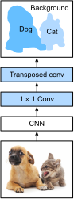

# Pilnai konvoliuciniai tinklai
:label:`sec_fcn`

Kaip aptarta :numref:`sec_semantic_segmentation`,
semantinis segmentavimas
klasifikuoja vaizdus pikselių lygmeniu.
Pilnai konvoliucinis tinklas (angl. *fully convolutional network*, FCN)
naudoja konvoliucinį neuroninį tinklą,
kad vaizdo pikselius paverstų pikselių klasėmis :cite:`Long.Shelhamer.Darrell.2015`.
Skirtingai nei anksčiau sutikti CNN
vaizdų klasifikavimui
ar objektų aptikimui,
pilnai konvoliucinis tinklas
tarpinių požymių žemėlapių aukštį ir plotį
paverčia atgal į įvesties vaizdo aukštį ir plotį:
tai pasiekiama
transponuotuoju konvoliuciniu sluoksniu,
pristatytu :numref:`sec_transposed_conv`.
Todėl
klasifikavimo išvestis
ir įvesties vaizdas
pikselių lygmeniu atitinka vienas kitą:
bet kurio išvesties pikselio kanalų dimensija
talpina
to paties erdvinės padėties įvesties pikselio klasifikavimo rezultatus.

```{.python .input}
#@tab mxnet
%matplotlib inline
from d2l import mxnet as d2l
from mxnet import gluon, image, init, np, npx
from mxnet.gluon import nn

npx.set_np()
```

```{.python .input}
#@tab pytorch
%matplotlib inline
from d2l import torch as d2l
import torch
import torchvision
from torch import nn
from torch.nn import functional as F
```

## Modelis

Čia aprašome pagrindinį pilnai konvoliucinio tinklo modelio dizainą.
Kaip parodyta :numref:`fig_fcn`,
šis modelis pirmiausia naudoja CNN vaizdo požymiams išgauti,
tada per $1\times 1$ konvoliucinį sluoksnį paverčia kanalų skaičių
klasių skaičiumi,
ir galiausiai per
transponuotąją konvoliuciją, pristatytą :numref:`sec_transposed_conv`,
paverčia požymių žemėlapių
aukštį ir plotį
įvesties vaizdo aukščiu ir pločiu.
Todėl
modelio išvestis turi tokį patį aukštį ir plotį kaip įvesties vaizdas,
o išvesties kanalas talpina to paties erdvinės padėties
įvesties pikselio prognozuotas klases.



:label:`fig_fcn`

Toliau [**vaizdo požymiams išgauti naudojame ResNet-18 modelį, iš anksto apmokytą ImageNet duomenų rinkinyje**],
o modelio egzempliorių pažymime `pretrained_net`.
Paskutiniai keli šio modelio sluoksniai
apima globalaus sutelkimo vidurkinant sluoksnį
ir pilnai sujungtą sluoksnį:
jų
pilnai konvoliuciniame tinkle nereikia.

```{.python .input}
#@tab mxnet
pretrained_net = gluon.model_zoo.vision.resnet18_v2(pretrained=True)
pretrained_net.features[-3:], pretrained_net.output
```

```{.python .input}
#@tab pytorch
pretrained_net = torchvision.models.resnet18(pretrained=True)
list(pretrained_net.children())[-3:]
```

Toliau [**sukuriame pilnai konvoliucinio tinklo egzempliorių `net`**].
Jis nukopijuoja visus iš anksto apmokytus ResNet-18 sluoksnius,
išskyrus galutinį globalaus sutelkimo vidurkinant sluoksnį
ir pilnai sujungtą sluoksnį, esančius arčiausiai
išvesties.

```{.python .input}
#@tab mxnet
net = nn.HybridSequential()
for layer in pretrained_net.features[:-2]:
    net.add(layer)
```

```{.python .input}
#@tab pytorch
net = nn.Sequential(*list(pretrained_net.children())[:-2])
```

Kai įvesties aukštis ir plotis yra atitinkamai 320 ir 480,
`net` tiesioginis sklidimas
sumažina įvesties aukštį ir plotį iki 1/32 pradinių, t. y. iki 10 ir 15.

```{.python .input}
#@tab mxnet
X = np.random.uniform(size=(1, 3, 320, 480))
net(X).shape
```

```{.python .input}
#@tab pytorch
X = torch.rand(size=(1, 3, 320, 480))
net(X).shape
```

Toliau [**naudojame $1\times 1$ konvoliucinį sluoksnį, kad išvesties kanalų skaičių paverstume Pascal VOC2012 duomenų rinkinio klasių skaičiumi (21).**]
Galiausiai turime (**padidinti požymių žemėlapių aukštį ir plotį 32 kartus**), kad juos pakeistume atgal į įvesties vaizdo aukštį ir plotį.
Prisiminkite, kaip apskaičiuojama
konvoliucinio sluoksnio išvesties forma :numref:`sec_padding`.
Kadangi $(320-64+16\times2+32)/32=10$ ir $(480-64+16\times2+32)/32=15$, sukonstruojame transponuotąjį konvoliucinį sluoksnį su $32$ žingsniu,
nustatydami
branduolio aukštį ir plotį
$64$, o papildymą $16$.
Apskritai
matome, kad
su žingsniu $s$,
papildymu $s/2$ (darant prielaidą, kad $s/2$ yra sveikasis skaičius)
ir branduolio aukščiu bei pločiu $2s$
transponuotoji konvoliucija padidins
įvesties aukštį ir plotį $s$ kartų.

```{.python .input}
#@tab mxnet
num_classes = 21
net.add(nn.Conv2D(num_classes, kernel_size=1),
        nn.Conv2DTranspose(
            num_classes, kernel_size=64, padding=16, strides=32))
```

```{.python .input}
#@tab pytorch
num_classes = 21
net.add_module('final_conv', nn.Conv2d(512, num_classes, kernel_size=1))
net.add_module('transpose_conv', nn.ConvTranspose2d(num_classes, num_classes,
                                    kernel_size=64, padding=16, stride=32))
```

## [**Transponuotųjų konvoliucinių sluoksnių inicializavimas**]


Jau žinome, kad
transponuotieji konvoliuciniai sluoksniai gali padidinti
požymių žemėlapių
aukštį ir plotį.
Vaizdų apdorojime gali prireikti padidinti
vaizdo mastelį, t. y. atlikti *didinimą* (angl. *upsampling*).
*Bitiesinė interpoliacija*
yra viena iš dažnai naudojamų didinimo technikų.
Ji taip pat dažnai naudojama transponuotiesiems konvoliuciniams sluoksniams inicializuoti.

Kad paaiškintume bitiesinę interpoliaciją,
tarkime,
kad turint įvesties vaizdą
norime
apskaičiuoti kiekvieną padidinto išvesties vaizdo
pikselį.
Kad apskaičiuotume išvesties vaizdo pikselį
koordinatėje $(x, y)$,
pirmiausia atvaizduokite $(x, y)$ į koordinatę $(x', y')$ įvesties vaizde, pavyzdžiui, pagal įvesties dydžio ir išvesties dydžio santykį.
Atkreipkite dėmesį, kad atvaizduoti $x'$ ir $y'$ yra realieji skaičiai.
Tada raskite keturis pikselius, artimiausius koordinatei
$(x', y')$ įvesties vaizde.
Galiausiai išvesties vaizdo pikselis koordinatėje $(x, y)$ apskaičiuojamas pagal šiuos keturis artimiausius pikselius
įvesties vaizde ir jų santykinį atstumą nuo $(x', y')$.

Bitiesinės interpoliacijos didinimą
galima įgyvendinti transponuotuoju konvoliuciniu sluoksniu
su branduoliu, sukonstruotu naudojant šią funkciją `bilinear_kernel`.
Dėl vietos stokos toliau pateikiame tik funkcijos `bilinear_kernel` įgyvendinimą
neaptardami jos algoritmo dizaino.

```{.python .input}
#@tab mxnet
def bilinear_kernel(in_channels, out_channels, kernel_size):
    factor = (kernel_size + 1) // 2
    if kernel_size % 2 == 1:
        center = factor - 1
    else:
        center = factor - 0.5
    og = (np.arange(kernel_size).reshape(-1, 1),
          np.arange(kernel_size).reshape(1, -1))
    filt = (1 - np.abs(og[0] - center) / factor) * \
           (1 - np.abs(og[1] - center) / factor)
    weight = np.zeros((in_channels, out_channels, kernel_size, kernel_size))
    weight[range(in_channels), range(out_channels), :, :] = filt
    return np.array(weight)
```

```{.python .input}
#@tab pytorch
def bilinear_kernel(in_channels, out_channels, kernel_size):
    factor = (kernel_size + 1) // 2
    if kernel_size % 2 == 1:
        center = factor - 1
    else:
        center = factor - 0.5
    og = (torch.arange(kernel_size).reshape(-1, 1),
          torch.arange(kernel_size).reshape(1, -1))
    filt = (1 - torch.abs(og[0] - center) / factor) * \
           (1 - torch.abs(og[1] - center) / factor)
    weight = torch.zeros((in_channels, out_channels,
                          kernel_size, kernel_size))
    weight[range(in_channels), range(out_channels), :, :] = filt
    return weight
```

[**Eksperimentuokime su bitiesinės interpoliacijos didinimu**],
įgyvendintu transponuotuoju konvoliuciniu sluoksniu.
Sukonstruojame transponuotąjį konvoliucinį sluoksnį,
kuris padvigubina aukštį ir plotį,
ir inicializuojame jo branduolį funkcija `bilinear_kernel`.

```{.python .input}
#@tab mxnet
conv_trans = nn.Conv2DTranspose(3, kernel_size=4, padding=1, strides=2)
conv_trans.initialize(init.Constant(bilinear_kernel(3, 3, 4)))
```

```{.python .input}
#@tab pytorch
conv_trans = nn.ConvTranspose2d(3, 3, kernel_size=4, padding=1, stride=2,
                                bias=False)
conv_trans.weight.data.copy_(bilinear_kernel(3, 3, 4));
```

Nuskaitykite vaizdą `X` ir priskirkite didinimo išvestį `Y`. Kad atspausdintume vaizdą, turime pakeisti kanalų dimensijos padėtį.

```{.python .input}
#@tab mxnet
img = image.imread('../img/catdog.jpg')
X = np.expand_dims(img.astype('float32').transpose(2, 0, 1), axis=0) / 255
Y = conv_trans(X)
out_img = Y[0].transpose(1, 2, 0)
```

```{.python .input}
#@tab pytorch
img = torchvision.transforms.ToTensor()(d2l.Image.open('../img/catdog.jpg'))
X = img.unsqueeze(0)
Y = conv_trans(X)
out_img = Y[0].permute(1, 2, 0).detach()
```

Kaip matome, transponuotasis konvoliucinis sluoksnis padidina tiek vaizdo aukštį, tiek plotį dvigubai.
Išskyrus skirtingus koordinačių mastelius,
bitiesine interpoliacija padidintas vaizdas ir originalus vaizdas, atspausdintas :numref:`sec_bbox`, atrodo vienodai.

```{.python .input}
#@tab mxnet
d2l.set_figsize()
print('input image shape:', img.shape)
d2l.plt.imshow(img.asnumpy());
print('output image shape:', out_img.shape)
d2l.plt.imshow(out_img.asnumpy());
```

```{.python .input}
#@tab pytorch
d2l.set_figsize()
print('input image shape:', img.permute(1, 2, 0).shape)
d2l.plt.imshow(img.permute(1, 2, 0));
print('output image shape:', out_img.shape)
d2l.plt.imshow(out_img);
```

Pilnai konvoliuciniame tinkle [**transponuotąjį konvoliucinį sluoksnį inicializuojame bitiesinės interpoliacijos didinimu. $1\times 1$ konvoliuciniam sluoksniui naudojame Xavier inicializavimą.**]

```{.python .input}
#@tab mxnet
W = bilinear_kernel(num_classes, num_classes, 64)
net[-1].initialize(init.Constant(W))
net[-2].initialize(init=init.Xavier())
```

```{.python .input}
#@tab pytorch
W = bilinear_kernel(num_classes, num_classes, 64)
net.transpose_conv.weight.data.copy_(W);
```

## [**Duomenų rinkinio skaitymas**]

Nuskaitome
semantinio segmentavimo duomenų rinkinį,
pristatytą :numref:`sec_semantic_segmentation`.
Atsitiktinio apkarpymo išvesties vaizdo forma
nurodoma $320\times 480$: ir aukštis, ir plotis dalijasi iš $32$.

```{.python .input}
#@tab all
batch_size, crop_size = 32, (320, 480)
train_iter, test_iter = d2l.load_data_voc(batch_size, crop_size)
```

## [**Apmokymas**]


Dabar galime apmokyti savo sukonstruotą
pilnai konvoliucinį tinklą.
Nuostolių funkcija ir tikslumo skaičiavimas čia
iš esmės nesiskiria nuo vaizdų klasifikavimo ankstesniuose skyriuose.
Kadangi naudojame transponuotojo konvoliucinio sluoksnio išvesties kanalą,
kad prognozuotume kiekvieno pikselio klasę,
kanalų dimensija nurodoma nuostolio skaičiavime.
Be to, tikslumas apskaičiuojamas
pagal visų pikselių
prognozuotos klasės teisingumą.

```{.python .input}
#@tab mxnet
num_epochs, lr, wd, devices = 5, 0.1, 1e-3, d2l.try_all_gpus()
loss = gluon.loss.SoftmaxCrossEntropyLoss(axis=1)
net.collect_params().reset_ctx(devices)
trainer = gluon.Trainer(net.collect_params(), 'sgd',
                        {'learning_rate': lr, 'wd': wd})
d2l.train_ch13(net, train_iter, test_iter, loss, trainer, num_epochs, devices)
```

```{.python .input}
#@tab pytorch
def loss(inputs, targets):
    return F.cross_entropy(inputs, targets, reduction='none').mean(1).mean(1)

num_epochs, lr, wd, devices = 5, 0.001, 1e-3, d2l.try_all_gpus()
trainer = torch.optim.SGD(net.parameters(), lr=lr, weight_decay=wd)
d2l.train_ch13(net, train_iter, test_iter, loss, trainer, num_epochs, devices)
```

## [**Prognozavimas**]


Prognozuodami turime standartizuoti įvesties vaizdą
kiekviename kanale ir paversti vaizdą į keturmačio įvesties formatą, kurio reikalauja CNN.

```{.python .input}
#@tab mxnet
def predict(img):
    X = test_iter._dataset.normalize_image(img)
    X = np.expand_dims(X.transpose(2, 0, 1), axis=0)
    pred = net(X.as_in_ctx(devices[0])).argmax(axis=1)
    return pred.reshape(pred.shape[1], pred.shape[2])
```

```{.python .input}
#@tab pytorch
def predict(img):
    X = test_iter.dataset.normalize_image(img).unsqueeze(0)
    pred = net(X.to(devices[0])).argmax(dim=1)
    return pred.reshape(pred.shape[1], pred.shape[2])
```

Kad [**vizualizuotume kiekvieno pikselio prognozuotą klasę**], prognozuotą klasę atvaizduojame atgal į jos žymens spalvą duomenų rinkinyje.

```{.python .input}
#@tab mxnet
def label2image(pred):
    colormap = np.array(d2l.VOC_COLORMAP, ctx=devices[0], dtype='uint8')
    X = pred.astype('int32')
    return colormap[X, :]
```

```{.python .input}
#@tab pytorch
def label2image(pred):
    colormap = torch.tensor(d2l.VOC_COLORMAP, device=devices[0])
    X = pred.long()
    return colormap[X, :]
```

Testavimo duomenų rinkinio vaizdai skiriasi dydžiu ir forma.
Kadangi modelis naudoja transponuotąjį konvoliucinį sluoksnį su 32 žingsniu,
kai įvesties vaizdo aukštis ar plotis nesidalija iš 32,
transponuotojo konvoliucinio sluoksnio išvesties aukštis ar plotis
nukryps nuo įvesties vaizdo formos.
Kad išspręstume šią problemą,
vaizde galime apkirpti kelias stačiakampes sritis, kurių aukštis ir plotis yra sveikieji 32 kartotiniai,
ir atlikti tiesioginį sklidimą
tų sričių pikseliams atskirai.
Atkreipkite dėmesį, kad
šių stačiakampių sričių sąjunga turi visiškai padengti įvesties vaizdą.
Kai pikselį dengia kelios stačiakampės sritys,
to paties pikselio transponuotosios konvoliucijos išvesčių
atskirose srityse vidurkis
gali būti paduotas
softmax operacijai
klasei prognozuoti.


Paprastumo dėlei nuskaitome tik keletą didesnių testinių vaizdų
ir prognozavimui apkerpame $320\times480$ sritį, pradedant nuo viršutinio kairiojo vaizdo kampo.
Šiems testiniams vaizdams
eilutė po eilutės
spausdiname jų apkirptas sritis,
prognozavimo rezultatus
ir tikrąsias reikšmes.

```{.python .input}
#@tab mxnet
voc_dir = d2l.download_extract('voc2012', 'VOCdevkit/VOC2012')
test_images, test_labels = d2l.read_voc_images(voc_dir, False)
n, imgs = 4, []
for i in range(n):
    crop_rect = (0, 0, 480, 320)
    X = image.fixed_crop(test_images[i], *crop_rect)
    pred = label2image(predict(X))
    imgs += [X, pred, image.fixed_crop(test_labels[i], *crop_rect)]
d2l.show_images(imgs[::3] + imgs[1::3] + imgs[2::3], 3, n, scale=2);
```

```{.python .input}
#@tab pytorch
voc_dir = d2l.download_extract('voc2012', 'VOCdevkit/VOC2012')
test_images, test_labels = d2l.read_voc_images(voc_dir, False)
n, imgs = 4, []
for i in range(n):
    crop_rect = (0, 0, 320, 480)
    X = torchvision.transforms.functional.crop(test_images[i], *crop_rect)
    pred = label2image(predict(X))
    imgs += [X.permute(1,2,0), pred.cpu(),
             torchvision.transforms.functional.crop(
                 test_labels[i], *crop_rect).permute(1,2,0)]
d2l.show_images(imgs[::3] + imgs[1::3] + imgs[2::3], 3, n, scale=2);
```

## Santrauka

* Pilnai konvoliucinis tinklas pirmiausia naudoja CNN vaizdo požymiams išgauti, tada per $1\times 1$ konvoliucinį sluoksnį paverčia kanalų skaičių klasių skaičiumi ir galiausiai per transponuotąją konvoliuciją paverčia požymių žemėlapių aukštį ir plotį įvesties vaizdo aukščiu ir pločiu.
* Pilnai konvoliuciniame tinkle galime naudoti bitiesinės interpoliacijos didinimą transponuotajam konvoliuciniam sluoksniui inicializuoti.


## Pratimai

1. Jei eksperimente transponuotajam konvoliuciniam sluoksniui naudotume Xavier inicializavimą, kaip pasikeistų rezultatas?
1. Ar galite dar labiau pagerinti modelio tikslumą derindami hiperparametrus?
1. Prognozuokite visų testinių vaizdų pikselių klases.
1. Originaliame pilnai konvoliucinio tinklo straipsnyje taip pat naudojamos kai kurių tarpinių CNN sluoksnių išvestys :cite:`Long.Shelhamer.Darrell.2015`. Pabandykite įgyvendinti šią idėją.

:begin_tab:`mxnet`
[Diskusijos](https://discuss.d2l.ai/t/377)
:end_tab:

:begin_tab:`pytorch`
[Diskusijos](https://discuss.d2l.ai/t/1582)
:end_tab:
