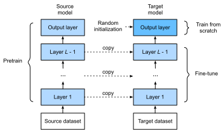

# Patikslinimas
:label:`sec_fine_tuning`

Ankstesniuose skyriuose aptarėme, kaip apmokyti modelius Fashion-MNIST apmokymo duomenų rinkinyje, turinčiame tik 60000 vaizdų. Taip pat aprašėme ImageNet – plačiausiai akademinėje bendruomenėje naudojamą didelio masto vaizdų duomenų rinkinį, turintį daugiau nei 10 milijonų vaizdų ir 1000 objektų. Tačiau duomenų rinkinio dydis, su kuriuo paprastai susiduriame, yra tarp šių dviejų duomenų rinkinių dydžių.


Tarkime, kad norime atpažinti skirtingų tipų kėdes iš vaizdų, o tada rekomenduoti naudotojams pirkimo nuorodas.
Vienas galimas metodas – pirmiausia nustatyti
100 įprastų kėdžių,
kiekvienai kėdei nufotografuoti 1000 vaizdų skirtingais kampais
ir tada apmokyti klasifikavimo modelį surinktame vaizdų duomenų rinkinyje.
Nors šis kėdžių duomenų rinkinys gali būti didesnis nei Fashion-MNIST duomenų rinkinys,
pavyzdžių skaičius vis dar yra mažesnis nei dešimtadalis
to, kuris yra ImageNet.
Tai gali lemti sudėtingų modelių, tinkamų ImageNet, persimokymą šiame kėdžių duomenų rinkinyje.
Be to, dėl ribotos apmokymo pavyzdžių apimties
apmokyto modelio tikslumas
gali neatitikti praktinių reikalavimų.


Kad išspręstume aukščiau minėtas problemas,
akivaizdus sprendimas yra surinkti daugiau duomenų.
Tačiau duomenų rinkimas ir žymėjimas gali atimti daug laiko ir pinigų.
Pavyzdžiui, kad surinktų ImageNet duomenų rinkinį, tyrėjai išleido milijonus dolerių iš tyrimų finansavimo.
Nors dabartinės duomenų rinkimo išlaidos gerokai sumažėjo, šių išlaidų vis tiek negalima ignoruoti.


Kitas sprendimas yra taikyti *perkeliamąjį mokymąsi* (angl. *transfer learning*), kad žinios, išmoktos iš *šaltinio duomenų rinkinio*, būtų perkeltos į *tikslo duomenų rinkinį*.
Pavyzdžiui, nors dauguma ImageNet duomenų rinkinio vaizdų neturi nieko bendro su kėdėmis, šiame duomenų rinkinyje apmokytas modelis gali išgauti bendresnius vaizdo požymius, kurie gali padėti identifikuoti kraštus, tekstūras, formas ir objektų kompoziciją.
Šie panašūs požymiai
taip pat gali būti veiksmingi atpažįstant kėdes.


## Žingsniai


Šiame skyrelyje pristatysime įprastą perkeliamojo mokymosi techniką: *patikslinimą* (angl. *fine-tuning*). Kaip parodyta :numref:`fig_finetune`, patikslinimą sudaro šie keturi žingsniai:


1. Iš anksto apmokykite neuroninio tinklo modelį, t. y. *šaltinio modelį*, šaltinio duomenų rinkinyje (pvz., ImageNet duomenų rinkinyje).
1. Sukurkite naują neuroninio tinklo modelį, t. y. *tikslo modelį*. Jis nukopijuoja visus šaltinio modelio dizainus ir jų parametrus, išskyrus išvesties sluoksnį. Darome prielaidą, kad šie modelio parametrai talpina iš šaltinio duomenų rinkinio išmoktas žinias ir kad šios žinios bus taikomos ir tikslo duomenų rinkiniui. Taip pat darome prielaidą, kad šaltinio modelio išvesties sluoksnis yra glaudžiai susijęs su šaltinio duomenų rinkinio žymenimis; todėl jis nenaudojamas tikslo modelyje.
1. Pridėkite išvesties sluoksnį prie tikslo modelio, kurio išvesčių skaičius yra kategorijų skaičius tikslo duomenų rinkinyje. Tada atsitiktinai inicializuokite šio sluoksnio modelio parametrus.
1. Apmokykite tikslo modelį tikslo duomenų rinkinyje, pavyzdžiui, kėdžių duomenų rinkinyje. Išvesties sluoksnis bus apmokomas nuo nulio, o visų kitų sluoksnių parametrai bus patikslinami remiantis šaltinio modelio parametrais.


:label:`fig_finetune`

Kai tikslo duomenų rinkiniai yra daug mažesni už šaltinio duomenų rinkinius, patikslinimas padeda pagerinti modelių apibendrinimo gebą.


## Dešrainio atpažinimas

Parodykime patikslinimą konkrečiu atveju:
dešrainio (angl. *hot dog*) atpažinimu.
Patikslinsime ResNet modelį mažame duomenų rinkinyje,
kuris buvo iš anksto apmokytas ImageNet duomenų rinkinyje.
Šį mažą duomenų rinkinį sudaro
tūkstančiai vaizdų su dešrainiais ir be jų.
Patikslintą modelį naudosime
dešrainiams atpažinti iš vaizdų.

```{.python .input}
#@tab mxnet
%matplotlib inline
from d2l import mxnet as d2l
from mxnet import gluon, init, np, npx
from mxnet.gluon import nn
import os

npx.set_np()
```

```{.python .input}
#@tab pytorch
%matplotlib inline
from d2l import torch as d2l
from torch import nn
import torch
import torchvision
import os
```

### Duomenų rinkinio skaitymas

[**Mūsų naudojamas dešrainių duomenų rinkinys paimtas iš internetinių vaizdų**].
Šį duomenų rinkinį sudaro
1400 teigiamos klasės vaizdų su dešrainiais
ir tiek pat neigiamos klasės vaizdų su kitais maisto produktais.
1000 abiejų klasių vaizdų naudojama apmokymui, o likusieji – testavimui.


Išpakavę atsisiųstą duomenų rinkinį,
gauname du aplankus `hotdog/train` ir `hotdog/test`. Abiejuose aplankuose yra poaplankiai `hotdog` ir `not-hotdog`, kurių kiekviename yra
atitinkamos klasės vaizdų.

```{.python .input}
#@tab all
#@save
d2l.DATA_HUB['hotdog'] = (d2l.DATA_URL + 'hotdog.zip', 
                         'fba480ffa8aa7e0febbb511d181409f899b9baa5')

data_dir = d2l.download_extract('hotdog')
```

Sukuriame du egzempliorius, kad perskaitytume visus apmokymo ir testavimo duomenų rinkinių vaizdų failus atitinkamai.

```{.python .input}
#@tab mxnet
train_imgs = gluon.data.vision.ImageFolderDataset(
    os.path.join(data_dir, 'train'))
test_imgs = gluon.data.vision.ImageFolderDataset(
    os.path.join(data_dir, 'test'))
```

```{.python .input}
#@tab pytorch
train_imgs = torchvision.datasets.ImageFolder(os.path.join(data_dir, 'train'))
test_imgs = torchvision.datasets.ImageFolder(os.path.join(data_dir, 'test'))
```

Toliau parodomi pirmieji 8 teigiami pavyzdžiai ir paskutiniai 8 neigiami vaizdai. Kaip matote, [**vaizdai skiriasi dydžiu ir kraštinių santykiu**].

```{.python .input}
#@tab all
hotdogs = [train_imgs[i][0] for i in range(8)]
not_hotdogs = [train_imgs[-i - 1][0] for i in range(8)]
d2l.show_images(hotdogs + not_hotdogs, 2, 8, scale=1.4);
```

Apmokymo metu pirmiausia iš vaizdo apkerpame atsitiktinio dydžio ir atsitiktinio kraštinių santykio atsitiktinę sritį,
o tada pakeičiame šios srities mastelį
į $224 \times 224$ įvesties vaizdą.
Testavimo metu pakeičiame vaizdo aukštį ir plotį iki 256 pikselių, o tada apkerpame centrinę $224 \times 224$ sritį kaip įvestį.
Be to,
trijų RGB (raudonos, žalios ir mėlynos) spalvų kanalų
reikšmes *standartizuojame* kanalas po kanalo.
Konkrečiai,
kanalo vidurkis atimamas iš kiekvienos to kanalo reikšmės, o tada rezultatas padalijamas iš to kanalo standartinio nuokrypio.

[~~Data augmentations~~]

```{.python .input}
#@tab mxnet
# Specify the means and standard deviations of the three RGB channels to
# standardize each channel
normalize = gluon.data.vision.transforms.Normalize(
    [0.485, 0.456, 0.406], [0.229, 0.224, 0.225])

train_augs = gluon.data.vision.transforms.Compose([
    gluon.data.vision.transforms.RandomResizedCrop(224),
    gluon.data.vision.transforms.RandomFlipLeftRight(),
    gluon.data.vision.transforms.ToTensor(),
    normalize])

test_augs = gluon.data.vision.transforms.Compose([
    gluon.data.vision.transforms.Resize(256),
    gluon.data.vision.transforms.CenterCrop(224),
    gluon.data.vision.transforms.ToTensor(),
    normalize])
```

```{.python .input}
#@tab pytorch
# Specify the means and standard deviations of the three RGB channels to
# standardize each channel
normalize = torchvision.transforms.Normalize(
    [0.485, 0.456, 0.406], [0.229, 0.224, 0.225])

train_augs = torchvision.transforms.Compose([
    torchvision.transforms.RandomResizedCrop(224),
    torchvision.transforms.RandomHorizontalFlip(),
    torchvision.transforms.ToTensor(),
    normalize])

test_augs = torchvision.transforms.Compose([
    torchvision.transforms.Resize([256, 256]),
    torchvision.transforms.CenterCrop(224),
    torchvision.transforms.ToTensor(),
    normalize])
```

### [**Modelio apibrėžimas ir inicializavimas**]

Kaip šaltinio modelį naudojame ResNet-18, kuris buvo iš anksto apmokytas ImageNet duomenų rinkinyje. Čia nurodome `pretrained=True`, kad automatiškai būtų atsisiųsti iš anksto apmokyti modelio parametrai.
Jei šis modelis naudojamas pirmą kartą,
atsisiuntimui reikalingas interneto ryšys.

```{.python .input}
#@tab mxnet
pretrained_net = gluon.model_zoo.vision.resnet18_v2(pretrained=True)
```

```{.python .input}
#@tab pytorch
pretrained_net = torchvision.models.resnet18(pretrained=True)
```

:begin_tab:`mxnet`
Iš anksto apmokytas šaltinio modelio egzempliorius turi du narių kintamuosius: `features` ir `output`. Pirmasis apima visus modelio sluoksnius, išskyrus išvesties sluoksnį, o antrasis yra modelio išvesties sluoksnis.
Pagrindinis šio padalijimo tikslas – palengvinti visų sluoksnių, išskyrus išvesties sluoksnį, modelio parametrų patikslinimą. Šaltinio modelio narys kintamasis `output` pateiktas toliau.
:end_tab:

:begin_tab:`pytorch`
Iš anksto apmokytas šaltinio modelio egzempliorius turi keletą požymių sluoksnių ir išvesties sluoksnį `fc`.
Pagrindinis šio padalijimo tikslas – palengvinti visų sluoksnių, išskyrus išvesties sluoksnį, modelio parametrų patikslinimą. Šaltinio modelio narys kintamasis `fc` pateiktas toliau.
:end_tab:

```{.python .input}
#@tab mxnet
pretrained_net.output
```

```{.python .input}
#@tab pytorch
pretrained_net.fc
```

Kaip pilnai sujungtas sluoksnis, jis paverčia ResNet galutinio globalaus sutelkimo vidurkinant išvestis į 1000 ImageNet duomenų rinkinio klasių išvesčių.
Tada sukonstruojame naują neuroninį tinklą kaip tikslo modelį. Jis apibrėžiamas taip pat kaip iš anksto apmokytas šaltinio modelis, tik
jo išvesčių skaičius paskutiniame sluoksnyje
nustatomas lygus
klasių skaičiui tikslo duomenų rinkinyje (o ne 1000).

Toliau pateiktame kode tikslo modelio egzemplioriaus `finetune_net` modelio parametrai prieš išvesties sluoksnį inicializuojami atitinkamų šaltinio modelio sluoksnių modelio parametrais.
Kadangi šie modelio parametrai buvo gauti išankstiniu apmokymu ImageNet duomenų rinkinyje,
jie yra veiksmingi.
Todėl tokius iš anksto apmokytus parametrus galime *patikslinti* naudodami tik
mažą mokymosi greitį.
Priešingai, išvesties sluoksnio modelio parametrai inicializuojami atsitiktinai ir paprastai reikalauja didesnio mokymosi greičio, kad būtų išmokti nuo nulio.
Tegul bazinis mokymosi greitis yra $\eta$; tada išvesties sluoksnio modelio parametrams iteruoti bus naudojamas $10\eta$ mokymosi greitis.

```{.python .input}
#@tab mxnet
finetune_net = gluon.model_zoo.vision.resnet18_v2(classes=2)
finetune_net.features = pretrained_net.features
finetune_net.output.initialize(init.Xavier())
# The model parameters in the output layer will be iterated using a learning
# rate ten times greater
finetune_net.output.collect_params().setattr('lr_mult', 10)
```

```{.python .input}
#@tab pytorch
finetune_net = torchvision.models.resnet18(pretrained=True)
finetune_net.fc = nn.Linear(finetune_net.fc.in_features, 2)
nn.init.xavier_uniform_(finetune_net.fc.weight);
```

### [**Modelio patikslinimas**]

Pirmiausia apibrėžiame apmokymo funkciją `train_fine_tuning`, kuri naudoja patikslinimą, kad ją būtų galima iškviesti kelis kartus.

```{.python .input}
#@tab mxnet
def train_fine_tuning(net, learning_rate, batch_size=128, num_epochs=5):
    train_iter = gluon.data.DataLoader(
        train_imgs.transform_first(train_augs), batch_size, shuffle=True)
    test_iter = gluon.data.DataLoader(
        test_imgs.transform_first(test_augs), batch_size)
    devices = d2l.try_all_gpus()
    net.collect_params().reset_ctx(devices)
    net.hybridize()
    loss = gluon.loss.SoftmaxCrossEntropyLoss()
    trainer = gluon.Trainer(net.collect_params(), 'sgd', {
        'learning_rate': learning_rate, 'wd': 0.001})
    d2l.train_ch13(net, train_iter, test_iter, loss, trainer, num_epochs,
                   devices)
```

```{.python .input}
#@tab pytorch
# If `param_group=True`, the model parameters in the output layer will be
# updated using a learning rate ten times greater
def train_fine_tuning(net, learning_rate, batch_size=128, num_epochs=5,
                      param_group=True):
    train_iter = torch.utils.data.DataLoader(torchvision.datasets.ImageFolder(
        os.path.join(data_dir, 'train'), transform=train_augs),
        batch_size=batch_size, shuffle=True)
    test_iter = torch.utils.data.DataLoader(torchvision.datasets.ImageFolder(
        os.path.join(data_dir, 'test'), transform=test_augs),
        batch_size=batch_size)
    devices = d2l.try_all_gpus()
    loss = nn.CrossEntropyLoss(reduction="none")
    if param_group:
        params_1x = [param for name, param in net.named_parameters()
             if name not in ["fc.weight", "fc.bias"]]
        trainer = torch.optim.SGD([{'params': params_1x},
                                   {'params': net.fc.parameters(),
                                    'lr': learning_rate * 10}],
                                lr=learning_rate, weight_decay=0.001)
    else:
        trainer = torch.optim.SGD(net.parameters(), lr=learning_rate,
                                  weight_decay=0.001)    
    d2l.train_ch13(net, train_iter, test_iter, loss, trainer, num_epochs,
                   devices)
```

[**Bazinį mokymosi greitį nustatome į mažą reikšmę**],
kad *patikslintume* išankstiniu apmokymu gautus modelio parametrus. Remiantis ankstesnėmis nuostatomis, tikslo modelio išvesties sluoksnio parametrus apmokysime nuo nulio, naudodami dešimt kartų didesnį mokymosi greitį.

```{.python .input}
#@tab mxnet
train_fine_tuning(finetune_net, 0.01)
```

```{.python .input}
#@tab pytorch
train_fine_tuning(finetune_net, 5e-5)
```

[**Palyginimui**] apibrėžiame identišką modelį, bet (**visus jo modelio parametrus inicializuojame atsitiktinėmis reikšmėmis**). Kadangi visą modelį reikia apmokyti nuo nulio, galime naudoti didesnį mokymosi greitį.

```{.python .input}
#@tab mxnet
scratch_net = gluon.model_zoo.vision.resnet18_v2(classes=2)
scratch_net.initialize(init=init.Xavier())
train_fine_tuning(scratch_net, 0.1)
```

```{.python .input}
#@tab pytorch
scratch_net = torchvision.models.resnet18()
scratch_net.fc = nn.Linear(scratch_net.fc.in_features, 2)
train_fine_tuning(scratch_net, 5e-4, param_group=False)
```

Kaip matome, patikslintas modelis per tą patį epochų skaičių linkęs veikti geriau,
nes jo pradinės parametrų reikšmės yra veiksmingesnės.


## Santrauka

* Perkeliamasis mokymasis perkelia žinias, išmoktas iš šaltinio duomenų rinkinio, į tikslo duomenų rinkinį. Patikslinimas yra įprasta perkeliamojo mokymosi technika.
* Tikslo modelis nukopijuoja visus šaltinio modelio dizainus su jų parametrais, išskyrus išvesties sluoksnį, ir patikslina šiuos parametrus pagal tikslo duomenų rinkinį. Priešingai, tikslo modelio išvesties sluoksnį reikia apmokyti nuo nulio.
* Paprastai patikslinant parametrus naudojamas mažesnis mokymosi greitis, o išvesties sluoksniui apmokyti nuo nulio galima naudoti didesnį mokymosi greitį.


## Pratimai

1. Toliau didinkite `finetune_net` mokymosi greitį. Kaip kinta modelio tikslumas?
2. Toliau koreguokite `finetune_net` ir `scratch_net` hiperparametrus lyginamajame eksperimente. Ar jų tikslumas vis dar skiriasi?
3. Nustatykite `finetune_net` parametrus prieš išvesties sluoksnį lygius šaltinio modelio parametrams ir *neatnaujinkite* jų apmokymo metu. Kaip kinta modelio tikslumas? Galite naudoti toliau pateiktą kodą.

```{.python .input}
#@tab mxnet
finetune_net.features.collect_params().setattr('grad_req', 'null')
```

```{.python .input}
#@tab pytorch
for param in finetune_net.parameters():
    param.requires_grad = False
```

4. Iš tikrųjų `ImageNet` duomenų rinkinyje yra „hotdog“ klasė. Jos atitinkamą svorio parametrą išvesties sluoksnyje galima gauti naudojant toliau pateiktą kodą. Kaip galime pasinaudoti šiuo svorio parametru?

```{.python .input}
#@tab mxnet
weight = pretrained_net.output.weight
hotdog_w = np.split(weight.data(), 1000, axis=0)[713]
hotdog_w.shape
```

```{.python .input}
#@tab pytorch
weight = pretrained_net.fc.weight
hotdog_w = torch.split(weight.data, 1, dim=0)[934]
hotdog_w.shape
```

:begin_tab:`mxnet`
[Diskusijos](https://discuss.d2l.ai/t/368)
:end_tab:

:begin_tab:`pytorch`
[Diskusijos](https://discuss.d2l.ai/t/1439)
:end_tab:
