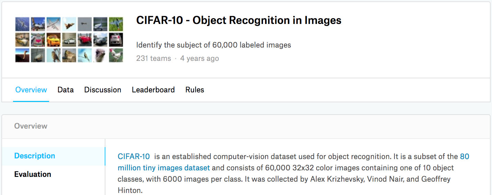

# Vaizdų klasifikavimas (CIFAR-10) Kaggle platformoje
:label:`sec_kaggle_cifar10`

Iki šiol naudojome giliojo mokymosi karkasų aukšto lygio API, kad tiesiogiai gautume vaizdų duomenų rinkinius tenzorių formatu.
Tačiau pritaikyti vaizdų duomenų rinkiniai
dažnai būna vaizdų failų pavidalu.
Šiame skyrelyje pradėsime nuo
neapdorotų vaizdų failų
ir žingsnis po žingsnio juos sutvarkysime, nuskaitysime ir paversime
tenzorių formatu.

CIFAR-10 duomenų rinkinį, kuris yra svarbus kompiuterinės regos duomenų rinkinys, išbandėme :numref:`sec_image_augmentation`.
Šiame skyrelyje
ankstesniuose skyreliuose išmoktas žinias pritaikysime
praktikai – Kaggle CIFAR-10 vaizdų klasifikavimo
konkursui.
(**Konkurso interneto adresas yra https://www.kaggle.com/c/cifar-10**)

:numref:`fig_kaggle_cifar10` parodyta informacija konkurso tinklalapyje.
Kad galėtumėte pateikti rezultatus,
turite užsiregistruoti Kaggle paskyrą.


:width:`600px`
:label:`fig_kaggle_cifar10`

```{.python .input}
#@tab mxnet
import collections
from d2l import mxnet as d2l
import math
from mxnet import gluon, init, npx
from mxnet.gluon import nn
import os
import pandas as pd
import shutil

npx.set_np()
```

```{.python .input}
#@tab pytorch
import collections
from d2l import torch as d2l
import math
import torch
import torchvision
from torch import nn
import os
import pandas as pd
import shutil
```

## Duomenų rinkinio gavimas ir tvarkymas

Konkurso duomenų rinkinys padalytas į
apmokymo ir testavimo aibes,
kuriose atitinkamai yra 50000 ir 300000 vaizdų.
Testavimo aibėje
10000 vaizdų bus naudojami vertinimui,
o likę 290000 vaizdų
nebus vertinami:
jie įtraukti tik tam,
kad būtų sunku apgauti
*rankiniu būdu* pažymėtais testavimo aibės rezultatais.
Visi šio duomenų rinkinio vaizdai
yra png spalvoti (RGB kanalų) vaizdų failai,
kurių aukštis ir plotis yra po 32 pikselius.
Vaizdai apima iš viso 10 kategorijų, būtent lėktuvus, automobilius, paukščius, kates, elnius, šunis, varles, arklius, laivus ir sunkvežimius.
:numref:`fig_kaggle_cifar10` viršutiniame kairiajame kampe parodyta keletas duomenų rinkinio lėktuvų, automobilių ir paukščių vaizdų.


### Duomenų rinkinio atsisiuntimas

Prisijungę prie Kaggle, galime spustelėti skirtuką „Data“ CIFAR-10 vaizdų klasifikavimo konkurso tinklalapyje, parodytame :numref:`fig_kaggle_cifar10`, ir atsisiųsti duomenų rinkinį spustelėję mygtuką „Download All“.
Išpakavę atsisiųstą failą aplanke `../data` ir išpakavę jame esančius `train.7z` ir `test.7z`, visą duomenų rinkinį rasite šiuose keliuose:

* `../data/cifar-10/train/[1-50000].png`
* `../data/cifar-10/test/[1-300000].png`
* `../data/cifar-10/trainLabels.csv`
* `../data/cifar-10/sampleSubmission.csv`

kur katalogai `train` ir `test` atitinkamai talpina apmokymo ir testavimo vaizdus, `trainLabels.csv` pateikia apmokymo vaizdų žymenis, o `sample_submission.csv` yra pateikimo failo pavyzdys.

Kad būtų lengviau pradėti, [**pateikiame mažo masto duomenų rinkinio pavyzdį,
kuriame yra pirmieji 1000 apmokymo vaizdų ir 5 atsitiktiniai testavimo vaizdai.**]
Kad naudotumėte pilną Kaggle konkurso duomenų rinkinį, toliau pateiktą kintamąjį `demo` turite nustatyti į `False`.

```{.python .input}
#@tab all
#@save
d2l.DATA_HUB['cifar10_tiny'] = (d2l.DATA_URL + 'kaggle_cifar10_tiny.zip',
                                '2068874e4b9a9f0fb07ebe0ad2b29754449ccacd')

# If you use the full dataset downloaded for the Kaggle competition, set
# `demo` to False
demo = True

if demo:
    data_dir = d2l.download_extract('cifar10_tiny')
else:
    data_dir = '../data/cifar-10/'
```

### [**Duomenų rinkinio tvarkymas**]

Duomenų rinkinius turime sutvarkyti, kad būtų lengviau apmokyti ir testuoti modelį.
Pirmiausia nuskaitykime žymenis iš csv failo.
Toliau pateikta funkcija grąžina žodyną, kuris atvaizduoja
failo pavadinimo dalį be plėtinio į jo žymenį.

```{.python .input}
#@tab all
#@save
def read_csv_labels(fname):
    """Read `fname` to return a filename to label dictionary."""
    with open(fname, 'r') as f:
        # Skip the file header line (column name)
        lines = f.readlines()[1:]
    tokens = [l.rstrip().split(',') for l in lines]
    return dict(((name, label) for name, label in tokens))

labels = read_csv_labels(os.path.join(data_dir, 'trainLabels.csv'))
print('# training examples:', len(labels))
print('# classes:', len(set(labels.values())))
```

Toliau apibrėžiame funkciją `reorg_train_valid`, kad [**iš pradinės apmokymo aibės išskirtume patikros aibę.**]
Šios funkcijos argumentas `valid_ratio` yra patikros aibės pavyzdžių skaičiaus ir pradinės apmokymo aibės pavyzdžių skaičiaus santykis.
Konkrečiau,
tegul $n$ yra klasės, turinčios mažiausiai pavyzdžių, vaizdų skaičius, o $r$ – santykis.
Patikros aibei bus išskirta
$\max(\lfloor nr\rfloor,1)$ vaizdų kiekvienai klasei.
Paimkime `valid_ratio=0.1` kaip pavyzdį. Kadangi pradinėje apmokymo aibėje yra 50000 vaizdų,
apmokymui bus naudojama 45000 vaizdų kelyje `train_valid_test/train`,
o kiti 5000 vaizdų bus išskirti
kaip patikros aibė kelyje `train_valid_test/valid`. Sutvarkius duomenų rinkinį, tos pačios klasės vaizdai bus patalpinti tame pačiame aplanke.

```{.python .input}
#@tab all
#@save
def copyfile(filename, target_dir):
    """Copy a file into a target directory."""
    os.makedirs(target_dir, exist_ok=True)
    shutil.copy(filename, target_dir)

#@save
def reorg_train_valid(data_dir, labels, valid_ratio):
    """Split the validation set out of the original training set."""
    # The number of examples of the class that has the fewest examples in the
    # training dataset
    n = collections.Counter(labels.values()).most_common()[-1][1]
    # The number of examples per class for the validation set
    n_valid_per_label = max(1, math.floor(n * valid_ratio))
    label_count = {}
    for train_file in os.listdir(os.path.join(data_dir, 'train')):
        label = labels[train_file.split('.')[0]]
        fname = os.path.join(data_dir, 'train', train_file)
        copyfile(fname, os.path.join(data_dir, 'train_valid_test',
                                     'train_valid', label))
        if label not in label_count or label_count[label] < n_valid_per_label:
            copyfile(fname, os.path.join(data_dir, 'train_valid_test',
                                         'valid', label))
            label_count[label] = label_count.get(label, 0) + 1
        else:
            copyfile(fname, os.path.join(data_dir, 'train_valid_test',
                                         'train', label))
    return n_valid_per_label
```

Toliau pateikta funkcija `reorg_test` [**sutvarko testavimo aibę duomenų įkėlimui prognozavimo metu.**]

```{.python .input}
#@tab all
#@save
def reorg_test(data_dir):
    """Organize the testing set for data loading during prediction."""
    for test_file in os.listdir(os.path.join(data_dir, 'test')):
        copyfile(os.path.join(data_dir, 'test', test_file),
                 os.path.join(data_dir, 'train_valid_test', 'test',
                              'unknown'))
```

Galiausiai naudojame funkciją, kad [**iškviestume**]
(**aukščiau apibrėžtas funkcijas**) `read_csv_labels`, `reorg_train_valid` ir `reorg_test`.

```{.python .input}
#@tab all
def reorg_cifar10_data(data_dir, valid_ratio):
    labels = read_csv_labels(os.path.join(data_dir, 'trainLabels.csv'))
    reorg_train_valid(data_dir, labels, valid_ratio)
    reorg_test(data_dir)
```

Čia rinkinio dydį nustatome į 32 tik mažo masto duomenų rinkinio pavyzdžiui.
Apmokant ir testuojant
pilną Kaggle konkurso duomenų rinkinį,
`batch_size` turėtų būti nustatytas didesnis sveikasis skaičius, pavyzdžiui, 128.
Išskiriame 10 % apmokymo pavyzdžių kaip patikros aibę hiperparametrams derinti.

```{.python .input}
#@tab all
batch_size = 32 if demo else 128
valid_ratio = 0.1
reorg_cifar10_data(data_dir, valid_ratio)
```

## [**Vaizdų augmentacija**]

Persimokymui įveikti naudojame vaizdų augmentaciją.
Pavyzdžiui, apmokymo metu vaizdai gali būti atsitiktinai apverčiami horizontaliai.
Taip pat galime atlikti spalvotų vaizdų trijų RGB kanalų standartizavimą. Toliau išvardytos kelios iš šių operacijų, kurias galite keisti.

```{.python .input}
#@tab mxnet
transform_train = gluon.data.vision.transforms.Compose([
    # Scale the image up to a square of 40 pixels in both height and width
    gluon.data.vision.transforms.Resize(40),
    # Randomly crop a square image of 40 pixels in both height and width to
    # produce a small square of 0.64 to 1 times the area of the original
    # image, and then scale it to a square of 32 pixels in both height and
    # width
    gluon.data.vision.transforms.RandomResizedCrop(32, scale=(0.64, 1.0),
                                                   ratio=(1.0, 1.0)),
    gluon.data.vision.transforms.RandomFlipLeftRight(),
    gluon.data.vision.transforms.ToTensor(),
    # Standardize each channel of the image
    gluon.data.vision.transforms.Normalize([0.4914, 0.4822, 0.4465],
                                           [0.2023, 0.1994, 0.2010])])
```

```{.python .input}
#@tab pytorch
transform_train = torchvision.transforms.Compose([
    # Scale the image up to a square of 40 pixels in both height and width
    torchvision.transforms.Resize(40),
    # Randomly crop a square image of 40 pixels in both height and width to
    # produce a small square of 0.64 to 1 times the area of the original
    # image, and then scale it to a square of 32 pixels in both height and
    # width
    torchvision.transforms.RandomResizedCrop(32, scale=(0.64, 1.0),
                                                   ratio=(1.0, 1.0)),
    torchvision.transforms.RandomHorizontalFlip(),
    torchvision.transforms.ToTensor(),
    # Standardize each channel of the image
    torchvision.transforms.Normalize([0.4914, 0.4822, 0.4465],
                                     [0.2023, 0.1994, 0.2010])])
```

Testavimo metu
vaizdams atliekame tik standartizavimą,
kad
pašalintume atsitiktinumą vertinimo rezultatuose.

```{.python .input}
#@tab mxnet
transform_test = gluon.data.vision.transforms.Compose([
    gluon.data.vision.transforms.ToTensor(),
    gluon.data.vision.transforms.Normalize([0.4914, 0.4822, 0.4465],
                                           [0.2023, 0.1994, 0.2010])])
```

```{.python .input}
#@tab pytorch
transform_test = torchvision.transforms.Compose([
    torchvision.transforms.ToTensor(),
    torchvision.transforms.Normalize([0.4914, 0.4822, 0.4465],
                                     [0.2023, 0.1994, 0.2010])])
```

## Duomenų rinkinio skaitymas

Toliau [**nuskaitome sutvarkytą duomenų rinkinį, sudarytą iš neapdorotų vaizdų failų**]. Kiekvieną pavyzdį sudaro vaizdas ir žymuo.

```{.python .input}
#@tab mxnet
train_ds, valid_ds, train_valid_ds, test_ds = [
    gluon.data.vision.ImageFolderDataset(
        os.path.join(data_dir, 'train_valid_test', folder))
    for folder in ['train', 'valid', 'train_valid', 'test']]
```

```{.python .input}
#@tab pytorch
train_ds, train_valid_ds = [torchvision.datasets.ImageFolder(
    os.path.join(data_dir, 'train_valid_test', folder),
    transform=transform_train) for folder in ['train', 'train_valid']]

valid_ds, test_ds = [torchvision.datasets.ImageFolder(
    os.path.join(data_dir, 'train_valid_test', folder),
    transform=transform_test) for folder in ['valid', 'test']]
```

Apmokymo metu
turime [**nurodyti visas aukščiau apibrėžtas vaizdų augmentacijos operacijas**].
Kai patikros aibė
naudojama modelio vertinimui derinant hiperparametrus,
neturėtų būti įvedama atsitiktinumo iš vaizdų augmentacijos.
Prieš galutinį prognozavimą
modelį apmokome kartu sujungtoje apmokymo ir patikros aibėje, kad visapusiškai išnaudotume visus pažymėtus duomenis.

```{.python .input}
#@tab mxnet
train_iter, train_valid_iter = [gluon.data.DataLoader(
    dataset.transform_first(transform_train), batch_size, shuffle=True,
    last_batch='discard') for dataset in (train_ds, train_valid_ds)]

valid_iter = gluon.data.DataLoader(
    valid_ds.transform_first(transform_test), batch_size, shuffle=False,
    last_batch='discard')

test_iter = gluon.data.DataLoader(
    test_ds.transform_first(transform_test), batch_size, shuffle=False,
    last_batch='keep')
```

```{.python .input}
#@tab pytorch
train_iter, train_valid_iter = [torch.utils.data.DataLoader(
    dataset, batch_size, shuffle=True, drop_last=True)
    for dataset in (train_ds, train_valid_ds)]

valid_iter = torch.utils.data.DataLoader(valid_ds, batch_size, shuffle=False,
                                         drop_last=True)

test_iter = torch.utils.data.DataLoader(test_ds, batch_size, shuffle=False,
                                        drop_last=False)
```

## [**Modelio**] apibrėžimas

:begin_tab:`mxnet`
Čia liekamuosius blokus sukuriame remdamiesi klase `HybridBlock`, kuri
šiek tiek skiriasi nuo įgyvendinimo, aprašyto
:numref:`sec_resnet`.
Tai daroma skaičiavimo efektyvumui pagerinti.
:end_tab:

```{.python .input}
#@tab mxnet
class Residual(nn.HybridBlock):
    def __init__(self, num_channels, use_1x1conv=False, strides=1, **kwargs):
        super(Residual, self).__init__(**kwargs)
        self.conv1 = nn.Conv2D(num_channels, kernel_size=3, padding=1,
                               strides=strides)
        self.conv2 = nn.Conv2D(num_channels, kernel_size=3, padding=1)
        if use_1x1conv:
            self.conv3 = nn.Conv2D(num_channels, kernel_size=1,
                                   strides=strides)
        else:
            self.conv3 = None
        self.bn1 = nn.BatchNorm()
        self.bn2 = nn.BatchNorm()

    def hybrid_forward(self, F, X):
        Y = F.npx.relu(self.bn1(self.conv1(X)))
        Y = self.bn2(self.conv2(Y))
        if self.conv3:
            X = self.conv3(X)
        return F.npx.relu(Y + X)
```

:begin_tab:`mxnet`
Toliau apibrėžiame ResNet-18 modelį.
:end_tab:

```{.python .input}
#@tab mxnet
def resnet18(num_classes):
    net = nn.HybridSequential()
    net.add(nn.Conv2D(64, kernel_size=3, strides=1, padding=1),
            nn.BatchNorm(), nn.Activation('relu'))

    def resnet_block(num_channels, num_residuals, first_block=False):
        blk = nn.HybridSequential()
        for i in range(num_residuals):
            if i == 0 and not first_block:
                blk.add(Residual(num_channels, use_1x1conv=True, strides=2))
            else:
                blk.add(Residual(num_channels))
        return blk

    net.add(resnet_block(64, 2, first_block=True),
            resnet_block(128, 2),
            resnet_block(256, 2),
            resnet_block(512, 2))
    net.add(nn.GlobalAvgPool2D(), nn.Dense(num_classes))
    return net
```

:begin_tab:`mxnet`
Prieš pradedant apmokymą naudojame Xavier inicializavimą, aprašytą :numref:`subsec_xavier`.
:end_tab:

:begin_tab:`pytorch`
Apibrėžiame ResNet-18 modelį, aprašytą
:numref:`sec_resnet`.
:end_tab:

```{.python .input}
#@tab mxnet
def get_net(devices):
    num_classes = 10
    net = resnet18(num_classes)
    net.initialize(ctx=devices, init=init.Xavier())
    return net

loss = gluon.loss.SoftmaxCrossEntropyLoss()
```

```{.python .input}
#@tab pytorch
def get_net():
    num_classes = 10
    net = d2l.resnet18(num_classes, 3)
    return net

loss = nn.CrossEntropyLoss(reduction="none")
```

## [**Apmokymo funkcijos**] apibrėžimas

Modelius rinksimės ir hiperparametrus derinsime pagal modelio našumą patikros aibėje.
Toliau apibrėžiame modelio apmokymo funkciją `train`.

```{.python .input}
#@tab mxnet
def train(net, train_iter, valid_iter, num_epochs, lr, wd, devices, lr_period,
          lr_decay):
    trainer = gluon.Trainer(net.collect_params(), 'sgd',
                            {'learning_rate': lr, 'momentum': 0.9, 'wd': wd})
    num_batches, timer = len(train_iter), d2l.Timer()
    legend = ['train loss', 'train acc']
    if valid_iter is not None:
        legend.append('valid acc')
    animator = d2l.Animator(xlabel='epoch', xlim=[1, num_epochs],
                            legend=legend)
    for epoch in range(num_epochs):
        metric = d2l.Accumulator(3)
        if epoch > 0 and epoch % lr_period == 0:
            trainer.set_learning_rate(trainer.learning_rate * lr_decay)
        for i, (features, labels) in enumerate(train_iter):
            timer.start()
            l, acc = d2l.train_batch_ch13(
                net, features, labels.astype('float32'), loss, trainer,
                devices, d2l.split_batch)
            metric.add(l, acc, labels.shape[0])
            timer.stop()
            if (i + 1) % (num_batches // 5) == 0 or i == num_batches - 1:
                animator.add(epoch + (i + 1) / num_batches,
                             (metric[0] / metric[2], metric[1] / metric[2],
                              None))
        if valid_iter is not None:
            valid_acc = d2l.evaluate_accuracy_gpus(net, valid_iter,
                                                   d2l.split_batch)
            animator.add(epoch + 1, (None, None, valid_acc))
    measures = (f'train loss {metric[0] / metric[2]:.3f}, '
                f'train acc {metric[1] / metric[2]:.3f}')
    if valid_iter is not None:
        measures += f', valid acc {valid_acc:.3f}'
    print(measures + f'\n{metric[2] * num_epochs / timer.sum():.1f}'
          f' examples/sec on {str(devices)}')
```

```{.python .input}
#@tab pytorch
def train(net, train_iter, valid_iter, num_epochs, lr, wd, devices, lr_period,
          lr_decay):
    trainer = torch.optim.SGD(net.parameters(), lr=lr, momentum=0.9,
                              weight_decay=wd)
    scheduler = torch.optim.lr_scheduler.StepLR(trainer, lr_period, lr_decay)
    num_batches, timer = len(train_iter), d2l.Timer()
    legend = ['train loss', 'train acc']
    if valid_iter is not None:
        legend.append('valid acc')
    animator = d2l.Animator(xlabel='epoch', xlim=[1, num_epochs],
                            legend=legend)
    net = nn.DataParallel(net, device_ids=devices).to(devices[0])
    for epoch in range(num_epochs):
        net.train()
        metric = d2l.Accumulator(3)
        for i, (features, labels) in enumerate(train_iter):
            timer.start()
            l, acc = d2l.train_batch_ch13(net, features, labels,
                                          loss, trainer, devices)
            metric.add(l, acc, labels.shape[0])
            timer.stop()
            if (i + 1) % (num_batches // 5) == 0 or i == num_batches - 1:
                animator.add(epoch + (i + 1) / num_batches,
                             (metric[0] / metric[2], metric[1] / metric[2],
                              None))
        if valid_iter is not None:
            valid_acc = d2l.evaluate_accuracy_gpu(net, valid_iter)
            animator.add(epoch + 1, (None, None, valid_acc))
        scheduler.step()
    measures = (f'train loss {metric[0] / metric[2]:.3f}, '
                f'train acc {metric[1] / metric[2]:.3f}')
    if valid_iter is not None:
        measures += f', valid acc {valid_acc:.3f}'
    print(measures + f'\n{metric[2] * num_epochs / timer.sum():.1f}'
          f' examples/sec on {str(devices)}')
```

## [**Modelio apmokymas ir patikra**]

Dabar galime apmokyti ir patikrinti modelį.
Visus toliau pateiktus hiperparametrus galima derinti.
Pavyzdžiui, galime padidinti epochų skaičių.
Kai `lr_period` ir `lr_decay` nustatyti atitinkamai į 4 ir 0,9, optimizavimo algoritmo mokymosi greitis bus padaugintas iš 0,9 po kiekvienų 4 epochų. Tik demonstravimo patogumui
čia apmokome tik 20 epochų.

```{.python .input}
#@tab mxnet
devices, num_epochs, lr, wd = d2l.try_all_gpus(), 20, 0.02, 5e-4
lr_period, lr_decay, net = 4, 0.9, get_net(devices)
net.hybridize()
train(net, train_iter, valid_iter, num_epochs, lr, wd, devices, lr_period,
      lr_decay)
```

```{.python .input}
#@tab pytorch
devices, num_epochs, lr, wd = d2l.try_all_gpus(), 20, 2e-4, 5e-4
lr_period, lr_decay, net = 4, 0.9, get_net()
net(next(iter(train_iter))[0])
train(net, train_iter, valid_iter, num_epochs, lr, wd, devices, lr_period,
      lr_decay)
```

## [**Testavimo aibės klasifikavimas**] ir rezultatų pateikimas Kaggle platformoje

Gavę perspektyvų modelį su hiperparametrais,
naudojame visus pažymėtus duomenis (įskaitant patikros aibę), kad iš naujo apmokytume modelį ir suklasifikuotume testavimo aibę.

```{.python .input}
#@tab mxnet
net, preds = get_net(devices), []
net.hybridize()
train(net, train_valid_iter, None, num_epochs, lr, wd, devices, lr_period,
      lr_decay)

for X, _ in test_iter:
    y_hat = net(X.as_in_ctx(devices[0]))
    preds.extend(y_hat.argmax(axis=1).astype(int).asnumpy())
sorted_ids = list(range(1, len(test_ds) + 1))
sorted_ids.sort(key=lambda x: str(x))
df = pd.DataFrame({'id': sorted_ids, 'label': preds})
df['label'] = df['label'].apply(lambda x: train_valid_ds.synsets[x])
df.to_csv('submission.csv', index=False)
```

```{.python .input}
#@tab pytorch
net, preds = get_net(), []
net(next(iter(train_valid_iter))[0])
train(net, train_valid_iter, None, num_epochs, lr, wd, devices, lr_period,
      lr_decay)

for X, _ in test_iter:
    y_hat = net(X.to(devices[0]))
    preds.extend(y_hat.argmax(dim=1).type(torch.int32).cpu().numpy())
sorted_ids = list(range(1, len(test_ds) + 1))
sorted_ids.sort(key=lambda x: str(x))
df = pd.DataFrame({'id': sorted_ids, 'label': preds})
df['label'] = df['label'].apply(lambda x: train_valid_ds.classes[x])
df.to_csv('submission.csv', index=False)
```

Aukščiau pateiktas kodas
sugeneruos failą `submission.csv`,
kurio formatas
atitinka Kaggle konkurso reikalavimus.
Rezultatų pateikimo Kaggle būdas
panašus į aprašytą :numref:`sec_kaggle_house`.

## Santrauka

* Duomenų rinkinius, kuriuose yra neapdorotų vaizdų failų, galime nuskaityti sutvarkę juos į reikiamą formatą.

:begin_tab:`mxnet`
* Vaizdų klasifikavimo konkurse galime naudoti konvoliucinius neuroninius tinklus, vaizdų augmentaciją ir hibridinį programavimą.
:end_tab:

:begin_tab:`pytorch`
* Vaizdų klasifikavimo konkurse galime naudoti konvoliucinius neuroninius tinklus ir vaizdų augmentaciją.
:end_tab:

## Pratimai

1. Šiam Kaggle konkursui naudokite pilną CIFAR-10 duomenų rinkinį. Nustatykite hiperparametrus `batch_size = 128`, `num_epochs = 100`, `lr = 0.1`, `lr_period = 50` ir `lr_decay = 0.1`. Pažiūrėkite, kokį tikslumą ir vietą šiame konkurse galite pasiekti. Ar galite juos dar pagerinti?
1. Kokį tikslumą galite gauti nenaudodami vaizdų augmentacijos?

:begin_tab:`mxnet`
[Diskusijos](https://discuss.d2l.ai/t/379)
:end_tab:

:begin_tab:`pytorch`
[Diskusijos](https://discuss.d2l.ai/t/1479)
:end_tab:
