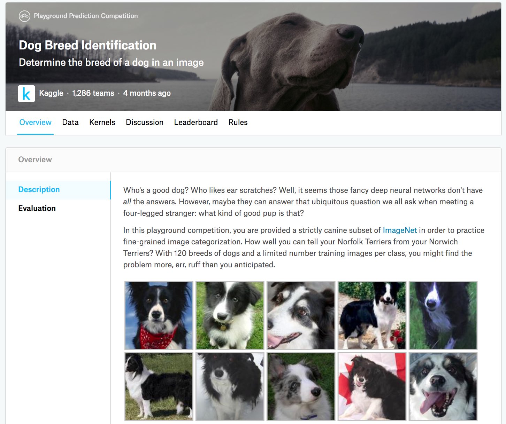

# Šunų veislių atpažinimas (ImageNet Dogs) Kaggle platformoje

Šiame skyrelyje praktikuosime
šunų veislių atpažinimo uždavinį
Kaggle platformoje. (**Šio konkurso interneto adresas yra https://www.kaggle.com/c/dog-breed-identification**)

Šiame konkurse
bus atpažįstamos 120 skirtingų šunų veislių.
Iš tikrųjų
šio konkurso duomenų rinkinys yra
ImageNet duomenų rinkinio poaibis.
Skirtingai nei CIFAR-10 duomenų rinkinio vaizdai :numref:`sec_kaggle_cifar10`,
ImageNet duomenų rinkinio vaizdai yra ir aukštesni, ir platesni, kintančių matmenų.
:numref:`fig_kaggle_dog` parodyta informacija konkurso tinklalapyje. Rezultatams pateikti reikia Kaggle
paskyros.



:width:`400px`
:label:`fig_kaggle_dog`

```{.python .input}
#@tab mxnet
from d2l import mxnet as d2l
from mxnet import autograd, gluon, init, npx
from mxnet.gluon import nn
import os

npx.set_np()
```

```{.python .input}
#@tab pytorch
from d2l import torch as d2l
import torch
import torchvision
from torch import nn
import os
```

## Duomenų rinkinio gavimas ir tvarkymas

Konkurso duomenų rinkinys padalytas į apmokymo ir testavimo aibes, kuriose atitinkamai yra 10222 ir 10357 JPEG vaizdų
su trimis RGB (spalvotais) kanalais.
Apmokymo duomenų rinkinyje
yra 120 šunų veislių,
tokių kaip labradorai, pudeliai, taksai, samojedai, haskiai, čihuahua ir jorkšyro terjerai.


### Duomenų rinkinio atsisiuntimas

Prisijungę prie Kaggle,
galite spustelėti skirtuką „Data“
konkurso tinklalapyje, parodytame :numref:`fig_kaggle_dog`, ir atsisiųsti duomenų rinkinį spustelėję mygtuką „Download All“.
Išpakavę atsisiųstą failą aplanke `../data`, visą duomenų rinkinį rasite šiuose keliuose:

* ../data/dog-breed-identification/labels.csv
* ../data/dog-breed-identification/sample_submission.csv
* ../data/dog-breed-identification/train
* ../data/dog-breed-identification/test

Galbūt pastebėjote, kad aukščiau pateikta struktūra
panaši į CIFAR-10 konkurso struktūrą :numref:`sec_kaggle_cifar10`, kur aplankuose `train/` ir `test/` atitinkamai yra apmokymo ir testavimo šunų vaizdai, o `labels.csv` talpina
apmokymo vaizdų žymenis.
Panašiai, kad būtų lengviau pradėti, [**pateikiame mažą aukščiau minėto duomenų rinkinio pavyzdį**]: `train_valid_test_tiny.zip`.
Jei ketinate naudoti pilną duomenų rinkinį Kaggle konkursui, toliau pateiktą kintamąjį `demo` turite pakeisti į `False`.

```{.python .input}
#@tab all
#@save
d2l.DATA_HUB['dog_tiny'] = (d2l.DATA_URL + 'kaggle_dog_tiny.zip',
                            '0cb91d09b814ecdc07b50f31f8dcad3e81d6a86d')

# If you use the full dataset downloaded for the Kaggle competition, change
# the variable below to `False`
demo = True
if demo:
    data_dir = d2l.download_extract('dog_tiny')
else:
    data_dir = os.path.join('..', 'data', 'dog-breed-identification')
```

### [**Duomenų rinkinio tvarkymas**]

Duomenų rinkinį galime sutvarkyti panašiai, kaip darėme :numref:`sec_kaggle_cifar10`, būtent išskirdami
patikros aibę iš pradinės apmokymo aibės ir perkeldami vaizdus į poaplankius, sugrupuotus pagal žymenis.

Toliau pateikta funkcija `reorg_dog_data` nuskaito
apmokymo duomenų žymenis, išskiria patikros aibę ir sutvarko apmokymo aibę.

```{.python .input}
#@tab all
def reorg_dog_data(data_dir, valid_ratio):
    labels = d2l.read_csv_labels(os.path.join(data_dir, 'labels.csv'))
    d2l.reorg_train_valid(data_dir, labels, valid_ratio)
    d2l.reorg_test(data_dir)


batch_size = 32 if demo else 128
valid_ratio = 0.1
reorg_dog_data(data_dir, valid_ratio)
```

## [**Vaizdų augmentacija**]

Prisiminkite, kad šis šunų veislių duomenų rinkinys
yra ImageNet duomenų rinkinio poaibis,
kurio vaizdai
yra didesni nei CIFAR-10 duomenų rinkinio vaizdai
:numref:`sec_kaggle_cifar10`.
Toliau
išvardytos kelios vaizdų augmentacijos operacijos,
kurios gali būti naudingos santykinai didesniems vaizdams.

```{.python .input}
#@tab mxnet
transform_train = gluon.data.vision.transforms.Compose([
    # Randomly crop the image to obtain an image with an area of 0.08 to 1 of
    # the original area and height-to-width ratio between 3/4 and 4/3. Then,
    # scale the image to create a new 224 x 224 image
    gluon.data.vision.transforms.RandomResizedCrop(224, scale=(0.08, 1.0),
                                                   ratio=(3.0/4.0, 4.0/3.0)),
    gluon.data.vision.transforms.RandomFlipLeftRight(),
    # Randomly change the brightness, contrast, and saturation
    gluon.data.vision.transforms.RandomColorJitter(brightness=0.4,
                                                   contrast=0.4,
                                                   saturation=0.4),
    # Add random noise
    gluon.data.vision.transforms.RandomLighting(0.1),
    gluon.data.vision.transforms.ToTensor(),
    # Standardize each channel of the image
    gluon.data.vision.transforms.Normalize([0.485, 0.456, 0.406],
                                           [0.229, 0.224, 0.225])])
```

```{.python .input}
#@tab pytorch
transform_train = torchvision.transforms.Compose([
    # Randomly crop the image to obtain an image with an area of 0.08 to 1 of
    # the original area and height-to-width ratio between 3/4 and 4/3. Then,
    # scale the image to create a new 224 x 224 image
    torchvision.transforms.RandomResizedCrop(224, scale=(0.08, 1.0),
                                             ratio=(3.0/4.0, 4.0/3.0)),
    torchvision.transforms.RandomHorizontalFlip(),
    # Randomly change the brightness, contrast, and saturation
    torchvision.transforms.ColorJitter(brightness=0.4,
                                       contrast=0.4,
                                       saturation=0.4),
    # Add random noise
    torchvision.transforms.ToTensor(),
    # Standardize each channel of the image
    torchvision.transforms.Normalize([0.485, 0.456, 0.406],
                                     [0.229, 0.224, 0.225])])
```

Prognozavimo metu
naudojame tik vaizdų išankstinio apdorojimo operacijas
be atsitiktinumo.

```{.python .input}
#@tab mxnet
transform_test = gluon.data.vision.transforms.Compose([
    gluon.data.vision.transforms.Resize(256),
    # Crop a 224 x 224 square area from the center of the image
    gluon.data.vision.transforms.CenterCrop(224),
    gluon.data.vision.transforms.ToTensor(),
    gluon.data.vision.transforms.Normalize([0.485, 0.456, 0.406],
                                           [0.229, 0.224, 0.225])])
```

```{.python .input}
#@tab pytorch
transform_test = torchvision.transforms.Compose([
    torchvision.transforms.Resize(256),
    # Crop a 224 x 224 square area from the center of the image
    torchvision.transforms.CenterCrop(224),
    torchvision.transforms.ToTensor(),
    torchvision.transforms.Normalize([0.485, 0.456, 0.406],
                                     [0.229, 0.224, 0.225])])
```

## [**Duomenų rinkinio skaitymas**]

Kaip :numref:`sec_kaggle_cifar10`,
galime nuskaityti sutvarkytą duomenų rinkinį,
sudarytą iš neapdorotų vaizdų failų.

```{.python .input}
#@tab mxnet
train_ds, valid_ds, train_valid_ds, test_ds = [
    gluon.data.vision.ImageFolderDataset(
        os.path.join(data_dir, 'train_valid_test', folder))
    for folder in ('train', 'valid', 'train_valid', 'test')]
```

```{.python .input}
#@tab pytorch
train_ds, train_valid_ds = [torchvision.datasets.ImageFolder(
    os.path.join(data_dir, 'train_valid_test', folder),
    transform=transform_train) for folder in ['train', 'train_valid']]

valid_ds, test_ds = [torchvision.datasets.ImageFolder(
    os.path.join(data_dir, 'train_valid_test', folder),
    transform=transform_test) for folder in ['valid', 'test']]
```

Toliau sukuriame duomenų iteratoriaus egzempliorius
tokiu pačiu būdu
kaip :numref:`sec_kaggle_cifar10`.

```{.python .input}
#@tab mxnet
train_iter, train_valid_iter = [gluon.data.DataLoader(
    dataset.transform_first(transform_train), batch_size, shuffle=True,
    last_batch='discard') for dataset in (train_ds, train_valid_ds)]

valid_iter = gluon.data.DataLoader(
    valid_ds.transform_first(transform_test), batch_size, shuffle=False,
    last_batch='discard')

test_iter = gluon.data.DataLoader(
    test_ds.transform_first(transform_test), batch_size, shuffle=False,
    last_batch='keep')
```

```{.python .input}
#@tab pytorch
train_iter, train_valid_iter = [torch.utils.data.DataLoader(
    dataset, batch_size, shuffle=True, drop_last=True)
    for dataset in (train_ds, train_valid_ds)]

valid_iter = torch.utils.data.DataLoader(valid_ds, batch_size, shuffle=False,
                                         drop_last=True)

test_iter = torch.utils.data.DataLoader(test_ds, batch_size, shuffle=False,
                                        drop_last=False)
```

## [**Iš anksto apmokyto modelio patikslinimas**]

Dar kartą,
šio konkurso duomenų rinkinys yra ImageNet duomenų rinkinio poaibis.
Todėl galime naudoti metodą, aptartą
:numref:`sec_fine_tuning`,
kad pasirinktume modelį, iš anksto apmokytą
pilname ImageNet duomenų rinkinyje, ir naudotume jį vaizdo požymiams išgauti, kurie būtų paduodami į
pritaikytą mažo masto išvesties tinklą.
Giliojo mokymosi karkasų aukšto lygio API
pateikia platų
ImageNet duomenų rinkinyje iš anksto apmokytų modelių pasirinkimą.
Čia pasirenkame
iš anksto apmokytą ResNet-34 modelį,
kuriame tiesiog pakartotinai naudojame
šio modelio išvesties sluoksnio įvestį
(t. y. išgautus
požymius).
Tada originalų išvesties sluoksnį galime pakeisti nedideliu pritaikytu
išvesties tinklu, kurį galima apmokyti,
pavyzdžiui, sukrovę du
pilnai sujungtus sluoksnius.
Skirtingai nei eksperimente
:numref:`sec_fine_tuning`,
toliau
neapmokome iš naujo iš anksto apmokyto modelio, naudojamo požymiams išgauti. Tai sumažina apmokymo laiką ir
atmintį gradientams saugoti.

Prisiminkite, kad vaizdus
standartizavome naudodami
pilno ImageNet duomenų rinkinio trijų RGB kanalų vidurkius ir standartinius nuokrypius.
Iš tikrųjų
tai taip pat atitinka standartizavimo operaciją,
kurią atlieka ImageNet duomenyse iš anksto apmokytas modelis.

```{.python .input}
#@tab mxnet
def get_net(devices):
    finetune_net = gluon.model_zoo.vision.resnet34_v2(pretrained=True)
    # Define a new output network
    finetune_net.output_new = nn.HybridSequential(prefix='')
    finetune_net.output_new.add(nn.Dense(256, activation='relu'))
    # There are 120 output categories
    finetune_net.output_new.add(nn.Dense(120))
    # Initialize the output network
    finetune_net.output_new.initialize(init.Xavier(), ctx=devices)
    # Distribute the model parameters to the CPUs or GPUs used for computation
    finetune_net.collect_params().reset_ctx(devices)
    return finetune_net
```

```{.python .input}
#@tab pytorch
def get_net(devices):
    finetune_net = nn.Sequential()
    finetune_net.features = torchvision.models.resnet34(pretrained=True)
    # Define a new output network (there are 120 output categories)
    finetune_net.output_new = nn.Sequential(nn.Linear(1000, 256),
                                            nn.ReLU(),
                                            nn.Linear(256, 120))
    # Move the model to devices
    finetune_net = finetune_net.to(devices[0])
    # Freeze parameters of feature layers
    for param in finetune_net.features.parameters():
        param.requires_grad = False
    return finetune_net
```

Prieš [**skaičiuodami nuostolį**],
pirmiausia gauname iš anksto apmokyto modelio išvesties sluoksnio įvestį, t. y. išgautą požymį.
Tada šį požymį naudojame kaip įvestį savo nedideliam pritaikytam išvesties tinklui, kad apskaičiuotume nuostolį.

```{.python .input}
#@tab mxnet
loss = gluon.loss.SoftmaxCrossEntropyLoss()

def evaluate_loss(data_iter, net, devices):
    l_sum, n = 0.0, 0
    for features, labels in data_iter:
        X_shards, y_shards = d2l.split_batch(features, labels, devices)
        output_features = [net.features(X_shard) for X_shard in X_shards]
        outputs = [net.output_new(feature) for feature in output_features]
        ls = [loss(output, y_shard).sum() for output, y_shard
              in zip(outputs, y_shards)]
        l_sum += sum([float(l.sum()) for l in ls])
        n += labels.size
    return l_sum / n
```

```{.python .input}
#@tab pytorch
loss = nn.CrossEntropyLoss(reduction='none')

def evaluate_loss(data_iter, net, devices):
    l_sum, n = 0.0, 0
    for features, labels in data_iter:
        features, labels = features.to(devices[0]), labels.to(devices[0])
        outputs = net(features)
        l = loss(outputs, labels)
        l_sum += l.sum()
        n += labels.numel()
    return l_sum / n
```

## [**Apmokymo funkcijos**] apibrėžimas

Modelį rinksimės ir hiperparametrus derinsime pagal modelio našumą patikros aibėje. Modelio apmokymo funkcija `train` iteruoja
tik nedidelio pritaikyto išvesties tinklo parametrus.

```{.python .input}
#@tab mxnet
def train(net, train_iter, valid_iter, num_epochs, lr, wd, devices, lr_period,
          lr_decay):
    # Only train the small custom output network
    trainer = gluon.Trainer(net.output_new.collect_params(), 'sgd',
                            {'learning_rate': lr, 'momentum': 0.9, 'wd': wd})
    num_batches, timer = len(train_iter), d2l.Timer()
    legend = ['train loss']
    if valid_iter is not None:
        legend.append('valid loss')
    animator = d2l.Animator(xlabel='epoch', xlim=[1, num_epochs],
                            legend=legend)
    for epoch in range(num_epochs):
        metric = d2l.Accumulator(2)
        if epoch > 0 and epoch % lr_period == 0:
            trainer.set_learning_rate(trainer.learning_rate * lr_decay)
        for i, (features, labels) in enumerate(train_iter):
            timer.start()
            X_shards, y_shards = d2l.split_batch(features, labels, devices)
            output_features = [net.features(X_shard) for X_shard in X_shards]
            with autograd.record():
                outputs = [net.output_new(feature)
                           for feature in output_features]
                ls = [loss(output, y_shard).sum() for output, y_shard
                      in zip(outputs, y_shards)]
            for l in ls:
                l.backward()
            trainer.step(batch_size)
            metric.add(sum([float(l.sum()) for l in ls]), labels.shape[0])
            timer.stop()
            if (i + 1) % (num_batches // 5) == 0 or i == num_batches - 1:
                animator.add(epoch + (i + 1) / num_batches,
                             (metric[0] / metric[1], None))
        if valid_iter is not None:
            valid_loss = evaluate_loss(valid_iter, net, devices)
            animator.add(epoch + 1, (None, valid_loss))
    measures = f'train loss {metric[0] / metric[1]:.3f}'
    if valid_iter is not None:
        measures += f', valid loss {valid_loss:.3f}'
    print(measures + f'\n{metric[1] * num_epochs / timer.sum():.1f}'
          f' examples/sec on {str(devices)}')
```

```{.python .input}
#@tab pytorch
def train(net, train_iter, valid_iter, num_epochs, lr, wd, devices, lr_period,
          lr_decay):
    # Only train the small custom output network
    net = nn.DataParallel(net, device_ids=devices).to(devices[0])
    trainer = torch.optim.SGD((param for param in net.parameters()
                               if param.requires_grad), lr=lr,
                              momentum=0.9, weight_decay=wd)
    scheduler = torch.optim.lr_scheduler.StepLR(trainer, lr_period, lr_decay)
    num_batches, timer = len(train_iter), d2l.Timer()
    legend = ['train loss']
    if valid_iter is not None:
        legend.append('valid loss')
    animator = d2l.Animator(xlabel='epoch', xlim=[1, num_epochs],
                            legend=legend)
    for epoch in range(num_epochs):
        metric = d2l.Accumulator(2)
        for i, (features, labels) in enumerate(train_iter):
            timer.start()
            features, labels = features.to(devices[0]), labels.to(devices[0])
            trainer.zero_grad()
            output = net(features)
            l = loss(output, labels).sum()
            l.backward()
            trainer.step()
            metric.add(l, labels.shape[0])
            timer.stop()
            if (i + 1) % (num_batches // 5) == 0 or i == num_batches - 1:
                animator.add(epoch + (i + 1) / num_batches,
                             (metric[0] / metric[1], None))
        measures = f'train loss {metric[0] / metric[1]:.3f}'
        if valid_iter is not None:
            valid_loss = evaluate_loss(valid_iter, net, devices)
            animator.add(epoch + 1, (None, valid_loss.detach().cpu()))
        scheduler.step()
    if valid_iter is not None:
        measures += f', valid loss {valid_loss:.3f}'
    print(measures + f'\n{metric[1] * num_epochs / timer.sum():.1f}'
          f' examples/sec on {str(devices)}')
```

## [**Modelio apmokymas ir patikra**]

Dabar galime apmokyti ir patikrinti modelį.
Visi toliau pateikti hiperparametrai yra derinami.
Pavyzdžiui, galima padidinti epochų skaičių. Kadangi `lr_period` ir `lr_decay` nustatyti atitinkamai į 2 ir 0,9, optimizavimo algoritmo mokymosi greitis bus padaugintas iš 0,9 po kiekvienų 2 epochų.

```{.python .input}
#@tab mxnet
devices, num_epochs, lr, wd = d2l.try_all_gpus(), 10, 5e-3, 1e-4
lr_period, lr_decay, net = 2, 0.9, get_net(devices)
net.hybridize()
train(net, train_iter, valid_iter, num_epochs, lr, wd, devices, lr_period,
      lr_decay)
```

```{.python .input}
#@tab pytorch
devices, num_epochs, lr, wd = d2l.try_all_gpus(), 10, 1e-4, 1e-4
lr_period, lr_decay, net = 2, 0.9, get_net(devices)
train(net, train_iter, valid_iter, num_epochs, lr, wd, devices, lr_period,
      lr_decay)
```

## [**Testavimo aibės klasifikavimas**] ir rezultatų pateikimas Kaggle platformoje


Panašiai kaip galutiniame žingsnyje :numref:`sec_kaggle_cifar10`,
galiausiai visi pažymėti duomenys (įskaitant patikros aibę) naudojami modeliui apmokyti ir testavimo aibei suklasifikuoti.
Klasifikavimui naudosime apmokytą pritaikytą išvesties tinklą.

```{.python .input}
#@tab mxnet
net = get_net(devices)
net.hybridize()
train(net, train_valid_iter, None, num_epochs, lr, wd, devices, lr_period,
      lr_decay)

preds = []
for data, label in test_iter:
    output_features = net.features(data.as_in_ctx(devices[0]))
    output = npx.softmax(net.output_new(output_features))
    preds.extend(output.asnumpy())
ids = sorted(os.listdir(
    os.path.join(data_dir, 'train_valid_test', 'test', 'unknown')))
with open('submission.csv', 'w') as f:
    f.write('id,' + ','.join(train_valid_ds.synsets) + '\n')
    for i, output in zip(ids, preds):
        f.write(i.split('.')[0] + ',' + ','.join(
            [str(num) for num in output]) + '\n')
```

```{.python .input}
#@tab pytorch
net = get_net(devices)
train(net, train_valid_iter, None, num_epochs, lr, wd, devices, lr_period,
      lr_decay)

preds = []
for data, label in test_iter:
    output = torch.nn.functional.softmax(net(data.to(devices[0])), dim=1)
    preds.extend(output.cpu().detach().numpy())
ids = sorted(os.listdir(
    os.path.join(data_dir, 'train_valid_test', 'test', 'unknown')))
with open('submission.csv', 'w') as f:
    f.write('id,' + ','.join(train_valid_ds.classes) + '\n')
    for i, output in zip(ids, preds):
        f.write(i.split('.')[0] + ',' + ','.join(
            [str(num) for num in output]) + '\n')
```

Aukščiau pateiktas kodas
sugeneruos failą `submission.csv`,
kurį reikia pateikti
Kaggle tokiu pačiu būdu, kaip aprašyta :numref:`sec_kaggle_house`.


## Santrauka


* ImageNet duomenų rinkinio vaizdai yra didesni (kintančių matmenų) nei CIFAR-10 vaizdai. Užduotims kitame duomenų rinkinyje galime modifikuoti vaizdų augmentacijos operacijas.
* Kad suklasifikuotume ImageNet duomenų rinkinio poaibį, galime pasinaudoti iš anksto apmokytais modeliais pilname ImageNet duomenų rinkinyje požymiams išgauti ir apmokyti tik pritaikytą mažo masto išvesties tinklą. Tai sumažins skaičiavimo laiką ir atminties sąnaudas.


## Pratimai

1. Naudojant pilną Kaggle konkurso duomenų rinkinį, kokių rezultatų galite pasiekti didindami `batch_size` (rinkinio dydį) ir `num_epochs` (epochų skaičių), o kai kuriuos kitus hiperparametrus nustatę `lr = 0.01`, `lr_period = 10` ir `lr_decay = 0.1`?
1. Ar gaunate geresnių rezultatų naudodami gilesnį iš anksto apmokytą modelį? Kaip derinate hiperparametrus? Ar galite dar pagerinti rezultatus?

:begin_tab:`mxnet`
[Diskusijos](https://discuss.d2l.ai/t/380)
:end_tab:

:begin_tab:`pytorch`
[Diskusijos](https://discuss.d2l.ai/t/1481)
:end_tab:
