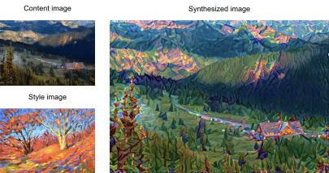
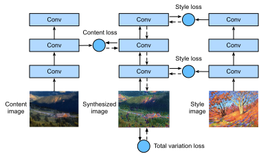

# Neuroninis stiliaus perkėlimas

Jei esate fotografijos entuziastas,
tikriausiai pažįstate filtrą.
Jis gali pakeisti nuotraukų spalvų stilių,
kad kraštovaizdžio nuotraukos taptų ryškesnės
arba portretų oda atrodytų šviesesnė.
Tačiau
vienas filtras paprastai keičia tik
vieną nuotraukos aspektą.
Kad nuotraukai pritaikytumėte idealų stilių,
tikriausiai
teks išbandyti daug skirtingų filtrų derinių.
Šis procesas yra
tiek pat sudėtingas, kiek modelio hiperparametrų derinimas.


Šiame skyrelyje
pasinaudosime CNN sluoksniniais vaizdavimais,
kad automatiškai pritaikytume vieno vaizdo stilių
kitam vaizdui, t. y. atliktume *stiliaus perkėlimą* :cite:`Gatys.Ecker.Bethge.2016`.
Šiai užduočiai reikia dviejų įvesties vaizdų:
vienas yra *turinio vaizdas*, o
kitas – *stiliaus vaizdas*.
Naudosime neuroninius tinklus,
kad pakeistume turinio vaizdą ir
priartintume jį prie stiliaus vaizdo stiliumi.
Pavyzdžiui,
:numref:`fig_style_transfer` turinio vaizdas yra kraštovaizdžio nuotrauka, kurią padarėme
Reinjero kalno nacionaliniame parke Sijetlo apylinkėse, o stiliaus vaizdas yra aliejinė tapyba
rudens ąžuolų tema.
Išvesties sintezuotame vaizde
pritaikomi stiliaus vaizdo
aliejinio teptuko brūkšniai, todėl spalvos tampa gyvesnės,
o pagrindinė objektų forma
turinio vaizde išsaugoma.


:label:`fig_style_transfer`

## Metodas

:numref:`fig_style_transfer_model` iliustruoja
CNN pagrįstą stiliaus perkėlimo metodą supaprastintu pavyzdžiu.
Pirmiausia inicializuojame sintezuotą vaizdą,
pavyzdžiui, į turinio vaizdą.
Šis sintezuotas vaizdas yra vienintelis kintamasis, kurį reikia atnaujinti stiliaus perkėlimo proceso metu,
t. y. modelio parametrai, atnaujinami apmokymo metu.
Tada pasirenkame iš anksto apmokytą CNN
vaizdo požymiams išgauti ir užšaldome jo
modelio parametrus apmokymo metu.
Šis gilusis CNN naudoja kelis sluoksnius
hierarchiniams vaizdų požymiams
išgauti.
Kai kurių iš šių sluoksnių išvestis galime pasirinkti kaip turinio požymius arba stiliaus požymius.
Paimkime :numref:`fig_style_transfer_model` kaip pavyzdį.
Čia esantis iš anksto apmokytas neuroninis tinklas turi 3 konvoliucinius sluoksnius,
kur antrasis sluoksnis išveda turinio požymius,
o pirmasis ir trečiasis sluoksniai išveda stiliaus požymius.


:label:`fig_style_transfer_model`

Toliau apskaičiuojame stiliaus perkėlimo nuostolių funkciją per tiesioginį sklidimą (ištisinių rodyklių kryptis) ir atnaujiname modelio parametrus (sintezuotą išvesties vaizdą) per atgalinį sklidimą (punktyrinių rodyklių kryptis).
Stiliaus perkėlime dažniausiai naudojamą nuostolių funkciją sudaro trys dalys:
(i) *turinio nuostolis* priartina sintezuotą vaizdą ir turinio vaizdą turinio požymiais;
(ii) *stiliaus nuostolis* priartina sintezuotą vaizdą ir stiliaus vaizdą stiliaus požymiais;
ir (iii) *pilnosios variacijos nuostolis* padeda sumažinti triukšmą sintezuotame vaizde.
Galiausiai, pasibaigus modelio apmokymui, išvedame stiliaus perkėlimo modelio parametrus, kad sugeneruotume
galutinį sintezuotą vaizdą.


Toliau
paaiškinsime stiliaus perkėlimo technines detales konkrečiu eksperimentu.


## [**Turinio ir stiliaus vaizdų skaitymas**]

Pirmiausia nuskaitome turinio ir stiliaus vaizdus.
Iš jų atspausdintų koordinačių ašių
galime pasakyti, kad šie vaizdai skirtingų dydžių.

```{.python .input}
#@tab mxnet
%matplotlib inline
from d2l import mxnet as d2l
from mxnet import autograd, gluon, image, init, np, npx
from mxnet.gluon import nn

npx.set_np()

d2l.set_figsize()
content_img = image.imread('../img/rainier.jpg')
d2l.plt.imshow(content_img.asnumpy());
```

```{.python .input}
#@tab pytorch
%matplotlib inline
from d2l import torch as d2l
import torch
import torchvision
from torch import nn

d2l.set_figsize()
content_img = d2l.Image.open('../img/rainier.jpg')
d2l.plt.imshow(content_img);
```

```{.python .input}
#@tab mxnet
style_img = image.imread('../img/autumn-oak.jpg')
d2l.plt.imshow(style_img.asnumpy());
```

```{.python .input}
#@tab pytorch
style_img = d2l.Image.open('../img/autumn-oak.jpg')
d2l.plt.imshow(style_img);
```

## [**Išankstinis ir paskesnis apdorojimas**]

Toliau apibrėžiame dvi funkcijas vaizdams iš anksto ir po to apdoroti.
Funkcija `preprocess` standartizuoja
kiekvieną iš trijų įvesties vaizdo RGB kanalų ir paverčia rezultatus į CNN įvesties formatą.
Funkcija `postprocess` atkuria išvesties vaizdo pikselių reikšmes į pradines reikšmes prieš standartizavimą.
Kadangi vaizdų spausdinimo funkcija reikalauja, kad kiekvieno pikselio slankiojo kablelio reikšmė būtų nuo 0 iki 1,
bet kurią reikšmę, mažesnę už 0 arba didesnę už 1, pakeičiame atitinkamai 0 arba 1.

```{.python .input}
#@tab mxnet
rgb_mean = np.array([0.485, 0.456, 0.406])
rgb_std = np.array([0.229, 0.224, 0.225])

def preprocess(img, image_shape):
    img = image.imresize(img, *image_shape)
    img = (img.astype('float32') / 255 - rgb_mean) / rgb_std
    return np.expand_dims(img.transpose(2, 0, 1), axis=0)

def postprocess(img):
    img = img[0].as_in_ctx(rgb_std.ctx)
    return (img.transpose(1, 2, 0) * rgb_std + rgb_mean).clip(0, 1)
```

```{.python .input}
#@tab pytorch
rgb_mean = torch.tensor([0.485, 0.456, 0.406])
rgb_std = torch.tensor([0.229, 0.224, 0.225])

def preprocess(img, image_shape):
    transforms = torchvision.transforms.Compose([
        torchvision.transforms.Resize(image_shape),
        torchvision.transforms.ToTensor(),
        torchvision.transforms.Normalize(mean=rgb_mean, std=rgb_std)])
    return transforms(img).unsqueeze(0)

def postprocess(img):
    img = img[0].to(rgb_std.device)
    img = torch.clamp(img.permute(1, 2, 0) * rgb_std + rgb_mean, 0, 1)
    return torchvision.transforms.ToPILImage()(img.permute(2, 0, 1))
```

## [**Požymių išgavimas**]

Vaizdo požymiams išgauti naudojame VGG-19 modelį, iš anksto apmokytą ImageNet duomenų rinkinyje :cite:`Gatys.Ecker.Bethge.2016`.

```{.python .input}
#@tab mxnet
pretrained_net = gluon.model_zoo.vision.vgg19(pretrained=True)
```

```{.python .input}
#@tab pytorch
pretrained_net = torchvision.models.vgg19(pretrained=True)
```

Kad išgautume vaizdo turinio ir stiliaus požymius, galime pasirinkti tam tikrų VGG tinklo sluoksnių išvestis.
Paprastai kalbant, kuo arčiau įvesties sluoksnio, tuo lengviau išgauti vaizdo detales, ir atvirkščiai – tuo lengviau išgauti globalią vaizdo informaciją. Kad sintezuotame vaizde
pernelyg neišsaugotume turinio vaizdo detalių,
kaip *turinio sluoksnį* vaizdo turinio požymiams išvesti pasirenkame VGG sluoksnį, esantį arčiau išvesties.
Taip pat pasirenkame skirtingų VGG sluoksnių išvestis lokaliems ir globaliems stiliaus požymiams išgauti.
Šie sluoksniai taip pat vadinami *stiliaus sluoksniais*.
Kaip minėta :numref:`sec_vgg`,
VGG tinklas naudoja 5 konvoliucinius blokus.
Eksperimente kaip turinio sluoksnį pasirenkame paskutinį ketvirtojo konvoliucinio bloko konvoliucinį sluoksnį, o kaip stiliaus sluoksnį – pirmąjį kiekvieno konvoliucinio bloko konvoliucinį sluoksnį.
Šių sluoksnių indeksus galima gauti atspausdinus `pretrained_net` egzempliorių.

```{.python .input}
#@tab all
style_layers, content_layers = [0, 5, 10, 19, 28], [25]
```

Išgaudami požymius VGG sluoksniais,
turime naudoti tik visus tuos sluoksnius
nuo įvesties sluoksnio iki arčiausiai išvesties esančio turinio arba stiliaus sluoksnio.
Sukonstruokime naują tinklo egzempliorių `net`, kuriame paliekami tik visi VGG sluoksniai,
reikalingi
požymiams išgauti.

```{.python .input}
#@tab mxnet
net = nn.Sequential()
for i in range(max(content_layers + style_layers) + 1):
    net.add(pretrained_net.features[i])
```

```{.python .input}
#@tab pytorch
net = nn.Sequential(*[pretrained_net.features[i] for i in
                      range(max(content_layers + style_layers) + 1)])
```

Turint įvestį `X`, jei tiesiog iškviesime
tiesioginį sklidimą `net(X)`, galime gauti tik paskutinio sluoksnio išvestį.
Kadangi mums taip pat reikia tarpinių sluoksnių išvesčių,
turime atlikti skaičiavimą sluoksnis po sluoksnio ir išsaugoti
turinio ir stiliaus sluoksnių išvestis.

```{.python .input}
#@tab all
def extract_features(X, content_layers, style_layers):
    contents = []
    styles = []
    for i in range(len(net)):
        X = net[i](X)
        if i in style_layers:
            styles.append(X)
        if i in content_layers:
            contents.append(X)
    return contents, styles
```

Toliau apibrėžiamos dvi funkcijos:
funkcija `get_contents` išgauna turinio požymius iš turinio vaizdo,
o funkcija `get_styles` išgauna stiliaus požymius iš stiliaus vaizdo.
Kadangi apmokymo metu iš anksto apmokyto VGG modelio parametrų atnaujinti nereikia,
turinio ir stiliaus požymius galime išgauti
dar prieš prasidedant apmokymui.
Kadangi sintezuotas vaizdas
yra modelio parametrų rinkinys, kurį reikia atnaujinti
stiliaus perkėlimui,
sintezuoto vaizdo turinio ir stiliaus požymius galime išgauti tik apmokymo metu iškviesdami funkciją `extract_features`.

```{.python .input}
#@tab mxnet
def get_contents(image_shape, device):
    content_X = preprocess(content_img, image_shape).copyto(device)
    contents_Y, _ = extract_features(content_X, content_layers, style_layers)
    return content_X, contents_Y

def get_styles(image_shape, device):
    style_X = preprocess(style_img, image_shape).copyto(device)
    _, styles_Y = extract_features(style_X, content_layers, style_layers)
    return style_X, styles_Y
```

```{.python .input}
#@tab pytorch
def get_contents(image_shape, device):
    content_X = preprocess(content_img, image_shape).to(device)
    contents_Y, _ = extract_features(content_X, content_layers, style_layers)
    return content_X, contents_Y

def get_styles(image_shape, device):
    style_X = preprocess(style_img, image_shape).to(device)
    _, styles_Y = extract_features(style_X, content_layers, style_layers)
    return style_X, styles_Y
```

## [**Nuostolių funkcijos apibrėžimas**]

Dabar aprašysime stiliaus perkėlimo nuostolių funkciją. Nuostolių funkciją sudaro
turinio nuostolis, stiliaus nuostolis ir pilnosios variacijos nuostolis.

### Turinio nuostolis

Panašiai kaip tiesinės regresijos nuostolių funkcija,
turinio nuostolis matuoja sintezuoto vaizdo ir turinio vaizdo
turinio požymių skirtumą
per kvadratinio nuostolio funkciją.
Abi kvadratinio nuostolio funkcijos įvestys
yra
turinio sluoksnio išvestys, apskaičiuotos funkcija `extract_features`.

```{.python .input}
#@tab mxnet
def content_loss(Y_hat, Y):
    return np.square(Y_hat - Y).mean()
```

```{.python .input}
#@tab pytorch
def content_loss(Y_hat, Y):
    # We detach the target content from the tree used to dynamically compute
    # the gradient: this is a stated value, not a variable. Otherwise the loss
    # will throw an error.
    return torch.square(Y_hat - Y.detach()).mean()
```

### Stiliaus nuostolis

Stiliaus nuostolis, panašiai kaip turinio nuostolis,
taip pat naudoja kvadratinio nuostolio funkciją sintezuoto vaizdo ir stiliaus vaizdo stiliaus skirtumui matuoti.
Kad išreikštume bet kurio stiliaus sluoksnio stiliaus išvestį,
pirmiausia naudojame funkciją `extract_features`
stiliaus sluoksnio išvesčiai apskaičiuoti.
Tarkime, kad išvestis turi
1 pavyzdį, $c$ kanalų,
aukštį $h$ ir plotį $w$;
šią išvestį galime paversti
matrica $\mathbf{X}$ su $c$ eilučių ir $hw$ stulpelių.
Šią matricą galima laikyti
$c$ vektorių $\mathbf{x}_1, \ldots, \mathbf{x}_c$
konkatenacija,
kurių kiekvieno ilgis yra $hw$.
Čia vektorius $\mathbf{x}_i$ vaizduoja kanalo $i$ stiliaus požymį.

Šių vektorių *Gramo matricoje* $\mathbf{X}\mathbf{X}^\top \in \mathbb{R}^{c \times c}$ elementas $x_{ij}$, esantis $i$ eilutėje ir $j$ stulpelyje, yra vektorių $\mathbf{x}_i$ ir $\mathbf{x}_j$ skaliarinė sandauga.
Ji vaizduoja kanalų $i$ ir $j$ stiliaus požymių koreliaciją.
Šią Gramo matricą naudojame bet kurio stiliaus sluoksnio stiliaus išvesčiai vaizduoti.
Atkreipkite dėmesį, kad kai $hw$ reikšmė yra didesnė,
tai tikėtina lemia didesnes Gramo matricos reikšmes.
Taip pat atkreipkite dėmesį, kad Gramo matricos aukštis ir plotis yra lygūs kanalų skaičiui $c$.
Kad šios reikšmės
neturėtų įtakos stiliaus nuostoliui,
toliau pateikta funkcija `gram` padalija
Gramo matricą iš jos elementų skaičiaus, t. y. $chw$.

```{.python .input}
#@tab all
def gram(X):
    num_channels, n = X.shape[1], d2l.size(X) // X.shape[1]
    X = d2l.reshape(X, (num_channels, n))
    return d2l.matmul(X, X.T) / (num_channels * n)
```

Akivaizdu,
kad dvi Gramo matricų įvestys stiliaus nuostolio kvadratinio nuostolio funkcijai yra pagrįstos
sintezuoto vaizdo ir stiliaus vaizdo
stiliaus sluoksnių išvestimis.
Čia daroma prielaida, kad Gramo matrica `gram_Y`, pagrįsta stiliaus vaizdu, buvo apskaičiuota iš anksto.

```{.python .input}
#@tab mxnet
def style_loss(Y_hat, gram_Y):
    return np.square(gram(Y_hat) - gram_Y).mean()
```

```{.python .input}
#@tab pytorch
def style_loss(Y_hat, gram_Y):
    return torch.square(gram(Y_hat) - gram_Y.detach()).mean()
```

### Pilnosios variacijos nuostolis

Kartais išmoktas sintezuotas vaizdas
turi daug aukštadažnio triukšmo,
t. y. ypač šviesių ar tamsių pikselių.
Vienas įprastas triukšmo mažinimo metodas yra
*pilnosios variacijos triukšmo šalinimas*.
Pažymėkime $x_{i, j}$ pikselio reikšmę koordinatėje $(i, j)$.
Mažinant pilnosios variacijos nuostolį

$$\sum_{i, j} \left|x_{i, j} - x_{i+1, j}\right| + \left|x_{i, j} - x_{i, j+1}\right|$$

kaimyninių sintezuoto vaizdo pikselių reikšmės tampa artimesnės.

```{.python .input}
#@tab all
def tv_loss(Y_hat):
    return 0.5 * (d2l.abs(Y_hat[:, :, 1:, :] - Y_hat[:, :, :-1, :]).mean() +
                  d2l.abs(Y_hat[:, :, :, 1:] - Y_hat[:, :, :, :-1]).mean())
```

### Nuostolių funkcija

[**Stiliaus perkėlimo nuostolių funkcija yra turinio nuostolio, stiliaus nuostolio ir pilnosios variacijos nuostolio svertinė suma**].
Koreguodami šiuos svorio hiperparametrus,
galime išlaikyti pusiausvyrą tarp
turinio išsaugojimo,
stiliaus perkėlimo
ir triukšmo mažinimo sintezuotame vaizde.

```{.python .input}
#@tab all
content_weight, style_weight, tv_weight = 1, 1e4, 10

def compute_loss(X, contents_Y_hat, styles_Y_hat, contents_Y, styles_Y_gram):
    # Calculate the content, style, and total variance losses respectively
    contents_l = [content_loss(Y_hat, Y) * content_weight for Y_hat, Y in zip(
        contents_Y_hat, contents_Y)]
    styles_l = [style_loss(Y_hat, Y) * style_weight for Y_hat, Y in zip(
        styles_Y_hat, styles_Y_gram)]
    tv_l = tv_loss(X) * tv_weight
    # Add up all the losses
    l = sum(styles_l + contents_l + [tv_l])
    return contents_l, styles_l, tv_l, l
```

## [**Sintezuoto vaizdo inicializavimas**]

Stiliaus perkėlime
sintezuotas vaizdas yra vienintelis kintamasis, kurį reikia atnaujinti apmokymo metu.
Taigi galime apibrėžti paprastą modelį `SynthesizedImage` ir sintezuotą vaizdą laikyti modelio parametrais.
Šiame modelyje tiesioginis sklidimas tiesiog grąžina modelio parametrus.

```{.python .input}
#@tab mxnet
class SynthesizedImage(nn.Block):
    def __init__(self, img_shape, **kwargs):
        super(SynthesizedImage, self).__init__(**kwargs)
        self.weight = self.params.get('weight', shape=img_shape)

    def forward(self):
        return self.weight.data()
```

```{.python .input}
#@tab pytorch
class SynthesizedImage(nn.Module):
    def __init__(self, img_shape, **kwargs):
        super(SynthesizedImage, self).__init__(**kwargs)
        self.weight = nn.Parameter(torch.rand(*img_shape))

    def forward(self):
        return self.weight
```

Toliau apibrėžiame funkciją `get_inits`.
Ši funkcija sukuria sintezuoto vaizdo modelio egzempliorių ir inicializuoja jį vaizdu `X`.
Stiliaus vaizdo Gramo matricos įvairiuose stiliaus sluoksniuose, `styles_Y_gram`, apskaičiuojamos prieš apmokymą.

```{.python .input}
#@tab mxnet
def get_inits(X, device, lr, styles_Y):
    gen_img = SynthesizedImage(X.shape)
    gen_img.initialize(init.Constant(X), ctx=device, force_reinit=True)
    trainer = gluon.Trainer(gen_img.collect_params(), 'adam',
                            {'learning_rate': lr})
    styles_Y_gram = [gram(Y) for Y in styles_Y]
    return gen_img(), styles_Y_gram, trainer
```

```{.python .input}
#@tab pytorch
def get_inits(X, device, lr, styles_Y):
    gen_img = SynthesizedImage(X.shape).to(device)
    gen_img.weight.data.copy_(X.data)
    trainer = torch.optim.Adam(gen_img.parameters(), lr=lr)
    styles_Y_gram = [gram(Y) for Y in styles_Y]
    return gen_img(), styles_Y_gram, trainer
```

## [**Apmokymas**]


Apmokydami stiliaus perkėlimo modelį,
nuolat išgauname
sintezuoto vaizdo turinio ir stiliaus požymius ir apskaičiuojame nuostolių funkciją.
Toliau apibrėžiamas apmokymo ciklas.

```{.python .input}
#@tab mxnet
def train(X, contents_Y, styles_Y, device, lr, num_epochs, lr_decay_epoch):
    X, styles_Y_gram, trainer = get_inits(X, device, lr, styles_Y)
    animator = d2l.Animator(xlabel='epoch', ylabel='loss',
                            xlim=[10, num_epochs], ylim=[0, 20],
                            legend=['content', 'style', 'TV'],
                            ncols=2, figsize=(7, 2.5))
    for epoch in range(num_epochs):
        with autograd.record():
            contents_Y_hat, styles_Y_hat = extract_features(
                X, content_layers, style_layers)
            contents_l, styles_l, tv_l, l = compute_loss(
                X, contents_Y_hat, styles_Y_hat, contents_Y, styles_Y_gram)
        l.backward()
        trainer.step(1)
        if (epoch + 1) % lr_decay_epoch == 0:
            trainer.set_learning_rate(trainer.learning_rate * 0.8)
        if (epoch + 1) % 10 == 0:
            animator.axes[1].imshow(postprocess(X).asnumpy())
            animator.add(epoch + 1, [float(sum(contents_l)),
                                     float(sum(styles_l)), float(tv_l)])
    return X
```

```{.python .input}
#@tab pytorch
def train(X, contents_Y, styles_Y, device, lr, num_epochs, lr_decay_epoch):
    X, styles_Y_gram, trainer = get_inits(X, device, lr, styles_Y)
    scheduler = torch.optim.lr_scheduler.StepLR(trainer, lr_decay_epoch, 0.8)
    animator = d2l.Animator(xlabel='epoch', ylabel='loss',
                            xlim=[10, num_epochs],
                            legend=['content', 'style', 'TV'],
                            ncols=2, figsize=(7, 2.5))
    for epoch in range(num_epochs):
        trainer.zero_grad()
        contents_Y_hat, styles_Y_hat = extract_features(
            X, content_layers, style_layers)
        contents_l, styles_l, tv_l, l = compute_loss(
            X, contents_Y_hat, styles_Y_hat, contents_Y, styles_Y_gram)
        l.backward()
        trainer.step()
        scheduler.step()
        if (epoch + 1) % 10 == 0:
            animator.axes[1].imshow(postprocess(X))
            animator.add(epoch + 1, [float(sum(contents_l)),
                                     float(sum(styles_l)), float(tv_l)])
    return X
```

Dabar [**pradedame apmokyti modelį**].
Turinio ir stiliaus vaizdų aukštį ir plotį pakeičiame į 300 × 450 pikselių.
Sintezuotam vaizdui inicializuoti naudojame turinio vaizdą.

```{.python .input}
#@tab mxnet
device, image_shape = d2l.try_gpu(), (450, 300)
net.collect_params().reset_ctx(device)
content_X, contents_Y = get_contents(image_shape, device)
_, styles_Y = get_styles(image_shape, device)
output = train(content_X, contents_Y, styles_Y, device, 0.9, 500, 50)
```

```{.python .input}
#@tab pytorch
device, image_shape = d2l.try_gpu(), (300, 450)  # PIL Image (h, w)
net = net.to(device)
content_X, contents_Y = get_contents(image_shape, device)
_, styles_Y = get_styles(image_shape, device)
output = train(content_X, contents_Y, styles_Y, device, 0.3, 500, 50)
```

Matome, kad sintezuotas vaizdas
išsaugo turinio vaizdo peizažą ir objektus
ir tuo pat metu perkelia stiliaus vaizdo spalvas.
Pavyzdžiui,
sintezuotame vaizde yra spalvų blokų,
panašių į stiliaus vaizde.
Kai kurie iš šių blokų net turi subtilią teptuko brūkšnių tekstūrą.


## Santrauka

* Stiliaus perkėlime dažniausiai naudojamą nuostolių funkciją sudaro trys dalys: (i) turinio nuostolis priartina sintezuotą vaizdą ir turinio vaizdą turinio požymiais; (ii) stiliaus nuostolis priartina sintezuotą vaizdą ir stiliaus vaizdą stiliaus požymiais; ir (iii) pilnosios variacijos nuostolis padeda sumažinti triukšmą sintezuotame vaizde.
* Galime naudoti iš anksto apmokytą CNN vaizdo požymiams išgauti ir minimizuoti nuostolių funkciją, kad apmokymo metu nuolat atnaujintume sintezuotą vaizdą kaip modelio parametrus.
* Stiliaus sluoksnių stiliaus išvestims vaizduoti naudojame Gramo matricas.


## Pratimai

1. Kaip keičiasi išvestis, kai pasirenkate skirtingus turinio ir stiliaus sluoksnius?
1. Koreguokite nuostolių funkcijos svorio hiperparametrus. Ar išvestyje išlieka daugiau turinio arba mažiau triukšmo?
1. Naudokite skirtingus turinio ir stiliaus vaizdus. Ar galite sukurti įdomesnių sintezuotų vaizdų?
1. Ar galime taikyti stiliaus perkėlimą tekstui? Užuomina: galite remtis :citet:`10.1145/3544903.3544906` apžvalginiu straipsniu.

:begin_tab:`mxnet`
[Diskusijos](https://discuss.d2l.ai/t/378)
:end_tab:

:begin_tab:`pytorch`
[Diskusijos](https://discuss.d2l.ai/t/1476)
:end_tab:
