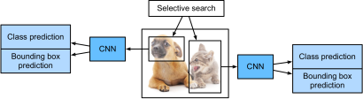
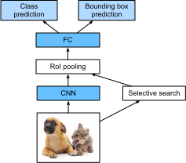
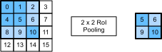
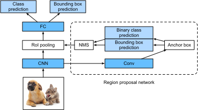
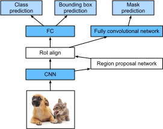

# Sritymis pagrįsti CNN (R-CNN)
:label:`sec_rcnn`

Be vieno praėjimo daugiastačiakampio aptikimo,
aprašyto :numref:`sec_ssd`,
sritymis pagrįsti CNN arba sritys su CNN požymiais (R-CNN)
taip pat yra vienas iš daugelio novatoriškų
giliojo mokymosi taikymo
objektų aptikimui metodų
:cite:`Girshick.Donahue.Darrell.ea.2014`.
Šiame skyrelyje pristatysime
R-CNN ir jo patobulinimų seriją: greitąjį R-CNN
:cite:`Girshick.2015`, greitesnįjį R-CNN :cite:`Ren.He.Girshick.ea.2015` ir kaukių R-CNN
:cite:`He.Gkioxari.Dollar.ea.2017`.
Dėl ribotos vietos susitelksime tik į
šių modelių dizainą.


## R-CNN


*R-CNN* pirmiausia iš įvesties vaizdo išgauna
daug (pvz., 2000) *sričių pasiūlymų*
(pvz., inkarinius stačiakampius taip pat galima laikyti
sričių pasiūlymais),
pažymėdamas jų klases ir apibrėžiamuosius stačiakampius (pvz., poslinkius).
:cite:`Girshick.Donahue.Darrell.ea.2014`
Tada CNN naudojamas
tiesioginiam sklidimui atlikti kiekvienam sričių pasiūlymui,
kad būtų išgauti jo požymiai.
Toliau kiekvieno sričių pasiūlymo požymiai
naudojami
šio sričių pasiūlymo klasei ir apibrėžiamajam stačiakampiui
prognozuoti.



:label:`fig_r-cnn`

:numref:`fig_r-cnn` parodytas R-CNN modelis. Konkrečiau, R-CNN sudaro šie keturi žingsniai:

1. Atlikite *selektyviąją paiešką* (angl. *selective search*), kad išgautumėte kelis aukštos kokybės sričių pasiūlymus įvesties vaizde :cite:`Uijlings.Van-De-Sande.Gevers.ea.2013`. Šios pasiūlytos sritys paprastai atrenkamos keliais masteliais, skirtingų formų ir dydžių. Kiekvienas sričių pasiūlymas bus pažymėtas klase ir tikruoju apibrėžiamuoju stačiakampiu.
1. Pasirinkite iš anksto apmokytą CNN ir nupjaukite jį prieš išvesties sluoksnį. Pakeiskite kiekvieno sričių pasiūlymo dydį į tinklo reikalaujamą įvesties dydį ir per tiesioginį sklidimą išveskite sričių pasiūlymo išgautus požymius.
1. Paimkite kiekvieno sričių pasiūlymo išgautus požymius ir pažymėtą klasę kaip pavyzdį. Apmokykite kelias atraminių vektorių mašinas objektams klasifikuoti, kur kiekviena atraminių vektorių mašina atskirai nustato, ar pavyzdyje yra tam tikra klasė.
1. Paimkite kiekvieno sričių pasiūlymo išgautus požymius ir pažymėtą apibrėžiamąjį stačiakampį kaip pavyzdį. Apmokykite tiesinės regresijos modelį tikrajam apibrėžiamajam stačiakampiui prognozuoti.


Nors R-CNN modelis naudoja iš anksto apmokytus CNN, kad veiksmingai išgautų vaizdų požymius,
jis yra lėtas.
Įsivaizduokite, kad iš vieno įvesties vaizdo atrenkame
tūkstančius sričių pasiūlymų:
objektų aptikimui reikia tūkstančių
CNN tiesioginio sklidimo kartų.
Dėl šios milžiniškos
skaičiavimo apkrovos R-CNN plačiai naudoti realaus pasaulio taikymuose
neįmanoma.

## Greitasis R-CNN

Pagrindinis R-CNN našumo kliūtis slypi
nepriklausomame CNN tiesioginiame sklidime
kiekvienam sričių pasiūlymui,
nesidalijant skaičiavimais.
Kadangi šios sritys paprastai
persidengia,
nepriklausomas požymių išgavimas lemia
daug pasikartojančių skaičiavimų.
Vienas iš pagrindinių
*greitojo R-CNN* patobulinimų, palyginti su
R-CNN, yra tai, kad
CNN tiesioginis sklidimas
atliekamas tik
visam vaizdui :cite:`Girshick.2015`.


:label:`fig_fast_r-cnn`

:numref:`fig_fast_r-cnn` aprašytas greitasis R-CNN modelis. Pagrindiniai jo skaičiavimai yra tokie:


1. Palyginti su R-CNN, greitajame R-CNN požymiams išgauti skirto CNN įvestis yra visas vaizdas, o ne atskiri sričių pasiūlymai. Be to, šis CNN yra apmokomas. Turint įvesties vaizdą, tegul CNN išvesties forma yra $1 \times c \times h_1  \times w_1$.
1. Tarkime, kad selektyvioji paieška sugeneruoja $n$ sričių pasiūlymų. Šie sričių pasiūlymai (skirtingų formų) žymi dominančias sritis (skirtingų formų) CNN išvestyje. Tada iš šių dominančių sričių išgaunami tos pačios formos požymiai (tarkime, nurodytas aukštis $h_2$ ir plotis $w_2$), kad juos būtų lengva sukonkatenuoti. Tam pasiekti greitasis R-CNN pristato *dominančios srities (angl. region of interest, RoI) sutelkimo* sluoksnį: CNN išvestis ir sričių pasiūlymai paduodami į šį sluoksnį, kuris išveda sukonkatenuotus požymius, kurių forma $n \times c \times h_2 \times w_2$, išgautus visiems sričių pasiūlymams.
1. Naudodami pilnai sujungtą sluoksnį, paverskite sukonkatenuotus požymius į išvestį, kurios forma $n \times d$, kur $d$ priklauso nuo modelio dizaino.
1. Prognozuokite kiekvieno iš $n$ sričių pasiūlymų klasę ir apibrėžiamąjį stačiakampį. Konkrečiau, klasės ir apibrėžiamojo stačiakampio prognozavime pilnai sujungto sluoksnio išvestį paverskite atitinkamai išvestimi, kurios forma $n \times q$ ($q$ yra klasių skaičius), ir išvestimi, kurios forma $n \times 4$. Klasės prognozavimui naudojama softmax regresija.


Greitajame R-CNN pasiūlytas dominančios srities sutelkimo sluoksnis skiriasi nuo sutelkimo sluoksnio, pristatyto :numref:`sec_pooling`.
Sutelkimo sluoksnyje
išvesties formą valdome netiesiogiai,
nurodydami
sutelkimo lango dydžius, papildymą ir žingsnį.
Priešingai,
dominančios srities sutelkimo sluoksnyje
išvesties formą galime nurodyti tiesiogiai.

Pavyzdžiui, nurodykime
kiekvienos srities išvesties aukštį ir plotį
atitinkamai kaip $h_2$ ir $w_2$.
Bet kuriam dominančios srities langui,
kurio forma $h \times w$,
šis langas padalijamas į $h_2 \times w_2$ tinklelį
poslangių,
kur kiekvieno poslangio forma yra apytiksliai
$(h/h_2) \times (w/w_2)$.
Praktikoje
bet kurio poslangio aukštis ir plotis suapvalinami aukštyn, o didžiausias elementas naudojamas kaip poslangio išvestis.
Todėl dominančios srities sutelkimo sluoksnis gali išgauti tos pačios formos požymius
net kai dominančios sritys turi skirtingas formas.


Kaip iliustracinis pavyzdys,
:numref:`fig_roi`
$4 \times 4$ įvestyje
pasirinkta viršutinė kairioji $3\times 3$ dominanti sritis.
Šiai dominančiai sričiai
naudojame $2\times 2$ dominančios srities sutelkimo sluoksnį, kad gautume
$2\times 2$ išvestį.
Atkreipkite dėmesį, kad
kiekviename iš keturių padalytų poslangių
yra elementai
0, 1, 4 ir 5 (5 yra maksimumas);
2 ir 6 (6 yra maksimumas);
8 ir 9 (9 yra maksimumas);
ir 10.


:label:`fig_roi`

Toliau parodome dominančios srities sutelkimo sluoksnio skaičiavimą. Tarkime, kad CNN išgautų požymių `X` aukštis ir plotis yra 4, ir yra tik vienas kanalas.

```{.python .input}
#@tab mxnet
from mxnet import np, npx

npx.set_np()

X = np.arange(16).reshape(1, 1, 4, 4)
X
```

```{.python .input}
#@tab pytorch
import torch
import torchvision

X = torch.arange(16.).reshape(1, 1, 4, 4)
X
```

Be to, tarkime,
kad įvesties vaizdo aukštis ir plotis yra po 40 pikselių ir kad selektyvioji paieška šiame vaizde sugeneruoja du sričių pasiūlymus.
Kiekvienas sričių pasiūlymas
išreiškiamas penkiais elementais:
jo objekto klase, po kurios eina viršutinio kairiojo ir apatinio dešiniojo kampų $(x, y)$ koordinatės.

```{.python .input}
#@tab mxnet
rois = np.array([[0, 0, 0, 20, 20], [0, 0, 10, 30, 30]])
```

```{.python .input}
#@tab pytorch
rois = torch.Tensor([[0, 0, 0, 20, 20], [0, 0, 10, 30, 30]])
```

Kadangi `X` aukštis ir plotis yra $1/10$ įvesties vaizdo aukščio ir pločio,
abiejų sričių pasiūlymų koordinatės
padauginamos iš 0,1 pagal nurodytą argumentą `spatial_scale`.
Tada dvi dominančios sritys `X` pažymimos kaip `X[:, :, 0:3, 0:3]` ir `X[:, :, 1:4, 0:4]` atitinkamai.
Galiausiai $2\times 2$ dominančios srities sutelkime
kiekviena dominanti sritis padalijama
į poslangių tinklelį, kad
būtų išgauti tos pačios $2\times 2$ formos požymiai.

```{.python .input}
#@tab mxnet
npx.roi_pooling(X, rois, pooled_size=(2, 2), spatial_scale=0.1)
```

```{.python .input}
#@tab pytorch
torchvision.ops.roi_pool(X, rois, output_size=(2, 2), spatial_scale=0.1)
```

## Greitesnysis R-CNN

Kad objektų aptikimas būtų tikslesnis,
greitasis R-CNN modelis
paprastai turi sugeneruoti
daug sričių pasiūlymų selektyviojoje paieškoje.
Kad sričių pasiūlymų skaičius sumažėtų
neprarandant tikslumo,
*greitesnysis R-CNN*
siūlo selektyviąją paiešką pakeisti *sričių pasiūlymų tinklu* :cite:`Ren.He.Girshick.ea.2015`.



:label:`fig_faster_r-cnn`


:numref:`fig_faster_r-cnn` parodytas greitesnysis R-CNN modelis. Palyginti su greitaisiais R-CNN,
greitesnysis R-CNN pakeičia tik
sričių pasiūlymų metodą:
selektyviąją paiešką keičia sričių pasiūlymų tinklu.
Likusi modelio dalis lieka
nepakitusi.
Sričių pasiūlymų tinklas
veikia šiais žingsniais:

1. Naudokite $3\times 3$ konvoliucinį sluoksnį su 1 papildymu, kad paverstumėte CNN išvestį nauja išvestimi su $c$ kanalų. Taip kiekvienas CNN išgautų požymių žemėlapių erdvinių dimensijų vienetas gauna naują $c$ ilgio požymių vektorių.
1. Aplink kiekvieną požymių žemėlapių pikselį sugeneruokite kelis skirtingų mastelių ir kraštinių santykių inkarinius stačiakampius ir juos pažymėkite.
1. Naudodami $c$ ilgio požymių vektorių kiekvieno inkarinio stačiakampio centre, prognozuokite šio inkarinio stačiakampio dvejetainę klasę (fonas arba objektai) ir apibrėžiamąjį stačiakampį.
1. Atsižvelkite į tuos prognozuojamus apibrėžiamuosius stačiakampius, kurių prognozuojamos klasės yra objektai. Pašalinkite persidengiančius rezultatus naudodami nemaksimalių reikšmių slopinimą. Likę prognozuojami objektų apibrėžiamieji stačiakampiai yra sričių pasiūlymai, reikalingi dominančios srities sutelkimo sluoksniui.


Verta pažymėti, kad
kaip greitesniojo R-CNN modelio dalis,
sričių pasiūlymų tinklas apmokomas kartu
su likusia modelio dalimi.
Kitaip tariant, greitesniojo R-CNN tikslo funkcija apima
ne tik klasės ir apibrėžiamojo stačiakampio prognozavimą
objektų aptikime,
bet ir inkarinių stačiakampių dvejetainės klasės bei apibrėžiamojo stačiakampio prognozavimą
sričių pasiūlymų tinkle.
Dėl apmokymo nuo pradžios iki galo
sričių pasiūlymų tinklas išmoksta,
kaip generuoti aukštos kokybės sričių pasiūlymus,
kad objektų aptikimas išliktų tikslus
su sumažintu sričių pasiūlymų skaičiumi,
kurie išmokstami iš duomenų.


## Kaukių R-CNN

Apmokymo duomenų rinkinyje,
jei vaizduose taip pat pažymėtos
pikselių lygmens objektų padėtys,
*kaukių R-CNN* gali veiksmingai pasinaudoti
tokiais išsamiais žymenimis,
kad dar labiau pagerintų objektų aptikimo tikslumą :cite:`He.Gkioxari.Dollar.ea.2017`.



:label:`fig_mask_r-cnn`

Kaip parodyta :numref:`fig_mask_r-cnn`,
kaukių R-CNN
yra modifikuotas remiantis greitesniuoju R-CNN.
Konkrečiai,
kaukių R-CNN pakeičia
dominančios srities sutelkimo sluoksnį
*dominančios srities (RoI) sulygiavimo* sluoksniu.
Šis dominančios srities sulygiavimo sluoksnis
naudoja bitiesinę interpoliaciją,
kad išsaugotų erdvinę informaciją požymių žemėlapiuose, o tai labiau tinka pikselių lygmens prognozavimui.
Šio sluoksnio išvestis
apima tos pačios formos požymių žemėlapius
visoms dominančioms sritims.
Jie naudojami
prognozuoti
ne tik kiekvienos dominančios srities klasę ir apibrėžiamąjį stačiakampį,
bet ir pikselių lygmens objekto padėtį per papildomą pilnai konvoliucinį tinklą.
Daugiau informacijos apie pilnai konvoliucinio tinklo naudojimą vaizdo pikselių lygmens semantikai prognozuoti
bus pateikta
tolesniuose šio skyriaus skyreliuose.


## Santrauka


* R-CNN iš įvesties vaizdo išgauna daug sričių pasiūlymų, naudoja CNN tiesioginiam sklidimui atlikti kiekvienam sričių pasiūlymui, kad išgautų jo požymius, tada naudoja šiuos požymius šio sričių pasiūlymo klasei ir apibrėžiamajam stačiakampiui prognozuoti.
* Vienas iš pagrindinių greitojo R-CNN patobulinimų, palyginti su R-CNN, yra tai, kad CNN tiesioginis sklidimas atliekamas tik visam vaizdui. Jis taip pat pristato dominančios srities sutelkimo sluoksnį, kad tos pačios formos požymius būtų galima išgauti iš skirtingų formų dominančių sričių.
* Greitesnysis R-CNN pakeičia greitajame R-CNN naudojamą selektyviąją paiešką kartu apmokomu sričių pasiūlymų tinklu, kad objektų aptikimas išliktų tikslus su sumažintu sričių pasiūlymų skaičiumi.
* Remdamasis greitesniuoju R-CNN, kaukių R-CNN papildomai pristato pilnai konvoliucinį tinklą, kad pasinaudotų pikselių lygmens žymenimis ir dar labiau pagerintų objektų aptikimo tikslumą.


## Pratimai

1. Ar galime objektų aptikimą formuluoti kaip vieną regresijos uždavinį, pavyzdžiui, prognozuojant apibrėžiamuosius stačiakampius ir klasių tikimybes? Galite remtis YOLO modelio dizainu :cite:`Redmon.Divvala.Girshick.ea.2016`.
1. Palyginkite vieno praėjimo daugiastačiakampį aptikimą su šiame skyrelyje pristatytais metodais. Kokie yra jų pagrindiniai skirtumai? Galite remtis :citet:`Zhao.Zheng.Xu.ea.2019` 2 paveikslu.

:begin_tab:`mxnet`
[Diskusijos](https://discuss.d2l.ai/t/374)
:end_tab:

:begin_tab:`pytorch`
[Diskusijos](https://discuss.d2l.ai/t/1409)
:end_tab:
