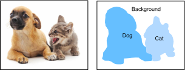

# Semantinis segmentavimas ir duomenų rinkinys
:label:`sec_semantic_segmentation`

Aptariant objektų aptikimo užduotis
:numref:`sec_bbox`–:numref:`sec_rcnn`,
vaizdų objektams pažymėti ir prognozuoti
naudojami stačiakampiai apibrėžiamieji stačiakampiai.
Šiame skyrelyje aptarsime *semantinio segmentavimo* uždavinį,
kuris orientuotas į tai, kaip padalyti vaizdą į sritis, priklausančias skirtingoms semantinėms klasėms.
Skirtingai nei objektų aptikimas,
semantinis segmentavimas
atpažįsta ir supranta,
kas yra vaizduose, pikselių lygmeniu:
semantinių sričių žymėjimas ir prognozavimas vyksta
pikselių lygmeniu.
:numref:`fig_segmentation` parodyti
vaizdo šuns, katės ir fono žymenys semantiniame segmentavime.
Palyginti su objektų aptikimu,
pikselių lygmens ribos, pažymėtos
semantiniame segmentavime, akivaizdžiai yra smulkesnės.



:label:`fig_segmentation`


## Vaizdų segmentavimas ir egzempliorių segmentavimas

Kompiuterinės regos srityje taip pat yra dvi svarbios užduotys,
panašios į semantinį segmentavimą,
būtent vaizdų segmentavimas ir egzempliorių segmentavimas.
Trumpai
atskirsime jas nuo semantinio segmentavimo taip.

* *Vaizdų segmentavimas* padalija vaizdą į kelias sudedamąsias sritis. Šio tipo uždavinių metodai paprastai naudoja vaizdo pikselių tarpusavio koreliaciją. Apmokymo metu jam nereikia žymenų informacijos apie vaizdo pikselius, ir jis negali garantuoti, kad segmentuotos sritys prognozavimo metu turės semantiką, kurią norime gauti. Imant :numref:`fig_segmentation` vaizdą kaip įvestį, vaizdų segmentavimas gali padalyti šunį į dvi sritis: viena apima burną ir akis, kurios daugiausia juodos, o kita apima likusią kūno dalį, kuri daugiausia geltona.
* *Egzempliorių segmentavimas* dar vadinamas *vienalaikiu aptikimu ir segmentavimu*. Jis tiria, kaip atpažinti kiekvieno vaizde esančio objekto egzemplioriaus pikselių lygmens sritis. Skirtingai nei semantinis segmentavimas, egzempliorių segmentavimas turi atskirti ne tik semantiką, bet ir skirtingus objektų egzempliorius. Pavyzdžiui, jei vaizde yra du šunys, egzempliorių segmentavimas turi atskirti, kuriam iš dviejų šunų priklauso pikselis.


## Pascal VOC2012 semantinio segmentavimo duomenų rinkinys

[**Vienas iš svarbiausių semantinio segmentavimo duomenų rinkinių
yra [Pascal VOC2012](http://host.robots.ox.ac.uk/pascal/VOC/voc2012/).**]
Toliau
apžvelgsime šį duomenų rinkinį.

```{.python .input}
#@tab mxnet
%matplotlib inline
from d2l import mxnet as d2l
from mxnet import gluon, image, np, npx
import os

npx.set_np()
```

```{.python .input}
#@tab pytorch
%matplotlib inline
from d2l import torch as d2l
import torch
import torchvision
import os
```

Duomenų rinkinio tar failas yra maždaug 2 GB,
todėl failo atsisiuntimas gali užtrukti.
Išpakuotas duomenų rinkinys yra `../data/VOCdevkit/VOC2012`.

```{.python .input}
#@tab all
#@save
d2l.DATA_HUB['voc2012'] = (d2l.DATA_URL + 'VOCtrainval_11-May-2012.tar',
                           '4e443f8a2eca6b1dac8a6c57641b67dd40621a49')

voc_dir = d2l.download_extract('voc2012', 'VOCdevkit/VOC2012')
```

Įėję į kelią `../data/VOCdevkit/VOC2012`,
galime pamatyti skirtingus duomenų rinkinio komponentus.
Kelyje `ImageSets/Segmentation` yra tekstiniai failai,
nurodantys apmokymo ir testavimo pavyzdžius,
o keliuose `JPEGImages` ir `SegmentationClass`
saugomas kiekvieno pavyzdžio įvesties vaizdas ir žymuo atitinkamai.
Žymuo čia taip pat yra vaizdo formato
ir tokio paties dydžio
kaip jo pažymėtas įvesties vaizdas.
Be to,
tokios pat spalvos pikseliai bet kuriame žymenų vaizde priklauso tai pačiai semantinei klasei.
Toliau apibrėžiama funkcija `read_voc_images`, skirta [**nuskaityti visus įvesties vaizdus ir žymenis į atmintį**].

```{.python .input}
#@tab mxnet
#@save
def read_voc_images(voc_dir, is_train=True):
    """Read all VOC feature and label images."""
    txt_fname = os.path.join(voc_dir, 'ImageSets', 'Segmentation',
                             'train.txt' if is_train else 'val.txt')
    with open(txt_fname, 'r') as f:
        images = f.read().split()
    features, labels = [], []
    for i, fname in enumerate(images):
        features.append(image.imread(os.path.join(
            voc_dir, 'JPEGImages', f'{fname}.jpg')))
        labels.append(image.imread(os.path.join(
            voc_dir, 'SegmentationClass', f'{fname}.png')))
    return features, labels

train_features, train_labels = read_voc_images(voc_dir, True)
```

```{.python .input}
#@tab pytorch
#@save
def read_voc_images(voc_dir, is_train=True):
    """Read all VOC feature and label images."""
    txt_fname = os.path.join(voc_dir, 'ImageSets', 'Segmentation',
                             'train.txt' if is_train else 'val.txt')
    mode = torchvision.io.image.ImageReadMode.RGB
    with open(txt_fname, 'r') as f:
        images = f.read().split()
    features, labels = [], []
    for i, fname in enumerate(images):
        features.append(torchvision.io.read_image(os.path.join(
            voc_dir, 'JPEGImages', f'{fname}.jpg')))
        labels.append(torchvision.io.read_image(os.path.join(
            voc_dir, 'SegmentationClass' ,f'{fname}.png'), mode))
    return features, labels

train_features, train_labels = read_voc_images(voc_dir, True)
```

[**Nubraižome pirmuosius penkis įvesties vaizdus ir jų žymenis**].
Žymenų vaizduose balta ir juoda spalvos atitinkamai žymi ribas ir foną, o kitos spalvos atitinka skirtingas klases.

```{.python .input}
#@tab mxnet
n = 5
imgs = train_features[:n] + train_labels[:n]
d2l.show_images(imgs, 2, n);
```

```{.python .input}
#@tab pytorch
n = 5
imgs = train_features[:n] + train_labels[:n]
imgs = [img.permute(1,2,0) for img in imgs]
d2l.show_images(imgs, 2, n);
```

Toliau [**išvardijame
RGB spalvų reikšmes ir klasių pavadinimus**]
visiems šio duomenų rinkinio žymenims.

```{.python .input}
#@tab all
#@save
VOC_COLORMAP = [[0, 0, 0], [128, 0, 0], [0, 128, 0], [128, 128, 0],
                [0, 0, 128], [128, 0, 128], [0, 128, 128], [128, 128, 128],
                [64, 0, 0], [192, 0, 0], [64, 128, 0], [192, 128, 0],
                [64, 0, 128], [192, 0, 128], [64, 128, 128], [192, 128, 128],
                [0, 64, 0], [128, 64, 0], [0, 192, 0], [128, 192, 0],
                [0, 64, 128]]

#@save
VOC_CLASSES = ['background', 'aeroplane', 'bicycle', 'bird', 'boat',
               'bottle', 'bus', 'car', 'cat', 'chair', 'cow',
               'diningtable', 'dog', 'horse', 'motorbike', 'person',
               'potted plant', 'sheep', 'sofa', 'train', 'tv/monitor']
```

Turėdami aukščiau apibrėžtas dvi konstantas,
galime patogiai
[**rasti kiekvieno žymens pikselio klasės indeksą**].
Apibrėžiame funkciją `voc_colormap2label`,
kad sukurtume atvaizdį iš aukščiau pateiktų RGB spalvų reikšmių
į klasių indeksus,
ir funkciją `voc_label_indices`,
kad bet kurias RGB reikšmes šiame Pascal VOC2012 duomenų rinkinyje
atvaizduotume į jų klasių indeksus.

```{.python .input}
#@tab mxnet
#@save
def voc_colormap2label():
    """Build the mapping from RGB to class indices for VOC labels."""
    colormap2label = np.zeros(256 ** 3)
    for i, colormap in enumerate(VOC_COLORMAP):
        colormap2label[
            (colormap[0] * 256 + colormap[1]) * 256 + colormap[2]] = i
    return colormap2label

#@save
def voc_label_indices(colormap, colormap2label):
    """Map any RGB values in VOC labels to their class indices."""
    colormap = colormap.astype(np.int32)
    idx = ((colormap[:, :, 0] * 256 + colormap[:, :, 1]) * 256
           + colormap[:, :, 2])
    return colormap2label[idx]
```

```{.python .input}
#@tab pytorch
#@save
def voc_colormap2label():
    """Build the mapping from RGB to class indices for VOC labels."""
    colormap2label = torch.zeros(256 ** 3, dtype=torch.long)
    for i, colormap in enumerate(VOC_COLORMAP):
        colormap2label[
            (colormap[0] * 256 + colormap[1]) * 256 + colormap[2]] = i
    return colormap2label

#@save
def voc_label_indices(colormap, colormap2label):
    """Map any RGB values in VOC labels to their class indices."""
    colormap = colormap.permute(1, 2, 0).numpy().astype('int32')
    idx = ((colormap[:, :, 0] * 256 + colormap[:, :, 1]) * 256
           + colormap[:, :, 2])
    return colormap2label[idx]
```

[**Pavyzdžiui**], pirmajame pavyzdiniame vaizde
lėktuvo priekinės dalies klasės indeksas yra 1,
o fono indeksas yra 0.

```{.python .input}
#@tab all
y = voc_label_indices(train_labels[0], voc_colormap2label())
y[105:115, 130:140], VOC_CLASSES[1]
```

### Duomenų išankstinis apdorojimas

Ankstesniuose eksperimentuose,
pavyzdžiui, :numref:`sec_alexnet`–:numref:`sec_googlenet`,
vaizdų mastelis keičiamas,
kad atitiktų modelio reikalaujamą įvesties formą.
Tačiau semantiniame segmentavime
taip darant
prognozuotas pikselių klases reikia perskaičiuoti
atgal į pradinę įvesties vaizdo formą.
Toks mastelio keitimas gali būti netikslus,
ypač skirtingų klasių segmentuotose srityse. Kad išvengtume šios problemos,
vietoj mastelio keitimo apkerpame vaizdą iki *fiksuotos* formos. Konkrečiai, [**naudodami atsitiktinį apkarpymą iš vaizdų augmentacijos, apkerpame tą pačią
įvesties vaizdo ir žymens sritį**].

```{.python .input}
#@tab mxnet
#@save
def voc_rand_crop(feature, label, height, width):
    """Randomly crop both feature and label images."""
    feature, rect = image.random_crop(feature, (width, height))
    label = image.fixed_crop(label, *rect)
    return feature, label
```

```{.python .input}
#@tab pytorch
#@save
def voc_rand_crop(feature, label, height, width):
    """Randomly crop both feature and label images."""
    rect = torchvision.transforms.RandomCrop.get_params(
        feature, (height, width))
    feature = torchvision.transforms.functional.crop(feature, *rect)
    label = torchvision.transforms.functional.crop(label, *rect)
    return feature, label
```

```{.python .input}
#@tab mxnet
imgs = []
for _ in range(n):
    imgs += voc_rand_crop(train_features[0], train_labels[0], 200, 300)
d2l.show_images(imgs[::2] + imgs[1::2], 2, n);
```

```{.python .input}
#@tab pytorch
imgs = []
for _ in range(n):
    imgs += voc_rand_crop(train_features[0], train_labels[0], 200, 300)

imgs = [img.permute(1, 2, 0) for img in imgs]
d2l.show_images(imgs[::2] + imgs[1::2], 2, n);
```

### [**Pritaikyta semantinio segmentavimo duomenų rinkinio klasė**]

Apibrėžiame pritaikytą semantinio segmentavimo duomenų rinkinio klasę `VOCSegDataset`, paveldėdami `Dataset` klasę, kurią pateikia aukšto lygio API.
Įgyvendindami funkciją `__getitem__`,
galime savavališkai pasiekti duomenų rinkinio įvesties vaizdą, indeksuotą kaip `idx`, ir kiekvieno šio vaizdo pikselio klasės indeksą.
Kadangi kai kurie duomenų rinkinio vaizdai
yra mažesnio dydžio
nei atsitiktinio apkarpymo išvesties dydis,
šie pavyzdžiai atfiltruojami
pritaikyta funkcija `filter`.
Be to, taip pat
apibrėžiame funkciją `normalize_image`,
kad standartizuotume
įvesties vaizdų trijų RGB kanalų reikšmes.

```{.python .input}
#@tab mxnet
#@save
class VOCSegDataset(gluon.data.Dataset):
    """A customized dataset to load the VOC dataset."""
    def __init__(self, is_train, crop_size, voc_dir):
        self.rgb_mean = np.array([0.485, 0.456, 0.406])
        self.rgb_std = np.array([0.229, 0.224, 0.225])
        self.crop_size = crop_size
        features, labels = read_voc_images(voc_dir, is_train=is_train)
        self.features = [self.normalize_image(feature)
                         for feature in self.filter(features)]
        self.labels = self.filter(labels)
        self.colormap2label = voc_colormap2label()
        print('read ' + str(len(self.features)) + ' examples')

    def normalize_image(self, img):
        return (img.astype('float32') / 255 - self.rgb_mean) / self.rgb_std

    def filter(self, imgs):
        return [img for img in imgs if (
            img.shape[0] >= self.crop_size[0] and
            img.shape[1] >= self.crop_size[1])]

    def __getitem__(self, idx):
        feature, label = voc_rand_crop(self.features[idx], self.labels[idx],
                                       *self.crop_size)
        return (feature.transpose(2, 0, 1),
                voc_label_indices(label, self.colormap2label))

    def __len__(self):
        return len(self.features)
```

```{.python .input}
#@tab pytorch
#@save
class VOCSegDataset(torch.utils.data.Dataset):
    """A customized dataset to load the VOC dataset."""

    def __init__(self, is_train, crop_size, voc_dir):
        self.transform = torchvision.transforms.Normalize(
            mean=[0.485, 0.456, 0.406], std=[0.229, 0.224, 0.225])
        self.crop_size = crop_size
        features, labels = read_voc_images(voc_dir, is_train=is_train)
        self.features = [self.normalize_image(feature)
                         for feature in self.filter(features)]
        self.labels = self.filter(labels)
        self.colormap2label = voc_colormap2label()
        print('read ' + str(len(self.features)) + ' examples')

    def normalize_image(self, img):
        return self.transform(img.float() / 255)

    def filter(self, imgs):
        return [img for img in imgs if (
            img.shape[1] >= self.crop_size[0] and
            img.shape[2] >= self.crop_size[1])]

    def __getitem__(self, idx):
        feature, label = voc_rand_crop(self.features[idx], self.labels[idx],
                                       *self.crop_size)
        return (feature, voc_label_indices(label, self.colormap2label))

    def __len__(self):
        return len(self.features)
```

### [**Duomenų rinkinio skaitymas**]

Naudojame pritaikytą klasę `VOCSegDataset`,
kad sukurtume atitinkamai apmokymo ir testavimo aibių egzempliorius.
Tarkime,
kad nurodome, jog atsitiktinai apkarpytų vaizdų išvesties forma yra $320\times 480$.
Toliau galime peržiūrėti pavyzdžių skaičių,
kuris išlieka apmokymo ir testavimo aibėse.

```{.python .input}
#@tab all
crop_size = (320, 480)
voc_train = VOCSegDataset(True, crop_size, voc_dir)
voc_test = VOCSegDataset(False, crop_size, voc_dir)
```

Nustatę rinkinio dydį į 64,
apibrėžiame apmokymo aibės duomenų iteratorių.
Atspausdinkime pirmojo minirinkinio formą.
Skirtingai nei vaizdų klasifikavime ar objektų aptikime, žymenys čia yra trimačiai tenzoriai.

```{.python .input}
#@tab mxnet
batch_size = 64
train_iter = gluon.data.DataLoader(voc_train, batch_size, shuffle=True,
                                   last_batch='discard',
                                   num_workers=d2l.get_dataloader_workers())
for X, Y in train_iter:
    print(X.shape)
    print(Y.shape)
    break
```

```{.python .input}
#@tab pytorch
batch_size = 64
train_iter = torch.utils.data.DataLoader(voc_train, batch_size, shuffle=True,
                                    drop_last=True,
                                    num_workers=d2l.get_dataloader_workers())
for X, Y in train_iter:
    print(X.shape)
    print(Y.shape)
    break
```

### [**Viskas kartu**]

Galiausiai apibrėžiame šią funkciją `load_data_voc`,
kad atsisiųstume ir nuskaitytume Pascal VOC2012 semantinio segmentavimo duomenų rinkinį.
Ji grąžina duomenų iteratorius tiek apmokymo, tiek testavimo duomenų rinkiniams.

```{.python .input}
#@tab mxnet
#@save
def load_data_voc(batch_size, crop_size):
    """Load the VOC semantic segmentation dataset."""
    voc_dir = d2l.download_extract('voc2012', os.path.join(
        'VOCdevkit', 'VOC2012'))
    num_workers = d2l.get_dataloader_workers()
    train_iter = gluon.data.DataLoader(
        VOCSegDataset(True, crop_size, voc_dir), batch_size,
        shuffle=True, last_batch='discard', num_workers=num_workers)
    test_iter = gluon.data.DataLoader(
        VOCSegDataset(False, crop_size, voc_dir), batch_size,
        last_batch='discard', num_workers=num_workers)
    return train_iter, test_iter
```

```{.python .input}
#@tab pytorch
#@save
def load_data_voc(batch_size, crop_size):
    """Load the VOC semantic segmentation dataset."""
    voc_dir = d2l.download_extract('voc2012', os.path.join(
        'VOCdevkit', 'VOC2012'))
    num_workers = d2l.get_dataloader_workers()
    train_iter = torch.utils.data.DataLoader(
        VOCSegDataset(True, crop_size, voc_dir), batch_size,
        shuffle=True, drop_last=True, num_workers=num_workers)
    test_iter = torch.utils.data.DataLoader(
        VOCSegDataset(False, crop_size, voc_dir), batch_size,
        drop_last=True, num_workers=num_workers)
    return train_iter, test_iter
```

## Santrauka

* Semantinis segmentavimas atpažįsta ir supranta, kas yra vaizde, pikselių lygmeniu, padalydamas vaizdą į sritis, priklausančias skirtingoms semantinėms klasėms.
* Vienas iš svarbiausių semantinio segmentavimo duomenų rinkinių yra Pascal VOC2012.
* Semantiniame segmentavime, kadangi įvesties vaizdas ir žymuo pikselių lygmeniu atitinka vienas kitą, įvesties vaizdas atsitiktinai apkerpamas iki fiksuotos formos, o ne keičiamas jo mastelis.


## Pratimai

1. Kaip semantinį segmentavimą galima taikyti savaeigėse transporto priemonėse ir medicininių vaizdų diagnostikoje? Ar galite sugalvoti kitų taikymų?
1. Prisiminkite duomenų augmentacijos aprašymus :numref:`sec_image_augmentation`. Kurių vaizdų klasifikavime naudojamų vaizdų augmentacijos metodų būtų neįmanoma taikyti semantiniame segmentavime?


:begin_tab:`mxnet`
[Diskusijos](https://discuss.d2l.ai/t/375)
:end_tab:

:begin_tab:`pytorch`
[Diskusijos](https://discuss.d2l.ai/t/1480)
:end_tab:
