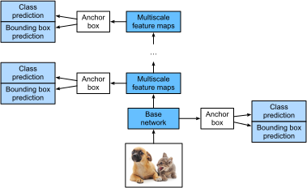

# Vieno praėjimo daugiastačiakampis aptikimas
:label:`sec_ssd`

:numref:`sec_bbox`–:numref:`sec_object-detection-dataset`
pristatėme apibrėžiamuosius stačiakampius, inkarinius stačiakampius,
daugiamastelį objektų aptikimą ir objektų aptikimo duomenų rinkinį.
Dabar esame pasirengę panaudoti šias pagrindines
žinias objektų aptikimo modeliui suprojektuoti:
vieno praėjimo daugiastačiakampiam aptikimui
(angl. *single shot multibox detection*, SSD) :cite:`Liu.Anguelov.Erhan.ea.2016`.
Šis modelis yra paprastas, greitas ir plačiai naudojamas.
Nors tai tik vienas iš daugybės
objektų aptikimo modelių,
kai kurie šiame skyrelyje aprašyti projektavimo principai
ir įgyvendinimo detalės
taikomi ir kitiems modeliams.


## Modelis

:numref:`fig_ssd` pateikiama vieno praėjimo daugiastačiakampio aptikimo
dizaino apžvalga.
Šį modelį daugiausia sudaro
bazinis tinklas,
po kurio eina
keli daugiamasteliai požymių žemėlapių blokai.
Bazinis tinklas
skirtas požymiams iš įvesties vaizdo išgauti,
todėl jame gali būti naudojamas gilusis CNN.
Pavyzdžiui,
originaliame vieno praėjimo daugiastačiakampio aptikimo straipsnyje
naudojamas VGG tinklas, nupjautas prieš
klasifikavimo sluoksnį :cite:`Liu.Anguelov.Erhan.ea.2016`,
nors dažnai naudojamas ir ResNet.
Savo dizainu
galime padaryti, kad bazinis tinklas išvestų
didesnius požymių žemėlapius,
kad būtų sugeneruota daugiau inkarinių stačiakampių
mažesniems objektams aptikti.
Vėliau
kiekvienas daugiamastelis požymių žemėlapių blokas
sumažina (pvz., perpus)
ankstesnio bloko požymių žemėlapių aukštį ir plotį
ir leidžia kiekvienam požymių žemėlapių
vienetui
padidinti savo lokalią matymo sritį įvesties vaizde.


Prisiminkite daugiamastelio objektų aptikimo dizainą,
naudojant giliųjų neuroninių tinklų
sluoksninius vaizdų vaizdavimus,
:numref:`sec_multiscale-object-detection`.
Kadangi
daugiamasteliai požymių žemėlapiai, esantys arčiau :numref:`fig_ssd` viršaus,
yra mažesni, bet turi didesnes lokalias matymo sritis,
jie tinka aptikti
mažiau, bet didesnių objektų.

Trumpai tariant,
per savo bazinį tinklą ir kelis daugiamastelius požymių žemėlapių blokus
vieno praėjimo daugiastačiakampis aptikimas
generuoja kintamą skirtingo dydžio inkarinių stačiakampių skaičių
ir aptinka skirtingo dydžio objektus
prognozuodamas šių inkarinių stačiakampių (taigi ir apibrėžiamųjų stačiakampių)
klases ir poslinkius;
taigi tai yra daugiamastelis objektų aptikimo modelis.



:label:`fig_ssd`


Toliau
aprašysime skirtingų blokų
įgyvendinimo detales :numref:`fig_ssd`. Pradėkime nuo to, kaip įgyvendinti
klasių ir apibrėžiamųjų stačiakampių prognozavimą.


### [**Klasių prognozavimo sluoksnis**]

Tegul objektų klasių skaičius yra $q$.
Tada inkariniai stačiakampiai turi $q+1$ klasių,
kur 0 klasė yra fonas.
Tam tikru masteliu
tarkime, kad požymių žemėlapių aukštis ir plotis
yra atitinkamai $h$ ir $w$.
Kai $a$ inkarinių stačiakampių
generuojama kiekvieną šių požymių žemėlapių erdvinę padėtį laikant jų centru,
iš viso reikia klasifikuoti $hwa$ inkarinių stačiakampių.
Dėl galimai
didelių parametrizavimo sąnaudų tai dažnai daro klasifikavimą pilnai sujungtais sluoksniais neįgyvendinamu.
Prisiminkite, kaip :numref:`sec_nin` naudojome
konvoliucinių sluoksnių kanalus
klasėms prognozuoti.
Vieno praėjimo daugiastačiakampis aptikimas naudoja
tą pačią techniką modelio sudėtingumui sumažinti.

Konkrečiai,
klasių prognozavimo sluoksnis naudoja konvoliucinį sluoksnį,
nekeisdamas požymių žemėlapių pločio ar aukščio.
Taip
išvestys ir įvestys gali atitikti viena kitą
tose pačiose požymių žemėlapių erdvinėse dimensijose (plotis ir aukštis).
Konkrečiau,
išvesties požymių žemėlapių kanalai
bet kurioje erdvinėje padėtyje ($x$, $y$)
vaizduoja klasių prognozes
visiems inkariniams stačiakampiams, kurių centras yra
įvesties požymių žemėlapių ($x$, $y$).
Kad būtų gautos galiojančios prognozės,
turi būti $a(q+1)$ išvesties kanalų,
kur toje pačioje erdvinėje padėtyje
išvesties kanalas su indeksu $i(q+1) + j$
vaizduoja
$j$ klasės ($0 \leq j \leq q$) prognozę
inkariniam stačiakampiui $i$ ($0 \leq i < a$).

Toliau apibrėžiame tokį klasių prognozavimo sluoksnį,
nurodydami $a$ ir $q$ argumentais `num_anchors` ir `num_classes` atitinkamai.
Šis sluoksnis naudoja $3\times3$ konvoliucinį sluoksnį su
1 papildymu.
Šio konvoliucinio sluoksnio įvesties ir išvesties plotis bei aukštis
nesikeičia.

```{.python .input}
#@tab mxnet
%matplotlib inline
from d2l import mxnet as d2l
from mxnet import autograd, gluon, image, init, np, npx
from mxnet.gluon import nn

npx.set_np()

def cls_predictor(num_anchors, num_classes):
    return nn.Conv2D(num_anchors * (num_classes + 1), kernel_size=3,
                     padding=1)
```

```{.python .input}
#@tab pytorch
%matplotlib inline
from d2l import torch as d2l
import torch
import torchvision
from torch import nn
from torch.nn import functional as F

def cls_predictor(num_inputs, num_anchors, num_classes):
    return nn.Conv2d(num_inputs, num_anchors * (num_classes + 1),
                     kernel_size=3, padding=1)
```

### (**Apibrėžiamųjų stačiakampių prognozavimo sluoksnis**)

Apibrėžiamųjų stačiakampių prognozavimo sluoksnio dizainas panašus į klasių prognozavimo sluoksnio.
Vienintelis skirtumas yra kiekvieno inkarinio stačiakampio išvesčių skaičius:
čia reikia prognozuoti keturis poslinkius, o ne $q+1$ klasių.

```{.python .input}
#@tab mxnet
def bbox_predictor(num_anchors):
    return nn.Conv2D(num_anchors * 4, kernel_size=3, padding=1)
```

```{.python .input}
#@tab pytorch
def bbox_predictor(num_inputs, num_anchors):
    return nn.Conv2d(num_inputs, num_anchors * 4, kernel_size=3, padding=1)
```

### [**Kelių mastelių prognozių konkatenavimas**]

Kaip minėjome, vieno praėjimo daugiastačiakampis aptikimas
naudoja daugiamačio mastelio požymių žemėlapius inkariniams stačiakampiams generuoti ir jų klasėms bei poslinkiams prognozuoti.
Skirtingais masteliais
požymių žemėlapių formos
arba to paties vieneto centre esančių inkarinių stačiakampių skaičius
gali skirtis.
Todėl
prognozių išvesčių formos
skirtingais masteliais gali skirtis.

Toliau pateiktame pavyzdyje
sukonstruojame požymių žemėlapius dviem skirtingais masteliais,
`Y1` ir `Y2`,
tam pačiam minirinkiniui,
kur `Y2` aukštis ir plotis
yra perpus mažesni nei `Y1`.
Paimkime klasių prognozavimą kaip pavyzdį.
Tarkime, kad
5 ir 3 inkariniai stačiakampiai
generuojami kiekvienam `Y1` ir `Y2` vienetui atitinkamai.
Be to, tarkime,
kad objektų klasių skaičius yra 10.
Požymių žemėlapiams `Y1` ir `Y2`
klasių prognozių išvesčių kanalų skaičius
yra atitinkamai $5\times(10+1)=55$ ir $3\times(10+1)=33$,
kur abiejų išvesčių forma yra
(rinkinio dydis, kanalų skaičius, aukštis, plotis).

```{.python .input}
#@tab mxnet
def forward(x, block):
    block.initialize()
    return block(x)

Y1 = forward(np.zeros((2, 8, 20, 20)), cls_predictor(5, 10))
Y2 = forward(np.zeros((2, 16, 10, 10)), cls_predictor(3, 10))
Y1.shape, Y2.shape
```

```{.python .input}
#@tab pytorch
def forward(x, block):
    return block(x)

Y1 = forward(torch.zeros((2, 8, 20, 20)), cls_predictor(8, 5, 10))
Y2 = forward(torch.zeros((2, 16, 10, 10)), cls_predictor(16, 3, 10))
Y1.shape, Y2.shape
```

Kaip matome, išskyrus rinkinio dydžio dimensiją,
kitos trys dimensijos turi skirtingus dydžius.
Kad sukonkatenuotume šias dvi prognozių išvestis efektyvesniam skaičiavimui,
paversime šiuos tenzorius nuoseklesniu formatu.

Atkreipkite dėmesį, kad
kanalų dimensijoje saugomos
to paties centro inkarinių stačiakampių prognozės.
Pirmiausia perkeliame šią dimensiją į giliausią.
Kadangi rinkinio dydis skirtingais masteliais išlieka tas pats,
prognozių išvestį galime paversti
dvimačiu tenzoriumi,
kurio forma (rinkinio dydis, aukštis $\times$ plotis $\times$ kanalų skaičius).
Tada galime sukonkatenuoti
tokias išvestis skirtingais masteliais
pagal 1 dimensiją.

```{.python .input}
#@tab mxnet
def flatten_pred(pred):
    return npx.batch_flatten(pred.transpose(0, 2, 3, 1))

def concat_preds(preds):
    return np.concatenate([flatten_pred(p) for p in preds], axis=1)
```

```{.python .input}
#@tab pytorch
def flatten_pred(pred):
    return torch.flatten(pred.permute(0, 2, 3, 1), start_dim=1)

def concat_preds(preds):
    return torch.cat([flatten_pred(p) for p in preds], dim=1)
```

Taip,
nors `Y1` ir `Y2` turi skirtingus dydžius
kanalų, aukščio ir pločio atžvilgiu,
vis tiek galime sukonkatenuoti šias dvi dviem skirtingais masteliais gautas prognozių išvestis tam pačiam minirinkiniui.

```{.python .input}
#@tab all
concat_preds([Y1, Y2]).shape
```

### [**Mažinimo blokas**]

Kad aptiktume objektus keliais masteliais,
apibrėžiame šį mažinimo bloką `down_sample_blk`, kuris
perpus sumažina įvesties požymių žemėlapių aukštį ir plotį.
Iš tikrųjų
šis blokas taiko VGG blokų dizainą
iš :numref:`subsec_vgg-blocks`.
Konkrečiau,
kiekvieną mažinimo bloką sudaro
du $3\times3$ konvoliciniai sluoksniai su 1 papildymu,
po kurių eina $2\times2$ sutelkimo sluoksnis imant maksimumą su 2 žingsniu.
Kaip žinome, $3\times3$ konvoliciniai sluoksniai su 1 papildymu nekeičia požymių žemėlapių formos.
Tačiau paskesnis $2\times2$ sutelkimo sluoksnis imant maksimumą perpus sumažina įvesties požymių žemėlapių aukštį ir plotį.
Tiek šio mažinimo bloko įvesties, tiek išvesties požymių žemėlapiams,
kadangi $1\times 2+(3-1)+(3-1)=6$,
kiekvienas išvesties vienetas
turi $6\times6$ lokalią matymo sritį įvestyje.
Todėl mažinimo blokas padidina kiekvieno savo išvesties požymių žemėlapių vieneto lokalią matymo sritį.

```{.python .input}
#@tab mxnet
def down_sample_blk(num_channels):
    blk = nn.Sequential()
    for _ in range(2):
        blk.add(nn.Conv2D(num_channels, kernel_size=3, padding=1),
                nn.BatchNorm(in_channels=num_channels),
                nn.Activation('relu'))
    blk.add(nn.MaxPool2D(2))
    return blk
```

```{.python .input}
#@tab pytorch
def down_sample_blk(in_channels, out_channels):
    blk = []
    for _ in range(2):
        blk.append(nn.Conv2d(in_channels, out_channels,
                             kernel_size=3, padding=1))
        blk.append(nn.BatchNorm2d(out_channels))
        blk.append(nn.ReLU())
        in_channels = out_channels
    blk.append(nn.MaxPool2d(2))
    return nn.Sequential(*blk)
```

Toliau pateiktame pavyzdyje mūsų sukonstruotas mažinimo blokas pakeičia įvesties kanalų skaičių ir perpus sumažina įvesties požymių žemėlapių aukštį ir plotį.

```{.python .input}
#@tab mxnet
forward(np.zeros((2, 3, 20, 20)), down_sample_blk(10)).shape
```

```{.python .input}
#@tab pytorch
forward(torch.zeros((2, 3, 20, 20)), down_sample_blk(3, 10)).shape
```

### [**Bazinio tinklo blokas**]

Bazinio tinklo blokas naudojamas požymiams iš įvesties vaizdų išgauti.
Paprastumo dėlei
sukonstruojame mažą bazinį tinklą,
sudarytą iš trijų mažinimo blokų,
kurie kiekviename bloke padvigubina kanalų skaičių.
Kai įvesties vaizdas yra $256\times256$,
šis bazinio tinklo blokas išveda $32 \times 32$ požymių žemėlapius ($256/2^3=32$).

```{.python .input}
#@tab mxnet
def base_net():
    blk = nn.Sequential()
    for num_filters in [16, 32, 64]:
        blk.add(down_sample_blk(num_filters))
    return blk

forward(np.zeros((2, 3, 256, 256)), base_net()).shape
```

```{.python .input}
#@tab pytorch
def base_net():
    blk = []
    num_filters = [3, 16, 32, 64]
    for i in range(len(num_filters) - 1):
        blk.append(down_sample_blk(num_filters[i], num_filters[i+1]))
    return nn.Sequential(*blk)

forward(torch.zeros((2, 3, 256, 256)), base_net()).shape
```

### Pilnas modelis


[**Pilną
vieno praėjimo daugiastačiakampio aptikimo modelį
sudaro penki blokai.**]
Kiekvieno bloko sukurti požymių žemėlapiai
naudojami tiek
(i) inkariniams stačiakampiams generuoti,
tiek (ii) šių inkarinių stačiakampių klasėms ir poslinkiams prognozuoti.
Iš šių penkių blokų
pirmasis
yra bazinio tinklo blokas,
nuo antrojo iki ketvirtojo
yra mažinimo blokai,
o paskutinis blokas
naudoja globalų sutelkimą imant maksimumą,
kad sumažintų ir aukštį, ir plotį iki 1.
Techniškai
nuo antrojo iki penktojo blokai
yra visi tie
daugiamasteliai požymių žemėlapių blokai
iš :numref:`fig_ssd`.

```{.python .input}
#@tab mxnet
def get_blk(i):
    if i == 0:
        blk = base_net()
    elif i == 4:
        blk = nn.GlobalMaxPool2D()
    else:
        blk = down_sample_blk(128)
    return blk
```

```{.python .input}
#@tab pytorch
def get_blk(i):
    if i == 0:
        blk = base_net()
    elif i == 1:
        blk = down_sample_blk(64, 128)
    elif i == 4:
        blk = nn.AdaptiveMaxPool2d((1,1))
    else:
        blk = down_sample_blk(128, 128)
    return blk
```

Dabar [**apibrėžiame tiesioginį sklidimą**]
kiekvienam blokui.
Skirtingai nei
vaizdų klasifikavimo užduotyse,
išvestis čia apima
(i) CNN požymių žemėlapius `Y`,
(ii) inkarinius stačiakampius, sugeneruotus naudojant `Y` dabartiniu masteliu,
ir (iii) šių inkarinių stačiakampių prognozuotas (remiantis `Y`) klases ir poslinkius.

```{.python .input}
#@tab mxnet
def blk_forward(X, blk, size, ratio, cls_predictor, bbox_predictor):
    Y = blk(X)
    anchors = d2l.multibox_prior(Y, sizes=size, ratios=ratio)
    cls_preds = cls_predictor(Y)
    bbox_preds = bbox_predictor(Y)
    return (Y, anchors, cls_preds, bbox_preds)
```

```{.python .input}
#@tab pytorch
def blk_forward(X, blk, size, ratio, cls_predictor, bbox_predictor):
    Y = blk(X)
    anchors = d2l.multibox_prior(Y, sizes=size, ratios=ratio)
    cls_preds = cls_predictor(Y)
    bbox_preds = bbox_predictor(Y)
    return (Y, anchors, cls_preds, bbox_preds)
```

Prisiminkite, kad
:numref:`fig_ssd`
daugiamastelis požymių žemėlapių blokas,
esantis arčiau viršaus,
skirtas didesniems objektams aptikti;
todėl jam reikia generuoti didesnius inkarinius stačiakampius.
Aukščiau pateiktame tiesioginiame sklidime
kiekviename daugiamasteliame požymių žemėlapių bloke
perduodame dviejų mastelio reikšmių sąrašą
per iškviestos funkcijos `multibox_prior` (aprašytos :numref:`sec_anchor`)
argumentą `sizes`.
Toliau
intervalas tarp 0,2 ir 1,05
tolygiai padalijamas
į penkias dalis, kad būtų nustatytos
mažesnės mastelio reikšmės penkiuose blokuose: 0,2, 0,37, 0,54, 0,71 ir 0,88.
Tada jų didesnės mastelio reikšmės
nustatomos pagal
$\sqrt{0{,}2 \times 0{,}37} = 0{,}272$, $\sqrt{0{,}37 \times 0{,}54} = 0{,}447$ ir t. t.

[~~Hyperparameters for each block~~]

```{.python .input}
#@tab all
sizes = [[0.2, 0.272], [0.37, 0.447], [0.54, 0.619], [0.71, 0.79],
         [0.88, 0.961]]
ratios = [[1, 2, 0.5]] * 5
num_anchors = len(sizes[0]) + len(ratios[0]) - 1
```

Dabar galime [**apibrėžti pilną modelį**] `TinySSD` taip.

```{.python .input}
#@tab mxnet
class TinySSD(nn.Block):
    def __init__(self, num_classes, **kwargs):
        super(TinySSD, self).__init__(**kwargs)
        self.num_classes = num_classes
        for i in range(5):
            # Equivalent to the assignment statement `self.blk_i = get_blk(i)`
            setattr(self, f'blk_{i}', get_blk(i))
            setattr(self, f'cls_{i}', cls_predictor(num_anchors, num_classes))
            setattr(self, f'bbox_{i}', bbox_predictor(num_anchors))

    def forward(self, X):
        anchors, cls_preds, bbox_preds = [None] * 5, [None] * 5, [None] * 5
        for i in range(5):
            # Here `getattr(self, 'blk_%d' % i)` accesses `self.blk_i`
            X, anchors[i], cls_preds[i], bbox_preds[i] = blk_forward(
                X, getattr(self, f'blk_{i}'), sizes[i], ratios[i],
                getattr(self, f'cls_{i}'), getattr(self, f'bbox_{i}'))
        anchors = np.concatenate(anchors, axis=1)
        cls_preds = concat_preds(cls_preds)
        cls_preds = cls_preds.reshape(
            cls_preds.shape[0], -1, self.num_classes + 1)
        bbox_preds = concat_preds(bbox_preds)
        return anchors, cls_preds, bbox_preds
```

```{.python .input}
#@tab pytorch
class TinySSD(nn.Module):
    def __init__(self, num_classes, **kwargs):
        super(TinySSD, self).__init__(**kwargs)
        self.num_classes = num_classes
        idx_to_in_channels = [64, 128, 128, 128, 128]
        for i in range(5):
            # Equivalent to the assignment statement `self.blk_i = get_blk(i)`
            setattr(self, f'blk_{i}', get_blk(i))
            setattr(self, f'cls_{i}', cls_predictor(idx_to_in_channels[i],
                                                    num_anchors, num_classes))
            setattr(self, f'bbox_{i}', bbox_predictor(idx_to_in_channels[i],
                                                      num_anchors))

    def forward(self, X):
        anchors, cls_preds, bbox_preds = [None] * 5, [None] * 5, [None] * 5
        for i in range(5):
            # Here `getattr(self, 'blk_%d' % i)` accesses `self.blk_i`
            X, anchors[i], cls_preds[i], bbox_preds[i] = blk_forward(
                X, getattr(self, f'blk_{i}'), sizes[i], ratios[i],
                getattr(self, f'cls_{i}'), getattr(self, f'bbox_{i}'))
        anchors = torch.cat(anchors, dim=1)
        cls_preds = concat_preds(cls_preds)
        cls_preds = cls_preds.reshape(
            cls_preds.shape[0], -1, self.num_classes + 1)
        bbox_preds = concat_preds(bbox_preds)
        return anchors, cls_preds, bbox_preds
```

[**Sukuriame modelio egzempliorių
ir naudojame jį tiesioginiam sklidimui atlikti**]
su $256 \times 256$ vaizdų minirinkiniu `X`.

Kaip parodyta anksčiau šiame skyrelyje,
pirmasis blokas išveda $32 \times 32$ požymių žemėlapius.
Prisiminkite, kad
nuo antrojo iki ketvirtojo mažinimo blokai
perpus sumažina aukštį ir plotį,
o penktasis blokas naudoja globalų sutelkimą.
Kadangi 4 inkariniai stačiakampiai
generuojami kiekvienam vienetui išilgai požymių žemėlapių
erdvinių dimensijų,
visais penkiais masteliais
kiekvienam vaizdui sugeneruojama iš viso $(32^2 + 16^2 + 8^2 + 4^2 + 1)\times 4 = 5444$ inkariniai stačiakampiai.

```{.python .input}
#@tab mxnet
net = TinySSD(num_classes=1)
net.initialize()
X = np.zeros((32, 3, 256, 256))
anchors, cls_preds, bbox_preds = net(X)

print('output anchors:', anchors.shape)
print('output class preds:', cls_preds.shape)
print('output bbox preds:', bbox_preds.shape)
```

```{.python .input}
#@tab pytorch
net = TinySSD(num_classes=1)
X = torch.zeros((32, 3, 256, 256))
anchors, cls_preds, bbox_preds = net(X)

print('output anchors:', anchors.shape)
print('output class preds:', cls_preds.shape)
print('output bbox preds:', bbox_preds.shape)
```

## Apmokymas

Dabar paaiškinsime,
kaip apmokyti vieno praėjimo daugiastačiakampio aptikimo modelį
objektams aptikti.


### Duomenų rinkinio skaitymas ir modelio inicializavimas

Pirmiausia
[**nuskaitykime
bananų aptikimo duomenų rinkinį**],
aprašytą :numref:`sec_object-detection-dataset`.

```{.python .input}
#@tab all
batch_size = 32
train_iter, _ = d2l.load_data_bananas(batch_size)
```

Bananų aptikimo duomenų rinkinyje yra tik viena klasė. Apibrėžę modelį,
turime (**inicializuoti jo parametrus ir apibrėžti
optimizavimo algoritmą**).

```{.python .input}
#@tab mxnet
device, net = d2l.try_gpu(), TinySSD(num_classes=1)
net.initialize(init=init.Xavier(), ctx=device)
trainer = gluon.Trainer(net.collect_params(), 'sgd',
                        {'learning_rate': 0.2, 'wd': 5e-4})
```

```{.python .input}
#@tab pytorch
device, net = d2l.try_gpu(), TinySSD(num_classes=1)
trainer = torch.optim.SGD(net.parameters(), lr=0.2, weight_decay=5e-4)
```

### [**Nuostolių ir vertinimo funkcijų apibrėžimas**]

Objektų aptikimas turi du nuostolių tipus.
Pirmasis nuostolis susijęs su inkarinių stačiakampių klasėmis:
jam apskaičiuoti
galima tiesiog pakartotinai naudoti
kryžminės entropijos nuostolių funkciją,
kurią naudojome vaizdų klasifikavimui.
Antrasis nuostolis
susijęs su teigiamų (nefono) inkarinių stačiakampių poslinkiais:
tai yra regresijos uždavinys.
Tačiau šiam regresijos uždaviniui
čia nenaudojame kvadratinio nuostolio,
aprašyto :numref:`subsec_normal_distribution_and_squared_loss`.
Vietoj to
naudojame $\ell_1$ normos nuostolį,
prognozės ir tikrosios reikšmės skirtumo
absoliučiąją vertę.
Kaukės kintamasis `bbox_masks` nuostolio skaičiavime išfiltruoja
neigiamus inkarinius stačiakampius ir neleistinus (papildymo)
inkarinius stačiakampius.
Galiausiai susumuojame
inkarinių stačiakampių klasių nuostolį
ir inkarinių stačiakampių poslinkių nuostolį,
kad gautume modelio nuostolių funkciją.

```{.python .input}
#@tab mxnet
cls_loss = gluon.loss.SoftmaxCrossEntropyLoss()
bbox_loss = gluon.loss.L1Loss()

def calc_loss(cls_preds, cls_labels, bbox_preds, bbox_labels, bbox_masks):
    cls = cls_loss(cls_preds, cls_labels)
    bbox = bbox_loss(bbox_preds * bbox_masks, bbox_labels * bbox_masks)
    return cls + bbox
```

```{.python .input}
#@tab pytorch
cls_loss = nn.CrossEntropyLoss(reduction='none')
bbox_loss = nn.L1Loss(reduction='none')

def calc_loss(cls_preds, cls_labels, bbox_preds, bbox_labels, bbox_masks):
    batch_size, num_classes = cls_preds.shape[0], cls_preds.shape[2]
    cls = cls_loss(cls_preds.reshape(-1, num_classes),
                   cls_labels.reshape(-1)).reshape(batch_size, -1).mean(dim=1)
    bbox = bbox_loss(bbox_preds * bbox_masks,
                     bbox_labels * bbox_masks).mean(dim=1)
    return cls + bbox
```

Klasifikavimo rezultatams įvertinti galime naudoti tikslumą.
Kadangi poslinkiams naudojamas $\ell_1$ normos nuostolis,
prognozuotiems apibrėžiamiesiems stačiakampiams įvertinti
naudojame *vidutinę absoliučiąją paklaidą*.
Šie prognozavimo rezultatai gaunami
iš sugeneruotų inkarinių stačiakampių ir
jiems prognozuotų poslinkių.

```{.python .input}
#@tab mxnet
def cls_eval(cls_preds, cls_labels):
    # Because the class prediction results are on the final dimension,
    # `argmax` needs to specify this dimension
    return float((cls_preds.argmax(axis=-1).astype(
        cls_labels.dtype) == cls_labels).sum())

def bbox_eval(bbox_preds, bbox_labels, bbox_masks):
    return float((np.abs((bbox_labels - bbox_preds) * bbox_masks)).sum())
```

```{.python .input}
#@tab pytorch
def cls_eval(cls_preds, cls_labels):
    # Because the class prediction results are on the final dimension,
    # `argmax` needs to specify this dimension
    return float((cls_preds.argmax(dim=-1).type(
        cls_labels.dtype) == cls_labels).sum())

def bbox_eval(bbox_preds, bbox_labels, bbox_masks):
    return float((torch.abs((bbox_labels - bbox_preds) * bbox_masks)).sum())
```

### [**Modelio apmokymas**]

Apmokydami modelį,
tiesioginiame sklidime turime generuoti daugiamastelius inkarinius stačiakampius (`anchors`)
ir prognozuoti jų klases (`cls_preds`) bei poslinkius (`bbox_preds`).
Tada pažymime tokių sugeneruotų inkarinių stačiakampių klases (`cls_labels`) ir poslinkius (`bbox_labels`)
pagal žymenų informaciją `Y`.
Galiausiai apskaičiuojame nuostolių funkciją
naudodami prognozuotas ir pažymėtas
klasių bei poslinkių reikšmes.
Glaustiems įgyvendinimams
testavimo duomenų rinkinio vertinimas čia praleistas.

```{.python .input}
#@tab mxnet
num_epochs, timer = 20, d2l.Timer()
animator = d2l.Animator(xlabel='epoch', xlim=[1, num_epochs],
                        legend=['class error', 'bbox mae'])
for epoch in range(num_epochs):
    # Sum of training accuracy, no. of examples in sum of training accuracy,
    # Sum of absolute error, no. of examples in sum of absolute error
    metric = d2l.Accumulator(4)
    for features, target in train_iter:
        timer.start()
        X = features.as_in_ctx(device)
        Y = target.as_in_ctx(device)
        with autograd.record():
            # Generate multiscale anchor boxes and predict their classes and
            # offsets
            anchors, cls_preds, bbox_preds = net(X)
            # Label the classes and offsets of these anchor boxes
            bbox_labels, bbox_masks, cls_labels = d2l.multibox_target(anchors,
                                                                      Y)
            # Calculate the loss function using the predicted and labeled
            # values of the classes and offsets
            l = calc_loss(cls_preds, cls_labels, bbox_preds, bbox_labels,
                          bbox_masks)
        l.backward()
        trainer.step(batch_size)
        metric.add(cls_eval(cls_preds, cls_labels), cls_labels.size,
                   bbox_eval(bbox_preds, bbox_labels, bbox_masks),
                   bbox_labels.size)
    cls_err, bbox_mae = 1 - metric[0] / metric[1], metric[2] / metric[3]
    animator.add(epoch + 1, (cls_err, bbox_mae))
print(f'class err {cls_err:.2e}, bbox mae {bbox_mae:.2e}')
print(f'{len(train_iter._dataset) / timer.stop():.1f} examples/sec on '
      f'{str(device)}')
```

```{.python .input}
#@tab pytorch
num_epochs, timer = 20, d2l.Timer()
animator = d2l.Animator(xlabel='epoch', xlim=[1, num_epochs],
                        legend=['class error', 'bbox mae'])
net = net.to(device)
for epoch in range(num_epochs):
    # Sum of training accuracy, no. of examples in sum of training accuracy,
    # Sum of absolute error, no. of examples in sum of absolute error
    metric = d2l.Accumulator(4)
    net.train()
    for features, target in train_iter:
        timer.start()
        trainer.zero_grad()
        X, Y = features.to(device), target.to(device)
        # Generate multiscale anchor boxes and predict their classes and
        # offsets
        anchors, cls_preds, bbox_preds = net(X)
        # Label the classes and offsets of these anchor boxes
        bbox_labels, bbox_masks, cls_labels = d2l.multibox_target(anchors, Y)
        # Calculate the loss function using the predicted and labeled values
        # of the classes and offsets
        l = calc_loss(cls_preds, cls_labels, bbox_preds, bbox_labels,
                      bbox_masks)
        l.mean().backward()
        trainer.step()
        metric.add(cls_eval(cls_preds, cls_labels), cls_labels.numel(),
                   bbox_eval(bbox_preds, bbox_labels, bbox_masks),
                   bbox_labels.numel())
    cls_err, bbox_mae = 1 - metric[0] / metric[1], metric[2] / metric[3]
    animator.add(epoch + 1, (cls_err, bbox_mae))
print(f'class err {cls_err:.2e}, bbox mae {bbox_mae:.2e}')
print(f'{len(train_iter.dataset) / timer.stop():.1f} examples/sec on '
      f'{str(device)}')
```

## [**Prognozavimas**]

Prognozavimo metu
tikslas yra aptikti visus dominančius objektus
vaizde.
Toliau
nuskaitome ir pakeičiame testinio vaizdo dydį,
paversdami jį
keturmačiu tenzoriumi,
kurio reikalauja konvoliciniai sluoksniai.

```{.python .input}
#@tab mxnet
img = image.imread('../img/banana.jpg')
feature = image.imresize(img, 256, 256).astype('float32')
X = np.expand_dims(feature.transpose(2, 0, 1), axis=0)
```

```{.python .input}
#@tab pytorch
X = torchvision.io.read_image('../img/banana.jpg').unsqueeze(0).float()
img = X.squeeze(0).permute(1, 2, 0).long()
```

Naudojant toliau pateiktą funkciją `multibox_detection`,
prognozuojami apibrėžiamieji stačiakampiai
gaunami
iš inkarinių stačiakampių ir jų prognozuotų poslinkių.
Tada nemaksimalių reikšmių slopinimas naudojamas
panašiems prognozuojamiems apibrėžiamiesiems stačiakampiams pašalinti.

```{.python .input}
#@tab mxnet
def predict(X):
    anchors, cls_preds, bbox_preds = net(X.as_in_ctx(device))
    cls_probs = npx.softmax(cls_preds).transpose(0, 2, 1)
    output = d2l.multibox_detection(cls_probs, bbox_preds, anchors)
    idx = [i for i, row in enumerate(output[0]) if row[0] != -1]
    return output[0, idx]

output = predict(X)
```

```{.python .input}
#@tab pytorch
def predict(X):
    net.eval()
    anchors, cls_preds, bbox_preds = net(X.to(device))
    cls_probs = F.softmax(cls_preds, dim=2).permute(0, 2, 1)
    output = d2l.multibox_detection(cls_probs, bbox_preds, anchors)
    idx = [i for i, row in enumerate(output[0]) if row[0] != -1]
    return output[0, idx]

output = predict(X)
```

Galiausiai kaip išvestį [**parodome
visus prognozuojamus apibrėžiamuosius stačiakampius, kurių
pasitikėjimas yra 0,9 arba didesnis**].

```{.python .input}
#@tab mxnet
def display(img, output, threshold):
    d2l.set_figsize((5, 5))
    fig = d2l.plt.imshow(img.asnumpy())
    for row in output:
        score = float(row[1])
        if score < threshold:
            continue
        h, w = img.shape[:2]
        bbox = [row[2:6] * np.array((w, h, w, h), ctx=row.ctx)]
        d2l.show_bboxes(fig.axes, bbox, '%.2f' % score, 'w')

display(img, output, threshold=0.9)
```

```{.python .input}
#@tab pytorch
def display(img, output, threshold):
    d2l.set_figsize((5, 5))
    fig = d2l.plt.imshow(img)
    for row in output:
        score = float(row[1])
        if score < threshold:
            continue
        h, w = img.shape[:2]
        bbox = [row[2:6] * torch.tensor((w, h, w, h), device=row.device)]
        d2l.show_bboxes(fig.axes, bbox, '%.2f' % score, 'w')

display(img, output.cpu(), threshold=0.9)
```

## Santrauka

* Vieno praėjimo daugiastačiakampis aptikimas yra daugiamastelis objektų aptikimo modelis. Per savo bazinį tinklą ir kelis daugiamastelius požymių žemėlapių blokus vieno praėjimo daugiastačiakampis aptikimas generuoja kintamą skirtingo dydžio inkarinių stačiakampių skaičių ir aptinka skirtingo dydžio objektus prognozuodamas šių inkarinių stačiakampių (taigi ir apibrėžiamųjų stačiakampių) klases ir poslinkius.
* Apmokant vieno praėjimo daugiastačiakampio aptikimo modelį, nuostolių funkcija apskaičiuojama pagal prognozuotas ir pažymėtas inkarinių stačiakampių klasių ir poslinkių reikšmes.


## Pratimai

1. Ar galite pagerinti vieno praėjimo daugiastačiakampį aptikimą patobulindami nuostolių funkciją? Pavyzdžiui, pakeiskite $\ell_1$ normos nuostolį glotniuoju $\ell_1$ normos nuostoliu prognozuotiems poslinkiams. Ši nuostolių funkcija aplink nulį naudoja kvadratinę funkciją glotnumui užtikrinti, kurį valdo hiperparametras $\sigma$:

$$
f(x) =
    \begin{cases}
    (\sigma x)^2/2,& \textrm{if }|x| < 1/\sigma^2\\
    |x|-0.5/\sigma^2,& \textrm{otherwise}
    \end{cases}
$$

Kai $\sigma$ yra labai didelis, šis nuostolis panašus į $\ell_1$ normos nuostolį. Kai jo reikšmė mažesnė, nuostolių funkcija yra glotnesnė.

```{.python .input}
#@tab mxnet
sigmas = [10, 1, 0.5]
lines = ['-', '--', '-.']
x = np.arange(-2, 2, 0.1)
d2l.set_figsize()

for l, s in zip(lines, sigmas):
    y = npx.smooth_l1(x, scalar=s)
    d2l.plt.plot(x.asnumpy(), y.asnumpy(), l, label='sigma=%.1f' % s)
d2l.plt.legend();
```

```{.python .input}
#@tab pytorch
def smooth_l1(data, scalar):
    out = []
    for i in data:
        if abs(i) < 1 / (scalar ** 2):
            out.append(((scalar * i) ** 2) / 2)
        else:
            out.append(abs(i) - 0.5 / (scalar ** 2))
    return torch.tensor(out)

sigmas = [10, 1, 0.5]
lines = ['-', '--', '-.']
x = torch.arange(-2, 2, 0.1)
d2l.set_figsize()

for l, s in zip(lines, sigmas):
    y = smooth_l1(x, scalar=s)
    d2l.plt.plot(x, y, l, label='sigma=%.1f' % s)
d2l.plt.legend();
```

Be to, eksperimente klasėms prognozuoti naudojome kryžminės entropijos nuostolį:
pažymėję $p_j$ prognozuotą tikrosios klasės $j$ tikimybę, kryžminės entropijos nuostolis yra $-\log p_j$. Taip pat galime naudoti židininį nuostolį (angl. *focal loss*)
:cite:`Lin.Goyal.Girshick.ea.2017`: turint hiperparametrus $\gamma > 0$
ir $\alpha > 0$, šis nuostolis apibrėžiamas taip:

$$ - \alpha (1-p_j)^{\gamma} \log p_j.$$

Kaip matome, didinant $\gamma$
galima veiksmingai sumažinti santykinį nuostolį
gerai suklasifikuotiems pavyzdžiams (pvz., $p_j > 0{,}5$),
todėl apmokymas
gali labiau susitelkti į tuos sunkius pavyzdžius, kurie suklasifikuoti neteisingai.

```{.python .input}
#@tab mxnet
def focal_loss(gamma, x):
    return -(1 - x) ** gamma * np.log(x)

x = np.arange(0.01, 1, 0.01)
for l, gamma in zip(lines, [0, 1, 5]):
    y = d2l.plt.plot(x.asnumpy(), focal_loss(gamma, x).asnumpy(), l,
                     label='gamma=%.1f' % gamma)
d2l.plt.legend();
```

```{.python .input}
#@tab pytorch
def focal_loss(gamma, x):
    return -(1 - x) ** gamma * torch.log(x)

x = torch.arange(0.01, 1, 0.01)
for l, gamma in zip(lines, [0, 1, 5]):
    y = d2l.plt.plot(x, focal_loss(gamma, x), l, label='gamma=%.1f' % gamma)
d2l.plt.legend();
```

2. Dėl vietos stokos šiame skyrelyje praleidome kai kurias vieno praėjimo daugiastačiakampio aptikimo modelio įgyvendinimo detales. Ar galite toliau pagerinti modelį šiais aspektais:
    1. Kai objektas yra daug mažesnis už vaizdą, modelis galėtų padidinti įvesties vaizdo dydį.
    1. Paprastai yra daugybė neigiamų inkarinių stačiakampių. Kad klasių pasiskirstymas būtų labiau subalansuotas, galėtume sumažinti neigiamų inkarinių stačiakampių imtį.
    1. Nuostolių funkcijoje klasių nuostoliui ir poslinkių nuostoliui priskirkite skirtingus svorio hiperparametrus.
    1. Naudokite kitus objektų aptikimo modelio vertinimo metodus, pavyzdžiui, aprašytus vieno praėjimo daugiastačiakampio aptikimo straipsnyje :cite:`Liu.Anguelov.Erhan.ea.2016`.


:begin_tab:`mxnet`
[Diskusijos](https://discuss.d2l.ai/t/373)
:end_tab:

:begin_tab:`pytorch`
[Diskusijos](https://discuss.d2l.ai/t/1604)
:end_tab:
