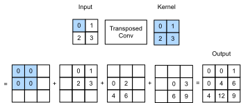
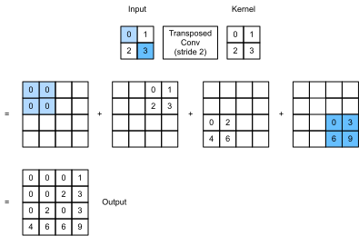

# Transponuotoji konvoliucija
:label:`sec_transposed_conv`

Iki šiol matyti CNN sluoksniai,
tokie kaip konvoliuciniai sluoksniai (:numref:`sec_conv_layer`) ir sutelkimo sluoksniai (:numref:`sec_pooling`),
paprastai sumažina (sumažina skiriamąją gebą) įvesties erdvines dimensijas (aukštį ir plotį)
arba palieka jas nepakitusias.
Semantiniame segmentavime,
kuris klasifikuoja pikselių lygmeniu,
būtų patogu, jei
įvesties ir išvesties erdvinės dimensijos
būtų tokios pačios.
Pavyzdžiui,
vieno išvesties pikselio kanalų dimensija
gali talpinti
to paties erdvinės padėties įvesties pikselio klasifikavimo rezultatus.


Kad tai pasiektume, ypač po to, kai
CNN sluoksniai sumažino erdvines dimensijas,
galime naudoti kito tipo
CNN sluoksnius,
kurie gali padidinti (padidinti skiriamąją gebą) tarpinių požymių žemėlapių
erdvines dimensijas.
Šiame skyrelyje
pristatysime
*transponuotąją konvoliuciją*, dar vadinamą *dalinio žingsnio konvoliucija* :cite:`Dumoulin.Visin.2016`,
skirtą konvoliucijos atliktoms
mažinimo operacijoms atšaukti.

```{.python .input}
#@tab mxnet
from mxnet import np, npx, init
from mxnet.gluon import nn
from d2l import mxnet as d2l

npx.set_np()
```

```{.python .input}
#@tab pytorch
import torch
from torch import nn
from d2l import torch as d2l
```

## Pagrindinė operacija

Kol kas ignoruodami kanalus,
pradėkime nuo
pagrindinės transponuotosios konvoliucijos operacijos
su 1 žingsniu ir be papildymo.
Tarkime,
kad turime
$n_h \times n_w$ įvesties tenzorių
ir $k_h \times k_w$ branduolį.
Stumdant branduolio langą su 1 žingsniu
$n_w$ kartų kiekvienoje eilutėje
ir $n_h$ kartų kiekviename stulpelyje,
gaunama
iš viso $n_h n_w$ tarpinių rezultatų.
Kiekvienas tarpinis rezultatas yra
$(n_h + k_h - 1) \times (n_w + k_w - 1)$
tenzorius, inicializuotas nuliais.
Kad apskaičiuotume kiekvieną tarpinį tenzorių,
kiekvienas įvesties tenzoriaus elementas
dauginamas iš branduolio,
kad gautas $k_h \times k_w$ tenzorius
pakeistų dalį
kiekviename tarpiniame tenzoriuje.
Atkreipkite dėmesį, kad
pakeistos dalies padėtis kiekviename
tarpiniame tenzoriuje atitinka skaičiavimui naudojamo
įvesties tenzoriaus elemento padėtį.
Galiausiai visi tarpiniai rezultatai
susumuojami, kad gautume išvestį.

Pavyzdžiui,
:numref:`fig_trans_conv` iliustruoja,
kaip transponuotoji konvoliucija su $2\times 2$ branduoliu apskaičiuojama $2\times 2$ įvesties tenzoriui.



:label:`fig_trans_conv`


Galime (**įgyvendinti šią pagrindinę transponuotosios konvoliucijos operaciją**) `trans_conv` įvesties matricai `X` ir branduolio matricai `K`.

```{.python .input}
#@tab all
def trans_conv(X, K):
    h, w = K.shape
    Y = d2l.zeros((X.shape[0] + h - 1, X.shape[1] + w - 1))
    for i in range(X.shape[0]):
        for j in range(X.shape[1]):
            Y[i: i + h, j: j + w] += X[i, j] * K
    return Y
```

Priešingai nei įprasta konvoliucija (:numref:`sec_conv_layer`), kuri *sumažina* įvesties elementus
per branduolį,
transponuotoji konvoliucija
*išskleidžia* įvesties elementus
per branduolį, taip
sukurdama išvestį,
kuri yra didesnė už įvestį.
Galime sukonstruoti įvesties tenzorių `X` ir branduolio tenzorių `K` iš :numref:`fig_trans_conv`, kad [**patvirtintume aukščiau pateikto pagrindinės dvimatės transponuotosios konvoliucijos operacijos įgyvendinimo išvestį**].

```{.python .input}
#@tab all
X = d2l.tensor([[0.0, 1.0], [2.0, 3.0]])
K = d2l.tensor([[0.0, 1.0], [2.0, 3.0]])
trans_conv(X, K)
```

Alternatyviai,
kai įvestis `X` ir branduolys `K` abu yra
keturmačiai tenzoriai,
galime [**naudoti aukšto lygio API tiems patiems rezultatams gauti**].

```{.python .input}
#@tab mxnet
X, K = X.reshape(1, 1, 2, 2), K.reshape(1, 1, 2, 2)
tconv = nn.Conv2DTranspose(1, kernel_size=2)
tconv.initialize(init.Constant(K))
tconv(X)
```

```{.python .input}
#@tab pytorch
X, K = X.reshape(1, 1, 2, 2), K.reshape(1, 1, 2, 2)
tconv = nn.ConvTranspose2d(1, 1, kernel_size=2, bias=False)
tconv.weight.data = K
tconv(X)
```

## [**Papildymas, žingsniai ir keli kanalai**]

Skirtingai nei įprastoje konvoliucijoje,
kur papildymas taikomas įvesčiai,
transponuotojoje konvoliucijoje jis taikomas išvesčiai.
Pavyzdžiui,
nurodžius papildymo skaičių
abiejose aukščio ir pločio pusėse
lygų 1,
pirmoji ir paskutinė eilutės bei stulpeliai
bus pašalinti iš transponuotosios konvoliucijos išvesties.

```{.python .input}
#@tab mxnet
tconv = nn.Conv2DTranspose(1, kernel_size=2, padding=1)
tconv.initialize(init.Constant(K))
tconv(X)
```

```{.python .input}
#@tab pytorch
tconv = nn.ConvTranspose2d(1, 1, kernel_size=2, padding=1, bias=False)
tconv.weight.data = K
tconv(X)
```

Transponuotojoje konvoliucijoje
žingsniai nurodomi tarpiniams rezultatams (taigi ir išvesčiai), o ne įvesčiai.
Naudojant tuos pačius įvesties ir branduolio tenzorius
iš :numref:`fig_trans_conv`,
pakeitus žingsnį iš 1 į 2,
padidėja tiek tarpinių tenzorių aukštis, tiek plotis, taigi ir išvesties tenzorius
:numref:`fig_trans_conv_stride2`.



:label:`fig_trans_conv_stride2`


Šis kodo fragmentas gali patvirtinti transponuotosios konvoliucijos išvestį su 2 žingsniu :numref:`fig_trans_conv_stride2`.

```{.python .input}
#@tab mxnet
tconv = nn.Conv2DTranspose(1, kernel_size=2, strides=2)
tconv.initialize(init.Constant(K))
tconv(X)
```

```{.python .input}
#@tab pytorch
tconv = nn.ConvTranspose2d(1, 1, kernel_size=2, stride=2, bias=False)
tconv.weight.data = K
tconv(X)
```

Kelių įvesties ir išvesties kanalų atveju
transponuotoji konvoliucija
veikia taip pat kaip įprasta konvoliucija.
Tarkime,
kad įvestis turi $c_i$ kanalų
ir kad transponuotoji konvoliucija
priskiria $k_h\times k_w$ branduolio tenzorių
kiekvienam įvesties kanalui.
Kai nurodoma keli išvesties kanalai,
kiekvienam išvesties kanalui turėsime $c_i\times k_h\times k_w$ branduolį.


Apskritai, jei paduodame $\mathsf{X}$ į konvoliucinį sluoksnį $f$, kad išvestume $\mathsf{Y}=f(\mathsf{X})$, ir sukuriame transponuotąjį konvoliucinį sluoksnį $g$ su tais pačiais hiperparametrais kaip $f$, išskyrus
išvesties kanalų skaičių,
kuris yra lygus $\mathsf{X}$ kanalų skaičiui,
tai $g(Y)$ turės tokią pačią formą kaip $\mathsf{X}$.
Tai galima iliustruoti šiuo pavyzdžiu.

```{.python .input}
#@tab mxnet
X = np.random.uniform(size=(1, 10, 16, 16))
conv = nn.Conv2D(20, kernel_size=5, padding=2, strides=3)
tconv = nn.Conv2DTranspose(10, kernel_size=5, padding=2, strides=3)
conv.initialize()
tconv.initialize()
tconv(conv(X)).shape == X.shape
```

```{.python .input}
#@tab pytorch
X = torch.rand(size=(1, 10, 16, 16))
conv = nn.Conv2d(10, 20, kernel_size=5, padding=2, stride=3)
tconv = nn.ConvTranspose2d(20, 10, kernel_size=5, padding=2, stride=3)
tconv(conv(X)).shape == X.shape
```

## [**Sąryšis su matricos transponavimu**]
:label:`subsec-connection-to-mat-transposition`

Transponuotoji konvoliucija pavadinta
matricos transponavimo vardu.
Kad paaiškintume,
pirmiausia pažiūrėkime,
kaip įgyvendinti konvoliucijas
naudojant matricų daugybą.
Toliau pateiktame pavyzdyje apibrėžiame $3\times 3$ įvestį `X` ir $2\times 2$ konvoliucijos branduolį `K`, o tada naudojame funkciją `corr2d` konvoliucijos išvesčiai `Y` apskaičiuoti.

```{.python .input}
#@tab all
X = d2l.arange(9.0).reshape(3, 3)
K = d2l.tensor([[1.0, 2.0], [3.0, 4.0]])
Y = d2l.corr2d(X, K)
Y
```

Toliau perrašome konvoliucijos branduolį `K` kaip
retąją svorių matricą `W`,
kurioje yra daug nulių.
Svorių matricos forma yra ($4$, $9$),
kur nenuliniai elementai gaunami
iš konvoliucijos branduolio `K`.

```{.python .input}
#@tab all
def kernel2matrix(K):
    k, W = d2l.zeros(5), d2l.zeros((4, 9))
    k[:2], k[3:5] = K[0, :], K[1, :]
    W[0, :5], W[1, 1:6], W[2, 3:8], W[3, 4:] = k, k, k, k
    return W

W = kernel2matrix(K)
W
```

Sukonkatenuokite įvestį `X` eilutė po eilutės, kad gautumėte 9 ilgio vektorių. Tada `W` ir vektorizuoto `X` matricų daugyba duoda 4 ilgio vektorių.
Pakeitę jo formą, galime gauti tą patį rezultatą `Y`
iš aukščiau pateiktos pradinės konvoliucijos operacijos:
ką tik įgyvendinome konvoliucijas naudodami matricų daugybą.

```{.python .input}
#@tab all
Y == d2l.matmul(W, d2l.reshape(X, -1)).reshape(2, 2)
```

Panašiai galime įgyvendinti transponuotąsias konvoliucijas naudodami
matricų daugybą.
Toliau pateiktame pavyzdyje
$2 \times 2$ išvestį `Y` iš aukščiau pateiktos
įprastos konvoliucijos
imame kaip transponuotosios konvoliucijos įvestį.
Kad įgyvendintume šią operaciją dauginant matricas,
tereikia transponuoti svorių matricą `W`,
kurios nauja forma yra $(9, 4)$.

```{.python .input}
#@tab all
Z = trans_conv(Y, K)
Z == d2l.matmul(W.T, d2l.reshape(Y, -1)).reshape(3, 3)
```

Apsvarstykime konvoliucijos įgyvendinimą
dauginant matricas.
Turint įvesties vektorių $\mathbf{x}$
ir svorių matricą $\mathbf{W}$,
konvoliucijos tiesioginio sklidimo funkciją
galima įgyvendinti
dauginant jos įvestį iš svorių matricos
ir išvedant vektorių
$\mathbf{y}=\mathbf{W}\mathbf{x}$.
Kadangi atgalinis sklidimas
vadovaujasi grandinės taisykle
ir $\nabla_{\mathbf{x}}\mathbf{y}=\mathbf{W}^\top$,
konvoliucijos atgalinio sklidimo funkciją
galima įgyvendinti
dauginant jos įvestį iš
transponuotosios svorių matricos $\mathbf{W}^\top$.
Todėl
transponuotasis konvoliucinis sluoksnis
tiesiog gali sukeisti konvoliucinio sluoksnio tiesioginio sklidimo funkciją
ir atgalinio sklidimo funkciją:
jo tiesioginio sklidimo
ir atgalinio sklidimo funkcijos
daugina savo įvesties vektorių atitinkamai iš
$\mathbf{W}^\top$ ir $\mathbf{W}$.


## Santrauka

* Priešingai nei įprasta konvoliucija, kuri sumažina įvesties elementus per branduolį, transponuotoji konvoliucija išskleidžia įvesties elementus per branduolį, taip sukurdama išvestį, kuri yra didesnė už įvestį.
* Jei paduodame $\mathsf{X}$ į konvoliucinį sluoksnį $f$, kad išvestume $\mathsf{Y}=f(\mathsf{X})$, ir sukuriame transponuotąjį konvoliucinį sluoksnį $g$ su tais pačiais hiperparametrais kaip $f$, išskyrus išvesties kanalų skaičių, kuris yra lygus $\mathsf{X}$ kanalų skaičiui, tai $g(Y)$ turės tokią pačią formą kaip $\mathsf{X}$.
* Konvoliucijas galime įgyvendinti naudodami matricų daugybą. Transponuotasis konvoliucinis sluoksnis tiesiog gali sukeisti konvoliucinio sluoksnio tiesioginio sklidimo funkciją ir atgalinio sklidimo funkciją.


## Pratimai

1. :numref:`subsec-connection-to-mat-transposition` konvoliucijos įvestis `X` ir transponuotosios konvoliucijos išvestis `Z` turi tokią pačią formą. Ar jų reikšmės tokios pačios? Kodėl?
1. Ar efektyvu konvoliucijoms įgyvendinti naudoti matricų daugybą? Kodėl?

:begin_tab:`mxnet`
[Diskusijos](https://discuss.d2l.ai/t/376)
:end_tab:

:begin_tab:`pytorch`
[Diskusijos](https://discuss.d2l.ai/t/1450)
:end_tab:
