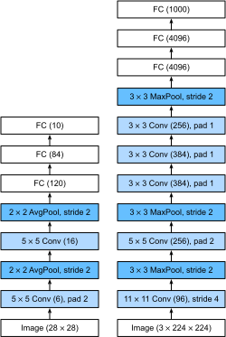

```{.python .input  n=1}
%load_ext d2lbook.tab
tab.interact_select(['mxnet', 'pytorch', 'tensorflow', 'jax'])
```

# Gilieji konvoliuciniai neuroniniai tinklai (AlexNet)
:label:`sec_alexnet`


Nors CNN buvo gerai žinomi
kompiuterinės regos ir mašininio mokymosi bendruomenėse
po LeNet pristatymo :cite:`LeCun.Jackel.Bottou.ea.1995`,
jie nedelsiant nepradėjo dominuoti srityje.
Nors LeNet pasiekė gerų rezultatų su ankstyvaisiais mažais duomenų rinkiniais,
CNN apmokymo našumas ir įmanomumas
su didesniais, realistiškesniais duomenų rinkiniais dar turėjo būti įrodytas.
Iš tiesų, didžiąją laiko tarp 1990-ųjų pradžios
ir 2012 m. lūžio rezultatų :cite:`Krizhevsky.Sutskever.Hinton.2012`
neuroninius tinklus dažnai pralenkdavo kiti mašininio mokymosi metodai,
tokie kaip branduolių metodai :cite:`Scholkopf.Smola.2002`, ansamblių metodai :cite:`Freund.Schapire.ea.1996`
ir struktūrizuotas vertinimas :cite:`Taskar.Guestrin.Koller.2004`.

Kompiuterinei regai šis palyginimas galbūt nėra visiškai tikslus.
Tai yra, nors konvoliucinių tinklų įvestis
sudaro neapdoroti ar lengvai apdoroti (pvz., centruoti) pikselių reikšmės, specialistai niekada nepaduotų neapdorotų pikselių tradiciniams modeliams.
Vietoj to tipiniai kompiuterinės regos konvejeriai
buvo sudaryti iš rankiniu būdu sukurtų požymių išskyrimo konvejerių, tokių kaip SIFT :cite:`Lowe.2004`, SURF :cite:`Bay.Tuytelaars.Van-Gool.2006` ir vizualinių žodžių maišai :cite:`Sivic.Zisserman.2003`.
Užuot požymius *išmokę*, juos *sukonstravo* žmonės.
Didžioji pažanga kilo iš gudresnių idėjų požymiams išskirti, viena vertus, ir gilios geometrijos įžvalgos :cite:`Hartley.Zisserman.2000`, kita vertus. Mokymosi algoritmas dažnai būdavo laikomas antraeiliu dalyku.

Nors 1990-aisiais buvo prieinami kai kurie neuroninių tinklų greitintuvai,
jie dar nebuvo pakankamai galingi, kad leistų sukurti
gilius daugiakanalius, daugiasluoksnius CNN
su dideliu parametrų skaičiumi. Pavyzdžiui, NVIDIA GeForce 256 iš 1999 m.
sugebėjo apdoroti daugiausia 480 milijonų slankiojo kablelio operacijų, tokių kaip sudėtis ir daugyba, per sekundę (MFLOPS), be jokio prasmingo
programavimo karkaso operacijoms, išskyrus žaidimus. Šiandieniniai greitintuvai gali atlikti daugiau nei 1000 TFLOPs viename įrenginyje.
Be to, duomenų rinkiniai vis dar buvo santykinai maži: OCR su 60 000 mažos skyros $28 \times 28$ pikselių vaizdų buvo laikomas labai sudėtinga užduotimi.
Prie šių kliūčių prisidėjo ir tai, kad trūko pagrindinių neuroninių tinklų apmokymo gudrybių,
įskaitant parametrų inicializavimo euristikas :cite:`Glorot.Bengio.2010`,
gudrius stochastinio gradientinio nusileidimo variantus :cite:`Kingma.Ba.2014`,
nesuspaudžiančias aktyvacijos funkcijas :cite:`Nair.Hinton.2010`
ir veiksmingas reguliarizacijos technikas :cite:`Srivastava.Hinton.Krizhevsky.ea.2014`.

Taigi, užuot apmokius *nuo galo iki galo* (nuo pikselio iki klasifikavimo) sistemas,
klasikiniai konvejeriai atrodė maždaug taip:

1. Gaukite įdomų duomenų rinkinį. Ankstyvaisiais laikais šiems duomenų rinkiniams reikėjo brangių jutiklių. Pavyzdžiui, [Apple QuickTake 100](https://en.wikipedia.org/wiki/Apple_QuickTake) iš 1994 m. turėjo net 0,3 megapikselio (VGA) skyrą, galėjo saugoti iki 8 vaizdų, ir visa tai už \$1000.
1. Iš anksto apdorokite duomenų rinkinį rankiniu būdu sukurtais požymiais, pagrįstais optikos, geometrijos, kitų analitinių įrankių žiniomis ir kartais atsitiktiniais laimingų doktorantų atradimais.
1. Praleiskite duomenis per standartinį požymių išskyrimo priemonių rinkinį, tokį kaip SIFT (mastelio atžvilgiu invariantiška požymių transformacija) :cite:`Lowe.2004`, SURF (pagreitinti tvirti požymiai) :cite:`Bay.Tuytelaars.Van-Gool.2006` ar bet kuris kitas rankiniu būdu suderintas konvejeris. OpenCV iki šiol teikia SIFT išskyrimo priemones!
1. Gautus atvaizdus supilkite į savo mėgstamą klasifikatorių, greičiausiai tiesinį modelį ar branduolių metodą, ir apmokykite klasifikatorių.

Jei kalbėtumėte su mašininio mokymosi tyrėjais,
jie atsakytų, kad mašininis mokymasis yra ir svarbus, ir gražus.
Elegantiškos teorijos įrodė įvairių klasifikatorių savybes :cite:`boucheron2005theory`, o iškilusis
optimizavimas :cite:`Boyd.Vandenberghe.2004` tapo pagrindine priemone jiems gauti.
Mašininio mokymosi sritis klestėjo, buvo griežta ir nepaprastai naudinga. Tačiau
jei kalbėtumėte su kompiuterinės regos tyrėju,
išgirstumėte visai kitokią istoriją.
Purvina vaizdų atpažinimo tiesa, pasakytų jie,
yra ta, kad pažangą varė požymiai, geometrija :cite:`Hartley.Zisserman.2000,hartley2009global` ir inžinerija,
o ne nauji mokymosi algoritmai.
Kompiuterinės regos tyrėjai pagrįstai tikėjo,
kad šiek tiek didesnis ar švaresnis duomenų rinkinys
arba šiek tiek patobulintas požymių išskyrimo konvejeris
galutiniam tikslumui turėjo kur kas didesnę reikšmę nei bet koks mokymosi algoritmas.

```{.python .input  n=2}
%%tab mxnet
from d2l import mxnet as d2l
from mxnet import np, init, npx
from mxnet.gluon import nn
npx.set_np()
```

```{.python .input  n=3}
%%tab pytorch
from d2l import torch as d2l
import torch
from torch import nn
```

```{.python .input  n=4}
%%tab tensorflow
from d2l import tensorflow as d2l
import tensorflow as tf
```

```{.python .input}
%%tab jax
from d2l import jax as d2l
from flax import linen as nn
import jax
from jax import numpy as jnp
```

## Atvaizdų mokymasis

Kitaip tariant, padėtį galima apibūdinti taip:
svarbiausia konvejerio dalis buvo atvaizdas.
Ir iki 2012 m. atvaizdas daugiausia buvo skaičiuojamas mechaniškai.
Iš tikrųjų naujo požymių funkcijų rinkinio kūrimas, rezultatų gerinimas ir metodo aprašymas
užėmė svarbią vietą straipsniuose.
SIFT :cite:`Lowe.2004`,
SURF :cite:`Bay.Tuytelaars.Van-Gool.2006`,
HOG (orientuotų gradientų histogramos) :cite:`Dalal.Triggs.2005`,
vizualinių žodžių maišai :cite:`Sivic.Zisserman.2003`
ir panašios požymių išskyrimo priemonės viešpatavo.

Kita tyrėjų grupė,
įskaitant Yanną LeCuną, Geoffą Hintoną, Yoshuą Bengio,
Andrew Ng, Shun-ichi Amari ir Juergeną Schmidhuberį,
turėjo kitokių planų.
Jie tikėjo, kad pačius požymius reikėtų išmokti.
Be to, jie tikėjo, kad norint būti pakankamai sudėtingi,
požymiai turėtų būti hierarchiškai sudaromi
iš kelių kartu išmokstamų sluoksnių, kurių kiekvienas turi išmokstamų parametrų.
Vaizdo atveju žemiausi sluoksniai gali
išmokti aptikti kraštus, spalvas ir tekstūras, panašiai kaip gyvūnų regos sistema
apdoroja savo įvestį. Visų pirma automatinis regos požymių, tokių kaip gaunami
retu kodavimu :cite:`olshausen1996emergence`, kūrimas liko atviru iššūkiu iki šiuolaikinių CNN atsiradimo.
Tik :citet:`Dean.Corrado.Monga.ea.2012,le2013building` darbais idėja automatiškai generuoti požymius
iš vaizdo duomenų sulaukė didelio dėmesio.

Pirmasis šiuolaikinis CNN :cite:`Krizhevsky.Sutskever.Hinton.2012`, pavadintas
*AlexNet* vieno iš jo išradėjų Alexo Krizhevsky vardu, iš esmės yra evoliucinis
LeNet patobulinimas. Jis pasiekė puikių rezultatų 2012 m. ImageNet konkurse.


:width:`400px`
:label:`fig_filters`

Įdomu tai, kad žemiausiuose tinklo sluoksniuose
modelis išmoko požymių išskyrimo priemones, panašias į kai kuriuos tradicinius filtrus.
:numref:`fig_filters`
parodo žemesnio lygio vaizdų deskriptorius.
Aukštesni tinklo sluoksniai gali remtis šiais atvaizdais,
kad atvaizduotų didesnes struktūras, pavyzdžiui, akis, nosis, žolės stiebelius ir pan.
Dar aukštesni sluoksniai gali atvaizduoti ištisus objektus,
tokius kaip žmonės, lėktuvai, šunys ar skraidančios lėkštės.
Galiausiai paskutinė paslėptoji būsena išmoksta kompaktišką
vaizdo atvaizdą, apibendrinantį jo turinį taip,
kad skirtingoms kategorijoms priklausančius duomenis būtų lengva atskirti.

AlexNet (2012) ir jo pirmtakas LeNet (1995) turi daug bendrų architektūros elementų. Kyla klausimas: kodėl prireikė tiek daug laiko?
Pagrindinis skirtumas buvo tas, kad per ankstesnius du dešimtmečius duomenų kiekis ir prieinama skaičiavimo galia gerokai išaugo. Todėl AlexNet buvo daug didesnis: jis buvo apmokytas su daug didesniu duomenų kiekiu ir daug greitesniais GPU, palyginti su 1995 m. prieinamais CPU.

### Trūkstamas ingredientas: duomenys

Giliems modeliams su daug sluoksnių reikia didelių duomenų kiekių,
kad pasiektų režimą,
kuriame jie gerokai pralenkia tradicinius metodus,
pagrįstus iškiliaisiais optimizavimo uždaviniais (pvz., tiesinius ir branduolių metodus).
Tačiau dėl ribotos kompiuterių saugojimo talpos,
santykinės (vaizdo) jutiklių kainos
ir palyginti griežtesnių tyrimų biudžetų 1990-aisiais
dauguma tyrimų rėmėsi mažyčiais duomenų rinkiniais.
Daugelis straipsnių rėmėsi UCI duomenų rinkinių kolekcija,
iš kurių daugelyje buvo tik šimtai ar (keli) tūkstančiai vaizdų,
užfiksuotų žema skyra ir dažnai su dirbtinai švariu fonu.

2009 m. buvo išleistas ImageNet duomenų rinkinys :cite:`Deng.Dong.Socher.ea.2009`,
metantis tyrėjams iššūkį išmokti modelius iš 1 milijono pavyzdžių,
po 1000 iš 1000 skirtingų objektų kategorijų. Pačios kategorijos
buvo pagrįstos populiariausiais WordNet daiktavardžių mazgais :cite:`Miller.1995`.
ImageNet komanda naudojo „Google Image Search“, kad iš anksto atfiltruotų didelius kandidatų rinkinius
kiekvienai kategorijai, ir pasitelkė
„Amazon Mechanical Turk“ būrinio darbo konvejerį,
kad kiekvienam vaizdui patvirtintų, ar jis priklauso atitinkamai kategorijai.
Šis mastas buvo precedento neturintis, viršijantis kitus daugiau nei dydžio eile
(pvz., CIFAR-100 turi 60 000 vaizdų). Kitas aspektas buvo tas, kad vaizdai buvo
santykinai aukštos $224 \times 224$ pikselių skyros, skirtingai nei 80 milijonų dydžio
TinyImages duomenų rinkinys :cite:`Torralba.Fergus.Freeman.2008`, sudarytas iš $32 \times 32$ pikselių miniatiūrų.
Tai leido formuoti aukštesnio lygio požymius.
Susijęs konkursas, pavadintas ImageNet didelio masto vizualinio atpažinimo
iššūkiu :cite:`russakovsky2015imagenet`,
paspartino kompiuterinės regos ir mašininio mokymosi tyrimus,
metęs tyrėjams iššūkį nustatyti, kurie modeliai veikia geriausiai
didesniu mastu, nei akademikai anksčiau buvo svarstę. Didžiausi regos duomenų rinkiniai, tokie kaip LAION-5B
:cite:`schuhmann2022laion`, turi milijardus vaizdų su papildomais metaduomenimis.

### Trūkstamas ingredientas: aparatinė įranga

Giliojo mokymosi modeliai yra negailestingi skaičiavimo ciklų vartotojai.
Apmokymas gali trukti šimtus epochų, o kiekviena iteracija
reikalauja perduoti duomenis per daugybę skaičiavimo požiūriu brangių
tiesinės algebros operacijų sluoksnių.
Tai viena pagrindinių priežasčių, kodėl 1990-aisiais ir 2000-ųjų pradžioje
buvo teikiama pirmenybė paprastiems algoritmams, pagrįstiems efektyviau optimizuojamais
iškiliaisiais tikslais.

*Grafikos apdorojimo įrenginiai* (GPU) pasirodė esą lūžio taškas,
leidęs įgyvendinti gilųjį mokymąsi.
Šie lustai anksčiau buvo sukurti grafikos apdorojimui
pagreitinti kompiuteriniams žaidimams.
Visų pirma jie buvo optimizuoti dideliam pralaidumui $4 \times 4$
matricų ir vektorių sandaugoms, reikalingoms daugeliui kompiuterinės grafikos užduočių.
Laimei, matematika stulbinamai panaši
į reikalingą konvoliuciniams sluoksniams skaičiuoti.
Maždaug tuo metu NVIDIA ir ATI pradėjo optimizuoti GPU
bendrosios paskirties skaičiavimo operacijoms :cite:`Fernando.2004`,
net rinkodaroje juos pristatydamos kaip *bendrosios paskirties GPU* (GPGPU).

Kad įgytume intuiciją, panagrinėkime šiuolaikinio mikroprocesoriaus (CPU)
branduolius.
Kiekvienas branduolys yra gana galingas, veikia aukštu taktiniu dažniu
ir turi didelius podėlius (iki kelių megabaitų L3).
Kiekvienas branduolys tinka vykdyti plačią instrukcijų įvairovę,
turi šakų nuspėjiklius, gilų konvejerį, specializuotus vykdymo blokus,
spekuliatyvų vykdymą
ir daugybę kitų papildomų funkcijų,
leidžiančių paleisti didelę programų įvairovę su sudėtinga valdymo eiga.
Tačiau šis akivaizdus stiprumas yra ir jo Achilo kulnas:
bendrosios paskirties branduolius labai brangu gaminti. Jie išsiskiria bendrosios paskirties
kodu su daug valdymo eigos.
Tam reikia daug lusto ploto, ne tik
tikrajam ALU (aritmetinio loginio bloko), kuriame vyksta skaičiavimai, bet ir
visoms minėtoms papildomoms funkcijoms, taip pat
atminties sąsajoms, podėlio logikai tarp branduolių,
sparčioms jungtims ir t. t. CPU yra
palyginti prasti bet kuriai vienai užduočiai, palyginti su specializuota aparatine įranga.
Šiuolaikiniai nešiojamieji kompiuteriai turi 4–8 branduolius,
o net aukščiausios klasės serveriai retai viršija 64 branduolius viename lizde,
tiesiog todėl, kad tai nėra ekonomiška.

Palyginimui, GPU gali būti sudaryti iš tūkstančių mažų apdorojimo elementų (naujausi NVIDIA Ampere lustai turi iki 6912 CUDA branduolių), dažnai sugrupuotų į didesnes grupes (NVIDIA jas vadina verpstėmis, angl. *warps*).
Detalės šiek tiek skiriasi tarp NVIDIA, AMD, ARM ir kitų lustų gamintojų. Nors kiekvienas branduolys yra santykinai silpnas,
veikia apie 1 GHz taktiniu dažniu,
būtent bendras tokių branduolių skaičius daro GPU eilėmis greitesnius už CPU.
Pavyzdžiui, naujausias NVIDIA Ampere A100 GPU siūlo daugiau nei 300 TFLOPs viename luste specializuotoms 16 bitų tikslumo (BFLOAT16) matricų sandaugoms ir iki 20 TFLOPs bendresnės paskirties slankiojo kablelio operacijoms (FP32).
Tuo pat metu CPU slankiojo kablelio našumas retai viršija 1 TFLOPs. Pavyzdžiui, Amazon Graviton 3 pasiekia 2 TFLOPs didžiausią našumą 16 bitų tikslumo operacijoms, panašų į Apple M1 procesoriaus GPU našumą.

Yra daug priežasčių, kodėl GPU yra daug greitesni už CPU FLOPs požiūriu.
Pirma, energijos suvartojimas linkęs augti *kvadratiškai* didėjant taktiniam dažniui.
Todėl už CPU branduolio, veikiančio keturis kartus greičiau (tipinis skaičius), energijos biudžetą
galite naudoti 16 GPU branduolių, veikiančių $\frac{1}{4}$ greičio,
o tai duoda $16 \times \frac{1}{4} = 4$ kartus didesnį našumą.
Antra, GPU branduoliai yra daug paprastesni
(iš tikrųjų ilgą laiką jie net negalėjo
vykdyti bendrosios paskirties kodo),
todėl jie efektyvesni energijos požiūriu. Pavyzdžiui, (i) jie paprastai nepalaiko spekuliatyvaus vertinimo, (ii) paprastai neįmanoma programuoti kiekvieno apdorojimo elemento atskirai, ir (iii) podėliai vienam branduoliui paprastai yra gerokai mažesni.
Galiausiai daugeliui giliojo mokymosi operacijų reikia didelio atminties pralaidumo.
Čia vėlgi GPU spindi su magistralėmis, bent 10 kartų platesnėmis nei daugelio CPU.

Grįžkime į 2012-uosius. Didelis proveržis įvyko,
kai Alexas Krizhevsky ir Ilya Sutskever
įgyvendino gilų CNN,
galintį veikti GPU.
Jie suprato, kad skaičiavimo kliūtys CNN –
konvoliucijos ir matricų daugyba –
yra operacijos, kurias galima lygiagretinti aparatinėje įrangoje.
Naudodami du NVIDIA GTX 580 su 3 GB atminties, kurių kiekvienas pajėgė 1,5 TFLOPs (dešimtmetį vėliau vis dar iššūkis daugumai CPU),
jie įgyvendino greitas konvoliucijas.
[cuda-convnet](https://code.google.com/archive/p/cuda-convnet/) kodas
buvo pakankamai geras, kad kelerius metus
jis buvo pramonės standartas ir varė
pirmuosius porą giliojo mokymosi bumo metų.

## AlexNet

AlexNet, naudojęs 8 sluoksnių CNN,
laimėjo 2012 m. ImageNet didelio masto vizualinio atpažinimo iššūkį
dideliu skirtumu :cite:`Russakovsky.Deng.Huang.ea.2013`.
Šis tinklas pirmą kartą parodė,
kad išmoktais gauti požymiai gali pranokti rankiniu būdu sukurtus požymius, sulaužydamas ankstesnę kompiuterinės regos paradigmą.

AlexNet ir LeNet architektūros yra stulbinamai panašios,
kaip iliustruoja :numref:`fig_alexnet`.
Atkreipkite dėmesį, kad pateikiame šiek tiek supaprastintą AlexNet versiją,
pašalinę kai kuriuos dizaino keistumus, kurių prireikė 2012 m.,
kad modelis tilptų į du mažus GPU.


:label:`fig_alexnet`

Tarp AlexNet ir LeNet yra ir reikšmingų skirtumų.
Pirma, AlexNet yra daug gilesnis nei palyginti mažas LeNet-5.
AlexNet sudaro aštuoni sluoksniai: penki konvoliuciniai sluoksniai,
du pilnai sujungti paslėptieji sluoksniai ir vienas pilnai sujungtas išvesties sluoksnis.
Antra, AlexNet kaip aktyvacijos funkciją naudojo ReLU vietoj sigmoidės.
Pažvelkime į detales toliau.

### Architektūra

AlexNet pirmajame sluoksnyje konvoliucijos lango forma yra $11\times11$.
Kadangi ImageNet vaizdai yra aštuonis kartus aukštesni ir platesni
nei MNIST vaizdai,
ImageNet duomenų objektai paprastai užima daugiau pikselių su daugiau vizualinių detalių.
Todėl objektui užfiksuoti reikalingas didesnis konvoliucijos langas.
Konvoliucijos lango forma antrajame sluoksnyje
sumažinama iki $5\times5$, o po to – iki $3\times3$.
Be to, po pirmojo, antrojo ir penktojo konvoliucinių sluoksnių
tinklas prideda sutelkimo imant maksimumą sluoksnius
su $3\times3$ lango forma ir 2 žingsniu.
Be to, AlexNet turi dešimt kartų daugiau konvoliucijos kanalų nei LeNet.

Po paskutinio konvoliucinio sluoksnio yra du milžiniški pilnai sujungti sluoksniai
su 4096 išėjimais.
Šiems sluoksniams reikia beveik 1 GB modelio parametrų.
Dėl ribotos ankstyvųjų GPU atminties
originalus AlexNet naudojo dvigubo duomenų srauto dizainą,
kad kiekvienas iš dviejų GPU galėtų būti atsakingas
už tik savo modelio pusės saugojimą ir skaičiavimą.
Laimei, GPU atmintis dabar yra palyginti gausi,
todėl šiais laikais retai tenka skaidyti modelius tarp GPU
(mūsų AlexNet modelio versija šiuo aspektu
skiriasi nuo originalaus straipsnio).

### Aktyvacijos funkcijos

Be to, AlexNet pakeitė sigmoidinę aktyvacijos funkciją paprastesne ReLU aktyvacijos funkcija. Viena vertus, ReLU aktyvacijos funkcijos skaičiavimas yra paprastesnis. Pavyzdžiui, joje nėra eksponentinės operacijos, kuri yra sigmoidinėje aktyvacijos funkcijoje.
 Kita vertus, ReLU aktyvacijos funkcija palengvina modelio apmokymą naudojant skirtingus parametrų inicializavimo metodus. Taip yra todėl, kad kai sigmoidinės aktyvacijos funkcijos išvestis yra labai artima 0 ar 1, šių sričių gradientas yra beveik 0, todėl atgalinis sklidimas negali toliau atnaujinti kai kurių modelio parametrų. Priešingai, ReLU aktyvacijos funkcijos gradientas teigiamame intervale visada yra 1 (:numref:`subsec_activation-functions`). Todėl, jei modelio parametrai tinkamai neinicializuoti, sigmoidinė funkcija gali gauti beveik 0 gradientą teigiamame intervale, o tai reiškia, kad modelio negalima efektyviai apmokyti.

### Pajėgumo kontrolė ir išankstinis apdorojimas

AlexNet kontroliuoja pilnai sujungto sluoksnio modelio sudėtingumą
dropout (:numref:`sec_dropout`),
o LeNet naudoja tik svorių silpnėjimą.
Kad duomenys būtų dar labiau papildyti, AlexNet mokymo ciklas
pridėjo daug vaizdų papildymo,
pavyzdžiui, apvertimą, iškirpimą ir spalvų pakeitimus.
Tai daro modelį atsparesnį, o didesnis imties dydis efektyviai mažina persimokymą.
Išsamią tokių išankstinio apdorojimo žingsnių apžvalgą žr. :citet:`Buslaev.Iglovikov.Khvedchenya.ea.2020`.

```{.python .input  n=5}
%%tab pytorch, mxnet, tensorflow
class AlexNet(d2l.Classifier):
    def __init__(self, lr=0.1, num_classes=10):
        super().__init__()
        self.save_hyperparameters()
        if tab.selected('mxnet'):
            self.net = nn.Sequential()
            self.net.add(
                nn.Conv2D(96, kernel_size=11, strides=4, activation='relu'),
                nn.MaxPool2D(pool_size=3, strides=2),
                nn.Conv2D(256, kernel_size=5, padding=2, activation='relu'),
                nn.MaxPool2D(pool_size=3, strides=2),
                nn.Conv2D(384, kernel_size=3, padding=1, activation='relu'),
                nn.Conv2D(384, kernel_size=3, padding=1, activation='relu'),
                nn.Conv2D(256, kernel_size=3, padding=1, activation='relu'),
                nn.MaxPool2D(pool_size=3, strides=2),
                nn.Dense(4096, activation='relu'), nn.Dropout(0.5),
                nn.Dense(4096, activation='relu'), nn.Dropout(0.5),
                nn.Dense(num_classes))
            self.net.initialize(init.Xavier())
        if tab.selected('pytorch'):
            self.net = nn.Sequential(
                nn.LazyConv2d(96, kernel_size=11, stride=4, padding=1),
                nn.ReLU(), nn.MaxPool2d(kernel_size=3, stride=2),
                nn.LazyConv2d(256, kernel_size=5, padding=2), nn.ReLU(),
                nn.MaxPool2d(kernel_size=3, stride=2),
                nn.LazyConv2d(384, kernel_size=3, padding=1), nn.ReLU(),
                nn.LazyConv2d(384, kernel_size=3, padding=1), nn.ReLU(),
                nn.LazyConv2d(256, kernel_size=3, padding=1), nn.ReLU(),
                nn.MaxPool2d(kernel_size=3, stride=2), nn.Flatten(),
                nn.LazyLinear(4096), nn.ReLU(), nn.Dropout(p=0.5),
                nn.LazyLinear(4096), nn.ReLU(),nn.Dropout(p=0.5),
                nn.LazyLinear(num_classes))
            self.net.apply(d2l.init_cnn)
        if tab.selected('tensorflow'):
            self.net = tf.keras.models.Sequential([
                tf.keras.layers.Conv2D(filters=96, kernel_size=11, strides=4,
                                       activation='relu'),
                tf.keras.layers.MaxPool2D(pool_size=3, strides=2),
                tf.keras.layers.Conv2D(filters=256, kernel_size=5, padding='same',
                                       activation='relu'),
                tf.keras.layers.MaxPool2D(pool_size=3, strides=2),
                tf.keras.layers.Conv2D(filters=384, kernel_size=3, padding='same',
                                       activation='relu'),
                tf.keras.layers.Conv2D(filters=384, kernel_size=3, padding='same',
                                       activation='relu'),
                tf.keras.layers.Conv2D(filters=256, kernel_size=3, padding='same',
                                       activation='relu'),
                tf.keras.layers.MaxPool2D(pool_size=3, strides=2),
                tf.keras.layers.Flatten(),
                tf.keras.layers.Dense(4096, activation='relu'),
                tf.keras.layers.Dropout(0.5),
                tf.keras.layers.Dense(4096, activation='relu'),
                tf.keras.layers.Dropout(0.5),
                tf.keras.layers.Dense(num_classes)])
```

```{.python .input}
%%tab jax
class AlexNet(d2l.Classifier):
    lr: float = 0.1
    num_classes: int = 10
    training: bool = True

    def setup(self):
        self.net = nn.Sequential([
            nn.Conv(features=96, kernel_size=(11, 11), strides=4, padding=1),
            nn.relu,
            lambda x: nn.max_pool(x, window_shape=(3, 3), strides=(2, 2)),
            nn.Conv(features=256, kernel_size=(5, 5)),
            nn.relu,
            lambda x: nn.max_pool(x, window_shape=(3, 3), strides=(2, 2)),
            nn.Conv(features=384, kernel_size=(3, 3)), nn.relu,
            nn.Conv(features=384, kernel_size=(3, 3)), nn.relu,
            nn.Conv(features=256, kernel_size=(3, 3)), nn.relu,
            lambda x: nn.max_pool(x, window_shape=(3, 3), strides=(2, 2)),
            lambda x: x.reshape((x.shape[0], -1)),  # flatten
            nn.Dense(features=4096),
            nn.relu,
            nn.Dropout(0.5, deterministic=not self.training),
            nn.Dense(features=4096),
            nn.relu,
            nn.Dropout(0.5, deterministic=not self.training),
            nn.Dense(features=self.num_classes)
        ])
```

[**Sukonstruojame vieno kanalo duomenų pavyzdį**], kurio ir aukštis, ir plotis yra 224, (**kad stebėtume kiekvieno sluoksnio išvesties formą**). Jis atitinka AlexNet architektūrą :numref:`fig_alexnet`.

```{.python .input  n=6}
%%tab pytorch, mxnet
AlexNet().layer_summary((1, 1, 224, 224))
```

```{.python .input  n=7}
%%tab tensorflow
AlexNet().layer_summary((1, 224, 224, 1))
```

```{.python .input}
%%tab jax
AlexNet(training=False).layer_summary((1, 224, 224, 1))
```

## Mokymas

Nors AlexNet buvo apmokytas su ImageNet :citet:`Krizhevsky.Sutskever.Hinton.2012`,
čia naudojame Fashion-MNIST,
nes ImageNet modelio apmokymas iki konvergavimo gali užtrukti valandas ar dienas
net su šiuolaikiniu GPU.
Viena iš problemų taikant AlexNet tiesiogiai su [**Fashion-MNIST**]
yra ta, kad jo (**vaizdai turi mažesnę skyrą**) ($28 \times 28$ pikselių)
(**nei ImageNet vaizdai.**)
Kad viskas veiktų, (**padidiname jų skyrą iki $224 \times 224$**).
Paprastai tai nėra išmintinga praktika, nes tiesiog padidina skaičiavimo
sudėtingumą nepridedant informacijos. Vis dėlto čia tai darome, kad išliktume ištikimi AlexNet architektūrai.
Šį dydžio keitimą atliekame naudodami argumentą `resize` konstruktoriuje `d2l.FashionMNIST`.

Dabar galime [**pradėti AlexNet apmokymą.**]
Palyginti su LeNet :numref:`sec_lenet`,
pagrindinis pakeitimas čia yra mažesnio mokymosi greičio naudojimas
ir daug lėtesnis apmokymas dėl gilesnio ir platesnio tinklo,
didesnės vaizdo skyros ir brangesnių konvoliucijų.

```{.python .input  n=8}
%%tab pytorch, mxnet, jax
model = AlexNet(lr=0.01)
data = d2l.FashionMNIST(batch_size=128, resize=(224, 224))
trainer = d2l.Trainer(max_epochs=10, num_gpus=1)
trainer.fit(model, data)
```

```{.python .input  n=9}
%%tab tensorflow
trainer = d2l.Trainer(max_epochs=10)
data = d2l.FashionMNIST(batch_size=128, resize=(224, 224))
with d2l.try_gpu():
    model = AlexNet(lr=0.01)
    trainer.fit(model, data)
```

## Diskusija

AlexNet struktūra stulbinamai panaši į LeNet su keliais esminiais patobulinimais, tiek tikslumui (dropout), tiek apmokymo paprastumui (ReLU). Ne mažiau stulbinanti yra pažanga, padaryta giliojo mokymosi įrankių srityje. Tai, kas 2012 m. buvo kelių mėnesių darbas, dabar gali būti atlikta keliolika kodo eilučių naudojant bet kurį šiuolaikinį karkasą.

Peržiūrėdami architektūrą matome, kad AlexNet turi Achilo kulną efektyvumo požiūriu: paskutiniai du paslėptieji sluoksniai reikalauja atitinkamai $6400 \times 4096$ ir $4096 \times 4096$ dydžio matricų. Tai atitinka 164 MB atminties ir 81 MFLOPs skaičiavimų, o tai yra nemenkos sąnaudos, ypač mažesniuose įrenginiuose, tokiuose kaip mobilieji telefonai. Tai viena iš priežasčių, kodėl AlexNet buvo pralenktas daug efektyvesnių architektūrų, kurias aptarsime kituose skyreliuose. Vis dėlto tai yra esminis žingsnis nuo negilių iki šiandien naudojamų gilių tinklų. Atkreipkite dėmesį, kad nors parametrų skaičius toli viršija mokymo duomenų kiekį mūsų eksperimentuose (paskutiniai du sluoksniai turi daugiau nei 40 milijonų parametrų, apmokytų su 60 tūkstančių vaizdų duomenų rinkiniu), persimokymo vargu ar pastebime: mokymo ir validavimo nuostoliai visą apmokymą praktiškai sutampa. Taip yra dėl pagerintos reguliarizacijos, tokios kaip dropout, būdingos šiuolaikiniams giliųjų tinklų dizainams.

Nors atrodo, kad AlexNet įgyvendinime yra tik kelios eilutės daugiau nei LeNet, akademinei bendruomenei prireikė daugelio metų priimti šį konceptualų pokytį ir pasinaudoti puikiais jo eksperimentiniais rezultatais. Tai taip pat lėmė efektyvių skaičiavimo įrankių trūkumas. Tuo metu neegzistavo nei DistBelief :cite:`Dean.Corrado.Monga.ea.2012`, nei Caffe :cite:`Jia.Shelhamer.Donahue.ea.2014`, o Theano :cite:`Bergstra.Breuleux.Bastien.ea.2010` dar trūko daug išskirtinių savybių. Būtent TensorFlow :cite:`Abadi.Barham.Chen.ea.2016` atsiradimas dramatiškai pakeitė situaciją.

## Pratimai

1. Tęsdami aukščiau pateiktą diskusiją, išanalizuokite AlexNet skaičiavimo savybes.
    1. Apskaičiuokite atminties apimtį atitinkamai konvoliucijoms ir pilnai sujungtiems sluoksniams. Kuri dominuoja?
    1. Apskaičiuokite konvoliucijų ir pilnai sujungtų sluoksnių skaičiavimo kainą.
    1. Kaip atmintis (skaitymo ir rašymo pralaidumas, delsa, dydis) veikia skaičiavimą? Ar jos poveikis skiriasi mokymui ir išvedimui?
1. Esate lustų projektuotojas ir turite rasti kompromisą tarp skaičiavimo ir atminties pralaidumo. Pavyzdžiui, greitesniam lustui reikia daugiau galios ir galbūt didesnio lusto ploto. Didesniam atminties pralaidumui reikia daugiau kontaktų ir valdymo logikos, taigi taip pat daugiau ploto. Kaip optimizuotumėte?
1. Kodėl inžinieriai nebeskelbia AlexNet našumo lyginamųjų testų?
1. Pabandykite padidinti epochų skaičių apmokydami AlexNet. Kuo rezultatai skiriasi, palyginti su LeNet? Kodėl?
1. AlexNet gali būti pernelyg sudėtingas Fashion-MNIST duomenų rinkiniui, ypač dėl žemos pradinių vaizdų skyros.
    1. Pabandykite supaprastinti modelį, kad apmokymas būtų greitesnis, užtikrindami, kad tikslumas gerokai nenukristų.
    1. Suprojektuokite geresnį modelį, veikiantį tiesiogiai su $28 \times 28$ vaizdais.
1. Pakeiskite minirinkinio dydį ir stebėkite pralaidumo (vaizdų/s), tikslumo ir GPU atminties pokyčius.
1. Pritaikykite dropout ir ReLU LeNet-5. Ar tai pagerina rezultatus? Ar galite dar labiau pagerinti, pasitelkę išankstinį apdorojimą, kad pasinaudotumėte vaizduose būdingomis invariantėmis?
1. Ar galite priversti AlexNet persimokyti? Kokią savybę reikia pašalinti ar pakeisti, kad apmokymas sutriktų?

:begin_tab:`mxnet`
[Diskusijos](https://discuss.d2l.ai/t/75)
:end_tab:

:begin_tab:`pytorch`
[Diskusijos](https://discuss.d2l.ai/t/76)
:end_tab:

:begin_tab:`tensorflow`
[Diskusijos](https://discuss.d2l.ai/t/276)
:end_tab:

:begin_tab:`jax`
[Diskusijos](https://discuss.d2l.ai/t/18001)
:end_tab:
