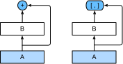
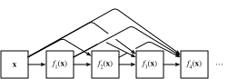

```{.python .input}
%load_ext d2lbook.tab
tab.interact_select(['mxnet', 'pytorch', 'tensorflow', 'jax'])
```

# Tankiai sujungti tinklai (DenseNet)
:label:`sec_densenet`

ResNet gerokai pakeitė požiūrį į tai, kaip parametrizuoti funkcijas giliuosiuose tinkluose. *DenseNet* (tankus konvoliucinis tinklas) tam tikru mastu yra loginis šio požiūrio tęsinys :cite:`Huang.Liu.Van-Der-Maaten.ea.2017`.
DenseNet pasižymi ir jungčių šablonu, kuriame
kiekvienas sluoksnis jungiasi su visais ankstesniais sluoksniais,
ir sujungimo operacija (o ne sudėties operatoriumi, kaip ResNet), skirta išsaugoti ir pakartotinai naudoti požymius
iš ankstesnių sluoksnių.
Kad suprastume, kaip prie to prieinama, padarykime nedidelę ekskursiją į matematiką.

```{.python .input}
%%tab mxnet
from d2l import mxnet as d2l
from mxnet import init, np, npx
from mxnet.gluon import nn
npx.set_np()
```

```{.python .input}
%%tab pytorch
from d2l import torch as d2l
import torch
from torch import nn
```

```{.python .input}
%%tab tensorflow
from d2l import tensorflow as d2l
import tensorflow as tf
```

```{.python .input}
%%tab jax
from d2l import jax as d2l
from flax import linen as nn
from jax import numpy as jnp
import jax
```

## Nuo ResNet prie DenseNet

Prisiminkite funkcijų Teiloro skleidinį. Taške $x = 0$ jį galima užrašyti taip:

$$f(x) = f(0) + x \cdot \left[f'(0) + x \cdot \left[\frac{f''(0)}{2!}  + x \cdot \left[\frac{f'''(0)}{3!}  + \cdots \right]\right]\right].$$


Svarbiausia, kad jis skaido funkciją į vis aukštesnės eilės narius. Panašiai ResNet skaido funkcijas į

$$f(\mathbf{x}) = \mathbf{x} + g(\mathbf{x}).$$

Tai yra, ResNet skaido $f$ į paprastą tiesinį narį ir sudėtingesnį
netiesinį narį.
Ką daryti, jei norėtume užfiksuoti (nebūtinai pridėti) informaciją už dviejų narių ribų?
Vienas toks sprendimas yra DenseNet :cite:`Huang.Liu.Van-Der-Maaten.ea.2017`.


:label:`fig_densenet_block`

Kaip parodyta :numref:`fig_densenet_block`, pagrindinis ResNet ir DenseNet skirtumas yra tas, kad pastaruoju atveju išvestys yra *sujungiamos* (žymima $[,]$), o ne sudedamos.
Todėl atliekame atvaizdavimą iš $\mathbf{x}$ į jo reikšmes, pritaikius vis sudėtingesnę funkcijų seką:

$$\mathbf{x} \to \left[
\mathbf{x},
f_1(\mathbf{x}),
f_2\left(\left[\mathbf{x}, f_1\left(\mathbf{x}\right)\right]\right), f_3\left(\left[\mathbf{x}, f_1\left(\mathbf{x}\right), f_2\left(\left[\mathbf{x}, f_1\left(\mathbf{x}\right)\right]\right)\right]\right), \ldots\right].$$

Galiausiai visos šios funkcijos sujungiamos MLP, kad vėl sumažintų požymių skaičių. Įgyvendinimo požiūriu tai gana paprasta:
užuot sudėję narius, juos sujungiame. DenseNet pavadinimas kilo iš to, kad kintamųjų priklausomybių grafas tampa gana tankus. Paskutinis tokios grandinės sluoksnis yra tankiai sujungtas su visais ankstesniais sluoksniais. Tankios jungtys parodytos :numref:`fig_densenet`.


:label:`fig_densenet`

Pagrindiniai DenseNet komponentai yra *tankieji blokai* ir *pereinamieji sluoksniai*. Pirmieji apibrėžia, kaip sujungiamos įvestys ir išvestys, o antrieji kontroliuoja kanalų skaičių, kad jis nebūtų per didelis,
nes skleidinys $\mathbf{x} \to \left[\mathbf{x}, f_1(\mathbf{x}),
f_2\left(\left[\mathbf{x}, f_1\left(\mathbf{x}\right)\right]\right), \ldots \right]$ gali būti gana didelės dimensijos.


## [**Tankieji blokai**]

DenseNet naudoja modifikuotą ResNet struktūrą „rinkinio normalizacija, aktyvacija ir konvoliucija“
(žr. pratimą :numref:`sec_resnet`).
Pirmiausia įgyvendiname šią konvoliucinio bloko struktūrą.

```{.python .input}
%%tab mxnet
def conv_block(num_channels):
    blk = nn.Sequential()
    blk.add(nn.BatchNorm(),
            nn.Activation('relu'),
            nn.Conv2D(num_channels, kernel_size=3, padding=1))
    return blk
```

```{.python .input}
%%tab pytorch
def conv_block(num_channels):
    return nn.Sequential(
        nn.LazyBatchNorm2d(), nn.ReLU(),
        nn.LazyConv2d(num_channels, kernel_size=3, padding=1))
```

```{.python .input}
%%tab tensorflow
class ConvBlock(tf.keras.layers.Layer):
    def __init__(self, num_channels):
        super(ConvBlock, self).__init__()
        self.bn = tf.keras.layers.BatchNormalization()
        self.relu = tf.keras.layers.ReLU()
        self.conv = tf.keras.layers.Conv2D(
            filters=num_channels, kernel_size=(3, 3), padding='same')

        self.listLayers = [self.bn, self.relu, self.conv]

    def call(self, x):
        y = x
        for layer in self.listLayers.layers:
            y = layer(y)
        y = tf.keras.layers.concatenate([x,y], axis=-1)
        return y
```

```{.python .input}
%%tab jax
class ConvBlock(nn.Module):
    num_channels: int
    training: bool = True

    @nn.compact
    def __call__(self, X):
        Y = nn.relu(nn.BatchNorm(not self.training)(X))
        Y = nn.Conv(self.num_channels, kernel_size=(3, 3), padding=(1, 1))(Y)
        Y = jnp.concatenate((X, Y), axis=-1)
        return Y
```

*Tankusis blokas* susideda iš kelių konvoliucinių blokų, kurių kiekvienas naudoja tą patį išvesties kanalų skaičių. Tačiau tiesioginio sklidimo metu kiekvieno konvoliucinio bloko įvestį ir išvestį sujungiame kanalų dimensijoje. Tingusis vertinimas leidžia mums automatiškai pritaikyti dimensiją.

```{.python .input}
%%tab mxnet
class DenseBlock(nn.Block):
    def __init__(self, num_convs, num_channels):
        super().__init__()
        self.net = nn.Sequential()
        for _ in range(num_convs):
            self.net.add(conv_block(num_channels))

    def forward(self, X):
        for blk in self.net:
            Y = blk(X)
            # Concatenate input and output of each block along the channels
            X = np.concatenate((X, Y), axis=1)
        return X
```

```{.python .input}
%%tab pytorch
class DenseBlock(nn.Module):
    def __init__(self, num_convs, num_channels):
        super(DenseBlock, self).__init__()
        layer = []
        for i in range(num_convs):
            layer.append(conv_block(num_channels))
        self.net = nn.Sequential(*layer)

    def forward(self, X):
        for blk in self.net:
            Y = blk(X)
            # Concatenate input and output of each block along the channels
            X = torch.cat((X, Y), dim=1)
        return X
```

```{.python .input}
%%tab tensorflow
class DenseBlock(tf.keras.layers.Layer):
    def __init__(self, num_convs, num_channels):
        super(DenseBlock, self).__init__()
        self.listLayers = []
        for _ in range(num_convs):
            self.listLayers.append(ConvBlock(num_channels))

    def call(self, x):
        for layer in self.listLayers.layers:
            x = layer(x)
        return x
```

```{.python .input}
%%tab jax
class DenseBlock(nn.Module):
    num_convs: int
    num_channels: int
    training: bool = True

    def setup(self):
        layer = []
        for i in range(self.num_convs):
            layer.append(ConvBlock(self.num_channels, self.training))
        self.net = nn.Sequential(layer)

    def __call__(self, X):
        return self.net(X)
```

Šiame pavyzdyje
[**apibrėžiame `DenseBlock` egzempliorių**] su dviem konvoliuciniais blokais, kurių kiekvienas turi 10 išvesties kanalų.
Naudojant įvestį su trimis kanalais, gausime išvestį su $3 + 10 + 10=23$ kanalais. Konvoliucinio bloko kanalų skaičius kontroliuoja išvesties kanalų skaičiaus augimą palyginti su įvesties kanalų skaičiumi. Tai taip pat vadinama *augimo sparta*.

```{.python .input}
%%tab pytorch, mxnet, tensorflow
blk = DenseBlock(2, 10)
if tab.selected('mxnet'):
    X = np.random.uniform(size=(4, 3, 8, 8))
    blk.initialize()
if tab.selected('pytorch'):
    X = torch.randn(4, 3, 8, 8)
if tab.selected('tensorflow'):
    X = tf.random.uniform((4, 8, 8, 3))
Y = blk(X)
Y.shape
```

```{.python .input}
%%tab jax
blk = DenseBlock(2, 10)
X = jnp.zeros((4, 8, 8, 3))
Y = blk.init_with_output(d2l.get_key(), X)[0]
Y.shape
```

## [**Pereinamieji sluoksniai**]

Kadangi kiekvienas tankusis blokas didins kanalų skaičių, pridėjus jų per daug modelis taps pernelyg sudėtingas. *Pereinamasis sluoksnis* naudojamas modelio sudėtingumui kontroliuoti. Jis sumažina kanalų skaičių naudodamas $1\times 1$ konvoliuciją. Be to, jis perpus sumažina aukštį ir plotį sutelkimu vidurkinant su 2 žingsniu.

```{.python .input}
%%tab mxnet
def transition_block(num_channels):
    blk = nn.Sequential()
    blk.add(nn.BatchNorm(), nn.Activation('relu'),
            nn.Conv2D(num_channels, kernel_size=1),
            nn.AvgPool2D(pool_size=2, strides=2))
    return blk
```

```{.python .input}
%%tab pytorch
def transition_block(num_channels):
    return nn.Sequential(
        nn.LazyBatchNorm2d(), nn.ReLU(),
        nn.LazyConv2d(num_channels, kernel_size=1),
        nn.AvgPool2d(kernel_size=2, stride=2))
```

```{.python .input}
%%tab tensorflow
class TransitionBlock(tf.keras.layers.Layer):
    def __init__(self, num_channels, **kwargs):
        super(TransitionBlock, self).__init__(**kwargs)
        self.batch_norm = tf.keras.layers.BatchNormalization()
        self.relu = tf.keras.layers.ReLU()
        self.conv = tf.keras.layers.Conv2D(num_channels, kernel_size=1)
        self.avg_pool = tf.keras.layers.AvgPool2D(pool_size=2, strides=2)

    def call(self, x):
        x = self.batch_norm(x)
        x = self.relu(x)
        x = self.conv(x)
        return self.avg_pool(x)
```

```{.python .input}
%%tab jax
class TransitionBlock(nn.Module):
    num_channels: int
    training: bool = True

    @nn.compact
    def __call__(self, X):
        X = nn.BatchNorm(not self.training)(X)
        X = nn.relu(X)
        X = nn.Conv(self.num_channels, kernel_size=(1, 1))(X)
        X = nn.avg_pool(X, window_shape=(2, 2), strides=(2, 2))
        return X
```

[**Pritaikykite pereinamąjį sluoksnį**] su 10 kanalų ankstesnio pavyzdžio tankiojo bloko išvesčiai. Tai sumažina išvesties kanalų skaičių iki 10 ir perpus sumažina aukštį ir plotį.

```{.python .input}
%%tab mxnet
blk = transition_block(10)
blk.initialize()
blk(Y).shape
```

```{.python .input}
%%tab pytorch
blk = transition_block(10)
blk(Y).shape
```

```{.python .input}
%%tab tensorflow
blk = TransitionBlock(10)
blk(Y).shape
```

```{.python .input}
%%tab jax
blk = TransitionBlock(10)
blk.init_with_output(d2l.get_key(), Y)[0].shape
```

## [**DenseNet modelis**]

Toliau sukonstruosime DenseNet modelį. DenseNet pirmiausia naudoja tą patį vieną konvoliucinį sluoksnį ir sutelkimo imant maksimumą sluoksnį kaip ResNet.

```{.python .input}
%%tab pytorch, mxnet, tensorflow
class DenseNet(d2l.Classifier):
    def b1(self):
        if tab.selected('mxnet'):
            net = nn.Sequential()
            net.add(nn.Conv2D(64, kernel_size=7, strides=2, padding=3),
                nn.BatchNorm(), nn.Activation('relu'),
                nn.MaxPool2D(pool_size=3, strides=2, padding=1))
            return net
        if tab.selected('pytorch'):
            return nn.Sequential(
                nn.LazyConv2d(64, kernel_size=7, stride=2, padding=3),
                nn.LazyBatchNorm2d(), nn.ReLU(),
                nn.MaxPool2d(kernel_size=3, stride=2, padding=1))
        if tab.selected('tensorflow'):
            return tf.keras.models.Sequential([
                tf.keras.layers.Conv2D(
                    64, kernel_size=7, strides=2, padding='same'),
                tf.keras.layers.BatchNormalization(),
                tf.keras.layers.ReLU(),
                tf.keras.layers.MaxPool2D(
                    pool_size=3, strides=2, padding='same')])
```

```{.python .input}
%%tab jax
class DenseNet(d2l.Classifier):
    num_channels: int = 64
    growth_rate: int = 32
    arch: tuple = (4, 4, 4, 4)
    lr: float = 0.1
    num_classes: int = 10
    training: bool = True

    def setup(self):
        self.net = self.create_net()

    def b1(self):
        return nn.Sequential([
            nn.Conv(64, kernel_size=(7, 7), strides=(2, 2), padding='same'),
            nn.BatchNorm(not self.training),
            nn.relu,
            lambda x: nn.max_pool(x, window_shape=(3, 3),
                                  strides=(2, 2), padding='same')
        ])
```

Tada, panašiai kaip keturis modulius, sudarytus iš liekamųjų blokų, kuriuos naudoja ResNet,
DenseNet naudoja keturis tankiuosius blokus.
Kaip ir ResNet, galime nustatyti kiekviename tankiajame bloke naudojamų konvoliucinių sluoksnių skaičių. Čia nustatome 4, atitinkamai ResNet-18 modeliui iš :numref:`sec_resnet`. Be to, tankiojo bloko konvoliucinių sluoksnių kanalų skaičių (t. y. augimo spartą) nustatome 32, todėl į kiekvieną tankųjį bloką bus pridėta 128 kanalai.

ResNet aukštis ir plotis tarp modulių mažinami liekamuoju bloku su 2 žingsniu. Čia naudojame pereinamąjį sluoksnį, kad perpus sumažintume aukštį ir plotį bei perpus sumažintume kanalų skaičių. Kaip ir ResNet, pabaigoje prijungiamas globalaus sutelkimo sluoksnis ir pilnai sujungtas sluoksnis išvesčiai gauti.

```{.python .input}
%%tab pytorch, mxnet, tensorflow
@d2l.add_to_class(DenseNet)
def __init__(self, num_channels=64, growth_rate=32, arch=(4, 4, 4, 4),
             lr=0.1, num_classes=10):
    super(DenseNet, self).__init__()
    self.save_hyperparameters()
    if tab.selected('mxnet'):
        self.net = nn.Sequential()
        self.net.add(self.b1())
        for i, num_convs in enumerate(arch):
            self.net.add(DenseBlock(num_convs, growth_rate))
            # The number of output channels in the previous dense block
            num_channels += num_convs * growth_rate
            # A transition layer that halves the number of channels is added
            # between the dense blocks
            if i != len(arch) - 1:
                num_channels //= 2
                self.net.add(transition_block(num_channels))
        self.net.add(nn.BatchNorm(), nn.Activation('relu'),
                     nn.GlobalAvgPool2D(), nn.Dense(num_classes))
        self.net.initialize(init.Xavier())
    if tab.selected('pytorch'):
        self.net = nn.Sequential(self.b1())
        for i, num_convs in enumerate(arch):
            self.net.add_module(f'dense_blk{i+1}', DenseBlock(num_convs,
                                                              growth_rate))
            # The number of output channels in the previous dense block
            num_channels += num_convs * growth_rate
            # A transition layer that halves the number of channels is added
            # between the dense blocks
            if i != len(arch) - 1:
                num_channels //= 2
                self.net.add_module(f'tran_blk{i+1}', transition_block(
                    num_channels))
        self.net.add_module('last', nn.Sequential(
            nn.LazyBatchNorm2d(), nn.ReLU(),
            nn.AdaptiveAvgPool2d((1, 1)), nn.Flatten(),
            nn.LazyLinear(num_classes)))
        self.net.apply(d2l.init_cnn)
    if tab.selected('tensorflow'):
        self.net = tf.keras.models.Sequential(self.b1())
        for i, num_convs in enumerate(arch):
            self.net.add(DenseBlock(num_convs, growth_rate))
            # The number of output channels in the previous dense block
            num_channels += num_convs * growth_rate
            # A transition layer that halves the number of channels is added
            # between the dense blocks
            if i != len(arch) - 1:
                num_channels //= 2
                self.net.add(TransitionBlock(num_channels))
        self.net.add(tf.keras.models.Sequential([
            tf.keras.layers.BatchNormalization(),
            tf.keras.layers.ReLU(),
            tf.keras.layers.GlobalAvgPool2D(),
            tf.keras.layers.Flatten(),
            tf.keras.layers.Dense(num_classes)]))
```

```{.python .input}
%%tab jax
@d2l.add_to_class(DenseNet)
def create_net(self):
    net = self.b1()
    for i, num_convs in enumerate(self.arch):
        net.layers.extend([DenseBlock(num_convs, self.growth_rate,
                                      training=self.training)])
        # The number of output channels in the previous dense block
        num_channels = self.num_channels + (num_convs * self.growth_rate)
        # A transition layer that halves the number of channels is added
        # between the dense blocks
        if i != len(self.arch) - 1:
            num_channels //= 2
            net.layers.extend([TransitionBlock(num_channels,
                                               training=self.training)])
    net.layers.extend([
        nn.BatchNorm(not self.training),
        nn.relu,
        lambda x: nn.avg_pool(x, window_shape=x.shape[1:3],
                              strides=x.shape[1:3], padding='valid'),
        lambda x: x.reshape((x.shape[0], -1)),
        nn.Dense(self.num_classes)
    ])
    return net
```

## [**Mokymas**]

Kadangi čia naudojame gilesnį tinklą, šiame skyrelyje sumažinsime įvesties aukštį ir plotį nuo 224 iki 96, kad supaprastintume skaičiavimą.

```{.python .input}
%%tab mxnet, pytorch, jax
model = DenseNet(lr=0.01)
trainer = d2l.Trainer(max_epochs=10, num_gpus=1)
data = d2l.FashionMNIST(batch_size=128, resize=(96, 96))
trainer.fit(model, data)
```

```{.python .input}
%%tab tensorflow
trainer = d2l.Trainer(max_epochs=10)
data = d2l.FashionMNIST(batch_size=128, resize=(96, 96))
with d2l.try_gpu():
    model = DenseNet(lr=0.01)
    trainer.fit(model, data)
```

## Santrauka ir diskusija

Pagrindiniai DenseNet komponentai yra tankieji blokai ir pereinamieji sluoksniai. Pastariesiems, komponuodami tinklą, turime išlaikyti dimensiją kontroliuojamą, pridėdami pereinamuosius sluoksnius, kurie vėl sumažina kanalų skaičių.
Tarpsluoksnių jungčių požiūriu, priešingai nei ResNet, kur įvestys ir išvestys sudedamos, DenseNet sujungia įvestis ir išvestis kanalų dimensijoje.
Nors šios sujungimo operacijos
pakartotinai naudoja požymius skaičiavimo efektyvumui pasiekti,
deja, jos lemia didelį GPU atminties suvartojimą.
Todėl
taikant DenseNet gali prireikti atmintį taupančių įgyvendinimų, kurie gali pailginti apmokymo laiką :cite:`pleiss2017memory`.


## Pratimai

1. Kodėl pereinamajame sluoksnyje naudojame sutelkimą vidurkinant, o ne imant maksimumą?
1. Vienas iš DenseNet straipsnyje paminėtų privalumų yra tas, kad jo modelio parametrų yra mažiau nei ResNet. Kodėl taip yra?
1. Viena problema, dėl kurios DenseNet buvo kritikuojamas, yra didelis atminties suvartojimas.
    1. Ar tai tikrai taip? Pabandykite pakeisti įvesties formą į $224\times 224$, kad empiriškai palygintumėte realų GPU atminties suvartojimą.
    1. Ar galite sugalvoti alternatyvų atminties suvartojimo mažinimo būdą? Kaip reikėtų pakeisti karkasą?
1. Įgyvendinkite įvairias DenseNet versijas, pateiktas DenseNet straipsnio 1 lentelėje :cite:`Huang.Liu.Van-Der-Maaten.ea.2017`.
1. Suprojektuokite MLP pagrįstą modelį, pritaikydami DenseNet idėją. Pritaikykite jį būsto kainų prognozavimo užduočiai iš :numref:`sec_kaggle_house`.

:begin_tab:`mxnet`
[Diskusijos](https://discuss.d2l.ai/t/87)
:end_tab:

:begin_tab:`pytorch`
[Diskusijos](https://discuss.d2l.ai/t/88)
:end_tab:

:begin_tab:`tensorflow`
[Diskusijos](https://discuss.d2l.ai/t/331)
:end_tab:

:begin_tab:`jax`
[Diskusijos](https://discuss.d2l.ai/t/18008)
:end_tab:
