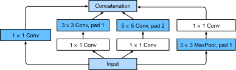
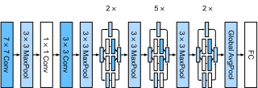

```{.python .input}
%load_ext d2lbook.tab
tab.interact_select(['mxnet', 'pytorch', 'tensorflow', 'jax'])
```

# Daugiašakiai tinklai (GoogLeNet)
:label:`sec_googlenet`

2014 m. *GoogLeNet*
laimėjo ImageNet iššūkį :cite:`Szegedy.Liu.Jia.ea.2015`, naudodamas struktūrą,
kuri sujungė NiN :cite:`Lin.Chen.Yan.2013`, pasikartojančių blokų :cite:`Simonyan.Zisserman.2014`
ir konvoliucijos branduolių kokteilio stipriąsias puses. Tai taip pat, galima sakyti, buvo pirmasis tinklas, kuriame CNN aiškiai atskirti pradžios dalis (duomenų priėmimas), korpusas (duomenų apdorojimas) ir galva (prognozavimas). Šis dizaino šablonas išliko giliųjų tinklų projektavime iki šiol: *pradžios dalį* sudaro pirmosios dvi ar trys konvoliucijos, veikiančios vaizdą. Jos išskiria žemo lygio požymius iš pradinių vaizdų. Po jos eina konvoliucinių blokų *korpusas*. Galiausiai *galva* atvaizduoja iki šiol gautus požymius į reikiamą klasifikavimo, segmentavimo, aptikimo ar sekimo uždavinį.

Pagrindinis GoogLeNet indėlis buvo tinklo korpuso dizainas. Jis išradingai išsprendė konvoliucijos branduolių
pasirinkimo problemą. Kol kiti darbai bandė nustatyti, kuri konvoliucija – nuo $1 \times 1$ iki $11 \times 11$ – būtų geriausia, jis tiesiog *sujungė* daugiašakes konvoliucijas.
Toliau pristatome šiek tiek supaprastintą GoogLeNet versiją: originalus dizainas apėmė daug gudrybių apmokymui stabilizuoti per tarpines nuostolių funkcijas, taikomas keliems tinklo sluoksniams.
Jų nebereikia, nes yra patobulintų apmokymo algoritmų.

```{.python .input}
%%tab mxnet
from d2l import mxnet as d2l
from mxnet import np, npx, init
from mxnet.gluon import nn
npx.set_np()
```

```{.python .input}
%%tab pytorch
from d2l import torch as d2l
import torch
from torch import nn
from torch.nn import functional as F
```

```{.python .input}
%%tab tensorflow
import tensorflow as tf
from d2l import tensorflow as d2l
```

```{.python .input}
%%tab jax
from d2l import jax as d2l
from flax import linen as nn
from jax import numpy as jnp
import jax
```

## (**Inception blokai**)

Pagrindinis GoogLeNet konvoliucinis blokas vadinamas *Inception bloku*,
pavadintu pagal memą „turime eiti giliau“ iš filmo *Pradžia* (angl. *Inception*).


:label:`fig_inception`

Kaip pavaizduota :numref:`fig_inception`,
inception blokas susideda iš keturių lygiagrečių šakų.
Pirmosios trys šakos naudoja konvoliucinius sluoksnius
su $1\times 1$, $3\times 3$ ir $5\times 5$ lango dydžiais,
kad išskirtų informaciją iš skirtingų erdvinių dydžių.
Vidurinės dvi šakos taip pat prideda $1\times 1$ įvesties konvoliuciją,
kad sumažintų kanalų skaičių ir taip sumažintų modelio sudėtingumą.
Ketvirtoji šaka naudoja $3\times 3$ sutelkimo imant maksimumą sluoksnį,
po kurio eina $1\times 1$ konvoliucinis sluoksnis
kanalų skaičiui pakeisti.
Visos keturios šakos naudoja tinkamą papildymą, kad įvestis ir išvestis turėtų tą patį aukštį ir plotį.
Galiausiai kiekvienos šakos išvestys sujungiamos
kanalų dimensijoje ir sudaro bloko išvestį.
Dažniausiai derinami Inception bloko hiperparametrai
yra išvesties kanalų skaičius kiekviename sluoksnyje, t. y. kaip paskirstyti pajėgumą tarp skirtingo dydžio konvoliucijų.

```{.python .input}
%%tab mxnet
class Inception(nn.Block):
    # c1--c4 are the number of output channels for each branch
    def __init__(self, c1, c2, c3, c4, **kwargs):
        super(Inception, self).__init__(**kwargs)
        # Branch 1
        self.b1_1 = nn.Conv2D(c1, kernel_size=1, activation='relu')
        # Branch 2
        self.b2_1 = nn.Conv2D(c2[0], kernel_size=1, activation='relu')
        self.b2_2 = nn.Conv2D(c2[1], kernel_size=3, padding=1,
                              activation='relu')
        # Branch 3
        self.b3_1 = nn.Conv2D(c3[0], kernel_size=1, activation='relu')
        self.b3_2 = nn.Conv2D(c3[1], kernel_size=5, padding=2,
                              activation='relu')
        # Branch 4
        self.b4_1 = nn.MaxPool2D(pool_size=3, strides=1, padding=1)
        self.b4_2 = nn.Conv2D(c4, kernel_size=1, activation='relu')

    def forward(self, x):
        b1 = self.b1_1(x)
        b2 = self.b2_2(self.b2_1(x))
        b3 = self.b3_2(self.b3_1(x))
        b4 = self.b4_2(self.b4_1(x))
        return np.concatenate((b1, b2, b3, b4), axis=1)
```

```{.python .input}
%%tab pytorch
class Inception(nn.Module):
    # c1--c4 are the number of output channels for each branch
    def __init__(self, c1, c2, c3, c4, **kwargs):
        super(Inception, self).__init__(**kwargs)
        # Branch 1
        self.b1_1 = nn.LazyConv2d(c1, kernel_size=1)
        # Branch 2
        self.b2_1 = nn.LazyConv2d(c2[0], kernel_size=1)
        self.b2_2 = nn.LazyConv2d(c2[1], kernel_size=3, padding=1)
        # Branch 3
        self.b3_1 = nn.LazyConv2d(c3[0], kernel_size=1)
        self.b3_2 = nn.LazyConv2d(c3[1], kernel_size=5, padding=2)
        # Branch 4
        self.b4_1 = nn.MaxPool2d(kernel_size=3, stride=1, padding=1)
        self.b4_2 = nn.LazyConv2d(c4, kernel_size=1)

    def forward(self, x):
        b1 = F.relu(self.b1_1(x))
        b2 = F.relu(self.b2_2(F.relu(self.b2_1(x))))
        b3 = F.relu(self.b3_2(F.relu(self.b3_1(x))))
        b4 = F.relu(self.b4_2(self.b4_1(x)))
        return torch.cat((b1, b2, b3, b4), dim=1)
```

```{.python .input}
%%tab tensorflow
class Inception(tf.keras.Model):
    # c1--c4 are the number of output channels for each branch
    def __init__(self, c1, c2, c3, c4):
        super().__init__()
        self.b1_1 = tf.keras.layers.Conv2D(c1, 1, activation='relu')
        self.b2_1 = tf.keras.layers.Conv2D(c2[0], 1, activation='relu')
        self.b2_2 = tf.keras.layers.Conv2D(c2[1], 3, padding='same',
                                           activation='relu')
        self.b3_1 = tf.keras.layers.Conv2D(c3[0], 1, activation='relu')
        self.b3_2 = tf.keras.layers.Conv2D(c3[1], 5, padding='same',
                                           activation='relu')
        self.b4_1 = tf.keras.layers.MaxPool2D(3, 1, padding='same')
        self.b4_2 = tf.keras.layers.Conv2D(c4, 1, activation='relu')

    def call(self, x):
        b1 = self.b1_1(x)
        b2 = self.b2_2(self.b2_1(x))
        b3 = self.b3_2(self.b3_1(x))
        b4 = self.b4_2(self.b4_1(x))
        return tf.keras.layers.Concatenate()([b1, b2, b3, b4])
```

```{.python .input}
%%tab jax
class Inception(nn.Module):
    # `c1`--`c4` are the number of output channels for each branch
    c1: int
    c2: tuple
    c3: tuple
    c4: int

    def setup(self):
        # Branch 1
        self.b1_1 = nn.Conv(self.c1, kernel_size=(1, 1))
        # Branch 2
        self.b2_1 = nn.Conv(self.c2[0], kernel_size=(1, 1))
        self.b2_2 = nn.Conv(self.c2[1], kernel_size=(3, 3), padding='same')
        # Branch 3
        self.b3_1 = nn.Conv(self.c3[0], kernel_size=(1, 1))
        self.b3_2 = nn.Conv(self.c3[1], kernel_size=(5, 5), padding='same')
        # Branch 4
        self.b4_1 = lambda x: nn.max_pool(x, window_shape=(3, 3),
                                          strides=(1, 1), padding='same')
        self.b4_2 = nn.Conv(self.c4, kernel_size=(1, 1))

    def __call__(self, x):
        b1 = nn.relu(self.b1_1(x))
        b2 = nn.relu(self.b2_2(nn.relu(self.b2_1(x))))
        b3 = nn.relu(self.b3_2(nn.relu(self.b3_1(x))))
        b4 = nn.relu(self.b4_2(self.b4_1(x)))
        return jnp.concatenate((b1, b2, b3, b4), axis=-1)
```

Kad įgytume intuiciją, kodėl šis tinklas veikia taip gerai,
panagrinėkime filtrų derinį.
Jie tyrinėja vaizdą įvairių dydžių filtrais.
Tai reiškia, kad skirtingo masto detales
efektyviai gali atpažinti skirtingo dydžio filtrai.
Tuo pat metu galime skirtingiems filtrams
skirti skirtingą parametrų kiekį.


## [**GoogLeNet modelis**]

Kaip parodyta :numref:`fig_inception_full`, GoogLeNet naudoja iš viso 9 inception blokų krūvą, sugrupuotą į tris grupes su sutelkimu imant maksimumą tarp jų,
o galvoje naudoja globalų sutelkimą vidurkinant savo įverčiams generuoti.
Sutelkimas imant maksimumą tarp inception blokų mažina dimensiją.
Pradžios dalyje pirmasis modulis panašus į AlexNet ir LeNet.


:label:`fig_inception_full`

Dabar galime įgyvendinti GoogLeNet dalimis. Pradėkime nuo pradžios dalies.
Pirmasis modulis naudoja 64 kanalų $7\times 7$ konvoliucinį sluoksnį.

```{.python .input}
%%tab pytorch, mxnet, tensorflow
class GoogleNet(d2l.Classifier):
    def b1(self):
        if tab.selected('mxnet'):
            net = nn.Sequential()
            net.add(nn.Conv2D(64, kernel_size=7, strides=2, padding=3,
                              activation='relu'),
                    nn.MaxPool2D(pool_size=3, strides=2, padding=1))
            return net
        if tab.selected('pytorch'):
            return nn.Sequential(
                nn.LazyConv2d(64, kernel_size=7, stride=2, padding=3),
                nn.ReLU(), nn.MaxPool2d(kernel_size=3, stride=2, padding=1))
        if tab.selected('tensorflow'):
            return tf.keras.models.Sequential([
                tf.keras.layers.Conv2D(64, 7, strides=2, padding='same',
                                       activation='relu'),
                tf.keras.layers.MaxPool2D(pool_size=3, strides=2,
                                          padding='same')])
```

```{.python .input}
%%tab jax
class GoogleNet(d2l.Classifier):
    lr: float = 0.1
    num_classes: int = 10

    def setup(self):
        self.net = nn.Sequential([self.b1(), self.b2(), self.b3(), self.b4(),
                                  self.b5(), nn.Dense(self.num_classes)])

    def b1(self):
        return nn.Sequential([
                nn.Conv(64, kernel_size=(7, 7), strides=(2, 2), padding='same'),
                nn.relu,
                lambda x: nn.max_pool(x, window_shape=(3, 3), strides=(2, 2),
                                      padding='same')])
```

Antrasis modulis naudoja du konvoliucinius sluoksnius:
pirmiausia 64 kanalų $1\times 1$ konvoliucinį sluoksnį,
po kurio eina $3\times 3$ konvoliucinis sluoksnis, utrigubinantis kanalų skaičių. Tai atitinka antrąją Inception bloko šaką ir užbaigia korpuso dizainą. Šiuo metu turime 192 kanalus.

```{.python .input}
%%tab all
@d2l.add_to_class(GoogleNet)
def b2(self):
    if tab.selected('mxnet'):
        net = nn.Sequential()
        net.add(nn.Conv2D(64, kernel_size=1, activation='relu'),
               nn.Conv2D(192, kernel_size=3, padding=1, activation='relu'),
               nn.MaxPool2D(pool_size=3, strides=2, padding=1))
        return net
    if tab.selected('pytorch'):
        return nn.Sequential(
            nn.LazyConv2d(64, kernel_size=1), nn.ReLU(),
            nn.LazyConv2d(192, kernel_size=3, padding=1), nn.ReLU(),
            nn.MaxPool2d(kernel_size=3, stride=2, padding=1))
    if tab.selected('tensorflow'):
        return tf.keras.Sequential([
            tf.keras.layers.Conv2D(64, 1, activation='relu'),
            tf.keras.layers.Conv2D(192, 3, padding='same', activation='relu'),
            tf.keras.layers.MaxPool2D(pool_size=3, strides=2, padding='same')])
    if tab.selected('jax'):
        return nn.Sequential([nn.Conv(64, kernel_size=(1, 1)),
                              nn.relu,
                              nn.Conv(192, kernel_size=(3, 3), padding='same'),
                              nn.relu,
                              lambda x: nn.max_pool(x, window_shape=(3, 3),
                                                    strides=(2, 2),
                                                    padding='same')])
```

Trečiasis modulis nuosekliai sujungia du pilnus Inception blokus.
Pirmojo Inception bloko išvesties kanalų skaičius yra
$64+128+32+32=256$. Tai atitinka
išvesties kanalų skaičiaus santykį
tarp keturių šakų $2:4:1:1$. Kad tai pasiektume, pirmiausia sumažiname įvesties
dimensijas $\frac{1}{2}$ ir $\frac{1}{12}$ atitinkamai antrojoje ir trečiojoje šakose,
kad gautume atitinkamai $96 = 192/2$ ir $16 = 192/12$ kanalų.

Antrojo Inception bloko išvesties kanalų skaičius
padidinamas iki $128+192+96+64=480$, gaunant santykį $128:192:96:64 = 4:6:3:2$. Kaip ir anksčiau,
turime sumažinti tarpinių dimensijų skaičių antrajame ir trečiajame kanale. Pakanka
atitinkamai $\frac{1}{2}$ ir $\frac{1}{8}$ mastelio, gaunant atitinkamai $128$ ir $32$ kanalus.
Tai užfiksuota šių `Inception` bloko konstruktorių argumentuose.

```{.python .input}
%%tab all
@d2l.add_to_class(GoogleNet)
def b3(self):
    if tab.selected('mxnet'):
        net = nn.Sequential()
        net.add(Inception(64, (96, 128), (16, 32), 32),
               Inception(128, (128, 192), (32, 96), 64),
               nn.MaxPool2D(pool_size=3, strides=2, padding=1))
        return net
    if tab.selected('pytorch'):
        return nn.Sequential(Inception(64, (96, 128), (16, 32), 32),
                             Inception(128, (128, 192), (32, 96), 64),
                             nn.MaxPool2d(kernel_size=3, stride=2, padding=1))
    if tab.selected('tensorflow'):
        return tf.keras.models.Sequential([
            Inception(64, (96, 128), (16, 32), 32),
            Inception(128, (128, 192), (32, 96), 64),
            tf.keras.layers.MaxPool2D(pool_size=3, strides=2, padding='same')])
    if tab.selected('jax'):
        return nn.Sequential([Inception(64, (96, 128), (16, 32), 32),
                              Inception(128, (128, 192), (32, 96), 64),
                              lambda x: nn.max_pool(x, window_shape=(3, 3),
                                                    strides=(2, 2),
                                                    padding='same')])
```

Ketvirtasis modulis yra sudėtingesnis.
Jis nuosekliai sujungia penkis Inception blokus,
kurių išvesties kanalų skaičius atitinkamai yra $192+208+48+64=512$, $160+224+64+64=512$,
$128+256+64+64=512$, $112+288+64+64=528$
ir $256+320+128+128=832$.
Šioms šakoms paskirtas kanalų skaičius panašus
į trečiojo modulio:
antroji šaka su $3\times 3$ konvoliuciniu sluoksniu
išveda daugiausia kanalų,
po jos eina pirmoji šaka tik su $1\times 1$ konvoliuciniu sluoksniu,
trečioji šaka su $5\times 5$ konvoliuciniu sluoksniu
ir ketvirtoji šaka su $3\times 3$ sutelkimo imant maksimumą sluoksniu.
Antroji ir trečioji šakos pirmiausia sumažins
kanalų skaičių pagal santykį.
Šie santykiai šiek tiek skiriasi skirtinguose Inception blokuose.

```{.python .input}
%%tab all
@d2l.add_to_class(GoogleNet)
def b4(self):
    if tab.selected('mxnet'):
        net = nn.Sequential()
        net.add(Inception(192, (96, 208), (16, 48), 64),
                Inception(160, (112, 224), (24, 64), 64),
                Inception(128, (128, 256), (24, 64), 64),
                Inception(112, (144, 288), (32, 64), 64),
                Inception(256, (160, 320), (32, 128), 128),
                nn.MaxPool2D(pool_size=3, strides=2, padding=1))
        return net
    if tab.selected('pytorch'):
        return nn.Sequential(Inception(192, (96, 208), (16, 48), 64),
                             Inception(160, (112, 224), (24, 64), 64),
                             Inception(128, (128, 256), (24, 64), 64),
                             Inception(112, (144, 288), (32, 64), 64),
                             Inception(256, (160, 320), (32, 128), 128),
                             nn.MaxPool2d(kernel_size=3, stride=2, padding=1))
    if tab.selected('tensorflow'):
        return tf.keras.Sequential([
            Inception(192, (96, 208), (16, 48), 64),
            Inception(160, (112, 224), (24, 64), 64),
            Inception(128, (128, 256), (24, 64), 64),
            Inception(112, (144, 288), (32, 64), 64),
            Inception(256, (160, 320), (32, 128), 128),
            tf.keras.layers.MaxPool2D(pool_size=3, strides=2, padding='same')])
    if tab.selected('jax'):
        return nn.Sequential([Inception(192, (96, 208), (16, 48), 64),
                              Inception(160, (112, 224), (24, 64), 64),
                              Inception(128, (128, 256), (24, 64), 64),
                              Inception(112, (144, 288), (32, 64), 64),
                              Inception(256, (160, 320), (32, 128), 128),
                              lambda x: nn.max_pool(x, window_shape=(3, 3),
                                                    strides=(2, 2),
                                                    padding='same')])
```

Penktasis modulis turi du Inception blokus su $256+320+128+128=832$
ir $384+384+128+128=1024$ išvesties kanalais.
Kiekvienai šakai paskirtas kanalų skaičius
toks pat kaip trečiajame ir ketvirtajame moduliuose,
bet skiriasi konkrečiomis reikšmėmis.
Reikia pažymėti, kad po penktojo bloko eina išvesties sluoksnis.
Šis blokas naudoja globalaus sutelkimo vidurkinant sluoksnį,
kad kiekvieno kanalo aukštį ir plotį pakeistų į 1, kaip ir NiN.
Galiausiai išvestį paverčiame dvimačiu masyvu,
po kurio eina pilnai sujungtas sluoksnis,
kurio išėjimų skaičius yra žymenų klasių skaičius.

```{.python .input}
%%tab all
@d2l.add_to_class(GoogleNet)
def b5(self):
    if tab.selected('mxnet'):
        net = nn.Sequential()
        net.add(Inception(256, (160, 320), (32, 128), 128),
                Inception(384, (192, 384), (48, 128), 128),
                nn.GlobalAvgPool2D())
        return net
    if tab.selected('pytorch'):
        return nn.Sequential(Inception(256, (160, 320), (32, 128), 128),
                             Inception(384, (192, 384), (48, 128), 128),
                             nn.AdaptiveAvgPool2d((1,1)), nn.Flatten())
    if tab.selected('tensorflow'):
        return tf.keras.Sequential([
            Inception(256, (160, 320), (32, 128), 128),
            Inception(384, (192, 384), (48, 128), 128),
            tf.keras.layers.GlobalAvgPool2D(),
            tf.keras.layers.Flatten()])
    if tab.selected('jax'):
        return nn.Sequential([Inception(256, (160, 320), (32, 128), 128),
                              Inception(384, (192, 384), (48, 128), 128),
                              # Flax does not provide a GlobalAvgPool2D layer
                              lambda x: nn.avg_pool(x,
                                                    window_shape=x.shape[1:3],
                                                    strides=x.shape[1:3],
                                                    padding='valid'),
                              lambda x: x.reshape((x.shape[0], -1))])
```

Dabar, kai apibrėžėme visus blokus `b1`–`b5`, belieka juos visus sujungti į pilną tinklą.

```{.python .input}
%%tab pytorch, mxnet, tensorflow
@d2l.add_to_class(GoogleNet)
def __init__(self, lr=0.1, num_classes=10):
    super(GoogleNet, self).__init__()
    self.save_hyperparameters()
    if tab.selected('mxnet'):
        self.net = nn.Sequential()
        self.net.add(self.b1(), self.b2(), self.b3(), self.b4(), self.b5(),
                     nn.Dense(num_classes))
        self.net.initialize(init.Xavier())
    if tab.selected('pytorch'):
        self.net = nn.Sequential(self.b1(), self.b2(), self.b3(), self.b4(),
                                 self.b5(), nn.LazyLinear(num_classes))
        self.net.apply(d2l.init_cnn)
    if tab.selected('tensorflow'):
        self.net = tf.keras.Sequential([
            self.b1(), self.b2(), self.b3(), self.b4(), self.b5(),
            tf.keras.layers.Dense(num_classes)])
```

GoogLeNet modelis yra skaičiavimo požiūriu sudėtingas. Atkreipkite dėmesį į didelį santykinai savavališkų hiperparametrų skaičių: pasirinktą kanalų skaičių, blokų skaičių prieš dimensijos mažinimą, santykinį pajėgumo paskirstymą tarp kanalų ir t. t. Didžiąja dalimi taip yra dėl to,
kad tuo metu, kai buvo pristatytas GoogLeNet, dar nebuvo automatinių tinklų apibrėžimo ar dizaino tyrinėjimo
įrankių. Pavyzdžiui, dabar laikome savaime suprantamu dalyku, kad tinkamas giliojo mokymosi karkasas sugeba automatiškai nustatyti įvesties tenzorių dimensijas. Tuo metu daugelį tokių konfigūracijų eksperimentuotojas turėjo nurodyti aiškiai, todėl dažnai sulėtėdavo aktyvūs eksperimentai. Be to, automatiniam tyrinėjimui reikalingi įrankiai dar tebebuvo kuriami, o pirmieji eksperimentai daugiausia reiškė brangų brutalios jėgos tyrinėjimą, genetinius algoritmus ir panašias strategijas.

Kol kas vienintelis pakeitimas, kurį atliksime, yra
[**sumažinti įvesties aukštį ir plotį nuo 224 iki 96,
kad apmokymo laikas su Fashion-MNIST būtų pagrįstas.**]
Tai supaprastina skaičiavimą. Pažiūrėkime, kaip
keičiasi išvesties forma tarp įvairių modulių.

```{.python .input}
%%tab mxnet, pytorch
model = GoogleNet().layer_summary((1, 1, 96, 96))
```

```{.python .input}
%%tab tensorflow, jax
model = GoogleNet().layer_summary((1, 96, 96, 1))
```

## [**Mokymas**]

Kaip ir anksčiau, modelį apmokome naudodami Fashion-MNIST duomenų rinkinį.
 Prieš pradėdami apmokymo procedūrą, transformuojame jį į $96 \times 96$ pikselių skyrą.

```{.python .input}
%%tab mxnet, pytorch, jax
model = GoogleNet(lr=0.01)
trainer = d2l.Trainer(max_epochs=10, num_gpus=1)
data = d2l.FashionMNIST(batch_size=128, resize=(96, 96))
if tab.selected('pytorch'):
    model.apply_init([next(iter(data.get_dataloader(True)))[0]], d2l.init_cnn)
trainer.fit(model, data)
```

```{.python .input}
%%tab tensorflow
trainer = d2l.Trainer(max_epochs=10)
data = d2l.FashionMNIST(batch_size=128, resize=(96, 96))
with d2l.try_gpu():
    model = GoogleNet(lr=0.01)
    trainer.fit(model, data)
```

## Diskusija

Pagrindinė GoogLeNet savybė yra ta, kad jį iš tikrųjų *pigiau* skaičiuoti nei pirmtakus,
kartu užtikrinant didesnį tikslumą. Tai žymi daug apgalvotesnio
tinklų dizaino pradžią, kuriame vertinimo kaina keičiama į paklaidų sumažinimą. Tai taip pat žymi eksperimentų su tinklo dizaino hiperparametrais blokų lygiu pradžią, nors tuo metu tai buvo visiškai rankinis darbas. Prie šios temos sugrįšime :numref:`sec_cnn-design`, aptardami tinklo struktūros tyrinėjimo strategijas.

Kituose skyreliuose susidursime su keliais dizaino sprendimais (pvz., rinkinio normalizacija, liekamosiomis jungtimis ir kanalų grupavimu), leidžiančiais gerokai patobulinti tinklus. Kol kas galite didžiuotis, kad įgyvendinote, galima sakyti, pirmąjį tikrai šiuolaikinį CNN.

## Pratimai

1. GoogLeNet buvo toks sėkmingas, kad jis išgyveno keletą iteracijų, palaipsniui gerinant greitį ir tikslumą. Pabandykite įgyvendinti ir paleisti kai kurias iš jų. Jos apima:
    1. Pridėkite rinkinio normalizacijos sluoksnį :cite:`Ioffe.Szegedy.2015`, kaip aprašyta vėliau :numref:`sec_batch_norm`.
    1. Atlikite Inception bloko pakeitimus (plotį, konvoliucijų pasirinkimą ir tvarką), kaip aprašyta :citet:`Szegedy.Vanhoucke.Ioffe.ea.2016`.
    1. Naudokite žymenų glotninimą modelio reguliarizacijai, kaip aprašyta :citet:`Szegedy.Vanhoucke.Ioffe.ea.2016`.
    1. Atlikite tolesnius Inception bloko pakeitimus, pridėdami liekamąją jungtį :cite:`Szegedy.Ioffe.Vanhoucke.ea.2017`, kaip aprašyta vėliau :numref:`sec_resnet`.
1. Koks yra mažiausias vaizdo dydis, reikalingas GoogLeNet veikti?
1. Ar galite suprojektuoti GoogLeNet variantą, veikiantį su Fashion-MNIST natyvia $28 \times 28$ pikselių skyra? Kaip reikėtų pakeisti tinklo pradžios dalį, korpusą ir galvą, jei apskritai reikėtų?
1. Palyginkite AlexNet, VGG, NiN ir GoogLeNet modelio parametrų dydžius. Kaip pastarosios dvi tinklų
   architektūros gerokai sumažina modelio parametrų dydį?
1. Palyginkite skaičiavimų kiekį, reikalingą GoogLeNet ir AlexNet. Kaip tai veikia greitintuvo lusto dizainą, pvz., atminties dydžio, atminties pralaidumo, podėlio dydžio, skaičiavimų kiekio ir specializuotų operacijų naudos požiūriu?

:begin_tab:`mxnet`
[Diskusijos](https://discuss.d2l.ai/t/81)
:end_tab:

:begin_tab:`pytorch`
[Diskusijos](https://discuss.d2l.ai/t/82)
:end_tab:

:begin_tab:`tensorflow`
[Diskusijos](https://discuss.d2l.ai/t/316)
:end_tab:

:begin_tab:`jax`
[Diskusijos](https://discuss.d2l.ai/t/18004)
:end_tab:
