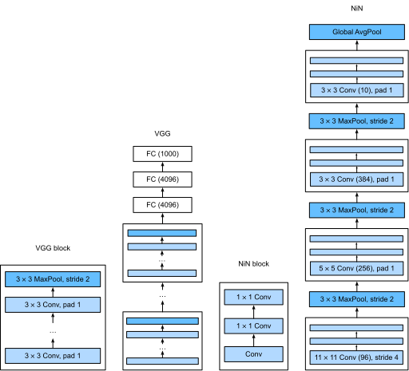

```{.python .input}
%load_ext d2lbook.tab
tab.interact_select(['mxnet', 'pytorch', 'tensorflow', 'jax'])
```

# Tinklas tinkle (NiN)
:label:`sec_nin`

LeNet, AlexNet ir VGG visi turi bendrą dizaino šabloną:
išskirti požymius, išnaudojant *erdvinę* struktūrą,
per konvoliucijų ir sutelkimo sluoksnių seką,
ir apdoroti atvaizdus pilnai sujungtais sluoksniais.
AlexNet ir VGG patobulinimai, palyginti su LeNet, daugiausia slypi
tame, kaip šie vėlesni tinklai praplečia ir pagilina šiuos du modulius.

Šis dizainas kelia du pagrindinius iššūkius.
Pirma, pilnai sujungti sluoksniai architektūros pabaigoje
naudoja milžinišką parametrų skaičių. Pavyzdžiui, net paprastam
modeliui, tokiam kaip VGG-11, reikia siaubingos matricos, užimančios beveik
400 MB RAM viengubo tikslumo (FP32) formatu. Tai didelė kliūtis skaičiavimams, ypač
mobiliuosiuose ir įterptuosiuose įrenginiuose. Juk net aukščiausios klasės mobilieji telefonai turi ne daugiau kaip 8 GB RAM. Kai buvo išrastas VGG, tai buvo dydžio eile mažiau (iPhone 4S turėjo 512 MB). Todėl būtų buvę sunku pateisinti didžiosios atminties dalies skyrimą vaizdų klasifikatoriui.

Antra, lygiai taip pat neįmanoma pridėti pilnai sujungtų sluoksnių
anksčiau tinkle, kad padidėtų netiesiškumo laipsnis: tai sunaikintų
erdvinę struktūrą ir galbūt pareikalautų dar daugiau atminties.

*Tinklo tinkle* (*NiN*) blokai :cite:`Lin.Chen.Yan.2013` siūlo alternatyvą,
galinčią išspręsti abi problemas viena paprasta strategija.
Jie buvo pasiūlyti remiantis labai paprasta įžvalga: (i) naudoti $1 \times 1$ konvoliucijas, kad
būtų pridėti lokalūs netiesiškumai kanalų aktyvacijose, ir (ii) naudoti globalų sutelkimą vidurkinant, kad
būtų integruojama per visas vietas paskutiniame atvaizdų sluoksnyje. Atkreipkite dėmesį, kad globalus sutelkimas vidurkinant nebūtų
veiksmingas be pridėtų netiesiškumų. Pažvelkime į tai išsamiai.

```{.python .input}
%%tab mxnet
from d2l import mxnet as d2l
from mxnet import np, npx, init
from mxnet.gluon import nn
npx.set_np()
```

```{.python .input}
%%tab pytorch
from d2l import torch as d2l
import torch
from torch import nn
```

```{.python .input}
%%tab tensorflow
import tensorflow as tf
from d2l import tensorflow as d2l
```

```{.python .input}
%%tab jax
from d2l import jax as d2l
from flax import linen as nn
import jax
from jax import numpy as jnp
```

## (**NiN blokai**)

Prisiminkite :numref:`subsec_1x1`. Joje sakėme, kad konvoliucinių sluoksnių įvestys ir išvestys
yra keturmačiai tenzoriai, kurių ašys
atitinka pavyzdį, kanalą, aukštį ir plotį.
Taip pat prisiminkite, kad pilnai sujungtų sluoksnių įvestys ir išvestys
paprastai yra dvimačiai tenzoriai, atitinkantys pavyzdį ir požymį.
NiN idėja – taikyti pilnai sujungtą sluoksnį
kiekvienoje pikselio vietoje (kiekvienam aukščiui ir pločiui).
Gautą $1 \times 1$ konvoliuciją galima laikyti
pilnai sujungtu sluoksniu, veikiančiu nepriklausomai kiekvienoje pikselio vietoje.

:numref:`fig_nin` iliustruoja pagrindinius struktūrinius
VGG ir NiN skirtumus bei jų blokus.
Atkreipkite dėmesį ir į NiN blokų skirtumą (po pradinės konvoliucijos eina $1 \times 1$ konvoliucijos, o VGG išlaiko $3 \times 3$ konvoliucijas), ir į pabaigą, kur nebereikia milžiniško pilnai sujungto sluoksnio.


:width:`600px`
:label:`fig_nin`

```{.python .input}
%%tab mxnet
def nin_block(num_channels, kernel_size, strides, padding):
    blk = nn.Sequential()
    blk.add(nn.Conv2D(num_channels, kernel_size, strides, padding,
                      activation='relu'),
            nn.Conv2D(num_channels, kernel_size=1, activation='relu'),
            nn.Conv2D(num_channels, kernel_size=1, activation='relu'))
    return blk
```

```{.python .input}
%%tab pytorch
def nin_block(out_channels, kernel_size, strides, padding):
    return nn.Sequential(
        nn.LazyConv2d(out_channels, kernel_size, strides, padding), nn.ReLU(),
        nn.LazyConv2d(out_channels, kernel_size=1), nn.ReLU(),
        nn.LazyConv2d(out_channels, kernel_size=1), nn.ReLU())
```

```{.python .input}
%%tab tensorflow
def nin_block(out_channels, kernel_size, strides, padding):
    return tf.keras.models.Sequential([
    tf.keras.layers.Conv2D(out_channels, kernel_size, strides=strides,
                           padding=padding),
    tf.keras.layers.Activation('relu'),
    tf.keras.layers.Conv2D(out_channels, 1),
    tf.keras.layers.Activation('relu'),
    tf.keras.layers.Conv2D(out_channels, 1),
    tf.keras.layers.Activation('relu')])
```

```{.python .input}
%%tab jax
def nin_block(out_channels, kernel_size, strides, padding):
    return nn.Sequential([
        nn.Conv(out_channels, kernel_size, strides, padding),
        nn.relu,
        nn.Conv(out_channels, kernel_size=(1, 1)), nn.relu,
        nn.Conv(out_channels, kernel_size=(1, 1)), nn.relu])
```

## [**NiN modelis**]

NiN naudoja tokius pat pradinių konvoliucijų dydžius kaip AlexNet (jis pasiūlytas netrukus po to).
Branduolių dydžiai atitinkamai yra $11\times 11$, $5\times 5$ ir $3\times 3$,
o išvesties kanalų skaičius sutampa su AlexNet. Po kiekvieno NiN bloko eina sutelkimo imant maksimumą sluoksnis
su 2 žingsniu ir $3\times 3$ lango forma.

Antrasis reikšmingas NiN skirtumas nuo AlexNet ir VGG
yra tas, kad NiN visiškai vengia pilnai sujungtų sluoksnių.
Vietoj to NiN naudoja NiN bloką su išvesties kanalų skaičiumi, lygiu žymenų klasių skaičiui, po kurio eina *globalaus* sutelkimo vidurkinant sluoksnis,
gaunantis logitų vektorių.
Šis dizainas gerokai sumažina reikalingų modelio parametrų skaičių, nors ir gali pailginti mokymo laiką.

```{.python .input}
%%tab pytorch, mxnet, tensorflow
class NiN(d2l.Classifier):
    def __init__(self, lr=0.1, num_classes=10):
        super().__init__()
        self.save_hyperparameters()
        if tab.selected('mxnet'):
            self.net = nn.Sequential()
            self.net.add(
                nin_block(96, kernel_size=11, strides=4, padding=0),
                nn.MaxPool2D(pool_size=3, strides=2),
                nin_block(256, kernel_size=5, strides=1, padding=2),
                nn.MaxPool2D(pool_size=3, strides=2),
                nin_block(384, kernel_size=3, strides=1, padding=1),
                nn.MaxPool2D(pool_size=3, strides=2),
                nn.Dropout(0.5),
                nin_block(num_classes, kernel_size=3, strides=1, padding=1),
                nn.GlobalAvgPool2D(),
                nn.Flatten())
            self.net.initialize(init.Xavier())
        if tab.selected('pytorch'):
            self.net = nn.Sequential(
                nin_block(96, kernel_size=11, strides=4, padding=0),
                nn.MaxPool2d(3, stride=2),
                nin_block(256, kernel_size=5, strides=1, padding=2),
                nn.MaxPool2d(3, stride=2),
                nin_block(384, kernel_size=3, strides=1, padding=1),
                nn.MaxPool2d(3, stride=2),
                nn.Dropout(0.5),
                nin_block(num_classes, kernel_size=3, strides=1, padding=1),
                nn.AdaptiveAvgPool2d((1, 1)),
                nn.Flatten())
            self.net.apply(d2l.init_cnn)
        if tab.selected('tensorflow'):
            self.net = tf.keras.models.Sequential([
                nin_block(96, kernel_size=11, strides=4, padding='valid'),
                tf.keras.layers.MaxPool2D(pool_size=3, strides=2),
                nin_block(256, kernel_size=5, strides=1, padding='same'),
                tf.keras.layers.MaxPool2D(pool_size=3, strides=2),
                nin_block(384, kernel_size=3, strides=1, padding='same'),
                tf.keras.layers.MaxPool2D(pool_size=3, strides=2),
                tf.keras.layers.Dropout(0.5),
                nin_block(num_classes, kernel_size=3, strides=1, padding='same'),
                tf.keras.layers.GlobalAvgPool2D(),
                tf.keras.layers.Flatten()])
```

```{.python .input}
%%tab jax
class NiN(d2l.Classifier):
    lr: float = 0.1
    num_classes = 10
    training: bool = True

    def setup(self):
        self.net = nn.Sequential([
            nin_block(96, kernel_size=(11, 11), strides=(4, 4), padding=(0, 0)),
            lambda x: nn.max_pool(x, (3, 3), strides=(2, 2)),
            nin_block(256, kernel_size=(5, 5), strides=(1, 1), padding=(2, 2)),
            lambda x: nn.max_pool(x, (3, 3), strides=(2, 2)),
            nin_block(384, kernel_size=(3, 3), strides=(1, 1), padding=(1, 1)),
            lambda x: nn.max_pool(x, (3, 3), strides=(2, 2)),
            nn.Dropout(0.5, deterministic=not self.training),
            nin_block(self.num_classes, kernel_size=(3, 3), strides=1, padding=(1, 1)),
            lambda x: nn.avg_pool(x, (5, 5)),  # global avg pooling
            lambda x: x.reshape((x.shape[0], -1))  # flatten
        ])
```

Sukuriame duomenų pavyzdį, kad pamatytume [**kiekvieno bloko išvesties formą**].

```{.python .input}
%%tab mxnet, pytorch
NiN().layer_summary((1, 1, 224, 224))
```

```{.python .input}
%%tab tensorflow
NiN().layer_summary((1, 224, 224, 1))
```

```{.python .input}
%%tab jax
NiN(training=False).layer_summary((1, 224, 224, 1))
```

## [**Mokymas**]

Kaip ir anksčiau, naudojame Fashion-MNIST modeliui apmokyti, naudodami tą patį
optimizavimo algoritmą, kurį naudojome AlexNet ir VGG.

```{.python .input}
%%tab mxnet, pytorch, jax
model = NiN(lr=0.05)
trainer = d2l.Trainer(max_epochs=10, num_gpus=1)
data = d2l.FashionMNIST(batch_size=128, resize=(224, 224))
if tab.selected('pytorch'):
    model.apply_init([next(iter(data.get_dataloader(True)))[0]], d2l.init_cnn)
trainer.fit(model, data)
```

```{.python .input}
%%tab tensorflow
trainer = d2l.Trainer(max_epochs=10)
data = d2l.FashionMNIST(batch_size=128, resize=(224, 224))
with d2l.try_gpu():
    model = NiN(lr=0.05)
    trainer.fit(model, data)
```

## Santrauka

NiN turi dramatiškai mažiau parametrų nei AlexNet ir VGG. Tai daugiausia kyla iš to, kad jam nereikia milžiniškų pilnai sujungtų sluoksnių. Vietoj to jis naudoja globalų sutelkimą vidurkinant, kad agreguotų per visas vaizdo vietas po paskutinio tinklo korpuso etapo. Tai panaikina poreikį brangioms (išmokstamoms) skyros mažinimo operacijoms ir pakeičia jas paprastu vidurkiu. Tyrėjus tuo metu nustebino tai, kad ši vidurkinimo operacija nepakenkė tikslumui. Atkreipkite dėmesį, kad vidurkinimas per žemos skyros atvaizdą (su daug kanalų) taip pat padidina postūmio invariantiškumo kiekį, kurį tinklas gali apdoroti.

Rinkimasis mažiau konvoliucijų su plačiais branduoliais ir jų keitimas $1 \times 1$ konvoliucijomis dar labiau padeda siekiant mažiau parametrų. Jos gali užtikrinti nemažą netiesiškumo kiekį per kanalus bet kurioje duotoje vietoje. Ir $1 \times 1$ konvoliucijos, ir globalus sutelkimas vidurkinant reikšmingai paveikė vėlesnių CNN dizainus.

## Pratimai

1. Kodėl kiekviename NiN bloke yra du $1\times 1$ konvoliuciniai sluoksniai? Padidinkite jų skaičių iki trijų. Sumažinkite iki vieno. Kas pasikeičia?
1. Kas pasikeičia, jei $1 \times 1$ konvoliucijas pakeisite $3 \times 3$ konvoliucijomis?
1. Kas nutinka, jei globalų sutelkimą vidurkinant pakeisite pilnai sujungtu sluoksniu (greitis, tikslumas, parametrų skaičius)?
1. Apskaičiuokite NiN išteklių naudojimą.
    1. Koks yra parametrų skaičius?
    1. Koks yra skaičiavimų kiekis?
    1. Koks yra mokymo metu reikalingas atminties kiekis?
    1. Koks yra prognozavimo metu reikalingas atminties kiekis?
1. Kokios galimos problemos, jei $384 \times 5 \times 5$ atvaizdą vienu žingsniu sumažinsime iki $10 \times 5 \times 5$ atvaizdo?
1. Pasinaudokite VGG struktūriniais dizaino sprendimais, kurie lėmė VGG-11, VGG-16 ir VGG-19, kad suprojektuotumėte į NiN panašių tinklų šeimą.

:begin_tab:`mxnet`
[Diskusijos](https://discuss.d2l.ai/t/79)
:end_tab:

:begin_tab:`pytorch`
[Diskusijos](https://discuss.d2l.ai/t/80)
:end_tab:

:begin_tab:`jax`
[Diskusijos](https://discuss.d2l.ai/t/18003)
:end_tab:
