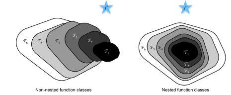
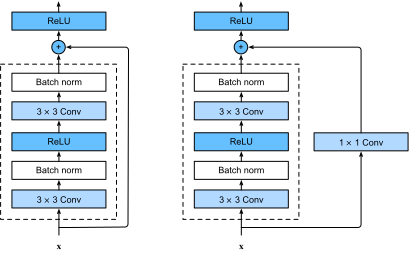
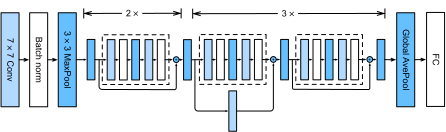
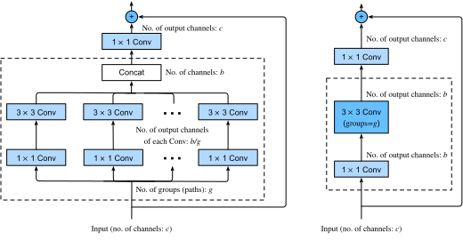

```{.python .input}
%load_ext d2lbook.tab
tab.interact_select(['mxnet', 'pytorch', 'tensorflow', 'jax'])
```

# Liekanų neuroniniai tinklai (ResNet) ir ResNeXt
:label:`sec_resnet`

Kurdami vis gilesnius tinklus, turime suprasti, kaip sluoksnių pridėjimas gali padidinti tinklo sudėtingumą ir raiškumą.
Dar svarbiau – gebėjimas projektuoti tinklus, kuriuose sluoksnių pridėjimas daro tinklus griežtai raiškesnius, o ne tik kitokius.
Kad padarytume pažangą, mums reikia šiek tiek matematikos.

```{.python .input}
%%tab mxnet
from d2l import mxnet as d2l
from mxnet import np, npx, init
from mxnet.gluon import nn
npx.set_np()
```

```{.python .input}
%%tab pytorch
from d2l import torch as d2l
import torch
from torch import nn
from torch.nn import functional as F
```

```{.python .input}
%%tab tensorflow
import tensorflow as tf
from d2l import tensorflow as d2l
```

```{.python .input}
%%tab jax
from d2l import jax as d2l
from flax import linen as nn
from jax import numpy as jnp
import jax
```

## Funkcijų klasės

Panagrinėkime $\mathcal{F}$ – funkcijų klasę, kurią gali pasiekti konkreti tinklo architektūra (kartu su mokymosi greičiais ir kitais hiperparametrų nustatymais).
Tai yra, kiekvienai $f \in \mathcal{F}$ egzistuoja tam tikras parametrų rinkinys (pvz., svoriai ir poslinkiai), kurį galima gauti apmokant tinkamame duomenų rinkinyje.
Tarkime, kad $f^*$ yra „tiesos“ funkcija, kurią iš tikrųjų norėtume rasti.
Jei ji yra $\mathcal{F}$, esame geroje padėtyje, tačiau paprastai nebūsime tokie laimingi.
Vietoj to bandysime rasti tam tikrą $f^*_\mathcal{F}$, kuri yra mūsų geriausias pasirinkimas $\mathcal{F}$ viduje.
Pavyzdžiui,
turėdami duomenų rinkinį su požymiais $\mathbf{X}$
ir žymenimis $\mathbf{y}$,
galime bandyti ją rasti spręsdami šį optimizavimo uždavinį:

$$f^*_\mathcal{F} \stackrel{\textrm{def}}{=} \mathop{\mathrm{argmin}}_f L(\mathbf{X}, \mathbf{y}, f) \textrm{ subject to } f \in \mathcal{F}.$$

Žinome, kad reguliarizacija :cite:`tikhonov1977solutions,morozov2012methods` gali kontroliuoti $\mathcal{F}$ sudėtingumą
ir pasiekti suderinamumą, todėl didesnis mokymo duomenų kiekis
paprastai lemia geresnę $f^*_\mathcal{F}$.
Pagrįsta manyti, kad jei suprojektuosime kitokią ir galingesnę architektūrą $\mathcal{F}'$, turėtume gauti geresnį rezultatą. Kitaip tariant, tikėtumėmės, kad $f^*_{\mathcal{F}'}$ yra „geresnė“ už $f^*_{\mathcal{F}}$. Tačiau jei $\mathcal{F} \not\subseteq \mathcal{F}'$, nėra jokios garantijos, kad taip net nutiks. Iš tikrųjų $f^*_{\mathcal{F}'}$ gali būti ir blogesnė.
Kaip iliustruoja :numref:`fig_functionclasses`,
neįdėtoms funkcijų klasėms didesnė funkcijų klasė ne visada priartėja prie „tiesos“ funkcijos $f^*$. Pavyzdžiui,
:numref:`fig_functionclasses` kairėje,
nors $\mathcal{F}_3$ yra arčiau $f^*$ nei $\mathcal{F}_1$, $\mathcal{F}_6$ tolsta, ir nėra garantijos, kad tolesnis sudėtingumo didinimas gali sumažinti atstumą iki $f^*$.
Su įdėtomis funkcijų klasėmis,
kur $\mathcal{F}_1 \subseteq \cdots \subseteq \mathcal{F}_6$,
:numref:`fig_functionclasses` dešinėje,
galime išvengti minėtos neįdėtų funkcijų klasių problemos.



:label:`fig_functionclasses`

Taigi
tik jei didesnės funkcijų klasės apima mažesnes, esame tikri, kad jų didinimas griežtai padidina tinklo raiškumą.
Giliesiems neuroniniams tinklams,
jei galime
apmokyti naujai pridėtą sluoksnį tapti tapatybės funkcija $f(\mathbf{x}) = \mathbf{x}$, naujas modelis bus toks pat veiksmingas kaip originalus. Kadangi naujas modelis gali gauti geresnį sprendinį, atitinkantį mokymo duomenų rinkinį, pridėtas sluoksnis gali palengvinti mokymo paklaidų mažinimą.

Būtent šį klausimą nagrinėjo :citet:`He.Zhang.Ren.ea.2016`, dirbdami su labai giliais kompiuterinės regos modeliais.
Jų pasiūlyto *liekanų neuroninio tinklo* (*ResNet*) esmė yra idėja, kad kiekvienas papildomas sluoksnis turėtų
lengviau
turėti tapatybės funkciją kaip vieną iš savo elementų.
Šie svarstymai yra gana gilūs, tačiau jie atvedė prie stebėtinai paprasto
sprendimo – *liekamojo bloko*.
Su juo ResNet laimėjo ImageNet didelio masto vizualinio atpažinimo iššūkį 2015 m. Dizainas turėjo didelę įtaką tam, kaip
kuriami gilieji neuroniniai tinklai. Pavyzdžiui, liekamieji blokai buvo pridėti į rekurentinius tinklus :cite:`prakash2016neural,kim2017residual`. Taip pat transformeriai :cite:`Vaswani.Shazeer.Parmar.ea.2017` jais naudojasi, kad efektyviai sukrautų daug tinklo sluoksnių. Jie taip pat naudojami grafų neuroniniuose tinkluose :cite:`Kipf.Welling.2016` ir, kaip pagrindinė sąvoka, plačiai naudojami kompiuterinėje regoje :cite:`Redmon.Farhadi.2018,Ren.He.Girshick.ea.2015`.
Atkreipkite dėmesį, kad prieš liekanų tinklus buvo greitkelių tinklai :cite:`srivastava2015highway`, kurie dalijasi dalimi motyvacijos, nors ir be elegantiškos parametrizacijos aplink tapatybės funkciją.


## (**Liekamieji blokai**)
:label:`subsec_residual-blks`

Sutelkime dėmesį į lokalią neuroninio tinklo dalį, kaip pavaizduota :numref:`fig_residual_block`. Pažymėkime įvestį $\mathbf{x}$.
Darome prielaidą, kad $f(\mathbf{x})$ – norimas pagrindinis atvaizdavimas, kurį norime gauti mokydamiesi – bus naudojamas kaip įvestis viršuje esančiai aktyvacijos funkcijai.
Kairėje
punktyriniame langelyje esanti dalis
turi tiesiogiai išmokti $f(\mathbf{x})$.
Dešinėje
punktyriniame langelyje esanti dalis
turi
išmokti *liekamąjį atvaizdavimą* $g(\mathbf{x}) = f(\mathbf{x}) - \mathbf{x}$,
iš kurio liekamasis blokas ir gavo savo pavadinimą.
Jei norimas pagrindinis atvaizdavimas yra tapatybės atvaizdavimas $f(\mathbf{x}) = \mathbf{x}$,
liekamasis atvaizdavimas yra $g(\mathbf{x}) = 0$, ir jį todėl lengviau išmokti:
tereikia nustumti svorius ir poslinkius
viršutinio svorių sluoksnio (pvz., pilnai sujungto sluoksnio ar konvoliucinio sluoksnio)
punktyriniame langelyje
iki nulio.
Dešinysis paveikslas iliustruoja ResNet *liekamąjį bloką*,
kuriame ištisinė linija, nešanti sluoksnio įvestį
$\mathbf{x}$ į sudėties operatorių,
vadinama *liekamąja jungtimi* (arba *trumpiklio jungtimi*).
Su liekamaisiais blokais įvestys gali
greičiau sklisti tiesiogiai per liekamąsias jungtis tarp sluoksnių.
Iš tikrųjų
liekamąjį bloką
galima laikyti
daugiašakio Inception bloko ypatingu atveju:
jis turi dvi šakas,
iš kurių viena yra tapatybės atvaizdavimas.


:label:`fig_residual_block`


ResNet turi VGG pilną $3\times 3$ konvoliucinio sluoksnio dizainą. Liekamasis blokas turi du $3\times 3$ konvoliucinius sluoksnius su tuo pačiu išvesties kanalų skaičiumi. Po kiekvieno konvoliucinio sluoksnio eina rinkinio normalizacijos sluoksnis ir ReLU aktyvacijos funkcija. Tada praleidžiame šias dvi konvoliucijos operacijas ir pridedame įvestį tiesiogiai prieš galutinę ReLU aktyvaciją.
Šio tipo dizainas reikalauja, kad dviejų konvoliucinių sluoksnių išvestis turėtų tą pačią formą kaip įvestis, kad jas būtų galima sudėti. Jei norime pakeisti kanalų skaičių, turime pridėti papildomą $1\times 1$ konvoliucinį sluoksnį, kuris transformuotų įvestį į norimą formą sudėties operacijai. Pažvelkime į toliau pateiktą kodą.

```{.python .input}
%%tab mxnet
class Residual(nn.Block):  #@save
    """The Residual block of ResNet models."""
    def __init__(self, num_channels, use_1x1conv=False, strides=1, **kwargs):
        super().__init__(**kwargs)
        self.conv1 = nn.Conv2D(num_channels, kernel_size=3, padding=1,
                               strides=strides)
        self.conv2 = nn.Conv2D(num_channels, kernel_size=3, padding=1)
        if use_1x1conv:
            self.conv3 = nn.Conv2D(num_channels, kernel_size=1,
                                   strides=strides)
        else:
            self.conv3 = None
        self.bn1 = nn.BatchNorm()
        self.bn2 = nn.BatchNorm()

    def forward(self, X):
        Y = npx.relu(self.bn1(self.conv1(X)))
        Y = self.bn2(self.conv2(Y))
        if self.conv3:
            X = self.conv3(X)
        return npx.relu(Y + X)
```

```{.python .input}
%%tab pytorch
class Residual(nn.Module):  #@save
    """The Residual block of ResNet models."""
    def __init__(self, num_channels, use_1x1conv=False, strides=1):
        super().__init__()
        self.conv1 = nn.LazyConv2d(num_channels, kernel_size=3, padding=1,
                                   stride=strides)
        self.conv2 = nn.LazyConv2d(num_channels, kernel_size=3, padding=1)
        if use_1x1conv:
            self.conv3 = nn.LazyConv2d(num_channels, kernel_size=1,
                                       stride=strides)
        else:
            self.conv3 = None
        self.bn1 = nn.LazyBatchNorm2d()
        self.bn2 = nn.LazyBatchNorm2d()

    def forward(self, X):
        Y = F.relu(self.bn1(self.conv1(X)))
        Y = self.bn2(self.conv2(Y))
        if self.conv3:
            X = self.conv3(X)
        Y += X
        return F.relu(Y)
```

```{.python .input}
%%tab tensorflow
class Residual(tf.keras.Model):  #@save
    """The Residual block of ResNet models."""
    def __init__(self, num_channels, use_1x1conv=False, strides=1):
        super().__init__()
        self.conv1 = tf.keras.layers.Conv2D(num_channels, padding='same',
                                            kernel_size=3, strides=strides)
        self.conv2 = tf.keras.layers.Conv2D(num_channels, kernel_size=3,
                                            padding='same')
        self.conv3 = None
        if use_1x1conv:
            self.conv3 = tf.keras.layers.Conv2D(num_channels, kernel_size=1,
                                                strides=strides)
        self.bn1 = tf.keras.layers.BatchNormalization()
        self.bn2 = tf.keras.layers.BatchNormalization()

    def call(self, X):
        Y = tf.keras.activations.relu(self.bn1(self.conv1(X)))
        Y = self.bn2(self.conv2(Y))
        if self.conv3 is not None:
            X = self.conv3(X)
        Y += X
        return tf.keras.activations.relu(Y)
```

```{.python .input}
%%tab jax
class Residual(nn.Module):  #@save
    """The Residual block of ResNet models."""
    num_channels: int
    use_1x1conv: bool = False
    strides: tuple = (1, 1)
    training: bool = True

    def setup(self):
        self.conv1 = nn.Conv(self.num_channels, kernel_size=(3, 3),
                             padding='same', strides=self.strides)
        self.conv2 = nn.Conv(self.num_channels, kernel_size=(3, 3),
                             padding='same')
        if self.use_1x1conv:
            self.conv3 = nn.Conv(self.num_channels, kernel_size=(1, 1),
                                 strides=self.strides)
        else:
            self.conv3 = None
        self.bn1 = nn.BatchNorm(not self.training)
        self.bn2 = nn.BatchNorm(not self.training)

    def __call__(self, X):
        Y = nn.relu(self.bn1(self.conv1(X)))
        Y = self.bn2(self.conv2(Y))
        if self.conv3:
            X = self.conv3(X)
        Y += X
        return nn.relu(Y)
```

Šis kodas generuoja du tinklų tipus: vieną, kuriame įvestis pridedama prie išvesties prieš taikant ReLU netiesiškumą, kai `use_1x1conv=False`; ir kitą, kuriame prieš sudėdami pakoreguojame kanalus ir skyrą per $1 \times 1$ konvoliuciją. :numref:`fig_resnet_block` tai iliustruoja.


:label:`fig_resnet_block`

Dabar pažvelkime į [**situaciją, kai įvestis ir išvestis yra tos pačios formos**], kai $1 \times 1$ konvoliucijos nereikia.

```{.python .input}
%%tab mxnet, pytorch
if tab.selected('mxnet'):
    blk = Residual(3)
    blk.initialize()
if tab.selected('pytorch'):
    blk = Residual(3)
X = d2l.randn(4, 3, 6, 6)
blk(X).shape
```

```{.python .input}
%%tab tensorflow
blk = Residual(3)
X = d2l.normal((4, 6, 6, 3))
Y = blk(X)
Y.shape
```

```{.python .input}
%%tab jax
blk = Residual(3)
X = jax.random.normal(d2l.get_key(), (4, 6, 6, 3))
blk.init_with_output(d2l.get_key(), X)[0].shape
```

Taip pat turime galimybę [**perpus sumažinti išvesties aukštį ir plotį didinant išvesties kanalų skaičių**].
Šiuo atveju per `use_1x1conv=True` naudojame $1 \times 1$ konvoliucijas. Tai patogu kiekvieno ResNet bloko pradžioje, kad per `strides=2` sumažintume erdvinę dimensiją.

```{.python .input}
%%tab pytorch, mxnet, tensorflow
blk = Residual(6, use_1x1conv=True, strides=2)
if tab.selected('mxnet'):
    blk.initialize()
blk(X).shape
```

```{.python .input}
%%tab jax
blk = Residual(6, use_1x1conv=True, strides=(2, 2))
blk.init_with_output(d2l.get_key(), X)[0].shape
```

## [**ResNet modelis**]

Pirmieji du ResNet sluoksniai yra tokie patys kaip anksčiau aprašyto GoogLeNet: $7\times 7$ konvoliucinį sluoksnį su 64 išvesties kanalais ir 2 žingsniu seka $3\times 3$ sutelkimo imant maksimumą sluoksnis su 2 žingsniu. Skirtumas yra rinkinio normalizacijos sluoksnis, pridėtas po kiekvieno konvoliucinio sluoksnio ResNet.

```{.python .input}
%%tab pytorch, mxnet, tensorflow
class ResNet(d2l.Classifier):
    def b1(self):
        if tab.selected('mxnet'):
            net = nn.Sequential()
            net.add(nn.Conv2D(64, kernel_size=7, strides=2, padding=3),
                    nn.BatchNorm(), nn.Activation('relu'),
                    nn.MaxPool2D(pool_size=3, strides=2, padding=1))
            return net
        if tab.selected('pytorch'):
            return nn.Sequential(
                nn.LazyConv2d(64, kernel_size=7, stride=2, padding=3),
                nn.LazyBatchNorm2d(), nn.ReLU(),
                nn.MaxPool2d(kernel_size=3, stride=2, padding=1))
        if tab.selected('tensorflow'):
            return tf.keras.models.Sequential([
                tf.keras.layers.Conv2D(64, kernel_size=7, strides=2,
                                       padding='same'),
                tf.keras.layers.BatchNormalization(),
                tf.keras.layers.Activation('relu'),
                tf.keras.layers.MaxPool2D(pool_size=3, strides=2,
                                          padding='same')])
```

```{.python .input}
%%tab jax
class ResNet(d2l.Classifier):
    arch: tuple
    lr: float = 0.1
    num_classes: int = 10
    training: bool = True

    def setup(self):
        self.net = self.create_net()

    def b1(self):
        return nn.Sequential([
            nn.Conv(64, kernel_size=(7, 7), strides=(2, 2), padding='same'),
            nn.BatchNorm(not self.training), nn.relu,
            lambda x: nn.max_pool(x, window_shape=(3, 3), strides=(2, 2),
                                  padding='same')])
```

GoogLeNet naudoja keturis modulius, sudarytus iš Inception blokų.
Tačiau ResNet naudoja keturis modulius, sudarytus iš liekamųjų blokų, kurių kiekvienas naudoja kelis liekamuosius blokus su tuo pačiu išvesties kanalų skaičiumi.
Pirmojo modulio kanalų skaičius yra toks pat kaip įvesties kanalų skaičius. Kadangi jau buvo naudotas sutelkimo imant maksimumą sluoksnis su 2 žingsniu, aukščio ir pločio mažinti nebūtina. Pirmajame kiekvieno paskesnio modulio liekamajame bloke kanalų skaičius padvigubėja, palyginti su ankstesniu moduliu, o aukštis ir plotis perpus sumažėja.

```{.python .input}
%%tab mxnet
@d2l.add_to_class(ResNet)
def block(self, num_residuals, num_channels, first_block=False):
    blk = nn.Sequential()
    for i in range(num_residuals):
        if i == 0 and not first_block:
            blk.add(Residual(num_channels, use_1x1conv=True, strides=2))
        else:
            blk.add(Residual(num_channels))
    return blk
```

```{.python .input}
%%tab pytorch
@d2l.add_to_class(ResNet)
def block(self, num_residuals, num_channels, first_block=False):
    blk = []
    for i in range(num_residuals):
        if i == 0 and not first_block:
            blk.append(Residual(num_channels, use_1x1conv=True, strides=2))
        else:
            blk.append(Residual(num_channels))
    return nn.Sequential(*blk)
```

```{.python .input}
%%tab tensorflow
@d2l.add_to_class(ResNet)
def block(self, num_residuals, num_channels, first_block=False):
    blk = tf.keras.models.Sequential()
    for i in range(num_residuals):
        if i == 0 and not first_block:
            blk.add(Residual(num_channels, use_1x1conv=True, strides=2))
        else:
            blk.add(Residual(num_channels))
    return blk
```

```{.python .input}
%%tab jax
@d2l.add_to_class(ResNet)
def block(self, num_residuals, num_channels, first_block=False):
    blk = []
    for i in range(num_residuals):
        if i == 0 and not first_block:
            blk.append(Residual(num_channels, use_1x1conv=True,
                                strides=(2, 2), training=self.training))
        else:
            blk.append(Residual(num_channels, training=self.training))
    return nn.Sequential(blk)
```

Tada pridedame visus modulius į ResNet. Čia kiekvienam moduliui naudojami du liekamieji blokai. Galiausiai, kaip ir GoogLeNet, pridedame globalaus sutelkimo vidurkinant sluoksnį, po kurio eina pilnai sujungto sluoksnio išvestis.

```{.python .input}
%%tab pytorch, mxnet, tensorflow
@d2l.add_to_class(ResNet)
def __init__(self, arch, lr=0.1, num_classes=10):
    super(ResNet, self).__init__()
    self.save_hyperparameters()
    if tab.selected('mxnet'):
        self.net = nn.Sequential()
        self.net.add(self.b1())
        for i, b in enumerate(arch):
            self.net.add(self.block(*b, first_block=(i==0)))
        self.net.add(nn.GlobalAvgPool2D(), nn.Dense(num_classes))
        self.net.initialize(init.Xavier())
    if tab.selected('pytorch'):
        self.net = nn.Sequential(self.b1())
        for i, b in enumerate(arch):
            self.net.add_module(f'b{i+2}', self.block(*b, first_block=(i==0)))
        self.net.add_module('last', nn.Sequential(
            nn.AdaptiveAvgPool2d((1, 1)), nn.Flatten(),
            nn.LazyLinear(num_classes)))
        self.net.apply(d2l.init_cnn)
    if tab.selected('tensorflow'):
        self.net = tf.keras.models.Sequential(self.b1())
        for i, b in enumerate(arch):
            self.net.add(self.block(*b, first_block=(i==0)))
        self.net.add(tf.keras.models.Sequential([
            tf.keras.layers.GlobalAvgPool2D(),
            tf.keras.layers.Dense(units=num_classes)]))
```

```{.python .input}
# %%tab jax
@d2l.add_to_class(ResNet)
def create_net(self):
    net = nn.Sequential([self.b1()])
    for i, b in enumerate(self.arch):
        net.layers.extend([self.block(*b, first_block=(i==0))])
    net.layers.extend([nn.Sequential([
        # Flax does not provide a GlobalAvg2D layer
        lambda x: nn.avg_pool(x, window_shape=x.shape[1:3],
                              strides=x.shape[1:3], padding='valid'),
        lambda x: x.reshape((x.shape[0], -1)),
        nn.Dense(self.num_classes)])])
    return net
```

Kiekviename modulyje yra keturi konvoliuciniai sluoksniai (neįskaitant $1\times 1$ konvoliucinio sluoksnio). Kartu su pirmuoju $7\times 7$ konvoliuciniu sluoksniu ir galutiniu pilnai sujungtu sluoksniu iš viso yra 18 sluoksnių. Todėl šis modelis paprastai žinomas kaip ResNet-18.
Konfigūruodami skirtingus kanalų ir liekamųjų blokų skaičius modulyje, galime sukurti skirtingus ResNet modelius, pavyzdžiui, gilesnį 152 sluoksnių ResNet-152. Nors pagrindinė ResNet architektūra panaši į GoogLeNet, ResNet struktūra paprastesnė ir lengviau modifikuojama. Visi šie veiksniai lėmė spartų ir platų ResNet naudojimą. :numref:`fig_resnet18` pavaizduotas pilnas ResNet-18.


:label:`fig_resnet18`

Prieš apmokydami ResNet, [**stebėkime, kaip įvesties forma kinta skirtinguose ResNet moduliuose**]. Kaip ir visose ankstesnėse architektūrose, skyra mažėja, o kanalų skaičius didėja, kol globalaus sutelkimo vidurkinant sluoksnis agreguoja visus požymius.

```{.python .input}
%%tab pytorch, mxnet, tensorflow
class ResNet18(ResNet):
    def __init__(self, lr=0.1, num_classes=10):
        super().__init__(((2, 64), (2, 128), (2, 256), (2, 512)),
                       lr, num_classes)
```

```{.python .input}
%%tab jax
class ResNet18(ResNet):
    arch: tuple = ((2, 64), (2, 128), (2, 256), (2, 512))
    lr: float = 0.1
    num_classes: int = 10
```

```{.python .input}
%%tab pytorch, mxnet
ResNet18().layer_summary((1, 1, 96, 96))
```

```{.python .input}
%%tab tensorflow
ResNet18().layer_summary((1, 96, 96, 1))
```

```{.python .input}
%%tab jax
ResNet18(training=False).layer_summary((1, 96, 96, 1))
```

## [**Mokymas**]

ResNet apmokome su Fashion-MNIST duomenų rinkiniu, kaip ir anksčiau. ResNet yra gana galinga ir lanksti architektūra. Grafikas, vaizduojantis mokymo ir validavimo nuostolius, iliustruoja reikšmingą tarpą tarp abiejų grafikų, kai mokymo nuostoliai yra gerokai mažesni. Tokio lankstumo tinklui daugiau mokymo duomenų duotų aiškią naudą mažinant tarpą ir gerinant tikslumą.

```{.python .input}
%%tab mxnet, pytorch, jax
model = ResNet18(lr=0.01)
trainer = d2l.Trainer(max_epochs=10, num_gpus=1)
data = d2l.FashionMNIST(batch_size=128, resize=(96, 96))
if tab.selected('pytorch'):
    model.apply_init([next(iter(data.get_dataloader(True)))[0]], d2l.init_cnn)
trainer.fit(model, data)
```

```{.python .input}
%%tab tensorflow
trainer = d2l.Trainer(max_epochs=10)
data = d2l.FashionMNIST(batch_size=128, resize=(96, 96))
with d2l.try_gpu():
    model = ResNet18(lr=0.01)
    trainer.fit(model, data)
```

## ResNeXt
:label:`subsec_resnext`

Vienas iš iššūkių, su kuriais susiduriama projektuojant ResNet, yra kompromisas tarp netiesiškumo ir dimensijos duotame bloke. Tai yra, galime pridėti daugiau netiesiškumo didindami sluoksnių skaičių arba konvoliucijų plotį. Alternatyvi strategija – didinti kanalų, galinčių nešti informaciją tarp blokų, skaičių. Deja, pastaroji strategija turi kvadratinę baudą, nes $c_\textrm{i}$ kanalų priėmimo ir $c_\textrm{o}$ kanalų išvedimo skaičiavimo kaina yra proporcinga $\mathcal{O}(c_\textrm{i} \cdot c_\textrm{o})$ (žr. mūsų diskusiją :numref:`sec_channels`).

Galime pasisemti įkvėpimo iš Inception bloko :numref:`fig_inception`, kuriame informacija teka per bloką atskirose grupėse. Pritaikius kelių nepriklausomų grupių idėją ResNet blokui :numref:`fig_resnet_block`, buvo sukurtas ResNeXt dizainas :cite:`Xie.Girshick.Dollar.ea.2017`.
Skirtingai nei Inception transformacijų švediškas stalas,
ResNeXt visose šakose naudoja *tą pačią* transformaciją,
taip sumažindamas poreikį rankiniu būdu derinti kiekvieną šaką.


:label:`fig_resnext_block`

Konvoliucijos iš $c_\textrm{i}$ į $c_\textrm{o}$ kanalų suskaidymas į $g$ grupių, kurių dydis $c_\textrm{i}/g$, generuojančių $g$ išvesčių, kurių dydis $c_\textrm{o}/g$, vadinamas, gana taikliai, *grupine konvoliucija*. Skaičiavimo kaina (proporcingai) sumažėja nuo $\mathcal{O}(c_\textrm{i} \cdot c_\textrm{o})$ iki $\mathcal{O}(g \cdot (c_\textrm{i}/g) \cdot (c_\textrm{o}/g)) = \mathcal{O}(c_\textrm{i} \cdot c_\textrm{o} / g)$, t. y. ji yra $g$ kartų greitesnė. Dar geriau, išvestiai generuoti reikalingų parametrų skaičius taip pat sumažėja nuo $c_\textrm{i} \times c_\textrm{o}$ matricos iki $g$ mažesnių $(c_\textrm{i}/g) \times (c_\textrm{o}/g)$ dydžio matricų, vėlgi $g$ kartų sumažinimas. Toliau darome prielaidą, kad ir $c_\textrm{i}$, ir $c_\textrm{o}$ dalijasi iš $g$.

Vienintelis šio dizaino iššūkis yra tas, kad tarp $g$ grupių nesikeičiama informacija. ResNeXt blokas
:numref:`fig_resnext_block` tai ištaiso dviem būdais: grupinė konvoliucija su $3 \times 3$ branduoliu įterpiama tarp dviejų $1 \times 1$ konvoliucijų. Antroji atlieka dvigubą darbą, grąžindama kanalų skaičių atgal. Nauda ta, kad už $1 \times 1$ branduolius mokame tik $\mathcal{O}(c \cdot b)$ kainą, o $3 \times 3$ branduoliams pakanka $\mathcal{O}(b^2 / g)$ kainos. Panašiai kaip liekamojo bloko įgyvendinime
:numref:`subsec_residual-blks`, liekamoji jungtis pakeičiama (taigi apibendrinama) $1 \times 1$ konvoliucija.

Dešinysis paveikslas :numref:`fig_resnext_block` pateikia daug glaustesnę gauto tinklo bloko santrauką. Jis taip pat vaidins svarbų vaidmenį projektuojant bendrines šiuolaikines CNN :numref:`sec_cnn-design`. Atkreipkite dėmesį, kad grupinių konvoliucijų idėja siekia AlexNet įgyvendinimą :cite:`Krizhevsky.Sutskever.Hinton.2012`. Paskirstant tinklą tarp dviejų GPU su ribota atmintimi, įgyvendinime kiekvienas GPU buvo traktuojamas kaip savo paties kanalas be neigiamo poveikio.

Toliau pateiktas klasės `ResNeXtBlock` įgyvendinimas kaip argumentą priima `groups` ($g$), su
`bot_channels` ($b$) tarpiniais (butelio kakliuko) kanalais. Galiausiai, kai reikia sumažinti atvaizdo aukštį ir plotį, pridedame žingsnį $2$, nustatydami `use_1x1conv=True, strides=2`.

```{.python .input}
%%tab mxnet
class ResNeXtBlock(nn.Block):  #@save
    """The ResNeXt block."""
    def __init__(self, num_channels, groups, bot_mul,
                 use_1x1conv=False, strides=1, **kwargs):
        super().__init__(**kwargs)
        bot_channels = int(round(num_channels * bot_mul))
        self.conv1 = nn.Conv2D(bot_channels, kernel_size=1, padding=0,
                               strides=1)
        self.conv2 = nn.Conv2D(bot_channels, kernel_size=3, padding=1, 
                               strides=strides, groups=bot_channels//groups)
        self.conv3 = nn.Conv2D(num_channels, kernel_size=1, padding=0,
                               strides=1)
        self.bn1 = nn.BatchNorm()
        self.bn2 = nn.BatchNorm()
        self.bn3 = nn.BatchNorm()
        if use_1x1conv:
            self.conv4 = nn.Conv2D(num_channels, kernel_size=1,
                                   strides=strides)
            self.bn4 = nn.BatchNorm()
        else:
            self.conv4 = None

    def forward(self, X):
        Y = npx.relu(self.bn1(self.conv1(X)))
        Y = npx.relu(self.bn2(self.conv2(Y)))
        Y = self.bn3(self.conv3(Y))
        if self.conv4:
            X = self.bn4(self.conv4(X))
        return npx.relu(Y + X)
```

```{.python .input}
%%tab pytorch
class ResNeXtBlock(nn.Module):  #@save
    """The ResNeXt block."""
    def __init__(self, num_channels, groups, bot_mul, use_1x1conv=False,
                 strides=1):
        super().__init__()
        bot_channels = int(round(num_channels * bot_mul))
        self.conv1 = nn.LazyConv2d(bot_channels, kernel_size=1, stride=1)
        self.conv2 = nn.LazyConv2d(bot_channels, kernel_size=3,
                                   stride=strides, padding=1,
                                   groups=bot_channels//groups)
        self.conv3 = nn.LazyConv2d(num_channels, kernel_size=1, stride=1)
        self.bn1 = nn.LazyBatchNorm2d()
        self.bn2 = nn.LazyBatchNorm2d()
        self.bn3 = nn.LazyBatchNorm2d()
        if use_1x1conv:
            self.conv4 = nn.LazyConv2d(num_channels, kernel_size=1, 
                                       stride=strides)
            self.bn4 = nn.LazyBatchNorm2d()
        else:
            self.conv4 = None

    def forward(self, X):
        Y = F.relu(self.bn1(self.conv1(X)))
        Y = F.relu(self.bn2(self.conv2(Y)))
        Y = self.bn3(self.conv3(Y))
        if self.conv4:
            X = self.bn4(self.conv4(X))
        return F.relu(Y + X)
```

```{.python .input}
%%tab tensorflow
class ResNeXtBlock(tf.keras.Model):  #@save
    """The ResNeXt block."""
    def __init__(self, num_channels, groups, bot_mul, use_1x1conv=False,
                 strides=1):
        super().__init__()
        bot_channels = int(round(num_channels * bot_mul))
        self.conv1 = tf.keras.layers.Conv2D(bot_channels, 1, strides=1)
        self.conv2 = tf.keras.layers.Conv2D(bot_channels, 3, strides=strides,
                                            padding="same",
                                            groups=bot_channels//groups)
        self.conv3 = tf.keras.layers.Conv2D(num_channels, 1, strides=1)
        self.bn1 = tf.keras.layers.BatchNormalization()
        self.bn2 = tf.keras.layers.BatchNormalization()
        self.bn3 = tf.keras.layers.BatchNormalization()
        if use_1x1conv:
            self.conv4 = tf.keras.layers.Conv2D(num_channels, 1,
                                                strides=strides)
            self.bn4 = tf.keras.layers.BatchNormalization()
        else:
            self.conv4 = None

    def call(self, X):
        Y = tf.keras.activations.relu(self.bn1(self.conv1(X)))
        Y = tf.keras.activations.relu(self.bn2(self.conv2(Y)))
        Y = self.bn3(self.conv3(Y))
        if self.conv4:
            X = self.bn4(self.conv4(X))
        return tf.keras.activations.relu(Y + X)
```

```{.python .input}
%%tab jax
class ResNeXtBlock(nn.Module):  #@save
    """The ResNeXt block."""
    num_channels: int
    groups: int
    bot_mul: int
    use_1x1conv: bool = False
    strides: tuple = (1, 1)
    training: bool = True

    def setup(self):
        bot_channels = int(round(self.num_channels * self.bot_mul))
        self.conv1 = nn.Conv(bot_channels, kernel_size=(1, 1),
                               strides=(1, 1))
        self.conv2 = nn.Conv(bot_channels, kernel_size=(3, 3),
                               strides=self.strides, padding='same',
                               feature_group_count=bot_channels//self.groups)
        self.conv3 = nn.Conv(self.num_channels, kernel_size=(1, 1),
                               strides=(1, 1))
        self.bn1 = nn.BatchNorm(not self.training)
        self.bn2 = nn.BatchNorm(not self.training)
        self.bn3 = nn.BatchNorm(not self.training)
        if self.use_1x1conv:
            self.conv4 = nn.Conv(self.num_channels, kernel_size=(1, 1),
                                       strides=self.strides)
            self.bn4 = nn.BatchNorm(not self.training)
        else:
            self.conv4 = None

    def __call__(self, X):
        Y = nn.relu(self.bn1(self.conv1(X)))
        Y = nn.relu(self.bn2(self.conv2(Y)))
        Y = self.bn3(self.conv3(Y))
        if self.conv4:
            X = self.bn4(self.conv4(X))
        return nn.relu(Y + X)
```

Jo naudojimas visiškai analogiškas anksčiau aptartam `ResNetBlock`. Pavyzdžiui, naudojant (`use_1x1conv=False, strides=1`), įvestis ir išvestis yra tos pačios formos. Alternatyviai, nustačius `use_1x1conv=True, strides=2`, išvesties aukštis ir plotis perpus sumažėja.

```{.python .input}
%%tab mxnet, pytorch
blk = ResNeXtBlock(32, 16, 1)
if tab.selected('mxnet'):
    blk.initialize()
X = d2l.randn(4, 32, 96, 96)
blk(X).shape
```

```{.python .input}
%%tab tensorflow
blk = ResNeXtBlock(32, 16, 1)
X = d2l.normal((4, 96, 96, 32))
Y = blk(X)
Y.shape
```

```{.python .input}
%%tab jax
blk = ResNeXtBlock(32, 16, 1)
X = jnp.zeros((4, 96, 96, 32))
blk.init_with_output(d2l.get_key(), X)[0].shape
```

## Santrauka ir diskusija

Įdėtosios funkcijų klasės yra pageidautinos, nes leidžia mums, pridedant pajėgumo, gauti griežtai *galingesnes*, o ne tik subtiliai *kitokias* funkcijų klases. Vienas būdas tai pasiekti – leisti papildomiems sluoksniams tiesiog perduoti įvestį į išvestį. Liekamosios jungtys tai leidžia. Dėl to pasikeičia induktyvinis šališkumas: paprastos funkcijos iš formos $f(\mathbf{x}) = 0$ virsta paprastomis funkcijomis, atrodančiomis kaip $f(\mathbf{x}) = \mathbf{x}$.


Liekamasis atvaizdavimas gali lengviau išmokti tapatybės funkciją, pavyzdžiui, nustumdamas svorių sluoksnio parametrus iki nulio. Turėdami liekamuosius blokus, galime apmokyti veiksmingą *gilų* neuroninį tinklą. Įvestys gali greičiau sklisti tiesiogiai per liekamąsias jungtis tarp sluoksnių. Dėl to galime apmokyti daug gilesnius tinklus. Pavyzdžiui, originalus ResNet straipsnis :cite:`He.Zhang.Ren.ea.2016` leido iki 152 sluoksnių. Kitas liekanų tinklų privalumas yra tai, kad jie leidžia pridėti sluoksnius, inicializuotus kaip tapatybės funkciją, *apmokymo proceso metu*. Juk numatytasis sluoksnio elgesys yra leisti duomenims praeiti nepakitusiems. Tai kai kuriais atvejais gali pagreitinti labai didelių tinklų apmokymą.

Prieš liekamąsias jungtis
buvo pristatyti apeinamieji keliai su sklendžių vienetais,
kad būtų galima efektyviai apmokyti greitkelių tinklus, turinčius per 100 sluoksnių
:cite:`srivastava2015highway`.
Naudodamas tapatybės funkcijas kaip apeinamuosius kelius,
ResNet pasirodė nepaprastai gerai
atliekant daugelį kompiuterinės regos užduočių.
Liekamosios jungtys turėjo didelę įtaką vėlesnių giliųjų neuroninių tinklų, tiek konvoliucinių, tiek nuoseklių, dizainui.
Kaip pristatysime vėliau,
transformerių architektūra :cite:`Vaswani.Shazeer.Parmar.ea.2017`
naudoja liekamąsias jungtis (kartu su kitais dizaino sprendimais) ir yra paplitusi
tokiose skirtingose srityse kaip
kalba, rega, kalbos atpažinimas ir skatinamasis mokymasis.

ResNeXt yra pavyzdys, kaip laikui bėgant keitėsi konvoliucinių neuroninių tinklų dizainas: būdamas taupesnis skaičiavimams ir iškeisdamas juos į aktyvacijų dydį (kanalų skaičių), jis leidžia gauti greitesnius ir tikslesnius tinklus mažesne kaina. Alternatyvus būdas žiūrėti į grupines konvoliucijas – įsivaizduoti blokinę įstrižainės matricą konvoliuciniams svoriams. Atkreipkite dėmesį, kad yra nemažai tokių „gudrybių“, vedančių prie efektyvesnių tinklų. Pavyzdžiui, ShiftNet :cite:`wu2018shift` imituoja $3 \times 3$ konvoliucijos poveikį tiesiog pridėdamas pastumtas aktyvacijas prie kanalų, taip padidindamas funkcijų sudėtingumą, šį kartą be jokių skaičiavimo sąnaudų.

Bendra iki šiol aptartų dizainų savybė yra ta, kad tinklo dizainas yra gana rankinis ir pirmiausia remiasi dizainerio išradingumu ieškant „tinkamų“ tinklo hiperparametrų. Nors tai aiškiai įmanoma, tai taip pat labai brangu žmogaus laiko požiūriu, ir nėra garantijos, kad rezultatas yra optimalus bet kuria prasme. :numref:`sec_cnn-design` aptarsime keletą strategijų, kaip aukštos kokybės tinklus gauti automatizuotiau. Visų pirma apžvelgsime *tinklo dizaino erdvių* sampratą, kuri atvedė prie RegNetX/Y modelių
:cite:`Radosavovic.Kosaraju.Girshick.ea.2020`.

## Pratimai

1. Kokie yra pagrindiniai Inception bloko :numref:`fig_inception` ir liekamojo bloko skirtumai? Kaip jie palyginami skaičiavimo, tikslumo ir funkcijų klasių, kurias gali aprašyti, požiūriu?
1. Remdamiesi ResNet straipsnio :cite:`He.Zhang.Ren.ea.2016` 1 lentele, įgyvendinkite skirtingus tinklo variantus.
1. Gilesniems tinklams ResNet pristato „butelio kakliuko“ architektūrą modelio sudėtingumui sumažinti. Pabandykite ją įgyvendinti.
1. Vėlesnėse ResNet versijose autoriai pakeitė struktūrą „konvoliucija, rinkinio normalizacija ir aktyvacija“ į struktūrą „rinkinio normalizacija, aktyvacija ir konvoliucija“. Patys atlikite šį patobulinimą. Išsamiau žr. 1 paveikslą :citet:`He.Zhang.Ren.ea.2016*1`.
1. Kodėl negalime tiesiog neribotai didinti funkcijų sudėtingumo, net jei funkcijų klasės yra įdėtos?

:begin_tab:`mxnet`
[Diskusijos](https://discuss.d2l.ai/t/85)
:end_tab:

:begin_tab:`pytorch`
[Diskusijos](https://discuss.d2l.ai/t/86)
:end_tab:

:begin_tab:`tensorflow`
[Diskusijos](https://discuss.d2l.ai/t/8737)
:end_tab:

:begin_tab:`jax`
[Diskusijos](https://discuss.d2l.ai/t/18006)
:end_tab:
