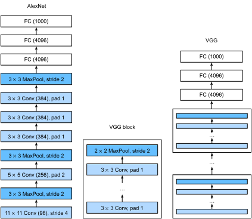

```{.python .input  n=1}
%load_ext d2lbook.tab
tab.interact_select(['mxnet', 'pytorch', 'tensorflow', 'jax'])
```

# Tinklai, naudojantys blokus (VGG)
:label:`sec_vgg`

Nors AlexNet pateikė empirinių įrodymų, kad gilieji CNN
gali pasiekti gerų rezultatų, jis nepasiūlė bendro šablono,
kuris vestų vėlesnius tyrėjus kuriant naujus tinklus.
Kituose skyreliuose pristatysime keletą euristinių sąvokų,
dažniausiai naudojamų giliesiems tinklams projektuoti.

Šios srities pažanga atspindi VLSI (labai didelio masto integravimo)
pažangą lustų projektavime,
kur inžinieriai pereidavo nuo tranzistorių išdėstymo
prie loginių elementų, o tada prie loginių blokų :cite:`Mead.1980`.
Panašiai neuroninių tinklų architektūrų projektavimas
tapo vis abstraktesnis:
tyrėjai pereidavo nuo mąstymo atskirų
neuronų lygiu prie ištisų sluoksnių,
o dabar – prie blokų, pasikartojančių sluoksnių šablonų. Po dešimtmečio tai pažengė iki to, kad
tyrėjai naudoja ištisus apmokytus modelius, pritaikydami juos skirtingoms,
nors ir susijusioms, užduotims. Tokie dideli iš anksto apmokyti modeliai paprastai vadinami
*fundamentiniais modeliais* :cite:`bommasani2021opportunities`.

Grįžkime prie tinklų projektavimo. Blokų naudojimo idėja pirmiausia atsirado
Oksfordo universiteto Vizualinės geometrijos grupėje (VGG)
jų to paties pavadinimo *VGG* tinkle :cite:`Simonyan.Zisserman.2014`.
Šias pasikartojančias struktūras lengva įgyvendinti kode
su bet kuriuo šiuolaikiniu giliojo mokymosi karkasu, naudojant ciklus ir paprogrames.

```{.python .input}
%%tab mxnet
from d2l import mxnet as d2l
from mxnet import np, npx, init
from mxnet.gluon import nn
npx.set_np()
```

```{.python .input}
%%tab pytorch
from d2l import torch as d2l
import torch
from torch import nn
```

```{.python .input}
%%tab tensorflow
import tensorflow as tf
from d2l import tensorflow as d2l
```

```{.python .input}
%%tab jax
from d2l import jax as d2l
from flax import linen as nn
import jax
```

## (**VGG blokai**)
:label:`subsec_vgg-blocks`

Pagrindinis CNN statybinis blokas
yra šios sekos:
(i) konvoliucinis sluoksnis
su papildymu skyrai išlaikyti,
(ii) netiesiškumas, pavyzdžiui, ReLU,
(iii) sutelkimo sluoksnis, pavyzdžiui,
sutelkimas imant maksimumą skyrai sumažinti. Viena šio požiūrio problemų yra ta,
kad erdvinė skyra mažėja gana sparčiai. Visų pirma
tai nustato griežtą $\log_2 d$ konvoliucinių sluoksnių ribą tinklui, kol bus išnaudotos visos
dimensijos ($d$). Pavyzdžiui, ImageNet atveju tokiu būdu būtų neįmanoma turėti
daugiau nei 8 konvoliucinių sluoksnių.

Pagrindinė :citet:`Simonyan.Zisserman.2014` idėja buvo naudoti *kelias* konvoliucijas tarp diskretizavimo dažnio mažinimo
sutelkimu imant maksimumą bloko pavidalu. Juos daugiausia domino, ar geriau veikia gilūs,
ar platūs tinklai. Pavyzdžiui, nuoseklus dviejų $3 \times 3$ konvoliucijų taikymas
paliečia tuos pačius pikselius kaip ir viena $5 \times 5$ konvoliucija. Tuo pat metu pastaroji naudoja maždaug
tiek pat parametrų ($25 \cdot c^2$), kiek trys $3 \times 3$ konvoliucijos ($3 \cdot 9 \cdot c^2$).
Gana išsamioje analizėje jie parodė, kad gilūs ir siauri tinklai gerokai pranoksta negilius atitikmenis. Tai pastūmėjo gilųjį mokymąsi siekti vis gilesnių tinklų, tipiniams taikymams turinčių per 100 sluoksnių.
$3 \times 3$ konvoliucijų kaupimas
tapo auksiniu standartu vėlesniuose giliuose tinkluose (dizaino sprendimas, kurį neseniai peržiūrėjo tik
:citet:`liu2022convnet`). Todėl greiti mažų konvoliucijų įgyvendinimai tapo GPU įprasta praktika :cite:`lavin2016fast`.

Grįžkime prie VGG: VGG blokas susideda iš *sekos* konvoliucijų su $3\times3$ branduoliais ir 1 papildymu
(išlaikant aukštį ir plotį), po kurių eina $2 \times 2$ sutelkimo imant maksimumą sluoksnis su 2 žingsniu
(perpus sumažinantis aukštį ir plotį po kiekvieno bloko).
Toliau pateiktame kode apibrėžiame funkciją `vgg_block`
vienam VGG blokui įgyvendinti.

Žemiau pateikta funkcija priima du argumentus,
atitinkančius konvoliucinių sluoksnių skaičių `num_convs`
ir išvesties kanalų skaičių `num_channels`.

```{.python .input  n=2}
%%tab mxnet
def vgg_block(num_convs, num_channels):
    blk = nn.Sequential()
    for _ in range(num_convs):
        blk.add(nn.Conv2D(num_channels, kernel_size=3,
                          padding=1, activation='relu'))
    blk.add(nn.MaxPool2D(pool_size=2, strides=2))
    return blk
```

```{.python .input  n=3}
%%tab pytorch
def vgg_block(num_convs, out_channels):
    layers = []
    for _ in range(num_convs):
        layers.append(nn.LazyConv2d(out_channels, kernel_size=3, padding=1))
        layers.append(nn.ReLU())
    layers.append(nn.MaxPool2d(kernel_size=2,stride=2))
    return nn.Sequential(*layers)
```

```{.python .input  n=4}
%%tab tensorflow
def vgg_block(num_convs, num_channels):
    blk = tf.keras.models.Sequential()
    for _ in range(num_convs):
        blk.add(
            tf.keras.layers.Conv2D(num_channels, kernel_size=3,
                                   padding='same', activation='relu'))
    blk.add(tf.keras.layers.MaxPool2D(pool_size=2, strides=2))
    return blk
```

```{.python .input}
%%tab jax
def vgg_block(num_convs, out_channels):
    layers = []
    for _ in range(num_convs):
        layers.append(nn.Conv(out_channels, kernel_size=(3, 3), padding=(1, 1)))
        layers.append(nn.relu)
    layers.append(lambda x: nn.max_pool(x, window_shape=(2, 2), strides=(2, 2)))
    return nn.Sequential(layers)
```

## [**VGG tinklas**]
:label:`subsec_vgg-network`

Kaip ir AlexNet bei LeNet,
VGG tinklą galima suskaidyti į dvi dalis:
pirmąją, sudarytą daugiausia iš konvoliucinių ir sutelkimo sluoksnių,
ir antrąją, sudarytą iš pilnai sujungtų sluoksnių, identiškų AlexNet sluoksniams.
Pagrindinis skirtumas yra tas,
kad konvoliuciniai sluoksniai sugrupuoti į netiesines transformacijas,
kurios nekeičia dimensijos, o po jų eina skyros mažinimo žingsnis, kaip
pavaizduota :numref:`fig_vgg`.


:width:`400px`
:label:`fig_vgg`

Konvoliucinė tinklo dalis nuosekliai sujungia kelis VGG blokus iš :numref:`fig_vgg` (taip pat apibrėžtus funkcijoje `vgg_block`).
Šis konvoliucijų grupavimas yra šablonas, kuris
per pastarąjį dešimtmetį išliko beveik nepakitęs, nors konkretus
operacijų pasirinkimas patyrė didelių pakeitimų.
Kintamasis `arch` susideda iš kortežų sąrašo (po vieną kiekvienam blokui),
kurių kiekvienas turi dvi reikšmes: konvoliucinių sluoksnių skaičių
ir išvesties kanalų skaičių,
kurie yra būtent argumentai, reikalingi funkcijai
`vgg_block` iškviesti. Taigi VGG apibrėžia tinklų *šeimą*, o ne tik
vieną konkrečią išraišką. Norėdami sukurti konkretų tinklą, tiesiog iteruojame per `arch`, kad sudėtume blokus.

```{.python .input  n=5}
%%tab pytorch, mxnet, tensorflow
class VGG(d2l.Classifier):
    def __init__(self, arch, lr=0.1, num_classes=10):
        super().__init__()
        self.save_hyperparameters()
        if tab.selected('mxnet'):
            self.net = nn.Sequential()
            for (num_convs, num_channels) in arch:
                self.net.add(vgg_block(num_convs, num_channels))
            self.net.add(nn.Dense(4096, activation='relu'), nn.Dropout(0.5),
                         nn.Dense(4096, activation='relu'), nn.Dropout(0.5),
                         nn.Dense(num_classes))
            self.net.initialize(init.Xavier())
        if tab.selected('pytorch'):
            conv_blks = []
            for (num_convs, out_channels) in arch:
                conv_blks.append(vgg_block(num_convs, out_channels))
            self.net = nn.Sequential(
                *conv_blks, nn.Flatten(),
                nn.LazyLinear(4096), nn.ReLU(), nn.Dropout(0.5),
                nn.LazyLinear(4096), nn.ReLU(), nn.Dropout(0.5),
                nn.LazyLinear(num_classes))
            self.net.apply(d2l.init_cnn)
        if tab.selected('tensorflow'):
            self.net = tf.keras.models.Sequential()
            for (num_convs, num_channels) in arch:
                self.net.add(vgg_block(num_convs, num_channels))
            self.net.add(
                tf.keras.models.Sequential([
                tf.keras.layers.Flatten(),
                tf.keras.layers.Dense(4096, activation='relu'),
                tf.keras.layers.Dropout(0.5),
                tf.keras.layers.Dense(4096, activation='relu'),
                tf.keras.layers.Dropout(0.5),
                tf.keras.layers.Dense(num_classes)]))
```

```{.python .input  n=5}
%%tab jax
class VGG(d2l.Classifier):
    arch: list
    lr: float = 0.1
    num_classes: int = 10
    training: bool = True

    def setup(self):
        conv_blks = []
        for (num_convs, out_channels) in self.arch:
            conv_blks.append(vgg_block(num_convs, out_channels))

        self.net = nn.Sequential([
            *conv_blks,
            lambda x: x.reshape((x.shape[0], -1)),  # flatten
            nn.Dense(4096), nn.relu,
            nn.Dropout(0.5, deterministic=not self.training),
            nn.Dense(4096), nn.relu,
            nn.Dropout(0.5, deterministic=not self.training),
            nn.Dense(self.num_classes)])
```

Originalus VGG tinklas turėjo penkis konvoliucinius blokus,
iš kurių pirmieji du turi po vieną konvoliucinį sluoksnį,
o paskutiniai trys – po du konvoliucinius sluoksnius.
Pirmasis blokas turi 64 išvesties kanalus,
o kiekvienas paskesnis blokas padvigubina išvesties kanalų skaičių,
kol jis pasiekia 512.
Kadangi šis tinklas naudoja aštuonis konvoliucinius sluoksnius
ir tris pilnai sujungtus sluoksnius, jis dažnai vadinamas VGG-11.

```{.python .input  n=6}
%%tab pytorch, mxnet
VGG(arch=((1, 64), (1, 128), (2, 256), (2, 512), (2, 512))).layer_summary(
    (1, 1, 224, 224))
```

```{.python .input  n=7}
%%tab tensorflow
VGG(arch=((1, 64), (1, 128), (2, 256), (2, 512), (2, 512))).layer_summary(
    (1, 224, 224, 1))
```

```{.python .input}
%%tab jax
VGG(arch=((1, 64), (1, 128), (2, 256), (2, 512), (2, 512)),
    training=False).layer_summary((1, 224, 224, 1))
```

Kaip matote, kiekviename bloke perpus sumažiname aukštį ir plotį,
kol galiausiai pasiekiame 7 aukštį ir plotį
prieš išlygindami atvaizdus
apdoroti pilnai sujungtoje tinklo dalyje.
:citet:`Simonyan.Zisserman.2014` aprašė keletą kitų VGG variantų.
Iš tikrųjų tapo norma, pristatant naują architektūrą, siūlyti tinklų *šeimas* su
skirtingais greičio ir tikslumo kompromisais.

## Mokymas

[**Kadangi VGG-11 skaičiavimo požiūriu reiklesnis nei AlexNet,
sukonstruojame tinklą su mažesniu kanalų skaičiumi.**]
To daugiau nei pakanka mokymui su Fashion-MNIST.
[**Modelio mokymo**] procesas panašus į AlexNet :numref:`sec_alexnet`.
Vėlgi atkreipkite dėmesį į glaudų validavimo ir mokymo nuostolių sutapimą,
rodantį tik nedidelį persimokymą.

```{.python .input  n=8}
%%tab mxnet, pytorch, jax
model = VGG(arch=((1, 16), (1, 32), (2, 64), (2, 128), (2, 128)), lr=0.01)
trainer = d2l.Trainer(max_epochs=10, num_gpus=1)
data = d2l.FashionMNIST(batch_size=128, resize=(224, 224))
if tab.selected('pytorch'):
    model.apply_init([next(iter(data.get_dataloader(True)))[0]], d2l.init_cnn)
trainer.fit(model, data)
```

```{.python .input  n=9}
%%tab tensorflow
trainer = d2l.Trainer(max_epochs=10)
data = d2l.FashionMNIST(batch_size=128, resize=(224, 224))
with d2l.try_gpu():
    model = VGG(arch=((1, 16), (1, 32), (2, 64), (2, 128), (2, 128)), lr=0.01)
    trainer.fit(model, data)
```

## Santrauka

Galima teigti, kad VGG yra pirmasis tikrai šiuolaikinis konvoliucinis neuroninis tinklas. Nors AlexNet pristatė daugelį komponentų, kurie daro gilųjį mokymąsi veiksmingą dideliu mastu, būtent VGG, galima sakyti, pristatė esmines savybes, tokias kaip kelių konvoliucijų blokai ir pirmenybė giliems ir siauriems tinklams. Tai taip pat pirmasis tinklas, kuris iš tikrųjų yra visa panašiai parametrizuotų modelių šeima, suteikianti praktikui didelę kompromiso tarp sudėtingumo ir greičio erdvę. Čia taip pat spindi šiuolaikiniai giliojo mokymosi karkasai. Nebereikia generuoti XML konfigūracijos failų tinklui nurodyti, o galima surinkti tuos tinklus paprastu Python kodu.

Visai neseniai ParNet :cite:`Goyal.Bochkovskiy.Deng.ea.2021` parodė, kad galima pasiekti konkurencingą našumą naudojant daug negilesnę architektūrą, pasitelkus didelį lygiagrečių skaičiavimų skaičių. Tai įdomi raida, ir tikimasi, kad ji paveiks architektūrų dizainą ateityje. Tačiau likusioje skyriaus dalyje sekime mokslinės pažangos keliu per pastarąjį dešimtmetį.

## Pratimai


1. Palyginti su AlexNet, VGG yra daug lėtesnis skaičiavimo požiūriu ir jam reikia daugiau GPU atminties.
    1. Palyginkite AlexNet ir VGG reikalingų parametrų skaičių.
    1. Palyginkite slankiojo kablelio operacijų skaičių konvoliuciniuose ir pilnai sujungtuose sluoksniuose.
    1. Kaip galėtumėte sumažinti pilnai sujungtų sluoksnių sukeliamas skaičiavimo sąnaudas?
1. Rodydami skirtingų tinklo sluoksnių dimensijas, matome tik informaciją, susijusią su aštuoniais blokais (plius keliomis pagalbinėmis transformacijomis), nors tinklas turi 11 sluoksnių. Kur dingo likę trys sluoksniai?
1. Naudodami VGG straipsnio :cite:`Simonyan.Zisserman.2014` 1 lentelę sukonstruokite kitus įprastus modelius, tokius kaip VGG-16 ar VGG-19.
1. Fashion-MNIST skyros padidinimas aštuonis kartus nuo $28 \times 28$ iki $224 \times 224$ dimensijų yra labai švaistūnas. Pabandykite pakeisti tinklo architektūrą ir skyros konversiją, pvz., į 56 ar 84 dimensijų įvestį. Ar galite tai padaryti nesumažindami tinklo tikslumo? Pasinaudokite VGG straipsniu :cite:`Simonyan.Zisserman.2014`, kad rastumėte idėjų, kaip pridėti daugiau netiesiškumų prieš diskretizavimo dažnio mažinimą.

:begin_tab:`mxnet`
[Diskusijos](https://discuss.d2l.ai/t/77)
:end_tab:

:begin_tab:`pytorch`
[Diskusijos](https://discuss.d2l.ai/t/78)
:end_tab:

:begin_tab:`tensorflow`
[Diskusijos](https://discuss.d2l.ai/t/277)
:end_tab:

:begin_tab:`jax`
[Diskusijos](https://discuss.d2l.ai/t/18002)
:end_tab:
