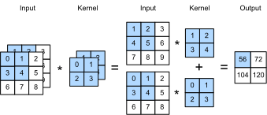
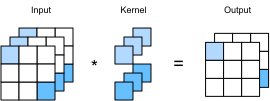

```{.python .input}
%load_ext d2lbook.tab
tab.interact_select(['mxnet', 'pytorch', 'tensorflow', 'jax'])
```

# Keli įvesties ir keli išvesties kanalai
:label:`sec_channels`

Nors :numref:`subsec_why-conv-channels` aprašėme kelis kanalus,
sudarančius kiekvieną vaizdą (pvz., spalvoti vaizdai turi standartinius RGB kanalus,
nurodančius raudonos, žalios ir mėlynos kiekį), ir konvoliucinius sluoksnius keliems kanalams,
iki šiol supaprastinome visus savo skaitinius pavyzdžius,
dirbdami tik su vienu įvesties ir vienu išvesties kanalu.
Tai leido mums savo įvestis, konvoliucijos branduolius
ir išvestis laikyti dvimačiais tenzoriais.

Kai pridedame kanalus,
mūsų įvestys ir paslėptieji atvaizdai
tampa trimačiais tenzoriais.
Pavyzdžiui, kiekvieno RGB įvesties vaizdo forma yra $3\times h\times w$.
Šią ašį, kurios dydis 3, vadiname *kanalų* dimensija. Kanalų sąvoka
yra tokia pat sena kaip patys CNN: pavyzdžiui, LeNet-5 :cite:`LeCun.Jackel.Bottou.ea.1995` jas naudoja.
Šiame skyrelyje giliau pažvelgsime
į konvoliucijos branduolius su keliais įvesties ir keliais išvesties kanalais.

```{.python .input}
%%tab mxnet
from d2l import mxnet as d2l
from mxnet import np, npx
npx.set_np()
```

```{.python .input}
%%tab pytorch
from d2l import torch as d2l
import torch
```

```{.python .input}
%%tab jax
from d2l import jax as d2l
import jax
from jax import numpy as jnp
```

```{.python .input}
%%tab tensorflow
from d2l import tensorflow as d2l
import tensorflow as tf
```

## Keli įvesties kanalai

Kai įvesties duomenys turi kelis kanalus,
turime sukonstruoti konvoliucijos branduolį
su tokiu pat įvesties kanalų skaičiumi kaip ir įvesties duomenys,
kad jis galėtų atlikti kryžminę koreliaciją su įvesties duomenimis.
Tarkime, kad įvesties duomenų kanalų skaičius yra $c_\textrm{i}$,
tada konvoliucijos branduolio įvesties kanalų skaičius taip pat turi būti $c_\textrm{i}$. Jei mūsų konvoliucijos branduolio lango forma yra $k_\textrm{h}\times k_\textrm{w}$,
tai, kai $c_\textrm{i}=1$, savo konvoliucijos branduolį galime laikyti
tiesiog dvimačiu tenzoriumi, kurio forma $k_\textrm{h}\times k_\textrm{w}$.

Tačiau, kai $c_\textrm{i}>1$, mums reikia branduolio,
kuriame yra formos $k_\textrm{h}\times k_\textrm{w}$ tenzorius *kiekvienam* įvesties kanalui. Sujungus šiuos $c_\textrm{i}$ tenzorių
gaunamas konvoliucijos branduolys, kurio forma $c_\textrm{i}\times k_\textrm{h}\times k_\textrm{w}$.
Kadangi įvestis ir konvoliucijos branduolys turi po $c_\textrm{i}$ kanalų,
galime atlikti kryžminės koreliacijos operaciją
su dvimačiu įvesties tenzoriumi
ir dvimačiu konvoliucijos branduolio tenzoriumi
kiekvienam kanalui, sudėdami $c_\textrm{i}$ rezultatus
(sumuodami per kanalus),
kad gautume dvimatį tenzorių.
Tai yra dvimatės kryžminės koreliacijos rezultatas
tarp daugiakanalės įvesties ir
konvoliucijos branduolio su keliais įvesties kanalais.

:numref:`fig_conv_multi_in` pateiktas dvimatės kryžminės koreliacijos
su dviem įvesties kanalais pavyzdys.
Pažymėtos dalys yra pirmasis išvesties elementas
ir įvesties bei branduolio tenzoriaus elementai, naudoti išvesčiai skaičiuoti:
$(1\times1+2\times2+4\times3+5\times4)+(0\times0+1\times1+3\times2+4\times3)=56$.


:label:`fig_conv_multi_in`


Kad įsitikintume, jog tikrai suprantame, kas čia vyksta,
patys galime (**įgyvendinti kryžminės koreliacijos operacijas su keliais įvesties kanalais**).
Atkreipkite dėmesį, kad viskas, ką darome, yra kryžminės koreliacijos operacija
kiekvienam kanalui, o tada rezultatų sudėjimas.

```{.python .input}
%%tab mxnet, pytorch, jax
def corr2d_multi_in(X, K):
    # Iterate through the 0th dimension (channel) of K first, then add them up
    return sum(d2l.corr2d(x, k) for x, k in zip(X, K))
```

```{.python .input}
%%tab tensorflow
def corr2d_multi_in(X, K):
    # Iterate through the 0th dimension (channel) of K first, then add them up
    return tf.reduce_sum([d2l.corr2d(x, k) for x, k in zip(X, K)], axis=0)
```

Galime sukonstruoti įvesties tenzorių `X` ir branduolio tenzorių `K`,
atitinkančius reikšmes :numref:`fig_conv_multi_in`,
kad (**patvirtintume**) kryžminės koreliacijos operacijos (**išvestį**).

```{.python .input}
%%tab all
X = d2l.tensor([[[0.0, 1.0, 2.0], [3.0, 4.0, 5.0], [6.0, 7.0, 8.0]],
               [[1.0, 2.0, 3.0], [4.0, 5.0, 6.0], [7.0, 8.0, 9.0]]])
K = d2l.tensor([[[0.0, 1.0], [2.0, 3.0]], [[1.0, 2.0], [3.0, 4.0]]])

corr2d_multi_in(X, K)
```

## Keli išvesties kanalai
:label:`subsec_multi-output-channels`

Nepriklausomai nuo įvesties kanalų skaičiaus,
iki šiol visada gaudavome vieną išvesties kanalą.
Tačiau, kaip aptarėme :numref:`subsec_why-conv-channels`,
paaiškėja, kad kiekviename sluoksnyje būtina turėti kelis kanalus.
Populiariausiose neuroninių tinklų architektūrose
iš tikrųjų didiname kanalų dimensiją,
eidami gilyn į neuroninį tinklą,
paprastai sumažindami diskretizavimo dažnį, kad iškeistume erdvinę skyrą
į didesnį *kanalų gylį*.
Intuityviai galite įsivaizduoti, kad kiekvienas kanalas
reaguoja į skirtingą požymių rinkinį.
Tikrovė yra šiek tiek sudėtingesnė. Naivi interpretacija leistų manyti,
kad atvaizdai išmokstami nepriklausomai kiekvienam pikseliui ar kiekvienam kanalui.
Vietoj to kanalai optimizuojami taip, kad būtų naudingi kartu.
Tai reiškia, kad užuot priskyrus vieną kanalą kraštų detektoriui, gali tiesiog reikšti,
kad tam tikra kryptis kanalų erdvėje atitinka kraštų aptikimą.

Tegul $c_\textrm{i}$ ir $c_\textrm{o}$ žymi atitinkamai įvesties ir išvesties
kanalų skaičių,
o $k_\textrm{h}$ ir $k_\textrm{w}$ – branduolio aukštį ir plotį.
Kad gautume išvestį su keliais kanalais,
galime sukurti formos $c_\textrm{i}\times k_\textrm{h}\times k_\textrm{w}$
branduolio tenzorių
*kiekvienam* išvesties kanalui.
Juos sujungiame išvesties kanalų dimensijoje,
taip kad konvoliucijos branduolio forma
būtų $c_\textrm{o}\times c_\textrm{i}\times k_\textrm{h}\times k_\textrm{w}$.
Kryžminės koreliacijos operacijose
rezultatas kiekviename išvesties kanale apskaičiuojamas
pagal tą išvesties kanalą atitinkantį konvoliucijos branduolį
ir gauna įvestį iš visų įvesties tenzoriaus kanalų.

Įgyvendiname kryžminės koreliacijos funkciją,
kad [**apskaičiuotume kelių kanalų išvestį**], kaip parodyta žemiau.

```{.python .input}
%%tab all
def corr2d_multi_in_out(X, K):
    # Iterate through the 0th dimension of K, and each time, perform
    # cross-correlation operations with input X. All of the results are
    # stacked together
    return d2l.stack([corr2d_multi_in(X, k) for k in K], 0)
```

Sukonstruojame trivialų konvoliucijos branduolį su trimis išvesties kanalais,
sujungdami `K` branduolio tenzorių su `K+1` ir `K+2`.

```{.python .input}
%%tab all
K = d2l.stack((K, K + 1, K + 2), 0)
K.shape
```

Toliau atliekame kryžminės koreliacijos operacijas
su įvesties tenzoriumi `X` ir branduolio tenzoriumi `K`.
Dabar išvestyje yra trys kanalai.
Pirmojo kanalo rezultatas sutampa
su ankstesnio įvesties tenzoriaus `X`
ir branduolio su keliais įvesties kanalais bei
vienu išvesties kanalu rezultatu.

```{.python .input}
%%tab all
corr2d_multi_in_out(X, K)
```

## $1\times 1$ konvoliucinis sluoksnis
:label:`subsec_1x1`

Iš pirmo žvilgsnio [**$1 \times 1$ konvoliucija**], t. y. $k_\textrm{h} = k_\textrm{w} = 1$,
neatrodo labai prasminga.
Juk konvoliucija koreliuoja gretimus pikselius.
$1 \times 1$ konvoliucija akivaizdžiai to nedaro.
Vis dėlto tai populiarios operacijos, kurios kartais įtraukiamos
į sudėtingų giliųjų tinklų dizainą :cite:`Lin.Chen.Yan.2013,Szegedy.Ioffe.Vanhoucke.ea.2017`.
Pažiūrėkime šiek tiek išsamiau, ką ji iš tikrųjų daro.

Kadangi naudojamas mažiausias langas,
$1\times 1$ konvoliucija praranda didesnių konvoliucinių sluoksnių gebėjimą
atpažinti šablonus, sudarytus iš sąveikų
tarp gretimų elementų aukščio ir pločio dimensijose.
Vienintelis $1\times 1$ konvoliucijos skaičiavimas vyksta
kanalų dimensijoje.

:numref:`fig_conv_1x1` parodytas kryžminės koreliacijos skaičiavimas
naudojant $1\times 1$ konvoliucijos branduolį
su 3 įvesties kanalais ir 2 išvesties kanalais.
Atkreipkite dėmesį, kad įvestys ir išvestys turi tą patį aukštį ir plotį.
Kiekvienas išvesties elementas gaunamas
iš įvesties vaizdo elementų *toje pačioje pozicijoje* tiesinio derinio.
$1\times 1$ konvoliucinį sluoksnį galite laikyti
pilnai sujungtu sluoksniu, taikomu kiekvienoje pikselio vietoje,
kad $c_\textrm{i}$ atitinkamų įvesties reikšmių transformuotų į $c_\textrm{o}$ išvesties reikšmių.
Kadangi tai vis dar yra konvoliucinis sluoksnis,
svoriai yra susieti per pikselių vietas.
Taigi $1\times 1$ konvoliuciniam sluoksniui reikia $c_\textrm{o}\times c_\textrm{i}$ svorių
(plius poslinkis). Taip pat atkreipkite dėmesį, kad po konvoliucinių sluoksnių paprastai
eina netiesiškumai. Tai užtikrina, kad $1 \times 1$ konvoliucijų negalima tiesiog
sulieti su kitomis konvoliucijomis.


:label:`fig_conv_1x1`

Patikrinkime, ar tai veikia praktikoje:
įgyvendiname $1 \times 1$ konvoliuciją
naudodami pilnai sujungtą sluoksnį.
Vienintelis dalykas – turime šiek tiek pakoreguoti
duomenų formą prieš matricų daugybą ir po jos.

```{.python .input}
%%tab all
def corr2d_multi_in_out_1x1(X, K):
    c_i, h, w = X.shape
    c_o = K.shape[0]
    X = d2l.reshape(X, (c_i, h * w))
    K = d2l.reshape(K, (c_o, c_i))
    # Matrix multiplication in the fully connected layer
    Y = d2l.matmul(K, X)
    return d2l.reshape(Y, (c_o, h, w))
```

Atliekant $1\times 1$ konvoliucijas,
aukščiau pateikta funkcija yra ekvivalenti anksčiau įgyvendintai kryžminės koreliacijos funkcijai `corr2d_multi_in_out`.
Patikrinkime tai su keliais pavyzdiniais duomenimis.

```{.python .input}
%%tab mxnet, pytorch
X = d2l.normal(0, 1, (3, 3, 3))
K = d2l.normal(0, 1, (2, 3, 1, 1))
Y1 = corr2d_multi_in_out_1x1(X, K)
Y2 = corr2d_multi_in_out(X, K)
assert float(d2l.reduce_sum(d2l.abs(Y1 - Y2))) < 1e-6
```

```{.python .input}
%%tab tensorflow
X = d2l.normal((3, 3, 3), 0, 1)
K = d2l.normal((2, 3, 1, 1), 0, 1)
Y1 = corr2d_multi_in_out_1x1(X, K)
Y2 = corr2d_multi_in_out(X, K)
assert float(d2l.reduce_sum(d2l.abs(Y1 - Y2))) < 1e-6
```

```{.python .input}
%%tab jax
X = jax.random.normal(jax.random.PRNGKey(d2l.get_seed()), (3, 3, 3)) + 0 * 1
K = jax.random.normal(jax.random.PRNGKey(d2l.get_seed()), (2, 3, 1, 1)) + 0 * 1
Y1 = corr2d_multi_in_out_1x1(X, K)
Y2 = corr2d_multi_in_out(X, K)
assert float(d2l.reduce_sum(d2l.abs(Y1 - Y2))) < 1e-6
```

## Diskusija

Kanalai leidžia mums sujungti geriausias abiejų pasaulių savybes: MLP, leidžiančius reikšmingus netiesiškumus, ir konvoliucijas, leidžiančias *lokalizuotą* požymių analizę. Visų pirma kanalai leidžia CNN samprotauti su keliais požymiais, tokiais kaip kraštų ir formų detektoriai vienu metu. Jie taip pat siūlo praktišką kompromisą tarp drastiško parametrų sumažinimo, atsirandančio dėl postūmio invariantiškumo ir lokalumo, ir raiškių bei įvairių modelių poreikio kompiuteriniame matyme.

Tačiau atkreipkite dėmesį, kad šis lankstumas kainuoja. Turint $(h \times w)$ dydžio vaizdą, $k \times k$ konvoliucijos skaičiavimo kaina yra $\mathcal{O}(h \cdot w \cdot k^2)$. Atitinkamai $c_\textrm{i}$ įvesties ir $c_\textrm{o}$ išvesties kanalams tai padidėja iki $\mathcal{O}(h \cdot w \cdot k^2 \cdot c_\textrm{i} \cdot c_\textrm{o})$. $256 \times 256$ pikselių vaizdui su $5 \times 5$ branduoliu ir atitinkamai $128$ įvesties ir išvesties kanalų tai sudaro daugiau nei 53 milijardus operacijų (daugybą ir sudėtį skaičiuojame atskirai). Vėliau susidursime su efektyviomis strategijomis kainai sumažinti, pvz., reikalaujant, kad operacijos pagal kanalus būtų blokinės įstrižainės, o tai veda prie tokių architektūrų kaip ResNeXt :cite:`Xie.Girshick.Dollar.ea.2017`.

## Pratimai

1. Tarkime, kad turime du konvoliucijos branduolius, kurių dydžiai atitinkamai $k_1$ ir $k_2$
   (be netiesiškumo tarp jų).
    1. Įrodykite, kad operacijos rezultatą galima išreikšti viena konvoliucija.
    1. Kokia yra ekvivalentiškos vienos konvoliucijos dimensija?
    1. Ar teisingas atvirkštinis teiginys, t. y. ar visada galima konvoliuciją išskaidyti į dvi mažesnes?
1. Tarkime, kad įvesties forma yra $c_\textrm{i}\times h\times w$, konvoliucijos branduolio forma –
   $c_\textrm{o}\times c_\textrm{i}\times k_\textrm{h}\times k_\textrm{w}$, papildymas – $(p_\textrm{h}, p_\textrm{w})$, o žingsnis – $(s_\textrm{h}, s_\textrm{w})$.
    1. Kokia yra tiesioginio sklidimo skaičiavimo kaina (daugybos ir sudėties)?
    1. Kokia yra atminties apimtis?
    1. Kokia yra atminties apimtis atgaliniam skaičiavimui?
    1. Kokia yra atgalinio sklidimo skaičiavimo kaina?
1. Kiek kartų padidėja skaičiavimų skaičius, jei padvigubiname ir įvesties kanalų skaičių
   $c_\textrm{i}$, ir išvesties kanalų skaičių $c_\textrm{o}$? Kas nutinka, jei padvigubiname papildymą?
1. Ar kintamieji `Y1` ir `Y2` paskutiniame šio skyrelio pavyzdyje yra visiškai vienodi? Kodėl?
1. Išreikškite konvoliucijas kaip matricų daugybą, net kai konvoliucijos langas nėra $1 \times 1$.
1. Jūsų užduotis – įgyvendinti greitas konvoliucijas su $k \times k$ branduoliu. Vienas iš algoritmo kandidatų
   yra skenuoti horizontaliai per šaltinį, skaitant $k$ pločio juostą ir apskaičiuojant $1$ pločio išvesties juostą
   po vieną reikšmę. Alternatyva yra nuskaityti $k + \Delta$ pločio juostą ir apskaičiuoti $\Delta$ pločio
   išvesties juostą. Kodėl pastaroji yra geresnė? Ar yra riba, kokį didelį $\Delta$ turėtumėte rinktis?
1. Tarkime, kad turime $c \times c$ matricą.
    1. Kiek greičiau dauginti iš blokinės įstrižainės matricos, jei matrica išskaidyta į $b$ blokų?
    1. Koks yra $b$ blokų turėjimo trūkumas? Kaip jį galėtumėte ištaisyti, bent iš dalies?

:begin_tab:`mxnet`
[Diskusijos](https://discuss.d2l.ai/t/69)
:end_tab:

:begin_tab:`pytorch`
[Diskusijos](https://discuss.d2l.ai/t/70)
:end_tab:

:begin_tab:`tensorflow`
[Diskusijos](https://discuss.d2l.ai/t/273)
:end_tab:

:begin_tab:`jax`
[Diskusijos](https://discuss.d2l.ai/t/17998)
:end_tab:
