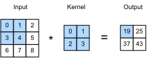

```{.python .input}
%load_ext d2lbook.tab
tab.interact_select(['mxnet', 'pytorch', 'tensorflow', 'jax'])
```

# Konvoliucijos vaizdams
:label:`sec_conv_layer`

Dabar, kai teoriškai suprantame, kaip veikia konvoliuciniai sluoksniai,
esame pasirengę pamatyti, kaip jie veikia praktikoje.
Remdamiesi savo konvoliucinių neuroninių tinklų motyvacija
kaip efektyvių architektūrų vaizdo duomenų struktūrai tyrinėti,
kaip nuolatinį pavyzdį toliau naudojame vaizdus.

```{.python .input}
%%tab mxnet
from d2l import mxnet as d2l
from mxnet import autograd, np, npx
from mxnet.gluon import nn
npx.set_np()
```

```{.python .input}
%%tab pytorch
from d2l import torch as d2l
import torch
from torch import nn
```

```{.python .input}
%%tab jax
from d2l import jax as d2l
from flax import linen as nn
import jax
from jax import numpy as jnp
```

```{.python .input}
%%tab tensorflow
from d2l import tensorflow as d2l
import tensorflow as tf
```

## Kryžminės koreliacijos operacija

Prisiminkite, kad griežtai kalbant, konvoliucinių sluoksnių pavadinimas
yra klaidingas, nes jų išreiškiamos operacijos
tiksliau apibūdinamos kaip kryžminės koreliacijos.
Remiantis mūsų konvoliucinių sluoksnių aprašymais :numref:`sec_why-conv`,
tokiame sluoksnyje įvesties tenzorius
ir branduolio tenzorius sujungiami,
kad per (**kryžminės koreliacijos operaciją**) būtų gautas išvesties tenzorius.

Kol kas ignoruokime kanalus ir pažiūrėkime, kaip tai veikia
su dvimačiais duomenimis ir paslėptaisiais atvaizdais.
:numref:`fig_correlation`
įvestis yra dvimatis tenzorius,
kurio aukštis 3 ir plotis 3.
Tenzoriaus formą žymime $3 \times 3$ arba ($3$, $3$).
Branduolio aukštis ir plotis abu yra 2.
*Branduolio lango* (arba *konvoliucijos lango*) forma
nustatoma pagal branduolio aukštį ir plotį
(čia tai $2 \times 2$).


:label:`fig_correlation`

Dvimatėje kryžminės koreliacijos operacijoje
pradedame nuo konvoliucijos lango, padėto
įvesties tenzoriaus viršutiniame kairiajame kampe,
ir slenkame jį per įvesties tenzorių
iš kairės į dešinę ir iš viršaus į apačią.
Kai konvoliucijos langas pasislenka į tam tikrą padėtį,
šiame lange esantis įvesties potenzorius
ir branduolio tenzorius sudauginami elementas po elemento,
o gautas tenzorius susumuojamas,
gaunant vieną skaliarinę reikšmę.
Šis rezultatas yra išvesties tenzoriaus reikšmė
atitinkamoje vietoje.
Čia išvesties tenzoriaus aukštis yra 2, o plotis – 2,
ir keturi elementai gaunami
iš dvimatės kryžminės koreliacijos operacijos:

$$
0\times0+1\times1+3\times2+4\times3=19,\\
1\times0+2\times1+4\times2+5\times3=25,\\
3\times0+4\times1+6\times2+7\times3=37,\\
4\times0+5\times1+7\times2+8\times3=43.
$$

Atkreipkite dėmesį, kad išilgai kiekvienos ašies išvesties dydis
yra šiek tiek mažesnis už įvesties dydį.
Kadangi branduolio plotis ir aukštis didesni nei $1$,
kryžminę koreliaciją galime tinkamai apskaičiuoti tik
vietoms, kuriose branduolys visiškai telpa vaizde,
todėl išvesties dydis lygus įvesties dydžiui $n_\textrm{h} \times n_\textrm{w}$,
atėmus konvoliucijos branduolio dydį $k_\textrm{h} \times k_\textrm{w}$,
pagal

$$(n_\textrm{h}-k_\textrm{h}+1) \times (n_\textrm{w}-k_\textrm{w}+1).$$

Taip yra todėl, kad mums reikia pakankamai vietos
konvoliucijos branduoliui „pastumti“ per vaizdą.
Vėliau pamatysime, kaip išlaikyti dydį nepakitusį,
papildant vaizdą nuliais aplink jo kraštą,
kad būtų pakankamai vietos branduoliui slinkti.
Toliau šį procesą įgyvendiname funkcijoje `corr2d`,
kuri priima įvesties tenzorių `X` ir branduolio tenzorių `K`
ir grąžina išvesties tenzorių `Y`.

```{.python .input}
%%tab mxnet
def corr2d(X, K):  #@save
    """Compute 2D cross-correlation."""
    h, w = K.shape
    Y = d2l.zeros((X.shape[0] - h + 1, X.shape[1] - w + 1))
    for i in range(Y.shape[0]):
        for j in range(Y.shape[1]):
            Y[i, j] = d2l.reduce_sum((X[i: i + h, j: j + w] * K))
    return Y
```

```{.python .input}
%%tab pytorch
def corr2d(X, K):  #@save
    """Compute 2D cross-correlation."""
    h, w = K.shape
    Y = d2l.zeros((X.shape[0] - h + 1, X.shape[1] - w + 1))
    for i in range(Y.shape[0]):
        for j in range(Y.shape[1]):
            Y[i, j] = d2l.reduce_sum((X[i: i + h, j: j + w] * K))
    return Y
```

```{.python .input}
%%tab jax
def corr2d(X, K):  #@save
    """Compute 2D cross-correlation."""
    h, w = K.shape
    Y = jnp.zeros((X.shape[0] - h + 1, X.shape[1] - w + 1))
    for i in range(Y.shape[0]):
        for j in range(Y.shape[1]):
            Y = Y.at[i, j].set((X[i:i + h, j:j + w] * K).sum())
    return Y
```

```{.python .input}
%%tab tensorflow
def corr2d(X, K):  #@save
    """Compute 2D cross-correlation."""
    h, w = K.shape
    Y = tf.Variable(tf.zeros((X.shape[0] - h + 1, X.shape[1] - w + 1)))
    for i in range(Y.shape[0]):
        for j in range(Y.shape[1]):
            Y[i, j].assign(tf.reduce_sum(
                X[i: i + h, j: j + w] * K))
    return Y
```

Galime sukonstruoti įvesties tenzorių `X` ir branduolio tenzorių `K`
iš :numref:`fig_correlation`,
kad [**patvirtintume aukščiau pateikto įgyvendinimo išvestį**]
dvimatei kryžminės koreliacijos operacijai.

```{.python .input}
%%tab all
X = d2l.tensor([[0.0, 1.0, 2.0], [3.0, 4.0, 5.0], [6.0, 7.0, 8.0]])
K = d2l.tensor([[0.0, 1.0], [2.0, 3.0]])
corr2d(X, K)
```

## Konvoliuciniai sluoksniai

Konvoliucinis sluoksnis kryžmiškai koreliuoja įvestį ir branduolį
ir prideda skaliarinį poslinkį, kad gautų išvestį.
Du konvoliucinio sluoksnio parametrai
yra branduolys ir skaliarinis poslinkis.
Apmokant modelius, pagrįstus konvoliuciniais sluoksniais,
branduolius paprastai inicializuojame atsitiktinai,
lygiai kaip ir pilnai sujungtame sluoksnyje.

Dabar esame pasirengę [**įgyvendinti dvimatį konvoliucinį sluoksnį**],
pagrįstą aukščiau apibrėžta funkcija `corr2d`.
Konstruktoriaus metode `__init__`
deklaruojame `weight` ir `bias` kaip du modelio parametrus.
Tiesioginio sklidimo metodas
kviečia funkciją `corr2d` ir prideda poslinkį.

```{.python .input}
%%tab mxnet
class Conv2D(nn.Block):
    def __init__(self, kernel_size, **kwargs):
        super().__init__(**kwargs)
        self.weight = self.params.get('weight', shape=kernel_size)
        self.bias = self.params.get('bias', shape=(1,))

    def forward(self, x):
        return corr2d(x, self.weight.data()) + self.bias.data()
```

```{.python .input}
%%tab pytorch
class Conv2D(nn.Module):
    def __init__(self, kernel_size):
        super().__init__()
        self.weight = nn.Parameter(torch.rand(kernel_size))
        self.bias = nn.Parameter(torch.zeros(1))

    def forward(self, x):
        return corr2d(x, self.weight) + self.bias
```

```{.python .input}
%%tab tensorflow
class Conv2D(tf.keras.layers.Layer):
    def __init__(self):
        super().__init__()

    def build(self, kernel_size):
        initializer = tf.random_normal_initializer()
        self.weight = self.add_weight(name='w', shape=kernel_size,
                                      initializer=initializer)
        self.bias = self.add_weight(name='b', shape=(1, ),
                                    initializer=initializer)

    def call(self, inputs):
        return corr2d(inputs, self.weight) + self.bias
```

```{.python .input}
%%tab jax
class Conv2D(nn.Module):
    kernel_size: int

    def setup(self):
        self.weight = nn.param('w', nn.initializers.uniform, self.kernel_size)
        self.bias = nn.param('b', nn.initializers.zeros, 1)

    def forward(self, x):
        return corr2d(x, self.weight) + self.bias
```

Sąvokoje
$h \times w$ konvoliucija
arba $h \times w$ konvoliucijos branduolys
konvoliucijos branduolio aukštis ir plotis yra atitinkamai $h$ ir $w$.
Taip pat konvoliucinį sluoksnį su $h \times w$
konvoliucijos branduoliu vadiname tiesiog $h \times w$ konvoliuciniu sluoksniu.


## Objekto kraštų aptikimas vaizduose

Skirkime akimirką išnagrinėti [**paprastą konvoliucinio sluoksnio taikymą:
objekto krašto aptikimą vaizde**],
randant pikselių pokyčio vietą.
Pirmiausia sukonstruojame $6\times 8$ pikselių „vaizdą“.
Vidurinieji keturi stulpeliai yra juodi ($0$), o likę – balti ($1$).

```{.python .input}
%%tab mxnet, pytorch
X = d2l.ones((6, 8))
X[:, 2:6] = 0
X
```

```{.python .input}
%%tab tensorflow
X = tf.Variable(tf.ones((6, 8)))
X[:, 2:6].assign(tf.zeros(X[:, 2:6].shape))
X
```

```{.python .input}
%%tab jax
X = jnp.ones((6, 8))
X = X.at[:, 2:6].set(0)
X
```

Toliau sukonstruojame branduolį `K`, kurio aukštis 1, o plotis 2.
Kai atliekame kryžminės koreliacijos operaciją su įvestimi,
jei horizontaliai gretimi elementai yra vienodi,
išvestis yra 0. Priešingu atveju išvestis yra nenulinė.
Atkreipkite dėmesį, kad šis branduolys yra ypatingas baigtinių skirtumų operatoriaus atvejis. Vietoje $(i,j)$ jis apskaičiuoja $x_{i,j} - x_{(i+1),j}$, t. y. apskaičiuoja skirtumą tarp horizontaliai gretimų pikselių reikšmių. Tai yra diskreti pirmosios išvestinės horizontalia kryptimi aproksimacija. Juk funkcijai $f(i,j)$ jos išvestinė $-\partial_i f(i,j) = \lim_{\epsilon \to 0} \frac{f(i,j) - f(i+\epsilon,j)}{\epsilon}$. Pažiūrėkime, kaip tai veikia praktikoje.

```{.python .input}
%%tab all
K = d2l.tensor([[1.0, -1.0]])
```

Esame pasirengę atlikti kryžminės koreliacijos operaciją
su argumentais `X` (mūsų įvestis) ir `K` (mūsų branduolys).
Kaip matote, [**aptinkame $1$ kraštui iš baltos į juodą
ir $-1$ kraštui iš juodos į baltą.**]
Visos kitos išvestys įgyja reikšmę $0$.

```{.python .input}
%%tab all
Y = corr2d(X, K)
Y
```

Dabar galime pritaikyti branduolį transponuotam vaizdui.
Kaip tikėtasi, jis išnyksta. [**Branduolys `K` aptinka tik vertikalius kraštus.**]

```{.python .input}
%%tab all
corr2d(d2l.transpose(X), K)
```

## Branduolio mokymasis

Kraštų detektoriaus projektavimas baigtiniais skirtumais `[1, -1]` yra puiku,
jei žinome, kad tiksliai to ir ieškome.
Tačiau, kai žiūrime į didesnius branduolius
ir svarstome nuoseklius konvoliucijų sluoksnius,
gali būti neįmanoma rankiniu būdu tiksliai nurodyti,
ką turėtų daryti kiekvienas filtras.

Dabar pažiūrėkime, ar galime [**išmokti branduolį, sugeneravusį `Y` iš `X`**],
žiūrėdami tik į įvesties ir išvesties poras.
Pirmiausia sukonstruojame konvoliucinį sluoksnį
ir inicializuojame jo branduolį kaip atsitiktinį tenzorių.
Toliau kiekvienoje iteracijoje naudosime kvadratinę paklaidą,
kad palygintume `Y` su konvoliucinio sluoksnio išvestimi.
Tada galime apskaičiuoti gradientą branduoliui atnaujinti.
Paprastumo dėlei toliau
naudojame įtaisytąją klasę
dvimačiams konvoliuciniams sluoksniams
ir ignoruojame poslinkį.

```{.python .input}
%%tab mxnet
# Construct a two-dimensional convolutional layer with 1 output channel and a
# kernel of shape (1, 2). For the sake of simplicity, we ignore the bias here
conv2d = nn.Conv2D(1, kernel_size=(1, 2), use_bias=False)
conv2d.initialize()

# The two-dimensional convolutional layer uses four-dimensional input and
# output in the format of (example, channel, height, width), where the batch
# size (number of examples in the batch) and the number of channels are both 1
X = X.reshape(1, 1, 6, 8)
Y = Y.reshape(1, 1, 6, 7)
lr = 3e-2  # Learning rate

for i in range(10):
    with autograd.record():
        Y_hat = conv2d(X)
        l = (Y_hat - Y) ** 2
    l.backward()
    # Update the kernel
    conv2d.weight.data()[:] -= lr * conv2d.weight.grad()
    if (i + 1) % 2 == 0:
        print(f'epoch {i + 1}, loss {float(l.sum()):.3f}')
```

```{.python .input}
%%tab pytorch
# Construct a two-dimensional convolutional layer with 1 output channel and a
# kernel of shape (1, 2). For the sake of simplicity, we ignore the bias here
conv2d = nn.LazyConv2d(1, kernel_size=(1, 2), bias=False)

# The two-dimensional convolutional layer uses four-dimensional input and
# output in the format of (example, channel, height, width), where the batch
# size (number of examples in the batch) and the number of channels are both 1
X = X.reshape((1, 1, 6, 8))
Y = Y.reshape((1, 1, 6, 7))
lr = 3e-2  # Learning rate

for i in range(10):
    Y_hat = conv2d(X)
    l = (Y_hat - Y) ** 2
    conv2d.zero_grad()
    l.sum().backward()
    # Update the kernel
    conv2d.weight.data[:] -= lr * conv2d.weight.grad
    if (i + 1) % 2 == 0:
        print(f'epoch {i + 1}, loss {l.sum():.3f}')
```

```{.python .input}
%%tab tensorflow
# Construct a two-dimensional convolutional layer with 1 output channel and a
# kernel of shape (1, 2). For the sake of simplicity, we ignore the bias here
conv2d = tf.keras.layers.Conv2D(1, (1, 2), use_bias=False)

# The two-dimensional convolutional layer uses four-dimensional input and
# output in the format of (example, height, width, channel), where the batch
# size (number of examples in the batch) and the number of channels are both 1
X = tf.reshape(X, (1, 6, 8, 1))
Y = tf.reshape(Y, (1, 6, 7, 1))
lr = 3e-2  # Learning rate

Y_hat = conv2d(X)
for i in range(10):
    with tf.GradientTape(watch_accessed_variables=False) as g:
        g.watch(conv2d.weights[0])
        Y_hat = conv2d(X)
        l = (abs(Y_hat - Y)) ** 2
        # Update the kernel
        update = tf.multiply(lr, g.gradient(l, conv2d.weights[0]))
        weights = conv2d.get_weights()
        weights[0] = conv2d.weights[0] - update
        conv2d.set_weights(weights)
        if (i + 1) % 2 == 0:
            print(f'epoch {i + 1}, loss {tf.reduce_sum(l):.3f}')
```

```{.python .input}
%%tab jax
# Construct a two-dimensional convolutional layer with 1 output channel and a
# kernel of shape (1, 2). For the sake of simplicity, we ignore the bias here
conv2d = nn.Conv(1, kernel_size=(1, 2), use_bias=False, padding='VALID')

# The two-dimensional convolutional layer uses four-dimensional input and
# output in the format of (example, height, width, channel), where the batch
# size (number of examples in the batch) and the number of channels are both 1
X = X.reshape((1, 6, 8, 1))
Y = Y.reshape((1, 6, 7, 1))
lr = 3e-2  # Learning rate

params = conv2d.init(jax.random.PRNGKey(d2l.get_seed()), X)

def loss(params, X, Y):
    Y_hat = conv2d.apply(params, X)
    return ((Y_hat - Y) ** 2).sum()

for i in range(10):
    l, grads = jax.value_and_grad(loss)(params, X, Y)
    # Update the kernel
    params = jax.tree_map(lambda p, g: p - lr * g, params, grads)
    if (i + 1) % 2 == 0:
        print(f'epoch {i + 1}, loss {l:.3f}')
```

Atkreipkite dėmesį, kad po 10 iteracijų paklaida nukrito iki mažos reikšmės. Dabar [**pažiūrėsime į išmoktą branduolio tenzorių.**]

```{.python .input}
%%tab mxnet
d2l.reshape(conv2d.weight.data(), (1, 2))
```

```{.python .input}
%%tab pytorch
d2l.reshape(conv2d.weight.data, (1, 2))
```

```{.python .input}
%%tab tensorflow
d2l.reshape(conv2d.get_weights()[0], (1, 2))
```

```{.python .input}
%%tab jax
params['params']['kernel'].reshape((1, 2))
```

Iš tiesų išmoktas branduolio tenzorius yra stebėtinai artimas
anksčiau apibrėžtam branduolio tenzoriui `K`.

## Kryžminė koreliacija ir konvoliucija

Prisiminkite mūsų pastebėjimą iš :numref:`sec_why-conv` apie atitiktį
tarp kryžminės koreliacijos ir konvoliucijos operacijų.
Čia toliau nagrinėkime dvimačius konvoliucinius sluoksnius.
Kas, jei tokie sluoksniai
atliktų griežtas konvoliucijos operacijas,
apibrėžtas :eqref:`eq_2d-conv-discrete`,
užuot atlikę kryžmines koreliacijas?
Kad gautume griežtos *konvoliucijos* operacijos išvestį, tereikia apversti dvimatį branduolio tenzorių ir horizontaliai, ir vertikaliai, o tada atlikti *kryžminės koreliacijos* operaciją su įvesties tenzoriumi.

Pažymėtina, kad kadangi giliajame mokyme branduoliai išmokstami iš duomenų,
konvoliucinių sluoksnių išvestys išlieka nepaveiktos
nesvarbu, ar tokie sluoksniai
atlieka
griežtas konvoliucijos operacijas,
ar kryžminės koreliacijos operacijas.

Kad tai iliustruotume, tarkime, kad konvoliucinis sluoksnis atlieka *kryžminę koreliaciją* ir išmoksta branduolį iš :numref:`fig_correlation`, čia žymimą matrica $\mathbf{K}$.
Darant prielaidą, kad kitos sąlygos nesikeičia,
kai šis sluoksnis vietoj to atlieka griežtą *konvoliuciją*,
išmoktas branduolys $\mathbf{K}'$ bus toks pat kaip $\mathbf{K}$,
kai $\mathbf{K}'$ yra
apverstas ir horizontaliai, ir vertikaliai.
Tai reiškia, kad
kai konvoliucinis sluoksnis
atlieka griežtą *konvoliuciją*
:numref:`fig_correlation` įvesčiai
ir $\mathbf{K}'$,
bus gauta ta pati :numref:`fig_correlation` išvestis
(įvesties ir $\mathbf{K}$ kryžminė koreliacija).

Laikydamiesi standartinės giliojo mokymosi literatūros terminijos,
toliau kryžminės koreliacijos operaciją vadinsime
konvoliucija, nors griežtai kalbant ji šiek tiek skiriasi.
Be to,
terminą *elementas* vartojame
sluoksnio atvaizdą ar konvoliucijos branduolį atitinkančio bet kurio tenzoriaus įrašui (ar komponentei) žymėti.


## Požymių žemėlapis ir lokali matymo sritis

Kaip aprašyta :numref:`subsec_why-conv-channels`,
konvoliucinio sluoksnio išvestis
:numref:`fig_correlation`
kartais vadinama *požymių žemėlapiu*,
nes ją galima laikyti
išmoktais atvaizdais (požymiais)
erdvinėse dimensijose (pvz., plotyje ir aukštyje),
skirtais kitam sluoksniui.
CNN
bet kurio sluoksnio elemento $x$
*lokali matymo sritis* (angl. *receptive field*) reiškia
visus elementus (iš visų ankstesnių sluoksnių),
kurie gali paveikti $x$ skaičiavimą
tiesioginio sklidimo metu.
Atkreipkite dėmesį, kad lokali matymo sritis
gali būti didesnė nei tikrasis įvesties dydis.

Toliau naudokime :numref:`fig_correlation`, kad paaiškintume lokalią matymo sritį.
Turint $2 \times 2$ konvoliucijos branduolį,
pažymėto išvesties elemento (kurio reikšmė $19$)
lokali matymo sritis yra
keturi įvesties elementai pažymėtoje dalyje.
Dabar $2 \times 2$ išvestį pažymėkime $\mathbf{Y}$
ir panagrinėkime gilesnį CNN
su papildomu $2 \times 2$ konvoliuciniu sluoksniu, kuris priima $\mathbf{Y}$
kaip savo įvestį ir išveda
vieną elementą $z$.
Šiuo atveju
$z$ lokali matymo sritis
$\mathbf{Y}$ atžvilgiu apima visus keturis $\mathbf{Y}$ elementus,
o
lokali matymo sritis
įvesties atžvilgiu apima visus devynis įvesties elementus.
Taigi,
kai bet kuriam požymių žemėlapio elementui
reikia didesnės lokalios matymo srities,
kad aptiktų įvesties požymius platesnėje srityje,
galime sukurti gilesnį tinklą.


Lokalios matymo sritys savo pavadinimą gavo iš neurofiziologijos.
Eksperimentų serija su įvairiais gyvūnais naudojant skirtingus dirgiklius
:cite:`Hubel.Wiesel.1959,Hubel.Wiesel.1962,Hubel.Wiesel.1968` tyrė vadinamosios regimosios
žievės atsaką į minėtus dirgiklius. Apskritai jie nustatė, kad žemesni lygiai reaguoja į kraštus ir susijusias
formas. Vėliau :citet:`Field.1987` iliustravo šį efektą natūraliuose
vaizduose su tuo, ką galima pavadinti tik konvoliucijos branduoliais.
:numref:`field_visual` perspausdiname pagrindinį paveikslą, kad iliustruotume stulbinamus panašumus.


:label:`field_visual`

Paaiškėja, kad šis ryšys galioja net požymiams, apskaičiuotiems gilesniuose tinklų, apmokytų vaizdų klasifikavimo užduotims, sluoksniuose, kaip parodyta, pavyzdžiui, :citet:`Kuzovkin.Vicente.Petton.ea.2018`. Pakanka pasakyti, kad konvoliucijos pasirodė esančios neįtikėtinai galingu kompiuterinio matymo įrankiu – ir biologijoje, ir kode. Todėl nenuostabu (žvelgiant atgal), kad jos pranašavo pastarąją giliojo mokymosi sėkmę.

## Santrauka

Pagrindinis konvoliucinio sluoksnio skaičiavimas yra kryžminės koreliacijos operacija. Matėme, kad jos reikšmei apskaičiuoti pakanka paprasto įdėtinio ciklo for. Jei turime kelis įvesties ir kelis išvesties kanalus, atliekame matricų ir matricų operaciją tarp kanalų. Kaip matyti, skaičiavimas yra paprastas ir, svarbiausia, labai *lokalus*. Tai suteikia reikšmingas aparatinės įrangos optimizavimo galimybes, ir daugelis naujausių kompiuterinio matymo rezultatų yra įmanomi tik dėl to. Juk tai reiškia, kad lustų projektuotojai, optimizuodami konvoliucijoms, gali investuoti į greitą skaičiavimą, o ne į atmintį. Nors tai gali neduoti optimalių sprendimų kitiems taikymams, tai atveria duris visur esančiam ir prieinamam kompiuteriniam matymui.

Kalbant apie pačias konvoliucijas, jas galima naudoti daugeliui tikslų, pavyzdžiui, kraštams ir linijoms aptikti, vaizdams sulieti ar paryškinti. Svarbiausia, kad statistikui (ar inžinieriui) nebūtina išrasti tinkamų filtrų. Vietoj to galime tiesiog juos *išmokti* iš duomenų. Tai pakeičia požymių inžinerijos euristikas įrodymais pagrįsta statistika. Galiausiai, ir labai maloniai, šie filtrai yra naudingi ne tik giliesiems tinklams kurti, bet ir atitinka lokalias matymo sritis bei požymių žemėlapius smegenyse. Tai suteikia mums pasitikėjimo, kad esame teisingame kelyje.

## Pratimai

1. Sukonstruokite vaizdą `X` su įstrižais kraštais.
    1. Kas nutinka, kai pritaikote šio skyrelio branduolį `K`?
    1. Kas nutinka, kai transponuojate `X`?
    1. Kas nutinka, kai transponuojate `K`?
1. Suprojektuokite keletą branduolių rankiniu būdu.
    1. Turint krypties vektorių $\mathbf{v} = (v_1, v_2)$, išveskite kraštų aptikimo branduolį, aptinkantį
       kraštus, ortogonalius $\mathbf{v}$, t. y. kraštus kryptimi $(v_2, -v_1)$.
    1. Išveskite baigtinių skirtumų operatorių antrajai išvestinei. Koks yra minimalus
       su juo susijusio konvoliucijos branduolio dydis? Kokios vaizdų struktūros į jį reaguoja stipriausiai?
    1. Kaip suprojektuotumėte suliejimo branduolį? Kodėl galėtumėte norėti naudoti tokį branduolį?
    1. Koks yra minimalus branduolio dydis, norint gauti $d$ eilės išvestinę?
1. Kai bandote automatiškai rasti gradientą mūsų sukurtai klasei `Conv2D`, kokį klaidos pranešimą matote?
1. Kaip pavaizduoti kryžminės koreliacijos operaciją kaip matricų daugybą, pakeitus įvesties ir branduolio tenzorius?

:begin_tab:`mxnet`
[Diskusijos](https://discuss.d2l.ai/t/65)
:end_tab:

:begin_tab:`pytorch`
[Diskusijos](https://discuss.d2l.ai/t/66)
:end_tab:

:begin_tab:`tensorflow`
[Diskusijos](https://discuss.d2l.ai/t/271)
:end_tab:

:begin_tab:`jax`
[Diskusijos](https://discuss.d2l.ai/t/17996)
:end_tab:
