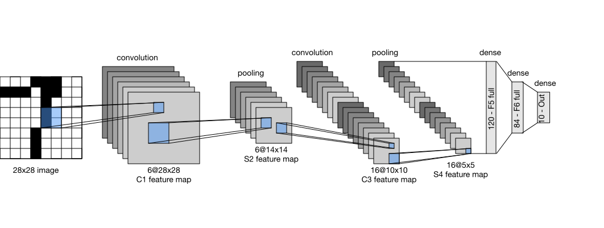
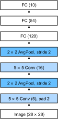

```{.python .input}
%load_ext d2lbook.tab
tab.interact_select(['mxnet', 'pytorch', 'tensorflow', 'jax'])
```

# Konvoliuciniai neuroniniai tinklai (LeNet)
:label:`sec_lenet`

Dabar turime visus ingredientus, reikalingus
pilnai veikiančiam CNN surinkti.
Ankstesnio susitikimo su vaizdų duomenimis metu taikėme
tiesinį modelį su softmax regresija (:numref:`sec_softmax_scratch`)
ir MLP (:numref:`sec_mlp-implementation`)
drabužių nuotraukoms iš Fashion-MNIST duomenų rinkinio.
Kad tokie duomenys taptų tinkami, pirmiausia išlyginome kiekvieną vaizdą iš $28\times28$ matricos
į fiksuoto ilgio $784$ dimensijų vektorių,
o po to apdorojome juos pilnai sujungtuose sluoksniuose.
Dabar, kai suprantame konvoliucinius sluoksnius,
galime išlaikyti vaizdų erdvinę struktūrą.
Papildomas pilnai sujungtų sluoksnių keitimo konvoliuciniais privalumas –
taupesni modeliai, kuriems reikia gerokai mažiau parametrų.

Šiame skyrelyje pristatysime *LeNet* –
vieną pirmųjų paskelbtų CNN,
sulaukusį plataus dėmesio dėl savo veikimo kompiuterinio matymo užduotyse.
Modelį pristatė (ir pavadino jo vardu) Yannas LeCunas,
tuomet AT&T Bell Labs tyrėjas,
rankraščiu rašytų skaitmenų vaizduose atpažinti :cite:`LeCun.Bottou.Bengio.ea.1998`.
Šis darbas buvo dešimtmetį trukusių
technologijos kūrimo tyrimų kulminacija;
LeCuno komanda paskelbė pirmąjį tyrimą, sėkmingai
apmokiusį CNN naudojant atgalinį sklidimą :cite:`LeCun.Boser.Denker.ea.1989`.

Tuo metu LeNet pasiekė puikių rezultatų,
prilygstančių atraminių vektorių mašinoms,
tuomet dominavusiam prižiūrimojo mokymosi metodui, pasiekdamas mažesnę nei 1 % paklaidą vienam skaitmeniui.
Galiausiai LeNet buvo pritaikytas skaitmenims atpažinti
apdorojant įnašus bankomatuose.
Iki šiol kai kurie bankomatai vis dar vykdo kodą,
kurį Yannas LeCunas ir jo kolega Leonas Bottou parašė 1990-aisiais!

```{.python .input}
%%tab mxnet
from d2l import mxnet as d2l
from mxnet import autograd, gluon, init, np, npx
from mxnet.gluon import nn
npx.set_np()
```

```{.python .input}
%%tab pytorch
from d2l import torch as d2l
import torch
from torch import nn
```

```{.python .input}
%%tab tensorflow
import tensorflow as tf
from d2l import tensorflow as d2l
```

```{.python .input}
%%tab jax
from d2l import jax as d2l
from flax import linen as nn
import jax
from jax import numpy as jnp
from types import FunctionType
```

## LeNet

Aukštu lygiu žvelgiant, (**LeNet (LeNet-5) sudaro dvi dalys:
(i) konvoliucinis kodavimo blokas iš dviejų konvoliucinių sluoksnių; ir
(ii) tankusis blokas iš trijų pilnai sujungtų sluoksnių**).
Architektūra apibendrinta :numref:`img_lenet`.


:label:`img_lenet`

Pagrindiniai kiekvieno konvoliucinio bloko vienetai
yra konvoliucinis sluoksnis, sigmoidinė aktyvacijos funkcija
ir po jos einanti sutelkimo vidurkinant operacija.
Atkreipkite dėmesį, kad nors ReLU ir sutelkimas imant maksimumą veikia geriau,
jie tuo metu dar nebuvo atrasti.
Kiekvienas konvoliucinis sluoksnis naudoja $5\times 5$ branduolį
ir sigmoidinę aktyvacijos funkciją.
Šie sluoksniai erdviškai išdėstytas įvestis atvaizduoja
į keletą dvimačių požymių žemėlapių, paprastai
didindami kanalų skaičių.
Pirmasis konvoliucinis sluoksnis turi 6 išvesties kanalus,
o antrasis – 16.
Kiekviena $2\times2$ sutelkimo operacija (žingsnis 2)
sumažina dimensiją $4$ kartus erdviškai mažindama diskretizavimo dažnį.
Konvoliucinis blokas išveda tenzorių, kurio forma
(minirinkinio dydis, kanalų skaičius, aukštis, plotis).

Kad išvestį iš konvoliucinio bloko
perduotume tankiajam blokui,
turime išlyginti kiekvieną minirinkinio pavyzdį.
Kitaip tariant, šią keturmatę įvestį transformuojame
į dvimatę įvestį, kurios tikisi pilnai sujungti sluoksniai:
primename, kad norimame dvimačiame atvaizde pirmoji dimensija indeksuoja minirinkinio pavyzdžius,
o antroji pateikia kiekvieno pavyzdžio plokščią vektorinį atvaizdą.
LeNet tankusis blokas turi tris pilnai sujungtus sluoksnius
su atitinkamai 120, 84 ir 10 išėjimų.
Kadangi vis dar sprendžiame klasifikavimo uždavinį,
10 dimensijų išvesties sluoksnis atitinka
galimų išvesties klasių skaičių.

Nors suprasti, kas iš tikrųjų vyksta LeNet viduje,
galėjo pareikalauti šiek tiek pastangų,
tikimės, kad toliau pateiktas kodo fragmentas įtikins jus,
jog tokių modelių įgyvendinimas šiuolaikiniais giliojo mokymosi karkasais
yra nepaprastai paprastas.
Tereikia sukurti `Sequential` bloką
ir sujungti į grandinę atitinkamus sluoksnius,
naudojant Xavier inicializaciją, kaip
pristatyta :numref:`subsec_xavier`.

```{.python .input}
%%tab pytorch
def init_cnn(module):  #@save
    """Initialize weights for CNNs."""
    if type(module) == nn.Linear or type(module) == nn.Conv2d:
        nn.init.xavier_uniform_(module.weight)
```

```{.python .input}
%%tab pytorch, mxnet, tensorflow
class LeNet(d2l.Classifier):  #@save
    """The LeNet-5 model."""
    def __init__(self, lr=0.1, num_classes=10):
        super().__init__()
        self.save_hyperparameters()
        if tab.selected('mxnet'):
            self.net = nn.Sequential()
            self.net.add(
                nn.Conv2D(channels=6, kernel_size=5, padding=2,
                          activation='sigmoid'),
                nn.AvgPool2D(pool_size=2, strides=2),
                nn.Conv2D(channels=16, kernel_size=5, activation='sigmoid'),
                nn.AvgPool2D(pool_size=2, strides=2),
                nn.Dense(120, activation='sigmoid'),
                nn.Dense(84, activation='sigmoid'),
                nn.Dense(num_classes))
            self.net.initialize(init.Xavier())
        if tab.selected('pytorch'):
            self.net = nn.Sequential(
                nn.LazyConv2d(6, kernel_size=5, padding=2), nn.Sigmoid(),
                nn.AvgPool2d(kernel_size=2, stride=2),
                nn.LazyConv2d(16, kernel_size=5), nn.Sigmoid(),
                nn.AvgPool2d(kernel_size=2, stride=2),
                nn.Flatten(),
                nn.LazyLinear(120), nn.Sigmoid(),
                nn.LazyLinear(84), nn.Sigmoid(),
                nn.LazyLinear(num_classes))
        if tab.selected('tensorflow'):
            self.net = tf.keras.models.Sequential([
                tf.keras.layers.Conv2D(filters=6, kernel_size=5,
                                       activation='sigmoid', padding='same'),
                tf.keras.layers.AvgPool2D(pool_size=2, strides=2),
                tf.keras.layers.Conv2D(filters=16, kernel_size=5,
                                       activation='sigmoid'),
                tf.keras.layers.AvgPool2D(pool_size=2, strides=2),
                tf.keras.layers.Flatten(),
                tf.keras.layers.Dense(120, activation='sigmoid'),
                tf.keras.layers.Dense(84, activation='sigmoid'),
                tf.keras.layers.Dense(num_classes)])
```

```{.python .input}
%%tab jax
class LeNet(d2l.Classifier):  #@save
    """The LeNet-5 model."""
    lr: float = 0.1
    num_classes: int = 10
    kernel_init: FunctionType = nn.initializers.xavier_uniform

    def setup(self):
        self.net = nn.Sequential([
            nn.Conv(features=6, kernel_size=(5, 5), padding='SAME',
                    kernel_init=self.kernel_init()),
            nn.sigmoid,
            lambda x: nn.avg_pool(x, window_shape=(2, 2), strides=(2, 2)),
            nn.Conv(features=16, kernel_size=(5, 5), padding='VALID',
                    kernel_init=self.kernel_init()),
            nn.sigmoid,
            lambda x: nn.avg_pool(x, window_shape=(2, 2), strides=(2, 2)),
            lambda x: x.reshape((x.shape[0], -1)),  # flatten
            nn.Dense(features=120, kernel_init=self.kernel_init()),
            nn.sigmoid,
            nn.Dense(features=84, kernel_init=self.kernel_init()),
            nn.sigmoid,
            nn.Dense(features=self.num_classes, kernel_init=self.kernel_init())
        ])
```

Šiek tiek laisvai atkūrėme LeNet, nes Gauso aktyvacijos sluoksnį pakeitėme
softmax sluoksniu. Tai labai supaprastina įgyvendinimą, ne mažiausia dėl to,
kad Gauso dekoderis šiais laikais retai naudojamas. Kitaip šis tinklas atitinka
originalią LeNet-5 architektūrą.

:begin_tab:`pytorch, mxnet, tensorflow`
Pažiūrėkime, kas vyksta tinkle viduje. Perleidę
vienkanalį (nespalvotą)
$28 \times 28$ vaizdą per tinklą
ir išspausdinę išvesties formą kiekviename sluoksnyje,
galime [**patikrinti modelį**] ir įsitikinti,
kad jo operacijos atitinka tai,
ko tikimės iš :numref:`img_lenet_vert`.
:end_tab:

:begin_tab:`jax`
Pažiūrėkime, kas vyksta tinkle viduje. Perleidę
vienkanalį (nespalvotą)
$28 \times 28$ vaizdą per tinklą
ir išspausdinę išvesties formą kiekviename sluoksnyje,
galime [**patikrinti modelį**] ir įsitikinti,
kad jo operacijos atitinka tai,
ko tikimės iš :numref:`img_lenet_vert`.
Flax teikia `nn.tabulate` – gražų metodą tinklo sluoksniams ir
parametrams apibendrinti. Čia naudojame metodą `bind`, kad sukurtume susietąjį modelį.
Kintamieji dabar yra susieti su klase `d2l.Module`, t. y. šis susietasis modelis
tampa būsenos objektu, kurį galima naudoti prieigai prie `Sequential`
objekto atributo `net` ir jame esančių sluoksnių (`layers`). Atkreipkite dėmesį, kad metodą `bind` reikėtų
naudoti tik interaktyviems eksperimentams, ir jis nėra tiesioginis
metodo `apply` pakaitalas.
:end_tab:


:label:`img_lenet_vert`

```{.python .input}
%%tab mxnet, pytorch
@d2l.add_to_class(d2l.Classifier)  #@save
def layer_summary(self, X_shape):
    X = d2l.randn(*X_shape)
    for layer in self.net:
        X = layer(X)
        print(layer.__class__.__name__, 'output shape:\t', X.shape)
        
model = LeNet()
model.layer_summary((1, 1, 28, 28))
```

```{.python .input}
%%tab tensorflow
@d2l.add_to_class(d2l.Classifier)  #@save
def layer_summary(self, X_shape):
    X = d2l.normal(X_shape)
    for layer in self.net.layers:
        X = layer(X)
        print(layer.__class__.__name__, 'output shape:\t', X.shape)

model = LeNet()
model.layer_summary((1, 28, 28, 1))
```

```{.python .input}
%%tab jax
@d2l.add_to_class(d2l.Classifier)  #@save
def layer_summary(self, X_shape, key=d2l.get_key()):
    X = jnp.zeros(X_shape)
    params = self.init(key, X)
    bound_model = self.clone().bind(params, mutable=['batch_stats'])
    _ = bound_model(X)
    for layer in bound_model.net.layers:
        X = layer(X)
        print(layer.__class__.__name__, 'output shape:\t', X.shape)

model = LeNet()
model.layer_summary((1, 28, 28, 1))
```

Atkreipkite dėmesį, kad atvaizdo aukštis ir plotis
kiekviename konvoliucinio bloko sluoksnyje
sumažėja (palyginti su ankstesniu sluoksniu).
Pirmasis konvoliucinis sluoksnis naudoja dviejų pikselių papildymą,
kad kompensuotų aukščio ir pločio sumažėjimą,
kuris kitaip atsirastų naudojant $5 \times 5$ branduolį.
Pasakysime pro šalį, kad originaliame
MNIST OCR duomenų rinkinyje $28 \times 28$ pikselių vaizdo dydis atsirado *apkirpus* dvi pikselių eilutes (ir stulpelius) nuo
originalių $32 \times 32$ pikselių dydžio skenavimų. Tai buvo daroma pirmiausia
siekiant sutaupyti vietos (30 % sumažinimas) tuo metu, kai megabaitai turėjo reikšmės.

Priešingai, antrasis konvoliucinis sluoksnis atsisako papildymo,
todėl aukštis ir plotis abu sumažėja keturiais pikseliais.
Kylant sluoksnių krūva aukštyn,
kanalų skaičius didėja sluoksnis po sluoksnio:
nuo 1 įvestyje iki 6 po pirmojo konvoliucinio sluoksnio
ir 16 po antrojo konvoliucinio sluoksnio.
Tačiau kiekvienas sutelkimo sluoksnis perpus sumažina aukštį ir plotį.
Galiausiai kiekvienas pilnai sujungtas sluoksnis mažina dimensiją,
ir galiausiai išveda rezultatą, kurio dimensija
atitinka klasių skaičių.


## Mokymas

Dabar, kai įgyvendinome modelį,
[**atlikime eksperimentą ir pažiūrėkime, kaip LeNet-5 modelis veikia su Fashion-MNIST**].

Nors CNN turi mažiau parametrų,
jų skaičiavimas vis tiek gali būti brangesnis
nei panašaus gylio MLP,
nes kiekvienas parametras dalyvauja daug didesniame
daugybų skaičiuje.
Jei turite prieigą prie GPU, tai gali būti geras metas
panaudoti jį mokymui pagreitinti.
Atkreipkite dėmesį, kad
klasė `d2l.Trainer` pasirūpina visomis detalėmis.
Pagal numatytuosius nustatymus ji inicializuoja modelio parametrus
turimuose įrenginiuose.
Kaip ir MLP atveju, mūsų nuostolių funkcija yra kryžminė entropija,
ir ją minimizuojame minirinkinio stochastiniu gradientiniu nusileidimu.

```{.python .input}
%%tab pytorch, mxnet, jax
trainer = d2l.Trainer(max_epochs=10, num_gpus=1)
data = d2l.FashionMNIST(batch_size=128)
model = LeNet(lr=0.1)
if tab.selected('pytorch'):
    model.apply_init([next(iter(data.get_dataloader(True)))[0]], init_cnn)
trainer.fit(model, data)
```

```{.python .input}
%%tab tensorflow
trainer = d2l.Trainer(max_epochs=10)
data = d2l.FashionMNIST(batch_size=128)
with d2l.try_gpu():
    model = LeNet(lr=0.1)
    trainer.fit(model, data)
```

## Santrauka

Šiame skyriuje padarėme didelę pažangą. Perėjome nuo 1980-ųjų MLP prie 1990-ųjų ir 2000-ųjų pradžios CNN. Pasiūlytos architektūros, pvz., LeNet-5 pavidalu, išlieka prasmingos net ir šiandien. Verta palyginti Fashion-MNIST paklaidas, pasiekiamas su LeNet-5, ir su geriausiais įmanomais MLP rezultatais (:numref:`sec_mlp-implementation`), ir su gerokai pažangesnėmis architektūromis, tokiomis kaip ResNet (:numref:`sec_resnet`). LeNet yra daug panašesnis į pastarąsias nei į pirmąsias. Vienas pagrindinių skirtumų, kaip pamatysime, yra tas, kad didesni skaičiavimo kiekiai leido kurti gerokai sudėtingesnes architektūras.

Antrasis skirtumas – santykinis lengvumas, kuriuo sugebėjome įgyvendinti LeNet. Tai, kas anksčiau buvo inžinerinis iššūkis, vertas mėnesių C++ ir asemblerio kodo, inžinerijos SN – ankstyvajam Lisp pagrindu sukurtam giliojo mokymosi įrankiui – gerinti :cite:`Bottou.Le-Cun.1988`, ir galiausiai eksperimentų su modeliais, dabar gali būti atlikta per minutes. Būtent šis neįtikėtinas produktyvumo šuolis ženkliai demokratizavo giliojo mokymosi modelių kūrimą. Kitame skyriuje leisimės į šią triušio olą ir pažiūrėsime, kur ji mus nuves.

## Pratimai

1. Modernizuokime LeNet. Įgyvendinkite ir išbandykite šiuos pakeitimus:
    1. Pakeiskite sutelkimą vidurkinant sutelkimu imant maksimumą.
    1. Pakeiskite softmax sluoksnį ReLU.
1. Pabandykite pakeisti LeNet tipo tinklo dydį, kad pagerintumėte jo tikslumą, be sutelkimo imant maksimumą ir ReLU.
    1. Pakoreguokite konvoliucijos lango dydį.
    1. Pakoreguokite išvesties kanalų skaičių.
    1. Pakoreguokite konvoliucinių sluoksnių skaičių.
    1. Pakoreguokite pilnai sujungtų sluoksnių skaičių.
    1. Pakoreguokite mokymosi greičius ir kitas mokymo detales (pvz., inicializaciją ir epochų skaičių).
1. Išbandykite patobulintą tinklą su originaliu MNIST duomenų rinkiniu.
1. Atvaizduokite pirmojo ir antrojo LeNet sluoksnio aktyvacijas skirtingoms įvestims (pvz., megztiniams ir paltams).
1. Kas nutinka aktyvacijoms, kai į tinklą paduodate gerokai skirtingus vaizdus (pvz., kates, automobilius ar net atsitiktinį triukšmą)?

:begin_tab:`mxnet`
[Diskusijos](https://discuss.d2l.ai/t/73)
:end_tab:

:begin_tab:`pytorch`
[Diskusijos](https://discuss.d2l.ai/t/74)
:end_tab:

:begin_tab:`tensorflow`
[Diskusijos](https://discuss.d2l.ai/t/275)
:end_tab:

:begin_tab:`jax`
[Diskusijos](https://discuss.d2l.ai/t/18000)
:end_tab:
