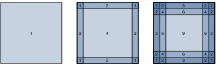
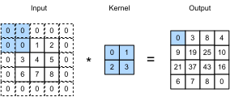
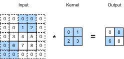

```{.python .input}
%load_ext d2lbook.tab
tab.interact_select(['mxnet', 'pytorch', 'tensorflow', 'jax'])
```

# Papildymas ir žingsnis
:label:`sec_padding`

Prisiminkite konvoliucijos pavyzdį :numref:`fig_correlation`.
Įvesties aukštis ir plotis buvo 3,
o konvoliucijos branduolio aukštis ir plotis – 2,
gaunant išvesties atvaizdą, kurio dimensija $2\times2$.
Tarkime, kad įvesties forma yra $n_\textrm{h}\times n_\textrm{w}$,
o konvoliucijos branduolio forma – $k_\textrm{h}\times k_\textrm{w}$,
tuomet išvesties forma bus $(n_\textrm{h}-k_\textrm{h}+1) \times (n_\textrm{w}-k_\textrm{w}+1)$:
konvoliucijos branduolį galime pastumti tik tiek, kol pritrūksta
pikselių, kuriems taikyti konvoliuciją.

Toliau išnagrinėsime keletą technikų,
įskaitant papildymą ir konvoliucijas su žingsniu,
suteikiančių daugiau kontrolės išvesties dydžiui.
Kaip motyvaciją atkreipkite dėmesį, kad kadangi branduolių
plotis ir aukštis paprastai didesni nei $1$,
pritaikius daug nuoseklių konvoliucijų,
dažniausiai gauname išvestis, kurios yra
gerokai mažesnės už įvestį.
Jei pradedame nuo $240 \times 240$ pikselių vaizdo,
dešimt $5 \times 5$ konvoliucijų sluoksnių
sumažina vaizdą iki $200 \times 200$ pikselių,
nupjaudami $30 \%$ vaizdo ir kartu
sunaikindami bet kokią įdomią informaciją
originalaus vaizdo pakraščiuose.
*Papildymas* yra populiariausia priemonė šiai problemai spręsti.
Kitais atvejais galime norėti drastiškai sumažinti dimensiją,
pvz., jei originali įvesties skyra mums pasirodo nepatogi.
*Konvoliucijos su žingsniu* yra populiari technika, galinti padėti tokiais atvejais.

```{.python .input}
%%tab mxnet
from mxnet import np, npx
from mxnet.gluon import nn
npx.set_np()
```

```{.python .input}
%%tab pytorch
import torch
from torch import nn
```

```{.python .input}
%%tab tensorflow
import tensorflow as tf
```

```{.python .input}
%%tab jax
from d2l import jax as d2l
from flax import linen as nn
import jax
from jax import numpy as jnp
```

## Papildymas

Kaip aprašyta aukščiau, viena keblumo priežastis taikant konvoliucinius sluoksnius
yra ta, kad prarandame pikselius vaizdo perimetre. Panagrinėkite :numref:`img_conv_reuse`, vaizduojantį pikselių panaudojimą kaip konvoliucijos branduolio dydžio ir vietos vaizde funkciją. Kampuose esantys pikseliai beveik nenaudojami.


:label:`img_conv_reuse`

Kadangi paprastai naudojame mažus branduolius,
bet kuriai konkrečiai konvoliucijai
galime prarasti tik kelis pikselius,
bet tai gali susikaupti, kai taikome
daug nuoseklių konvoliucinių sluoksnių.
Vienas paprastas šios problemos sprendimas
yra pridėti papildomų užpildo pikselių aplink įvesties vaizdo kraštą,
taip padidinant efektyvų vaizdo dydį.
Paprastai papildomų pikselių reikšmes nustatome lygias nuliui.
:numref:`img_conv_pad` papildome $3 \times 3$ įvestį,
padidindami jos dydį iki $5 \times 5$.
Atitinkama išvestis tada padidėja iki $4 \times 4$ matricos.
Pažymėtos dalys yra pirmasis išvesties elementas ir įvesties bei branduolio tenzoriaus elementai, naudoti išvesčiai skaičiuoti: $0\times0+0\times1+0\times2+0\times3=0$.


:label:`img_conv_pad`

Apskritai, jei pridedame iš viso $p_\textrm{h}$ papildymo eilučių
(maždaug pusę viršuje ir pusę apačioje)
ir iš viso $p_\textrm{w}$ papildymo stulpelių
(maždaug pusę kairėje ir pusę dešinėje),
išvesties forma bus

$$(n_\textrm{h}-k_\textrm{h}+p_\textrm{h}+1)\times(n_\textrm{w}-k_\textrm{w}+p_\textrm{w}+1).$$

Tai reiškia, kad išvesties aukštis ir plotis
padidės atitinkamai $p_\textrm{h}$ ir $p_\textrm{w}$.

Daugeliu atvejų norėsime nustatyti $p_\textrm{h}=k_\textrm{h}-1$ ir $p_\textrm{w}=k_\textrm{w}-1$,
kad įvestis ir išvestis turėtų tą patį aukštį ir plotį.
Tai palengvins kiekvieno sluoksnio išvesties formos numatymą
konstruojant tinklą.
Darant prielaidą, kad čia $k_\textrm{h}$ yra nelyginis,
papildysime $p_\textrm{h}/2$ eilučių abiejose aukščio pusėse.
Jei $k_\textrm{h}$ yra lyginis, viena galimybė yra
papildyti $\lceil p_\textrm{h}/2\rceil$ eilučių įvesties viršuje
ir $\lfloor p_\textrm{h}/2\rfloor$ eilučių apačioje.
Abi pločio puses papildysime tuo pačiu būdu.

CNN dažniausiai naudoja konvoliucijos branduolius
su nelyginėmis aukščio ir pločio reikšmėmis, tokiomis kaip 1, 3, 5 ar 7.
Nelyginių branduolių dydžių pasirinkimas turi tą privalumą,
kad galime išlaikyti dimensiją,
papildydami vienodu eilučių skaičiumi viršuje ir apačioje
bei vienodu stulpelių skaičiumi kairėje ir dešinėje.

Be to, ši praktika naudoti nelyginius branduolius
ir papildymą, kad tiksliai išlaikytume dimensiją,
suteikia raštvedybinės naudos.
Bet kuriam dvimačiam tenzoriui `X`,
kai branduolio dydis yra nelyginis,
o papildymo eilučių ir stulpelių skaičius
visose pusėse yra vienodas,
taip gaunant išvestį, kurios aukštis ir plotis yra tokie patys kaip įvesties,
žinome, kad išvestis `Y[i, j]` apskaičiuojama
įvesties ir konvoliucijos branduolio kryžmine koreliacija,
kai langas yra centruotas ties `X[i, j]`.

Toliau pateiktame pavyzdyje sukuriame dvimatį konvoliucinį sluoksnį,
kurio aukštis ir plotis yra 3,
ir (**visose pusėse pritaikome 1 pikselio papildymą.**)
Turint įvestį, kurios aukštis ir plotis yra 8,
randame, kad išvesties aukštis ir plotis taip pat yra 8.

```{.python .input}
%%tab mxnet
# We define a helper function to calculate convolutions. It initializes 
# the convolutional layer weights and performs corresponding dimensionality 
# elevations and reductions on the input and output
def comp_conv2d(conv2d, X):
    conv2d.initialize()
    # (1, 1) indicates that batch size and the number of channels are both 1
    X = X.reshape((1, 1) + X.shape)
    Y = conv2d(X)
    # Strip the first two dimensions: examples and channels
    return Y.reshape(Y.shape[2:])

# 1 row and column is padded on either side, so a total of 2 rows or columns are added
conv2d = nn.Conv2D(1, kernel_size=3, padding=1)
X = np.random.uniform(size=(8, 8))
comp_conv2d(conv2d, X).shape
```

```{.python .input}
%%tab pytorch
# We define a helper function to calculate convolutions. It initializes the
# convolutional layer weights and performs corresponding dimensionality
# elevations and reductions on the input and output
def comp_conv2d(conv2d, X):
    # (1, 1) indicates that batch size and the number of channels are both 1
    X = X.reshape((1, 1) + X.shape)
    Y = conv2d(X)
    # Strip the first two dimensions: examples and channels
    return Y.reshape(Y.shape[2:])

# 1 row and column is padded on either side, so a total of 2 rows or columns
# are added
conv2d = nn.LazyConv2d(1, kernel_size=3, padding=1)
X = torch.rand(size=(8, 8))
comp_conv2d(conv2d, X).shape
```

```{.python .input}
%%tab tensorflow
# We define a helper function to calculate convolutions. It initializes
# the convolutional layer weights and performs corresponding dimensionality
# elevations and reductions on the input and output
def comp_conv2d(conv2d, X):
    # (1, 1) indicates that batch size and the number of channels are both 1
    X = tf.reshape(X, (1, ) + X.shape + (1, ))
    Y = conv2d(X)
    # Strip the first two dimensions: examples and channels
    return tf.reshape(Y, Y.shape[1:3])
# 1 row and column is padded on either side, so a total of 2 rows or columns
# are added
conv2d = tf.keras.layers.Conv2D(1, kernel_size=3, padding='same')
X = tf.random.uniform(shape=(8, 8))
comp_conv2d(conv2d, X).shape
```

```{.python .input}
%%tab jax
# We define a helper function to calculate convolutions. It initializes
# the convolutional layer weights and performs corresponding dimensionality
# elevations and reductions on the input and output
def comp_conv2d(conv2d, X):
    # (1, X.shape, 1) indicates that batch size and the number of channels are both 1
    key = jax.random.PRNGKey(d2l.get_seed())
    X = X.reshape((1,) + X.shape + (1,))
    Y, _ = conv2d.init_with_output(key, X)
    # Strip the dimensions: examples and channels
    return Y.reshape(Y.shape[1:3])
# 1 row and column is padded on either side, so a total of 2 rows or columns are added
conv2d = nn.Conv(1, kernel_size=(3, 3), padding='SAME')
X = jax.random.uniform(jax.random.PRNGKey(d2l.get_seed()), shape=(8, 8))
comp_conv2d(conv2d, X).shape
```

Kai konvoliucijos branduolio aukštis ir plotis skiriasi,
galime padaryti, kad išvestis ir įvestis turėtų tą patį aukštį ir plotį,
[**nustatydami skirtingus papildymo skaičius aukščiui ir pločiui.**]

```{.python .input}
%%tab mxnet
# We use a convolution kernel with height 5 and width 3. The padding on
# either side of the height and width are 2 and 1, respectively
conv2d = nn.Conv2D(1, kernel_size=(5, 3), padding=(2, 1))
comp_conv2d(conv2d, X).shape
```

```{.python .input}
%%tab pytorch
# We use a convolution kernel with height 5 and width 3. The padding on either
# side of the height and width are 2 and 1, respectively
conv2d = nn.LazyConv2d(1, kernel_size=(5, 3), padding=(2, 1))
comp_conv2d(conv2d, X).shape
```

```{.python .input}
%%tab tensorflow
# We use a convolution kernel with height 5 and width 3. The padding on
# either side of the height and width are 2 and 1, respectively
conv2d = tf.keras.layers.Conv2D(1, kernel_size=(5, 3), padding='same')
comp_conv2d(conv2d, X).shape
```

```{.python .input}
%%tab jax
# We use a convolution kernel with height 5 and width 3. The padding on
# either side of the height and width are 2 and 1, respectively
conv2d = nn.Conv(1, kernel_size=(5, 3), padding=(2, 1))
comp_conv2d(conv2d, X).shape
```

## Žingsnis

Skaičiuodami kryžminę koreliaciją,
pradedame nuo konvoliucijos lango
įvesties tenzoriaus viršutiniame kairiajame kampe,
o tada slenkame jį per visas vietas žemyn ir į dešinę.
Ankstesniuose pavyzdžiuose pagal numatytuosius nustatymus slinkome po vieną elementą.
Tačiau kartais, arba dėl skaičiavimo efektyvumo,
arba todėl, kad norime sumažinti diskretizavimo dažnį,
savo langą judiname daugiau nei vienu elementu vienu metu,
praleisdami tarpines vietas. Tai ypač naudinga, jei konvoliucijos
branduolys yra didelis, nes jis apima didelę pagrindinio vaizdo sritį.

Eilučių ir stulpelių skaičių, kurį peržengiame per vieną slinkimą, vadiname *žingsniu*.
Iki šiol naudojome 1 žingsnius – ir aukščiui, ir pločiui.
Kartais galime norėti naudoti didesnį žingsnį.
:numref:`img_conv_stride` parodyta dvimatė kryžminės koreliacijos operacija
su žingsniu 3 vertikaliai ir 2 horizontaliai.
Pažymėtos dalys yra išvesties elementai ir įvesties bei branduolio tenzoriaus elementai, naudoti išvesčiai skaičiuoti: $0\times0+0\times1+1\times2+2\times3=8$, $0\times0+6\times1+0\times2+0\times3=6$.
Matome, kad generuojant antrąjį pirmojo stulpelio elementą,
konvoliucijos langas slenka žemyn per tris eilutes.
Konvoliucijos langas slenka dviem stulpeliais į dešinę,
kai generuojamas antrasis pirmosios eilutės elementas.
Kai konvoliucijos langas toliau slenka dviem stulpeliais į dešinę įvestyje,
išvesties nėra, nes įvesties elementas negali užpildyti lango
(nebent pridėtume dar vieną papildymo stulpelį).


:label:`img_conv_stride`

Apskritai, kai aukščio žingsnis yra $s_\textrm{h}$,
o pločio žingsnis – $s_\textrm{w}$, išvesties forma yra

$$\lfloor(n_\textrm{h}-k_\textrm{h}+p_\textrm{h}+s_\textrm{h})/s_\textrm{h}\rfloor \times \lfloor(n_\textrm{w}-k_\textrm{w}+p_\textrm{w}+s_\textrm{w})/s_\textrm{w}\rfloor.$$

Jei nustatome $p_\textrm{h}=k_\textrm{h}-1$ ir $p_\textrm{w}=k_\textrm{w}-1$,
išvesties formą galima supaprastinti iki
$\lfloor(n_\textrm{h}+s_\textrm{h}-1)/s_\textrm{h}\rfloor \times \lfloor(n_\textrm{w}+s_\textrm{w}-1)/s_\textrm{w}\rfloor$.
Žengiant dar žingsnį, jei įvesties aukštis ir plotis
dalijasi iš aukščio ir pločio žingsnių,
tuomet išvesties forma bus $(n_\textrm{h}/s_\textrm{h}) \times (n_\textrm{w}/s_\textrm{w})$.

Toliau [**nustatome ir aukščio, ir pločio žingsnius lygius 2**],
taip perpus sumažindami įvesties aukštį ir plotį.

```{.python .input}
%%tab mxnet
conv2d = nn.Conv2D(1, kernel_size=3, padding=1, strides=2)
comp_conv2d(conv2d, X).shape
```

```{.python .input}
%%tab pytorch
conv2d = nn.LazyConv2d(1, kernel_size=3, padding=1, stride=2)
comp_conv2d(conv2d, X).shape
```

```{.python .input}
%%tab tensorflow
conv2d = tf.keras.layers.Conv2D(1, kernel_size=3, padding='same', strides=2)
comp_conv2d(conv2d, X).shape
```

```{.python .input}
%%tab jax
conv2d = nn.Conv(1, kernel_size=(3, 3), padding=1, strides=2)
comp_conv2d(conv2d, X).shape
```

Pažvelkime į (**šiek tiek sudėtingesnį pavyzdį**).

```{.python .input}
%%tab mxnet
conv2d = nn.Conv2D(1, kernel_size=(3, 5), padding=(0, 1), strides=(3, 4))
comp_conv2d(conv2d, X).shape
```

```{.python .input}
%%tab pytorch
conv2d = nn.LazyConv2d(1, kernel_size=(3, 5), padding=(0, 1), stride=(3, 4))
comp_conv2d(conv2d, X).shape
```

```{.python .input}
%%tab tensorflow
conv2d = tf.keras.layers.Conv2D(1, kernel_size=(3,5), padding='valid',
                                strides=(3, 4))
comp_conv2d(conv2d, X).shape
```

```{.python .input}
%%tab jax
conv2d = nn.Conv(1, kernel_size=(3, 5), padding=(0, 1), strides=(3, 4))
comp_conv2d(conv2d, X).shape
```

## Santrauka ir diskusija

Papildymas gali padidinti išvesties aukštį ir plotį. Tai dažnai naudojama, kad išvestis turėtų tokį patį aukštį ir plotį kaip įvestis, siekiant išvengti nepageidaujamo išvesties susitraukimo. Be to, tai užtikrina, kad visi pikseliai naudojami vienodai dažnai. Paprastai renkamės simetrišką papildymą abiejose įvesties aukščio ir pločio pusėse. Šiuo atveju kalbame apie $(p_\textrm{h}, p_\textrm{w})$ papildymą. Dažniausiai nustatome $p_\textrm{h} = p_\textrm{w}$, ir tada tiesiog sakome, kad pasirenkame papildymą $p$.

Panaši konvencija taikoma žingsniams. Kai horizontalus žingsnis $s_\textrm{h}$ ir vertikalus žingsnis $s_\textrm{w}$ sutampa, tiesiog kalbame apie žingsnį $s$. Žingsnis gali sumažinti išvesties skyrą, pavyzdžiui, sumažindamas išvesties aukštį ir plotį iki tik $1/n$ įvesties aukščio ir pločio, kai $n > 1$. Pagal numatytuosius nustatymus papildymas yra 0, o žingsnis – 1.

Iki šiol visas aptartas papildymas tiesiog išplėsdavo vaizdus nuliais. Tai turi didelį skaičiavimo privalumą, nes jį padaryti elementaru. Be to, operatorius galima suprojektuoti taip, kad jie netiesiogiai pasinaudotų šiuo papildymu, nereikalaujant skirti papildomos atminties. Tuo pat metu tai leidžia CNN užkoduoti numanomą pozicijos informaciją vaizde, tiesiog išmokstant, kur yra „tuščia vieta“. Yra daug alternatyvų papildymui nuliais. :citet:`Alsallakh.Kokhlikyan.Miglani.ea.2020` pateikė išsamią jų apžvalgą (nors be aiškaus atvejo, kada naudoti nenulinį papildymą, nebent atsiranda artefaktų).


## Pratimai

1. Turint paskutinį šio skyrelio kodo pavyzdį su branduolio dydžiu $(3, 5)$, papildymu $(0, 1)$ ir žingsniu $(3, 4)$,
   apskaičiuokite išvesties formą, kad patikrintumėte, ar ji atitinka eksperimento rezultatą.
1. Garso signalams, ką atitinka žingsnis 2?
1. Įgyvendinkite veidrodinį papildymą, t. y. papildymą, kai kraštų reikšmės tiesiog atspindimos tenzoriams išplėsti.
1. Kokia yra skaičiavimo nauda iš didesnio nei 1 žingsnio?
1. Kokia gali būti statistinė nauda iš didesnio nei 1 žingsnio?
1. Kaip įgyvendintumėte žingsnį $\frac{1}{2}$? Ką jis atitinka? Kada tai būtų naudinga?

:begin_tab:`mxnet`
[Diskusijos](https://discuss.d2l.ai/t/67)
:end_tab:

:begin_tab:`pytorch`
[Diskusijos](https://discuss.d2l.ai/t/68)
:end_tab:

:begin_tab:`tensorflow`
[Diskusijos](https://discuss.d2l.ai/t/272)
:end_tab:

:begin_tab:`jax`
[Diskusijos](https://discuss.d2l.ai/t/17997)
:end_tab:
