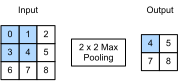

```{.python .input}
%load_ext d2lbook.tab
tab.interact_select(['mxnet', 'pytorch', 'tensorflow', 'jax'])
```

# Sutelkimas
:label:`sec_pooling`

Daugeliu atvejų mūsų galutinė užduotis kelia kokį nors globalų klausimą apie vaizdą,
pvz., *ar jame yra katė?* Todėl mūsų paskutinio sluoksnio vienetai
turėtų būti jautrūs visai įvesčiai.
Palaipsniui agreguodami informaciją, gaudami vis grubesnius žemėlapius,
pasiekiame šį tikslą – galiausiai išmokti globalų atvaizdą,
išlaikydami visus konvoliucinių sluoksnių privalumus tarpiniuose apdorojimo lygiuose.
Kuo giliau einame tinkle,
tuo didesnė lokali matymo sritis (įvesties atžvilgiu),
kuriai yra jautrus kiekvienas paslėptasis mazgas. Erdvinės skyros mažinimas
pagreitina šį procesą,
nes konvoliucijos branduoliai apima didesnę efektyvią sritį.

Be to, aptikdami žemesnio lygio požymius, tokius kaip kraštai
(kaip aptarta :numref:`sec_conv_layer`),
dažnai norime, kad mūsų atvaizdai būtų šiek tiek invariantiški postūmiui.
Pavyzdžiui, jei paimame vaizdą `X`
su ryškiu juodos ir baltos ribojimu
ir pastumiame visą vaizdą vienu pikseliu į dešinę,
t. y. `Z[i, j] = X[i, j + 1]`,
tuomet naujo vaizdo `Z` išvestis gali labai skirtis.
Kraštas pasislinks vienu pikseliu.
Realybėje objektai vargu ar kada pasitaiko tiksliai toje pačioje vietoje.
Iš tiesų, net su trikoju ir nejudančiu objektu,
fotoaparato vibracija dėl užraktės judėjimo
gali viską pastumti maždaug vienu pikseliu
(aukščiausios klasės fotoaparatai turi specialių funkcijų šiai problemai spręsti).

Šiame skyrelyje pristatomi *sutelkimo sluoksniai*,
turintys dvejopą paskirtį:
sumažinti konvoliucinių sluoksnių jautrumą vietai
ir erdviškai sumažinti atvaizdų diskretizavimo dažnį.

```{.python .input}
%%tab mxnet
from d2l import mxnet as d2l
from mxnet import np, npx
from mxnet.gluon import nn
npx.set_np()
```

```{.python .input}
%%tab pytorch
from d2l import torch as d2l
import torch
from torch import nn
```

```{.python .input}
%%tab jax
from d2l import jax as d2l
from flax import linen as nn
import jax
from jax import numpy as jnp
```

## Sutelkimas imant maksimumą ir sutelkimas vidurkinant

Kaip ir konvoliuciniai sluoksniai, *sutelkimo* operatoriai
susideda iš fiksuotos formos lango, kuris slenkamas per
visas įvesties sritis pagal savo žingsnį,
apskaičiuojant vieną išvestį kiekvienai vietai, kurią peržengia
fiksuotos formos langas (kartais žinomas kaip *sutelkimo langas*).
Tačiau, skirtingai nuo įvesčių ir branduolių kryžminės koreliacijos
skaičiavimo konvoliuciniame sluoksnyje,
sutelkimo sluoksnis neturi parametrų (nėra *branduolio*).
Vietoj to sutelkimo operatoriai yra deterministiniai,
paprastai apskaičiuojantys arba maksimalią, arba vidutinę
sutelkimo lange esančių elementų reikšmę.
Šios operacijos vadinamos atitinkamai *sutelkimu imant maksimumą* (trumpiau *max-pooling*)
ir *sutelkimu vidurkinant*.

*Sutelkimas vidurkinant* iš esmės yra tiek pat senas kaip CNN. Idėja panaši į
vaizdo diskretizavimo dažnio mažinimą. Užuot tiesiog paėmę kas antro (ar trečio)
pikselio reikšmę mažesnės skyros vaizdui, galime vidurkinti gretimus pikselius, kad gautume
vaizdą su geresniu signalo ir triukšmo santykiu, nes sujungiame informaciją
iš kelių gretimų pikselių. *Sutelkimas imant maksimumą* buvo pristatytas
:citet:`Riesenhuber.Poggio.1999` kognityvinės neurologijos kontekste, siekiant apibūdinti,
kaip informacija gali būti hierarchiškai agreguojama objektų atpažinimo tikslais;
jau buvo ir ankstesnė versija kalbos atpažinime :cite:`Yamaguchi.Sakamoto.Akabane.ea.1990`. Beveik visais atvejais sutelkimas imant maksimumą,
kaip jis taip pat vadinamas, yra geresnis už sutelkimą vidurkinant.

Abiem atvejais, kaip ir su kryžminės koreliacijos operatoriumi,
sutelkimo langą galime įsivaizduoti
kaip pradedantį nuo viršutinio kairiojo įvesties tenzoriaus kampo
ir slenkantį per jį iš kairės į dešinę ir iš viršaus į apačią.
Kiekvienoje vietoje, kurią pasiekia sutelkimo langas,
jis apskaičiuoja lange esančio įvesties potenzorio maksimalią arba vidutinę
reikšmę, priklausomai nuo to, ar naudojamas sutelkimas imant maksimumą, ar vidurkinant.



:label:`fig_pooling`

:numref:`fig_pooling` išvesties tenzoriaus aukštis yra 2, o plotis – 2.
Keturi elementai gaunami iš maksimalios reikšmės kiekviename sutelkimo lange:

$$
\max(0, 1, 3, 4)=4,\\
\max(1, 2, 4, 5)=5,\\
\max(3, 4, 6, 7)=7,\\
\max(4, 5, 7, 8)=8.\\
$$

Bendriau, galime apibrėžti $p \times q$ sutelkimo sluoksnį, agreguodami per
tokio dydžio sritį. Grįžtant prie kraštų aptikimo problemos,
konvoliucinio sluoksnio išvestį naudojame
kaip $2\times 2$ sutelkimo imant maksimumą įvestį.
Pažymėkime `X` konvoliucinio sluoksnio įvestį, o `Y` – sutelkimo sluoksnio išvestį.
Nepriklausomai nuo to, ar `X[i, j]`, `X[i, j + 1]`,
`X[i+1, j]` ir `X[i+1, j + 1]` reikšmės skiriasi,
sutelkimo sluoksnis visada išveda `Y[i, j] = 1`.
Tai yra, naudodami $2\times 2$ sutelkimo imant maksimumą sluoksnį,
vis tiek galime aptikti, ar šablonas, atpažintas konvoliucinio sluoksnio,
pasislinko ne daugiau nei vienu elementu aukščio ar pločio kryptimi.

Žemiau pateiktame kode funkcijoje `pool2d` (**įgyvendiname sutelkimo sluoksnio
tiesioginį sklidimą**).
Ši funkcija panaši į funkciją `corr2d`
iš :numref:`sec_conv_layer`.
Tačiau branduolio nereikia, išvestis apskaičiuojama
kaip kiekvienos įvesties srities maksimumas arba vidurkis.

```{.python .input}
%%tab mxnet, pytorch
def pool2d(X, pool_size, mode='max'):
    p_h, p_w = pool_size
    Y = d2l.zeros((X.shape[0] - p_h + 1, X.shape[1] - p_w + 1))
    for i in range(Y.shape[0]):
        for j in range(Y.shape[1]):
            if mode == 'max':
                Y[i, j] = X[i: i + p_h, j: j + p_w].max()
            elif mode == 'avg':
                Y[i, j] = X[i: i + p_h, j: j + p_w].mean()
    return Y
```

```{.python .input}
%%tab jax
def pool2d(X, pool_size, mode='max'):
    p_h, p_w = pool_size
    Y = jnp.zeros((X.shape[0] - p_h + 1, X.shape[1] - p_w + 1))
    for i in range(Y.shape[0]):
        for j in range(Y.shape[1]):
            if mode == 'max':
                Y = Y.at[i, j].set(X[i: i + p_h, j: j + p_w].max())
            elif mode == 'avg':
                Y = Y.at[i, j].set(X[i: i + p_h, j: j + p_w].mean())
    return Y
```

```{.python .input}
%%tab tensorflow
import tensorflow as tf

def pool2d(X, pool_size, mode='max'):
    p_h, p_w = pool_size
    Y = tf.Variable(tf.zeros((X.shape[0] - p_h + 1, X.shape[1] - p_w +1)))
    for i in range(Y.shape[0]):
        for j in range(Y.shape[1]):
            if mode == 'max':
                Y[i, j].assign(tf.reduce_max(X[i: i + p_h, j: j + p_w]))
            elif mode =='avg':
                Y[i, j].assign(tf.reduce_mean(X[i: i + p_h, j: j + p_w]))
    return Y
```

Galime sukonstruoti įvesties tenzorių `X` iš :numref:`fig_pooling`, kad [**patvirtintume dvimačio sutelkimo imant maksimumą sluoksnio išvestį**].

```{.python .input}
%%tab all
X = d2l.tensor([[0.0, 1.0, 2.0], [3.0, 4.0, 5.0], [6.0, 7.0, 8.0]])
pool2d(X, (2, 2))
```

Taip pat galime eksperimentuoti su (**sutelkimo vidurkinant sluoksniu**).

```{.python .input}
%%tab all
pool2d(X, (2, 2), 'avg')
```

## [**Papildymas ir žingsnis**]

Kaip ir konvoliuciniai sluoksniai, sutelkimo sluoksniai
keičia išvesties formą.
Ir kaip anksčiau, galime pakoreguoti operaciją, kad pasiektume norimą išvesties formą,
papildydami įvestį ir koreguodami žingsnį.
Papildymo ir žingsnių naudojimą sutelkimo sluoksniuose
galime pademonstruoti per įtaisytąjį dvimatį sutelkimo imant maksimumą sluoksnį iš giliojo mokymosi karkaso.
Pirmiausia sukonstruojame įvesties tenzorių `X`, kurio forma turi keturias dimensijas,
kur pavyzdžių skaičius (minirinkinio dydis) ir kanalų skaičius abu yra 1.

:begin_tab:`tensorflow`
Atkreipkite dėmesį, kad skirtingai nei kiti karkasai, TensorFlow
teikia pirmenybę *kanalų gale* (angl. *channels-last*) įvesčiai ir yra jai optimizuotas.
:end_tab:

```{.python .input}
%%tab mxnet, pytorch
X = d2l.reshape(d2l.arange(16, dtype=d2l.float32), (1, 1, 4, 4))
X
```

```{.python .input}
%%tab tensorflow, jax
X = d2l.reshape(d2l.arange(16, dtype=d2l.float32), (1, 4, 4, 1))
X
```

Kadangi sutelkimas agreguoja informaciją iš srities, (**giliojo mokymosi karkasai pagal numatytuosius nustatymus suderina sutelkimo langų dydžius ir žingsnį.**) Pavyzdžiui, jei naudojame formos `(3, 3)` sutelkimo langą,
pagal numatytuosius nustatymus gauname formos `(3, 3)` žingsnį.

```{.python .input}
%%tab mxnet
pool2d = nn.MaxPool2D(3)
# Pooling has no model parameters, hence it needs no initialization
pool2d(X)
```

```{.python .input}
%%tab pytorch
pool2d = nn.MaxPool2d(3)
# Pooling has no model parameters, hence it needs no initialization
pool2d(X)
```

```{.python .input}
%%tab tensorflow
pool2d = tf.keras.layers.MaxPool2D(pool_size=[3, 3])
# Pooling has no model parameters, hence it needs no initialization
pool2d(X)
```

```{.python .input}
%%tab jax
# Pooling has no model parameters, hence it needs no initialization
nn.max_pool(X, window_shape=(3, 3), strides=(3, 3))
```

Nereikia nė sakyti, kad [**žingsnį ir papildymą galima nurodyti rankiniu būdu**], norint pakeisti karkaso numatytąsias reikšmes.

```{.python .input}
%%tab mxnet
pool2d = nn.MaxPool2D(3, padding=1, strides=2)
pool2d(X)
```

```{.python .input}
%%tab pytorch
pool2d = nn.MaxPool2d(3, padding=1, stride=2)
pool2d(X)
```

```{.python .input}
%%tab tensorflow
paddings = tf.constant([[0, 0], [1,0], [1,0], [0,0]])
X_padded = tf.pad(X, paddings, "CONSTANT")
pool2d = tf.keras.layers.MaxPool2D(pool_size=[3, 3], padding='valid',
                                   strides=2)
pool2d(X_padded)
```

```{.python .input}
%%tab jax
X_padded = jnp.pad(X, ((0, 0), (1, 0), (1, 0), (0, 0)), mode='constant')
nn.max_pool(X_padded, window_shape=(3, 3), padding='VALID', strides=(2, 2))
```

Žinoma, galime nurodyti savavališką stačiakampį sutelkimo langą su atitinkamai savavališku aukščiu ir pločiu, kaip rodo žemiau pateiktas pavyzdys.

```{.python .input}
%%tab mxnet
pool2d = nn.MaxPool2D((2, 3), padding=(0, 1), strides=(2, 3))
pool2d(X)
```

```{.python .input}
%%tab pytorch
pool2d = nn.MaxPool2d((2, 3), stride=(2, 3), padding=(0, 1))
pool2d(X)
```

```{.python .input}
%%tab tensorflow
paddings = tf.constant([[0, 0], [0, 0], [1, 1], [0, 0]])
X_padded = tf.pad(X, paddings, "CONSTANT")

pool2d = tf.keras.layers.MaxPool2D(pool_size=[2, 3], padding='valid',
                                   strides=(2, 3))
pool2d(X_padded)
```

```{.python .input}
%%tab jax

X_padded = jnp.pad(X, ((0, 0), (0, 0), (1, 1), (0, 0)), mode='constant')
nn.max_pool(X_padded, window_shape=(2, 3), strides=(2, 3), padding='VALID')
```

## Keli kanalai

Apdorojant daugiakanalius įvesties duomenis,
[**sutelkimo sluoksnis sutelkia kiekvieną įvesties kanalą atskirai**],
užuot sumavęs įvestis per kanalus,
kaip konvoliuciniame sluoksnyje.
Tai reiškia, kad sutelkimo sluoksnio išvesties kanalų skaičius
yra toks pat kaip įvesties kanalų skaičius.
Toliau sujungsime tenzorius `X` ir `X + 1`
kanalų dimensijoje, kad sukonstruotume įvestį su dviem kanalais.

:begin_tab:`tensorflow`
Atkreipkite dėmesį, kad TensorFlow dėl kanalų gale sintaksės tam reikės
sujungimo išilgai paskutinės dimensijos.
:end_tab:

```{.python .input}
%%tab mxnet, pytorch
X = d2l.concat((X, X + 1), 1)
X
```

```{.python .input}
%%tab tensorflow, jax
# Concatenate along `dim=3` due to channels-last syntax
X = d2l.concat([X, X + 1], 3)
X
```

Kaip matome, išvesties kanalų skaičius po sutelkimo vis dar yra du.

```{.python .input}
%%tab mxnet
pool2d = nn.MaxPool2D(3, padding=1, strides=2)
pool2d(X)
```

```{.python .input}
%%tab pytorch
pool2d = nn.MaxPool2d(3, padding=1, stride=2)
pool2d(X)
```

```{.python .input}
%%tab tensorflow
paddings = tf.constant([[0, 0], [1,0], [1,0], [0,0]])
X_padded = tf.pad(X, paddings, "CONSTANT")
pool2d = tf.keras.layers.MaxPool2D(pool_size=[3, 3], padding='valid',
                                   strides=2)
pool2d(X_padded)

```

```{.python .input}
%%tab jax
X_padded = jnp.pad(X, ((0, 0), (1, 0), (1, 0), (0, 0)), mode='constant')
nn.max_pool(X_padded, window_shape=(3, 3), padding='VALID', strides=(2, 2))
```

:begin_tab:`tensorflow`
Atkreipkite dėmesį, kad TensorFlow sutelkimo išvestis iš pirmo žvilgsnio atrodo kitokia, tačiau
skaitine prasme pateikiami tie patys rezultatai kaip MXNet ir PyTorch.
Skirtumas yra dimensijoje, o skaitant
išvestį vertikaliai gaunama tokia pati išvestis kaip kitose įgyvendinimuose.
:end_tab:

## Santrauka

Sutelkimas yra nepaprastai paprasta operacija. Ji daro būtent tai, ką rodo jos pavadinimas – agreguoja rezultatus per reikšmių langą. Visa konvoliucijų semantika, tokia kaip žingsniai ir papildymas, taikoma taip pat, kaip ir anksčiau. Atkreipkite dėmesį, kad sutelkimas yra abejingas kanalams, t. y. jis nekeičia kanalų skaičiaus ir taikomas kiekvienam kanalui atskirai. Galiausiai, iš dviejų populiarių sutelkimo pasirinkimų, sutelkimas imant maksimumą yra geresnis už sutelkimą vidurkinant, nes suteikia tam tikrą invariantiškumo laipsnį išvesčiai. Populiarus pasirinkimas yra rinktis $2 \times 2$ sutelkimo lango dydį, kad ketvirtadaliu sumažėtų išvesties erdvinė skyra.

Atkreipkite dėmesį, kad be sutelkimo yra daug daugiau skyros mažinimo būdų. Pavyzdžiui, stochastiniame sutelkime :cite:`Zeiler.Fergus.2013` ir trupmeniniame sutelkime imant maksimumą :cite:`Graham.2014` agregavimas derinamas su atsitiktinumu. Tai kai kuriais atvejais gali šiek tiek pagerinti tikslumą. Galiausiai, kaip pamatysime vėliau su dėmesio sutelkimo mechanizmu, yra rafinuotesnių būdų agreguoti išvestis, pvz., naudojant užklausos ir atvaizdų vektorių sulygiavimą.


## Pratimai

1. Įgyvendinkite sutelkimą vidurkinant per konvoliuciją.
1. Įrodykite, kad sutelkimo imant maksimumą negalima įgyvendinti vien per konvoliuciją.
1. Sutelkimą imant maksimumą galima atlikti naudojant ReLU operacijas, t. y. $\textrm{ReLU}(x) = \max(0, x)$.
    1. Išreikškite $\max (a, b)$ naudodami tik ReLU operacijas.
    1. Panaudokite tai, kad įgyvendintumėte sutelkimą imant maksimumą per konvoliucijas ir ReLU sluoksnius.
    1. Kiek kanalų ir sluoksnių jums reikia $2 \times 2$ konvoliucijai? O kiek $3 \times 3$ konvoliucijai?
1. Kokia yra sutelkimo sluoksnio skaičiavimo kaina? Tarkime, kad sutelkimo sluoksnio įvesties dydis yra $c\times h\times w$, sutelkimo lango forma yra $p_\textrm{h}\times p_\textrm{w}$, papildymas – $(p_\textrm{h}, p_\textrm{w})$, o žingsnis – $(s_\textrm{h}, s_\textrm{w})$.
1. Kodėl tikitės, kad sutelkimas imant maksimumą ir sutelkimas vidurkinant veiks skirtingai?
1. Ar mums reikia atskiro sutelkimo imant minimumą sluoksnio? Ar galite jį pakeisti kita operacija?
1. Sutelkimui galėtume naudoti softmax operaciją. Kodėl ji gali būti nelabai populiari?

:begin_tab:`mxnet`
[Diskusijos](https://discuss.d2l.ai/t/71)
:end_tab:

:begin_tab:`pytorch`
[Diskusijos](https://discuss.d2l.ai/t/72)
:end_tab:

:begin_tab:`tensorflow`
[Diskusijos](https://discuss.d2l.ai/t/274)
:end_tab:

:begin_tab:`jax`
[Diskusijos](https://discuss.d2l.ai/t/17999)
:end_tab:
