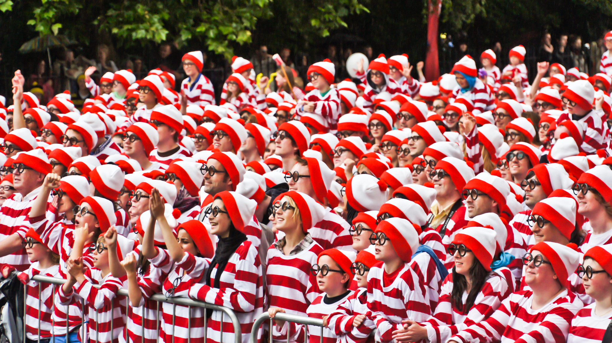
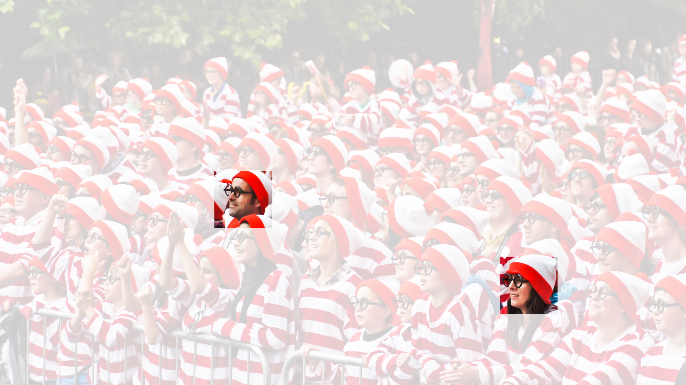

# Nuo pilnai sujungtų sluoksnių prie konvoliucijų
:label:`sec_why-conv`

Iki šiol
aptarti modeliai
tebėra tinkami pasirinkimai,
kai dirbame su lentelės duomenimis.
Lentelės duomenimis laikome tokius, kuriuos sudaro
eilutės, atitinkančios pavyzdžius,
ir stulpeliai, atitinkantys požymius.
Su lentelės duomenimis galime tikėtis,
kad ieškomi dėsningumai gali apimti
požymių sąveikas,
bet *a priori* nedarome jokių prielaidų apie struktūrą,
kaip požymiai sąveikauja.

Kartais mums tikrai trūksta žinių, kurios padėtų sukurti įmantresnes architektūras.
Tokiais atvejais MLP
gali būti geriausia, ką galime padaryti.
Tačiau didelės dimensijos suvokimo duomenims
tokie bestruktūriai tinklai gali tapti nepatogūs.

Pavyzdžiui, grįžkime prie savo nuolatinio pavyzdžio –
kačių ir šunų atskyrimo.
Tarkime, kad kruopščiai surenkame duomenis,
sukaupdami anotuotą vieno megapikselio nuotraukų rinkinį.
Tai reiškia, kad kiekviena tinklo įvestis turi milijoną dimensijų.
Net agresyviai sumažinus iki tūkstančio paslėptųjų dimensijų,
prireiktų pilnai sujungto sluoksnio,
turinčio $10^6 \times 10^3 = 10^9$ parametrų.
Nebent turime daug GPU, gebėjimų
paskirstytam optimizavimui
ir nepaprastai daug kantrybės,
šio tinklo parametrų išmokimas
gali pasirodyti neįmanomas.

Atidus skaitytojas gali prieštarauti šiam argumentui
remdamasis tuo, kad vieno megapikselio skyros gali ir nereikėti.
Tačiau nors galbūt galėtume išsiversti
su šimtu tūkstančių pikselių,
mūsų 1000 dydžio paslėptasis sluoksnis smarkiai nuvertina
paslėptųjų vienetų skaičių, reikalingą
geriems vaizdų atvaizdams išmokti,
todėl praktinei sistemai vis tiek reikės milijardų parametrų.
Be to, klasifikatoriaus mokymasis pritaikant tiek daug parametrų
gali reikalauti surinkti milžinišką duomenų rinkinį.
Ir vis dėlto šiandien ir žmonės, ir kompiuteriai geba
gana gerai atskirti kates nuo šunų,
tarsi prieštaraudami šioms intuicijoms.
Taip yra todėl, kad vaizdai pasižymi turtinga struktūra,
kurią gali išnaudoti ir žmonės,
ir mašininio mokymosi modeliai.
Konvoliuciniai neuroniniai tinklai (CNN) yra vienas kūrybiškas būdas,
kurį mašininis mokymasis pasitelkė siekdamas išnaudoti
tam tikrą žinomą natūralių vaizdų struktūrą.

## Invariantiškumas

Įsivaizduokite, kad norime aptikti objektą vaizde.
Atrodo pagrįsta, kad bet kuris metodas,
kurį naudojame objektams atpažinti, neturėtų pernelyg rūpintis
tiksliu objekto vieta vaizde.
Idealiu atveju mūsų sistema turėtų išnaudoti šią žinią.
Kiaulės paprastai neskraido, o lėktuvai paprastai neplaukioja.
Vis dėlto vis tiek turėtume atpažinti
kiaulę, jei ji pasirodytų vaizdo viršuje.
Čia galime pasisemti įkvėpimo iš vaikų žaidimo
„Kur Valdas?“
(kuris pats įkvėpė daug realių pamėgdžiojimų, tokių kaip pavaizduotas :numref:`img_waldo`).
Žaidimą sudaro daugybė chaotiškų scenų,
trykštančių veikla.
Valdas kiekvienoje pasirodo kur nors,
paprastai slapstydamasis neįtikėtinoje vietoje.
Skaitytojo tikslas yra jį surasti.
Nepaisant jo būdingo apdaro,
tai gali būti stebėtinai sunku
dėl daugybės blaškančių detalių.
Tačiau tai, *kaip Valdas atrodo*,
nepriklauso nuo to, *kur Valdas yra*.
Galėtume perbraukti vaizdą Valdo detektoriumi,
kuris galėtų priskirti įvertį kiekvienam fragmentui,
nurodantį tikimybę, kad fragmente yra Valdas.
Iš tiesų daugelis objektų aptikimo ir segmentavimo algoritmų
yra pagrįsti šiuo metodu :cite:`Long.Shelhamer.Darrell.2015`.
CNN sistemina šią *erdvinio invariantiškumo* idėją,
išnaudodami ją naudingiems atvaizdams išmokti
su mažiau parametrų.

:width:`400px`
:label:`img_waldo`

Dabar galime šias intuicijas padaryti konkretesnes,
išvardydami kelis pageidavimus, kurie turėtų vadovauti mūsų
neuroninio tinklo architektūros, tinkamos kompiuteriniam matymui, projektavimui:

1. Ankstyviausiuose sluoksniuose mūsų tinklas
   turėtų panašiai reaguoti į tą patį fragmentą,
   nepaisant to, kur jis pasirodo vaizde. Šis principas vadinamas *postūmio invariantiškumu* (arba *postūmio ekvivariantiškumu*).
1. Ankstyviausi tinklo sluoksniai turėtų susitelkti į lokalias sritis,
   nepaisydami vaizdo turinio tolimose srityse. Tai yra *lokalumo* principas.
   Galiausiai šiuos lokalius atvaizdus galima agreguoti,
   kad būtų daromos prognozės viso vaizdo lygmeniu.
1. Judant gilyn, gilesni sluoksniai turėtų gebėti užfiksuoti tolimesnio nuotolio vaizdo
   požymius, panašiai kaip aukštesnio lygio regėjimas gamtoje.

Pažiūrėkime, kaip tai virsta matematika.

## MLP apribojimas

Pradžioje galime panagrinėti MLP,
kurio įvestys yra dvimačiai vaizdai $\mathbf{X}$,
o jų tiesioginiai paslėptieji atvaizdai
$\mathbf{H}$ panašiai vaizduojami matricomis (kode tai dvimačiai tenzoriai), kur $\mathbf{X}$ ir $\mathbf{H}$ turi tą pačią formą.
Įsisąmoninkite tai.
Dabar įsivaizduojame, kad ne tik įvestys, bet ir
paslėptieji atvaizdai turi erdvinę struktūrą.

Tegul $[\mathbf{X}]_{i, j}$ ir $[\mathbf{H}]_{i, j}$ žymi pikselį
vietoje $(i,j)$
atitinkamai įvesties vaizde ir paslėptajame atvaizde.
Todėl, kad kiekvienas paslėptasis vienetas
gautų įvestį iš kiekvieno įvesties pikselio,
pereitume nuo svorių matricų naudojimo
(kaip anksčiau MLP)
prie savo parametrų vaizdavimo
ketvirtos eilės svorių tenzoriais $\mathsf{W}$.
Tarkime, kad $\mathbf{U}$ turi poslinkius,
pilnai sujungtą sluoksnį galėtume formaliai išreikšti kaip

$$\begin{aligned} \left[\mathbf{H}\right]_{i, j} &= [\mathbf{U}]_{i, j} + \sum_k \sum_l[\mathsf{W}]_{i, j, k, l}  [\mathbf{X}]_{k, l}\\ &=  [\mathbf{U}]_{i, j} +
\sum_a \sum_b [\mathsf{V}]_{i, j, a, b}  [\mathbf{X}]_{i+a, j+b}.\end{aligned}$$

Perėjimas nuo $\mathsf{W}$ prie $\mathsf{V}$ kol kas yra grynai kosmetinis,
nes tarp abiejų ketvirtos eilės tenzorių koeficientų
yra abipusiškai vienareikšmė atitiktis.
Mes tiesiog iš naujo indeksuojame apatinius indeksus $(k, l)$
taip, kad $k = i+a$ ir $l = j+b$.
Kitaip tariant, nustatome $[\mathsf{V}]_{i, j, a, b} = [\mathsf{W}]_{i, j, i+a, j+b}$.
Indeksai $a$ ir $b$ eina per teigiamus ir neigiamus poslinkius,
apimdami visą vaizdą.
Bet kuriai duotai vietai ($i$, $j$) paslėptajame atvaizde $[\mathbf{H}]_{i, j}$
jos reikšmę apskaičiuojame sumuodami $x$ pikselius,
centruotus apie $(i, j)$ ir pasvertus $[\mathsf{V}]_{i, j, a, b}$. Prieš tęsdami, apsvarstykime bendrą parametrų skaičių, reikalingą *vienam* sluoksniui šioje parametrizacijoje: $1000 \times 1000$ vaizdas (1 megapikselis) atvaizduojamas į $1000 \times 1000$ paslėptąjį atvaizdą. Tam reikia $10^{12}$ parametrų – gerokai daugiau, nei šiuo metu gali apdoroti kompiuteriai.

### Postūmio invariantiškumas

Dabar pasitelkime pirmąjį aukščiau nustatytą principą:
postūmio invariantiškumą :cite:`Zhang.ea.1988`.
Tai reiškia, kad įvesties $\mathbf{X}$ postūmis
turėtų tiesiog sukelti paslėptojo atvaizdo $\mathbf{H}$ postūmį.
Tai įmanoma tik tuo atveju, jei $\mathsf{V}$ ir $\mathbf{U}$ iš tikrųjų nepriklauso nuo $(i, j)$. Taigi
turime $[\mathsf{V}]_{i, j, a, b} = [\mathbf{V}]_{a, b}$, o $\mathbf{U}$ yra konstanta, tarkime, $u$.
Todėl galime supaprastinti $\mathbf{H}$ apibrėžimą:

$$[\mathbf{H}]_{i, j} = u + \sum_a\sum_b [\mathbf{V}]_{a, b}  [\mathbf{X}]_{i+a, j+b}.$$

Tai yra *konvoliucija*!
Mes faktiškai sveriame pikselius $(i+a, j+b)$
vietos $(i, j)$ apylinkėse koeficientais $[\mathbf{V}]_{a, b}$,
kad gautume reikšmę $[\mathbf{H}]_{i, j}$.
Atkreipkite dėmesį, kad $[\mathbf{V}]_{a, b}$ reikia gerokai mažiau koeficientų nei $[\mathsf{V}]_{i, j, a, b}$, nes jis
nebepriklauso nuo vietos vaizde. Todėl reikalingų parametrų skaičius nebe $10^{12}$, o daug protingesnis $4 \times 10^6$: vis dar turime priklausomybę nuo $a, b \in (-1000, 1000)$. Trumpai tariant, padarėme didelę pažangą. Laiko vėlinimo neuroniniai tinklai (TDNN) yra vieni pirmųjų pavyzdžių, išnaudojusių šią idėją :cite:`Waibel.Hanazawa.Hinton.ea.1989`.

###  Lokalumas

Dabar pasitelkime antrąjį principą: lokalumą.
Kaip motyvuota aukščiau, manome, kad neturėtume
žiūrėti labai toli nuo vietos $(i, j)$,
kad surinktume tinkamą informaciją
įvertinti, kas vyksta ties $[\mathbf{H}]_{i, j}$.
Tai reiškia, kad už tam tikro intervalo $|a|> \Delta$ arba $|b| > \Delta$
turėtume nustatyti $[\mathbf{V}]_{a, b} = 0$.
Lygiavertiškai galime perrašyti $[\mathbf{H}]_{i, j}$ kaip

$$[\mathbf{H}]_{i, j} = u + \sum_{a = -\Delta}^{\Delta} \sum_{b = -\Delta}^{\Delta} [\mathbf{V}]_{a, b}  [\mathbf{X}]_{i+a, j+b}.$$
:eqlabel:`eq_conv-layer`

Tai sumažina parametrų skaičių nuo $4 \times 10^6$ iki $4 \Delta^2$, kur $\Delta$ paprastai yra mažesnis nei $10$. Taigi parametrų skaičių sumažinome dar keturiomis eilėmis. Atkreipkite dėmesį, kad :eqref:`eq_conv-layer` yra tai, kas trumpai vadinama *konvoliuciniu sluoksniu*.
*Konvoliuciniai neuroniniai tinklai* (CNN)
yra ypatinga neuroninių tinklų šeima, kurioje yra konvoliucinių sluoksnių.
Giliojo mokymosi tyrėjų bendruomenėje
$\mathbf{V}$ vadinamas *konvoliucijos branduoliu*,
*filtru* arba tiesiog sluoksnio *svoriais*, kurie yra išmokstami parametrai.

Nors anksčiau galėjo prireikti milijardų parametrų
vienam vaizdų apdorojimo tinklo sluoksniui atvaizduoti,
dabar paprastai užtenka tik kelių šimtų, nekeičiant
nei įvesčių, nei paslėptųjų atvaizdų dimensijų.
Kaina, sumokėta už šį drastišką parametrų sumažinimą,
yra ta, kad mūsų požymiai dabar yra postūmio invariantiški
ir kad mūsų sluoksnis gali įtraukti tik lokalią informaciją,
nustatydamas kiekvienos paslėptosios aktyvacijos reikšmę.
Visas mokymasis priklauso nuo indukcinio polinkio primetimo.
Kai šis polinkis dera su tikrove,
gauname imčių atžvilgiu efektyvius modelius,
kurie gerai apibendrina nematytiems duomenims.
Bet, žinoma, jei šie polinkiai nedera su tikrove,
pvz., jei paaiškėtų, kad vaizdai nėra postūmio invariantiški,
mūsų modeliams gali būti sunku net pritaikyti savo apmokymo duomenis.

Šis dramatiškas parametrų sumažėjimas atveda mus prie paskutinio mūsų pageidavimo,
būtent kad gilesni sluoksniai turėtų atvaizduoti didesnius ir sudėtingesnius
vaizdo aspektus. Tai galima pasiekti pakartotinai sluoksniuojant netiesiškumus ir konvoliucinius
sluoksnius.

## Konvoliucijos

Trumpai prisiminkime, kodėl :eqref:`eq_conv-layer` vadinama konvoliucija.
Matematikoje dviejų funkcijų *konvoliucija* :cite:`Rudin.1973`,
tarkime, $f, g: \mathbb{R}^d \to \mathbb{R}$, apibrėžiama kaip

$$(f * g)(\mathbf{x}) = \int f(\mathbf{z}) g(\mathbf{x}-\mathbf{z}) d\mathbf{z}.$$

Tai yra, matuojame sutapimą tarp $f$ ir $g$,
kai viena funkcija yra „apversta“ ir pastumta per $\mathbf{x}$.
Kai turime diskrečius objektus, integralas virsta suma.
Pavyzdžiui, vektoriams iš
kvadratu sumuojamų begalinės dimensijos vektorių aibės,
kurių indeksas eina per $\mathbb{Z}$, gauname šį apibrėžimą:

$$(f * g)(i) = \sum_a f(a) g(i-a).$$

Dvimačiams tenzoriams turime atitinkamą sumą
su indeksais $(a, b)$ funkcijai $f$ ir $(i-a, j-b)$ funkcijai $g$:

$$(f * g)(i, j) = \sum_a\sum_b f(a, b) g(i-a, j-b).$$
:eqlabel:`eq_2d-conv-discrete`

Tai panašu į :eqref:`eq_conv-layer`, su vienu dideliu skirtumu.
Užuot naudoję $(i+a, j+b)$, naudojame skirtumą.
Tačiau atkreipkite dėmesį, kad šis skirtumas daugiausia yra kosmetinis,
nes visada galime suderinti žymėjimą tarp
:eqref:`eq_conv-layer` ir :eqref:`eq_2d-conv-discrete`.
Mūsų pradinis apibrėžimas :eqref:`eq_conv-layer` tiksliau
apibūdina *kryžminę koreliaciją*.
Prie to grįšime kitame skyrelyje.

## Kanalai
:label:`subsec_why-conv-channels`

Grįžtant prie mūsų Valdo detektoriaus, pažiūrėkime, kaip tai atrodo.
Konvoliucinis sluoksnis parenka nurodyto dydžio langus
ir sveria intensyvumus pagal filtrą $\mathsf{V}$, kaip parodyta :numref:`fig_waldo_mask`.
Galėtume siekti išmokti modelį taip, kad
visur, kur „valdiškumas“ didžiausias,
paslėptojo sluoksnio atvaizduose rastume smailę.

:width:`400px`
:label:`fig_waldo_mask`

Su šiuo metodu yra tik viena problema.
Iki šiol palaimingai ignoravome tai, kad vaizdai susideda
iš trijų kanalų: raudonos, žalios ir mėlynos.
Apibendrinant, vaizdai nėra dvimačiai objektai,
o trečios eilės tenzoriai,
apibūdinami aukščiu, pločiu ir kanalu,
pvz., formos $1024 \times 1024 \times 3$ pikseliai.
Nors pirmos dvi iš šių ašių susijusios su erdviniais ryšiais,
trečiąją galima laikyti daugiamačio atvaizdo
priskyrimu kiekvienai pikselio vietai.
Todėl indeksuojame $\mathsf{X}$ kaip $[\mathsf{X}]_{i, j, k}$.
Konvoliucinis filtras turi atitinkamai prisitaikyti.
Užuot turėję $[\mathbf{V}]_{a,b}$, dabar turime $[\mathsf{V}]_{a,b,c}$.

Be to, kaip ir mūsų įvestis susideda iš trečios eilės tenzoriaus,
pasirodo, kad gera idėja panašiai formuluoti
ir savo paslėptuosius atvaizdus kaip trečios eilės tenzorius $\mathsf{H}$.
Kitaip tariant, užuot turėję tik vieną paslėptąjį atvaizdą,
atitinkantį kiekvieną erdvinę vietą,
norime turėti visą paslėptųjų atvaizdų vektorių,
atitinkantį kiekvieną erdvinę vietą.
Paslėptuosius atvaizdus galime įsivaizduoti kaip sudarytus iš
kelių dvimačių tinklelių, sukrautų vienas ant kito.
Kaip ir įvestyse, jie kartais vadinami *kanalais*.
Jie taip pat kartais vadinami *požymių žemėlapiais*,
nes kiekvienas suteikia erdvinį
išmoktų požymių rinkinį kitam sluoksniui.
Intuityviai galite įsivaizduoti, kad žemesniuose sluoksniuose, esančiuose arčiau įvesčių,
kai kurie kanalai gali specializuotis atpažinti kraštus, o
kiti – tekstūras.

Kad palaikytume kelis kanalus ir įvestyse ($\mathsf{X}$), ir paslėptuosiuose atvaizduose ($\mathsf{H}$),
galime pridėti ketvirtąją koordinatę prie $\mathsf{V}$: $[\mathsf{V}]_{a, b, c, d}$.
Sudėję viską kartu, gauname:

$$[\mathsf{H}]_{i,j,d} = \sum_{a = -\Delta}^{\Delta} \sum_{b = -\Delta}^{\Delta} \sum_c [\mathsf{V}]_{a, b, c, d} [\mathsf{X}]_{i+a, j+b, c},$$
:eqlabel:`eq_conv-layer-channels`

kur $d$ indeksuoja išvesties kanalus paslėptuosiuose atvaizduose $\mathsf{H}$. Kitas konvoliucinis sluoksnis toliau priims trečios eilės tenzorių $\mathsf{H}$ kaip įvestį.
Dėl bendrumo imame
:eqref:`eq_conv-layer-channels`
kaip konvoliucinio sluoksnio daugeliui kanalų apibrėžimą, kur $\mathsf{V}$ yra sluoksnio branduolys arba filtras.

Dar yra daug operacijų, kurias reikia aptarti.
Pavyzdžiui, turime išsiaiškinti, kaip sujungti visus paslėptuosius atvaizdus
į vieną išvestį, pvz., ar vaizde *kur nors* yra Valdas.
Taip pat turime nuspręsti, kaip efektyviai skaičiuoti,
kaip derinti kelis sluoksnius,
tinkamas aktyvacijos funkcijas
ir kaip priimti pagrįstus projektavimo sprendimus,
kad gautume praktikoje veiksmingus tinklus.
Šiais klausimais užsiimsime likusioje skyriaus dalyje.

## Santrauka ir diskusija

Šiame skyrelyje išvedėme konvoliucinių neuroninių tinklų struktūrą iš pirminių principų. Nors neaišku, ar būtent šiuo keliu buvo išrasti CNN, malonu žinoti, kad jie yra *teisingas* pasirinkimas, taikant pagrįstus principus, kaip turėtų veikti vaizdų apdorojimo ir kompiuterinio matymo algoritmai, bent jau žemesniuose lygmenyse. Visų pirma, postūmio invariantiškumas vaizduose reiškia, kad visi vaizdo fragmentai bus traktuojami vienodai. Lokalumas reiškia, kad atitinkamiems paslėptiesiems atvaizdams apskaičiuoti bus naudojama tik nedidelė pikselių kaimynystė. Vieni ankstyviausių nuorodų į CNN yra Neokognitrono pavidalu :cite:`Fukushima.1982`.

Antrasis principas, su kuriuo susidūrėme savo samprotavimuose, yra, kaip sumažinti funkcijų klasės parametrų skaičių neribojant jos raiškos galios, bent jau tada, kai galioja tam tikros modelio prielaidos. Pamatėme dramatišką sudėtingumo sumažėjimą dėl šio apribojimo, paverčiantį skaičiavimo ir statistikos požiūriu neįgyvendinamas problemas įveikiamais modeliais.

Kanalų pridėjimas leido sugrąžinti dalį sudėtingumo, prarasto dėl apribojimų, primestų konvoliucijos branduoliui lokalumo ir postūmio invariantiškumo. Atkreipkite dėmesį, kad visai natūralu pridėti kitų kanalų nei tik raudonas, žalias ir mėlynas. Daugelis palydovinių
vaizdų, ypač žemės ūkiui ir meteorologijai, turi dešimtis ar šimtus kanalų,
sudarydami hiperspektrinius vaizdus. Jie pateikia duomenis daugelyje skirtingų bangų ilgių. Toliau pamatysime, kaip efektyviai naudoti konvoliucijas, kad manipuliuotume vaizdų, su kuriais jos veikia, dimensijomis, kaip pereiti nuo vietos pagrįstų atvaizdų prie kanalų pagrįstų atvaizdų ir kaip efektyviai tvarkytis su dideliu kategorijų skaičiumi.

## Pratimai

1. Tarkime, kad konvoliucijos branduolio dydis yra $\Delta = 0$.
   Parodykite, kad šiuo atveju konvoliucijos branduolys
   įgyvendina MLP nepriklausomai kiekvienai kanalų aibei. Tai veda prie „tinklas tinkle“
   (angl. *Network in Network*) architektūrų :cite:`Lin.Chen.Yan.2013`.
1. Garso duomenys dažnai vaizduojami kaip vienmatė seka.
    1. Kada galėtumėte norėti primesti lokalumą ir postūmio invariantiškumą garsui?
    1. Išveskite konvoliucijos operacijas garsui.
    1. Ar galite apdoroti garsą naudodami tuos pačius įrankius kaip kompiuteriniame matyme? Užuomina: naudokite spektrogramą.
1. Kodėl postūmio invariantiškumas galiausiai gali nebūti gera idėja? Pateikite pavyzdį.
1. Ar manote, kad konvoliuciniai sluoksniai taip pat gali būti taikomi tekstiniams duomenims?
   Su kokiomis problemomis galite susidurti kalbos atveju?
1. Kas nutinka su konvoliucijomis, kai objektas yra vaizdo pakraštyje?
1. Įrodykite, kad konvoliucija yra simetriška, t. y. $f * g = g * f$.

[Diskusijos](https://discuss.d2l.ai/t/64)
