# Įvadas į Gauso procesus

Daugeliu atvejų mašininis mokymasis reiškia parametrų vertinimą iš duomenų. Šie parametrai dažnai yra gausūs ir santykinai sunkiai interpretuojami – pavyzdžiui, neuroninio tinklo svoriai. Priešingai, Gauso procesai suteikia mechanizmą tiesiogiai samprotauti apie aukšto lygio funkcijų, kurios galėtų atitikti mūsų duomenis, savybes. Pavyzdžiui, galime nujausti, ar šios funkcijos kinta sparčiai, ar yra periodinės, ar turi sąlyginių nepriklausomumų, ar yra invariantiškos postūmiui. Gauso procesai leidžia lengvai įtraukti šias savybes į savo modelį tiesiogiai nurodant Gauso skirstinį funkcijos reikšmėms, kurios galėtų atitikti mūsų duomenis. 

Pajauskime, kaip veikia Gauso procesai, pradėdami nuo kelių pavyzdžių.

Tarkime, stebime šį duomenų rinkinį – regresijos tikslus (išvestis) $y$, indeksuotus įvestimis $x$. Pavyzdžiui, tikslai galėtų būti anglies dioksido koncentracijų pokyčiai, o įvestys – laikai, kuriais šie tikslai buvo užregistruoti. Kokios yra duomenų ypatybės? Kaip sparčiai jie, atrodo, kinta? Ar turime duomenų taškų, surinktų reguliariais intervalais, ar yra trūkstamų įvesčių? Kaip įsivaizduotumėte trūkstamų sričių užpildymą arba prognozavimą iki $x=25$?

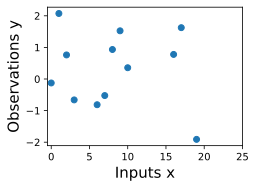

Norėdami pritaikyti Gauso procesą duomenims, pradedame nurodydami apriorinį skirstinį, kokių tipų funkcijas galime laikyti pagrįstomis. Čia parodome kelias Gauso proceso imčių funkcijas. Ar šis apriorinis skirstinys atrodo pagrįstas? Atkreipkite dėmesį, kad čia ieškome ne funkcijų, atitinkančių mūsų duomenų rinkinį, o nurodome pagrįstas aukšto lygio sprendinių savybes, pavyzdžiui, kaip sparčiai jie kinta priklausomai nuo įvesčių. Atkreipkite dėmesį, kad visų šioje užrašų knygutėje esančių grafikų atkūrimo kodą pamatysime kitose užrašų knygutėse apie apriorinius skirstinius ir inferenciją.

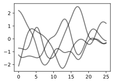

Kai sąlygojame duomenimis, galime naudoti šį apriorinį skirstinį, kad atliktume inferenciją apie aposteriorinį funkcijų, kurios galėtų atitikti duomenis, skirstinį. Čia parodome aposteriorinių funkcijų imtis.

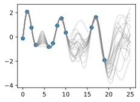

Matome, kad kiekviena iš šių funkcijų yra visiškai suderinama su mūsų duomenimis ir tiksliai eina per kiekvieną stebinį. Norėdami naudoti šias aposteriorines imtis prognozėms daryti, galime suvidurkinti kiekvienos galimos aposteriorinės imties funkcijos reikšmes ir sukurti žemiau pateiktą kreivę storai mėlyna spalva. Atkreipkite dėmesį, kad iš tikrųjų nereikia imti begalinio imčių skaičiaus šiam vidurkiui apskaičiuoti; kaip pamatysime vėliau, vidurkį galime apskaičiuoti uždaros formos išraiška. 

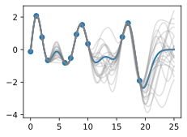

Taip pat galime norėti neapibrėžtumo atvaizdavimo, kad žinotume, kiek pasitikėti savo prognozėmis. Intuityviai neapibrėžtumas turėtų būti didesnis ten, kur aposteriorinių imčių funkcijos labiau kinta, nes tai mums sako, kad tikroji funkcija galėtų įgyti daug daugiau galimų reikšmių. Šis neapibrėžtumo tipas vadinamas _epistemiliniu neapibrėžtumu_, kuris yra su informacijos trūkumu susijęs _sumažinamas neapibrėžtumas_. Gaunant daugiau duomenų, šio tipo neapibrėžtumas išnyksta, nes vis mažiau sprendinių bus suderinami su tuo, ką stebime. Kaip ir aposteriorinį vidurkį, aposteriorinę dispersiją (šių funkcijų kintamumą aposteriorinio skirstinio atveju) galime apskaičiuoti uždaros formos išraiška. Šešėliu rodome dvigubą aposteriorinį standartinį nuokrypį į abi vidurkio puses, sukurdami _patikimąjį intervalą_, kuris su 95 % tikimybe turi tikrąją funkcijos reikšmę bet kuriai įvesčiai $x$.

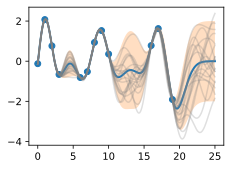

Grafikas atrodo kiek tvarkingiau, jei pašaliname aposteriorines imtis ir tiesiog vizualizuojame duomenis, aposteriorinį vidurkį ir 95 % patikimąją aibę. Atkreipkite dėmesį, kaip neapibrėžtumas didėja tolstant nuo duomenų – tai epistemilinio neapibrėžtumo savybė. 

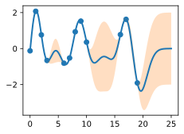

Gauso proceso, kurį naudojome duomenims pritaikyti, savybes stipriai valdo vadinamoji _kovariacijos funkcija_, dar žinoma kaip _branduolys_. Mūsų naudota kovariacijos funkcija vadinama _RBF (radialiosios bazinės funkcijos) branduoliu_, kurio forma yra
$$ k_{\textrm{RBF}}(x,x') = \textrm{Cov}(f(x),f(x')) = a^2 \exp\left(-\frac{1}{2\ell^2}||x-x'||^2\right) $$

Šio branduolio _hiperparametrai_ yra interpretuojami. _Amplitudės_ parametras $a$ valdo vertikalųjį mastelį, kuriuo funkcija kinta, o _ilgio skalės_ parametras
$\ell$
valdo funkcijos kitimo spartą (banguotumą). Didesnis $a$ reiškia didesnes funkcijos reikšmes, o didesnis
$\ell$
reiškia lėčiau kintančias funkcijas. Pažiūrėkime, kas nutinka mūsų apriorinėms ir aposteriorinėms imties funkcijoms keičiant $a$ ir
$\ell$. 

_Ilgio skalė_ turi ypač ryškų poveikį GP prognozėms ir neapibrėžtumui. Kai
$||x-x'|| = \ell$
, kovariacija tarp funkcijos reikšmių poros yra $a^2\exp(-0.5)$. Esant didesniems atstumams nei
$\ell$
, funkcijos reikšmės tampa beveik nekoreliuotos. Tai reiškia, kad jei norime padaryti prognozę taške $x_*$, tai funkcijos reikšmės su įvestimis $x$, tokiomis kad
$||x-x'||>\ell$,
stipriai nepaveiks mūsų prognozių. 

Pažiūrėkime, kaip ilgio skalės keitimas veikia apriorines ir aposteriorines imties funkcijas bei patikimąsias aibes. Aukščiau pateikti pritaikymai naudoja $2$ ilgio skalę. Dabar panagrinėkime
$\ell = 0.1, 0.5, 2, 5, 10$
. $0.1$ ilgio skalė yra labai maža, palyginti su nagrinėjamos įvesties srities intervalu $25$. Pavyzdžiui, funkcijos reikšmės taškuose $x=5$ ir $x=10$ tokioje ilgio skalėje iš esmės neturės jokios koreliacijos. Kita vertus, esant $10$ ilgio skalei, funkcijos reikšmės šiose įvestyse bus labai koreliuotos. Atkreipkite dėmesį, kad vertikalusis mastelis šiuose paveiksluose keičiasi.

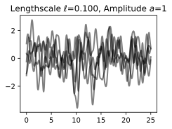
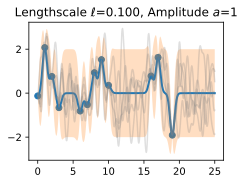

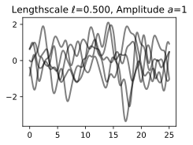
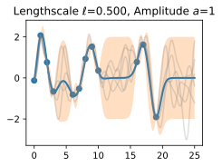

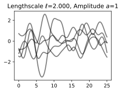
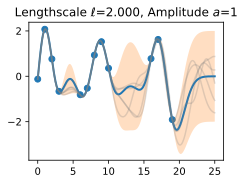

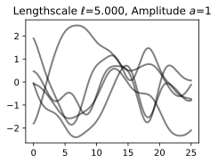
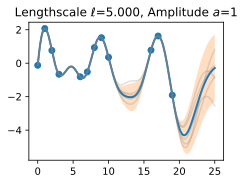

Pastebėkite, kad didėjant ilgio skalei funkcijų „banguotumas“ mažėja, ir mūsų neapibrėžtumas mažėja. Jei ilgio skalė maža, neapibrėžtumas greitai didės tolstant nuo duomenų, nes duomenų taškai tampa mažiau informatyvūs apie funkcijos reikšmes. 

Dabar keiskime amplitudės parametrą, laikydami ilgio skalę fiksuotą ties $2$. Atkreipkite dėmesį, kad vertikalusis mastelis apriorinėms imtims laikomas fiksuotu, o aposteriorinėms imtims keičiasi, taigi aiškiai matote ir didėjantį funkcijos mastelį, ir pritaikymus duomenims.

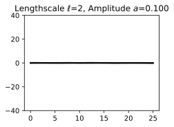
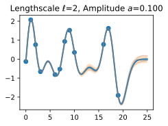

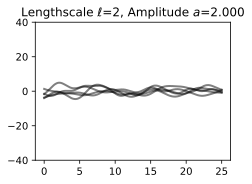
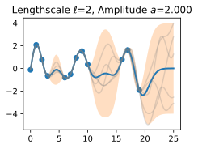

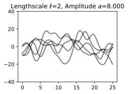
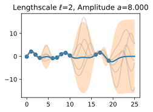

Matome, kad amplitudės parametras veikia funkcijos mastelį, bet ne kitimo spartą. Šiuo metu taip pat nujaučiame, kad mūsų procedūros apibendrinimo našumas priklausys nuo pagrįstų šių hiperparametrų reikšmių. Reikšmės $\ell=2$ ir $a=1$ atrodė suteikiančios pagrįstus pritaikymus, o kai kurios kitos reikšmės – ne. Laimei, yra patikimas ir automatinis būdas nurodyti šiuos hiperparametrus naudojant vadinamąjį _ribinį tikėtinumą_, prie kurio grįšime inferencijos užrašų knygutėje. 

Taigi kas iš tikrųjų yra GP? Kaip pradėjome, GP tiesiog teigia, kad bet kuri funkcijos reikšmių aibė
$f(x_1),\dots,f(x_n)$,
indeksuota bet kuria įvesčių aibe
$x_1,\dots,x_n$,
turi jungtinį daugiamatį Gauso skirstinį. Šio skirstinio vidurkio vektorių $\mu$ nurodo _vidurkio funkcija_, kuri paprastai laikoma pastovia arba nuline. Šio skirstinio kovariacijų matricą nurodo _branduolys_, įvertintas visose įvesčių $x$ porose. 

$$\begin{bmatrix}f(x) \\f(x_1) \\ \vdots \\ f(x_n) \end{bmatrix}\sim \mathcal{N}\left(\mu, \begin{bmatrix}k(x,x) & k(x, x_1) & \dots & k(x,x_n) \\ k(x_1,x) & k(x_1,x_1) & \dots & k(x_1,x_n) \\ \vdots & \vdots & \ddots & \vdots \\ k(x_n, x) & k(x_n, x_1) & \dots & k(x_n,x_n) \end{bmatrix}\right)$$
:eqlabel:`eq_gp_prior`

Lygtis :eqref:`eq_gp_prior` nurodo GP apriorinį skirstinį. Galime apskaičiuoti $f(x)$ sąlyginį skirstinį bet kuriam $x$, žinant $f(x_1), \dots, f(x_n)$ – funkcijos reikšmes, kurias stebėjome. Šis sąlyginis skirstinys vadinamas _aposterioriniu_, ir būtent jį naudojame prognozėms daryti.

Konkrečiai, 

$$f(x) | f(x_1), \dots, f(x_n) \sim \mathcal{N}(m,s^2)$$ 

kur

$$m = k(x,x_{1:n}) k(x_{1:n},x_{1:n})^{-1} f(x_{1:n})$$ 

$$s^2 = k(x,x) - k(x,x_{1:n})k(x_{1:n},x_{1:n})^{-1}k(x,x_{1:n})$$ 

kur $k(x,x_{1:n})$ yra $1 \times n$ vektorius, sudarytas įvertinus $k(x,x_{i})$ su $i=1,\dots,n$, o $k(x_{1:n},x_{1:n})$ yra $n \times n$ matrica, sudaryta įvertinus $k(x_i,x_j)$ su $i,j = 1,\dots,n$. $m$ galime naudoti kaip taškinį prognozuotuvą bet kuriam $x$, o $s^2$ naudojame neapibrėžtumui: jei norime sukurti intervalą su 95 % tikimybe, kad $f(x)$ yra tame intervale, naudotume $m \pm 2s$. Visų aukščiau pateiktų paveikslų prognozuojami vidurkiai ir neapibrėžtumai buvo sukurti naudojant šias lygtis. Stebėti duomenų taškai buvo
$f(x_1), \dots, f(x_n)$,
o prognozėms daryti pasirinkome smulkią $x$ taškų aibę.

Tarkime, kad stebime vieną duomenų tašką $f(x_1)$ ir norime nustatyti $f(x)$ reikšmę kuriame nors $x$. Kadangi $f(x)$ aprašomas Gauso procesu, žinome, kad jungtinis skirstinys
$(f(x), f(x_1))$
yra Gauso: 

$$
\begin{bmatrix}
f(x) \\ 
f(x_1) \\
\end{bmatrix}
\sim
\mathcal{N}\left(\mu, 
\begin{bmatrix}
k(x,x) & k(x, x_1) \\
k(x_1,x) & k(x_1,x_1)
\end{bmatrix}
\right)
$$

Nediagonalinė išraiška $k(x,x_1) = k(x_1,x)$
mums sako, kiek koreliuotos bus funkcijos reikšmės – kaip stipriai $f(x)$
bus nulemta pagal $f(x_1)$. 
Jau matėme, kad jei naudojame didelę ilgio skalę, palyginti su atstumu tarp $x$ ir $x_1$,
$||x-x_1||$, tada funkcijos reikšmės bus labai koreliuotos. Galime vizualizuoti $f(x)$ nustatymo iš $f(x_1)$ procesą tiek funkcijų erdvėje, tiek jungtiniame skirstinyje $f(x_1), f(x)$. Pirmiausia panagrinėkime tokį $x$, kad $k(x,x_1) = 0.9$, o $k(x,x)=1$, tai reiškia, kad $f(x)$ reikšmė yra vidutiniškai koreliuota su $f(x_1)$ reikšme. Jungtiniame skirstinyje pastovios tikimybės kontūrai bus gana siauros elipsės.

Tarkime, kad stebime $f(x_1) = 1.2$. 
Norėdami sąlygoti šia $f(x_1)$ reikšme,
galime nubrėžti horizontalią liniją ties $1.2$ tankio grafike ir pamatyti, kad $f(x)$ reikšmė
daugiausia apribojama intervale $[0.64,1.52]$. Šį grafiką taip pat nubraižėme funkcijų erdvėje, parodydami stebimą
tašką $f(x_1)$ oranžine spalva ir 1 standartinį Gauso proceso prognozuojamojo skirstinio $f(x)$ nuokrypį
mėlyna spalva apie vidurkio reikšmę $1.08$.

Dabar tarkime, kad turime stipresnę koreliaciją, $k(x,x_1) = 0.95$. 
Dabar elipsės dar labiau susiaurėjo, o $f(x)$ reikšmė
dar stipriau nulemta pagal $f(x_1)$. Nubrėžę horizontalią liniją ties $1.2$, matome, kad $f(x)$ kontūrai
palaiko reikšmes daugiausia intervale $[0.83, 1.45]$. Vėlgi parodome ir grafiką funkcijų erdvėje su vienu standartiniu
nuokrypiu apie vidutinę prognozuojamąją reikšmę $1.14$.

Matome, kad mūsų Gauso proceso aposteriorinis vidurkio prognozuotuvas yra arčiau $1.2$, nes dabar yra stipresnė koreliacija. Taip pat matome, kad mūsų neapibrėžtumas (paklaidos juostos) kiek sumažėjo. Nepaisant stiprios šių funkcijos reikšmių koreliacijos, mūsų neapibrėžtumas vis tiek pagrįstai gana didelis, nes stebėjome tik vieną duomenų tašką! 

Ši procedūra gali suteikti $f(x)$ aposteriorinį skirstinį bet kuriam $x$ su bet kuriuo stebėtų taškų skaičiumi. Tarkime, stebime $f(x_1), f(x_2)$. Dabar vizualizuojame $f(x)$ aposteriorinį skirstinį tam tikrame $x=x'$ funkcijų erdvėje. Tikslus $f(x)$ skirstinys nurodytas aukščiau pateiktomis lygtimis. $f(x)$ yra pasiskirstęs pagal Gauso skirstinį su vidurkiu 

$$m = k(x,x_{1:3}) k(x_{1:3},x_{1:3})^{-1} f(x_{1:3})$$

ir dispersija 

$$s^2 = k(x,x) - k(x,x_{1:3})k(x_{1:3},x_{1:3})^{-1}k(x,x_{1:3})$$

Šioje įvadinėje užrašų knygutėje nagrinėjome _be triukšmo_ stebinius. Kaip pamatysime, stebėjimo triukšmą įtraukti lengva. Jei darome prielaidą, kad duomenys generuojami iš latentinės be triukšmo funkcijos $f(x)$ plius nepriklausomo vienodai pasiskirsčiusio (iid) Gauso triukšmo
$\epsilon(x) \sim \mathcal{N}(0,\sigma^2)$
su dispersija $\sigma^2$, tada mūsų kovariacijos funkcija tiesiog tampa
$k(x_i,x_j) \to k(x_i,x_j) + \delta_{ij}\sigma^2$,
kur $\delta_{ij} = 1$, jei $i=j$, ir $0$ kitu atveju.

Jau pradėjome įgyti tam tikrą intuiciją, kaip galime naudoti Gauso procesą aprioriniam ir aposterioriniam sprendinių skirstiniui nurodyti ir kaip branduolio funkcija veikia šių sprendinių savybes. Kitose užrašų knygutėse tiksliai parodysime, kaip nurodyti Gauso proceso apriorinį skirstinį, pristatysime ir išvesime įvairias branduolio funkcijas, o tada aptarsime, kaip automatiškai išmokti branduolio hiperparametrus ir sudaryti Gauso proceso aposteriorinį skirstinį prognozėms daryti. Nors reikia laiko ir praktikos priprasti prie tokių sąvokų kaip „funkcijų skirstiniai“, pati GP prognozavimo lygčių radimo mechanika iš tikrųjų yra gana paprasta, todėl lengva praktikuotis, kad susiformuotų intuityvus šių sąvokų supratimas.

## Santrauka

Tipiniame mašininiame mokymesi nurodome funkciją su tam tikrais laisvais parametrais (pavyzdžiui, neuroninį tinklą ir jo svorius) ir sutelkiame dėmesį į šių parametrų, kurie gali būti neinterpretuojami, vertinimą. Su Gauso procesu vietoj to samprotaujame tiesiogiai apie funkcijų skirstinius, o tai leidžia mums samprotauti apie aukšto lygio sprendinių savybes. Šias savybes valdo kovariacijos funkcija (branduolys), kuri dažnai turi kelis labai interpretuojamus hiperparametrus. Šie hiperparametrai apima _ilgio skalę_, kuri valdo, kaip sparčiai (kaip banguotai) kinta funkcijos. Kitas hiperparametras yra amplitudė, kuri valdo vertikalųjį mastelį, kuriuo mūsų funkcijos kinta. 
Daugelio skirtingų funkcijų, kurios gali atitikti duomenis, atvaizdavimas ir jų sujungimas į prognozuojamąjį skirstinį yra išskirtinė Bajeso metodų savybė. Kadangi tarp galimų sprendinių toli nuo duomenų yra didesnis kintamumas, mūsų neapibrėžtumas intuityviai didėja tolstant nuo duomenų. 

Gauso procesas atvaizduoja funkcijų skirstinį nurodydamas daugiamatį normalųjį (Gauso) skirstinį visoms galimoms funkcijos reikšmėms. Gauso skirstinius galima lengvai manipuliuoti, kad būtų rastas vienos funkcijos reikšmės skirstinys pagal bet kurios kitų reikšmių aibės reikšmes. Kitaip tariant, jei stebime taškų aibę, galime sąlygoti šiais taškais ir daryti inferenciją apie skirstinį, kaip gali atrodyti funkcijos reikšmė bet kurioje kitoje įvestyje. Tai, kaip modeliuojame koreliacijas tarp šių taškų, nustato kovariacijos funkcija ir būtent tai apibrėžia Gauso proceso apibendrinimo savybes. Nors reikia laiko priprasti prie Gauso procesų, su jais lengva dirbti, jie turi daug taikymų ir padeda suprasti bei kurti kitas modelių klases, pavyzdžiui, neuroninius tinklus.

## Pratimai

1. Koks skirtumas tarp epistemilinio neapibrėžtumo ir stebėjimo neapibrėžtumo?
2. Be kitimo spartos ir amplitudės, kokias kitas funkcijų savybes galėtume norėti apsvarstyti ir kokie būtų realaus pasaulio funkcijų, turinčių tas savybes, pavyzdžiai?
3. Mūsų nagrinėta RBF kovariacijos funkcija teigia, kad kovariacijos (ir koreliacijos) tarp stebinių mažėja didėjant jų atstumui įvesčių erdvėje (laikai, erdvinės vietos ir kt.). Ar tai pagrįsta prielaida? Kodėl taip arba kodėl ne?
4. Ar dviejų Gauso kintamųjų suma yra Gauso? Ar dviejų Gauso kintamųjų sandauga yra Gauso? Jei (a,b) turi jungtinį Gauso skirstinį, ar a|b (a esant b) yra Gauso? Ar a yra Gauso?
5. Pakartokite pratimą, kuriame stebime duomenų tašką $f(x_1) = 1.2$, bet dabar tarkime, kad papildomai stebime $f(x_2) = 1.4$. Tegu $k(x,x_1) = 0.9$ ir $k(x,x_2) = 0.8$. Ar dabar būsime daugiau, ar mažiau tikri dėl $f(x)$ reikšmės, nei kai buvome stebėję tik $f(x_1)$? Koks dabar yra mūsų $f(x)$ reikšmės vidurkis ir 95 % patikimoji aibė? 
6. Kaip manote, ar padidinus mūsų stebėjimo triukšmo įvertį padidėtų, ar sumažėtų mūsų etaloninės funkcijos ilgio skalės įvertis?
7. Tarkime, tolstant nuo duomenų neapibrėžtumas mūsų prognozuojamajame skirstinyje didėja iki tam tikro taško, o tada nustoja didėti. Kodėl taip gali nutikti?

:begin_tab:`pytorch`
[Diskusijos](https://discuss.d2l.ai/t/12115)
:end_tab:
